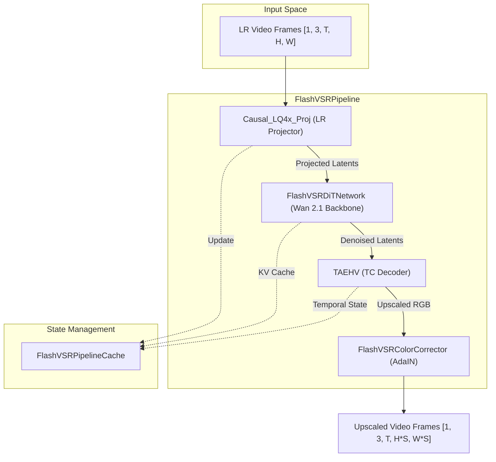
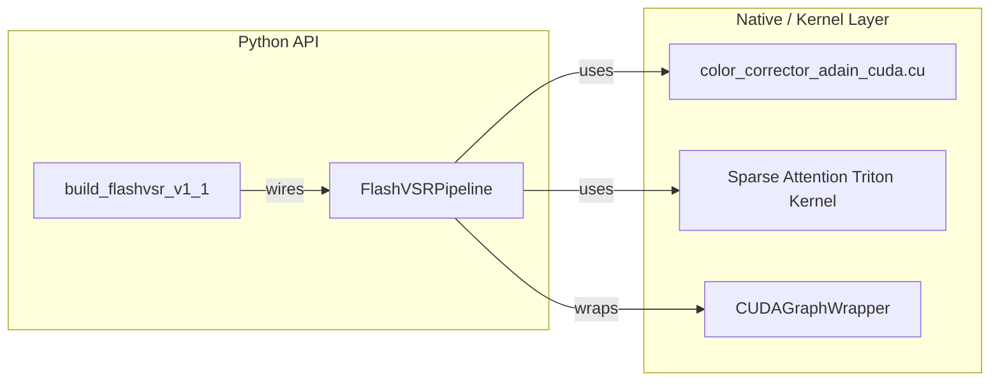

<!-- source: DeepWiki mcp.deepwiki.com · repo NVIDIA/flashdreams · page 4.3 FlashVSR Integration (Video Super-Resolution) · fetched 2026-10-26 -->

# FlashVSR Integration (Video Super-Resolution)

Relevant source files

The following files were used as context for generating this wiki page:

- [integrations/flashvsr/flashvsr/config.py](integrations/flashvsr/flashvsr/config.py)
- [integrations/flashvsr/flashvsr/corrector.py](integrations/flashvsr/flashvsr/corrector.py)
- [integrations/flashvsr/flashvsr/csrc/color_corrector_adain_cuda.cu](integrations/flashvsr/flashvsr/csrc/color_corrector_adain_cuda.cu)
- [integrations/flashvsr/flashvsr/decoder/__init__.py](integrations/flashvsr/flashvsr/decoder/__init__.py)
- [integrations/flashvsr/flashvsr/decoder/network.py](integrations/flashvsr/flashvsr/decoder/network.py)
- [integrations/flashvsr/flashvsr/encoder/__init__.py](integrations/flashvsr/flashvsr/encoder/__init__.py)
- [integrations/flashvsr/flashvsr/encoder/network.py](integrations/flashvsr/flashvsr/encoder/network.py)
- [integrations/flashvsr/flashvsr/grpc/__init__.py](integrations/flashvsr/flashvsr/grpc/__init__.py)
- [integrations/flashvsr/flashvsr/grpc/protos/__init__.py](integrations/flashvsr/flashvsr/grpc/protos/__init__.py)
- [integrations/flashvsr/flashvsr/grpc/protos/flashvsr.proto](integrations/flashvsr/flashvsr/grpc/protos/flashvsr.proto)
- [integrations/flashvsr/flashvsr/grpc/protos/flashvsr_pb2.py](integrations/flashvsr/flashvsr/grpc/protos/flashvsr_pb2.py)
- [integrations/flashvsr/flashvsr/grpc/protos/flashvsr_pb2.pyi](integrations/flashvsr/flashvsr/grpc/protos/flashvsr_pb2.pyi)
- [integrations/flashvsr/flashvsr/grpc/protos/flashvsr_pb2_grpc.py](integrations/flashvsr/flashvsr/grpc/protos/flashvsr_pb2_grpc.py)
- [integrations/flashvsr/flashvsr/grpc/streaming_view.py](integrations/flashvsr/flashvsr/grpc/streaming_view.py)
- [integrations/flashvsr/flashvsr/grpc/uplift_client.py](integrations/flashvsr/flashvsr/grpc/uplift_client.py)
- [integrations/flashvsr/flashvsr/grpc/uplift_server.py](integrations/flashvsr/flashvsr/grpc/uplift_server.py)
- [integrations/flashvsr/flashvsr/pipeline.py](integrations/flashvsr/flashvsr/pipeline.py)
- [integrations/flashvsr/flashvsr/transformer/__init__.py](integrations/flashvsr/flashvsr/transformer/__init__.py)
- [integrations/flashvsr/flashvsr/transformer/network.py](integrations/flashvsr/flashvsr/transformer/network.py)
- [integrations/flashvsr/tests/conftest.py](integrations/flashvsr/tests/conftest.py)
- [integrations/flashvsr/tests/parity_check/pyproject.toml](integrations/flashvsr/tests/parity_check/pyproject.toml)
- [integrations/flashvsr/tests/test_color_corrector_benchmark.py](integrations/flashvsr/tests/test_color_corrector_benchmark.py)
- [integrations/flashvsr/tests/test_flashvsr.py](integrations/flashvsr/tests/test_flashvsr.py)
- [integrations/flashvsr/tests/test_flashvsr_context_parallel.py](integrations/flashvsr/tests/test_flashvsr_context_parallel.py)
- [integrations/flashvsr/tests/test_grpc_client.py](integrations/flashvsr/tests/test_grpc_client.py)
- [integrations/flashvsr/tests/test_projector_benchmark.py](integrations/flashvsr/tests/test_projector_benchmark.py)
- [integrations/flashvsr/tests/test_projector_cuda_graph.py](integrations/flashvsr/tests/test_projector_cuda_graph.py)

The FlashVSR integration provides a high-performance, streaming video super-resolution pipeline capable of 2× or 4× upscaling. It leverages a diffusion-based architecture with a Wan 2.1 DiT backbone, specialized causal projectors, and the TAEHV decoder. This integration is designed for low-latency operation, supporting both sparse and dense attention modes, and includes a gRPC-based serving infrastructure for remote uplift requests.

## Pipeline Architecture

The FlashVSR pipeline follows the `StreamInferencePipeline` pattern, where video frames are processed in temporal chunks. The architecture consists of four primary stages: low-resolution projection, diffusion denoising (DiT), temporal-causal decoding, and color correction.

### Data Flow and Component Interaction

The following diagram illustrates the flow of a single video chunk through the FlashVSR system:

**FlashVSR Chunk Processing Flow**

Sources: `[integrations/flashvsr/flashvsr/pipeline.py:1-66]()`, `[integrations/flashvsr/flashvsr/config.py:33-56]()`

### Key Components

1.  **LR Projector (`Causal_LQ4x_Proj`)**: A causal encoder that projects low-resolution pixel space into the latent space required by the DiT. It maintains a `Causal_LQ4x_Proj_Cache` to handle temporal dependencies across chunks `[integrations/flashvsr/flashvsr/encoder/network.py:54-57]()`.
2.  **Wan 2.1 DiT Backbone**: The core diffusion model (`FlashVSRDiTNetwork`). It supports `sparse` and `full` attention modes. Sparse attention utilizes an in-tree Triton-based `SparseSelfAttention` implementation for efficiency `[integrations/flashvsr/flashvsr/transformer/network.py:48-50]()`.
3.  **TC Decoder (`TAEHV`)**: A Temporal-Causal Tiny Autoencoder for Hunyuan Video. It upscales the denoised latents back to pixel space while maintaining temporal consistency via causal convolutions `[integrations/flashvsr/flashvsr/decoder/network.py:1-20]()`.
4.  **Color Corrector (`FlashVSRColorCorrector`)**: An AdaIN-based module that ensures the upscaled output matches the color distribution of the original low-resolution input. It features a high-performance CUDA kernel implementation `[integrations/flashvsr/flashvsr/corrector.py:39-40]()`.

## Sparse vs. Dense Attention

FlashVSR supports two primary attention mechanisms within its DiT backbone, controlled by the `attention_mode` configuration:

*   **Sparse Attention**: Dispatches to a specialized Triton kernel. It uses a `topk_ratio` to determine the sparsity level, significantly reducing memory and compute requirements for high-resolution video `[integrations/flashvsr/tests/test_flashvsr.py:125-141]()`.
*   **Full (Dense) Attention**: Standard self-attention. This is used as a fallback when Triton is unavailable or when maximum precision is required `[integrations/flashvsr/flashvsr/grpc/uplift_server.py:109-114]()`.

Sources: `[integrations/flashvsr/flashvsr/config.py:79-81]()`, `[integrations/flashvsr/flashvsr/transformer/network.py:48-50]()`

## gRPC Serving Infrastructure

The `uplift_server` provides a robust gRPC interface for FlashVSR, allowing remote clients to stream video for upscaling.

### Server Implementation (`FlashVSRServicer`)

The server manages multiple `_Session` objects, each containing a `FlashVSRPipelineCache` for a specific video stream `[integrations/flashvsr/flashvsr/grpc/uplift_server.py:125-129]()`. It uses a `_gpu_lock` to serialize operations across concurrent gRPC calls to prevent resource contention `[integrations/flashvsr/flashvsr/grpc/uplift_server.py:211-211]()`.

**gRPC Service Methods:**
| Method | Type | Description |
| :--- | :--- | :--- |
| `start_session` | Unary | Initializes a session and allocates KV-caches `[integrations/flashvsr/flashvsr/grpc/protos/flashvsr_pb2_grpc.py:63-67]()`. |
| `upscale_chunk` | Unary | Upscales a single chunk of frames for a given session `[integrations/flashvsr/flashvsr/grpc/protos/flashvsr_pb2_grpc.py:73-77]()`. |
| `upscale_video` | Streaming | Bidirectional stream for continuous video processing `[integrations/flashvsr/flashvsr/grpc/protos/flashvsr_pb2_grpc.py:78-82]()`. |
| `end_session` | Unary | Frees server-side resources and caches `[integrations/flashvsr/flashvsr/grpc/protos/flashvsr_pb2_grpc.py:68-72]()`. |

### Client and CLI Tools

*   **`flashvsr-grpc-server`**: Launches the `uplift_server`. It includes an optional HTTP MJPEG viewer for real-time monitoring of the upscaling process `[integrations/flashvsr/flashvsr/grpc/uplift_server.py:17-32]()`.
*   **`flashvsr-grpc-client`**: A reference client (`uplift_client.py`) that can process local video files or run in a `continuous` loop for stress testing `[integrations/flashvsr/flashvsr/grpc/uplift_client.py:17-33]()`.

Sources: `[integrations/flashvsr/flashvsr/grpc/uplift_server.py:158-212]()`, `[integrations/flashvsr/flashvsr/grpc/uplift_client.py:187-197]()`

## Performance and Acceleration

FlashVSR utilizes several acceleration techniques to achieve low-latency video processing:

1.  **CUDA Graph Capture**: The LR Projector (`Causal_LQ4x_Proj`) supports `use_cuda_graph`, allowing the capture of its forward pass into a graph for reduced CPU overhead during steady-state execution `[integrations/flashvsr/tests/test_projector_cuda_graph.py:16-47]()`.
2.  **Native CUDA AdaIN**: The color corrector includes a native CUDA extension (`color_corrector_adain_cuda.cu`) that provides significant speedups over the pure PyTorch implementation `[integrations/flashvsr/tests/test_color_corrector_benchmark.py:16-31]()`.
3.  **Triton Sparse Attention**: The sparse attention backend is implemented in Triton, providing optimized kernels for the DiT's attention layers `[integrations/flashvsr/tests/test_flashvsr.py:125-141]()`.

**System Entity Mapping**

Sources: `[integrations/flashvsr/flashvsr/config.py:38-38]()`, `[integrations/flashvsr/flashvsr/corrector.py:109-112]()`, `[integrations/flashvsr/tests/test_projector_cuda_graph.py:54-57]()`

## Testing and Benchmarking

The integration includes comprehensive tests and benchmarks:
*   **Numerical Parity**: Tests in `test_projector_cuda_graph.py` ensure that CUDA-graph execution remains bit-equivalent to eager execution `[integrations/flashvsr/tests/test_projector_cuda_graph.py:16-23]()`.
*   **Per-Stage Benchmarking**: `test_projector_benchmark.py` instruments the pipeline with `cuda.Event` timers to report the median execution time of each component (Projector, DiT, Decoder, Color Corrector) `[integrations/flashvsr/tests/test_projector_benchmark.py:16-29]()`.
*   **Color Corrector Parity**: `test_color_corrector_benchmark.py` validates the CUDA AdaIN kernel against a PyTorch reference `[integrations/flashvsr/tests/test_color_corrector_benchmark.py:16-23]()`.

Sources: `[integrations/flashvsr/tests/test_projector_benchmark.py:81-117]()`, `[integrations/flashvsr/tests/test_color_corrector_benchmark.py:102-130]()`

---

