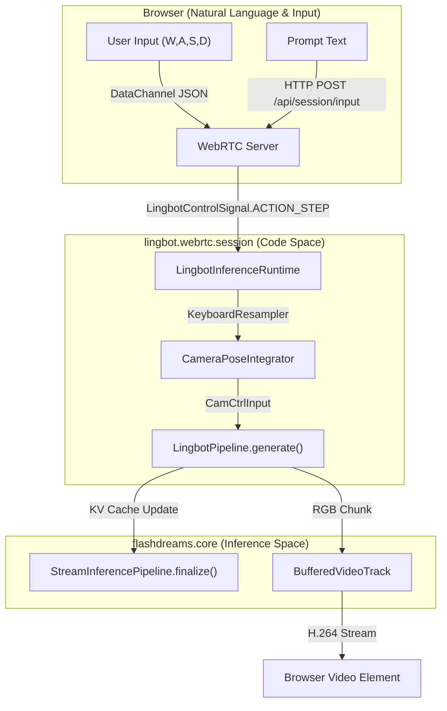
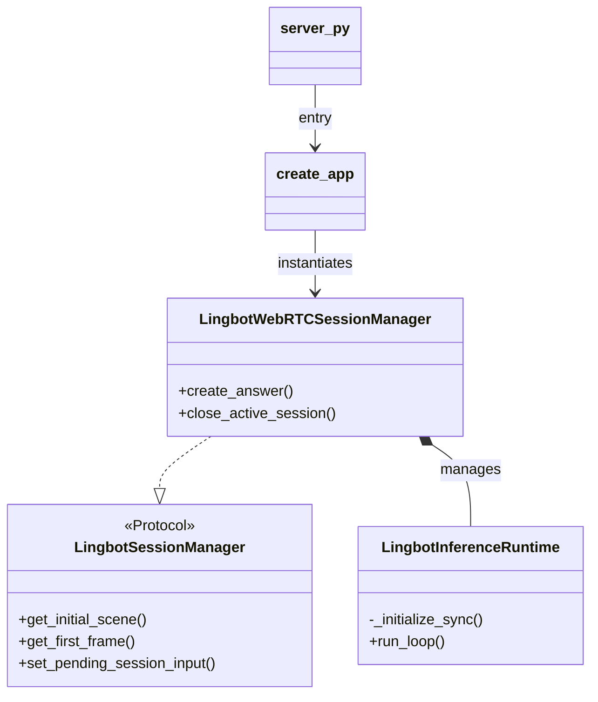

<!-- source: DeepWiki mcp.deepwiki.com · repo NVIDIA/flashdreams · page 4.4 LingBot-World Integration (Camera-Control I2V) · fetched 2026-10-26 -->

# LingBot-World Integration (Camera-Control I2V)

Relevant source files

The following files were used as context for generating this wiki page:

- [integrations/causal_forcing/README.md](integrations/causal_forcing/README.md)
- [integrations/cosmos_predict2/README.md](integrations/cosmos_predict2/README.md)
- [integrations/fastvideo_causal_wan22/README.md](integrations/fastvideo_causal_wan22/README.md)
- [integrations/flashvsr/README.md](integrations/flashvsr/README.md)
- [integrations/lingbot/README.md](integrations/lingbot/README.md)
- [integrations/lingbot/lingbot/__init__.py](integrations/lingbot/lingbot/__init__.py)
- [integrations/lingbot/lingbot/transformer/impl/modules.py](integrations/lingbot/lingbot/transformer/impl/modules.py)
- [integrations/lingbot/lingbot/transformer/impl/network.py](integrations/lingbot/lingbot/transformer/impl/network.py)
- [integrations/lingbot/lingbot/webrtc/__init__.py](integrations/lingbot/lingbot/webrtc/__init__.py)
- [integrations/lingbot/lingbot/webrtc/server.py](integrations/lingbot/lingbot/webrtc/server.py)
- [integrations/lingbot/lingbot/webrtc/session.py](integrations/lingbot/lingbot/webrtc/session.py)
- [integrations/lingbot/lingbot/webrtc/web/request_session.css](integrations/lingbot/lingbot/webrtc/web/request_session.css)
- [integrations/lingbot/lingbot/webrtc/web/request_session.html](integrations/lingbot/lingbot/webrtc/web/request_session.html)
- [integrations/lingbot/lingbot/webrtc/web/request_session.js](integrations/lingbot/lingbot/webrtc/web/request_session.js)
- [integrations/lingbot/tests/test_server_routes.py](integrations/lingbot/tests/test_server_routes.py)
- [integrations/lingbot/tests/test_webrtc_runtime.py](integrations/lingbot/tests/test_webrtc_runtime.py)
- [integrations/lingbot/tests/test_webrtc_runtime_distributed.py](integrations/lingbot/tests/test_webrtc_runtime_distributed.py)
- [integrations/self_forcing/README.md](integrations/self_forcing/README.md)
- [integrations/wan21/README.md](integrations/wan21/README.md)

The LingBot integration provides a streaming Image-to-Video (I2V) pipeline conditioned on precise camera trajectories. It enables interactive "flythrough" video generation by binding user actions (keyboard/DataChannel) to camera poses in real-time. This integration is packaged as a `flashdreams` plugin and includes a specialized WebRTC server for low-latency interactive sessions.

## System Architecture

The LingBot integration bridges high-level user actions with the low-level `StreamInferencePipeline`. It utilizes a camera control encoder to inject trajectory information into the DiT backbone.

### High-Level Data Flow

The following diagram illustrates the flow from a browser-based user action to a generated video chunk.

**Diagram: Action-to-Video Pipeline**

Sources: `[integrations/lingbot/lingbot/webrtc/server.py:80-84]()`, `[integrations/lingbot/lingbot/webrtc/session.py:192-198]()`, `[integrations/lingbot/README.md:135-148]()`

## Camera Control and Input Handling

LingBot uses `CamCtrlInput` to represent the geometric conditioning for each video chunk.

### CamCtrlInput Specification
The pipeline expects a `CamCtrlInput` object containing:
*   **Intrinsics**: A `[T_chunk, 4]` tensor representing `(fx, fy, cx, cy)` [integrations/lingbot/README.md:125-127]().
*   **Poses**: A `[T_chunk, 4, 4]` tensor representing camera-to-world matrices [integrations/lingbot/README.md:128]().
*   **World Scale**: A scalar factor used to normalize translation [integrations/lingbot/README.md:129]().

### Action Binding
Interactive control is managed by the `CameraPoseIntegrator` [integrations/lingbot/lingbot/webrtc/session.py:44](), which maintains the current camera state and integrates velocity vectors derived from `KeyboardResampler` [integrations/lingbot/lingbot/webrtc/session.py:45]().

| Key | Action |
| :--- | :--- |
| `W` / `S` | Forward / Backward |
| `A` / `D` | Yaw Left / Right |
| `Q` / `E` | Strafe Left / Right |
| `I` / `K` | Pitch Up / Down |

Sources: `[integrations/lingbot/README.md:199-203]()`, `[integrations/lingbot/lingbot/webrtc/session.py:43-47]()`

## WebRTC Serving Infrastructure

The `lingbot.webrtc.server` provides the entry point for interactive sessions. It extends the core `flashdreams.serving` abstractions to handle LingBot-specific scene initialization and first-frame uploads.

### Server Components and Routes

**Diagram: WebRTC Server Implementation**

Sources: `[integrations/lingbot/lingbot/webrtc/server.py:63-70]()`, `[integrations/lingbot/lingbot/webrtc/session.py:54-55]()`

### Key Routes
*   `GET /request_session`: Serves the HTML/JS client [integrations/lingbot/lingbot/webrtc/server.py:140-145]().
*   `GET /api/session/initial_scene`: Returns metadata about the current scene, including the default prompt and resolution [integrations/lingbot/lingbot/webrtc/server.py:152-154]().
*   `POST /api/session/input`: Accepts multipart form data for custom first-frame uploads and text prompts [integrations/lingbot/lingbot/webrtc/server.py:180-212]().
*   `POST /api/webrtc/offer`: Handles SDP signaling for the WebRTC PeerConnection [integrations/lingbot/lingbot/webrtc/server.py:42]().

## Pipeline Configuration and Performance

LingBot supports multiple "slugs" registered via entry points, primarily differing in the decoder used and the KV-cache windowing strategy.

### Available Slugs
| Slug | Description |
| :--- | :--- |
| `lingbot-world-fast` | Standard Wan VAE decoder, 4-step DiT [integrations/lingbot/README.md:32](). |
| `lingbot-world-fast-taehv-window15-sink3` | Uses `TAEHV` (LightTAE) decoder for reduced latency with a 15-frame sliding window and 3-frame sink [integrations/lingbot/README.md:33](). |

### Context Parallelism
For multi-GPU execution, LingBot utilizes the Wan 2.1 Context Parallelism (CP) implementation. In this mode, the rollout seed is automatically offset by the rank to ensure consistent noise generation across the distributed group [integrations/lingbot/tests/test_webrtc_runtime_distributed.py:160-166]().

Sources: `[integrations/lingbot/README.md:30-34]()`, `[integrations/lingbot/tests/test_webrtc_runtime_distributed.py:132-156]()`

## Parity and Testing

The integration includes a suite of tests to ensure runtime stability and distributed correctness.

*   **Distributed Runtime Test**: `test_initialize_sync_passes_rank_seed` verifies that the `LingbotInferenceRuntime` correctly calculates seeds when `context_parallel_size > 1` [integrations/lingbot/tests/test_webrtc_runtime_distributed.py:132-158]().
*   **Server Route Test**: `test_session_input_upload_stores_prompt_and_image` validates the multipart handling for user-provided assets [integrations/lingbot/tests/test_server_routes.py:178-198]().
*   **Baseline Comparison**: The repository includes parity-check environments to compare LingBot-World outputs against the `LightX2V` baseline.

Sources: `[integrations/lingbot/tests/test_webrtc_runtime_distributed.py:28-30]()`, `[integrations/lingbot/tests/test_server_routes.py:30-31]()`

---

