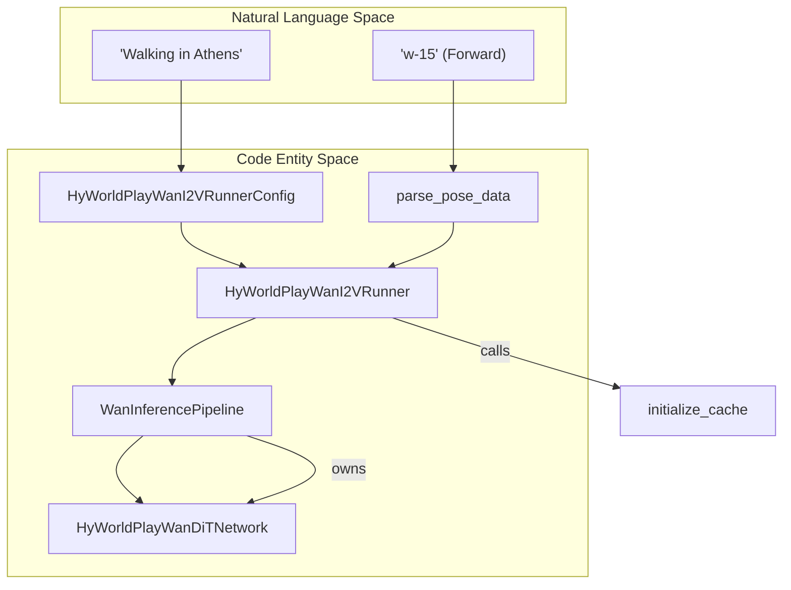
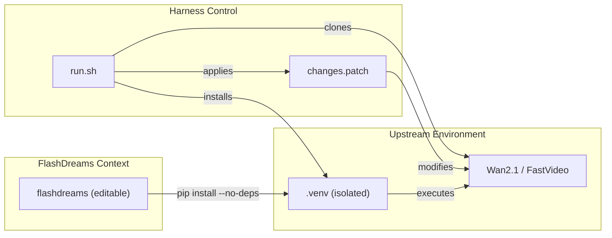

<!-- source: DeepWiki mcp.deepwiki.com · repo NVIDIA/flashdreams · page 4.5 HY-WorldPlay and Wan 2.1/2.2 Integrations · fetched 2026-10-26 -->

# HY-WorldPlay and Wan 2.1/2.2 Integrations

Relevant source files

The following files were used as context for generating this wiki page:

- [integrations/hy_worldplay/README.md](integrations/hy_worldplay/README.md)
- [integrations/hy_worldplay/hy_worldplay/__init__.py](integrations/hy_worldplay/hy_worldplay/__init__.py)
- [integrations/hy_worldplay/hy_worldplay/_pose.py](integrations/hy_worldplay/hy_worldplay/_pose.py)
- [integrations/hy_worldplay/hy_worldplay/config.py](integrations/hy_worldplay/hy_worldplay/config.py)
- [integrations/hy_worldplay/hy_worldplay/runner.py](integrations/hy_worldplay/hy_worldplay/runner.py)
- [integrations/hy_worldplay/run-docker.sh](integrations/hy_worldplay/run-docker.sh)
- [integrations/hy_worldplay/tests/parity_check/.gitignore](integrations/hy_worldplay/tests/parity_check/.gitignore)
- [integrations/hy_worldplay/tests/parity_check/README.md](integrations/hy_worldplay/tests/parity_check/README.md)
- [integrations/hy_worldplay/tests/parity_check/pyproject.toml](integrations/hy_worldplay/tests/parity_check/pyproject.toml)
- [integrations/hy_worldplay/tests/parity_check/run.sh](integrations/hy_worldplay/tests/parity_check/run.sh)
- [integrations/hy_worldplay/tests/test_action.py](integrations/hy_worldplay/tests/test_action.py)
- [integrations/omnidreams/ludus-renderer/README.md](integrations/omnidreams/ludus-renderer/README.md)
- [integrations/omnidreams/ludus-renderer/uv.lock](integrations/omnidreams/ludus-renderer/uv.lock)
- [integrations/wan21/tests/baseline_fastvideo/.gitignore](integrations/wan21/tests/baseline_fastvideo/.gitignore)
- [integrations/wan21/tests/baseline_fastvideo/README.md](integrations/wan21/tests/baseline_fastvideo/README.md)
- [integrations/wan21/tests/baseline_fastvideo/changes.patch](integrations/wan21/tests/baseline_fastvideo/changes.patch)
- [integrations/wan21/tests/baseline_fastvideo/pyproject.toml](integrations/wan21/tests/baseline_fastvideo/pyproject.toml)
- [integrations/wan21/tests/baseline_fastvideo/run.sh](integrations/wan21/tests/baseline_fastvideo/run.sh)
- [integrations/wan21/tests/baseline_fastvideo/uv.lock](integrations/wan21/tests/baseline_fastvideo/uv.lock)
- [integrations/wan21/tests/parity_check/.gitignore](integrations/wan21/tests/parity_check/.gitignore)
- [integrations/wan21/tests/parity_check/README.md](integrations/wan21/tests/parity_check/README.md)
- [integrations/wan21/tests/parity_check/changes.patch](integrations/wan21/tests/parity_check/changes.patch)
- [integrations/wan21/tests/parity_check/run.sh](integrations/wan21/tests/parity_check/run.sh)

This page covers the integration of the **HY-WorldPlay** interactive world model and the **Wan 2.1/2.2** model family into the FlashDreams framework. These integrations provide streaming video diffusion capabilities with advanced conditioning for actions and camera trajectories.

## HY-WorldPlay (WorldPlay) Integration

The `hy_worldplay` integration brings Tencent Hunyuan's real-time interactive world model (HY-World 1.5) into the FlashDreams ecosystem [integrations/hy_worldplay/README.md:8-12](). It utilizes a distilled **Wan 2.2 TI2V-5B** backbone capable of high-quality video generation in just 4 inference steps [integrations/hy_worldplay/README.md:22-25]().

### Architecture and Data Flow

The integration is implemented as a standalone plugin that drives the in-tree `WanInferencePipeline` while layering HY-WorldPlay's specific conditioners (Action and Camera) on top [integrations/hy_worldplay/README.md:24-27]().

#### System Entity Mapping
The following diagram illustrates the relationship between HY-WorldPlay components and the FlashDreams core pipeline.

**HY-WorldPlay to Pipeline Mapping**

Sources: [integrations/hy_worldplay/hy_worldplay/runner.py:38-40](), [integrations/hy_worldplay/hy_worldplay/runner.py:175-178](), [integrations/hy_worldplay/hy_worldplay/_pose.py:179-184]()

### Action and Camera Conditioning

HY-WorldPlay introduces two primary conditioning mechanisms beyond standard text-to-video:

1.  **Action Conditioner**: Consumes discrete action labels. These labels are encoded into an 81-class space (`trans * 9 + rotate`) [integrations/hy_worldplay/hy_worldplay/_pose.py:16-23]().
2.  **Camera Conditioner**: Consumes per-latent World-to-Camera (W2C) and intrinsic matrices to guide the perspective of the generated video [integrations/hy_worldplay/hy_worldplay/_pose.py:185-186]().

The `parse_pose_data` function in `_pose.py` is responsible for converting motion scripts (e.g., `"w-3, right-1"`) into the tensors required by these conditioners [integrations/hy_worldplay/hy_worldplay/_pose.py:179-186]().

| Action Token | Description | Code Constant |
| :--- | :--- | :--- |
| `w-N` / `s-N` | Forward / Backward | `_FORWARD_SPEED` [integrations/hy_worldplay/hy_worldplay/_pose.py:51-52]() |
| `a-N` / `d-N` | Strafe Left / Right | `_FORWARD_SPEED` [integrations/hy_worldplay/hy_worldplay/_pose.py:51-52]() |
| `up-N` / `down-N` | Pitch Up / Down | `_PITCH_SPEED` [integrations/hy_worldplay/hy_worldplay/_pose.py:57-58]() |
| `left-N` / `right-N` | Yaw Left / Right | `_YAW_SPEED` [integrations/hy_worldplay/hy_worldplay/_pose.py:54-55]() |

Sources: [integrations/hy_worldplay/hy_worldplay/_pose.py:81-91](), [integrations/hy_worldplay/hy_worldplay/_pose.py:39-49]()

### Reconstituted-Context Memory

HY-WorldPlay utilizes a "reconstituted-context memory" system to maintain temporal consistency over long rollouts. The `select_mem_frames_wan` algorithm (implemented in `_memory.py`) selects historical frames based on Field-of-View (FOV) distance to provide the most relevant context for the current generation step [integrations/hy_worldplay/README.md:120-132]().

## Wan 2.1 and 2.2 Integrations

FlashDreams provides robust support for the Wan model family, including T2V (Text-to-Video) and I2V (Image-to-Video) variants.

### Implementation Details
The integration relies on the `WanInferencePipeline` recipe. Key differences between Wan 2.1 and 2.2, such as the use of `AvgDown3D` and `DupUp3D` in the VAE, are handled within the core recipes [integrations/hy_worldplay/README.md:24-25]().

### Parity-Check Environments

To ensure implementation accuracy, FlashDreams includes dedicated parity-check harnesses that compare native outputs against upstream baselines.

#### Wan 2.1 Official Parity
The `integrations/wan21/tests/parity_check/` directory contains a harness for the official `Wan-Video/Wan2.1` repository [integrations/wan21/tests/parity_check/README.md:1-4]().
- **Harness Logic**: Clones the official repo, applies a patch to enforce cuDNN SDPA and `torch.compile`, and runs the reference `generate.py` [integrations/wan21/tests/parity_check/run.sh:16-42]().
- **Alignment**: The harness installs the local `flashdreams` package in the parity venv with `--no-deps` to ensure environment alignment without introducing dependency conflicts [integrations/wan21/tests/parity_check/run.sh:80-81]().

#### FastVideo Causal Wan Integration
A specialized plugin, `fastvideo_causal_wan22`, integrates optimizations from the FastVideo project [integrations/wan21/tests/baseline_fastvideo/README.md:3-4]().
- **Performance Tuning**: This integration defaults to `TORCH_SDPA` backends and enforces `FASTVIDEO_FORCE_CUDNN_SDPA=1` for maximum inference speed [integrations/wan21/tests/baseline_fastvideo/README.md:31-38]().
- **Causal Forcing**: It utilizes causal-forcing techniques to enable streaming inference with Wan 2.2 backbones.

**Parity Harness Data Flow**

Sources: [integrations/wan21/tests/parity_check/run.sh:16-104](), [integrations/wan21/tests/baseline_fastvideo/run.sh:14-56]()

### Baseline Comparisons

Parity for HY-WorldPlay is measured against the vendor's `use_kv_cache=True` baseline.
- **Acceptance Bar**: Mean pixel difference $| \Delta | \le 20 / 255$ [integrations/hy_worldplay/README.md:108-112]().
- **Observed Performance**: A 2-chunk GPU smoke test typically results in $| \Delta | \approx 15.65 / 255$, which is below the visible threshold of approximately $30 / 255$ [integrations/hy_worldplay/README.md:108-112]().

Sources: [integrations/hy_worldplay/README.md:108-115](), [integrations/wan21/tests/parity_check/README.md:1-4]()

---

