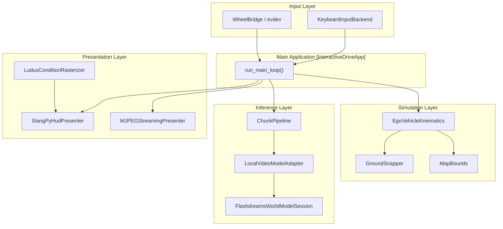

<!-- source: DeepWiki mcp.deepwiki.com · repo NVIDIA/flashdreams · page 5 OmniDreams Interactive Drive · fetched 2026-10-26 -->

# OmniDreams Interactive Drive

Relevant source files

The following files were used as context for generating this wiki page:

- [integrations/omnidreams/omnidreams/interactive_drive/README.md](integrations/omnidreams/omnidreams/interactive_drive/README.md)
- [integrations/omnidreams/omnidreams/interactive_drive/app.py](integrations/omnidreams/omnidreams/interactive_drive/app.py)
- [integrations/omnidreams/omnidreams/interactive_drive/cli.py](integrations/omnidreams/omnidreams/interactive_drive/cli.py)
- [integrations/omnidreams/omnidreams/interactive_drive/config.py](integrations/omnidreams/omnidreams/interactive_drive/config.py)
- [integrations/omnidreams/omnidreams/interactive_drive/configs/example_world_model_perf.yaml](integrations/omnidreams/omnidreams/interactive_drive/configs/example_world_model_perf.yaml)
- [integrations/omnidreams/omnidreams/interactive_drive/demo.py](integrations/omnidreams/omnidreams/interactive_drive/demo.py)
- [integrations/omnidreams/omnidreams/interactive_drive/runtime/loop.py](integrations/omnidreams/omnidreams/interactive_drive/runtime/loop.py)
- [integrations/omnidreams/omnidreams/interactive_drive/simulation/ground_snap.py](integrations/omnidreams/omnidreams/interactive_drive/simulation/ground_snap.py)
- [integrations/omnidreams/omnidreams/interactive_drive/streaming_presenter.py](integrations/omnidreams/omnidreams/interactive_drive/streaming_presenter.py)
- [integrations/omnidreams/omnidreams/interactive_drive/world_model/flashdreams_adapter.py](integrations/omnidreams/omnidreams/interactive_drive/world_model/flashdreams_adapter.py)
- [integrations/omnidreams/omnidreams/interactive_drive/world_model/manifest.py](integrations/omnidreams/omnidreams/interactive_drive/world_model/manifest.py)
- [integrations/omnidreams/tests/interactive_drive/test_cli_manifest_resolution.py](integrations/omnidreams/tests/interactive_drive/test_cli_manifest_resolution.py)
- [integrations/omnidreams/tests/interactive_drive/test_latency_loop.py](integrations/omnidreams/tests/interactive_drive/test_latency_loop.py)
- [integrations/omnidreams/tests/interactive_drive/test_manifest.py](integrations/omnidreams/tests/interactive_drive/test_manifest.py)
- [integrations/omnidreams/tests/interactive_drive/test_world_model_adapter.py](integrations/omnidreams/tests/interactive_drive/test_world_model_adapter.py)

The OmniDreams Interactive Drive is a high-performance, interactive simulation environment designed to explore NVIDIA OmniDreams world models in real-time. It provides a unified interface for driving within a generated world, conditioned by HD maps, with support for local windowed rendering, MJPEG streaming, and WebRTC serving.

The system bridges the gap between static world model inference and a dynamic "drive-loop" where user inputs (keyboard or steering wheel) immediately influence the generated video stream.

## System Architecture

The interactive drive environment is built on a multi-threaded architecture that decouples simulation, world model generation, and display presentation.

### High-Level Component Relationship
This diagram illustrates how the major subsystems interact within the `InteractiveDriveApp` lifecycle.

**Sources:** [integrations/omnidreams/omnidreams/interactive_drive/app.py:49-141](), [integrations/omnidreams/omnidreams/interactive_drive/runtime/loop.py:209-215]()

---

## Subsystem Overviews

### 1. InteractiveDriveApp and Simulation Loop
The `InteractiveDriveApp` manages the lifecycle of the simulation, including scene loading and the transition between model warmup and active driving. The `run_main_loop` function orchestrates the timing between user input sampling, kinematic updates via `EgoVehicleKinematics`, and frame presentation. It handles "Out-of-Bounds" (OOB) detection and automatic respawning using `GroundSnapper` and `MapBounds`.

For details, see [InteractiveDriveApp and Simulation Loop](#5.1).

**Sources:** [integrations/omnidreams/omnidreams/interactive_drive/app.py:49-141](), [integrations/omnidreams/omnidreams/interactive_drive/runtime/loop.py:134-215]()

### 2. Rendering and HUD Presentation
Presentation is handled by interchangeable backends. The `SlangPyHudPresenter` provides a local Vulkan-based window with a complex HUD (Heads-Up Display) including speedometers, steering overlays, and a Birds-Eye View (BEV) minimap. Conditioning frames for the world model are rendered using the `LudusConditionRasterizer`. For headless environments, the `MJPEGStreamingPresenter` provides a zero-dependency HTTP stream.

For details, see [Rendering and HUD Presentation](#5.2).

**Sources:** [integrations/omnidreams/omnidreams/interactive_drive/streaming_presenter.py:88-130](), [integrations/omnidreams/omnidreams/interactive_drive/demo.py:52-102]()

### 3. World Model Adapter and Manifest System
The `FlashdreamsWorldModelSession` acts as the bridge to the `flashdreams` core inference engine. It uses a YAML-based `WorldModelManifest` to configure performance knobs like `native_dit_acceleration` (DiT) and `native_vae_encoder` (FP8 VAE). The `ChunkPipeline` manages the asynchronous generation of video chunks, ensuring the model stays resident across scene changes.

For details, see [World Model Adapter and Manifest System](#5.3).

**Sources:** [integrations/omnidreams/omnidreams/interactive_drive/world_model/flashdreams_adapter.py:149-210](), [integrations/omnidreams/omnidreams/interactive_drive/world_model/manifest.py:147-175]()

### 4. WebRTC and gRPC Serving
For remote interaction, the system supports high-performance streaming via WebRTC. This involves the `OmnidreamsWebRTCSessionManager` and a gRPC-based `WorldModelService` for distributed inference. This allows users to drive the simulation through a web browser with low latency.

For details, see [WebRTC and gRPC Serving](#5.4).

**Sources:** [integrations/omnidreams/omnidreams/interactive_drive/streaming_presenter.py:13-28]()

### 5. Input Handling and Controller Configuration
The system supports multiple input methods, from standard `KeyboardState` mapping to professional racing wheels via `WheelBridge`. It includes a configuration wizard for mapping `evdev` events to simulation axes and supports force-feedback (FFB) via `AutocenterFFB`.

For details, see [Input Handling and Controller Configuration](#5.5).

**Sources:** [integrations/omnidreams/omnidreams/interactive_drive/demo.py:129-183](), [integrations/omnidreams/omnidreams/interactive_drive/demo.py:25-41]()

---

## Technical Mapping: Configuration to Code

The following table and diagram map the user-facing configuration knobs in the `WorldModelManifest` to the underlying code entities that implement them.

| Manifest Key | Code Entity / Class | Purpose |
| :--- | :--- | :--- |
| `native_dit_acceleration` | `OptimizedDiTExecutor` | Controls JIT-compiled DiT kernel usage |
| `native_vae_encoder` | `omnidreams_vae_encode_wan_fp8` | Selects between PyTorch and Native FP8 VAE |
| `resolution_wh` | `_LazyRGBFrame` | Determines internal tensor shapes for inference |
| `denoising_steps` | `FlowMatchScheduler` | Configures the diffusion sampling schedule |

### Data Flow: Input to Inference
This diagram shows how a user's input travels through the system to become a generated frame.

```mermaid
graph LR
    User["User Input"] --> KB["KeyboardDriveState"]
    KB --> CMD["DriverCommand"]
    CMD --> SIM["EgoVehicleKinematics"]
    SIM --> POS["TrajectoryChunk (Poses)"]
    POS --> RAST["LudusConditionRasterizer"]
    RAST --> COND["Conditioning Frames (HDMap)"]
    COND --> ADAPT["FlashdreamsWorldModelSession"]
    ADAPT --> GEN["generate()"]
    GEN --> OUT["PresentedFrame"]
```

**Sources:** [integrations/omnidreams/omnidreams/interactive_drive/demo.py:129-183](), [integrations/omnidreams/omnidreams/interactive_drive/runtime/loop.py:20-25](), [integrations/omnidreams/omnidreams/interactive_drive/world_model/flashdreams_adapter.py:149-170]()

---

