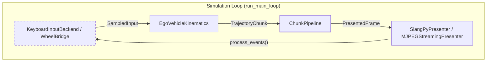
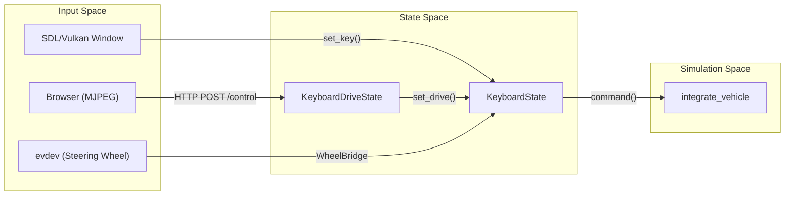

<!-- source: DeepWiki mcp.deepwiki.com · repo NVIDIA/flashdreams · page 5.1 InteractiveDriveApp and Simulation Loop · fetched 2026-10-26 -->

# InteractiveDriveApp and Simulation Loop

Relevant source files

The following files were used as context for generating this wiki page:

- [integrations/omnidreams/omnidreams/interactive_drive/README.md](integrations/omnidreams/omnidreams/interactive_drive/README.md)
- [integrations/omnidreams/omnidreams/interactive_drive/_pipeline_fakes.py](integrations/omnidreams/omnidreams/interactive_drive/_pipeline_fakes.py)
- [integrations/omnidreams/omnidreams/interactive_drive/app.py](integrations/omnidreams/omnidreams/interactive_drive/app.py)
- [integrations/omnidreams/omnidreams/interactive_drive/backends/base.py](integrations/omnidreams/omnidreams/interactive_drive/backends/base.py)
- [integrations/omnidreams/omnidreams/interactive_drive/backends/raster.py](integrations/omnidreams/omnidreams/interactive_drive/backends/raster.py)
- [integrations/omnidreams/omnidreams/interactive_drive/backends/world_model.py](integrations/omnidreams/omnidreams/interactive_drive/backends/world_model.py)
- [integrations/omnidreams/omnidreams/interactive_drive/cli.py](integrations/omnidreams/omnidreams/interactive_drive/cli.py)
- [integrations/omnidreams/omnidreams/interactive_drive/config.py](integrations/omnidreams/omnidreams/interactive_drive/config.py)
- [integrations/omnidreams/omnidreams/interactive_drive/demo.py](integrations/omnidreams/omnidreams/interactive_drive/demo.py)
- [integrations/omnidreams/omnidreams/interactive_drive/input/keyboard.py](integrations/omnidreams/omnidreams/interactive_drive/input/keyboard.py)
- [integrations/omnidreams/omnidreams/interactive_drive/input/wheel_profiles.py](integrations/omnidreams/omnidreams/interactive_drive/input/wheel_profiles.py)
- [integrations/omnidreams/omnidreams/interactive_drive/input_config/app.py](integrations/omnidreams/omnidreams/interactive_drive/input_config/app.py)
- [integrations/omnidreams/omnidreams/interactive_drive/input_config/capture.py](integrations/omnidreams/omnidreams/interactive_drive/input_config/capture.py)
- [integrations/omnidreams/omnidreams/interactive_drive/loading_overlay.py](integrations/omnidreams/omnidreams/interactive_drive/loading_overlay.py)
- [integrations/omnidreams/omnidreams/interactive_drive/simulation/ego_vehicle_kinematics.py](integrations/omnidreams/omnidreams/interactive_drive/simulation/ego_vehicle_kinematics.py)
- [integrations/omnidreams/omnidreams/interactive_drive/simulation/ground_snap.py](integrations/omnidreams/omnidreams/interactive_drive/simulation/ground_snap.py)
- [integrations/omnidreams/omnidreams/interactive_drive/simulation/map_bounds.py](integrations/omnidreams/omnidreams/interactive_drive/simulation/map_bounds.py)
- [integrations/omnidreams/omnidreams/interactive_drive/streaming_presenter.py](integrations/omnidreams/omnidreams/interactive_drive/streaming_presenter.py)
- [integrations/omnidreams/omnidreams/interactive_drive/video_model/chunk_pipeline.py](integrations/omnidreams/omnidreams/interactive_drive/video_model/chunk_pipeline.py)
- [integrations/omnidreams/tests/interactive_drive/test_chunk_pipeline.py](integrations/omnidreams/tests/interactive_drive/test_chunk_pipeline.py)
- [integrations/omnidreams/tests/interactive_drive/test_core_control.py](integrations/omnidreams/tests/interactive_drive/test_core_control.py)
- [integrations/omnidreams/tests/interactive_drive/test_input_config_capture.py](integrations/omnidreams/tests/interactive_drive/test_input_config_capture.py)
- [integrations/omnidreams/tests/interactive_drive/test_keyboard_state.py](integrations/omnidreams/tests/interactive_drive/test_keyboard_state.py)
- [integrations/omnidreams/tests/interactive_drive/test_wheel_profiles.py](integrations/omnidreams/tests/interactive_drive/test_wheel_profiles.py)

The `InteractiveDriveApp` is the central engine for the OmniDreams interactive simulation. it manages the lifecycle of world model generation, vehicle kinematics, and user input integration. It provides a unified interface for loading scenes, running the simulation loop, and presenting frames via various backends (Vulkan/SlangPy or MJPEG).

## InteractiveDriveApp Lifecycle

The `InteractiveDriveApp` class [integrations/omnidreams/omnidreams/interactive_drive/app.py:49-59]() is designed to be long-lived. It initializes the world model once and keeps it resident across multiple scene changes to avoid re-paying the warmup and compilation costs [integrations/omnidreams/omnidreams/interactive_drive/app.py:104-107]().

### Core Lifecycle Methods

| Method | Purpose |
| :--- | :--- |
| `__init__` | Constructs the engine, initializes the `LocalVideoModelAdapter`, and starts the `ChunkPipeline` worker thread for model warmup [integrations/omnidreams/omnidreams/interactive_drive/app.py:61-109](). |
| `load_scene` | Parses a USDZ scene bundle, builds spatial acceleration structures (`GroundSnapper`, `MapBounds`), and prepares the world model for a specific scene [integrations/omnidreams/omnidreams/interactive_drive/app.py:186-224](). |
| `run_scene` | Executes the main simulation loop for the currently loaded scene, handling resets and scene-exit requests [integrations/omnidreams/omnidreams/interactive_drive/app.py:255-300](). |
| `run_main_loop` | The actual blocking simulation loop that coordinates input sampling, kinematic integration, and chunk generation [integrations/omnidreams/omnidreams/interactive_drive/runtime/loop.py:21-21](). |

### Scene and Geometry Caching
To enable instant switching between weather variants (e.g., clear to rain), the app maintains a `_geometry_cache` [integrations/omnidreams/omnidreams/interactive_drive/app.py:133-135](). Since weather variants share the same 3D geometry and only differ in the seed frame and text prompt, `load_scene` reuses the parsed `SceneBundle` and spatial grids if the base USDZ path matches [integrations/omnidreams/omnidreams/interactive_drive/app.py:202-212]().

**Sources:** [integrations/omnidreams/omnidreams/interactive_drive/app.py:49-142](), [integrations/omnidreams/omnidreams/interactive_drive/app.py:186-224]()

## Simulation Loop Architecture

The simulation operates on a "chunk" basis. Instead of per-frame updates, the loop advances the world model in multi-frame chunks (typically 12-24 frames).

### Data Flow and Coordination

The diagram below illustrates how `run_main_loop` orchestrates the different components.

**Simulation Loop Entity Mapping**

**Sources:** [integrations/omnidreams/omnidreams/interactive_drive/runtime/loop.py:21-21](), [integrations/omnidreams/omnidreams/interactive_drive/app.py:108-109]()

## Ego Vehicle Kinematics

Vehicle movement is governed by `integrate_vehicle`, which implements a bicycle model for steering and a physical drive model for acceleration and braking.

### Kinematic Integration
The function `integrate_vehicle` [integrations/omnidreams/omnidreams/interactive_drive/simulation/ego_vehicle_kinematics.py:25-30]() updates the `VehicleState` based on `DriverCommand` and `VehicleConfig`:
*   **Steering:** Uses a rate-limited integrator. In manual mode, it supports direct steering (wheel) or rate-based steering (keyboard) [integrations/omnidreams/omnidreams/interactive_drive/simulation/ego_vehicle_kinematics.py:31-41]().
*   **Throttle/Brake:** Implements engine braking, drag, and a "creep" target speed (10 mph) when no pedals are pressed [integrations/omnidreams/omnidreams/interactive_drive/simulation/ego_vehicle_kinematics.py:46-95]().
*   **Yaw Rate:** Calculated as `speed / wheel_base * tan(steer_rad)` [integrations/omnidreams/omnidreams/interactive_drive/simulation/ego_vehicle_kinematics.py:108-109]().

### GroundSnapper and MapBounds
*   **GroundSnapper:** Uses the scene's ground mesh (vertices/faces) to "snap" the vehicle's Z-coordinate, pitch, and roll to the terrain [integrations/omnidreams/omnidreams/interactive_drive/simulation/ego_vehicle_kinematics.py:150-151](). It uses a spatial grid built during scene load [integrations/omnidreams/omnidreams/interactive_drive/app.py:112-116]().
*   **MapBounds:** Detects Out-of-Bounds (OOB) conditions by checking if the vehicle has moved beyond the HDMap data extent [integrations/omnidreams/omnidreams/interactive_drive/simulation/map_bounds.py:1-1](). This triggers an automatic reset in the simulation loop.

**Sources:** [integrations/omnidreams/omnidreams/interactive_drive/simulation/ego_vehicle_kinematics.py:25-165](), [integrations/omnidreams/omnidreams/interactive_drive/app.py:112-116]()

## ChunkPipeline and Async Generation

The `ChunkPipeline` [integrations/omnidreams/omnidreams/interactive_drive/video_model/chunk_pipeline.py:1-1]() decouples the simulation state from the heavy world model inference.

1.  **Staging:** The simulation samples a `TrajectoryChunk` (future poses) [integrations/omnidreams/omnidreams/interactive_drive/simulation/ego_vehicle_kinematics.py:127-135]().
2.  **Worker Thread:** The pipeline submits this trajectory to a background worker.
3.  **LocalVideoModelAdapter:** The adapter wraps the `FlashdreamsWorldModelSession` to generate video frames for the trajectory [integrations/omnidreams/omnidreams/interactive_drive/app.py:108-109]().
4.  **Buffering:** While the GPU generates the next chunk, the `Presenter` continues to display the previous chunk's frames or a loading overlay [integrations/omnidreams/omnidreams/interactive_drive/app.py:43-46]().

**Sources:** [integrations/omnidreams/omnidreams/interactive_drive/video_model/chunk_pipeline.py:1-1](), [integrations/omnidreams/omnidreams/interactive_drive/app.py:108-110]()

## Input Handling and Control

Input is abstracted through the `KeyboardState` class [integrations/omnidreams/omnidreams/interactive_drive/input/keyboard.py:15-31](), which acts as a thread-safe mailbox between the UI/Presenter thread and the simulation loop.

### Control Entity Mapping

### Steering Wheels and evdev
For high-fidelity driving, the `WheelBridge` (via `omnidreams.interactive_drive.input.wheel_profiles`) interfaces with Linux `evdev` devices [integrations/omnidreams/omnidreams/interactive_drive/input/wheel_profiles.py:4-22]().
*   **Profiles:** YAML-based profiles define axis mappings (steering, throttle, brake) and Force Feedback (FFB) settings [integrations/omnidreams/omnidreams/interactive_drive/input/wheel_profiles.py:71-102]().
*   **Calibration:** The `interactive-drive-configuration` wizard uses `CaptureSession` to detect axis ranges and pedal inversion (e.g., whether a pedal rests at 0 or 65535) [integrations/omnidreams/omnidreams/interactive_drive/input_config/capture.py:174-182]().
*   **Steering Curves:** `apply_steering_curve` handles deadzones and sensitivity scaling to normalize different hardware (e.g., 900° wheels vs. game controllers) [integrations/omnidreams/omnidreams/interactive_drive/input/wheel_profiles.py:105-121]().

**Sources:** [integrations/omnidreams/omnidreams/interactive_drive/input/keyboard.py:15-141](), [integrations/omnidreams/omnidreams/interactive_drive/input/wheel_profiles.py:4-102](), [integrations/omnidreams/omnidreams/interactive_drive/demo.py:129-182]()

---

