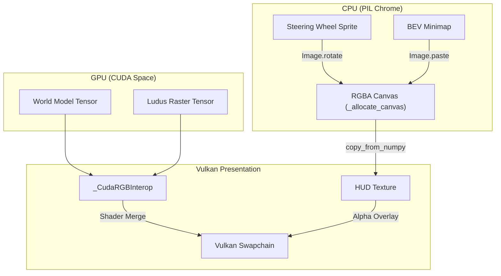
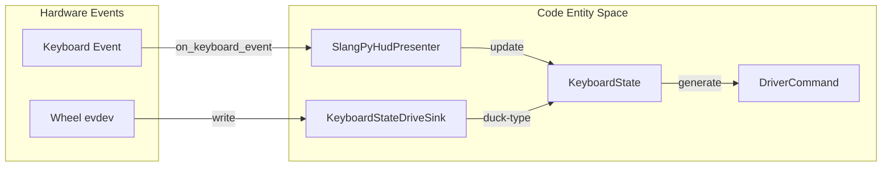

<!-- source: DeepWiki mcp.deepwiki.com · repo NVIDIA/flashdreams · page 5.2 Rendering and HUD Presentation · fetched 2026-10-26 -->

# Rendering and HUD Presentation

Relevant source files

The following files were used as context for generating this wiki page:

- [integrations/omnidreams/ludus-renderer/ludus_renderer/clipgt.py](integrations/omnidreams/ludus-renderer/ludus_renderer/clipgt.py)
- [integrations/omnidreams/omnidreams/conditioning/conditioning_wrapper.py](integrations/omnidreams/omnidreams/conditioning/conditioning_wrapper.py)
- [integrations/omnidreams/omnidreams/conditioning/renderer.py](integrations/omnidreams/omnidreams/conditioning/renderer.py)
- [integrations/omnidreams/omnidreams/conditioning/world_scenario/ftheta.py](integrations/omnidreams/omnidreams/conditioning/world_scenario/ftheta.py)
- [integrations/omnidreams/omnidreams/interactive_drive/_pipeline_fakes.py](integrations/omnidreams/omnidreams/interactive_drive/_pipeline_fakes.py)
- [integrations/omnidreams/omnidreams/interactive_drive/backends/base.py](integrations/omnidreams/omnidreams/interactive_drive/backends/base.py)
- [integrations/omnidreams/omnidreams/interactive_drive/backends/raster.py](integrations/omnidreams/omnidreams/interactive_drive/backends/raster.py)
- [integrations/omnidreams/omnidreams/interactive_drive/backends/world_model.py](integrations/omnidreams/omnidreams/interactive_drive/backends/world_model.py)
- [integrations/omnidreams/omnidreams/interactive_drive/cuda_env.py](integrations/omnidreams/omnidreams/interactive_drive/cuda_env.py)
- [integrations/omnidreams/omnidreams/interactive_drive/loading_overlay.py](integrations/omnidreams/omnidreams/interactive_drive/loading_overlay.py)
- [integrations/omnidreams/omnidreams/interactive_drive/presenter.py](integrations/omnidreams/omnidreams/interactive_drive/presenter.py)
- [integrations/omnidreams/omnidreams/interactive_drive/rasterizer.py](integrations/omnidreams/omnidreams/interactive_drive/rasterizer.py)
- [integrations/omnidreams/omnidreams/interactive_drive/slangpy_hud_presenter.py](integrations/omnidreams/omnidreams/interactive_drive/slangpy_hud_presenter.py)
- [integrations/omnidreams/omnidreams/interactive_drive/types.py](integrations/omnidreams/omnidreams/interactive_drive/types.py)
- [integrations/omnidreams/tests/interactive_drive/test_chunk_pipeline.py](integrations/omnidreams/tests/interactive_drive/test_chunk_pipeline.py)
- [integrations/omnidreams/tests/interactive_drive/test_presenter.py](integrations/omnidreams/tests/interactive_drive/test_presenter.py)
- [integrations/omnidreams/tests/interactive_drive/test_rasterizer.py](integrations/omnidreams/tests/interactive_drive/test_rasterizer.py)
- [integrations/omnidreams/tests/test_conditioning_wrapper.py](integrations/omnidreams/tests/test_conditioning_wrapper.py)
- [integrations/omnidreams/tests/test_grpc_dynamic_actors.py](integrations/omnidreams/tests/test_grpc_dynamic_actors.py)
- [integrations/omnidreams/tests/test_ludus_renderer.py](integrations/omnidreams/tests/test_ludus_renderer.py)

The Rendering and HUD Presentation layer handles the final composition and display of generated video frames, HDMap conditioning visualizations, and the interactive user interface (Chrome). It is designed for high-performance, single-process execution using CUDA-Vulkan interop to minimize CPU-GPU transfers.

## SlangPyHudPresenter

The `SlangPyHudPresenter` is the primary display engine for the `interactive-drive` application [integrations/omnidreams/omnidreams/interactive_drive/slangpy_hud_presenter.py:4-12](). It replaces the legacy multi-process Pygame architecture with a single-process `slangpy.Window` backed by SDL3 [integrations/omnidreams/omnidreams/interactive_drive/slangpy_hud_presenter.py:13-17]().

### CUDA-Vulkan Interop and _CudaRGBInterop
To achieve low latency, the presenter uses `_CudaRGBInterop` to map CUDA tensors (from the world model or rasterizer) directly into Vulkan textures for display without round-tripping through host memory [integrations/omnidreams/omnidreams/interactive_drive/presenter.py:61-61]().

*   **Device Creation**: The presenter attempts to create a Vulkan device with CUDA interop enabled, sharing the existing CUDA context used by PyTorch [integrations/omnidreams/omnidreams/interactive_drive/presenter.py:103-120]().
*   **Fallback Path**: If interop is disabled via `INTERACTIVE_DRIVE_DISABLE_CUDA_INTEROP` or device creation fails, it falls back to standard NumPy-based host uploads [integrations/omnidreams/omnidreams/interactive_drive/presenter.py:121-133]().
*   **Ring Buffer**: `SlangPyHudPresenter` manages a ring buffer of frames to handle asynchronous presentation and UI updates.

### PIL Chrome Rendering
The UI "Chrome" (panels, BEV minimap, speedometers, and steering wheel) is rendered on the CPU using the Python Imaging Library (PIL) [integrations/omnidreams/omnidreams/interactive_drive/slangpy_hud_presenter.py:20-23]().

*   **Zero-Copy Canvas**: `_allocate_canvas` creates a NumPy array and a PIL Image view sharing the same memory. Drawing operations write directly into the buffer that is later uploaded to the GPU via `copy_from_numpy` [integrations/omnidreams/omnidreams/interactive_drive/slangpy_hud_presenter.py:128-148]().
*   **LRU Caching**: Frequent UI elements like the steering wheel (rotated at various angles) and speed digits are stored in an `_LRUCache` to avoid redundant PIL rotation and draw calls [integrations/omnidreams/omnidreams/interactive_drive/slangpy_hud_presenter.py:151-172]().

### HUD Component Data Flow
The following diagram illustrates how generated frames and UI elements are merged.

**Presenter Composition Flow**

**Sources:** [integrations/omnidreams/omnidreams/interactive_drive/slangpy_hud_presenter.py:4-42](), [integrations/omnidreams/omnidreams/interactive_drive/presenter.py:103-187]()

---

## LudusConditionRasterizer

The `LudusConditionRasterizer` is a thread-pinned component that wraps the `ludus_renderer` library to generate HDMap visualizations [integrations/omnidreams/omnidreams/interactive_drive/rasterizer.py:4-12](). It provides the "ground truth" conditioning frames required by the world model.

### Key Features
*   **Thread Pinning**: Because NVIDIA EGL contexts on certain drivers (e.g., Blackwell) cannot migrate across threads, the rasterizer logic is encapsulated in `_LudusConditionRasterizerImpl` and pinned to a dedicated worker thread [integrations/omnidreams/omnidreams/interactive_drive/rasterizer.py:162-169]().
*   **FThetaCamera Model**: Supports the non-linear `FThetaCamera` used in automotive datasets. It maps polynomial coefficients to principal points and focal lengths [integrations/omnidreams/omnidreams/conditioning/renderer.py:51-77]().
*   **Bird's-Eye-View (BEV)**: When `BevConfig` is enabled, the rasterizer renders a secondary top-down view using a synthetic camera mounted 25m above the vehicle rig [integrations/omnidreams/omnidreams/interactive_drive/rasterizer.py:14-20]().

### Data Handling
*   **_LazyRasterFrame**: Rasterized frames are initially kept as CUDA tensors. They are only converted to NumPy arrays if requested by a non-interop presenter [integrations/omnidreams/omnidreams/interactive_drive/rasterizer.py:90-118]().
*   **ClipGT Loading**: Loads scene geometry from Parquet files stored within USDZ bundles [integrations/omnidreams/omnidreams/interactive_drive/rasterizer.py:50-73]().

**Sources:** [integrations/omnidreams/omnidreams/interactive_drive/rasterizer.py:4-180](), [integrations/omnidreams/omnidreams/conditioning/renderer.py:51-145]()

---

## MJPEGStreamingPresenter

For remote viewing (e.g., via a web browser), the `MJPEGStreamingPresenter` (referenced in [integrations/omnidreams/omnidreams/interactive_drive/loading_overlay.py:13-14]()) provides an alternative to the SlangPy window. It encodes `PresentedFrame` objects into a JPEG stream.

*   **Status Overlays**: Uses `render_loading_overlay` to draw "Loading world model..." or "Loading scene..." messages over the initial frame during startup [integrations/omnidreams/omnidreams/interactive_drive/loading_overlay.py:4-18]().
*   **PIL Integration**: Like the HUD, it uses PIL to compose the status text and high-contrast callout boxes before JPEG encoding [integrations/omnidreams/omnidreams/interactive_drive/loading_overlay.py:26-77]().

**Sources:** [integrations/omnidreams/omnidreams/interactive_drive/loading_overlay.py:4-78]()

---

## Input Handling and Debouncing

Input flows from the `slangpy.Window` callbacks into the `KeyboardState` management system [integrations/omnidreams/omnidreams/interactive_drive/slangpy_hud_presenter.py:24-29]().

### Input Debouncing
The presenter implements specific debouncing logic for drive keys (Throttle, Brake, Steer) to prevent flickering or rapid state changes during frame transitions [integrations/omnidreams/omnidreams/interactive_drive/slangpy_hud_presenter.py:106-109]().

*   **DRIVE_KEY_RELEASE_DEBOUNCE_S**: A window (default 80ms) during which a key release is held in `_pending_drive_releases` before being committed to the `DriverCommand` [integrations/omnidreams/omnidreams/interactive_drive/slangpy_hud_presenter.py:109-109]().

### Entity Mapping: Input to Control
The following diagram maps the relationship between hardware events and code entities.

**Input Entity Mapping**

**Sources:** [integrations/omnidreams/omnidreams/interactive_drive/slangpy_hud_presenter.py:24-29](), [integrations/omnidreams/omnidreams/interactive_drive/types.py:166-174]()

---

## Performance Monitoring

The presenter includes an optional profiling mode enabled via `INTERACTIVE_DRIVE_PROFILE_HUD` [integrations/omnidreams/omnidreams/interactive_drive/slangpy_hud_presenter.py:110-111](). It tracks several metrics per frame:

| Metric | Description |
| :--- | :--- |
| `camera_ms` | Time spent preparing the main camera frame. |
| `bev_ms` | Time spent rendering/preparing the BEV minimap. |
| `render_ms` | Time spent in PIL Chrome composition. |
| `present_ms` | Time spent in the Vulkan swapchain presentation. |

**Sources:** [integrations/omnidreams/omnidreams/interactive_drive/slangpy_hud_presenter.py:112-125]()

---

