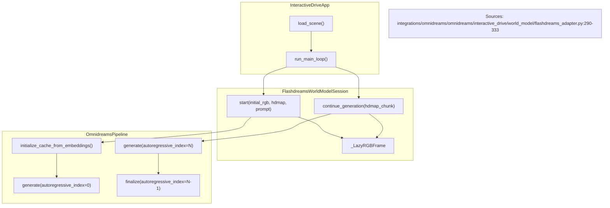
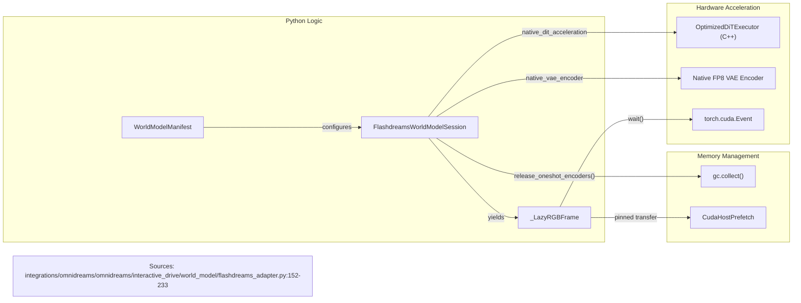

<!-- source: DeepWiki mcp.deepwiki.com · repo NVIDIA/flashdreams · page 5.3 World Model Adapter and Manifest System · fetched 2026-10-26 -->

# World Model Adapter and Manifest System

Relevant source files

The following files were used as context for generating this wiki page:

- [integrations/omnidreams/omnidreams/interactive_drive/.gitignore](integrations/omnidreams/omnidreams/interactive_drive/.gitignore)
- [integrations/omnidreams/omnidreams/interactive_drive/_sample_assets.py](integrations/omnidreams/omnidreams/interactive_drive/_sample_assets.py)
- [integrations/omnidreams/omnidreams/interactive_drive/assets/README.md](integrations/omnidreams/omnidreams/interactive_drive/assets/README.md)
- [integrations/omnidreams/omnidreams/interactive_drive/configs/example_world_model.yaml](integrations/omnidreams/omnidreams/interactive_drive/configs/example_world_model.yaml)
- [integrations/omnidreams/omnidreams/interactive_drive/configs/example_world_model_perf.yaml](integrations/omnidreams/omnidreams/interactive_drive/configs/example_world_model_perf.yaml)
- [integrations/omnidreams/omnidreams/interactive_drive/runtime/loop.py](integrations/omnidreams/omnidreams/interactive_drive/runtime/loop.py)
- [integrations/omnidreams/omnidreams/interactive_drive/world_model/flashdreams_adapter.py](integrations/omnidreams/omnidreams/interactive_drive/world_model/flashdreams_adapter.py)
- [integrations/omnidreams/omnidreams/interactive_drive/world_model/manifest.py](integrations/omnidreams/omnidreams/interactive_drive/world_model/manifest.py)
- [integrations/omnidreams/omnidreams/pipeline.py](integrations/omnidreams/omnidreams/pipeline.py)
- [integrations/omnidreams/tests/interactive_drive/test_cli_manifest_resolution.py](integrations/omnidreams/tests/interactive_drive/test_cli_manifest_resolution.py)
- [integrations/omnidreams/tests/interactive_drive/test_latency_loop.py](integrations/omnidreams/tests/interactive_drive/test_latency_loop.py)
- [integrations/omnidreams/tests/interactive_drive/test_manifest.py](integrations/omnidreams/tests/interactive_drive/test_manifest.py)
- [integrations/omnidreams/tests/interactive_drive/test_world_model_adapter.py](integrations/omnidreams/tests/interactive_drive/test_world_model_adapter.py)
- [integrations/omnidreams/tests/test_omnidreams_pipeline.py](integrations/omnidreams/tests/test_omnidreams_pipeline.py)

This page documents the integration layer between the **OmniDreams Interactive Drive** application and the **FlashDreams** streaming inference engine. It covers the session management lifecycle, the YAML-based manifest schema for model configuration, and the specialized performance optimizations used for low-latency interactive simulation.

## World Model Session Management

The `FlashdreamsWorldModelSession` class acts as the primary adapter, wrapping a `StreamInferencePipeline` to provide a simplified interface for the interactive drive loop. It manages the transition from natural language prompts and HDMap conditioning to the autoregressive generation of video chunks.

### Lifecycle and Data Flow

The session follows a four-stage lifecycle:
1.  **Warmup**: Initializes the model weights and prepares CUDA graphs or `torch.compile` kernels.
2.  **Scene Preparation**: Precomputes text and image embeddings for a specific scene to minimize latency during the first driving tick.
3.  **Start**: Generates the initial chunk of frames using the first-frame condition.
4.  **Continue**: Progressively generates subsequent chunks based on updated driver inputs and HDMap trajectories.

| Function | Role | Source |
| :--- | :--- | :--- |
| `warmup_model` | Instantiates the pipeline and triggers initial kernel compilation. | [integrations/omnidreams/omnidreams/interactive_drive/world_model/flashdreams_adapter.py:255-263]() |
| `prepare_for_scene` | Precomputes one-shot embeddings (text/image) and optionally offloads encoders. | [integrations/omnidreams/omnidreams/interactive_drive/world_model/flashdreams_adapter.py:265-288]() |
| `start` | Begins the rollout using `initialize_cache_from_embeddings`. | [integrations/omnidreams/omnidreams/interactive_drive/world_model/flashdreams_adapter.py:290-316]() |
| `continue_generation` | Executes `generate` for the next autoregressive index. | [integrations/omnidreams/omnidreams/interactive_drive/world_model/flashdreams_adapter.py:318-333]() |

### Natural Language to Code Mapping: Session Execution
The following diagram bridges the conceptual "Interactive Drive" commands to the specific `FlashdreamsWorldModelSession` methods and their internal `OmnidreamsPipeline` calls.

"Interactive Drive Session Flow"

Sources: [integrations/omnidreams/omnidreams/interactive_drive/world_model/flashdreams_adapter.py:236-333](), [integrations/omnidreams/omnidreams/pipeline.py:106-128]()

## World Model Manifest System

The `WorldModelManifest` is a YAML-defined schema that configures the world model's behavior, resolution, and hardware acceleration modes. It decouples the simulation's visual requirements from the underlying model recipe.

### YAML Schema and Loading
The manifest supports local file paths and Hugging Face URLs for model artifacts. Relative paths are resolved against the directory containing the manifest file [integrations/omnidreams/omnidreams/interactive_drive/world_model/manifest.py:83-100]().

| Field | Description | Default |
| :--- | :--- | :--- |
| `resolution_wh` | Target [Width, Height]. Must be divisible by 16. | `[1280, 704]` |
| `num_frames_per_block` | Number of frames generated per AR step (chunk size). | `8` |
| `compile_net` | Whether to enable `torch.compile` on the DiT. | `True` |
| `native_dit_acceleration` | Mode for CUDA/C++ extension (`auto`, `disabled`, `required`). | `disabled` |
| `native_vae_encoder` | Use FP8 native encoder path (`disabled`, `fp8`). | `disabled` |
| `denoising_steps` | List of timesteps for the FlowMatch scheduler. | `[1000, 500]` |

### Recipe Mapping
The adapter uses `_select_config_name` to map manifest flags to specific FlashDreams recipe slugs (e.g., `omnidreams-sv-2steps-chunk2-loc6-lightvae-lighttae`).

Sources: [integrations/omnidreams/omnidreams/interactive_drive/world_model/manifest.py:148-175](), [integrations/omnidreams/omnidreams/interactive_drive/world_model/flashdreams_adapter.py:27-67](), [integrations/omnidreams/omnidreams/interactive_drive/configs/example_world_model_perf.yaml:1-61]()

## Performance Infrastructure

### Native DiT and Encoder Offloading
To achieve interactive frame rates, the system employs several acceleration strategies:
*   **Native DiT Acceleration**: Uses the `omnidreams_singleview` CUDA extension for FP8 KV-cache and optimized attention backends like `cudnn` or `sparge` [integrations/omnidreams/omnidreams/interactive_drive/world_model/flashdreams_adapter.py:172-185]().
*   **Encoder Offloading**: Once `prepare_for_scene` computes the text and image embeddings, the session calls `release_oneshot_encoders()` to free GPU memory for the DiT and VAE decoder [integrations/omnidreams/omnidreams/interactive_drive/world_model/flashdreams_adapter.py:286-288]().
*   **FP8 VAE**: Supports a native FP8 LightVAE encoder path, requiring a calibrated state file provided via `native_vae_fp8_state_path` [integrations/omnidreams/omnidreams/interactive_drive/world_model/flashdreams_adapter.py:152-169]().

### CUDA Event Synchronization and Lazy Frames
The system uses `_LazyRGBFrame` to overlap GPU computation with host-side frame processing. Instead of blocking the generation thread, it returns a handle that encapsulates a `torch.Tensor` and a `torch.cuda.Event`.

*   **`_LazyRGBFrame.cpu()`**: Triggers a `cudaEventSynchronize` on the generation event before moving the tensor to host memory [integrations/omnidreams/omnidreams/interactive_drive/world_model/flashdreams_adapter.py:221-233]().
*   **CudaHostPrefetch**: A utility used to pre-allocate pinned host memory for asynchronous DtoH transfers [integrations/omnidreams/omnidreams/interactive_drive/world_model/flashdreams_adapter.py:15]().

"Performance Optimization Entity Mapping"

Sources: [integrations/omnidreams/omnidreams/interactive_drive/world_model/flashdreams_adapter.py:152-233](), [integrations/omnidreams/omnidreams/interactive_drive/world_model/manifest.py:119-144]()

---

