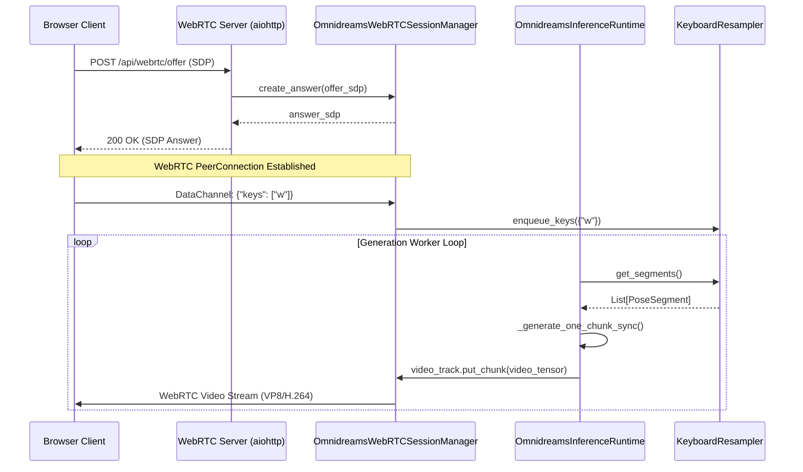
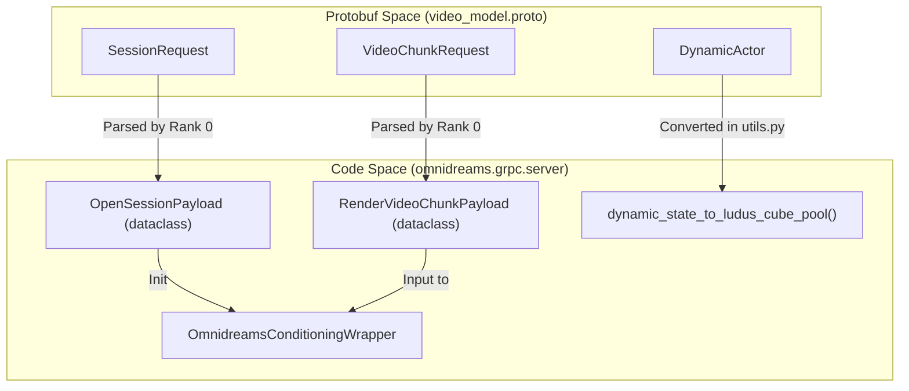

<!-- source: DeepWiki mcp.deepwiki.com · repo NVIDIA/flashdreams · page 5.4 WebRTC and gRPC Serving · fetched 2026-10-26 -->

# WebRTC and gRPC Serving

<details>
<summary>Relevant source files</summary>

The following files were used as context for generating this wiki page:

- [integrations/omnidreams/README.md](integrations/omnidreams/README.md)
- [integrations/omnidreams/omnidreams/grpc/protos/camera.proto](integrations/omnidreams/omnidreams/grpc/protos/camera.proto)
- [integrations/omnidreams/omnidreams/grpc/protos/camera_pb2.py](integrations/omnidreams/omnidreams/grpc/protos/camera_pb2.py)
- [integrations/omnidreams/omnidreams/grpc/protos/camera_pb2.pyi](integrations/omnidreams/omnidreams/grpc/protos/camera_pb2.pyi)
- [integrations/omnidreams/omnidreams/grpc/protos/video_model.proto](integrations/omnidreams/omnidreams/grpc/protos/video_model.proto)
- [integrations/omnidreams/omnidreams/grpc/protos/video_model_pb2.py](integrations/omnidreams/omnidreams/grpc/protos/video_model_pb2.py)
- [integrations/omnidreams/omnidreams/grpc/protos/video_model_pb2_grpc.py](integrations/omnidreams/omnidreams/grpc/protos/video_model_pb2_grpc.py)
- [integrations/omnidreams/omnidreams/grpc/server.py](integrations/omnidreams/omnidreams/grpc/server.py)
- [integrations/omnidreams/omnidreams/grpc/utils.py](integrations/omnidreams/omnidreams/grpc/utils.py)
- [integrations/omnidreams/omnidreams/interactive_drive/scene_loader.py](integrations/omnidreams/omnidreams/interactive_drive/scene_loader.py)
- [integrations/omnidreams/omnidreams/prepare.py](integrations/omnidreams/omnidreams/prepare.py)
- [integrations/omnidreams/omnidreams/scenes.py](integrations/omnidreams/omnidreams/scenes.py)
- [integrations/omnidreams/omnidreams/webrtc/server.py](integrations/omnidreams/omnidreams/webrtc/server.py)
- [integrations/omnidreams/omnidreams/webrtc/session.py](integrations/omnidreams/omnidreams/webrtc/session.py)
- [integrations/omnidreams/omnidreams/webrtc/web/request_session.css](integrations/omnidreams/omnidreams/webrtc/web/request_session.css)
- [integrations/omnidreams/omnidreams/webrtc/web/request_session.html](integrations/omnidreams/omnidreams/webrtc/web/request_session.html)
- [integrations/omnidreams/omnidreams/webrtc/web/request_session.js](integrations/omnidreams/omnidreams/webrtc/web/request_session.js)
- [integrations/omnidreams/tests/test_grpc_camera_extrinsics.py](integrations/omnidreams/tests/test_grpc_camera_extrinsics.py)
- [integrations/omnidreams/tests/test_grpc_server_integration.py](integrations/omnidreams/tests/test_grpc_server_integration.py)
- [integrations/omnidreams/tests/test_service_composition.py](integrations/omnidreams/tests/test_service_composition.py)
- [integrations/omnidreams/tests/test_webrtc_runtime.py](integrations/omnidreams/tests/test_webrtc_runtime.py)
- [integrations/omnidreams/tests/test_webrtc_server_routes.py](integrations/omnidreams/tests/test_webrtc_server_routes.py)

</details>


This page documents the interactive serving infrastructure for OmniDreams, covering both the WebRTC real-time driving interface and the gRPC world model service. These systems allow external clients (web browsers or autonomous driving stacks) to interact with the world model by providing control inputs and receiving generated video streams.

## WebRTC Serving Architecture

The WebRTC stack enables a low-latency, interactive driving experience where a user can control the ego-vehicle using WSAD keys. The server negotiates a peer connection, receives input via a `DataChannel`, and streams generated video chunks back to the client.

### OmnidreamsWebRTCSessionManager

The `OmnidreamsWebRTCSessionManager` [integrations/omnidreams/omnidreams/webrtc/session.py:1083-1084]() manages the lifecycle of a single active WebRTC session. It implements the `WebRTCSessionManager` protocol [flashdreams/serving/webrtc/server.py:30]().

*   **Session Lifecycle**: It handles the SDP offer/answer exchange via `create_answer` [integrations/omnidreams/omnidreams/webrtc/session.py:1162-1163](). It ensures only one session is active at a time, raising a `SessionBusyError` [flashdreams/serving/webrtc/server.py:64]() if a new connection is attempted while one is live.
*   **Runtime Preloading**: It triggers `preload_runtime` [integrations/omnidreams/omnidreams/webrtc/session.py:1145-1146]() during server startup to warm up the model and text encoders.
*   **Media Tracks**: It instantiates `BufferedVideoTrack` [flashdreams/serving/webrtc/media.py:63]() to stream the generated frames to the client.

### OmnidreamsInferenceRuntime

The `OmnidreamsInferenceRuntime` [integrations/omnidreams/omnidreams/webrtc/session.py:488-489]() encapsulates the world model pipeline and the generation loop.

*   **Worker Loop**: The `_generation_worker_loop` [integrations/omnidreams/omnidreams/webrtc/session.py:1022-1023]() runs as a background task. It continuously polls for new input segments from the `KeyboardResampler` and dispatches generation tasks.
*   **Generation Logic**: It uses `_generate_one_chunk_sync` [integrations/omnidreams/omnidreams/webrtc/session.py:889-890]() to produce video frames. This method switches between `start_generation` [integrations/omnidreams/omnidreams/webrtc/session.py:943]() for the first chunk and `continue_generation` [integrations/omnidreams/omnidreams/webrtc/session.py:954]() for subsequent autoregressive steps.
*   **Conditioning**: It integrates the `LudusRenderer` to produce HDMap conditioning frames based on the integrated camera poses [integrations/omnidreams/omnidreams/webrtc/session.py:633-635]().

### WebRTC Data Flow

The following diagram illustrates the interaction between the WebRTC client, the session manager, and the inference runtime.

**WebRTC Interactive Flow**


Sources: [integrations/omnidreams/omnidreams/webrtc/session.py:488-1200](), [integrations/omnidreams/omnidreams/webrtc/server.py:119-133](), [flashdreams/serving/webrtc/server.py:30-64]()

---

## gRPC Serving and WorldModelService

The gRPC server implements the `WorldModelService` [integrations/omnidreams/omnidreams/grpc/protos/video_model.proto:23](), allowing programmatic control of the world model for simulation and testing.

### Service Definition

The service provides four primary RPCs:
1.  `start_session`: Initializes a session with a static world map, camera specs, and initial frames [integrations/omnidreams/omnidreams/grpc/protos/video_model.proto:24]().
2.  `render_video_chunk`: Generates a video chunk given a rig trajectory and dynamic actor states [integrations/omnidreams/omnidreams/grpc/protos/video_model.proto:26]().
3.  `close_session`: Tears down the session state [integrations/omnidreams/omnidreams/grpc/protos/video_model.proto:25]().
4.  `get_version`: Returns the server's API version [integrations/omnidreams/omnidreams/grpc/protos/video_model.proto:27]().

### Distributed Orchestration

The gRPC server supports multi-GPU execution using a `RankCoordinator` [integrations/omnidreams/omnidreams/grpc/server.py:87](). 
*   **Rank 0**: Acts as the gRPC endpoint, receiving requests and broadcasting control signals (e.g., `START`, `VIDEO_CHUNK`) to worker ranks [integrations/omnidreams/omnidreams/grpc/server.py:103-109]().
*   **Worker Ranks**: Wait for signals via `distributed_op` and execute the corresponding pipeline methods in parallel [integrations/omnidreams/omnidreams/grpc/server.py:88]().

### gRPC Entity Mapping

This diagram maps gRPC Protobuf messages to the internal Python classes and functions used for processing.

**gRPC to Code Entity Mapping**


Sources: [integrations/omnidreams/omnidreams/grpc/server.py:16-169](), [integrations/omnidreams/omnidreams/grpc/protos/video_model.proto:23-118](), [integrations/omnidreams/omnidreams/grpc/utils.py:1-100]()

---

## Media and Input Handling

### BufferedVideoTrack
The `BufferedVideoTrack` [flashdreams/serving/webrtc/media.py:63]() bridges the PyTorch generation output and the `aiortc` media stream. It maintains a queue of frames and handles the conversion from torch tensors to `av.VideoFrame` objects.

### Keyboard and Pose Integration
Interactive driving requires converting discrete key presses into continuous camera trajectories.
*   **KeyboardResampler**: [flashdreams/serving/webrtc/controls.py:60]() Buffers key events from the WebRTC DataChannel and resamples them into segments matching the world model's frame rate.
*   **CameraPoseIntegrator**: [flashdreams/serving/webrtc/controls.py:59]() Integrates velocity and steering commands into 4x4 transformation matrices representing the camera's path through the 3D scene.

### Scene Asset Resolution
The `omnidreams.scenes` module [integrations/omnidreams/omnidreams/scenes.py:41-42]() provides helpers for fetching and caching USDZ scene archives from Hugging Face.

*   **`hf_hub_download_scene`**: Downloads archives to a local cache [integrations/omnidreams/omnidreams/scenes.py:46]().
*   **`_resolve_webrtc_scene_assets`**: Extracts the necessary files (`clipgt/first_image.*`, `clipgt/prompt.txt`) from the USDZ for use by the runtime [integrations/omnidreams/omnidreams/webrtc/session.py:170-177]().

**Input Processing Pipeline**
```mermaid
graph LR
    subgraph "Frontend"
        K[Key Press: W/A/S/D]
    end

    subgraph "Serving Layer"
        DC[DataChannel]
        KR["KeyboardResampler"]
    end

    subgraph "Inference Runtime"
        CPI["CameraPoseIntegrator"]
        LR["LudusRenderer"]
        SIP["StreamInferencePipeline"]
    end

    K --> DC
    DC --> KR
    KR -->|List[PoseSegment]| CPI
    CPI -->|Camera Poses| LR
    LR -->|Conditioning Frames| SIP
```

Sources: [integrations/omnidreams/omnidreams/webrtc/session.py:59-63](), [integrations/omnidreams/omnidreams/scenes.py:41-102](), [flashdreams/serving/webrtc/controls.py:59-61]()

---

## Server Implementation Details

### aiohttp Server Routes
The WebRTC server uses `aiohttp` to serve the web interface and handle signaling.
*   `/request_session`: Serves the main HTML page [integrations/omnidreams/omnidreams/webrtc/server.py:129]().
*   `/api/webrtc/offer`: Endpoint for SDP negotiation [integrations/omnidreams/tests/test_webrtc_server_routes.py:209-210]().
*   `/static/`: Serves CSS and JS assets [integrations/omnidreams/omnidreams/webrtc/server.py:132]().

### Initialization and Warmup
Before serving requests, the server performs several initialization steps:
1.  **Distributed Init**: Sets up NCCL process groups if `WORLD_SIZE > 1` [integrations/omnidreams/omnidreams/webrtc/server.py:176]().
2.  **Runtime Warmup**: Generates a configurable number of synthetic "warmup" chunks (`--warmup_chunks`) to trigger CUDA graph capture and kernel autotuning [integrations/omnidreams/omnidreams/webrtc/server.py:91-95]().
3.  **Scene Staging**: If no local directory is provided, it automatically downloads the default scene from Hugging Face [integrations/omnidreams/omnidreams/webrtc/server.py:58-66]().

Sources: [integrations/omnidreams/omnidreams/webrtc/server.py:42-133](), [integrations/omnidreams/omnidreams/webrtc/session.py:1145-1150](), [integrations/omnidreams/tests/test_webrtc_server_routes.py:48-56]()

---

