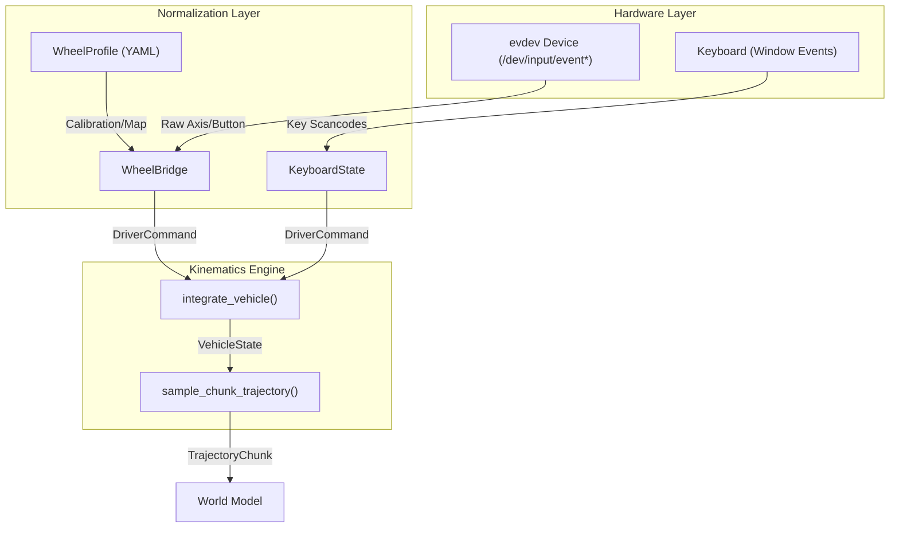
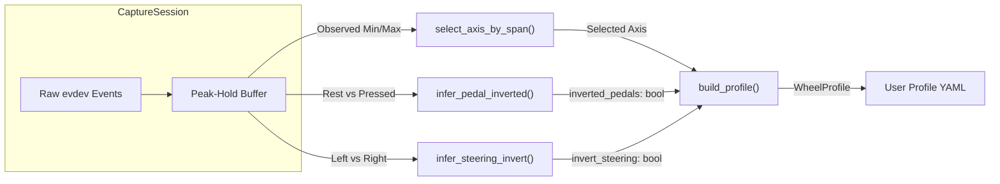

<!-- source: DeepWiki mcp.deepwiki.com · repo NVIDIA/flashdreams · page 5.5 Input Handling and Controller Configuration · fetched 2026-10-26 -->

# Input Handling and Controller Configuration

Relevant source files

The following files were used as context for generating this wiki page:

- [integrations/omnidreams/omnidreams/interactive_drive/input/keyboard.py](integrations/omnidreams/omnidreams/interactive_drive/input/keyboard.py)
- [integrations/omnidreams/omnidreams/interactive_drive/input/wheel_profiles.py](integrations/omnidreams/omnidreams/interactive_drive/input/wheel_profiles.py)
- [integrations/omnidreams/omnidreams/interactive_drive/input_config/__init__.py](integrations/omnidreams/omnidreams/interactive_drive/input_config/__init__.py)
- [integrations/omnidreams/omnidreams/interactive_drive/input_config/__main__.py](integrations/omnidreams/omnidreams/interactive_drive/input_config/__main__.py)
- [integrations/omnidreams/omnidreams/interactive_drive/input_config/app.py](integrations/omnidreams/omnidreams/interactive_drive/input_config/app.py)
- [integrations/omnidreams/omnidreams/interactive_drive/input_config/capture.py](integrations/omnidreams/omnidreams/interactive_drive/input_config/capture.py)
- [integrations/omnidreams/omnidreams/interactive_drive/simulation/ego_vehicle_kinematics.py](integrations/omnidreams/omnidreams/interactive_drive/simulation/ego_vehicle_kinematics.py)
- [integrations/omnidreams/tests/interactive_drive/test_core_control.py](integrations/omnidreams/tests/interactive_drive/test_core_control.py)
- [integrations/omnidreams/tests/interactive_drive/test_input_config_capture.py](integrations/omnidreams/tests/interactive_drive/test_input_config_capture.py)
- [integrations/omnidreams/tests/interactive_drive/test_keyboard_state.py](integrations/omnidreams/tests/interactive_drive/test_keyboard_state.py)
- [integrations/omnidreams/tests/interactive_drive/test_wheel_profiles.py](integrations/omnidreams/tests/interactive_drive/test_wheel_profiles.py)

This page documents the input subsystem of the OmniDreams interactive drive environment. The system is designed to be device-agnostic, supporting keyboard input, game controllers, and professional steering wheels through a unified normalization layer.

## Input Architecture and Data Flow

The input system bridges physical hardware events (evdev for Linux controllers or windowing events for keyboard) into a standardized `DriverCommand` structure. This command is then integrated into the vehicle's kinematics to produce trajectory chunks for the world model.

### Input Normalization Pipeline

The following diagram illustrates the flow from raw hardware events to the `VehicleState` used by the simulation.

**Diagram: Input to Kinematics Flow**

**Sources:** [integrations/omnidreams/omnidreams/interactive_drive/input/wheel_profiles.py:4-22](), [integrations/omnidreams/omnidreams/interactive_drive/simulation/ego_vehicle_kinematics.py:25-30]()

## Keyboard Input

Keyboard input is managed by the `KeyboardState` class, which serves as a thread-safe synchronized state holder for pressed keys and UI affordances.

### Key Components
- **`KeyboardState`**: Owns the live set of pressed keys and manages rising-edge requests for scene resets and exits. It also acts as a telemetry sink via `update_telemetry`, allowing the HUD to read the latest `VehicleState` without direct simulation access [integrations/omnidreams/omnidreams/interactive_drive/input/keyboard.py:15-31]().
- **`command_from_snapshot`**: A pure function that maps a `ControlSnapshot` (set of keys) to a `DriverCommand`. It maps `W/Up` to throttle, `S/Down` to brake, and `A/D` to steering [integrations/omnidreams/omnidreams/interactive_drive/input/keyboard.py:144-157]().
- **`KeyboardInputBackend`**: Implements the `InputBackend` interface to provide sampled commands to the main simulation loop [integrations/omnidreams/omnidreams/interactive_drive/input/keyboard.py:160-167]().

**Sources:** [integrations/omnidreams/omnidreams/interactive_drive/input/keyboard.py:15-167]()

## Wheel and Controller Handling

Steering wheels and game controllers are handled via the Linux `evdev` interface. The system relies on `WheelProfile` objects to translate raw device-specific axis codes into normalized driving commands.

### WheelProfile Configuration
A `WheelProfile` is a YAML-backed data structure that defines how a specific device should be interpreted.

| Field | Description |
| :--- | :--- |
| `axis_map` | Dictionary mapping "steering", "throttle", and "brake" to evdev ABS codes [integrations/omnidreams/omnidreams/interactive_drive/input/wheel_profiles.py:84](). |
| `inverted_pedals` | `True` for wheels (rest at max, fall to min); `False` for triggers (rest at 0, rise to max) [integrations/omnidreams/omnidreams/interactive_drive/input/wheel_profiles.py:85](). |
| `steering_range` | Sensitivity multiplier for steering [integrations/omnidreams/omnidreams/interactive_drive/input/wheel_profiles.py:101](). |
| `steering_deadzone` | Center deadzone to ignore analog stick drift [integrations/omnidreams/omnidreams/interactive_drive/input/wheel_profiles.py:102](). |
| `ffb_enabled` | Enables Force Feedback (autocentering) [integrations/omnidreams/omnidreams/interactive_drive/input/wheel_profiles.py:87](). |

### Force Feedback (FFB)
The `AutocenterFFB` class (referenced in [integrations/omnidreams/omnidreams/interactive_drive/input_config/app.py:25]()) manages the hardware autocenter effect. It uses `fcntl.ioctl` with `FF_AUTOCENTER` to set the spring strength on supported hardware [integrations/omnidreams/omnidreams/interactive_drive/input/wheel_profiles.py:41-43]().

**Sources:** [integrations/omnidreams/omnidreams/interactive_drive/input/wheel_profiles.py:71-104](), [integrations/omnidreams/omnidreams/interactive_drive/input_config/app.py:24-38]()

## Configuration Wizard and Capture App

The `interactive-drive-configuration` tool is a Tkinter-based wizard that allows users to calibrate new devices without editing YAML manually.

### Calibration Logic
The calibration process uses a "peak-hold" model via the `CaptureSession` class. Instead of taking a single snapshot, it listens over a window and records the maximum deflection of every axis.

1. **`select_axis_by_span`**: Identifies which axis the user moved by comparing the observed span against the device's full range [integrations/omnidreams/omnidreams/interactive_drive/input_config/capture.py:49-70]().
2. **`infer_steering_invert`**: Determines if the steering axis needs inversion by checking if the "full left" raw value is lower than the "full right" value [integrations/omnidreams/omnidreams/interactive_drive/input_config/capture.py:110-118]().
3. **`infer_pedal_inverted`**: Detects if a pedal rests at the axis maximum (typical for wheels) or minimum (typical for controllers) [integrations/omnidreams/omnidreams/interactive_drive/input_config/capture.py:121-127]().

**Diagram: Calibration Inference**

**Sources:** [integrations/omnidreams/omnidreams/interactive_drive/input_config/capture.py:174-182](), [integrations/omnidreams/omnidreams/interactive_drive/input_config/app.py:4-14]()

## Vehicle Kinematics Integration

The final stage of input handling is the `integrate_vehicle` function, which applies the `DriverCommand` to the current `VehicleState`.

### Kinematics Logic
- **Steering**: If `steer_is_direct` is false (keyboard), steering accumulates at `steer_rate_rad_per_s`. If true (wheel), it follows the command directly [integrations/omnidreams/omnidreams/interactive_drive/simulation/ego_vehicle_kinematics.py:31-41]().
- **Acceleration/Braking**: The system implements a realistic "brake wins" policy where holding both pedals results in deceleration [integrations/omnidreams/omnidreams/interactive_drive/simulation/ego_vehicle_kinematics.py:48-53]().
- **Creep/Drag**: The vehicle includes a low-speed "creep" (approx 10 mph) when no pedals are pressed, matching automatic transmission behavior [integrations/omnidreams/omnidreams/interactive_drive/simulation/ego_vehicle_kinematics.py:81-85]().
- **Yaw Rate**: Calculated using a bicycle model: `yaw_rate = speed / wheel_base * tan(steer_rad)` [integrations/omnidreams/omnidreams/interactive_drive/simulation/ego_vehicle_kinematics.py:108-109]().

**Sources:** [integrations/omnidreams/omnidreams/interactive_drive/simulation/ego_vehicle_kinematics.py:25-124]()

---

