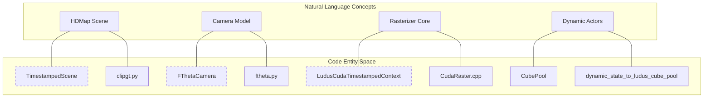
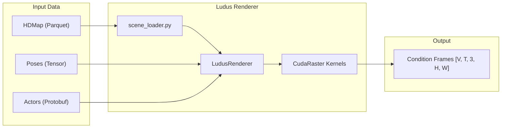

<!-- source: DeepWiki mcp.deepwiki.com · repo NVIDIA/flashdreams · page 6 Ludus Renderer · fetched 2026-10-26 -->

# Ludus Renderer

Relevant source files

The following files were used as context for generating this wiki page:

- [flashdreams/flashdreams/serving/webrtc/server.py](flashdreams/flashdreams/serving/webrtc/server.py)
- [integrations/omnidreams/ludus-renderer/ludus_renderer/_cpp/cudaraster/cuda/BinRaster.inl](integrations/omnidreams/ludus-renderer/ludus_renderer/_cpp/cudaraster/cuda/BinRaster.inl)
- [integrations/omnidreams/ludus-renderer/ludus_renderer/_ops/_plugin.py](integrations/omnidreams/ludus-renderer/ludus_renderer/_ops/_plugin.py)
- [integrations/omnidreams/ludus-renderer/ludus_renderer/clipgt.py](integrations/omnidreams/ludus-renderer/ludus_renderer/clipgt.py)
- [integrations/omnidreams/ludus-renderer/ludus_renderer/scene_cache.py](integrations/omnidreams/ludus-renderer/ludus_renderer/scene_cache.py)
- [integrations/omnidreams/omnidreams/conditioning/conditioning_wrapper.py](integrations/omnidreams/omnidreams/conditioning/conditioning_wrapper.py)
- [integrations/omnidreams/omnidreams/conditioning/renderer.py](integrations/omnidreams/omnidreams/conditioning/renderer.py)
- [integrations/omnidreams/omnidreams/conditioning/world_scenario/ftheta.py](integrations/omnidreams/omnidreams/conditioning/world_scenario/ftheta.py)
- [integrations/omnidreams/tests/test_conditioning_wrapper.py](integrations/omnidreams/tests/test_conditioning_wrapper.py)
- [integrations/omnidreams/tests/test_grpc_dynamic_actors.py](integrations/omnidreams/tests/test_grpc_dynamic_actors.py)
- [integrations/omnidreams/tests/test_ludus_renderer.py](integrations/omnidreams/tests/test_ludus_renderer.py)

The Ludus Renderer is a GPU-native CUDA software rasterizer designed specifically for rendering high-definition map (HDMap) conditioning for video generation pipelines. Within the FlashDreams ecosystem, Ludus serves as the primary bridge between vector-based map data (polylines, polygons, and 3D cuboids) and the spatial conditioning required by diffusion-based world models like OmniDreams.

### System Role and Integration

Ludus is implemented as a JIT-compiled C++/CUDA extension [integrations/omnidreams/ludus-renderer/ludus_renderer/_ops/_plugin.py:16-16]() that integrates with PyTorch. It is designed to handle the complex non-linear projections required by automotive camera models while maintaining high throughput on modern NVIDIA GPUs.

The renderer is typically orchestrated through the `LudusRenderer` wrapper class [integrations/omnidreams/omnidreams/conditioning/renderer.py:51-51](), which handles:
*   **Camera Conversion:** Translating pipeline-specific camera models into Ludus-native formats.
*   **Scene Management:** Uploading and managing static and dynamic scene geometry.
*   **Batch Rendering:** Executing high-performance rendering across multiple frames and camera views in a single GPU call.

### Natural Language to Code Entity Mapping

The following diagram illustrates how high-level rendering concepts map to specific classes and files within the Ludus subsystem.

**Ludus Entity Mapping**

Sources: [integrations/omnidreams/ludus-renderer/ludus_renderer/clipgt.py:55-61](), [integrations/omnidreams/omnidreams/conditioning/world_scenario/ftheta.py:193-193](), [integrations/omnidreams/ludus-renderer/ludus_renderer/_ops/_plugin.py:100-100](), [integrations/omnidreams/omnidreams/grpc/utils.py:24-24]() (referenced in [integrations/omnidreams/tests/test_grpc_dynamic_actors.py:23-26]()).

### Core Components

#### 1. FTheta Camera Model
Unlike standard pinhole models, Ludus natively supports the `FThetaCamera` [integrations/omnidreams/omnidreams/conditioning/world_scenario/ftheta.py:193-193](). This model uses a polynomial mapping to handle wide-angle and fisheye distortion common in autonomous driving datasets. It supports forward mapping (ray to pixel) and approximate polynomial inversion for ray-casting operations [integrations/omnidreams/omnidreams/conditioning/world_scenario/ftheta.py:125-127]().

#### 2. GPU-Native Software Rasterizer
The backend utilizes a modified version of the high-performance `CudaRaster` [integrations/omnidreams/ludus-renderer/ludus_renderer/_ops/_plugin.py:100-100](). This implementation bypasses the standard graphics pipeline (OpenGL/Vulkan) to perform triangle and primitive rasterization directly in CUDA kernels [integrations/omnidreams/ludus-renderer/ludus_renderer/_cpp/cudaraster/cuda/BinRaster.inl:30-30](). This allows for:
*   **Deep Integration:** Direct access to PyTorch tensors without expensive GPU-CPU-GPU transfers.
*   **Temporal Rendering:** Native support for `TimestampedScene` objects that interpolate geometry across continuous time [integrations/omnidreams/ludus-renderer/ludus_renderer/clipgt.py:19-20]().

#### 3. Scene and Geometry Management
Ludus manages geometry in specialized "Pools":
*   `TimestampedPolylinePool`: For lane lines and road boundaries [integrations/omnidreams/ludus-renderer/ludus_renderer/clipgt.py:60-60]().
*   `TimestampedPolygonPool`: For crosswalks and intersections [integrations/omnidreams/ludus-renderer/ludus_renderer/clipgt.py:59-59]().
*   `CubePool`: For 3D bounding boxes of vehicles and pedestrians [integrations/omnidreams/ludus-renderer/ludus_renderer/clipgt.py:58-58]().

### Integration Pipeline

The renderer is a core component of the `OmnidreamsConditioningWrapper` [integrations/omnidreams/omnidreams/conditioning/conditioning_wrapper.py:84-84](). During a simulation rollout, the wrapper calls `render_all_frames_and_cameras` to generate the visual conditioning required for the diffusion model's next autoregressive step.

**Rendering Data Flow**

Sources: [integrations/omnidreams/omnidreams/conditioning/renderer.py:162-169](), [integrations/omnidreams/ludus-renderer/ludus_renderer/clipgt.py:19-20](), [integrations/omnidreams/omnidreams/conditioning/conditioning_wrapper.py:77-77]().

### Child Pages

For more detailed technical information, refer to the following sub-sections:

*   **[Rasterizer Architecture and Primitives](#6.1)**: Deep dive into the `LudusCudaTimestampedContext`, `CudaRaster` backend, MSAA implementation, and the 3-level `scene_cache` (CUDA/RAM/Disk).
*   **[HDMap Scene Loading and ClipGT Format](#6.2)**: Details on the `ClipGT` parquet format, `scene_loader.py` logic, and the conversion of raw map data into GPU-native primitives.

Sources: [integrations/omnidreams/ludus-renderer/ludus_renderer/scene_cache.py:16-16](), [integrations/omnidreams/ludus-renderer/ludus_renderer/clipgt.py:19-33]().

---

