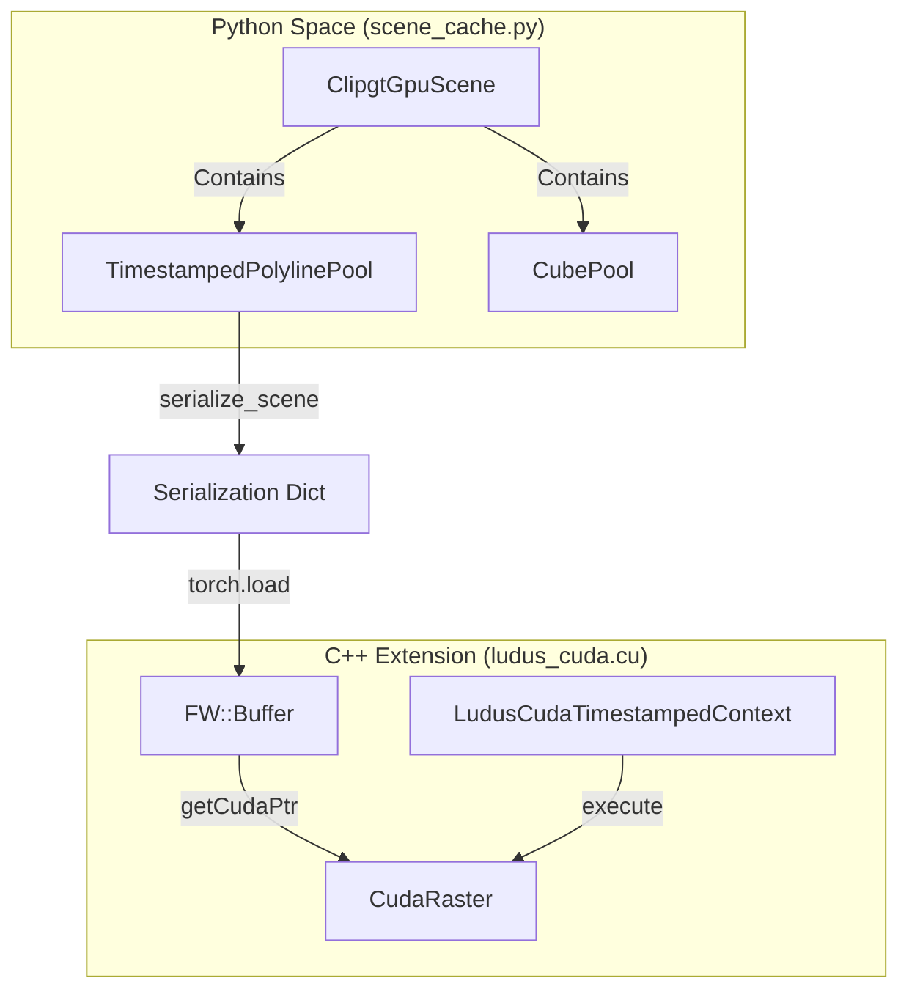
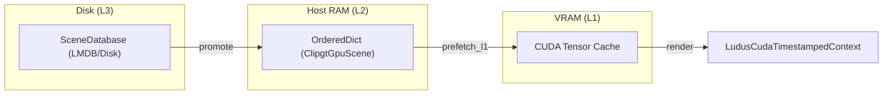

<!-- source: DeepWiki mcp.deepwiki.com · repo NVIDIA/flashdreams · page 6.1 Rasterizer Architecture and Primitives · fetched 2026-10-26 -->

# Rasterizer Architecture and Primitives

Relevant source files

The following files were used as context for generating this wiki page:

- [flashdreams/flashdreams/serving/webrtc/server.py](flashdreams/flashdreams/serving/webrtc/server.py)
- [integrations/omnidreams/ludus-renderer/examples/benchmark_gpu_parquet.py](integrations/omnidreams/ludus-renderer/examples/benchmark_gpu_parquet.py)
- [integrations/omnidreams/ludus-renderer/ludus_renderer/_cpp/cudaraster/cuda/BinRaster.inl](integrations/omnidreams/ludus-renderer/ludus_renderer/_cpp/cudaraster/cuda/BinRaster.inl)
- [integrations/omnidreams/ludus-renderer/ludus_renderer/_cpp/cudaraster/framework/base/DLLImports.hpp](integrations/omnidreams/ludus-renderer/ludus_renderer/_cpp/cudaraster/framework/base/DLLImports.hpp)
- [integrations/omnidreams/ludus-renderer/ludus_renderer/_cpp/cudaraster/framework/base/Defs.hpp](integrations/omnidreams/ludus-renderer/ludus_renderer/_cpp/cudaraster/framework/base/Defs.hpp)
- [integrations/omnidreams/ludus-renderer/ludus_renderer/_cpp/cudaraster/framework/base/Math.hpp](integrations/omnidreams/ludus-renderer/ludus_renderer/_cpp/cudaraster/framework/base/Math.hpp)
- [integrations/omnidreams/ludus-renderer/ludus_renderer/_cpp/cudaraster/framework/base/String.hpp](integrations/omnidreams/ludus-renderer/ludus_renderer/_cpp/cudaraster/framework/base/String.hpp)
- [integrations/omnidreams/ludus-renderer/ludus_renderer/_cpp/cudaraster/framework/gpu/Buffer.cpp](integrations/omnidreams/ludus-renderer/ludus_renderer/_cpp/cudaraster/framework/gpu/Buffer.cpp)
- [integrations/omnidreams/ludus-renderer/ludus_renderer/_cpp/cudaraster/framework/gpu/Buffer.hpp](integrations/omnidreams/ludus-renderer/ludus_renderer/_cpp/cudaraster/framework/gpu/Buffer.hpp)
- [integrations/omnidreams/ludus-renderer/ludus_renderer/_ops/_plugin.py](integrations/omnidreams/ludus-renderer/ludus_renderer/_ops/_plugin.py)
- [integrations/omnidreams/ludus-renderer/ludus_renderer/scene_cache.py](integrations/omnidreams/ludus-renderer/ludus_renderer/scene_cache.py)

The Ludus renderer provides a high-performance, GPU-native software rasterization backend specifically designed for HDMap conditioning in world models. It leverages a specialized triangle rasterizer architecture (based on High-Performance Graphics 2011 research) to render complex vector primitives like polylines, polygons, and cuboids with low latency and high fidelity.

## Core Architecture: LudusCudaTimestampedContext

The primary entry point for the rasterization pipeline is the `LudusCudaTimestampedContext`. This context manages the lifecycle of rendering operations, including JIT compilation of CUDA kernels, resource allocation via a specialized `Buffer` class, and synchronization between Python/PyTorch and the C++ backend.

### CudaRaster Backend
The underlying rasterizer is an implementation of **CudaRaster** (HPG 2011), which uses a tile-based approach to triangle rasterization.
*   **Binning**: Triangles are binned into coarse tiles to minimize redundant processing [integrations/omnidreams/ludus-renderer/ludus_renderer/_cpp/cudaraster/cuda/BinRaster.inl:30-75]().
*   **Coarse Rasterization**: Determines which tiles a triangle covers.
*   **Fine Rasterization**: Executes per-pixel coverage tests within tiles, supporting Multi-Sample Anti-Aliasing (MSAA).

### JIT Compilation and Plugin Management
The renderer is delivered as a JIT-compiled C++/CUDA extension. The `_get_plugin` function handles the compilation of the core source files including `ludus_cuda.cu`, `CudaRaster.cpp`, and `CudaRasterKernels.cu` [integrations/omnidreams/ludus-renderer/ludus_renderer/_ops/_plugin.py:93-104]().

| Component | Responsibility |
| :--- | :--- |
| `Buffer` | Manages dual-residency (CPU/GPU) memory with automatic synchronization [integrations/omnidreams/ludus-renderer/ludus_renderer/_cpp/cudaraster/framework/gpu/Buffer.cpp:199-214](). |
| `CudaRaster` | High-level orchestration of the HPG 2011 rasterization pipeline [integrations/omnidreams/ludus-renderer/ludus_renderer/_cpp/cudaraster/_ops/_plugin.py:100](). |
| `torch_bindings` | Provides the bridge between PyTorch Tensors and the internal `FW::Buffer` system [integrations/omnidreams/ludus-renderer/ludus_renderer/_cpp/bindings/torch_bindings_cuda.cpp:1](). |

**Sources:**
* [integrations/omnidreams/ludus-renderer/ludus_renderer/_ops/_plugin.py:28-167]()
* [integrations/omnidreams/ludus-renderer/ludus_renderer/_cpp/cudaraster/cuda/BinRaster.inl:30-95]()
* [integrations/omnidreams/ludus-renderer/ludus_renderer/_cpp/cudaraster/framework/gpu/Buffer.hpp:36-108]()

## Supported Primitives

Ludus supports a variety of primitives optimized for autonomous driving scene representation. These are organized into "Pools" that manage temporal data (timestamps) for streaming inference.

### Polylines and Polygons
*   **Polylines**: Represented as `TimestampedPolylinePool`. They are often used for lane lines and road boundaries [integrations/omnidreams/ludus-renderer/ludus_renderer/scene_cache.py:75]().
*   **Polygons**: Represented as `TimestampedPolygonPool`. Used for areas like crosswalks or junctions. The backend performs **adaptive tessellation** to convert these into triangles for the CudaRaster core [integrations/omnidreams/ludus-renderer/ludus_renderer/scene_cache.py:76]().

### Cuboids (3D Boxes)
The `CubePool` manages 3D bounding boxes for dynamic objects.
*   **Layout**: Cubes use a compact layout: `trans3_quat4_scale3_color6` (translation, quaternion rotation, scale, and RGB color) [integrations/omnidreams/ludus-renderer/ludus_renderer/scene_cache.py:98]().
*   **Rendering**: Cubes are expanded into 12 triangles on the GPU before being passed to the rasterizer.

### Primitive Data Flow Diagram
This diagram bridges the Python-level primitive definitions to the C++ data structures.

Title: Primitive Data Flow from Python to C++

**Sources:**
* [integrations/omnidreams/ludus-renderer/ludus_renderer/scene_cache.py:72-183]()
* [integrations/omnidreams/ludus-renderer/ludus_renderer/_cpp/cudaraster/framework/gpu/Buffer.cpp:104-107]()

## Scene Caching and GPU Spatial Culling

To maintain interactive frame rates, Ludus implements a multi-level cache and spatial culling system.

### The 3-Level Scene Cache
The `SceneDatabase` manages data across three tiers to minimize latency during world model execution:
1.  **L1 (GPU Cache)**: Resident CUDA tensors in GPU memory [integrations/omnidreams/ludus-renderer/ludus_renderer/scene_cache.py:22]().
2.  **L2 (CPU Cache)**: In-memory LRU cache of `ClipgtGpuScene` objects [integrations/omnidreams/ludus-renderer/ludus_renderer/scene_cache.py:21]().
3.  **L3 (Disk/LMDB)**: Persistent storage using LMDB for fast mmap-based reads [integrations/omnidreams/ludus-renderer/ludus_renderer/scene_cache.py:19]().

### GPU Spatial Culling
Before rasterization, primitives are culled against the camera frustum on the GPU.
*   **AABB Testing**: The system uses Axis-Aligned Bounding Boxes (AABB) for each primitive element (e.g., polyline segment or cube) [integrations/omnidreams/ludus-renderer/ludus_renderer/scene_cache.py:97]().
*   **Temporal Culling**: Primitives are filtered based on their `timestamps_us` to ensure only relevant temporal data is rendered for a given simulation timestamp [integrations/omnidreams/ludus-renderer/ludus_renderer/scene_cache.py:154]().

### Cache Architecture Diagram
Title: Multi-Level Scene Cache Hierarchy

**Sources:**
* [integrations/omnidreams/ludus-renderer/ludus_renderer/scene_cache.py:16-47]()
* [integrations/omnidreams/ludus-renderer/ludus_renderer/scene_cache.py:134-170]()

## Performance and Validation

The renderer includes benchmarking tools to validate the GPU-native path against standard PyArrow/CPU implementations.

*   **GpuParquetDecoder**: Directly decodes Parquet files into GPU memory, bypassing CPU bottlenecks [integrations/omnidreams/ludus-renderer/examples/benchmark_gpu_parquet.py:29]().
*   **Validation**: The `compare_flat` function ensures that vertices, timestamps, and row offsets match between the GPU-native and PyArrow paths with a tolerance of $1e-6$ [integrations/omnidreams/ludus-renderer/examples/benchmark_gpu_parquet.py:51-95]().

**Sources:**
* [integrations/omnidreams/ludus-renderer/examples/benchmark_gpu_parquet.py:17-31]()
* [integrations/omnidreams/ludus-renderer/examples/benchmark_gpu_parquet.py:100-123]()

---

