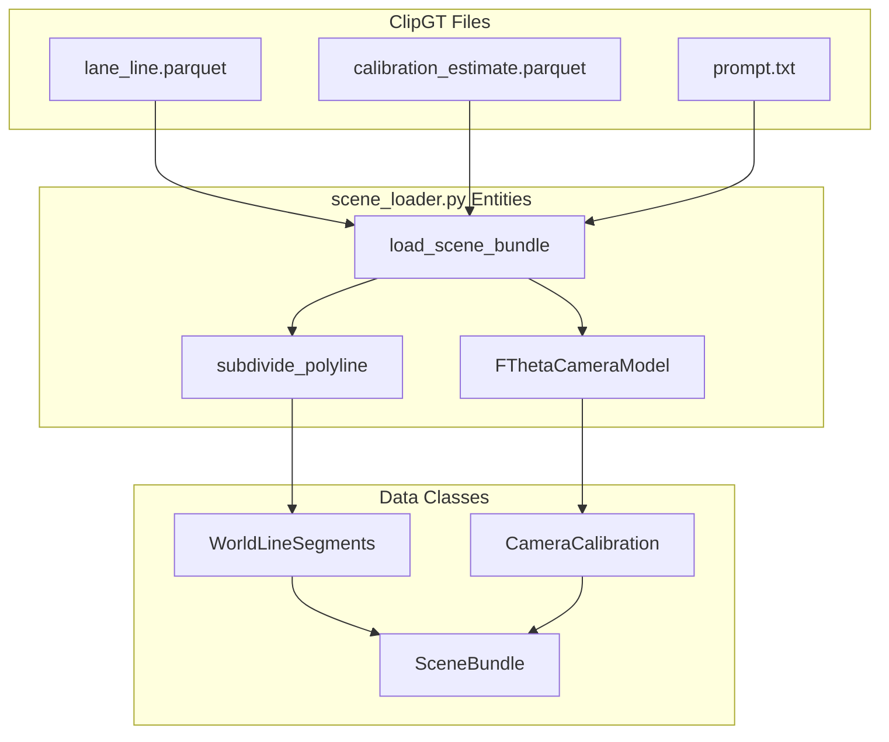
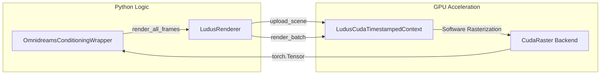

<!-- source: DeepWiki mcp.deepwiki.com · repo NVIDIA/flashdreams · page 6.2 HDMap Scene Loading and ClipGT Format · fetched 2026-10-26 -->

# HDMap Scene Loading and ClipGT Format

Relevant source files

The following files were used as context for generating this wiki page:

- [integrations/omnidreams/README.md](integrations/omnidreams/README.md)
- [integrations/omnidreams/ludus-renderer/ludus_renderer/clipgt.py](integrations/omnidreams/ludus-renderer/ludus_renderer/clipgt.py)
- [integrations/omnidreams/omnidreams/conditioning/conditioning_wrapper.py](integrations/omnidreams/omnidreams/conditioning/conditioning_wrapper.py)
- [integrations/omnidreams/omnidreams/conditioning/renderer.py](integrations/omnidreams/omnidreams/conditioning/renderer.py)
- [integrations/omnidreams/omnidreams/conditioning/world_scenario/ftheta.py](integrations/omnidreams/omnidreams/conditioning/world_scenario/ftheta.py)
- [integrations/omnidreams/omnidreams/interactive_drive/assets/scene_bundle.py](integrations/omnidreams/omnidreams/interactive_drive/assets/scene_bundle.py)
- [integrations/omnidreams/omnidreams/interactive_drive/camera.py](integrations/omnidreams/omnidreams/interactive_drive/camera.py)
- [integrations/omnidreams/omnidreams/interactive_drive/scene_fixture.py](integrations/omnidreams/omnidreams/interactive_drive/scene_fixture.py)
- [integrations/omnidreams/omnidreams/interactive_drive/scene_loader.py](integrations/omnidreams/omnidreams/interactive_drive/scene_loader.py)
- [integrations/omnidreams/omnidreams/prepare.py](integrations/omnidreams/omnidreams/prepare.py)
- [integrations/omnidreams/omnidreams/scenes.py](integrations/omnidreams/omnidreams/scenes.py)
- [integrations/omnidreams/omnidreams/webrtc/server.py](integrations/omnidreams/omnidreams/webrtc/server.py)
- [integrations/omnidreams/omnidreams/webrtc/session.py](integrations/omnidreams/omnidreams/webrtc/session.py)
- [integrations/omnidreams/tests/interactive_drive/test_hf_org.py](integrations/omnidreams/tests/interactive_drive/test_hf_org.py)
- [integrations/omnidreams/tests/interactive_drive/test_scene_helpers.py](integrations/omnidreams/tests/interactive_drive/test_scene_helpers.py)
- [integrations/omnidreams/tests/interactive_drive/test_scene_loader.py](integrations/omnidreams/tests/interactive_drive/test_scene_loader.py)
- [integrations/omnidreams/tests/test_conditioning_wrapper.py](integrations/omnidreams/tests/test_conditioning_wrapper.py)
- [integrations/omnidreams/tests/test_grpc_dynamic_actors.py](integrations/omnidreams/tests/test_grpc_dynamic_actors.py)
- [integrations/omnidreams/tests/test_ludus_renderer.py](integrations/omnidreams/tests/test_ludus_renderer.py)
- [integrations/omnidreams/tests/test_webrtc_runtime.py](integrations/omnidreams/tests/test_webrtc_runtime.py)

This page documents the data lifecycle for HDMap conditioning in FlashDreams, specifically focusing on the **ClipGT** parquet-based scene format and the loading infrastructure used by the **Ludus** GPU rasterizer.

## ClipGT Format Overview

The ClipGT format is a collection of Parquet files and associated assets (images, prompts) that define a driving scenario. It is designed for efficient streaming and high-fidelity reconstruction of road geometry and actor trajectories.

### Core Data Components
A standard ClipGT bundle (typically packaged as a `.usdz` archive) contains the following key files:

| File | Description |
| :--- | :--- |
| `lane_line.parquet` | Polylines representing lane markings, curbs, and road boundaries. |
| `calibration_estimate.parquet` | Extrinsic and intrinsic camera parameters, including FTheta coefficients. |
| `egomotion_estimate.parquet` | High-frequency trajectory of the ego-vehicle. |
| `first_image.png` / `frames/` | Ground-truth reference frames for seeding the world model. |
| `prompt.txt` | Textual description of the scene (weather, road type). |

Sources: [integrations/omnidreams/omnidreams/scenes.py:55-86](), [integrations/omnidreams/omnidreams/interactive_drive/scene_loader.py:86-106]()

## Scene Loading Logic

The `scene_loader.py` module handles the transformation of raw Parquet records into GPU-ready primitives for the Ludus renderer.

### Polyline Processing
Long road features (like several kilometers of highway) are processed through a pipeline to ensure rendering stability:
1.  **Subdivision**: `subdivide_polyline` adds intermediate points to maintain curvature.
2.  **Chunking**: To avoid precision issues and distance-fade in the rasterizer, long polylines are split into overlapping segments of approximately 80 meters.
3.  **Styling**: Lines are assigned colors and styles (dashed, solid, double-yellow) based on the `LANE_LINE_STYLE_CONFIG`.

### Cuboid Building
Dynamic actors (vehicles, pedestrians) are stored as tracks. The loader reconstructs 3D bounding boxes by:
1.  Extracting dimensions (length, width, height) from the metadata.
2.  Interpolating poses at specific timestamps using `WorldVehicleBBoxTrack`.
3.  Mapping object types to colors using `BBOX_V3_COLORS`.

### System Entity Mapping: Data Flow
The following diagram illustrates how raw ClipGT files are mapped to internal code objects during the loading phase.

"ClipGT to Internal Objects Mapping"

Sources: [integrations/omnidreams/omnidreams/interactive_drive/scene_loader.py:13-48](), [integrations/omnidreams/omnidreams/interactive_drive/scene_loader.py:433-471]()

## FTheta Camera Model

FlashDreams uses an **FTheta** (fisheye) camera model to support wide-FOV automotive sensors.

### Initialization
The `FThetaCamera` class is initialized using coefficients from the calibration Parquet. Key parameters include:
*   **Principal Point**: The optical center $(c_x, c_y)$.
*   **Forward Polynomial (`fw_poly`)**: Maps the angle from the optical axis ($\theta$) to the pixel radius ($r$).
*   **Inverse Polynomial**: Computed via `approximate_polynomial_inverse` to map pixel coordinates back to rays.

### Coordinate Systems
The renderer expects **FLU** (Front-Left-Up) coordinates. Poses are converted from the dataset's internal representation using `torch.linalg.inv(camera_poses)` to align with the Ludus camera space.

Sources: [integrations/omnidreams/omnidreams/conditioning/world_scenario/ftheta.py:125-193](), [integrations/omnidreams/omnidreams/conditioning/renderer.py:78-86]()

## GPU Parquet Pipeline

The loading pipeline is optimized to minimize CPU-GPU transfers. In the `LudusRenderer`, scene data is uploaded to GPU memory once and referenced via handles.

### Ludus Integration
The `LudusRenderer` wraps the underlying C++ `ludus_renderer` library:
1.  **Context Setup**: `LudusCudaTimestampedContext` manages CUDA resources and MSAA.
2.  **Scene Upload**: The `TimestampedScene` object (containing polylines, polygons, and cubes) is uploaded to the GPU.
3.  **Dynamic Overlays**: For interactive use cases, a `CubePool` can be dynamically updated to reflect real-time ego or actor movements without re-uploading the static map.

### Rendering Workflow
"GPU Rendering Pipeline"

Sources: [integrations/omnidreams/omnidreams/conditioning/renderer.py:51-88](), [integrations/omnidreams/omnidreams/conditioning/renderer.py:123-145](), [integrations/omnidreams/omnidreams/conditioning/renderer.py:162-180]()

## Scene Staging and Cache

Scenes are typically resolved from Hugging Face using the `omnidreams-prepare` utility.

1.  **UUID Resolution**: Coerces `clipgt-<uuid>` stems to bare UUIDs via `normalise_scene_uuid`.
2.  **Archive Handling**: The desktop demo (`interactive_drive`) reads directly from the `.usdz` zip archive, while the WebRTC server extracts the payload into `$FLASHDREAMS_CACHE_DIR/omnidreams-scenes/<uuid>/clipgt/`.
3.  **Variant Selection**: Weather variants (rain, snow) are stored as sibling archives and selected via the `--scene-variant` flag.

Sources: [integrations/omnidreams/omnidreams/scenes.py:116-158](), [integrations/omnidreams/omnidreams/prepare.py:36-43]()

---

