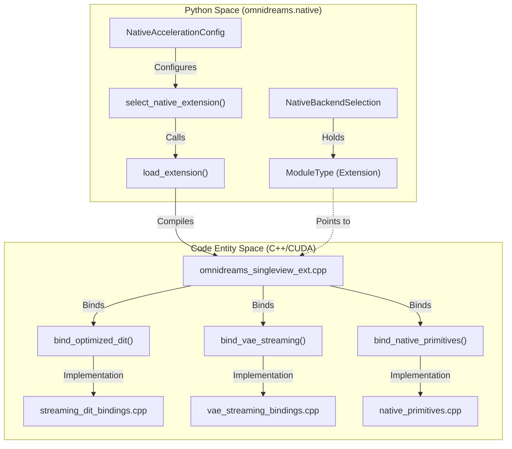
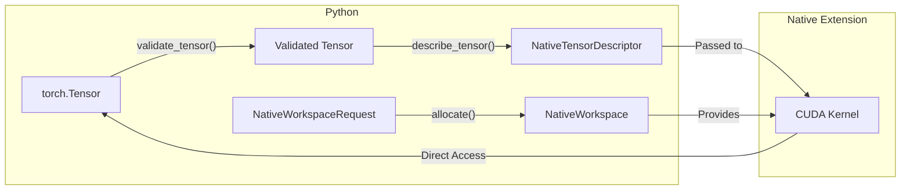

<!-- source: DeepWiki mcp.deepwiki.com · repo NVIDIA/flashdreams · page 7 Native Acceleration (omnidreams_singleview) · fetched 2026-10-26 -->

# Native Acceleration (omnidreams_singleview)

Relevant source files

The following files were used as context for generating this wiki page:

- [THIRD-PARTY-NOTICES](THIRD-PARTY-NOTICES)
- [docs/source/api/integrations.rst](docs/source/api/integrations.rst)
- [docs/source/developer_guides/inference_pipeline_overview.rst](docs/source/developer_guides/inference_pipeline_overview.rst)
- [docs/source/models/index.rst](docs/source/models/index.rst)
- [integrations/omnidreams/omnidreams/native/__init__.py](integrations/omnidreams/omnidreams/native/__init__.py)
- [integrations/omnidreams/omnidreams/native/acceleration.py](integrations/omnidreams/omnidreams/native/acceleration.py)
- [integrations/omnidreams/omnidreams/native/omnidreams_singleview.py](integrations/omnidreams/omnidreams/native/omnidreams_singleview.py)
- [integrations/omnidreams/omnidreams_singleview/README.md](integrations/omnidreams/omnidreams_singleview/README.md)
- [integrations/omnidreams/omnidreams_singleview/patches/cutlass/include/cute/atom/detail/tma_descriptor_pool.hpp](integrations/omnidreams/omnidreams_singleview/patches/cutlass/include/cute/atom/detail/tma_descriptor_pool.hpp)
- [integrations/omnidreams/omnidreams_singleview/patches/cutlass/sm120-tma-pool.patch](integrations/omnidreams/omnidreams_singleview/patches/cutlass/sm120-tma-pool.patch)
- [integrations/omnidreams/omnidreams_singleview/src/native_primitives_cuda.cu](integrations/omnidreams/omnidreams_singleview/src/native_primitives_cuda.cu)
- [integrations/omnidreams/omnidreams_singleview/src/omnidreams_singleview_ext.cpp](integrations/omnidreams/omnidreams_singleview/src/omnidreams_singleview_ext.cpp)
- [integrations/omnidreams/omnidreams_singleview/thirdparty_sources.json](integrations/omnidreams/omnidreams_singleview/thirdparty_sources.json)
- [integrations/omnidreams/omnidreams_singleview/tools/native_build.py](integrations/omnidreams/omnidreams_singleview/tools/native_build.py)
- [integrations/omnidreams/tests/test_omnidreams_singleview_native.py](integrations/omnidreams/tests/test_omnidreams_singleview_native.py)

The OmniDreams integration utilizes a high-performance JIT-compiled CUDA/C++ extension, `omnidreams_singleview`, to accelerate critical paths in the world model's inference pipeline. This extension provides optimized kernels for Diffusion Transformer (DiT) execution and VAE encoding/decoding, specifically targeting Blackwell (SM120) and Hopper (SM90) architectures.

The system is designed to bridge the gap between high-level Python orchestration and low-level hardware primitives, integrating third-party libraries like **CUTLASS**, **cuDNN**, **SageAttention**, and **SpargeAttn** into a unified acceleration backend.

### System Architecture Overview

The native acceleration layer consists of a Python management shim that handles just-in-time (JIT) compilation via `torch.utils.cpp_extension` and a C++ core that implements the optimized operators.

#### Component Mapping: Python to Native
The following diagram illustrates how Python-side configuration and loading logic maps to the underlying native source entities.

"Native Acceleration Entity Mapping"

Sources: [integrations/omnidreams/omnidreams/native/acceleration.py:107-114](), [integrations/omnidreams/omnidreams/native/omnidreams_singleview.py:163-228](), [integrations/omnidreams/omnidreams_singleview/src/omnidreams_singleview_ext.cpp:88-94]()

### Build and Management System

The extension uses a script-managed build system to ensure that third-party dependencies are pinned to specific versions and patched for compatibility.

*   **JIT Compilation**: The `load_extension()` function uses `torch.utils.cpp_extension.load` to compile the C++ and CUDA sources on-the-fly, caching the resulting shared object in a configurable build root [integrations/omnidreams/omnidreams/native/omnidreams_singleview.py:163-189]().
*   **Source Fingerprinting**: To ensure cache integrity, the system calculates a SHA256 fingerprint of all source files and header dependencies before attempting a load [integrations/omnidreams/omnidreams/native/omnidreams_singleview.py:145-161]().
*   **Third-Party Synchronization**: Dependencies like **CUTLASS** and **cuDNN-frontend** are managed via `thirdparty_sources.json` and a synchronization tool that applies local patches, such as the Blackwell SM120 TMA descriptor fix [integrations/omnidreams/omnidreams_singleview/thirdparty_sources.json:1-44]().

For details on the loading lifecycle and backend selection logic, see **[Extension Loading and Backend Selection](#7.1)**.

Sources: [integrations/omnidreams/omnidreams/native/omnidreams_singleview.py:163-228](), [integrations/omnidreams/omnidreams_singleview/tools/native_build.py:196-205](), [integrations/omnidreams/omnidreams_singleview/thirdparty_sources.json:1-44]()

### Acceleration Modes and Capabilities

The native layer exposes specialized executors and kernels that significantly outperform standard PyTorch implementations for streaming world model tasks.

| Component | Acceleration Features |
| :--- | :--- |
| **DiT Executor** | Optimized attention backends (cuDNN, Sage3, Sparge), fused AdaLN-LoRA, and FP8 GEMM kernels. |
| **VAE Encoder** | `omnidreams_vae_encode_wan_fp8` for low-latency causal encoding of high-resolution video frames. |
| **Primitives** | Native tensor layout descriptors and workspace management for zero-copy memory interop. |

#### Data Flow: Native Tensor Management
The following diagram shows how Python tensors are prepared and passed to native kernels using the primitive system.

"Native Tensor Interop Flow"

Sources: [integrations/omnidreams/omnidreams/native/primitives.py:33-45](), [integrations/omnidreams/omnidreams/native/omnidreams_singleview.py:153-182]()

For a deep dive into the specific kernels and the Blackwell-specific memory optimizations, see **[Native DiT and VAE Kernels](#7.2)**.

### Sub-Pages

- **[Extension Loading and Backend Selection](#7.1)**
  Detailed documentation of the JIT build process, SHA256 source fingerprinting, and the `NativeAccelerationConfig` policy (auto/disabled/required).
- **[Native DiT and VAE Kernels](#7.2)**
  Deep dive into `OptimizedDiTExecutor`, FP8 attention backends, and the custom CUTLASS patches for SM120 TMA descriptor management.

Sources: [integrations/omnidreams/omnidreams/native/acceleration.py:32-75](), [integrations/omnidreams/omnidreams/native/omnidreams_singleview.py:16-55](), [integrations/omnidreams/omnidreams_singleview/patches/cutlass/sm120-tma-pool.patch:42-62]()

---

