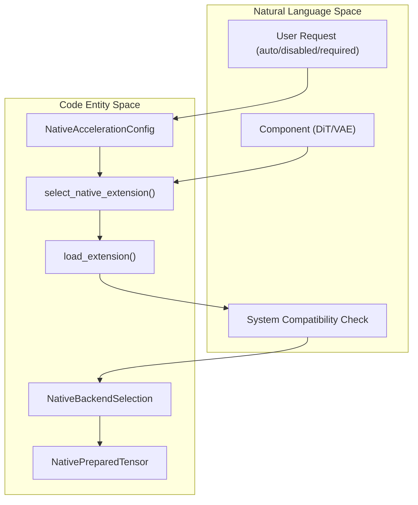
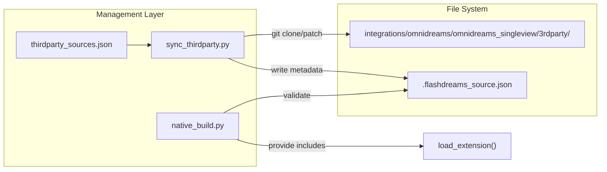

<!-- source: DeepWiki mcp.deepwiki.com · repo NVIDIA/flashdreams · page 7.1 Extension Loading and Backend Selection · fetched 2026-10-26 -->

# Extension Loading and Backend Selection

Relevant source files

The following files were used as context for generating this wiki page:

- [.gitignore](.gitignore)
- [agentic/skills/README.md](agentic/skills/README.md)
- [integrations/omnidreams/omnidreams/native/__init__.py](integrations/omnidreams/omnidreams/native/__init__.py)
- [integrations/omnidreams/omnidreams/native/acceleration.py](integrations/omnidreams/omnidreams/native/acceleration.py)
- [integrations/omnidreams/omnidreams/native/omnidreams_singleview.py](integrations/omnidreams/omnidreams/native/omnidreams_singleview.py)
- [integrations/omnidreams/omnidreams/native/primitives.py](integrations/omnidreams/omnidreams/native/primitives.py)
- [integrations/omnidreams/omnidreams_singleview/.gitignore](integrations/omnidreams/omnidreams_singleview/.gitignore)
- [integrations/omnidreams/omnidreams_singleview/README.md](integrations/omnidreams/omnidreams_singleview/README.md)
- [integrations/omnidreams/omnidreams_singleview/src/native_primitives_cuda.cu](integrations/omnidreams/omnidreams_singleview/src/native_primitives_cuda.cu)
- [integrations/omnidreams/omnidreams_singleview/src/omnidreams_singleview_ext.cpp](integrations/omnidreams/omnidreams_singleview/src/omnidreams_singleview_ext.cpp)
- [integrations/omnidreams/omnidreams_singleview/tools/native_build.py](integrations/omnidreams/omnidreams_singleview/tools/native_build.py)
- [integrations/omnidreams/omnidreams_singleview/tools/sync_thirdparty.py](integrations/omnidreams/omnidreams_singleview/tools/sync_thirdparty.py)
- [integrations/omnidreams/tests/test_omnidreams_singleview_native.py](integrations/omnidreams/tests/test_omnidreams_singleview_native.py)
- [integrations/omnidreams/tests/test_sync_thirdparty.py](integrations/omnidreams/tests/test_sync_thirdparty.py)

This page documents the native acceleration infrastructure for OmniDreams, focusing on the JIT (Just-In-Time) compilation of CUDA/C++ extensions, source provenance management, and the logic for selecting between Python and native backends.

The system is designed to provide high-performance DiT (Diffusion Transformer) and VAE kernels while maintaining a "source-first" approach where extensions are compiled on the user's machine to match their specific GPU architecture and environment.

## Architecture Overview

The native acceleration layer consists of a Python management interface that wraps a high-performance C++/CUDA core. It manages third-party dependencies (like CUTLASS and SageAttention) and uses `torch.utils.cpp_extension` for JIT compilation.

### Native Backend Selection Flow

The selection process determines whether to use the optimized native kernels or fall back to standard PyTorch implementations based on a `NativeAccelerationConfig`.

**Sources:**
- `NativeAccelerationConfig` definition: [integrations/omnidreams/omnidreams/native/acceleration.py:53-75]()
- `select_native_extension` logic: [integrations/omnidreams/omnidreams/native/acceleration.py:107-157]()

---

## Extension Loading and JIT Compilation

The core of the acceleration system is `load_extension()`, which handles the JIT compilation of the `omnidreams_singleview` module.

### Compilation Lifecycle
1.  **Source Gathering**: Collects all `.cpp`, `.cu`, and `.h` files from the `src` directory [integrations/omnidreams/omnidreams_singleview/src:1-182]().
2.  **Fingerprinting**: Generates a SHA256 hash of all source files to determine if a re-build is necessary [integrations/omnidreams/omnidreams/native/omnidreams_singleview.py:145-150]().
3.  **Third-Party Validation**: Ensures dependencies in `3rdparty/` match the pinned versions in `thirdparty_sources.json` [integrations/omnidreams/omnidreams/native/omnidreams_singleview.py:85-91]().
4.  **Torch Extension Load**: Calls `torch.utils.cpp_extension.load` with optimized flags, including `O3`, `fast-math`, and specific CUDA architecture targets (defaulting to `12.0a` for Blackwell) [integrations/omnidreams/omnidreams/native/omnidreams_singleview.py:55-182]().

### Acceleration Modes
The `NativeAccelerationMode` [integrations/omnidreams/omnidreams/native/acceleration.py:32-32]() controls the loading behavior:
| Mode | Behavior |
| :--- | :--- |
| `disabled` | Never attempts to load native code; uses Python/PyTorch fallbacks. |
| `auto` | Attempts to load/compile. If it fails (e.g., no CUDA), it silently falls back to Python. |
| `required` | Attempts to load/compile. Raises `NativeAccelerationUnavailable` on failure. |

**Sources:**
- `load_extension` implementation: [integrations/omnidreams/omnidreams/native/omnidreams_singleview.py:163-182]()
- Source fingerprinting: [integrations/omnidreams/omnidreams/native/omnidreams_singleview.py:185-195]()

---

## Third-Party Source Management

Because the native kernels rely on external libraries (CUTLASS, SageAttention, SpargeAttn, cuDNN-frontend), the repository includes a management system to ensure reproducible builds without vendoring large amounts of code directly into Git.

### Source Provenance Flow

### Key Components
- **`thirdparty_sources.json`**: A manifest file defining Git repositories, specific commit SHAs, and required patches for dependencies [integrations/omnidreams/omnidreams_singleview/tools/sync_thirdparty.py:205-223]().
- **`sync_thirdparty.py`**: A utility that clones dependencies, applies patches, and writes a `.flashdreams_source.json` "stamp" to verify the tree integrity [integrations/omnidreams/omnidreams_singleview/tools/sync_thirdparty.py:34-124]().
- **`native_build.py`**: Provides the Python interface for the build system to find include paths and validate that the source tree hasn't drifted [integrations/omnidreams/omnidreams_singleview/tools/native_build.py:155-171]().

**Sources:**
- `SourceSpec` and `SyncResult`: [integrations/omnidreams/omnidreams_singleview/tools/sync_thirdparty.py:55-75]()
- `validate_thirdparty`: [integrations/omnidreams/omnidreams_singleview/tools/native_build.py:155-171]()

---

## Primitives and Tensor Preparation

Before calling into native C++ code, tensors must be validated and prepared to ensure they meet the expectations of the CUDA kernels (e.g., contiguity, specific dtypes, and memory alignment).

### NativeTensorLayout and Spec
The system uses `NativeTensorLayout` to define named axes (e.g., `"B L D"`) and `NativeTensorSpec` to enforce constraints [integrations/omnidreams/omnidreams/native/primitives.py:34-114]().

### Preparation Pipeline
1.  **`describe_tensor()`**: Extracts metadata (shape, stride, dtype) from a `torch.Tensor` [integrations/omnidreams/omnidreams/native/primitives.py:160-182]().
2.  **`validate_tensor()`**: Checks if the tensor matches the `NativeTensorSpec` [integrations/omnidreams/omnidreams/native/primitives.py:185-190]().
3.  **`prepare_tensor_for_native()`**: Ensures the tensor is contiguous if required by the spec. If it is not, it creates a contiguous copy and returns a `NativePreparedTensor` [integrations/omnidreams/omnidreams/native/primitives.py:193-212]().

### Workspace Management
Native kernels often require temporary "workspace" memory. The `NativeWorkspaceRequest` class allows components to request specific amounts of memory that are allocated as standard `torch.Tensor` objects, allowing the PyTorch allocator to manage the memory while providing raw pointers to the C++ backend [integrations/omnidreams/omnidreams/native/primitives.py:125-159]().

**Sources:**
- `NativeTensorLayout`: [integrations/omnidreams/omnidreams/native/primitives.py:34-65]()
- `NativeTensorSpec`: [integrations/omnidreams/omnidreams/native/primitives.py:82-114]()
- `allocate_native_workspaces`: [integrations/omnidreams/omnidreams/native/primitives.py:215-220]()

---

