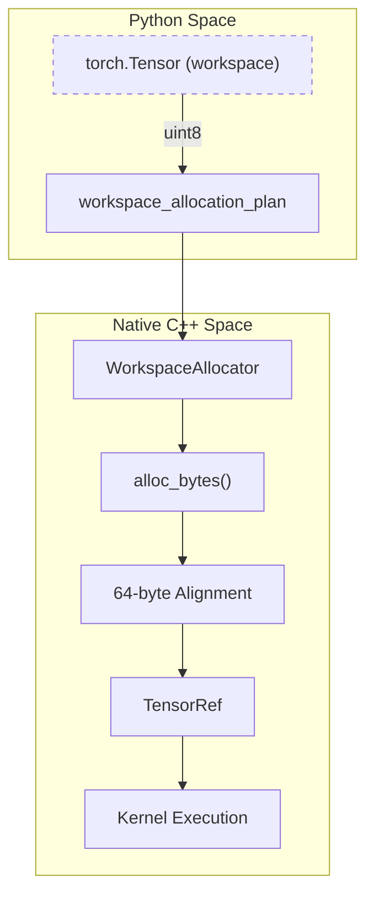
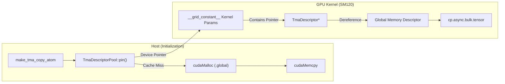

<!-- source: DeepWiki mcp.deepwiki.com · repo NVIDIA/flashdreams · page 7.2 Native DiT and VAE Kernels · fetched 2026-10-26 -->

# Native DiT and VAE Kernels

Relevant source files

The following files were used as context for generating this wiki page:

- [THIRD-PARTY-NOTICES](THIRD-PARTY-NOTICES)
- [docs/source/api/integrations.rst](docs/source/api/integrations.rst)
- [docs/source/developer_guides/inference_pipeline_overview.rst](docs/source/developer_guides/inference_pipeline_overview.rst)
- [docs/source/models/index.rst](docs/source/models/index.rst)
- [integrations/omnidreams/omnidreams/transformer/__init__.py](integrations/omnidreams/omnidreams/transformer/__init__.py)
- [integrations/omnidreams/omnidreams/vae_native.py](integrations/omnidreams/omnidreams/vae_native.py)
- [integrations/omnidreams/omnidreams_singleview/patches/cutlass/include/cute/atom/detail/tma_descriptor_pool.hpp](integrations/omnidreams/omnidreams_singleview/patches/cutlass/include/cute/atom/detail/tma_descriptor_pool.hpp)
- [integrations/omnidreams/omnidreams_singleview/patches/cutlass/sm120-tma-pool.patch](integrations/omnidreams/omnidreams_singleview/patches/cutlass/sm120-tma-pool.patch)
- [integrations/omnidreams/omnidreams_singleview/python/cosmos_fp8_utils.py](integrations/omnidreams/omnidreams_singleview/python/cosmos_fp8_utils.py)
- [integrations/omnidreams/omnidreams_singleview/python/cosmos_weights.py](integrations/omnidreams/omnidreams_singleview/python/cosmos_weights.py)
- [integrations/omnidreams/omnidreams_singleview/python/optimized_dit.py](integrations/omnidreams/omnidreams_singleview/python/optimized_dit.py)
- [integrations/omnidreams/omnidreams_singleview/python/vae_weights.py](integrations/omnidreams/omnidreams_singleview/python/vae_weights.py)
- [integrations/omnidreams/omnidreams_singleview/src/dit_streaming/common/attn_backend.h](integrations/omnidreams/omnidreams_singleview/src/dit_streaming/common/attn_backend.h)
- [integrations/omnidreams/omnidreams_singleview/src/dit_streaming/common/cuda_utils.cuh](integrations/omnidreams/omnidreams_singleview/src/dit_streaming/common/cuda_utils.cuh)
- [integrations/omnidreams/omnidreams_singleview/src/dit_streaming/common/math_compat.hpp](integrations/omnidreams/omnidreams_singleview/src/dit_streaming/common/math_compat.hpp)
- [integrations/omnidreams/omnidreams_singleview/src/dit_streaming/common/profile_config.h](integrations/omnidreams/omnidreams_singleview/src/dit_streaming/common/profile_config.h)
- [integrations/omnidreams/omnidreams_singleview/src/dit_streaming/common/profiler.h](integrations/omnidreams/omnidreams_singleview/src/dit_streaming/common/profiler.h)
- [integrations/omnidreams/omnidreams_singleview/src/native_common/macros.h](integrations/omnidreams/omnidreams_singleview/src/native_common/macros.h)
- [integrations/omnidreams/omnidreams_singleview/src/native_common/scalar_types.h](integrations/omnidreams/omnidreams_singleview/src/native_common/scalar_types.h)
- [integrations/omnidreams/omnidreams_singleview/src/native_common/tensor_ref.h](integrations/omnidreams/omnidreams_singleview/src/native_common/tensor_ref.h)
- [integrations/omnidreams/omnidreams_singleview/src/native_common/tensor_ref_torch.h](integrations/omnidreams/omnidreams_singleview/src/native_common/tensor_ref_torch.h)
- [integrations/omnidreams/omnidreams_singleview/src/native_common/workspace_allocator.h](integrations/omnidreams/omnidreams_singleview/src/native_common/workspace_allocator.h)
- [integrations/omnidreams/omnidreams_singleview/src/native_primitives.cpp](integrations/omnidreams/omnidreams_singleview/src/native_primitives.cpp)
- [integrations/omnidreams/omnidreams_singleview/src/native_primitives.h](integrations/omnidreams/omnidreams_singleview/src/native_primitives.h)
- [integrations/omnidreams/omnidreams_singleview/src/vae_streaming/lightvae_fp8_attention.cu](integrations/omnidreams/omnidreams_singleview/src/vae_streaming/lightvae_fp8_attention.cu)
- [integrations/omnidreams/omnidreams_singleview/src/vae_streaming/lightvae_fp8_direct_stages.cu](integrations/omnidreams/omnidreams_singleview/src/vae_streaming/lightvae_fp8_direct_stages.cu)
- [integrations/omnidreams/omnidreams_singleview/src/vae_streaming/lightvae_fp8_ops.cu](integrations/omnidreams/omnidreams_singleview/src/vae_streaming/lightvae_fp8_ops.cu)
- [integrations/omnidreams/omnidreams_singleview/thirdparty_sources.json](integrations/omnidreams/omnidreams_singleview/thirdparty_sources.json)

This page documents the high-performance CUDA/C++ kernels and Python orchestration layers for the OmniDreams single-view pipeline. These components provide JIT-compiled acceleration for Diffusion Transformers (DiT) and Variational Autoencoders (VAE), specifically targeting FP8 inference on NVIDIA Hopper (SM90) and Blackwell (SM120) architectures.

## Optimized DiT Execution

The `OptimizedDiTExecutor` serves as the primary interface for accelerated DiT inference. It manages the lifecycle of native backends and provides specialized attention implementations.

### Attention Backends
The framework supports multiple FP8-optimized attention backends, selected based on hardware capability and performance characteristics:
*   **cuDNN**: Leverages `cudnn-frontend` for robust FP8 attention support [integrations/omnidreams/omnidreams_singleview/thirdparty_sources.json:38-42]().
*   **SageAttention**: A high-performance FP8 attention implementation [integrations/omnidreams/omnidreams_singleview/thirdparty_sources.json:26-30]().
*   **SpargeAttn**: Specialized sparse attention backend [integrations/omnidreams/omnidreams_singleview/thirdparty_sources.json:32-36]().

### Data Flow: Python to Native
The transition from PyTorch tensors to native C++ structures is facilitated by the `NativeTensorDescriptor`.

| Entity | Description |
| :--- | :--- |
| `native_tensor_descriptor` | Extracts metadata (shape, stride, dtype, nbytes) from a `torch::Tensor` [integrations/omnidreams/omnidreams_singleview/src/native_primitives.cpp:132-146](). |
| `native_tensor_ref_descriptor` | Creates a rank-aware descriptor (up to Rank 8) for native `TensorRef` structures [integrations/omnidreams/omnidreams_singleview/src/native_primitives.cpp:148-170](). |
| `TensorRef<T, Rank>` | A lightweight C++ template that wraps a raw pointer with shape and stride information, providing `operator()` indexing and slicing [integrations/omnidreams/omnidreams_singleview/src/native_common/tensor_ref.h:28-35](). |

**Sources:** [integrations/omnidreams/omnidreams_singleview/python/optimized_dit.py](), [integrations/omnidreams/omnidreams_singleview/src/native_primitives.cpp:132-170](), [integrations/omnidreams/omnidreams_singleview/src/native_common/tensor_ref.h:28-35]()

## VAE FP8 Encoding

The `omnidreams_vae_encode_wan_fp8` kernel provides a native implementation of the Wan VAE encoder path using FP8 precision.

### Implementation Details
*   **Direct Stages**: Uses `lightvae_fp8_direct_stages.cu` to fuse multiple VAE encoding operations into single-kernel launches.
*   **Attention**: Specialized FP8 attention kernels for the VAE bottleneck are implemented in `lightvae_fp8_attention.cu`.
*   **Memory Management**: Workspace allocation is handled by the `WorkspaceAllocator`, which ensures proper 64-byte alignment required for TMA (Tensor Memory Accelerator) operations [integrations/omnidreams/omnidreams_singleview/src/native_common/workspace_allocator.h:73-88]().

**Sources:** [integrations/omnidreams/omnidreams/vae_native.py](), [integrations/omnidreams/omnidreams_singleview/src/native_common/workspace_allocator.h:73-88]()

## Workspace Allocation and Layouts

Native kernels require a pre-allocated "scratchpad" of memory to avoid runtime `cudaMalloc` overhead.

### Workspace Allocation Plan
The `workspace_allocation_plan` function calculates offsets and sizes for multiple sub-buffers within a single contiguous `torch.uint8` workspace tensor [integrations/omnidreams/omnidreams_singleview/src/native_primitives.cpp:172-205]().

### Memory Alignment Diagram
Title: Workspace Allocation and TensorRef Mapping

**Sources:** [integrations/omnidreams/omnidreams_singleview/src/native_primitives.cpp:172-205](), [integrations/omnidreams/omnidreams_singleview/src/native_common/workspace_allocator.h:61-71](), [integrations/omnidreams/omnidreams_singleview/src/native_common/tensor_ref.h:28-35]()

## Blackwell (SM120) TMA Descriptor Pool

A critical patch is applied to the CUTLASS library to support TMA on Blackwell (SM120) architectures when using CUDA 13.x.

### The SM120 Spill Bug
On Blackwell, `nvcc` may materialize `__grid_constant__` kernel parameters (which embed 128-byte `TmaDescriptor` objects) into thread-local memory. This causes PTX instructions like `prefetch.tensormap` to abort with a "Misaligned shared or local address" error [integrations/omnidreams/omnidreams_singleview/patches/cutlass/include/cute/atom/detail/tma_descriptor_pool.hpp:9-15]().

### Workaround: TmaDescriptorPool
The repository includes a custom `TmaDescriptorPool` to bypass this issue:
1.  **Global Storage**: Actual TMA descriptor bytes are stored in `cudaMalloc`'d global memory (guaranteed `.global` state space) [integrations/omnidreams/omnidreams_singleview/patches/cutlass/include/cute/atom/detail/tma_descriptor_pool.hpp:17-22]().
2.  **Pointer Injection**: `Copy_Traits` is patched to store a `TmaDescriptor const*` pointer instead of the descriptor by value [integrations/omnidreams/omnidreams_singleview/patches/cutlass/sm120-tma-pool.patch:65-71]().
3.  **Content-Based Caching**: The pool deduplicates descriptors by content, allowing it to function safely under CUDA Graph capture without triggering illegal `cudaMemcpy` calls [integrations/omnidreams/omnidreams_singleview/patches/cutlass/include/cute/atom/detail/tma_descriptor_pool.hpp:24-30]().

### TMA Descriptor Flow Diagram
Title: SM120 TMA Descriptor Workaround

**Sources:** [integrations/omnidreams/omnidreams_singleview/patches/cutlass/sm120-tma-pool.patch:1-108](), [integrations/omnidreams/omnidreams_singleview/patches/cutlass/include/cute/atom/detail/tma_descriptor_pool.hpp:1-41](), [integrations/omnidreams/omnidreams_singleview/thirdparty_sources.json:12-17]()

---

