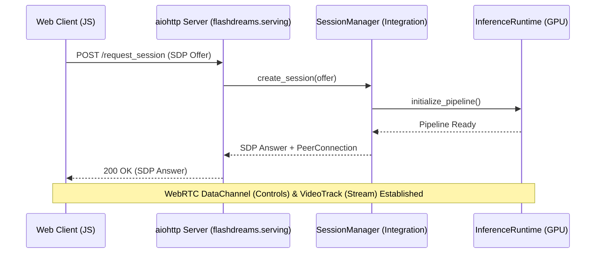
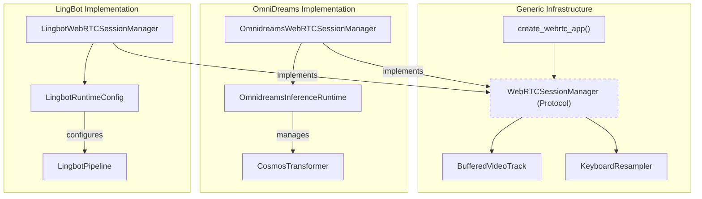

<!-- source: DeepWiki mcp.deepwiki.com · repo NVIDIA/flashdreams · page 8 Serving Infrastructure · fetched 2026-10-26 -->

# Serving Infrastructure

Relevant source files

The following files were used as context for generating this wiki page:

- [docs/source/api/core.rst](docs/source/api/core.rst)
- [docs/source/api/index.rst](docs/source/api/index.rst)
- [docs/source/developer_guides/config_system.rst](docs/source/developer_guides/config_system.rst)
- [docs/source/developer_guides/index.rst](docs/source/developer_guides/index.rst)
- [docs/source/developer_guides/interactive_serving.rst](docs/source/developer_guides/interactive_serving.rst)
- [docs/source/developer_guides/new_integration.rst](docs/source/developer_guides/new_integration.rst)
- [docs/source/developer_guides/usage_patterns.rst](docs/source/developer_guides/usage_patterns.rst)
- [integrations/lingbot/lingbot/webrtc/server.py](integrations/lingbot/lingbot/webrtc/server.py)
- [integrations/lingbot/lingbot/webrtc/session.py](integrations/lingbot/lingbot/webrtc/session.py)
- [integrations/lingbot/lingbot/webrtc/web/request_session.css](integrations/lingbot/lingbot/webrtc/web/request_session.css)
- [integrations/lingbot/lingbot/webrtc/web/request_session.html](integrations/lingbot/lingbot/webrtc/web/request_session.html)
- [integrations/lingbot/lingbot/webrtc/web/request_session.js](integrations/lingbot/lingbot/webrtc/web/request_session.js)
- [integrations/lingbot/tests/test_server_routes.py](integrations/lingbot/tests/test_server_routes.py)
- [integrations/lingbot/tests/test_webrtc_runtime.py](integrations/lingbot/tests/test_webrtc_runtime.py)
- [integrations/lingbot/tests/test_webrtc_runtime_distributed.py](integrations/lingbot/tests/test_webrtc_runtime_distributed.py)
- [integrations/omnidreams/README.md](integrations/omnidreams/README.md)
- [integrations/omnidreams/omnidreams/interactive_drive/scene_loader.py](integrations/omnidreams/omnidreams/interactive_drive/scene_loader.py)
- [integrations/omnidreams/omnidreams/prepare.py](integrations/omnidreams/omnidreams/prepare.py)
- [integrations/omnidreams/omnidreams/scenes.py](integrations/omnidreams/omnidreams/scenes.py)
- [integrations/omnidreams/omnidreams/webrtc/server.py](integrations/omnidreams/omnidreams/webrtc/server.py)
- [integrations/omnidreams/omnidreams/webrtc/session.py](integrations/omnidreams/omnidreams/webrtc/session.py)
- [integrations/omnidreams/tests/test_webrtc_runtime.py](integrations/omnidreams/tests/test_webrtc_runtime.py)

The FlashDreams serving layer provides a high-performance, low-latency framework for interactive world model streaming. It is built primarily on **WebRTC** for real-time video delivery and control feedback, with support for **gRPC** for structured inference requests.

The infrastructure is designed to be integration-agnostic, allowing different world models (e.g., OmniDreams, LingBot) to share a common server abstraction, session management protocol, and frontend client.

## Shared WebRTC Server Abstraction

The core of the serving layer resides in `flashdreams/serving/webrtc/`. It abstracts away the complexities of SDP (Session Description Protocol) negotiation, ICE gathering, and media track management.

*   **`create_webrtc_app()`**: A factory function that initializes an `aiohttp` web application with standard routes for session negotiation and static asset serving [integrations/omnidreams/omnidreams/webrtc/server.py:125-130]().
*   **`WebRTCSessionManager`**: A Python `Protocol` that integrations must implement to handle the lifecycle of a WebRTC session, including creating the peer connection and managing inference runtimes [integrations/omnidreams/omnidreams/webrtc/server.py:30-30]().
*   **`BufferedVideoTrack`**: A custom `aiortc` MediaStreamTrack that handles the frame-to-video encoding and ensures smooth playback of generated world model chunks [integrations/omnidreams/omnidreams/webrtc/session.py:63-63]().

For a deep dive into the server implementation and the shared HTML/JS client, see **[WebRTC Server Abstraction](#8.1)**.

### WebRTC Connection Flow

The following diagram illustrates how the generic server infrastructure interacts with integration-specific managers.

**WebRTC Session Initialization Flow**

Sources: [integrations/omnidreams/omnidreams/webrtc/server.py:119-133](), [integrations/lingbot/lingbot/webrtc/server.py:134-149]()

## Integration Patterns

FlashDreams supports diverse interaction patterns by extending the base serving classes.

### OmniDreams (Interactive Driving)
The OmniDreams integration uses the serving layer to provide a real-time driving simulation. It utilizes a `CameraPoseIntegrator` to translate WSAD keyboard inputs from the WebRTC DataChannel into 6-DOF camera trajectories [integrations/omnidreams/omnidreams/webrtc/session.py:57-62]().
*   **Scene Staging**: Uses `hf_hub_download_scene` to fetch USDZ assets containing HDMap data and initial frames [integrations/omnidreams/omnidreams/scenes.py:46-50]().
*   **HDMap Streaming**: Supports a `debug_serve_hdmaps` mode which streams the rendered conditioning frames directly, bypassing the diffusion model for debugging [integrations/omnidreams/omnidreams/webrtc/server.py:103-109]().

### LingBot (Action-Bound I2V)
LingBot focuses on Image-to-Video (I2V) generation with trajectory control. Its server implementation includes additional API routes for uploading initial frames and setting text prompts via multipart forms [integrations/lingbot/lingbot/webrtc/server.py:146-148]().

**Serving Architecture Components**

Sources: [integrations/omnidreams/omnidreams/webrtc/session.py:21-68](), [integrations/lingbot/lingbot/webrtc/session.py:43-53]()

## Building New Integrations

Developers can create new interactive serving applications by following the established plugin contract. This involves:
1.  Defining a `runner.py` that registers the model via entry points [integrations/omnidreams/README.md:40-48]().
2.  Implementing a `WebRTCSessionManager` to handle integration-specific logic like scene loading or custom control signals [integrations/lingbot/lingbot/webrtc/server.py:63-67]().
3.  Utilizing the `flashdreams.infra.config` system to manage complex pipeline parameters [integrations/lingbot/lingbot/webrtc/session.py:42-42]().

For a step-by-step walkthrough, see **[Developer Guide: Building New Integrations](#8.2)**.

## Related Components

| Component | Description | File Reference |
| :--- | :--- | :--- |
| **KeyboardResampler** | Normalizes high-frequency client inputs into fixed-interval action steps. | [flashdreams/serving/webrtc/controls.py]() |
| **PoseIntegrator** | Computes 3D camera transforms from movement deltas. | [integrations/omnidreams/omnidreams/webrtc/session.py:59-59]() |
| **SessionBusyError** | Raised when a server instance is already handling a session. | [flashdreams/serving/webrtc/server.py:64-64]() |
| **HF Scene Resolver** | Logic for fetching and caching USDZ scene archives. | [integrations/omnidreams/omnidreams/scenes.py:1-40]() |

Sources: [integrations/omnidreams/omnidreams/webrtc/session.py:57-68](), [integrations/omnidreams/omnidreams/scenes.py:1-40]()

---

