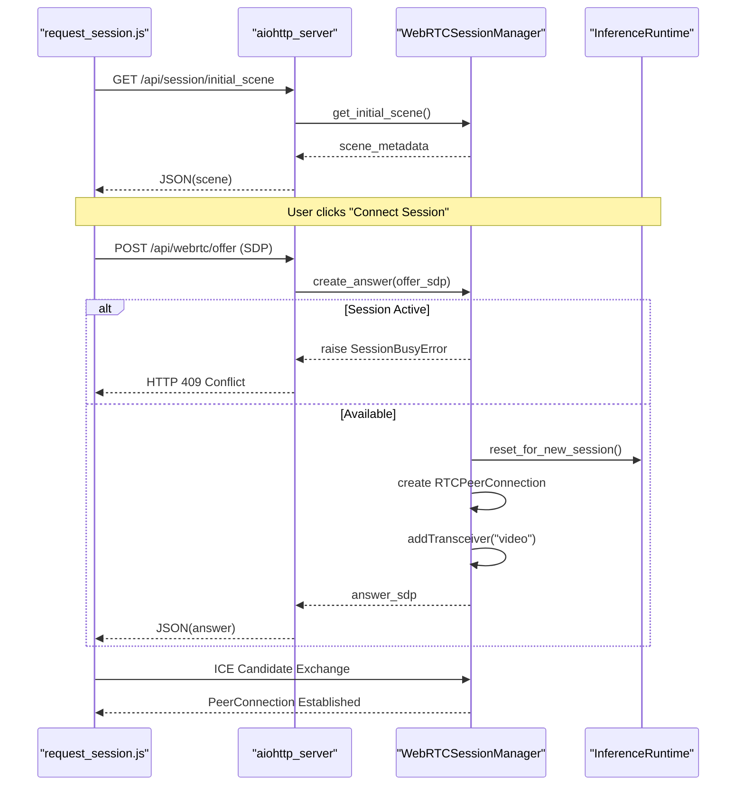

<!-- source: DeepWiki mcp.deepwiki.com · repo NVIDIA/flashdreams · page 8.1 WebRTC Server Abstraction · fetched 2026-10-26 -->

# WebRTC Server Abstraction

<details>
<summary>Relevant source files</summary>

The following files were used as context for generating this wiki page:

- [integrations/lingbot/lingbot/webrtc/server.py](integrations/lingbot/lingbot/webrtc/server.py)
- [integrations/lingbot/lingbot/webrtc/session.py](integrations/lingbot/lingbot/webrtc/session.py)
- [integrations/lingbot/lingbot/webrtc/web/request_session.css](integrations/lingbot/lingbot/webrtc/web/request_session.css)
- [integrations/lingbot/lingbot/webrtc/web/request_session.html](integrations/lingbot/lingbot/webrtc/web/request_session.html)
- [integrations/lingbot/lingbot/webrtc/web/request_session.js](integrations/lingbot/lingbot/webrtc/web/request_session.js)
- [integrations/lingbot/tests/test_server_routes.py](integrations/lingbot/tests/test_server_routes.py)
- [integrations/lingbot/tests/test_webrtc_runtime.py](integrations/lingbot/tests/test_webrtc_runtime.py)
- [integrations/lingbot/tests/test_webrtc_runtime_distributed.py](integrations/lingbot/tests/test_webrtc_runtime_distributed.py)
- [integrations/omnidreams/omnidreams/webrtc/web/request_session.css](integrations/omnidreams/omnidreams/webrtc/web/request_session.css)
- [integrations/omnidreams/omnidreams/webrtc/web/request_session.html](integrations/omnidreams/omnidreams/webrtc/web/request_session.html)
- [integrations/omnidreams/omnidreams/webrtc/web/request_session.js](integrations/omnidreams/omnidreams/webrtc/web/request_session.js)
- [integrations/omnidreams/tests/test_webrtc_server_routes.py](integrations/omnidreams/tests/test_webrtc_server_routes.py)

</details>


The WebRTC Server Abstraction provides a standardized infrastructure for low-latency, interactive video streaming from FlashDreams world models to web-based clients. It encapsulates the complexities of SDP negotiation, ICE gathering, and asynchronous session management, allowing integrations like OmniDreams and LingBot to share a common networking and UI foundation.

### Core Components and Protocols

The system is built around the `WebRTCSessionManager` protocol, which defines the interface between the web server (AIOHTTP) and the underlying inference runtime.

#### WebRTCSessionManager Protocol
The protocol defines the lifecycle of a WebRTC session, including runtime preloading and SDP negotiation.

| Method | Description |
| :--- | :--- |
| `has_active_session()` | Returns `True` if a peer connection is currently established. |
| `is_runtime_ready()` | Indicates if the inference pipeline (e.g., DiT/VAE) is loaded and warmed up. |
| `preload_runtime()` | Coroutine to initialize the inference engine before a session starts. |
| `create_answer(offer_sdp, offer_type)` | Negotiates a new connection. Throws `SessionBusyError` if a session exists. |
| `shutdown()` | Coroutine to clean up the manager and stop all active sessions. |

Sources: `[flashdreams/serving/webrtc/server.py:41-52]()`, `[integrations/lingbot/lingbot/webrtc/server.py:63-67]()`

### Server Initialization and Routes

The `create_webrtc_app()` function initializes an `aiohttp.web.Application` with standard routes for WebRTC signaling and health monitoring.

**Standard Routes:**
*   `GET /request_session`: Serves the primary HTML viewer client.
*   `GET /healthz`: Returns JSON status including `runtime_ready` and `session_active`.
*   `POST /api/webrtc/offer`: Accepts an SDP offer and returns an SDP answer generated by the session manager.
*   `GET /static/*`: Serves the shared CSS/JS assets.

Sources: `[flashdreams/serving/webrtc/server.py:126-150]()`, `[integrations/lingbot/lingbot/webrtc/server.py:140-145]()`

### Data Flow: Session Negotiation

The following diagram illustrates the interaction between the `request_session.js` client and the server entities during session establishment.

**WebRTC Negotiation Flow**

Sources: `[flashdreams/serving/webrtc/server.py:182-205]()`, `[integrations/lingbot/lingbot/webrtc/session.py:221-240]()`, `[integrations/lingbot/lingbot/webrtc/web/request_session.js:525-560]()`

### Shared Web Client Infrastructure

The abstraction provides a "Viewer Shell" used by both OmniDreams and LingBot. This includes a responsive UI and a robust JavaScript client.

#### HTML/JS/CSS Client (`request_session`)
*   **Media Handling**: Uses `RTCPeerConnection` with a `recvonly` video transceiver to receive the world model stream.
*   **Input Handling**: Captures keyboard states (WASD, etc.) and transmits them via an `RTCDataChannel` to the server's `KeyboardResampler`.
*   **Telemetry**: Displays real-time FPS, latency (RTT + processing), and resolution metrics.
*   **Visuals**: Includes an `idleCanvas` for CSS-based animations while waiting for the first video frame.

| Entity | Code Identifier | Role |
| :--- | :--- | :--- |
| Video Element | `remoteVideo` | Displays the `BufferedVideoTrack` stream. |
| Status Indicator | `statusDot` | Visual feedback for `connected`, `error`, or `generating`. |
| Control Channel | `controlChannel` | Reliable data channel for sending JSON-encoded actions. |

Sources: `[integrations/lingbot/lingbot/webrtc/web/request_session.html:31-45]()`, `[integrations/lingbot/lingbot/webrtc/web/request_session.js:43-53]()`, `[integrations/omnidreams/omnidreams/webrtc/web/request_session.js:18-31]()`

### Entity Mapping: Serving Layer

The following diagram maps the high-level Natural Language concepts to the specific Python and JavaScript classes in the codebase.

**System Entity Mapping**
```mermaid
graph TD
    subgraph "Web Interface Space"
        JS_CLIENT["request_session.js"]
        HTML_VIEWER["request_session.html"]
        CSS_THEME["request_session.css"]
    end

    subgraph "Server Abstraction Space"
        APP_GEN["create_webrtc_app()"]
        MGR_PROTO["WebRTCSessionManager"]
        BUSY_ERR["SessionBusyError"]
    end

    subgraph "Integration Implementation"
        LING_MGR["LingbotWebRTCSessionManager"]
        OMNI_MGR["OmnidreamsWebRTCSessionManager"]
        V_TRACK["BufferedVideoTrack"]
    end

    JS_CLIENT -- "Signaling" --> APP_GEN
    APP_GEN -- "Delegates to" --> MGR_PROTO
    MGR_PROTO <|-- LING_MGR
    MGR_PROTO <|-- OMNI_MGR
    LING_MGR -- "Streams" --> V_TRACK
    OMNI_MGR -- "Streams" --> V_TRACK
    HTML_VIEWER -- "Includes" --> JS_CLIENT
    HTML_VIEWER -- "Styled by" --> CSS_THEME
```
Sources: `[flashdreams/serving/webrtc/server.py:41-43]()`, `[integrations/lingbot/lingbot/webrtc/server.py:134-149]()`, `[integrations/lingbot/lingbot/webrtc/session.py:48-54]()`

### Implementation Details: Session Busy Handling

The server strictly enforces a single-session policy per process to ensure deterministic performance for the world model. If a client attempts to negotiate a session while `has_active_session()` is true, the server returns a `409 Conflict` status.

```python
# Server-side busy check logic
try:
    answer = await manager.create_answer(
        offer_sdp=params["sdp"], 
        offer_type=params["type"]
    )
except SessionBusyError as exc:
    return web.json_response({"error": str(exc)}, status=409)
```
Sources: `[flashdreams/serving/webrtc/server.py:196-203]()`, `[integrations/omnidreams/tests/test_webrtc_server_routes.py:38-41]()`

### Integration-Specific Extensions

While the core is shared, integrations extend the manager and routes for specific needs:
*   **LingBot**: Adds `/api/session/input` for uploading first-frame images and text prompts via multipart forms.
*   **OmniDreams**: Focuses on high-performance HDMap rendering and interactive driving controls (WASD).

Sources: `[integrations/lingbot/lingbot/webrtc/server.py:146-148]()`, `[integrations/lingbot/lingbot/webrtc/server.py:180-213]()`

---

