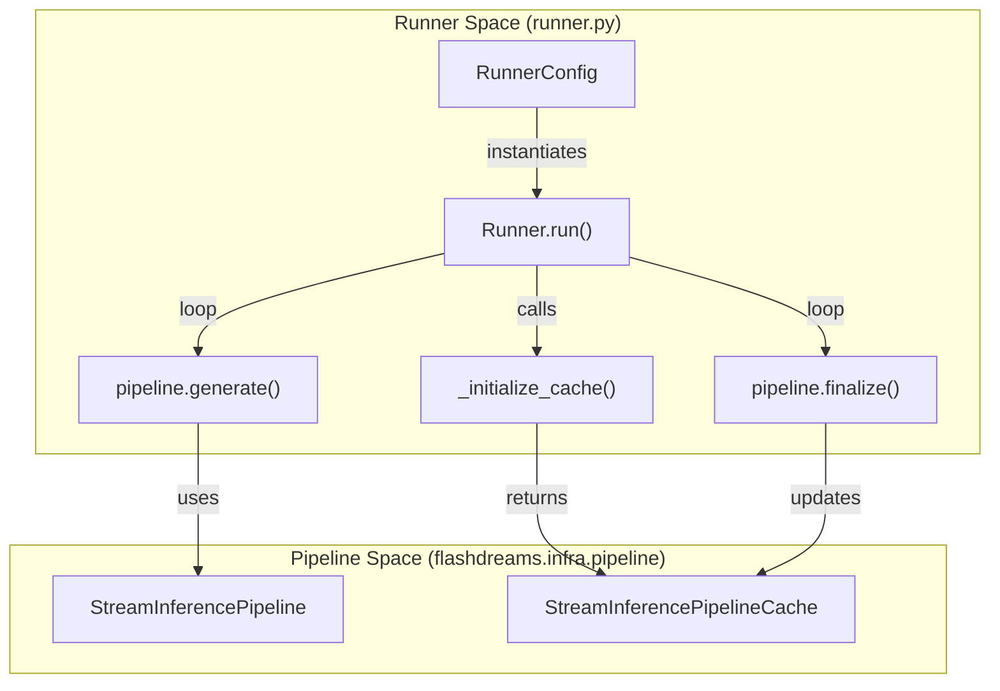
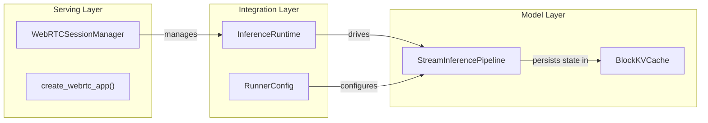

<!-- source: DeepWiki mcp.deepwiki.com · repo NVIDIA/flashdreams · page 8.2 Developer Guide: Building New Integrations · fetched 2026-10-26 -->

# Developer Guide: Building New Integrations

<details>
<summary>Relevant source files</summary>

The following files were used as context for generating this wiki page:

- [docs/source/api/core.rst](docs/source/api/core.rst)
- [docs/source/api/index.rst](docs/source/api/index.rst)
- [docs/source/developer_guides/config_system.rst](docs/source/developer_guides/config_system.rst)
- [docs/source/developer_guides/index.rst](docs/source/developer_guides/index.rst)
- [docs/source/developer_guides/interactive_serving.rst](docs/source/developer_guides/interactive_serving.rst)
- [docs/source/developer_guides/new_integration.rst](docs/source/developer_guides/new_integration.rst)
- [docs/source/developer_guides/usage_patterns.rst](docs/source/developer_guides/usage_patterns.rst)
- [flashdreams/flashdreams/core/io/download.py](flashdreams/flashdreams/core/io/download.py)
- [flashdreams/flashdreams/recipes/template/README.md](flashdreams/flashdreams/recipes/template/README.md)
- [flashdreams/flashdreams/recipes/template/config.py](flashdreams/flashdreams/recipes/template/config.py)
- [flashdreams/flashdreams/recipes/template/decoder.py](flashdreams/flashdreams/recipes/template/decoder.py)
- [flashdreams/flashdreams/recipes/template/encoder.py](flashdreams/flashdreams/recipes/template/encoder.py)
- [flashdreams/flashdreams/recipes/template/transformer/__init__.py](flashdreams/flashdreams/recipes/template/transformer/__init__.py)
- [flashdreams/flashdreams/recipes/template/transformer/network.py](flashdreams/flashdreams/recipes/template/transformer/network.py)
- [flashdreams/tests/test_template.py](flashdreams/tests/test_template.py)
- [integrations/causal_forcing/causal_forcing/runner.py](integrations/causal_forcing/causal_forcing/runner.py)
- [integrations/fastvideo_causal_wan22/fastvideo_causal_wan22/runner.py](integrations/fastvideo_causal_wan22/fastvideo_causal_wan22/runner.py)
- [integrations/flashvsr/flashvsr/runner.py](integrations/flashvsr/flashvsr/runner.py)
- [integrations/self_forcing/self_forcing/runner.py](integrations/self_forcing/self_forcing/runner.py)
- [integrations/wan21/wan21/runner.py](integrations/wan21/wan21/runner.py)

</details>


The FlashDreams framework is designed to be extensible, allowing researchers and developers to build novel video and world models by overriding specific components while leveraging the core streaming infrastructure. This guide provides a technical walkthrough for creating a new integration, from configuration to interactive serving.

## Integration Philosophy

FlashDreams encourages a plugin-based architecture where new methods reside in standalone repositories or sub-packages that import `flashdreams` as a dependency. Most integrations do not need to modify the core `flashdreams.infra` or `flashdreams.core` layers; instead, they provide specialized implementations of the `Encoder`, `Transformer`, and `Decoder` contracts [docs/source/developer_guides/new_integration.rst:19-24]().

### Recommended File Structure

A standard integration should follow this layout to ensure compatibility with the CLI and registration systems:

| File | Role |
| :--- | :--- |
| `config.py` | Defines `StreamInferencePipelineConfig` and `RunnerConfig` literals. |
| `runner.py` | Implements the `Runner` class to handle I/O, loops, and rank orchestration. |
| `pipeline.py` | (Optional) Customizes the `StreamInferencePipeline` logic. |
| `transformer.py` | Implements the DiT network and KV-cache management. |
| `pyproject.toml` | Registers the integration via entry-points. |

Sources: [docs/source/developer_guides/new_integration.rst:30-43]()

## Step 1: Defining the Configuration

FlashDreams uses a strongly-typed, nested `dataclass` system powered by `tyro`. Every integration starts with a `StreamInferencePipelineConfig` that composes the model architecture.

### The target Pattern
Components are linked to their implementation classes using the `_target` field. This allows the configuration system to instantiate the correct Python class at runtime [docs/source/developer_guides/config_system.rst:62-65]().

```python
@dataclass(kw_only=True)
class MyEncoderConfig(EncoderConfig):
    _target: type["MyEncoder"] = field(default_factory=lambda: MyEncoder)
    embedding_dim: int = 512
```

### Composing the Pipeline
A pipeline configuration typically nests configs for the encoder, diffusion model (transformer + scheduler), and decoder [docs/source/developer_guides/config_system.rst:47-55]().

Sources: [flashdreams/flashdreams/recipes/template/config.py:42-79](), [docs/source/developer_guides/config_system.rst:70-80]()

## Step 2: Implementing the Runner

The `Runner` class (defined in `flashdreams.infra.runner`) manages the high-level execution flow, including cache initialization, the autoregressive loop, and output writing.

### Runner Lifecycle
1.  **`initialize_cache`**: Prepares the `StreamInferencePipelineCache`. This often involves encoding text prompts or first-frame images [integrations/wan21/wan21/runner.py:163-181]().
2.  **`generate`**: Executes one autoregressive (AR) step.
3.  **`finalize`**: Updates the KV cache and performs post-step bookkeeping.
4.  **Rank Zero Logic**: Only the main process (rank 0) should perform I/O operations like saving videos [docs/source/developer_guides/new_integration.rst:63-78]().

### Code Entity Space: Runner Execution Flow
The following diagram maps the logical execution steps to the specific code entities involved in a typical integration.

Title: Runner and Pipeline Interaction

Sources: [docs/source/developer_guides/new_integration.rst:56-78](), [integrations/wan21/wan21/runner.py:140-192]()

## Step 3: Registration via Entry-Points

To make an integration discoverable by the `flashdreams-run` CLI, it must be registered in the `pyproject.toml` of the package using the `flashdreams.runner_configs` entry-point group [docs/source/developer_guides/new_integration.rst:146-148]().

```toml
[project.entry-points."flashdreams.runner_configs"]
my-new-method = "my_package.config:MY_RUNNER_CONFIG_LITERAL"
```

Once installed (via `pip install -e .`), the integration will appear in `flashdreams-run --help` [docs/source/developer_guides/new_integration.rst:116-126]().

## Step 4: Interactive Serving Patterns

For world models requiring live interaction (e.g., camera control or autonomous driving), integrations must implement a streaming loop that keeps the session alive.

### Serving Data Flow
Unlike offline runners that process a fixed prompt, serving runners consume continuous input updates (e.g., `CamCtrlInput`) and produce frame streams via WebRTC or gRPC [docs/source/developer_guides/interactive_serving.rst:21-46]().

### Code Entity Space: Interactive Serving Architecture
This diagram illustrates how the serving infrastructure connects to the model pipeline.

Title: Interactive Serving System Mapping

Sources: [docs/source/developer_guides/interactive_serving.rst:18-46](), [docs/source/developer_guides/new_integration.rst:49-62]()

## Best Practices for New Integrations

1.  **Use `derive_config`**: Avoid duplicating large configuration blocks. Use `flashdreams.infra.config.derive_config` to create variants (e.g., a "compiled" version of a base config) [flashdreams/flashdreams/recipes/template/config.py:114-126](), [docs/source/developer_guides/config_system.rst:101-114]().
2.  **Determinism in Tests**: When writing smoke tests, use a seeded `torch.Generator` for input generation to ensure bit-identical results across eager, compiled, and Context Parallel (CP) executions [flashdreams/tests/test_template.py:112-119]().
3.  **Spatial Compression Awareness**: Ensure the runner validates that input pixel dimensions are divisible by the decoder's `spatial_compression_ratio` [integrations/wan21/wan21/runner.py:168-177]().
4.  **Async I/O**: For serving, use the `CudaHostPrefetch` and `EventProfiler` utilities to overlap GPU computation with host-side video encoding or network transfers.

Sources: [flashdreams/flashdreams/recipes/template/config.py:16-23](), [flashdreams/tests/test_template.py:16-29](), [docs/source/developer_guides/config_system.rst:19-23]()

---

