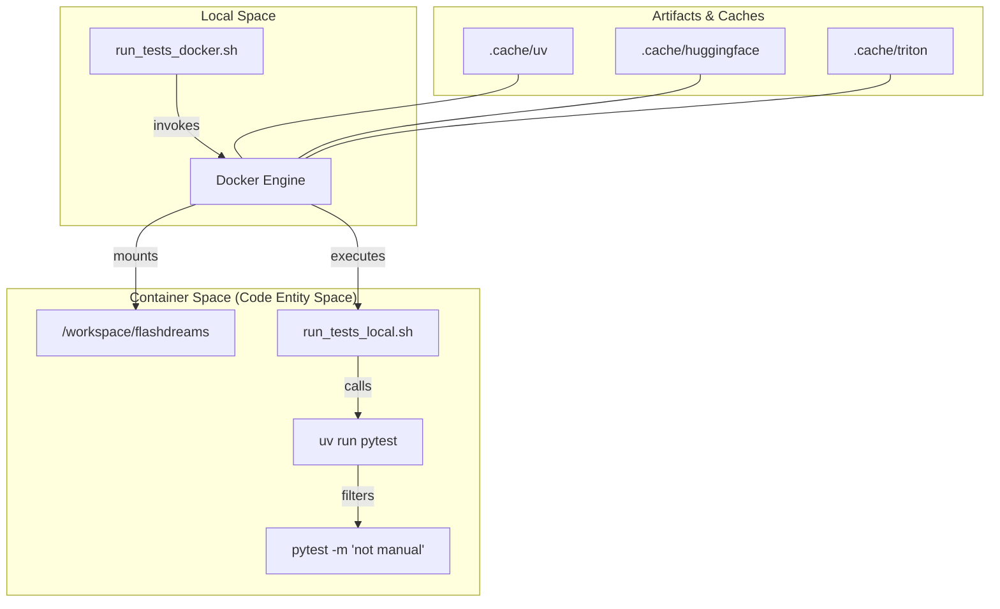
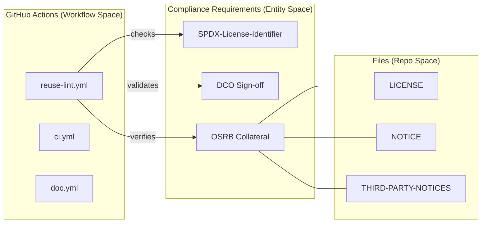

<!-- source: DeepWiki mcp.deepwiki.com · repo NVIDIA/flashdreams · page 9 Testing and CI/CD · fetched 2026-10-26 -->

# Testing and CI/CD

Relevant source files

The following files were used as context for generating this wiki page:

- [.github/workflows/reuse-lint.yml](.github/workflows/reuse-lint.yml)
- [CODE_OF_CONDUCT.md](CODE_OF_CONDUCT.md)
- [CONTRIBUTING.md](CONTRIBUTING.md)
- [LICENSE](LICENSE)
- [SECURITY.md](SECURITY.md)
- [agentic/skills/maintaining-oss-state/SKILL.md](agentic/skills/maintaining-oss-state/SKILL.md)
- [docker/Dockerfile](docker/Dockerfile)
- [docker/README.md](docker/README.md)
- [docker/build_with_docker.sh](docker/build_with_docker.sh)
- [docs/source/community/contribute.rst](docs/source/community/contribute.rst)
- [docs/source/community/discord.rst](docs/source/community/discord.rst)
- [tests/README.md](tests/README.md)
- [tests/run_tests_docker.sh](tests/run_tests_docker.sh)
- [tests/run_tests_local.sh](tests/run_tests_local.sh)

The FlashDreams testing and CI/CD strategy is designed to ensure the reliability of high-performance streaming inference pipelines and distributed GPU kernels. Given the complexity of multi-GPU execution and CUDA-native accelerations, the infrastructure relies heavily on Docker-based environments to provide consistent hardware-accelerated testing across local development and GitHub Actions.

### Testing Philosophy and Code-to-Entity Mapping

The testing suite is categorized by compute requirements and execution context. The system uses `pytest` markers to differentiate between lightweight CPU logic and heavy GPU-bound integration tests.

| Testing Tier | Code Entity / Marker | Infrastructure |
| :--- | :--- | :--- |
| **Unit Tests** | `pytest` (default) | Local venv or CPU CI |
| **GPU Integration** | `@pytest.mark.ci_gpu` | Docker + NVIDIA Container Toolkit |
| **Manual/Heavy** | `@pytest.mark.manual` | Dedicated GPU nodes |
| **Parity Checks** | `baseline_*` envs | Cross-integration comparison |

#### Test Execution Flow

The following diagram illustrates how the test runner scripts bridge the local environment to the containerized test execution.

**Test Execution Architecture**

**Sources:**
- [tests/run_tests_docker.sh:17-40]()
- [tests/run_tests_local.sh:17-29]()
- [tests/README.md:5-13]()

---

## 9.1 Test Infrastructure and Parity Checks

FlashDreams utilizes a dual-layer script system for testing. `run_tests_local.sh` is the internal helper that discovers test files and invokes `pytest` [tests/run_tests_local.sh:17-29](). For users on local machines with GPUs, `run_tests_docker.sh` provides a turnkey solution by bootstrapping a fresh NVIDIA PyTorch container, installing dependencies via `uv`, and mounting host cache directories to accelerate subsequent runs [tests/run_tests_docker.sh:45-68]().

A critical component of the testing strategy is **Parity Checking**. This involves comparing the output of FlashDreams streaming implementations against established baselines like `baseline_fastvideo` or `baseline_lightx2v`. These checks ensure that optimizations (such as KV-cache rolling windows or FP8 quantization) do not introduce significant numerical drift compared to the original reference models.

For details, see [Test Infrastructure and Parity Checks](#9.1).

**Sources:**
- [tests/run_tests_docker.sh:1-87]()
- [tests/run_tests_local.sh:1-30]()
- [tests/README.md:26-47]()

---

## 9.2 CI/CD Workflows and Compliance

The FlashDreams CI/CD pipeline is hosted on GitHub Actions and enforces strict standards for code quality, performance, and legal compliance.

### Workflow Orchestration
- **`ci.yml`**: Handles the primary test suite, including CPU-based unit tests and GPU-based integration tests where runners are available.
- **`reuse-lint.yml`**: A mandatory gate that enforces REUSE 3.3 compliance. It ensures every file contains an inline SPDX header (e.g., `SPDX-License-Identifier: Apache-2.0`) and that the repository's legal collateral (LICENSE, NOTICE, THIRD-PARTY-NOTICES) remains consistent [.github/workflows/reuse-lint.yml:15-25]().
- **`doc.yml`**: Automates the building of Sphinx documentation and deployment to GitHub Pages.

### Compliance and Contribution Gates
FlashDreams follows a "hard gate" policy for contributions. Every commit must include a **DCO (Developer Certificate of Origin) sign-off** via `git commit -s` [CONTRIBUTING.md:148-162](). The `reuse-lint` workflow also verifies that no legacy NVIDIA proprietary banners exist in the source code [.github/workflows/reuse-lint.yml:138-154]().

**CI Compliance Mapping**

For details, see [CI/CD Workflows and Compliance](#9.2).

**Sources:**
- [.github/workflows/reuse-lint.yml:1-155]()
- [CONTRIBUTING.md:84-139]()
- [agentic/skills/maintaining-oss-state/SKILL.md:24-64]()

---

## Docker Infrastructure

The repository provides a standardized `Dockerfile` based on `nvidia/cuda:13.2.1-cudnn-devel-ubuntu24.04` [docker/Dockerfile:16](). This image includes:
- **Python 3.12** and `uv` for fast package management [docker/Dockerfile:25,46]().
- **Build Tools**: `gcc`, `g++`, and `ninja-build` for JIT compilation of CUDA extensions [docker/Dockerfile:27]().
- **System Libraries**: `ffmpeg` for video processing and `libnccl-dev` for multi-GPU communication [docker/Dockerfile:26-28]().

The `build_with_docker.sh` script enables multi-arch builds (`linux/arm64` and `linux/amd64`) using Docker Buildx [docker/build_with_docker.sh:87-93]().

**Sources:**
- [docker/Dockerfile:1-59]()
- [docker/build_with_docker.sh:1-94]()
- [docker/README.md:1-51]()

---

