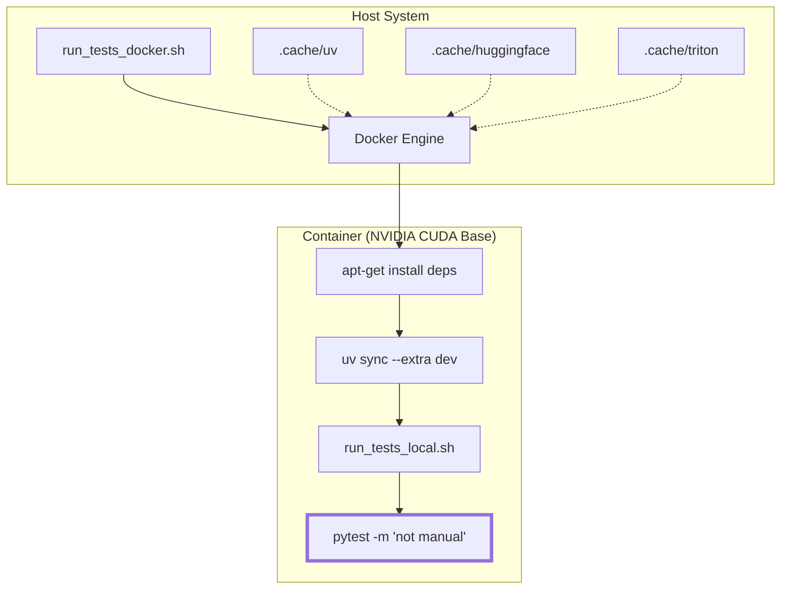
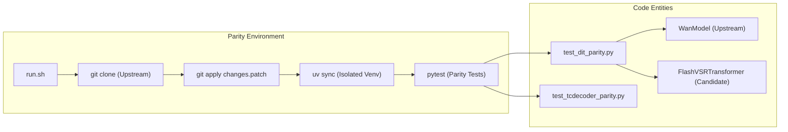

<!-- source: DeepWiki mcp.deepwiki.com · repo NVIDIA/flashdreams · page 9.1 Test Infrastructure and Parity Checks · fetched 2026-10-26 -->

# Test Infrastructure and Parity Checks

Relevant source files

The following files were used as context for generating this wiki page:

- [docker/Dockerfile](docker/Dockerfile)
- [docker/README.md](docker/README.md)
- [docker/build_with_docker.sh](docker/build_with_docker.sh)
- [docs/source/_static/js/benchmark_chart.js](docs/source/_static/js/benchmark_chart.js)
- [docs/source/_static/performance/flashvsr/perf-0527.md](docs/source/_static/performance/flashvsr/perf-0527.md)
- [integrations/flashvsr/tests/parity_check/README.md](integrations/flashvsr/tests/parity_check/README.md)
- [integrations/flashvsr/tests/parity_check/changes.patch](integrations/flashvsr/tests/parity_check/changes.patch)
- [integrations/flashvsr/tests/parity_check/run.sh](integrations/flashvsr/tests/parity_check/run.sh)
- [integrations/flashvsr/tests/parity_check/test_dit_parity.py](integrations/flashvsr/tests/parity_check/test_dit_parity.py)
- [integrations/flashvsr/tests/parity_check/test_tcdecoder_parity.py](integrations/flashvsr/tests/parity_check/test_tcdecoder_parity.py)
- [integrations/flashvsr/tests/parity_check/uv.lock](integrations/flashvsr/tests/parity_check/uv.lock)
- [integrations/lingbot/tests/parity_check/pyproject.toml](integrations/lingbot/tests/parity_check/pyproject.toml)
- [integrations/lingbot/tests/parity_check/uv.lock](integrations/lingbot/tests/parity_check/uv.lock)
- [integrations/omnidreams/ludus-renderer/README.md](integrations/omnidreams/ludus-renderer/README.md)
- [integrations/omnidreams/ludus-renderer/uv.lock](integrations/omnidreams/ludus-renderer/uv.lock)
- [integrations/self_forcing/tests/parity_check/.gitignore](integrations/self_forcing/tests/parity_check/.gitignore)
- [integrations/self_forcing/tests/parity_check/README.md](integrations/self_forcing/tests/parity_check/README.md)
- [integrations/self_forcing/tests/parity_check/changes.patch](integrations/self_forcing/tests/parity_check/changes.patch)
- [integrations/self_forcing/tests/parity_check/pyproject.toml](integrations/self_forcing/tests/parity_check/pyproject.toml)
- [integrations/self_forcing/tests/parity_check/uv.lock](integrations/self_forcing/tests/parity_check/uv.lock)
- [integrations/wan21/tests/parity_check/.gitignore](integrations/wan21/tests/parity_check/.gitignore)
- [integrations/wan21/tests/parity_check/README.md](integrations/wan21/tests/parity_check/README.md)
- [integrations/wan21/tests/parity_check/changes.patch](integrations/wan21/tests/parity_check/changes.patch)
- [integrations/wan21/tests/parity_check/run.sh](integrations/wan21/tests/parity_check/run.sh)
- [tests/README.md](tests/README.md)
- [tests/run_tests_docker.sh](tests/run_tests_docker.sh)
- [tests/run_tests_local.sh](tests/run_tests_local.sh)

The FlashDreams test infrastructure is designed to ensure numerical and architectural parity with reference implementations while maintaining high performance across diverse hardware environments. It utilizes a layered approach consisting of Dockerized environments, localized execution scripts, and specialized parity-check sub-environments for integrations.

## Pytest Marker System and Discovery

The repository uses `pytest` for test orchestration. Tests are categorized using markers to control execution based on the environment and resource availability.

*   **`ci_cpu`**: Tests that run on standard CPU runners (e.g., GitHub Actions).
*   **`ci_gpu`**: Tests requiring a GPU, typically executed in a Dockerized environment with NVIDIA Container Toolkit.
*   **`manual`**: Large-scale integration tests or parity checks that require specific checkpoints or long runtimes. These are skipped by default in the standard test runners using `-m "not manual"` [tests/README.md:30-31]().

Standard discovery targets all `**/test_*.py` files within the repository [tests/README.md:28-28]().

### Sources:
* [tests/README.md:28-31]()
* [integrations/flashvsr/tests/parity_check/test_dit_parity.py:64-64]()

---

## Test Runners: Local and Docker

FlashDreams provides two primary entry points for executing tests, coordinated to provide a consistent environment whether running on a developer workstation or a CI server.

### `run_tests_local.sh`
This script is intended for developers already inside a configured environment (e.g., a dev container). It performs test discovery and invokes `pytest` directly without managing dependencies or containers [tests/README.md:7-7]().

### `run_tests_docker.sh`
This script automates the creation of a fresh test environment using an NVIDIA CUDA base image. It performs the following lifecycle:
1.  **Mounting**: Binds the repository root and various cache directories (UV, HuggingFace, FlashDreams, Triton) from the host to the container [tests/run_tests_docker.sh:52-62]().
2.  **Bootstrapping**: Installs system dependencies (`ffmpeg`, `libnccl-dev`, etc.) and the `uv` package manager inside the container [tests/run_tests_docker.sh:72-78]().
3.  **Synchronization**: Uses `uv sync` to install `flashdreams[dev]` and all integration packages [tests/run_tests_docker.sh:84-84]().
4.  **Delegation**: Executes `run_tests_local.sh` inside the containerized environment [tests/run_tests_docker.sh:86-86]().

### Cache Directory Mounts
To ensure fast subsequent runs, `run_tests_docker.sh` manages several host-side caches:

| Host Environment Variable | Default Path | Container Path | Purpose |
| :--- | :--- | :--- | :--- |
| `FLASHDREAMS_UV_CACHE_DIR` | `~/.cache/uv` | `/root/.cache/uv` | Python package cache. |
| `FLASHDREAMS_HF_CACHE_DIR` | `~/.cache/huggingface` | `/root/.cache/huggingface` | Model weights and datasets. |
| `FLASHDREAMS_CACHE_DIR` | `~/.cache/flashdreams` | `/root/.cache/flashdreams` | Processed weights/outputs. |
| `FLASHDREAMS_TRITON_CACHE_DIR` | `~/.cache/triton` | `/root/.cache/triton` | Compiled Triton kernels. |

**Test Infrastructure Data Flow**

### Sources:
* [tests/run_tests_docker.sh:1-87]()
* [tests/README.md:1-47]()
* [docker/Dockerfile:1-59]()

---

## Parity-Check Sub-Environments

For complex integrations like `flashvsr`, `self_forcing` (FastVideo), and `lingbot` (LightX2V), the repository maintains isolated sub-environments to verify numerical parity against upstream "baseline" implementations.

### Implementation Pattern
Each parity check follows a standard structure located in `integrations/<plugin>/tests/parity_check/`:
1.  **`pyproject.toml`**: Defines an isolated project that depends on both the local `flashdreams` source and the specific dependencies of the upstream baseline [integrations/self_forcing/tests/parity_check/pyproject.toml:12-27]().
2.  **`run.sh`**: An idempotent script that clones the upstream repository at a `PIN_COMMIT`, applies a `changes.patch` to inject profiling or data-export hooks, and materializes a local `.venv` [integrations/flashvsr/tests/parity_check/run.sh:21-60]().
3.  **`changes.patch`**: Modifies the upstream code to use `flashdreams.infra.EventProfiler` or to export intermediate latents for comparison [integrations/flashvsr/tests/parity_check/README.md:3-6]().

### Baseline Comparisons
*   **`baseline_fastvideo`**: Used by `self_forcing` to verify chunkwise streaming against the original FastVideo implementation.
*   **`baseline_lightx2v`**: Used by `lingbot` for camera-control parity.
*   **`FlashVSR`**: Compares the `FlashVSRTransformer` and `FlashVSR_TAEHV` decoder against the OpenImagingLab reference [integrations/flashvsr/tests/parity_check/test_dit_parity.py:16-25]().

**Parity Check Execution Flow**

### Sources:
* [integrations/flashvsr/tests/parity_check/run.sh:21-120]()
* [integrations/flashvsr/tests/parity_check/README.md:1-118]()
* [integrations/flashvsr/tests/parity_check/test_dit_parity.py:16-50]()
* [integrations/self_forcing/tests/parity_check/pyproject.toml:1-30]()

---

## Integration-Specific Testing

Integration tests are typically run from the root of the repository or within the specific parity-check directory.

### Running FlashVSR Parity
To run the DiT and Decoder parity checks for FlashVSR:
1.  Navigate to `integrations/flashvsr/tests/parity_check/`.
2.  Execute `bash run.sh`. This script ensures that the `FlashVSR-v1.1` weights are staged and the environment is prepared [integrations/flashvsr/tests/parity_check/run.sh:98-118]().
3.  The script invokes `test_tcdecoder_parity.py` and `test_dit_parity.py` [integrations/flashvsr/tests/parity_check/README.md:81-87]().

### Numerical Tolerances
Parity tests use calibrated tolerances to account for architectural differences (e.g., fused kernels vs. unfused, FP32 vs. BF16):
*   **DiT Parity**: Uses `max_abs <= 2.5e-1` and `mean_abs <= 3.5e-2` to account for fused RoPE and Triton sparse-attention differences [integrations/flashvsr/tests/parity_check/test_dit_parity.py:100-101]().
*   **Decoder Parity**: Uses `atol=2.5e-3 / rtol=1e-3` because different cuDNN kernels are selected when running convs with different batch/stride layouts [integrations/flashvsr/tests/parity_check/README.md:108-112]().

### Sources:
* [integrations/flashvsr/tests/parity_check/test_dit_parity.py:100-101]()
* [integrations/flashvsr/tests/parity_check/README.md:108-112]()
* [integrations/flashvsr/tests/parity_check/run.sh:147-155]()

---

