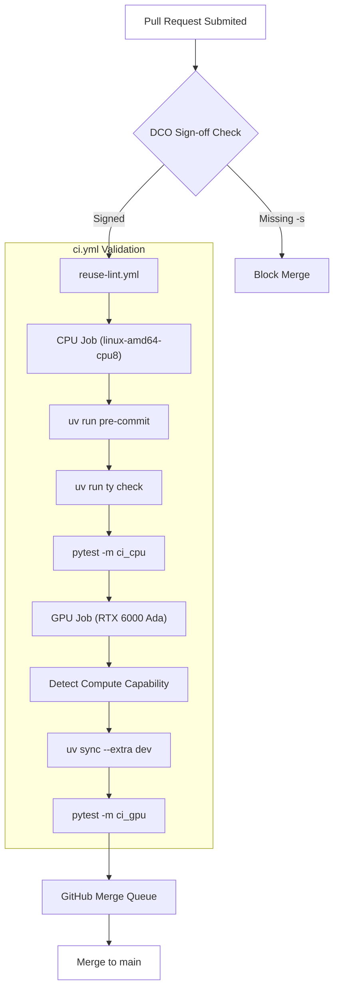

<!-- source: DeepWiki mcp.deepwiki.com · repo NVIDIA/flashdreams · page 9.2 CI/CD Workflows and Compliance · fetched 2026-10-26 -->

# CI/CD Workflows and Compliance

<details>
<summary>Relevant source files</summary>

The following files were used as context for generating this wiki page:

- [.github/workflows/ci.yml](.github/workflows/ci.yml)
- [.github/workflows/reuse-lint.yml](.github/workflows/reuse-lint.yml)
- [.pre-commit-config.yaml](.pre-commit-config.yaml)
- [CODE_OF_CONDUCT.md](CODE_OF_CONDUCT.md)
- [CONTRIBUTING.md](CONTRIBUTING.md)
- [LICENSE](LICENSE)
- [LICENSES/BSD-3-Clause.txt](LICENSES/BSD-3-Clause.txt)
- [LICENSES/Zlib.txt](LICENSES/Zlib.txt)
- [NOTICE](NOTICE)
- [REUSE.toml](REUSE.toml)
- [SECURITY.md](SECURITY.md)
- [agentic/skills/maintaining-oss-state/SKILL.md](agentic/skills/maintaining-oss-state/SKILL.md)
- [docs/source/community/contribute.rst](docs/source/community/contribute.rst)
- [docs/source/community/discord.rst](docs/source/community/discord.rst)
- [flashdreams/flashdreams/configs/runner_configs.py](flashdreams/flashdreams/configs/runner_configs.py)
- [flashdreams/pyproject.toml](flashdreams/pyproject.toml)
- [integrations/omnidreams/ludus-renderer/examples/render_mirror_augmented.py](integrations/omnidreams/ludus-renderer/examples/render_mirror_augmented.py)
- [integrations/omnidreams/ludus-renderer/pyproject.toml](integrations/omnidreams/ludus-renderer/pyproject.toml)
- [integrations/omnidreams/omnidreams/config.py](integrations/omnidreams/omnidreams/config.py)
- [pyproject.toml](pyproject.toml)
- [uv.lock](uv.lock)

</details>


The FlashDreams repository employs a multi-layered CI/CD strategy to ensure high-performance video generation remains stable across diverse hardware targets. This infrastructure manages the transition from "Natural Language Space" (governance policies and documentation) to "Code Entity Space" (automated tests, GPU kernels, and package releases).

## GitHub Actions Workflows

The repository utilizes three primary GitHub Actions workflows to manage testing, documentation, and compliance.

### 1. Continuous Integration (ci.yml)
The `ci.yml` workflow is the primary gatekeeper for the repository. It is divided into two main job types: `cpu` and `gpu`.

*   **CPU Job**: Runs on `linux-amd64-cpu8` runners. It performs linting (via `pre-commit` and `ty`), builds the `flashdreams` wheel, and executes unit tests marked with the `ci_cpu` marker [.github/workflows/ci.yml:19-81]().
*   **GPU Job**: Runs on `linux-amd64-gpu-rtxpro6000-latest-2` runners. It detects the specific GPU architecture to optimize `nvcc` compilation and executes heavy integration tests marked with `ci_gpu` [.github/workflows/ci.yml:85-159]().

### 2. Documentation (doc.yml)
Handles the Sphinx-based documentation build. To build on GPU-less CI runners, it utilizes `autodoc_mock_imports` for heavy dependencies like `transformer-engine` and `pynvml` [pyproject.toml:141-156]().

### 3. Compliance (reuse-lint.yml)
Enforces REUSE 3.3 compliance and OSRB (Open Source Review Board) requirements. It verifies that every source file contains valid SPDX headers and that canonical license texts are present at the repo root [.github/workflows/reuse-lint.yml:1-137]().

### CI Data Flow and Environment Setup

The following diagram illustrates the data flow from a PR submission through the automated validation gates.

**PR Validation and Merge Flow**

Sources: [.github/workflows/ci.yml:1-159](), [.github/workflows/reuse-lint.yml:1-137](), [CONTRIBUTING.md:146-162]()

## GPU Compute Capability Detection

To ensure that JIT-compiled kernels (like those in `ludus-renderer` or `omnidreams_singleview`) are optimized for the runner hardware, the CI environment dynamically detects the GPU architecture.

The workflow queries `nvidia-smi` to extract the `compute_cap` and formats it for `nvcc` (e.g., "12.0" becomes `sm_120`). This value is then passed to the build system via the `NVTE_CUDA_ARCHS` environment variable [.github/workflows/ci.yml:106-116](), [.github/workflows/ci.yml:145-150]().

| Variable | Source | Purpose |
| :--- | :--- | :--- |
| `compute_cap` | `nvidia-smi --query-gpu=compute_cap` | Raw capability (e.g., 8.9) |
| `arch` | `tr -d '.'` | Formatted for nvcc (e.g., 89) |
| `NVTE_CUDA_ARCHS` | Step Output | Controls Transformer Engine compilation |

Sources: [.github/workflows/ci.yml:106-116]()

## DCO Sign-off and Governance

FlashDreams follows a "DCO over CLA" model. All contributions must be made under the Apache-2.0 license and signed off using the Developer Certificate of Origin (DCO) [CONTRIBUTING.md:86-136]().

*   **Sign-off Requirement**: Every commit must include a `Signed-off-by: Name <email>` trailer, typically added via `git commit -s` [CONTRIBUTING.md:154-158]().
*   **Compliance Check**: The `reuse-lint.yml` workflow verifies that `CONTRIBUTING.md` correctly references the DCO and that no legacy NVIDIA proprietary banners exist in the source code [.github/workflows/reuse-lint.yml:76-84](), [.github/workflows/reuse-lint.yml:138-155]().

## Merge Queue and Branch Protection

The repository uses the GitHub Merge Queue (`merge_group`) to prevent "semantic merge conflicts" where independent PRs pass CI individually but break when combined on `main`.

*   **Trigger**: The `merge_group` event fires when a PR is added to the queue [.github/workflows/ci.yml:15-16]().
*   **Validation**: GitHub creates a temporary branch (e.g., `gh-readonly-queue/main/...`) and runs `ci.yml` against the combined state of the queue.
*   **Required Checks**: Success in both `cpu` and `gpu` jobs is a mandatory prerequisite for the final merge to `main` [.github/workflows/ci.yml:18-195]().

## Dependency Management and Compliance

The project uses `uv` for workspace management, ensuring reproducible environments across local development and CI.

**Compliance Entity Mapping**
```mermaid
graph LR
    subgraph "Compliance Requirements"
        REUSE["REUSE 3.3"]
        OSRB["OSRB Bug 6107043"]
        APACHE["Apache-2.0 §4(d)"]
    end

    subgraph "Code Entities"
        HEADER["SPDX-License-Identifier"]
        NOTICE_FILE["NOTICE"]
        TPN["THIRD-PARTY-NOTICES"]
        UV_LOCK["uv.lock"]
    end

    REUSE --> HEADER
    OSRB --> TPN
    OSRB --> UV_LOCK
    APACHE --> NOTICE_FILE

    HEADER --- "flashdreams/pyproject.toml:1-2"
    TPN --- "THIRD-PARTY-NOTICES"
    NOTICE_FILE --- "NOTICE:1-20"
    UV_LOCK --- "uv.lock:1-40"
```
Sources: [agentic/skills/maintaining-oss-state/SKILL.md:6-82](), [flashdreams/pyproject.toml:1-2](), [NOTICE:1-20](), [uv.lock:1-40]()

### Dependency Pinning
Direct runtime dependencies are mirrored in three locations to satisfy OSRB requirements:
1.  The workspace member's `pyproject.toml` `dependencies` [flashdreams/pyproject.toml:27-63]().
2.  The resolved `uv.lock` file [uv.lock:1-40]().
3.  The `THIRD-PARTY-NOTICES` attribution document [agentic/skills/maintaining-oss-state/SKILL.md:49-52]().

The CI `reuse-lint` job ensures these remain synchronized and that all first-party source files (including `.sh`, `.proto`, and `Dockerfile`) carry the mandatory inline SPDX headers [.github/workflows/reuse-lint.yml:93-137]().

Sources: [.github/workflows/ci.yml](), [.github/workflows/reuse-lint.yml](), [CONTRIBUTING.md](), [pyproject.toml](), [flashdreams/pyproject.toml](), [agentic/skills/maintaining-oss-state/SKILL.md]()

---

