# Page: FlashDreams Overview

# FlashDreams Overview

<details>
<summary>Relevant source files</summary>

The following files were used as context for generating this wiki page:

- [.github/workflows/ci.yml](.github/workflows/ci.yml)
- [.github/workflows/doc.yml](.github/workflows/doc.yml)
- [.pre-commit-config.yaml](.pre-commit-config.yaml)
- [README.md](README.md)
- [docs/README.md](docs/README.md)
- [docs/source/_static/custom.css](docs/source/_static/custom.css)
- [docs/source/_templates/sidebar/brand.html](docs/source/_templates/sidebar/brand.html)
- [docs/source/conf.py](docs/source/conf.py)
- [docs/source/index.rst](docs/source/index.rst)
- [flashdreams/PYPI_README.md](flashdreams/PYPI_README.md)
- [flashdreams/flashdreams/__init__.py](flashdreams/flashdreams/__init__.py)
- [flashdreams/flashdreams/_version.py](flashdreams/flashdreams/_version.py)
- [flashdreams/flashdreams/configs/runner_configs.py](flashdreams/flashdreams/configs/runner_configs.py)
- [flashdreams/pyproject.toml](flashdreams/pyproject.toml)
- [integrations/causal_forcing/pyproject.toml](integrations/causal_forcing/pyproject.toml)
- [integrations/cosmos_predict2/pyproject.toml](integrations/cosmos_predict2/pyproject.toml)
- [integrations/fastvideo_causal_wan22/pyproject.toml](integrations/fastvideo_causal_wan22/pyproject.toml)
- [integrations/flashvsr/pyproject.toml](integrations/flashvsr/pyproject.toml)
- [integrations/hy_worldplay/pyproject.toml](integrations/hy_worldplay/pyproject.toml)
- [integrations/lingbot/pyproject.toml](integrations/lingbot/pyproject.toml)
- [integrations/omnidreams/ludus-renderer/examples/render_mirror_augmented.py](integrations/omnidreams/ludus-renderer/examples/render_mirror_augmented.py)
- [integrations/omnidreams/ludus-renderer/pyproject.toml](integrations/omnidreams/ludus-renderer/pyproject.toml)
- [integrations/omnidreams/omnidreams/config.py](integrations/omnidreams/omnidreams/config.py)
- [integrations/omnidreams/pyproject.toml](integrations/omnidreams/pyproject.toml)
- [integrations/self_forcing/pyproject.toml](integrations/self_forcing/pyproject.toml)
- [integrations/wan21/pyproject.toml](integrations/wan21/pyproject.toml)
- [integrations/wan22/pyproject.toml](integrations/wan22/pyproject.toml)
- [pyproject.toml](pyproject.toml)
- [uv.lock](uv.lock)

</details>


**FlashDreams** is a high-performance inference and serving library designed for interactive autoregressive video and world models [README.md:18-23](). Originally developed as the runtime backbone for the NVIDIA OmniDreams closed-loop simulation at GTC 2026, it provides a general-purpose platform for real-time applications in gaming, autonomous vehicles, and robotics [docs/source/index.rst:32-37]().

Unlike one-shot video generation systems that return a finished file, FlashDreams maintains a persistent interactive session where model state, GPU inference, and streaming output evolve continuously based on user input [docs/source/index.rst:89-93]().

### High-Level Architecture

The system is built on a "bottom-up" design philosophy to minimize latency and maximize throughput during autoregressive generation [docs/source/index.rst:162-165]().

#### System Context Diagram
This diagram illustrates how the core library interacts with external plugins and the hardware layer.

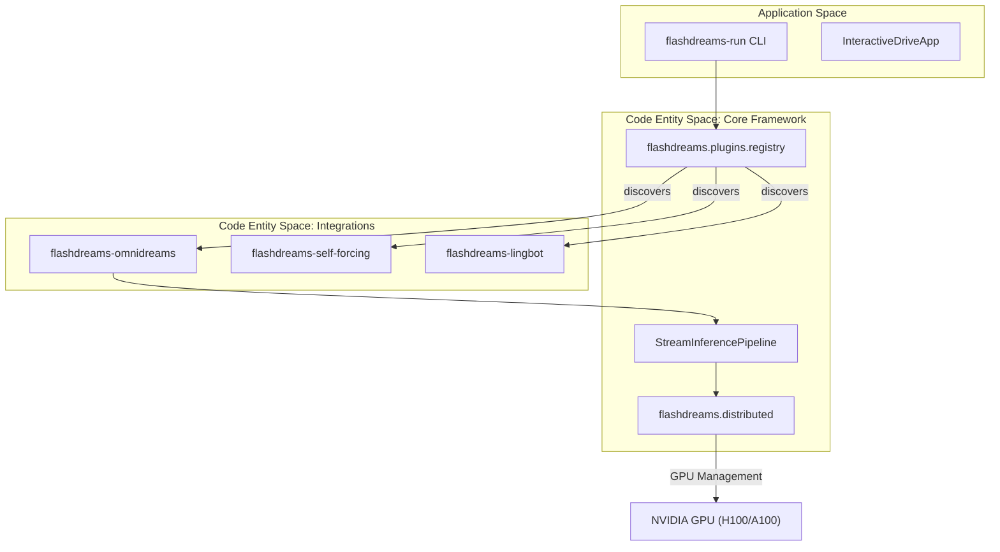
**Sources:** [flashdreams/pyproject.toml:65-69](), [flashdreams/pyproject.toml:117-119](), [integrations/omnidreams/pyproject.toml:102-105]().

### Key Capabilities

*   **Streaming Inference:** Continuous generation using a rolling KV cache and frame-by-frame or chunk-wise decoding [docs/source/index.rst:117-123]().
*   **Low Latency Serving:** Optimized for interactive loops (e.g., driving or camera control) where conditioning changes at every step [docs/source/index.rst:109-111]().
*   **Distributed Execution:** Support for multi-GPU setups using context parallelism (CP) and sharded state [README.md:85-86]().
*   **Native Acceleration:** JIT-compiled CUDA/C++ extensions for optimized DiT and VAE kernels [integrations/omnidreams/pyproject.toml:36-38]().

### Repository Organization

The repository is structured as a `uv` monorepo, containing the core library and a collection of standalone integration packages [pyproject.toml:1-12]().

#### Workspace Layout Diagram
This diagram maps the physical repository structure to the primary Python packages.

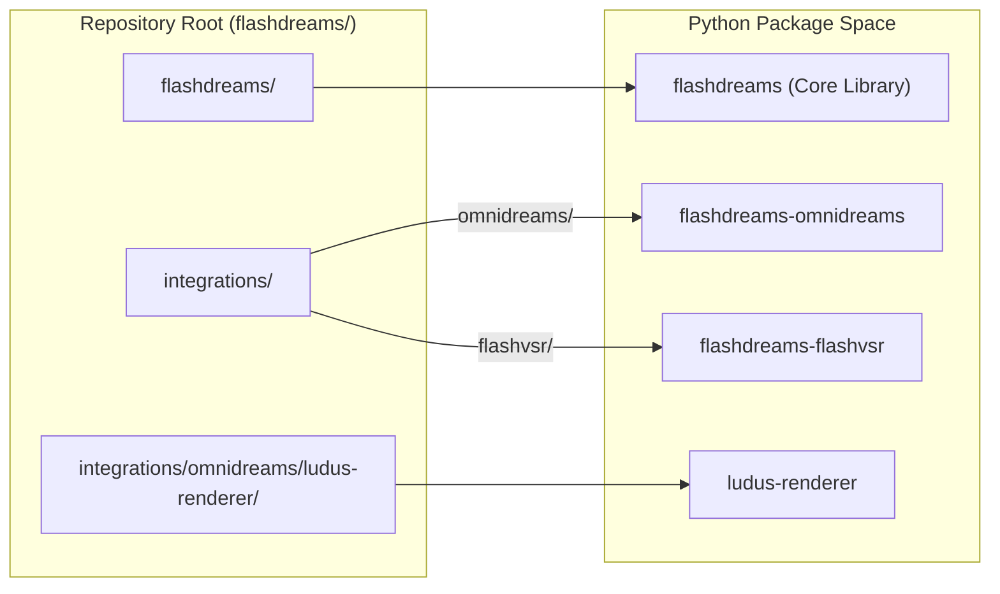
**Sources:** [uv.lock:21-35](), [pyproject.toml:1-12]().

| Component | Path | Description |
| :--- | :--- | :--- |
| **Core Framework** | `flashdreams/` | Contains the `StreamInferencePipeline`, distributed infra, and base model recipes [flashdreams/pyproject.toml:21-23](). |
| **Integrations** | `integrations/` | Specialized plugins for models like Wan 2.1, Cosmos, and OmniDreams [README.md:81-84](). |
| **Ludus Renderer** | `integrations/omnidreams/ludus-renderer/` | A GPU-native software rasterizer for HDMap conditioning [integrations/omnidreams/pyproject.toml:32](). |

### Major Subsystems

1.  **[Getting Started](#1.1)**: Installation via `uv`, environment requirements (NVIDIA GPU 80GB+), and running your first world model [README.md:29-61]().
2.  **[CLI and Plugin Registry](#1.2)**: The `flashdreams-run` entry point and how it uses Python entry points to discover runners across the workspace [flashdreams/pyproject.toml:65-69]().
3.  **[Repository Structure and Workspace](#1.3)**: Detailed breakdown of the `uv` workspace, dependency management, and the PyPI publishing strategy [pyproject.toml:1-12]().

**Sources:** [README.md:18-23](), [README.md:29-39](), [README.md:81-97](), [pyproject.toml:1-12](), [flashdreams/pyproject.toml:21-47](), [docs/source/index.rst:32-37]().

---

# Page: Getting Started

# Getting Started

<details>
<summary>Relevant source files</summary>

The following files were used as context for generating this wiki page:

- [DEV.md](DEV.md)
- [docker/Dockerfile](docker/Dockerfile)
- [docker/README.md](docker/README.md)
- [docker/build_with_docker.sh](docker/build_with_docker.sh)
- [docs/source/quickstart/first_world_model.rst](docs/source/quickstart/first_world_model.rst)
- [docs/source/quickstart/installation.rst](docs/source/quickstart/installation.rst)
- [flashdreams/flashdreams/core/log_filters.py](flashdreams/flashdreams/core/log_filters.py)
- [flashdreams/tests/test_log_filters.py](flashdreams/tests/test_log_filters.py)
- [integrations/lingbot/lingbot/runner.py](integrations/lingbot/lingbot/runner.py)
- [integrations/lingbot/tests/test_distributed_server_main.py](integrations/lingbot/tests/test_distributed_server_main.py)
- [tests/README.md](tests/README.md)
- [tests/run_tests_docker.sh](tests/run_tests_docker.sh)
- [tests/run_tests_local.sh](tests/run_tests_local.sh)

</details>


This page provides instructions for setting up the FlashDreams environment, installing dependencies, and running your first world model inference. FlashDreams is designed as a high-performance monorepo using `uv` for workspace management, with support for both local and Docker-based execution.

## Installation

FlashDreams can be consumed either as a library or as a development workspace for running and extending world models.

### Using as a Library
To integrate FlashDreams primitives into an existing project, install the core package from PyPI or directly from the repository [docs/source/quickstart/installation.rst:21-34]():

```bash
# From PyPI
pip install flashdreams

# From GitHub main branch
pip install "git+https://github.com/NVIDIA/flashdreams.git"
```

### Development Workspace Setup
For running the provided model recipes and integrations, we recommend using the `uv` package manager. This setup configures the monorepo workspace and installs the unified `flashdreams-run` CLI [docs/source/quickstart/installation.rst:38-54]().

```bash
git clone https://github.com/NVIDIA/flashdreams.git
cd flashdreams

# Synchronize the workspace and install dev/runner extras
uv sync --extra dev --extra runners
```

### Environment Variables
Most models require Hugging Face authentication to download weights. Ensure your environment is configured [docs/source/quickstart/installation.rst:58-67]():

```bash
export HF_TOKEN=<your-hf-token>
export HF_HOME=~/.cache/huggingface  # Optional: defaults to ~/.cache/huggingface
```

## Docker Environment

For a consistent environment across different hardware (AMD64 and ARM64), FlashDreams provides a multi-arch Docker container based on `nvidia/cuda:13.2.1-cudnn-devel-ubuntu24.04` [docker/Dockerfile:16-16]().

### Build and Run
The container includes Python 3.12, `ffmpeg`, `libnccl-dev`, and `uv` [docker/Dockerfile:23-46]().

**Local Build:**
```bash
docker build -t flashdreams:local -f docker/Dockerfile .
```

**Multi-Arch Build & Push:**
The `build_with_docker.sh` script uses Docker Buildx to produce images for both `linux/arm64` and `linux/amd64` [docker/build_with_docker.sh:87-93]().

```bash
bash docker/build_with_docker.sh <your-registry>/flashdreams:<tag>
```

### Data Flow: Docker Host-to-Container Mapping
The testing and execution scripts use bind-mounts to persist caches across container runs [tests/run_tests_docker.sh:52-61]().

**Container Volume Mapping**
| Host Path | Container Path | Purpose |
| :--- | :--- | :--- |
| `REPO_ROOT` | `/workspace/flashdreams` | Codebase access |
| `~/.cache/uv` | `/root/.cache/uv` | Python package cache |
| `~/.cache/huggingface` | `/root/.cache/huggingface` | Model weights |
| `~/.cache/triton` | `/root/.cache/triton` | Compiled Triton kernels |

Sources: [docker/Dockerfile:1-59](), [docker/build_with_docker.sh:1-94](), [tests/run_tests_docker.sh:42-69]()

## Running Your First World Model

FlashDreams uses a unified entry point, `flashdreams-run`, to launch different model configurations (runners).

### 1. Batch Inference (Self-Forcing T2V)
Launch an offline Text-to-Video inference run using the Wan 2.1 1.3B model with TAEHV. The first run will perform Triton autotuning and CUDA graph warmup [docs/source/quickstart/first_world_model.rst:31-46]().

```bash
uv run --project integrations/self_forcing \
    flashdreams-run self-forcing-wan2.1-t2v-1.3b-taehv \
    --total-blocks 7
```
The output is saved to `outputs/self-forcing-wan2.1-t2v-1.3b-taehv.mp4`.

### 2. Interactive Serving (LingBot-World)
Launch an interactive WebRTC server. This allows for real-time camera control and video generation [docs/source/quickstart/first_world_model.rst:48-59]().

```bash
uv run --project integrations/lingbot \
    flashdreams-run lingbot-world-fast \
    --example-data True \
    --total-blocks 21
```

### System Interaction: CLI to Runner Logic
The following diagram illustrates how the `flashdreams-run` CLI interacts with the `Runner` and `InferencePipeline` classes to execute a model.

**Execution Data Flow**
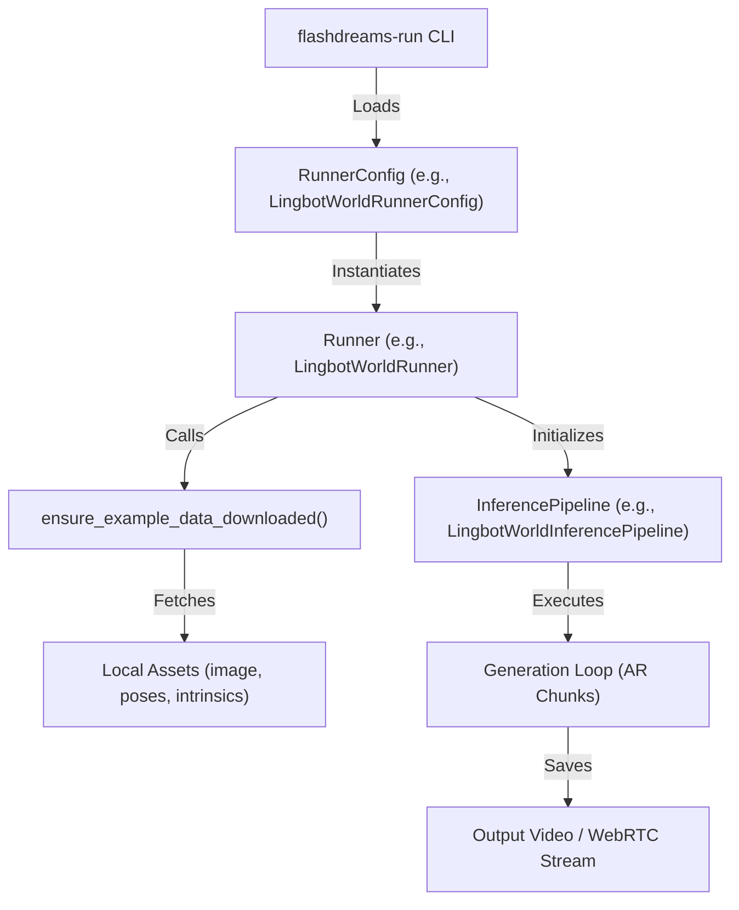
Sources: [integrations/lingbot/lingbot/runner.py:113-165](), [docs/source/quickstart/first_world_model.rst:31-59]()

## Development and Testing

### Testing Infrastructure
The repository provides two primary test runners located in `tests/` [tests/README.md:5-9]():
*   `run_tests_local.sh`: For environments where dependencies are already installed.
*   `run_tests_docker.sh`: Spawns a container, installs dependencies, and runs tests.

To run tests:
```bash
# Local
./tests/run_tests_local.sh

# Docker (requires GPU)
./tests/run_tests_docker.sh
```

### Distributed Initialization
For multi-GPU or interactive serving, the system uses `initialize_distributed` to set up the NCCL process group and CUDA device affinity [integrations/lingbot/tests/test_distributed_server_main.py:66-104]().

**Distributed Setup Logic**
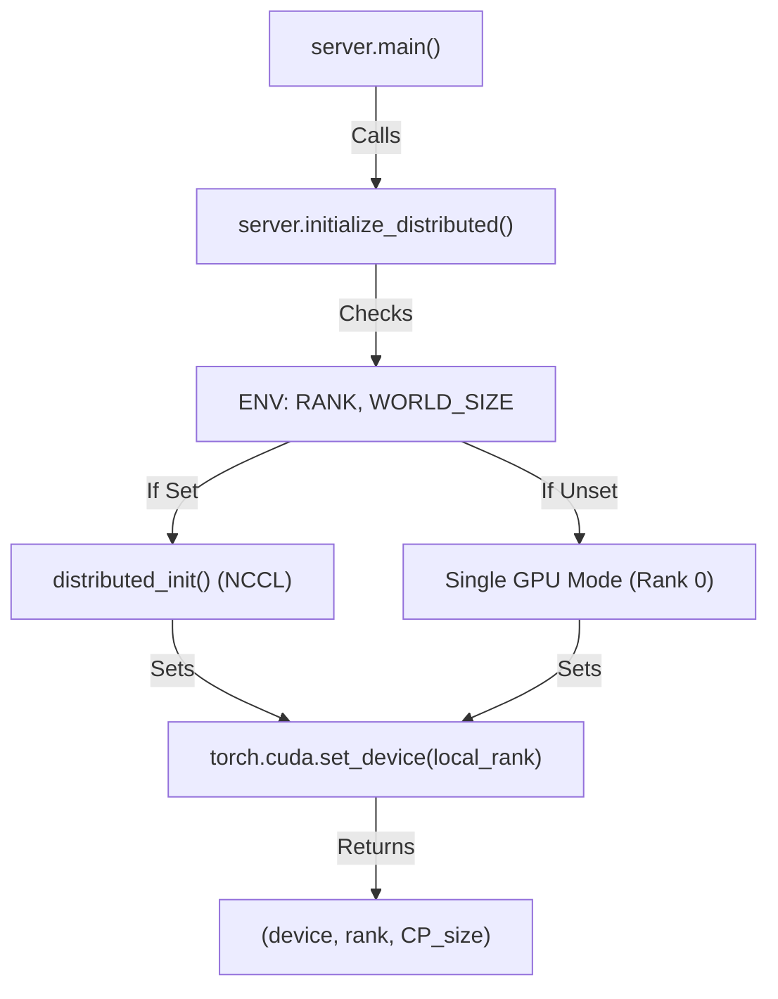
Sources: [integrations/lingbot/tests/test_distributed_server_main.py:53-138](), [tests/run_tests_local.sh:1-30]()

### Versioning
FlashDreams uses a single source of truth for versioning located in `flashdreams/flashdreams/_version.py`. All integration packages in the monorepo are kept in sync automatically via pre-commit hooks [DEV.md:3-13]().

Sources: [DEV.md:1-57](), [flashdreams/tests/test_log_filters.py:10-111]()

---

# Page: CLI and Plugin Registry

# CLI and Plugin Registry

<details>
<summary>Relevant source files</summary>

The following files were used as context for generating this wiki page:

- [.github/workflows/ci.yml](.github/workflows/ci.yml)
- [.pre-commit-config.yaml](.pre-commit-config.yaml)
- [docs/source/_static/diagrams/cli-screen-shot.png](docs/source/_static/diagrams/cli-screen-shot.png)
- [docs/source/api/cli.rst](docs/source/api/cli.rst)
- [flashdreams/flashdreams/configs/runner_configs.py](flashdreams/flashdreams/configs/runner_configs.py)
- [flashdreams/flashdreams/infra/runner.py](flashdreams/flashdreams/infra/runner.py)
- [flashdreams/flashdreams/scripts/cli.py](flashdreams/flashdreams/scripts/cli.py)
- [flashdreams/pyproject.toml](flashdreams/pyproject.toml)
- [flashdreams/tests/test_recipe_configs.py](flashdreams/tests/test_recipe_configs.py)
- [integrations/causal_forcing/tests/test_smoke.py](integrations/causal_forcing/tests/test_smoke.py)
- [integrations/fastvideo_causal_wan22/tests/test_smoke.py](integrations/fastvideo_causal_wan22/tests/test_smoke.py)
- [integrations/lingbot/tests/test_smoke.py](integrations/lingbot/tests/test_smoke.py)
- [integrations/omnidreams/ludus-renderer/examples/render_mirror_augmented.py](integrations/omnidreams/ludus-renderer/examples/render_mirror_augmented.py)
- [integrations/omnidreams/ludus-renderer/pyproject.toml](integrations/omnidreams/ludus-renderer/pyproject.toml)
- [integrations/omnidreams/omnidreams/config.py](integrations/omnidreams/omnidreams/config.py)
- [integrations/omnidreams/tests/test_recipe_configs.py](integrations/omnidreams/tests/test_recipe_configs.py)
- [integrations/self_forcing/tests/test_smoke.py](integrations/self_forcing/tests/test_smoke.py)
- [integrations/wan21/tests/test_smoke.py](integrations/wan21/tests/test_smoke.py)
- [pyproject.toml](pyproject.toml)
- [uv.lock](uv.lock)

</details>


The `flashdreams-run` CLI serves as the unified entry point for the entire framework, providing a consistent interface to execute diverse world models and video diffusion pipelines. It leverages a decentralized plugin registry that allows both in-tree recipes and external integration packages to register "runner slugs" that appear as subcommands.

## Unified CLI: flashdreams-run

The CLI is powered by `tyro`, which automatically generates a command-line interface from a union of `RunnerConfig` dataclasses [flashdreams/flashdreams/scripts/cli.py:42-47](). Every field in a model's configuration becomes a CLI flag, allowing users to override specific hyperparameters (e.g., `--prompt`, `--total-blocks`, or `--pipeline.diffusion_model.transformer.num_views`) directly from the terminal [flashdreams/flashdreams/scripts/cli.py:16-30]().

### Core Commands

| Command | Description |
|:---|:---|
| `flashdreams-run --help` | Lists all registered runner slugs and their descriptions [flashdreams/flashdreams/scripts/cli.py:25](). |
| `flashdreams-run <slug> --help` | Inspects all overridable fields for a specific model [flashdreams/flashdreams/scripts/cli.py:26](). |
| `flashdreams-run <slug> [flags]` | Executes the runner on a single GPU [flashdreams/flashdreams/scripts/cli.py:27](). |
| `torchrun ... flashdreams-run <slug>` | Executes the runner in distributed mode (Multi-GPU) [flashdreams/flashdreams/scripts/cli.py:35](). |
| `--no-instantiate` | Resolves the final configuration and prints it without loading weights or starting inference [flashdreams/flashdreams/scripts/cli.py:50-60](). |

### Data Flow: CLI to Execution

The following diagram illustrates how a string-based CLI command is transformed into a live `Runner` instance.

**CLI Resolution and Execution Flow**
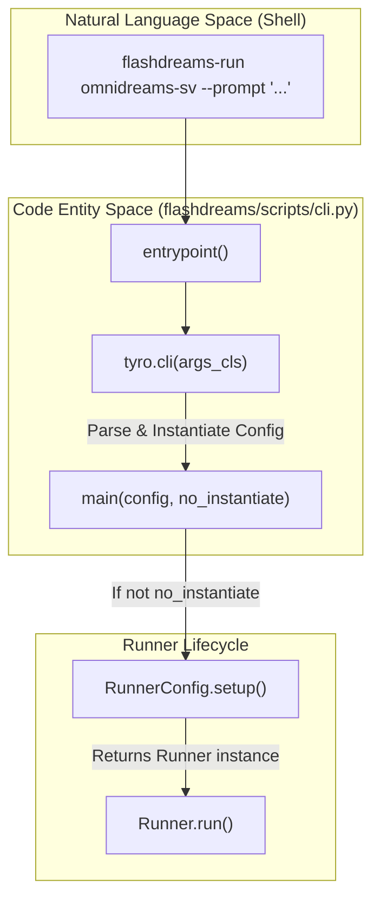
Sources: [flashdreams/flashdreams/scripts/cli.py:50-107](), [flashdreams/flashdreams/infra/runner.py:1-10]()

## Plugin Registry and Discovery

FlashDreams uses a hybrid registration system. In-tree recipes are registered via explicit imports, while external integrations (located in `integrations/*`) are discovered via Python entry points.

### Registration Mechanism
The central registry is managed in `flashdreams.configs.registry`. It maintains a mapping of slugs to `RunnerConfig` instances [flashdreams/flashdreams/configs/runner_configs.py:56-60]().

1.  **Built-in Runners**: In-tree integrations (like the template) call `register_runner(..., source="builtin")` during module import [flashdreams/flashdreams/configs/runner_configs.py:33-42]().
2.  **Plugin Discovery**: The `all_runners()` function calls `discover_runners()`, which scans the environment for packages advertising the `flashdreams.runner_configs` entry-point group [flashdreams/flashdreams/configs/runner_configs.py:72-83]().
3.  **Conflict Resolution**: Built-in runners always take precedence over plugins with the same slug. Collisions are logged, and the plugin version is skipped [flashdreams/flashdreams/configs/runner_configs.py:72-79]().

### Integration Structure
External integrations, such as `flashdreams-omnidreams`, define their runners in their own `pyproject.toml` files. This allows `flashdreams-run` to find them even if they are installed as separate packages.

**Example Entry Point Registration**
```toml
# integrations/omnidreams/pyproject.toml (Conceptual)
[project.entry-points."flashdreams.runner_configs"]
omnidreams-sv = "omnidreams.config:RUNNER_SV_CONFIG"
```
Sources: [integrations/omnidreams/omnidreams/config.py:18-24](), [flashdreams/flashdreams/configs/runner_configs.py:16-31]()

## System Architecture: Registry Aggregation

This diagram shows how the `flashdreams-run` tool aggregates configurations from disparate sources.

**Registry Aggregation Logic**
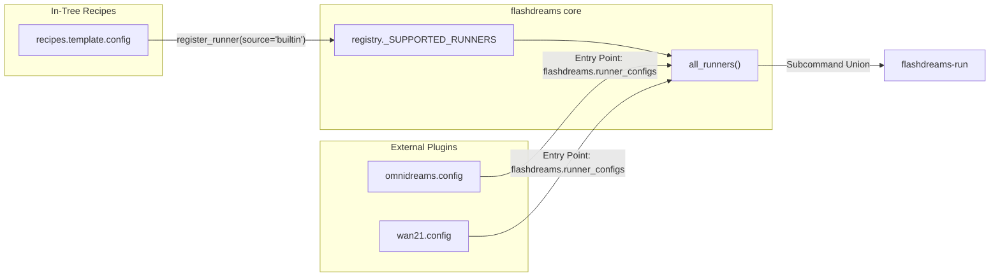
Sources: [flashdreams/flashdreams/configs/runner_configs.py:65-83](), [flashdreams/flashdreams/configs/registry.py:1-60](), [flashdreams/flashdreams/scripts/cli.py:46-47]()

## Environment Backdoor: FLASHDREAMS_RUNNER_CONFIGS

For development and rapid prototyping, the framework supports the `FLASHDREAMS_RUNNER_CONFIGS` environment variable. This acts as a "backdoor" to inject runner configurations without formal entry-point registration or modifying in-tree code.

*   **Mechanism**: `discover_runners()` checks this variable for a colon-separated list of import paths (e.g., `my_module.config:MY_RUNNER`).
*   **Priority**: Runners loaded via this environment variable are treated similarly to plugins but are useful for one-off experiments or CI/CD testing of new integrations.

Sources: [flashdreams/flashdreams/plugins/registry.py:1-30](), [flashdreams/flashdreams/configs/runner_configs.py:72-83]()

## Configuration Validation

To maintain a consistent CLI experience, the framework enforces several constraints on registered runners via smoke tests in `tests/test_recipe_configs.py`:

*   **Slug Parity**: The dictionary key in the registry must match the `runner_name` field within the `RunnerConfig` [flashdreams/tests/test_recipe_configs.py:39-48]().
*   **Pipeline Alignment**: By convention, `runner_name` must equal the `pipeline.name` to ensure the CLI command accurately reflects the underlying pipeline being executed [flashdreams/tests/test_recipe_configs.py:79-93]().
*   **Documentation**: Every runner must provide a non-empty `description` string, which `tyro` uses to populate the help menu [flashdreams/tests/test_recipe_configs.py:95-102]().

Sources: [flashdreams/tests/test_recipe_configs.py:16-103]()

---

# Page: Repository Structure and Workspace

# Repository Structure and Workspace

<details>
<summary>Relevant source files</summary>

The following files were used as context for generating this wiki page:

- [.github/copy-pr-bot.yaml](.github/copy-pr-bot.yaml)
- [.github/renovate.json](.github/renovate.json)
- [.github/scripts/sync_version.py](.github/scripts/sync_version.py)
- [DEV.md](DEV.md)
- [flashdreams/flashdreams/_version.py](flashdreams/flashdreams/_version.py)
- [integrations/causal_forcing/pyproject.toml](integrations/causal_forcing/pyproject.toml)
- [integrations/cosmos_predict2/pyproject.toml](integrations/cosmos_predict2/pyproject.toml)
- [integrations/fastvideo_causal_wan22/pyproject.toml](integrations/fastvideo_causal_wan22/pyproject.toml)
- [integrations/flashvsr/pyproject.toml](integrations/flashvsr/pyproject.toml)
- [integrations/hy_worldplay/pyproject.toml](integrations/hy_worldplay/pyproject.toml)
- [integrations/lingbot/pyproject.toml](integrations/lingbot/pyproject.toml)
- [integrations/omnidreams/pyproject.toml](integrations/omnidreams/pyproject.toml)
- [integrations/self_forcing/pyproject.toml](integrations/self_forcing/pyproject.toml)
- [integrations/self_forcing/tests/baseline_fastvideo/.gitignore](integrations/self_forcing/tests/baseline_fastvideo/.gitignore)
- [integrations/self_forcing/tests/baseline_fastvideo/README.md](integrations/self_forcing/tests/baseline_fastvideo/README.md)
- [integrations/self_forcing/tests/baseline_fastvideo/changes.patch](integrations/self_forcing/tests/baseline_fastvideo/changes.patch)
- [integrations/self_forcing/tests/baseline_fastvideo/pyproject.toml](integrations/self_forcing/tests/baseline_fastvideo/pyproject.toml)
- [integrations/self_forcing/tests/baseline_fastvideo/run.sh](integrations/self_forcing/tests/baseline_fastvideo/run.sh)
- [integrations/self_forcing/tests/baseline_fastvideo/uv.lock](integrations/self_forcing/tests/baseline_fastvideo/uv.lock)
- [integrations/wan21/pyproject.toml](integrations/wan21/pyproject.toml)
- [integrations/wan22/pyproject.toml](integrations/wan22/pyproject.toml)

</details>


This page details the monorepo architecture of the FlashDreams project, focusing on its `uv` workspace layout, the relationship between the core package and integrations, and the versioning and distribution strategy.

## Monorepo Layout and Workspace

FlashDreams is structured as a **uv monorepo**. This allows for a single lockfile at the repository root while maintaining distinct, modular packages for the core framework and various model-specific integrations.

### Core vs. Integrations
The repository is split into two primary areas:
1.  **Core Package (`flashdreams/`)**: Contains the foundational infrastructure, including streaming inference pipelines, distributed execution logic, and shared serving abstractions.
2.  **Integrations (`integrations/`)**: Contains specialized plugins for specific models (e.g., Wan 2.1, Cosmos) or applications (e.g., OmniDreams). Each integration is a standalone Python package with its own `pyproject.toml`.

### Dependency Management
The `uv` workspace ensures that integration packages can depend on the core `flashdreams` package using the `{ workspace = true }` directive [integrations/omnidreams/pyproject.toml:56-57](). This enables local development where changes in the core package are immediately reflected in all integrations without requiring a re-install.

| Component | Path | Description |
| :--- | :--- | :--- |
| **Workspace Root** | `/` | Contains `uv.lock` and global configuration. |
| **Core Framework** | `flashdreams/` | The `flashdreams` package. |
| **Integrations** | `integrations/*` | Model-specific plugins (e.g., `flashdreams-wan21`). |
| **External Renderer** | `ludus-renderer/` | GPU-native rasterizer used by OmniDreams. |

### Workspace Dependency Flow
The following diagram illustrates how the `uv` workspace resolves dependencies between the core package and various integrations.

**Workspace Dependency Graph**
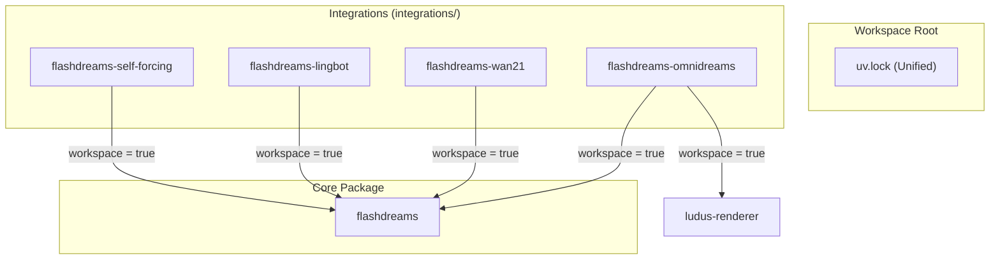
Sources: [integrations/omnidreams/pyproject.toml:56-59](), [integrations/wan21/pyproject.toml:32-33](), [integrations/lingbot/pyproject.toml:35-36](), [DEV.md:46-57]().

---

## Versioning Strategy

FlashDreams employs a "single source of truth" versioning system to ensure consistency across the monorepo.

### Canonical Version
The version for the entire monorepo is defined in a single file: `flashdreams/flashdreams/_version.py` [flashdreams/flashdreams/_version.py:16-16]().

### Synchronization Mechanism
To prevent version drift, a synchronization script (`.github/scripts/sync_version.py`) is triggered as a pre-commit hook [DEV.md:12-14](). This script:
1.  Reads the `__version__` string from the core package.
2.  Updates the `version` field in every `pyproject.toml` file within the `integrations/` directory to match.

**Versioning Data Flow**
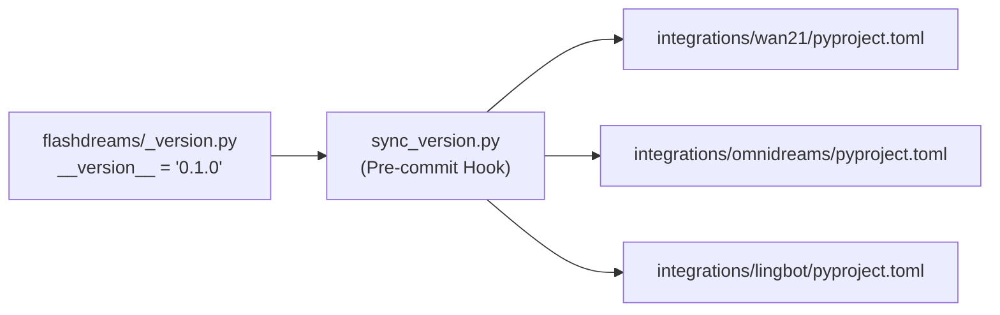
Sources: [flashdreams/flashdreams/_version.py:16-16](), [DEV.md:5-21]().

---

## Publishing and Distribution

The project uses a tiered publishing strategy, distinguishing between the core framework and the model-specific integrations.

### PyPI Strategy
Only the core `flashdreams` package is published to PyPI [DEV.md:24-24](). It is distributed as a pure-Python wheel. During the initial development phase, it is published to **test.pypi.org** [DEV.md:26-29]().

### Git-Installable Integrations
Integration packages (e.g., `flashdreams-omnidreams`, `flashdreams-wan21`) are **not** published to PyPI [DEV.md:33-33](). They are intended to be installed directly from the GitHub repository using the `subdirectory` fragment.

**Example Installation:**
```bash
pip install "flashdreams-wan21 @ git+https://github.com/NVIDIA/flashdreams.git#subdirectory=integrations/wan21"
```
[DEV.md:37-38]()

### Plugin Registration via Entry Points
Integrations register themselves with the core `flashdreams-run` CLI using `project.entry-points` [integrations/omnidreams/pyproject.toml:102-105](). Specifically, they use the `flashdreams.runner_configs` group. This allows the CLI to discover and instantiate specific model runners (e.g., `wan21-t2v-1.3b-480p`) without the core package having explicit knowledge of every integration [integrations/wan21/pyproject.toml:44-46]().

| Integration | Entry Point Group | Key Config Symbol |
| :--- | :--- | :--- |
| `omnidreams` | `flashdreams.runner_configs` | `RUNNER_SV_2STEPS_CHUNK2_LOC6_LIGHTVAE_LIGHTTAE` |
| `flashvsr` | `flashdreams.runner_configs` | `RUNNER_FLASHVSR_V1_1_SPARSE_2_0` |
| `lingbot` | `flashdreams.runner_configs` | `RUNNER_LINGBOT_WORLD_FAST` |
| `wan21` | `flashdreams.runner_configs` | `RUNNER_WAN21_T2V_1PT3B_480P` |

Sources: [integrations/omnidreams/pyproject.toml:102-105](), [integrations/flashvsr/pyproject.toml:56-60](), [integrations/lingbot/pyproject.toml:48-51](), [integrations/wan21/pyproject.toml:44-46](), [DEV.md:31-45]().

---

# Page: Core Framework Architecture

# Core Framework Architecture

<details>
<summary>Relevant source files</summary>

The following files were used as context for generating this wiki page:

- [THIRD-PARTY-NOTICES](THIRD-PARTY-NOTICES)
- [docs/source/api/integrations.rst](docs/source/api/integrations.rst)
- [docs/source/developer_guides/inference_pipeline_overview.rst](docs/source/developer_guides/inference_pipeline_overview.rst)
- [docs/source/models/index.rst](docs/source/models/index.rst)
- [flashdreams/flashdreams/core/attention/native.py](flashdreams/flashdreams/core/attention/native.py)
- [flashdreams/flashdreams/infra/diffusion/model/base.py](flashdreams/flashdreams/infra/diffusion/model/base.py)
- [flashdreams/flashdreams/infra/diffusion/scheduler/base.py](flashdreams/flashdreams/infra/diffusion/scheduler/base.py)
- [flashdreams/flashdreams/infra/diffusion/transformer/base.py](flashdreams/flashdreams/infra/diffusion/transformer/base.py)
- [flashdreams/flashdreams/infra/encoder/base.py](flashdreams/flashdreams/infra/encoder/base.py)
- [flashdreams/flashdreams/recipes/wan/pipeline.py](flashdreams/flashdreams/recipes/wan/pipeline.py)
- [flashdreams/tests/test_wan_pipeline.py](flashdreams/tests/test_wan_pipeline.py)
- [integrations/omnidreams/omnidreams_singleview/patches/cutlass/include/cute/atom/detail/tma_descriptor_pool.hpp](integrations/omnidreams/omnidreams_singleview/patches/cutlass/include/cute/atom/detail/tma_descriptor_pool.hpp)
- [integrations/omnidreams/omnidreams_singleview/patches/cutlass/sm120-tma-pool.patch](integrations/omnidreams/omnidreams_singleview/patches/cutlass/sm120-tma-pool.patch)
- [integrations/omnidreams/omnidreams_singleview/thirdparty_sources.json](integrations/omnidreams/omnidreams_singleview/thirdparty_sources.json)

</details>


The FlashDreams core framework provides a modular, streaming-first architecture for autoregressive video generation and world modeling. It is designed to bridge the gap between high-quality offline video models (like Wan 2.1 or Cosmos) and low-latency interactive applications.

The architecture is built on four pillars: a **Streaming Inference Pipeline** that manages the autoregressive lifecycle, a **Diffusion Infrastructure** for modular denoising, **Attention Primitives** optimized for long-context KV caching, and a **Distributed Execution** layer for multi-GPU scaling.

### System Overview Diagram
The following diagram illustrates how the natural language concepts of the generation loop map to the primary code entities in `flashdreams.infra`.

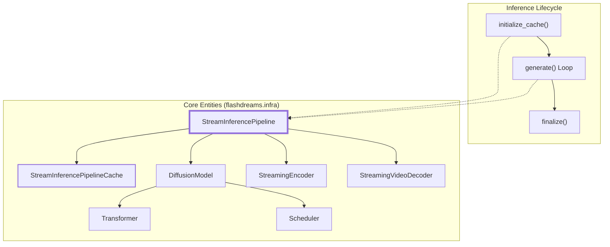
**Sources:** [docs/source/developer_guides/inference_pipeline_overview.rst:29-67](), [flashdreams/flashdreams/infra/pipeline.py:38-42]()

---

## 2.1 Streaming Inference Pipeline
The `StreamInferencePipeline` is the central orchestrator for the framework. It defines a rigid 3-stage lifecycle for each autoregressive (AR) step: `initialize_cache` for global context (text/first frame), `generate` for the denoising and decoding hot-path, and `finalize` for KV cache maintenance and state updates [docs/source/developer_guides/inference_pipeline_overview.rst:57-63]().

The pipeline uses an `InstantiateConfig` pattern via `StreamInferencePipelineConfig`, allowing users to swap encoders, transformers, and decoders without modifying the core loop [flashdreams/flashdreams/infra/pipeline.py:76-125]().

For details, see [Streaming Inference Pipeline](#2.1).

**Sources:** [docs/source/developer_guides/inference_pipeline_overview.rst:29-128](), [flashdreams/flashdreams/infra/pipeline.py:98-132]()

---

## 2.2 Attention Mechanisms and KV Cache
To support long-duration streaming, FlashDreams implements specialized attention primitives. The framework centers on the `BlockKVCache`, which supports "sink tokens" for stable attention and "rolling windows" to manage memory during infinite generation.

Positioning is handled by `RotaryPositionEmbedding3D` (3D RoPE), which decouples temporal, height, and width frequencies to maintain spatial consistency across AR chunks. Distributed attention is supported via Context Parallelism (CP), utilizing both Ring and Ulysses sharding strategies.

For details, see [Attention Mechanisms and KV Cache](#2.2).

**Sources:** [flashdreams/flashdreams/infra/diffusion/transformer/base.py:30-35](), [flashdreams/flashdreams/core/attention/native.py:1-20]()

---

## 2.3 Diffusion Schedulers
The `DiffusionModel` class encapsulates the relationship between a `Transformer` (the flow predictor) and a `Scheduler` (the denoising loop) [flashdreams/flashdreams/infra/diffusion/model/base.py:73-105](). FlashDreams primarily utilizes the Flow-Matching family of schedulers.

*   **`FlowMatchScheduler`**: Implements standard Euler-based ODE solving.
*   **`FlowMatchUniPCScheduler`**: An order-2 predictor-corrector for higher quality at lower step counts.

Schedulers are shape-agnostic and operate on the `initial_noise` provided by the model [flashdreams/flashdreams/infra/diffusion/scheduler/base.py:67-90]().

For details, see [Diffusion Schedulers](#2.3).

**Sources:** [flashdreams/flashdreams/infra/diffusion/model/base.py:48-105](), [flashdreams/flashdreams/infra/diffusion/scheduler/base.py:45-110]()

---

## 2.4 Distributed Execution and Multi-GPU
FlashDreams is built for high-performance multi-GPU environments. The `RankCoordinator` orchestrates execution across NCCL process groups. The framework utilizes Context Parallelism (CP) to shard the temporal dimension of video latents across GPUs, enabling the generation of high-resolution video that exceeds the memory of a single card.

The infrastructure also includes low-level optimizations such as CUDA L2 fetch granularity tuning and CPU affinity management via `pynvml` to minimize host-to-device bottlenecks.

For details, see [Distributed Execution and Multi-GPU](#2.4).

**Sources:** [flashdreams/flashdreams/infra/diffusion/model/base.py:163-175](), [THIRD-PARTY-NOTICES:35-41]()

---

## 2.5 CUDA Graph Capture and Performance Infrastructure
To achieve interactive latencies, the framework utilizes `CUDAGraphWrapper` to capture the "steady-state" of the denoising loop. This eliminates Python launch overhead during the generation of subsequent video chunks.

The performance stack also includes:
*   **`EventProfiler`**: For fine-grained GPU timing of DiT blocks.
*   **`CudaHostPrefetch`**: Overlaps GPU-to-host transfers of the decoded video with the computation of the next latent chunk.

For details, see [CUDA Graph Capture and Performance Infrastructure](#2.5).

**Sources:** [docs/source/developer_guides/inference_pipeline_overview.rst:60-63](), [integrations/omnidreams/omnidreams_singleview/patches/cutlass/sm120-tma-pool.patch:42-61]()

---

### Code Mapping: Data Flow
The diagram below maps the internal data flow of a `DiffusionModel` during a single `generate()` call.

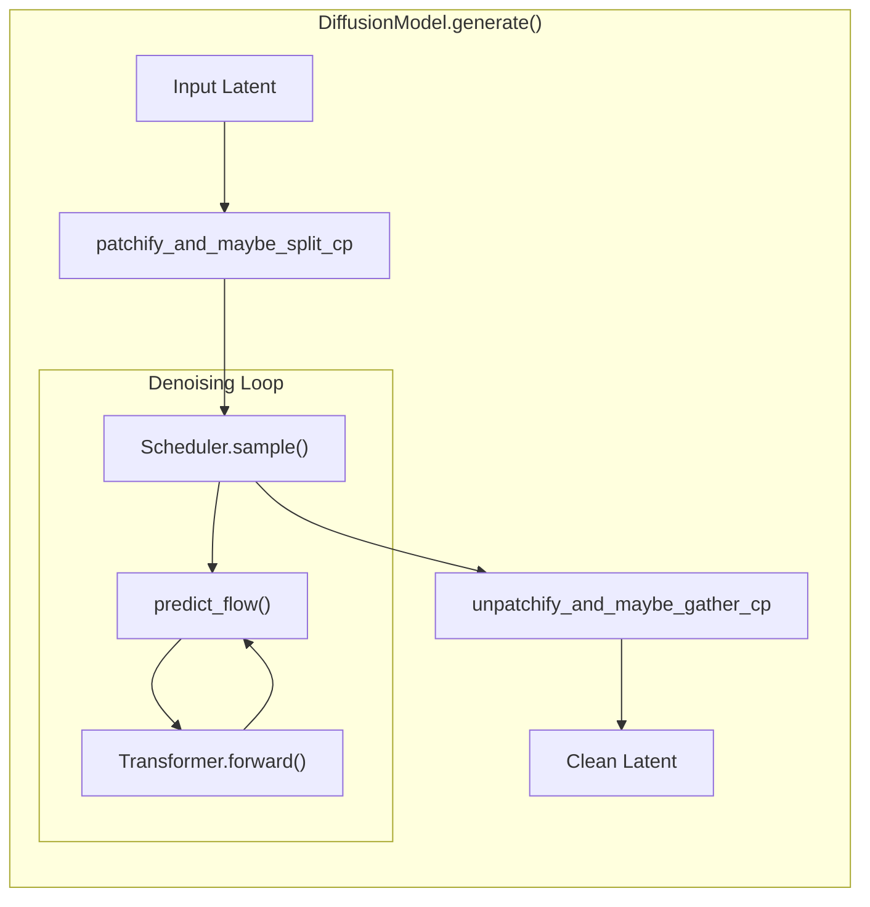
**Sources:** [flashdreams/flashdreams/infra/diffusion/model/base.py:144-190](), [flashdreams/flashdreams/infra/diffusion/scheduler/base.py:67-75]()

---

# Page: Streaming Inference Pipeline

# Streaming Inference Pipeline

<details>
<summary>Relevant source files</summary>

The following files were used as context for generating this wiki page:

- [THIRD-PARTY-NOTICES](THIRD-PARTY-NOTICES)
- [docs/source/api/integrations.rst](docs/source/api/integrations.rst)
- [docs/source/developer_guides/inference_pipeline_overview.rst](docs/source/developer_guides/inference_pipeline_overview.rst)
- [docs/source/models/index.rst](docs/source/models/index.rst)
- [flashdreams/flashdreams/core/attention/native.py](flashdreams/flashdreams/core/attention/native.py)
- [flashdreams/flashdreams/core/checkpoint/remap.py](flashdreams/flashdreams/core/checkpoint/remap.py)
- [flashdreams/flashdreams/core/io/hf.py](flashdreams/flashdreams/core/io/hf.py)
- [flashdreams/flashdreams/infra/config/base.py](flashdreams/flashdreams/infra/config/base.py)
- [flashdreams/flashdreams/infra/diffusion/model/base.py](flashdreams/flashdreams/infra/diffusion/model/base.py)
- [flashdreams/flashdreams/infra/diffusion/scheduler/base.py](flashdreams/flashdreams/infra/diffusion/scheduler/base.py)
- [flashdreams/flashdreams/infra/diffusion/transformer/base.py](flashdreams/flashdreams/infra/diffusion/transformer/base.py)
- [flashdreams/flashdreams/infra/encoder/base.py](flashdreams/flashdreams/infra/encoder/base.py)
- [flashdreams/flashdreams/infra/encoder/image/clip.py](flashdreams/flashdreams/infra/encoder/image/clip.py)
- [flashdreams/flashdreams/infra/encoder/text/cosmos_reason1.py](flashdreams/flashdreams/infra/encoder/text/cosmos_reason1.py)
- [flashdreams/flashdreams/infra/encoder/text/umt5.py](flashdreams/flashdreams/infra/encoder/text/umt5.py)
- [flashdreams/flashdreams/infra/pipeline/base.py](flashdreams/flashdreams/infra/pipeline/base.py)
- [flashdreams/flashdreams/recipes/wan/pipeline.py](flashdreams/flashdreams/recipes/wan/pipeline.py)
- [flashdreams/tests/test_distributed_logging.py](flashdreams/tests/test_distributed_logging.py)
- [flashdreams/tests/test_hf_io.py](flashdreams/tests/test_hf_io.py)
- [flashdreams/tests/test_wan_pipeline.py](flashdreams/tests/test_wan_pipeline.py)
- [integrations/omnidreams/omnidreams_singleview/patches/cutlass/include/cute/atom/detail/tma_descriptor_pool.hpp](integrations/omnidreams/omnidreams_singleview/patches/cutlass/include/cute/atom/detail/tma_descriptor_pool.hpp)
- [integrations/omnidreams/omnidreams_singleview/patches/cutlass/sm120-tma-pool.patch](integrations/omnidreams/omnidreams_singleview/patches/cutlass/sm120-tma-pool.patch)
- [integrations/omnidreams/omnidreams_singleview/thirdparty_sources.json](integrations/omnidreams/omnidreams_singleview/thirdparty_sources.json)

</details>


The `StreamInferencePipeline` is the central orchestration layer of FlashDreams. It manages the lifecycle of an autoregressive (AR) generation rollout by composing an **Encoder**, a **Diffusion Model** (Transformer + Scheduler), and a **Decoder**. It is designed to handle persistent state across AR steps via a unified cache object, enabling low-latency streaming of video or world-model frames.

## Pipeline Lifecycle

The execution of a streaming pipeline follows a strict three-stage lifecycle for every rollout. This separation allows for performance optimizations, such as offloading non-critical path KV cache updates to background threads.

1.  **`initialize_cache`**: Consumes one-shot global conditions (e.g., text prompts, initial frames) and allocates the persistent state for the rollout [docs/source/developer_guides/inference_pipeline_overview.rst:45-49]().
2.  **`generate`**: The "hot path" that executes the per-step logic. It encodes control inputs, runs the diffusion denoising loop, and decodes the resulting latent chunk into pixels [flashdreams/flashdreams/infra/pipeline/base.py:194-200]().
3.  **`finalize`**: Handles post-generation state updates and KV cache maintenance that are not required for the immediate output [flashdreams/flashdreams/infra/pipeline/base.py:255-260]().

### Autoregressive Loop Flow

The following diagram illustrates the relationship between the pipeline components and the state management during a rollout.

**Diagram: Pipeline Component Interaction**
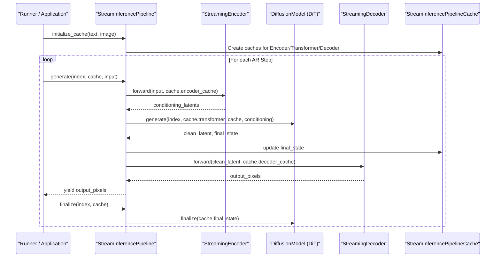
Sources: `[docs/source/developer_guides/inference_pipeline_overview.rst:52-63]()`, `[flashdreams/flashdreams/infra/pipeline/base.py:111-133]()`, `[flashdreams/flashdreams/infra/diffusion/model/base.py:144-162]()`.

---

## Key Classes and Data Flow

### StreamInferencePipeline
The `StreamInferencePipeline` class [flashdreams/flashdreams/infra/pipeline/base.py:111-118]() serves as the `nn.Module` container. It holds the sub-modules and provides the top-level API. It is generic over the cache types of its constituents to ensure type safety across different model architectures.

### StreamInferencePipelineCache
This dataclass acts as the container for all persistent state [flashdreams/flashdreams/infra/pipeline/base.py:86-109](). It typically contains:
*   `transformer_cache`: Long-lived AR cache for the DiT [flashdreams/flashdreams/infra/pipeline/base.py:91-92]().
*   `encoder_cache`: Cache for streaming encoders (e.g., HDMap or camera encoders) [flashdreams/flashdreams/infra/pipeline/base.py:94-95]().
*   `decoder_cache`: Cache for streaming VAE decoders (e.g., TAEHV) [flashdreams/flashdreams/infra/pipeline/base.py:97-98]().
*   `final_state`: A `DiffusionModel.FinalState` object stashed during `generate` to be used by `finalize` [flashdreams/flashdreams/infra/pipeline/base.py:100-102]().

### Internal Data Flow in `generate()`
Inside the `generate` call, data flows through the pipeline as follows:
1.  **Control Encoding**: If a `StreamingEncoder` is present, the per-step `input` is transformed into model conditioning [docs/source/developer_guides/inference_pipeline_overview.rst:76-81]().
2.  **Denoising Loop**: The `DiffusionModel` takes the conditioning and the `transformer_cache` to run a multi-step denoising process (e.g., Flow Matching) [flashdreams/flashdreams/infra/diffusion/model/base.py:144-162]().
3.  **Decoding**: The resulting clean latent is passed to the `StreamingDecoder` to produce the final output (e.g., RGB frames) [docs/source/developer_guides/inference_pipeline_overview.rst:95-99]().

Sources: `[flashdreams/flashdreams/infra/pipeline/base.py:16-47]()`, `[flashdreams/flashdreams/infra/diffusion/model/base.py:73-85]()`.

---

## The InstantiateConfig Pattern

FlashDreams uses a recursive configuration system based on `InstantiateConfig` [flashdreams/flashdreams/infra/config/base.py](). This allows complex pipelines to be defined as static data structures and instantiated with a single `.setup()` call.

**Diagram: Configuration to Entity Mapping**
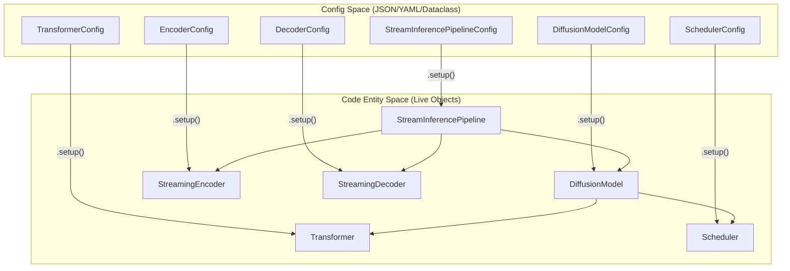
Sources: `[flashdreams/flashdreams/infra/pipeline/base.py:50-83]()`, `[flashdreams/flashdreams/infra/diffusion/model/base.py:48-71]()`, `[docs/source/developer_guides/inference_pipeline_overview.rst:107-128]()`.

---

## Concrete Implementation: WanInferencePipeline

The `WanInferencePipeline` [flashdreams/flashdreams/recipes/wan/pipeline.py:98-104]() is a reference implementation that supports both Text-to-Video (T2V) and Image-to-Video (I2V) tasks.

*   **One-shot Encoders**: Unlike streaming encoders, Wan uses `UMT5TextEncoder` and `CLIPImageEncoder` which are run once during `initialize_cache` [flashdreams/flashdreams/recipes/wan/pipeline.py:136-141]().
*   **Context Management**: It includes logic to `release_oneshot_encoders` after initialization to free up VRAM for the transformer during the AR rollout [flashdreams/flashdreams/recipes/wan/pipeline.py:193-195]().
*   **Cache Specialization**: It uses `WanInferencePipelineCache`, which extends the base cache to include first-frame pixel tensors for I2V tasks [flashdreams/flashdreams/recipes/wan/pipeline.py:57-72]().

### Initialization Parameters
| Parameter | Role | Source |
| :--- | :--- | :--- |
| `text` | List of prompts for the batch. | [flashdreams/flashdreams/recipes/wan/pipeline.py:182]() |
| `image` | First-frame pixels (I2V only). | [flashdreams/flashdreams/recipes/wan/pipeline.py:183]() |
| `height`/`width` | Latent dimensions (derived from image in I2V). | [flashdreams/flashdreams/recipes/wan/pipeline.py:189-191]() |

Sources: `[flashdreams/flashdreams/recipes/wan/pipeline.py:16-53]()`, `[flashdreams/flashdreams/infra/encoder/text/umt5.py:58-67]()`.

---

# Page: Attention Mechanisms and KV Cache

# Attention Mechanisms and KV Cache

<details>
<summary>Relevant source files</summary>

The following files were used as context for generating this wiki page:

- [flashdreams/flashdreams/core/attention/__init__.py](flashdreams/flashdreams/core/attention/__init__.py)
- [flashdreams/flashdreams/core/attention/cp.py](flashdreams/flashdreams/core/attention/cp.py)
- [flashdreams/flashdreams/core/attention/kvcache.py](flashdreams/flashdreams/core/attention/kvcache.py)
- [flashdreams/flashdreams/core/attention/rope.py](flashdreams/flashdreams/core/attention/rope.py)
- [flashdreams/flashdreams/core/attention/rope_kernel.py](flashdreams/flashdreams/core/attention/rope_kernel.py)
- [flashdreams/flashdreams/recipes/wan/transformer/impl/modules.py](flashdreams/flashdreams/recipes/wan/transformer/impl/modules.py)
- [flashdreams/flashdreams/recipes/wan/transformer/impl/network.py](flashdreams/flashdreams/recipes/wan/transformer/impl/network.py)
- [flashdreams/tests/perf_rope.py](flashdreams/tests/perf_rope.py)
- [flashdreams/tests/test_attention.py](flashdreams/tests/test_attention.py)
- [flashdreams/tests/test_kvcache.py](flashdreams/tests/test_kvcache.py)
- [flashdreams/tests/test_wan_context_parallel.py](flashdreams/tests/test_wan_context_parallel.py)
- [integrations/omnidreams/omnidreams/transformer/impl/modules.py](integrations/omnidreams/omnidreams/transformer/impl/modules.py)
- [integrations/omnidreams/omnidreams/transformer/impl/network.py](integrations/omnidreams/omnidreams/transformer/impl/network.py)

</details>


This page documents the core attention primitives and KV cache infrastructure in FlashDreams. The framework implements a high-performance, CUDA-graph compatible streaming attention system designed for long-sequence video DiTs (Diffusion Transformers). Key components include a rolling window block KV cache, 3D Rotary Position Embeddings (RoPE), and context-parallel attention strategies.

## BlockKVCache

The `BlockKVCache` class [flashdreams/flashdreams/core/attention/kvcache.py:26-57]() provides a fixed-size local window cache for causal attention. It is designed to be CUDA-graph compatible by pre-allocating static buffers and using in-place updates.

### Architecture and Data Flow

The cache maintains two logical regions within its physical buffer:
1.  **Sink Tokens**: A fixed number of initial tokens (`sink_size`) that are never evicted, preserving global context [flashdreams/flashdreams/core/attention/kvcache.py:74-75]().
2.  **Rolling Window**: A local attention window (`window_size`) that rolls left as new chunks are added once the cache reaches capacity [flashdreams/flashdreams/core/attention/kvcache.py:71-72]().

### Lifecycle Phases
The cache operates in two distinct phases:
*   **Filling Phase**: The cache is not yet full. Tokens are written contiguously, and `cached_k()`/`cached_v()` return only the valid prefix [flashdreams/flashdreams/core/attention/kvcache.py:40-41]().
*   **Steady-State Phase**: The cache is full. Each new chunk triggers a left-roll of the local window via `_roll_local_window_left()`, and the new data overwrites the rightmost positions [flashdreams/flashdreams/core/attention/kvcache.py:42-44]().

### Cache Update Sequence
The standard per-step usage follows this sequence:
1.  `before_update(chunk_idx)`: Prepares the buffer (rolls the window if in steady-state) [flashdreams/flashdreams/core/attention/kvcache.py:53]().
2.  `update(k, v)`: Writes the new chunk's tensors into the pre-allocated buffer [flashdreams/flashdreams/core/attention/kvcache.py:54]().
3.  `cached_k()` / `cached_v()`: Returns the tensors for attention computation [flashdreams/flashdreams/core/attention/kvcache.py:55]().
4.  `after_update(chunk_idx)`: Updates internal bookkeeping and increments cached token counts [flashdreams/flashdreams/core/attention/kvcache.py:56]().

**Sources:**
* [flashdreams/flashdreams/core/attention/kvcache.py:26-129]()
* [flashdreams/tests/test_kvcache.py:40-117]() (Baseline comparison logic)

---

## 3D Rotary Position Embeddings (RoPE)

FlashDreams uses 3D RoPE to handle the spatio-temporal nature of video tokens (Time, Height, Width). The head dimension is typically split into H/W/T sub-dimensions in a 2:2:2 ratio [flashdreams/flashdreams/core/attention/rope.py:102-103]().

### RoPE Implementations

| Class | Purpose |
| :--- | :--- |
| `RotaryPositionEmbedding3D` | Standard 3D RoPE where keys are rotated **before** being written to the KV cache [flashdreams/flashdreams/core/attention/rope.py:179-183](). |
| `KVCacheRelativeRotaryPositionEmbedding3D` | Relative 3D RoPE where keys in the cache are stored **un-rotated**. Rotation is applied at query time relative to the current window [flashdreams/flashdreams/core/attention/rope.py:233-238](). |

### Triton RoPE Kernel
FlashDreams includes a custom Triton kernel for applying rotary embeddings. It supports both interleaved and non-interleaved frequency layouts and provides an A/B benchmark against Transformer Engine's implementation [flashdreams/tests/perf_rope.py:16-22](). The kernel is invoked via `apply_rotary_pos_emb` [flashdreams/flashdreams/core/attention/rope_kernel.py]().

### Entity Mapping: RoPE Logic to Code
The following diagram illustrates how spatial and temporal dimensions are mapped to frequency components and applied to QKV tensors.

**3D RoPE Frequency Generation and Application**
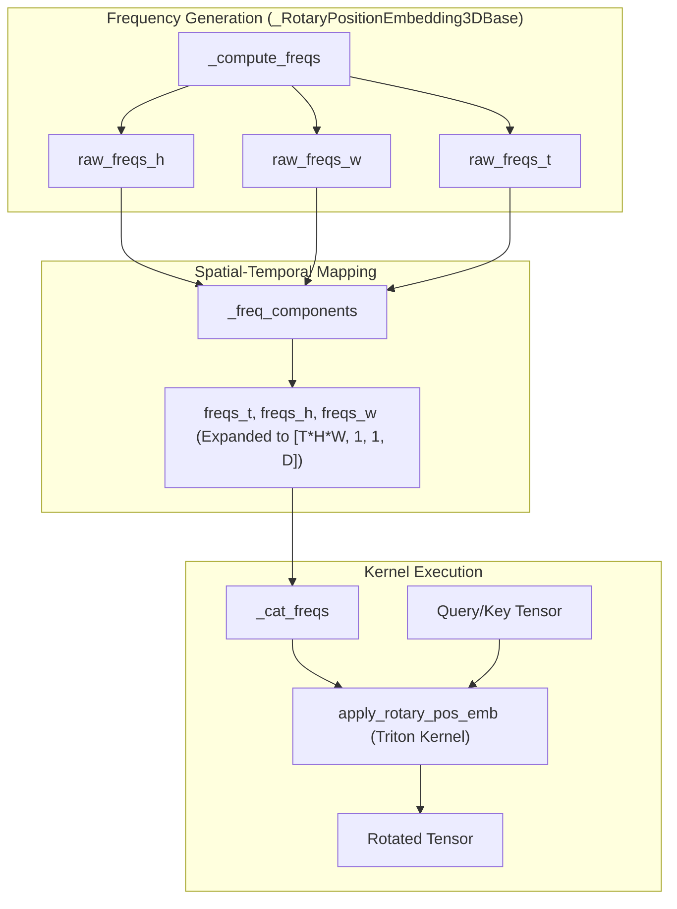
**Sources:**
* [flashdreams/flashdreams/core/attention/rope.py:41-176]()
* [flashdreams/flashdreams/core/attention/rope_kernel.py]()
* [flashdreams/tests/perf_rope.py:89-115]()

---

## Context-Parallel Attention

To support extremely long sequences across multiple GPUs, FlashDreams implements `ContextParallelAttention` [flashdreams/flashdreams/core/attention/cp.py:61](). This class wraps native SDPA primitives and supports two primary strategies:

### Parallelization Strategies
1.  **Ring Attention**: All-gathers KV tensors across CP ranks and merges outputs using Log-Sum-Exp (LSE) [flashdreams/flashdreams/core/attention/cp.py:104-105](). It supports `convert_to_fp32` for stable LSE accumulation [flashdreams/flashdreams/core/attention/cp.py:141-142]().
2.  **Ulysses Attention**: Uses all-to-all collectives to redistribute tokens such that each GPU has all heads for a subset of the sequence, performs local attention, and then redistributes back [flashdreams/flashdreams/core/attention/cp.py:162-163]().

### Integration with Transformer Blocks
Transformer blocks like `MultiHeadAttention` in the Wan recipe [flashdreams/flashdreams/recipes/wan/transformer/impl/modules.py:146]() utilize these primitives. They support `set_context_parallel_group()` to configure the underlying `attn_op` [flashdreams/flashdreams/recipes/wan/transformer/impl/modules.py:193-195]().

### Entity Mapping: Attention Data Flow
The following diagram shows how a `MultiHeadAttention` module interacts with the `BlockKVCache` and `ContextParallelAttention` during an inference step.

**Attention Inference Step Data Flow**
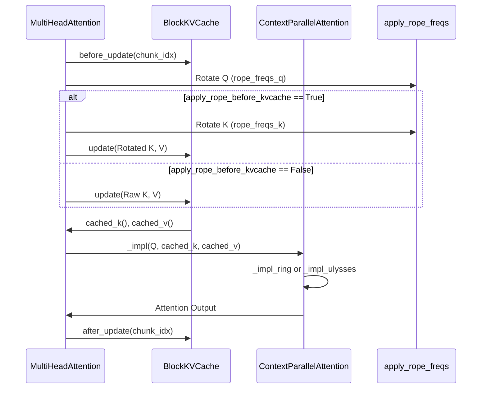

**Sources:**
* [flashdreams/flashdreams/core/attention/cp.py:61-186]()
* [flashdreams/flashdreams/recipes/wan/transformer/impl/modules.py:146-248]()
* [flashdreams/tests/test_attention.py:34-109]()

---

## Performance and Precision

FlashDreams prioritizes numerical stability and speed in its attention implementation:
*   **LSE Merging**: In Ring CP, LSE is promoted to `float32` during the merge step to prevent overflow/underflow when combining attention results from different ranks [flashdreams/flashdreams/core/attention/cp.py:147-155]().
*   **SDPA Backends**: Supports both `cudnn` and `flash` attention backends via `torch.ops.aten` calls [flashdreams/flashdreams/core/attention/cp.py:29-58]().
*   **Layout Support**: Native support for both `bhsd` (batch, head, seq, dim) and `bshd` layouts [flashdreams/flashdreams/core/attention/cp.py:66]().

**Sources:**
* [flashdreams/flashdreams/core/attention/cp.py:141-160]()
* [flashdreams/flashdreams/core/attention/native.py]()

---

# Page: Diffusion Schedulers

# Diffusion Schedulers

<details>
<summary>Relevant source files</summary>

The following files were used as context for generating this wiki page:

- [flashdreams/flashdreams/infra/diffusion/scheduler/__init__.py](flashdreams/flashdreams/infra/diffusion/scheduler/__init__.py)
- [flashdreams/flashdreams/infra/diffusion/scheduler/fm.py](flashdreams/flashdreams/infra/diffusion/scheduler/fm.py)
- [flashdreams/flashdreams/infra/diffusion/scheduler/fm_euler.py](flashdreams/flashdreams/infra/diffusion/scheduler/fm_euler.py)
- [flashdreams/flashdreams/infra/diffusion/scheduler/fm_unipc.py](flashdreams/flashdreams/infra/diffusion/scheduler/fm_unipc.py)
- [flashdreams/flashdreams/recipes/cosmos/pipeline.py](flashdreams/flashdreams/recipes/cosmos/pipeline.py)
- [flashdreams/flashdreams/recipes/cosmos/transformer/__init__.py](flashdreams/flashdreams/recipes/cosmos/transformer/__init__.py)
- [flashdreams/flashdreams/recipes/cosmos/transformer/impl/modules.py](flashdreams/flashdreams/recipes/cosmos/transformer/impl/modules.py)
- [flashdreams/flashdreams/recipes/cosmos/transformer/impl/network.py](flashdreams/flashdreams/recipes/cosmos/transformer/impl/network.py)
- [flashdreams/flashdreams/recipes/wan/__init__.py](flashdreams/flashdreams/recipes/wan/__init__.py)
- [flashdreams/tests/test_scheduler_fm_euler.py](flashdreams/tests/test_scheduler_fm_euler.py)
- [integrations/cosmos_predict2/cosmos_predict2/config.py](integrations/cosmos_predict2/cosmos_predict2/config.py)
- [integrations/cosmos_predict2/cosmos_predict2/runner.py](integrations/cosmos_predict2/cosmos_predict2/runner.py)
- [integrations/cosmos_predict2/tests/parity_check/README.md](integrations/cosmos_predict2/tests/parity_check/README.md)

</details>


Diffusion schedulers in FlashDreams manage the iterative denoising process, converting pure noise into structured latents. The framework focuses on the **Flow-Matching** family of schedulers, providing optimized implementations of Euler and UniPC (multistep) methods. These schedulers are designed to work seamlessly with `DiffusionModel` and `StreamInferencePipeline`, supporting advanced features like schedule warping (shifting), Karras-style sigma schedules, and self-forcing renoising.

## Scheduler Architecture

FlashDreams defines a base `Scheduler` protocol that abstracts the sampling loop from the specific numerical solver. Schedulers are initialized via `InstantiateConfig` patterns, allowing them to be easily swapped in pipeline configurations.

### Data Flow and Integration
The following diagram illustrates how the `Scheduler` interacts with the `DiffusionModel` and the underlying `Transformer` (e.g., `CosmosTransformer` or `Wan21Transformer`) during the sampling process.

**Scheduler and DiffusionModel Interaction**
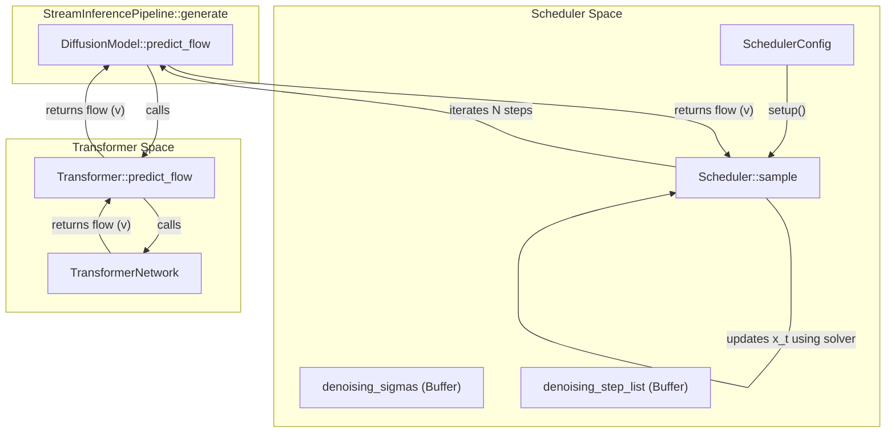
**Sources:** [flashdreams/flashdreams/infra/diffusion/scheduler/base.py:18-34](), [flashdreams/flashdreams/infra/diffusion/model.py:21-45](), [flashdreams/flashdreams/infra/pipeline.py:30-34]()

## Flow-Matching Scheduler Family

FlashDreams provides several implementations optimized for different model families (Wan, Cosmos).

### 1. FlowMatchScheduler (Euler with Renoising)
The `FlowMatchScheduler` implements a flow-matching solver with an optional self-forcing renoising path, commonly used in the Wan model family. It supports a "schedule warp" (shift) to redistribute timesteps towards higher or lower noise levels.

*   **Implementation:** `FlowMatchScheduler` [flashdreams/flashdreams/infra/diffusion/scheduler/fm.py:88-121]()
*   **Key Logic:**
    *   **Warping:** Uses the formula `shift * s / (1 + (shift - 1) * s)` to adjust the sigma schedule [flashdreams/flashdreams/infra/diffusion/scheduler/fm.py:33-35]().
    *   **Loop:** For each step, it predicts the flow $v$, estimates $x_0 = x_t - \sigma(t) \cdot v$, and then re-noises to $x_{t+1}$ [flashdreams/flashdreams/infra/diffusion/scheduler/fm.py:95-100]().

### 2. FlowMatchUniPCScheduler (Order-2 Multistep)
The `FlowMatchUniPCScheduler` is a sophisticated multistep predictor-corrector scheduler. It is the default for **Cosmos-Predict2** [integrations/cosmos_predict2/cosmos_predict2/config.py:60-65](). It achieves high-quality results with fewer steps (e.g., 35 steps) by using information from previous iterations.

*   **Implementation:** `FlowMatchUniPCScheduler` [flashdreams/flashdreams/infra/diffusion/scheduler/fm_unipc.py:16-31]()
*   **Mathematical Pre-computation:** The scheduler pre-bakes per-step coefficients (`a_pred`, `b_pred_m0`, `b_pred_dprev`, etc.) using `_build_per_step_coefs` to minimize overhead during the sampling loop [flashdreams/flashdreams/infra/diffusion/scheduler/fm_unipc.py:34-163]().
*   **Solver Phases:**
    1.  **Warmup:** Step 0 uses an order-1 Euler-style predictor.
    2.  **Multistep:** Subsequent steps use an order-2 predictor and an order-2 corrector to refine the latent [flashdreams/flashdreams/infra/diffusion/scheduler/fm_unipc.py:61-101]().

### 3. FlowMatchEulerDiscreteScheduler
A standard discrete Euler scheduler used for distilled models like **HY-WorldPlay**. It supports `fixed_timesteps` to match specific distillation schedules [flashdreams/tests/test_scheduler_fm_euler.py:32-41]().

**Sources:** [flashdreams/flashdreams/infra/diffusion/scheduler/fm.py:16-35](), [flashdreams/flashdreams/infra/diffusion/scheduler/fm_unipc.py:16-163](), [flashdreams/flashdreams/infra/diffusion/scheduler/fm_euler.py:1-46]()

## Schedule Warp and Sigma Management

Schedulers in FlashDreams use specific techniques to manage the noise schedule ($\sigma$):

| Feature | Description | Code Reference |
| :--- | :--- | :--- |
| **Shift (Warp)** | Adjusts the density of timesteps. Higher values shift steps toward the high-noise end ($t \to 1$). | `_warp` in [flashdreams/flashdreams/infra/diffusion/scheduler/fm.py:33-35]() |
| **Karras Sigma** | Uses a non-linear sigma distribution (often used in Cosmos). | `use_kerras_sigma` in [flashdreams/flashdreams/infra/diffusion/scheduler/fm_unipc.py:223-230]() |
| **Buffer Pinning** | Schedule buffers (`denoising_sigmas`, `denoising_step_list`) are pinned to `float32` to prevent precision loss if the model is cast to `bfloat16`. | `register_buffer` in [flashdreams/flashdreams/infra/diffusion/scheduler/fm.py:173-182]() |

**Sources:** [flashdreams/flashdreams/infra/diffusion/scheduler/fm.py:49-60](), [flashdreams/flashdreams/infra/diffusion/scheduler/fm_unipc.py:223-230]()

## Code Entity Mapping

This diagram maps the abstract concepts of the diffusion process to the specific classes and methods implemented in the `flashdreams` codebase.

**Diffusion Logic to Code Entity Mapping**
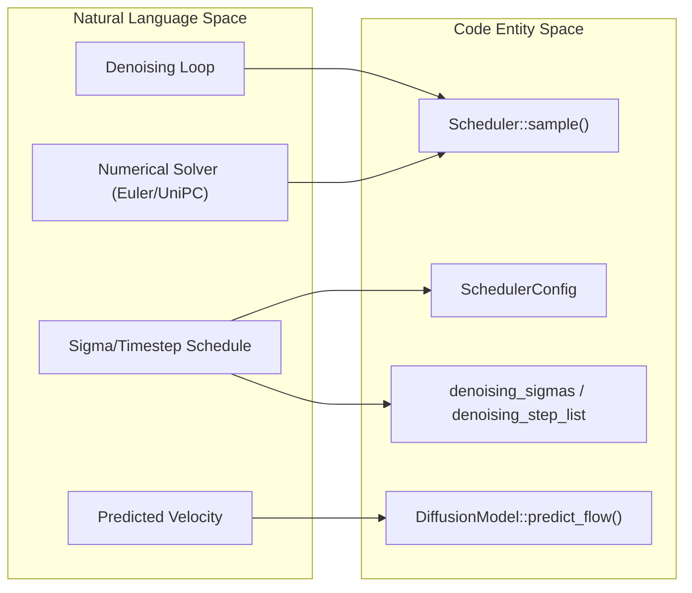
**Sources:** [flashdreams/flashdreams/infra/diffusion/scheduler/base.py:18-34](), [flashdreams/flashdreams/infra/diffusion/scheduler/fm.py:88-115](), [flashdreams/flashdreams/infra/diffusion/model.py:21-45]()

## Implementation Details: UniPC Coefficients
The `FlowMatchUniPCScheduler` performs complex scalar math in `float64` to pre-calculate coefficients, then downcasts them to `float32` for GPU execution. This ensures numerical stability for the order-2 coefficients `rks_p` (predictor) and `rks_c` (corrector) [flashdreams/flashdreams/infra/diffusion/scheduler/fm_unipc.py:59-101]().

**Predictor Coefficient Calculation:**
```python
# Predictor at step i: x_{i+1} = a * x_i - alpha_t * h_phi_1 * (m0 + 0.5/rks_p * (m_prev - m0))
h_p = (log_alpha_t_p - log_sigma_t_p) - (log_alpha_s0_p - log_sigma_s0_p)
h_phi_1_p = np.expm1(-h_p)
b_pred_m0 = -alpha_t_p * h_phi_1_p
```
**Sources:** [flashdreams/flashdreams/infra/diffusion/scheduler/fm_unipc.py:61-87]()

---

# Page: Distributed Execution and Multi-GPU

# Distributed Execution and Multi-GPU

<details>
<summary>Relevant source files</summary>

The following files were used as context for generating this wiki page:

- [docs/source/models/causal_forcing.rst](docs/source/models/causal_forcing.rst)
- [docs/source/models/causal_wan22.rst](docs/source/models/causal_wan22.rst)
- [docs/source/models/cosmos_predict2.rst](docs/source/models/cosmos_predict2.rst)
- [docs/source/models/flashvsr.rst](docs/source/models/flashvsr.rst)
- [docs/source/models/lingbot_world.rst](docs/source/models/lingbot_world.rst)
- [docs/source/models/omnidreams.rst](docs/source/models/omnidreams.rst)
- [docs/source/models/self_forcing.rst](docs/source/models/self_forcing.rst)
- [docs/source/models/wan21.rst](docs/source/models/wan21.rst)
- [flashdreams/flashdreams/_pytest_plugins/__init__.py](flashdreams/flashdreams/_pytest_plugins/__init__.py)
- [flashdreams/flashdreams/core/distributed/__init__.py](flashdreams/flashdreams/core/distributed/__init__.py)
- [flashdreams/flashdreams/core/distributed/context_parallel.py](flashdreams/flashdreams/core/distributed/context_parallel.py)
- [flashdreams/flashdreams/core/distributed/rank_orchestration.py](flashdreams/flashdreams/core/distributed/rank_orchestration.py)

</details>


FlashDreams provides a robust infrastructure for multi-GPU inference, specifically optimized for the high-throughput requirements of streaming world models. The framework handles process initialization, hardware-aware CPU affinity, context-parallel (CP) sharding for long-sequence attention, and rank orchestration to ensure synchronized execution across distributed nodes.

## Distributed Initialization and Hardware Tuning

The entry point for multi-GPU execution is the `distributed.init()` function [flashdreams/flashdreams/core/distributed/__init__.py:135-176](). This function orchestrates the setup of the NCCL backend and applies several low-level optimizations to maximize interconnect performance.

### CPU Affinity via pynvml
To minimize latency and prevent cross-socket bottlenecks, FlashDreams uses `pynvml` to query the ideal CPU affinity for each GPU [flashdreams/flashdreams/core/distributed/__init__.py:108-133](). The `Device` class binds to an NVML handle and retrieves a bitmask of CPUs physically closest to the device. The process then calls `os.sched_setaffinity` to pin itself to those cores [flashdreams/flashdreams/core/distributed/__init__.py:141-147]().

### CUDA L2 Fetch Granularity
A specific optimization for bandwidth-heavy DiT (Diffusion Transformer) models is the adjustment of the CUDA L2 fetch granularity. `distributed.init()` uses `ctypes` to interface with `libcudart.so` and sets `cudaLimitMaxL2FetchGranularity` (limit ID `0x05`) to 128 bytes [flashdreams/flashdreams/core/distributed/__init__.py:170-174](). This tuning can improve effective memory bandwidth during the large-scale tensor operations common in video generation.

### Process Group Management
FlashDreams configures standard PyTorch distributed environment variables, setting `TORCH_NCCL_BLOCKING_WAIT` to `0` and `TORCH_NCCL_ASYNC_ERROR_HANDLING` to `1` [flashdreams/flashdreams/core/distributed/__init__.py:148-149](). It also registers an `atexit` handler, `_safe_destroy_pg`, to ensure that `dist.destroy_process_group()` is called upon interpreter exit, preventing common NCCL "leaked group" warnings [flashdreams/flashdreams/core/distributed/__init__.py:41-55]().

Sources: [flashdreams/flashdreams/core/distributed/__init__.py:41-176]()

## Context Parallelism (CP) Sharding

FlashDreams supports Context Parallelism to handle long video sequences that exceed the memory capacity of a single GPU. Unlike Pipeline Parallelism, CP shards the sequence dimension across ranks.

### Tensor Sharding Primitives
The `context_parallel.py` module provides two primary functions for tensor manipulation:
*   `split_inputs_cp`: Slices a tensor along a specified `seq_dim` based on the rank's position within the `cp_group` [flashdreams/flashdreams/core/distributed/context_parallel.py:30-65]().
*   `cat_outputs_cp`: Uses `dist.all_gather` to collect shards from all ranks and concatenates them back into a full sequence [flashdreams/flashdreams/core/distributed/context_parallel.py:68-96]().

### Object Sharding Primitives
For non-tensor data (such as lists of frame metadata or conditioning objects), the framework provides `split_inputs_cp_object_list` and `cat_outputs_cp_object_list` [flashdreams/flashdreams/core/distributed/context_parallel.py:102-156](). These utilize `dist.all_gather_object` to synchronize Python objects across the CP group.

**Sequence Sharding Data Flow**
The following diagram illustrates how a sequence is sharded and re-assembled during a distributed forward pass.

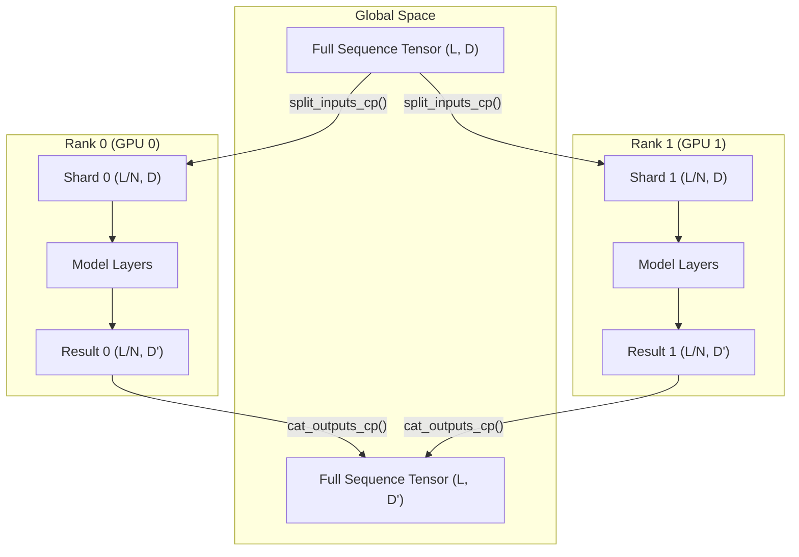
Sources: [flashdreams/flashdreams/core/distributed/context_parallel.py:16-156]()

## Rank Orchestration

In interactive or complex serving scenarios, the master rank (Rank 0) often needs to drive worker ranks through specific state transitions (e.g., "start generation", "process new input", "exit"). The `RankCoordinator` class facilitates this command-and-control pattern.

### Components of Orchestration
1.  **SignalBus**: Broadcasts lightweight `IntEnum` signals from the master to workers [flashdreams/flashdreams/core/distributed/rank_orchestration.py:47-85](). It includes a `_counter` to ensure signals are processed in strict order [flashdreams/flashdreams/core/distributed/rank_orchestration.py:62-68]().
2.  **PayloadBus**: Broadcasts picklable Python objects (like generation configs or prompts) using `dist.broadcast_object_list` [flashdreams/flashdreams/core/distributed/rank_orchestration.py:87-99]().
3.  **RankCoordinator**: The high-level manager that wraps the buses. It allows workers to enter a `worker_loop` where they block until a signal is received, then execute a registered callback [flashdreams/flashdreams/core/distributed/rank_orchestration.py:108-194]().

### Distributed Operations
The `@distributed_op` decorator allows methods to be marked as distributed [flashdreams/flashdreams/core/distributed/rank_orchestration.py:195-204](). When Rank 0 calls a decorated method, the `RankCoordinator` automatically sends the corresponding signal and broadcasts the method's arguments as a payload to all workers, who then execute the same method locally.

**Orchestration Code Entities**
This diagram maps the orchestration concepts to their implementation classes.

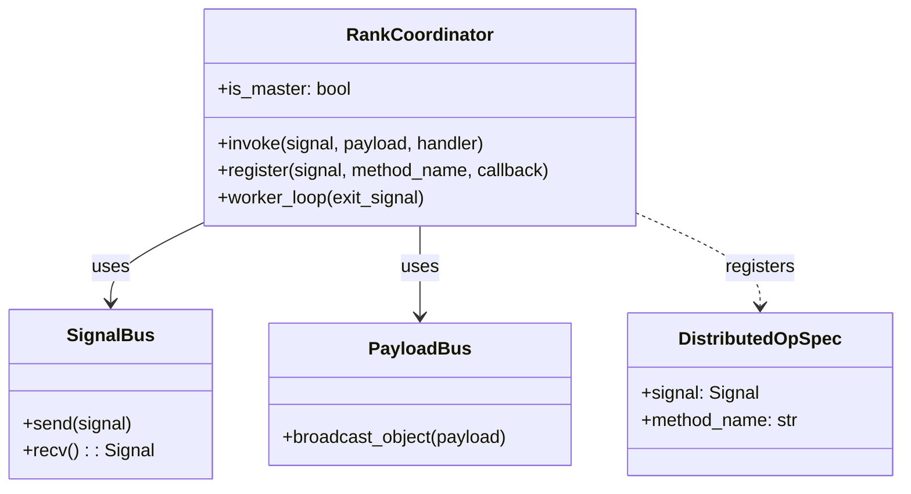
Sources: [flashdreams/flashdreams/core/distributed/rank_orchestration.py:16-204]()

## Multi-GPU Usage Patterns

Multi-GPU inference is typically invoked via `torchrun`. Most recipes in the repository support multi-GPU execution by simply increasing the `--nproc_per_node` count.

| Context | Usage Command |
| :--- | :--- |
| **Standard CLI** | `torchrun --nproc_per_node=4 --no-python flashdreams-run <slug> ...` |
| **Interactive Serving** | `torchrun --nproc_per_node=4 -m <integration>.webrtc.server ...` |

### Performance Considerations
While per-block steady-state inference is significantly faster on multiple GPUs (e.g., ~2x faster on 4 GPUs for certain Wan 2.1 configs), there is an initial overhead for NCCL initialization and Triton kernel autotuning on every rank [docs/source/models/self_forcing.rst:134-144](). For very short video generations (e.g., < 10 blocks), a single GPU may be faster due to lower setup overhead. Multi-GPU configurations are recommended for long rollouts (60+ blocks) or high-resolution models like Cosmos 14B or Wan 14B [docs/source/models/self_forcing.rst:141-144](), [docs/source/models/wan21.rst:90-91]().

Sources: [docs/source/models/self_forcing.rst:88-144](), [docs/source/models/wan21.rst:58-91](), [docs/source/models/flashvsr.rst:71-87]()

---

# Page: CUDA Graph Capture and Performance Infrastructure

# CUDA Graph Capture and Performance Infrastructure

<details>
<summary>Relevant source files</summary>

The following files were used as context for generating this wiki page:

- [flashdreams/flashdreams/core/checkpoint/load.py](flashdreams/flashdreams/core/checkpoint/load.py)
- [flashdreams/flashdreams/infra/cuda_graph.py](flashdreams/flashdreams/infra/cuda_graph.py)
- [flashdreams/flashdreams/infra/profiler.py](flashdreams/flashdreams/infra/profiler.py)
- [flashdreams/tests/test_cuda_graph.py](flashdreams/tests/test_cuda_graph.py)
- [integrations/omnidreams/omnidreams/interactive_drive/cuda_host_prefetch.py](integrations/omnidreams/omnidreams/interactive_drive/cuda_host_prefetch.py)

</details>


This section documents the performance infrastructure used in FlashDreams to achieve low-latency streaming inference. It focuses on the `CUDAGraphWrapper` for accelerating stateful model calls, the `EventProfiler` for precise GPU timing, and the `CudaHostPrefetch` mechanism for overlapping compute with I/O.

## CUDA Graph Management

The `CUDAGraphWrapper` class provides a reusable infrastructure for capturing stateful CUDA callables into replayable graphs. This is critical for streaming inference where the overhead of launching many small kernels (e.g., in a DiT or VAE loop) can dominate execution time [flashdreams/flashdreams/infra/cuda_graph.py:16-17]().

### Capture Lifecycle

The wrapper follows a "warmup then capture" lifecycle to ensure that the CUDA allocator stabilizes and any JIT kernels (like those from `torch.compile`) are fully loaded before capture begins [flashdreams/flashdreams/infra/cuda_graph.py:51-54]().

1.  **Warmup Phase**: The callable runs eagerly for a configurable number of iterations (`warmup_iters`) [flashdreams/flashdreams/infra/cuda_graph.py:97-98]().
2.  **Capture Phase**: The wrapper creates static input buffers. It records the callable's execution into a `torch.cuda.CUDAGraph` [flashdreams/flashdreams/infra/cuda_graph.py:54-55]().
3.  **Steady State**: For subsequent calls with the same tensor shapes, the wrapper copies inputs into the static buffers, replays the graph, and returns clones of the captured output buffers [flashdreams/flashdreams/infra/cuda_graph.py:55-57]().

### Implementation Details

*   **Pointer Stability**: `CUDAGraphWrapper` requires stable storage addresses for captured kernels. The helper function `set_or_copy` is used to manage stateful buffers (like KV caches) by using `copy_` once shapes stabilize [flashdreams/flashdreams/infra/cuda_graph.py:26-42]().
*   **Input Staging**: Only top-level tensor arguments are staged into static buffers. Non-tensor arguments (ints, strings, `None`) are passed through verbatim to avoid breaking in-place semantics of complex state containers [flashdreams/flashdreams/infra/cuda_graph.py:65-70]().
*   **Automatic Reset**: If the staged-tensor signature (shape or dtype) changes, the wrapper automatically calls `reset()`, drops the existing graph, and restarts the warmup process [flashdreams/flashdreams/infra/cuda_graph.py:72-74]().

### Interaction with torch.compile

When using `torch.compile` (Inductor), the first call for a new shape triggers autotuning, which is illegal during CUDA graph capture. The `drain` method allows callers to run the eager path to exhaust these autotunes before attempting capture [flashdreams/flashdreams/infra/cuda_graph.py:76-80]().

#### CUDA Graph Capture Flow
The following diagram illustrates how `CUDAGraphWrapper` manages the transition from eager execution to graph replay.

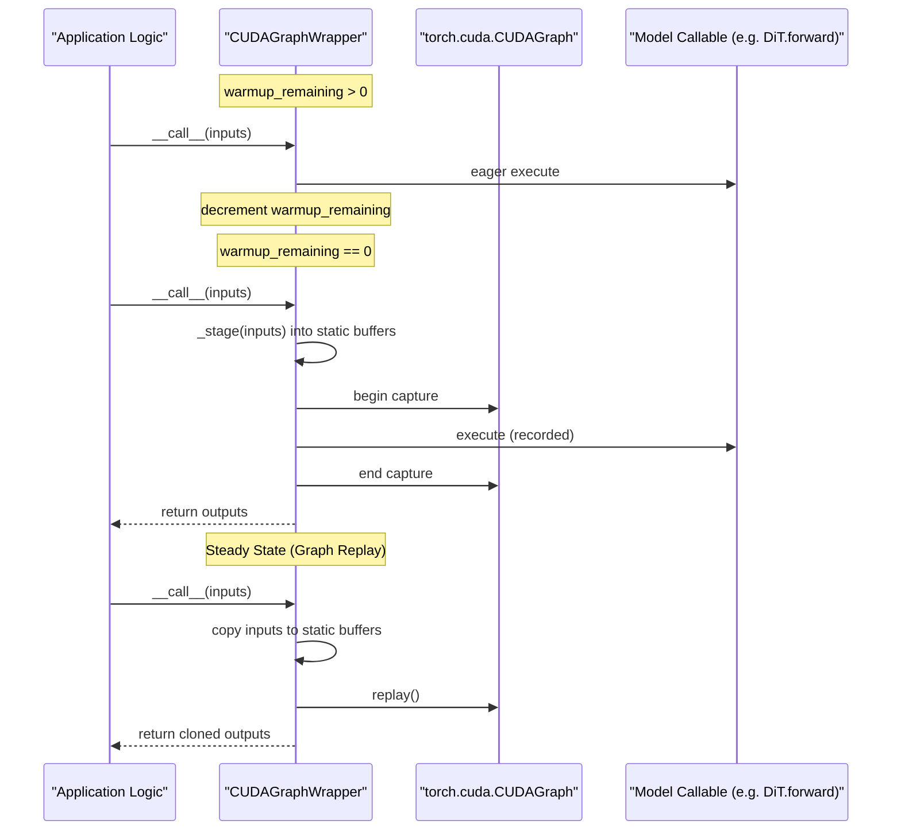
Sources: [flashdreams/flashdreams/infra/cuda_graph.py:50-93](), [flashdreams/flashdreams/infra/cuda_graph.py:105-120](), [flashdreams/flashdreams/infra/cuda_graph.py:161-185]()

## Event Profiling

The `EventProfiler` provides a high-resolution timing mechanism based on `torch.cuda.Event`. Unlike standard Python timers, it measures actual GPU execution time by recording events on the CUDA stream [flashdreams/flashdreams/infra/profiler.py:16-24]().

| Method | Description |
| :--- | :--- |
| `__init__` | Initializes a start event and records it after a `torch.cuda.synchronize()` [flashdreams/flashdreams/infra/profiler.py:40-47](). |
| `record(stage)` | Creates and records a new event for the specified stage name [flashdreams/flashdreams/infra/profiler.py:49-54](). |
| `elapsed_ms()` | Returns a dictionary of stage names to durations (in milliseconds) without blocking the CPU [flashdreams/flashdreams/infra/profiler.py:56-63](). |
| `sync_and_summarize()` | Synchronizes the GPU and then returns the elapsed times for all stages [flashdreams/flashdreams/infra/profiler.py:65-68](). |

The utility function `record_event` is used throughout the pipeline to optionally log performance data if a profiler instance is provided [flashdreams/flashdreams/infra/profiler.py:71-75]().

Sources: [flashdreams/flashdreams/infra/profiler.py:23-68]()

## CUDA Host Prefetching

The `CudaHostPrefetch` class is designed to overlap GPU-to-Host transfers with subsequent GPU computation. This is particularly useful in interactive applications like `OmniDreams` where generated frames must be transferred to the CPU for WebRTC streaming [integrations/omnidreams/omnidreams/interactive_drive/cuda_host_prefetch.py:15-16]().

### Mechanism

*   **Pinned Memory**: It allocates a destination buffer in CPU pinned memory (`pin_memory=True`), which allows for faster, non-blocking asynchronous copies [integrations/omnidreams/omnidreams/interactive_drive/cuda_host_prefetch.py:40-45]().
*   **Dedicated Stream**: Transfers are executed on a dedicated CUDA stream (`_HOST_COPY_STREAMS`) to avoid blocking the main compute stream [integrations/omnidreams/omnidreams/interactive_drive/cuda_host_prefetch.py:74-82]().
*   **Synchronization**: The `start()` method initiates the transfer. The `to_numpy()` method synchronizes with a `torch.cuda.Event` to ensure the copy is complete before converting the buffer to a NumPy array [integrations/omnidreams/omnidreams/interactive_drive/cuda_host_prefetch.py:64-71]().

#### Performance Entity Mapping
The following diagram maps the performance infrastructure components to their specific code entities and data flows.

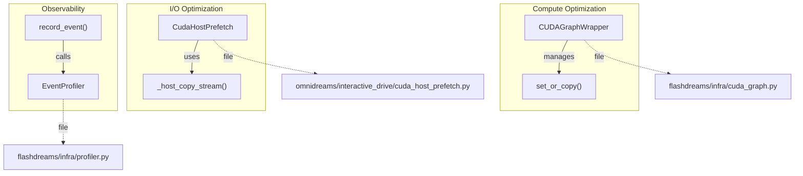
Sources: [flashdreams/flashdreams/infra/cuda_graph.py:50-51](), [flashdreams/flashdreams/infra/profiler.py:23-24](), [integrations/omnidreams/omnidreams/interactive_drive/cuda_host_prefetch.py:15-16]()

---

# Page: Model Recipes

# Model Recipes

<details>
<summary>Relevant source files</summary>

The following files were used as context for generating this wiki page:

- [agentic/skills/flashdreams-recipes/SKILL.md](agentic/skills/flashdreams-recipes/SKILL.md)
- [flashdreams/flashdreams/core/io/s3_filesystem.py](flashdreams/flashdreams/core/io/s3_filesystem.py)
- [flashdreams/flashdreams/core/io/s3_sync.py](flashdreams/flashdreams/core/io/s3_sync.py)
- [flashdreams/flashdreams/recipes/taehv/__init__.py](flashdreams/flashdreams/recipes/taehv/__init__.py)
- [flashdreams/flashdreams/recipes/taehv/checkpoint.py](flashdreams/flashdreams/recipes/taehv/checkpoint.py)
- [flashdreams/flashdreams/recipes/taehv/impl.py](flashdreams/flashdreams/recipes/taehv/impl.py)
- [flashdreams/flashdreams/recipes/template/README.md](flashdreams/flashdreams/recipes/template/README.md)
- [flashdreams/flashdreams/recipes/template/config.py](flashdreams/flashdreams/recipes/template/config.py)
- [flashdreams/flashdreams/recipes/template/decoder.py](flashdreams/flashdreams/recipes/template/decoder.py)
- [flashdreams/flashdreams/recipes/template/encoder.py](flashdreams/flashdreams/recipes/template/encoder.py)
- [flashdreams/flashdreams/recipes/template/transformer/__init__.py](flashdreams/flashdreams/recipes/template/transformer/__init__.py)
- [flashdreams/flashdreams/recipes/template/transformer/network.py](flashdreams/flashdreams/recipes/template/transformer/network.py)
- [flashdreams/flashdreams/recipes/wan/autoencoder/vae.py](flashdreams/flashdreams/recipes/wan/autoencoder/vae.py)
- [flashdreams/tests/test_model_instantiation.py](flashdreams/tests/test_model_instantiation.py)
- [flashdreams/tests/test_rope_kernel.py](flashdreams/tests/test_rope_kernel.py)
- [flashdreams/tests/test_template.py](flashdreams/tests/test_template.py)
- [flashdreams/tests/test_vae.py](flashdreams/tests/test_vae.py)
- [integrations/omnidreams/omnidreams/runner.py](integrations/omnidreams/omnidreams/runner.py)

</details>


The `recipes/` layer in FlashDreams contains concrete implementations of world models and diffusion pipelines. These recipes compose the low-level primitives defined in `flashdreams.core` and `flashdreams.infra` into functional model architectures like **Wan 2.x**, **Cosmos**, and **TAEHV**. 

Each recipe typically encapsulates:
1.  **Network Architecture**: A `Transformer` subclass (e.g., `WanDiTNetwork` or `CosmosDiTNetwork`) that manages the denoising backbone.
2.  **Autoencoders**: Streaming causal `Encoder` and `Decoder` implementations for latent projection.
3.  **Caching Logic**: Specialized `StreamingEncoderCache` and `StreamingDecoderCache` objects that maintain temporal context across chunks.
4.  **Configurations**: Pre-defined `StreamInferencePipelineConfig` literals for common variants (e.g., 1.3B vs 14B, T2V vs I2V).

### Model Recipe Composition

Recipes follow a standardized pattern of wiring together the four pillars of the `StreamInferencePipeline`: the **Encoder**, **Diffusion Model** (Transformer + Scheduler), and **Decoder**.

```mermaid
graph TD
    subgraph "StreamInferencePipeline [flashdreams.infra.pipeline]"
        A["Encoder (StreamingVideoEncoder)"] -->|Latent Chunks| B["DiffusionModel"]
        B -->|Denoised Latents| C["Decoder (StreamingVideoDecoder)"]
    end

    subgraph "Recipe Layer [flashdreams.recipes]"
        direction TB
        R1["Wan 2.x Recipe"]
        R2["Cosmos Recipe"]
        R3["TAEHV Recipe"]
        R4["Template Recipe"]
    end

    R1 -.->|Implements| A
    R1 -.->|Implements| B
    R2 -.->|Implements| B
    R3 -.->|Implements| C
```
**Sources:** [flashdreams/flashdreams/infra/pipeline.py:43-46](), [flashdreams/flashdreams/recipes/template/README.md:18-55]()

---

### Shipped Recipes

#### Wan 2.x Recipe (Transformer and VAE)
The Wan recipe provides a high-performance implementation of the Wan 2.1 and 2.2 architectures. It features a streaming causal VAE (`WanVAE`) capable of processing video chunks with minimal temporal artifacts by maintaining a 1-frame causal context. The recipe supports multiple DiT scales, including the 1.3B and 14B variants, and handles the architectural shifts between Wan 2.1 (standard downsampling) and Wan 2.2 (residual-based `AvgDown3D`/`DupUp3D`).

For details, see [Wan 2.x Recipe (Transformer and VAE)](#3.1).

**Sources:** [flashdreams/flashdreams/recipes/wan/autoencoder/vae.py:16-25](), [flashdreams/tests/test_model_instantiation.py:129-168]()

#### TAEHV Recipe (Tiny Autoencoder for Hunyuan Video)
TAEHV is a lightweight, streaming-optimized decoder designed to replace the heavy Wan VAE decoder for low-latency inference. It uses `MemBlock` modules to maintain a 1-frame temporal-left memory slot, allowing for frame-by-frame or chunk-by-chunk decoding without re-encoding previous frames. It is particularly effective for real-time interactive applications like OmniDreams.

For details, see [TAEHV Recipe (Tiny Autoencoder for Hunyuan Video)](#3.2).

**Sources:** [flashdreams/flashdreams/recipes/taehv/impl.py:16-107](), [flashdreams/flashdreams/recipes/taehv/__init__.py:82-90]()

#### Cosmos-Predict2 Recipe
The Cosmos recipe implements the transformer architecture used in the Cosmos-Predict2 world model. It integrates advanced features such as AdaLN-LoRA for conditioning, shuffle/padding mask fusion for performance, and specialized first-frame injection for Image-to-Video (I2V) tasks. It typically pairs with the `FlowMatchUniPCScheduler` for high-quality, few-step generation.

For details, see [Cosmos-Predict2 Recipe](#3.3).

**Sources:** [integrations/omnidreams/omnidreams/runner.py:42-47](), [integrations/omnidreams/omnidreams/runner.py:146-153]()

#### Template Recipe and Adding New Models
The `template` recipe serves as a minimal, well-documented scaffold for adding new model families to FlashDreams. It exercises the full `flashdreams.infra` contract, including `BlockKVCache` management, Context Parallelism (CP), and `CUDAGraphWrapper` integration. Developers should use this as a reference when integrating a new DiT or VAE.

For details, see [Template Recipe and Adding New Models](#3.4).

**Sources:** [flashdreams/flashdreams/recipes/template/README.md:18-55](), [flashdreams/flashdreams/recipes/template/config.py:42-79]()

---

### Code Entity Space: Recipe Lifecycle

The following diagram maps the logical model components to the specific classes and methods that manage their lifecycle within a recipe.

```mermaid
graph LR
    subgraph "Initialization"
        Config["InstantiateConfig"] -->|setup()| Instance["Recipe Instance"]
        Instance -->|initialize_cache()| Cache["RecipeCache"]
    end

    subgraph "Execution Loop"
        Cache -->|start(ar_idx)| Transformer["Transformer.forward()"]
        Transformer -->|finalize(ar_idx)| Cache
    end

    subgraph "Entities"
        direction TB
        T1["WanDiTNetwork [wan]"]
        T2["TemplateDiT [template]"]
        D1["TeahvVAEDecoder [taehv]"]
        C1["WanVAECache [wan]"]
    end

    Instance --- T1
    Instance --- T2
    Instance --- D1
    Cache --- C1
```
**Sources:** [flashdreams/flashdreams/recipes/template/transformer/__init__.py:76-94](), [flashdreams/flashdreams/recipes/taehv/impl.py:184-193](), [flashdreams/flashdreams/recipes/wan/autoencoder/vae.py:147-162]()

### Recipe Component Comparison

| Feature | Wan 2.x | TAEHV | Template |
| :--- | :--- | :--- | :--- |
| **Primary Class** | `WanDiTNetwork` | `TeahvVAEDecoder` | `TemplateTransformer` |
| **Cache Type** | `WanVAECache` | `TAEHVCache` | `TemplateTransformerCache` |
| **Temporal Context** | Causal 3D Conv | 1-Frame MemBlock | `BlockKVCache` (Sliding) |
| **CP Support** | Yes (Ring/Ulysses) | N/A (Decoder) | Yes (Ring/Ulysses) |
| **Compilation** | `torch.compile` | `torch.compile` | `CUDAGraphWrapper` |

**Sources:** [flashdreams/flashdreams/recipes/wan/autoencoder/vae.py:147-162](), [flashdreams/flashdreams/recipes/taehv/impl.py:39-48](), [flashdreams/flashdreams/recipes/template/transformer/__init__.py:46-70](), [flashdreams/flashdreams/recipes/template/README.md:23-55]()

---

# Page: Wan 2.x Recipe (Transformer and VAE)

# Wan 2.x Recipe (Transformer and VAE)

<details>
<summary>Relevant source files</summary>

The following files were used as context for generating this wiki page:

- [agentic/skills/flashdreams-recipes/SKILL.md](agentic/skills/flashdreams-recipes/SKILL.md)
- [flashdreams/flashdreams/core/attention/kvcache.py](flashdreams/flashdreams/core/attention/kvcache.py)
- [flashdreams/flashdreams/core/attention/native.py](flashdreams/flashdreams/core/attention/native.py)
- [flashdreams/flashdreams/core/attention/rope.py](flashdreams/flashdreams/core/attention/rope.py)
- [flashdreams/flashdreams/core/io/s3_filesystem.py](flashdreams/flashdreams/core/io/s3_filesystem.py)
- [flashdreams/flashdreams/core/io/s3_sync.py](flashdreams/flashdreams/core/io/s3_sync.py)
- [flashdreams/flashdreams/infra/decoder/base.py](flashdreams/flashdreams/infra/decoder/base.py)
- [flashdreams/flashdreams/infra/diffusion/model/base.py](flashdreams/flashdreams/infra/diffusion/model/base.py)
- [flashdreams/flashdreams/infra/diffusion/scheduler/base.py](flashdreams/flashdreams/infra/diffusion/scheduler/base.py)
- [flashdreams/flashdreams/infra/diffusion/transformer/base.py](flashdreams/flashdreams/infra/diffusion/transformer/base.py)
- [flashdreams/flashdreams/infra/encoder/base.py](flashdreams/flashdreams/infra/encoder/base.py)
- [flashdreams/flashdreams/recipes/taehv/__init__.py](flashdreams/flashdreams/recipes/taehv/__init__.py)
- [flashdreams/flashdreams/recipes/taehv/checkpoint.py](flashdreams/flashdreams/recipes/taehv/checkpoint.py)
- [flashdreams/flashdreams/recipes/taehv/impl.py](flashdreams/flashdreams/recipes/taehv/impl.py)
- [flashdreams/flashdreams/recipes/wan/autoencoder/i2v.py](flashdreams/flashdreams/recipes/wan/autoencoder/i2v.py)
- [flashdreams/flashdreams/recipes/wan/autoencoder/vae.py](flashdreams/flashdreams/recipes/wan/autoencoder/vae.py)
- [flashdreams/flashdreams/recipes/wan/pipeline.py](flashdreams/flashdreams/recipes/wan/pipeline.py)
- [flashdreams/flashdreams/recipes/wan/transformer/impl/modules.py](flashdreams/flashdreams/recipes/wan/transformer/impl/modules.py)
- [flashdreams/flashdreams/recipes/wan/transformer/impl/network.py](flashdreams/flashdreams/recipes/wan/transformer/impl/network.py)
- [flashdreams/flashdreams/recipes/wan/transformer/wan21.py](flashdreams/flashdreams/recipes/wan/transformer/wan21.py)
- [flashdreams/flashdreams/recipes/wan/transformer/wan22.py](flashdreams/flashdreams/recipes/wan/transformer/wan22.py)
- [flashdreams/tests/test_attention.py](flashdreams/tests/test_attention.py)
- [flashdreams/tests/test_kvcache.py](flashdreams/tests/test_kvcache.py)
- [flashdreams/tests/test_model_instantiation.py](flashdreams/tests/test_model_instantiation.py)
- [flashdreams/tests/test_rope_kernel.py](flashdreams/tests/test_rope_kernel.py)
- [flashdreams/tests/test_vae.py](flashdreams/tests/test_vae.py)
- [flashdreams/tests/test_wan_context_parallel.py](flashdreams/tests/test_wan_context_parallel.py)
- [flashdreams/tests/test_wan_pipeline.py](flashdreams/tests/test_wan_pipeline.py)
- [integrations/omnidreams/omnidreams/runner.py](integrations/omnidreams/omnidreams/runner.py)

</details>


The Wan 2.x recipe provides a high-performance, streaming implementation of the Wan video generation models. This page documents the architectural components of the Wan family, including the `WanDiTNetwork` (Diffusion Transformer), the causal streaming `WanVAE`, and the structural differences between Wan 2.1 and Wan 2.2.

## Architectural Overview

The Wan architecture is built on a Diffusion Transformer (DiT) backbone that operates in a latent space compressed by a Video Autoencoder (VAE). FlashDreams implements these components with a focus on **streaming causal inference**, where the VAE and Transformer maintain internal state to process video chunks sequentially without re-encoding past frames.

### System Mapping: Code Entities to Concepts

The following diagram maps high-level generation concepts to the specific classes and files implementing them in the Wan recipe.

**Wan Concept Mapping**
```mermaid
graph TD
    subgraph "Natural Language Space"
        A["Text-to-Video (T2V)"]
        B["Image-to-Video (I2V)"]
        C["Streaming Latent Space"]
    end

    subgraph "Code Entity Space"
        D["WanInferencePipeline"]
        E["WanDiTNetwork"]
        F["WanVAE"]
        G["WanDiTNetworkCache"]
        H["WanVAECache"]
    end

    A --> D
    B --> D
    D --> E
    D --> F
    E -.-> G
    F -.-> H
    C -.-> G
    C -.-> H
```
**Sources:** [flashdreams/flashdreams/recipes/wan/pipeline.py:98-128](), [flashdreams/flashdreams/recipes/wan/autoencoder/vae.py:146-162](), [flashdreams/flashdreams/recipes/wan/transformer/impl/network.py:43-63]()

---

## WanDiTNetwork (Transformer)

The `WanDiTNetwork` is the core backbone for both Wan 2.1 and 2.2. It supports varying scales (1.3B, 5B, 14B) and conditioning modes (T2V, I2V).

### Key Components
- **Patchification:** The network consumes latents via a `patch_embedding` which can be either a `Linear` layer (flattened) or a `Conv3d` (strided) [flashdreams/flashdreams/recipes/wan/transformer/impl/network.py:176-188]().
- **Adaptive Layer Norm (AdaLN):** Used in the `Head` and `Block` modules to modulate hidden states based on the timestep embedding [flashdreams/flashdreams/recipes/wan/transformer/impl/modules.py:76-143]().
- **Context Parallelism (CP):** The network supports `ring` or `ulysses` methods to shard the sequence dimension across multiple GPUs [flashdreams/flashdreams/recipes/wan/transformer/impl/network.py:104-105]().

### Configuration Variants
| Feature | Wan 2.1 (1.3B) | Wan 2.1 (14B) | Wan 2.2 (5B TI2V) |
| :--- | :--- | :--- | :--- |
| **Hidden Dim** | 1536 | 5120 | 3072 |
| **Layers** | 30 | 40 | 30 |
| **Heads** | 12 | 40 | 24 |
| **In/Out Dim** | 16 | 16 | 48 |
| **Image Cross-Attn**| No | Yes (CLIP) | No (Latent Injection) |

**Sources:** [flashdreams/flashdreams/recipes/wan/transformer/impl/network.py:108-149]()

---

## WanVAE: Streaming Causal Autoencoder

The `WanVAE` implements a causal video autoencoder. Unlike standard 3D VAEs that require the full video context, `WanVAE` uses `CausalConv3d` to process frames with a "left-only" temporal context, enabling real-time streaming [flashdreams/flashdreams/recipes/wan/autoencoder/vae.py:16-25]().

### CausalConv3d and Caching
The `CausalConv3d` module extends `nn.Conv3d` by applying manual temporal padding and maintaining a streaming left-context slot [flashdreams/flashdreams/recipes/wan/autoencoder/vae.py:169-198]().
- **Filling Phase:** The cache accumulates frames until the temporal kernel size is met.
- **Steady-State Phase:** The cache maintains a rolling window of `(kernel_size - 1)` frames to provide context for the next chunk.

### WanVAECache
The `WanVAECache` class manages the state for both the encoder and decoder rollouts, using module IDs as keys to store per-block temporal buffers [flashdreams/flashdreams/recipes/wan/autoencoder/vae.py:146-162]().

**Data Flow: Video Frame to Latent Chunk**
```mermaid
sequenceDiagram
    participant P as Pixel Frames
    participant E as WanVAE (Encoder)
    participant C as WanVAECache
    participant L as Latent Chunk

    P->>E: Forward(chunk_t)
    E->>C: Retrieve Left-Context
    Note over E: Apply CausalConv3d
    E->>C: Update Left-Context (last frames)
    E->>L: Emit Compressed Latent
```
**Sources:** [flashdreams/flashdreams/recipes/wan/autoencoder/vae.py:169-200](), [flashdreams/flashdreams/recipes/wan/autoencoder/vae.py:146-162]()

---

## Wan 2.1 vs 2.2 Architectural Differences

While both versions share the core DiT/VAE philosophy, Wan 2.2 introduces significant changes for high-resolution TI2V (Text-and-Image to Video).

### VAE: PixelShuffle and Residuals
- **Wan 2.1:** Uses standard 8x spatial and 4x temporal compression with 16 latent channels [flashdreams/flashdreams/recipes/wan/autoencoder/vae.py:18-21]().
- **Wan 2.2 (5B):** Introduces a 16x-spatial, 48-channel residual VAE. It utilizes `AvgDown3D` for downsampling and `DupUp3D` for upsampling, combined with `patchify`/`unpatchify` wraps to handle the increased channel depth [flashdreams/flashdreams/recipes/wan/autoencoder/vae.py:19-25]().

### Transformer: First-Frame Conditioning
- **Wan 2.1 14B I2V:** Uses a CLIP image encoder and a dedicated cross-attention branch (`cross_attn_enable_img=True`) [flashdreams/flashdreams/recipes/wan/transformer/impl/network.py:119-127]().
- **Wan 2.2 5B TI2V:** Removes the CLIP branch. Instead, it conditions on the first frame via a clean VAE-latent seed and a per-token `t=0` timestep injection on the initial frames of the first AR chunk [flashdreams/flashdreams/recipes/wan/transformer/impl/network.py:129-149]().

---

## Implementation Details

### Patchify and Unpatchify
The transformer does not operate on raw 3D volumes. It uses `patchify` to flatten spatial and temporal dimensions into a sequence of tokens [flashdreams/flashdreams/recipes/wan/transformer/impl/network.py:176-188]().
- `patch_size`: Typically `(1, 2, 2)` (T, H, W), meaning temporal resolution is preserved while spatial resolution is halved per dimension [flashdreams/flashdreams/recipes/wan/transformer/impl/network.py:71-72]().

### KV Cache and RoPE
The `Wan21TransformerCache` and `Wan22TransformerCache` manage the self-attention KV state.
- **BlockKVCache:** Implements a fixed-size local window with optional "sink" tokens to prevent eviction of initial context [flashdreams/flashdreams/core/attention/kvcache.py:26-57]().
- **3D RoPE:** Rotary Position Embeddings are applied to the 3D grid (T, H, W). In streaming mode, the `rope_adapter` shifts the temporal frequencies for each new AR step [flashdreams/flashdreams/recipes/wan/transformer/wan21.py:66-86]().

**Sources:** [flashdreams/flashdreams/core/attention/kvcache.py:26-57](), [flashdreams/flashdreams/recipes/wan/transformer/wan21.py:50-86](), [flashdreams/flashdreams/recipes/wan/transformer/impl/network.py:71-105]()

---

# Page: TAEHV Recipe (Tiny Autoencoder for Hunyuan Video)

# TAEHV Recipe (Tiny Autoencoder for Hunyuan Video)

<details>
<summary>Relevant source files</summary>

The following files were used as context for generating this wiki page:

- [agentic/skills/flashdreams-recipes/SKILL.md](agentic/skills/flashdreams-recipes/SKILL.md)
- [flashdreams/flashdreams/core/io/s3_filesystem.py](flashdreams/flashdreams/core/io/s3_filesystem.py)
- [flashdreams/flashdreams/core/io/s3_sync.py](flashdreams/flashdreams/core/io/s3_sync.py)
- [flashdreams/flashdreams/infra/decoder/__init__.py](flashdreams/flashdreams/infra/decoder/__init__.py)
- [flashdreams/flashdreams/infra/encoder/__init__.py](flashdreams/flashdreams/infra/encoder/__init__.py)
- [flashdreams/flashdreams/recipes/taehv/__init__.py](flashdreams/flashdreams/recipes/taehv/__init__.py)
- [flashdreams/flashdreams/recipes/taehv/checkpoint.py](flashdreams/flashdreams/recipes/taehv/checkpoint.py)
- [flashdreams/flashdreams/recipes/taehv/impl.py](flashdreams/flashdreams/recipes/taehv/impl.py)
- [flashdreams/flashdreams/recipes/wan/autoencoder/vae.py](flashdreams/flashdreams/recipes/wan/autoencoder/vae.py)
- [flashdreams/tests/test_model_instantiation.py](flashdreams/tests/test_model_instantiation.py)
- [flashdreams/tests/test_rope_kernel.py](flashdreams/tests/test_rope_kernel.py)
- [flashdreams/tests/test_vae.py](flashdreams/tests/test_vae.py)
- [integrations/omnidreams/omnidreams/runner.py](integrations/omnidreams/omnidreams/runner.py)

</details>


The **TAEHV (Tiny AutoEncoder for Hunyuan Video)** recipe provides a high-performance, low-latency streaming decoder designed to replace full-scale VAE decoders (like Wan 2.x) in real-time inference pipelines. It utilizes a causal architecture with 1-frame temporal memory to enable frame-by-frame or chunk-by-chunk decoding with minimal overhead.

## Architecture Overview

TAEHV is structured as a sequence of residual blocks and upsampling layers. Unlike traditional 3D convolutional VAEs that require large temporal windows, TAEHV uses **MemBlock** units to maintain a rolling temporal context of exactly one frame.

### Key Components

*   **`MemBlock`**: The core building block. It concatenates the current frame with a 1-step time-shifted "past" frame along the channel dimension before applying a 2D convolution stack [flashdreams/flashdreams/recipes/taehv/impl.py:62-82]().
*   **`TGrow`**: A stateless temporal upsampling module that expands channels and reshapes them to increase the frame count [flashdreams/flashdreams/recipes/taehv/impl.py:110-121]().
*   **`TAEHVCache`**: A dataclass that stores the `dec_state` (the last input frame of the previous chunk) for each `MemBlock`, keyed by the module's ID [flashdreams/flashdreams/recipes/taehv/impl.py:40-49]().
*   **`TeahvVAEDecoder`**: The top-level wrapper that implements the `StreamingVideoDecoder` interface, handling latent scaling and integration into the `StreamInferencePipeline` [flashdreams/flashdreams/recipes/taehv/__init__.py:82-115]().

### Natural Language to Code Entity Space: Decoder Structure

The following diagram maps the logical stages of the TAEHV decoding process to the specific code entities in `impl.py`.

```mermaid
graph TD
    subgraph "Logic: Latent Processing"
        L1["Latent Input [B, T, C, H, W]"] --> C1["Clamp (Soft Saturating)"]
        C1 --> CV1["Initial Conv2d"]
    end

    subgraph "Logic: Causal Temporal Memory"
        CV1 --> MB1["MemBlock (Stage 0)"]
        MB1 --> MB2["MemBlock (Stage 0)"]
        MB2 --> MB3["MemBlock (Stage 0)"]
    end

    subgraph "Logic: Upsampling & Growth"
        MB3 --> US1["nn.Upsample (Spatial)"]
        US1 --> TG1["TGrow (Temporal)"]
        TG1 --> CV2["_conv (Channel adjust)"]
    end

    subgraph "Code Entities (flashdreams.recipes.taehv.impl)"
        C1["Clamp"]
        MB1["MemBlock"]
        TG1["TGrow"]
        D1["Decoder"]
    end

    D1 -- "contains" --> MB1
    D1 -- "contains" --> TG1
```
Sources: `[flashdreams/flashdreams/recipes/taehv/impl.py:55-168]()`

## Streaming Data Flow

TAEHV operates in a "streaming causal" mode. During the `forward` pass of a `MemBlock`, the module retrieves the previous chunk's final frame from the `TAEHVCache`, prepends it to the current chunk's sequence, and then updates the cache with the new final frame for the next step.

### MemBlock Cache Lifecycle

The `cache_step` function is the primary entry point for streaming execution. It ensures that the compiled decoder remains a stable CUDA graph across transitions by pre-allocating state buffers.

```mermaid
sequenceDiagram
    participant P as Pipeline
    participant M as MemBlock::cache_step
    participant C as TAEHVCache (dec_state)

    P->>M: forward(x, cache)
    M->>C: lookup state[id(self)]
    C-->>M: prev_frame [B, 1, C, H, W]
    Note over M: torch.cat([prev_frame, x[:, :-1]])
    M->>M: run conv stack
    M->>C: set_or_copy(new_last_frame)
    M-->>P: return decoded_features
```
Sources: `[flashdreams/flashdreams/recipes/taehv/impl.py:87-108]()`, `[flashdreams/flashdreams/infra/cuda_graph.py:42-42]()`

## Checkpoint Remapping and Transforms

TAEHV checkpoints (such as `lighttae`) often require remapping to fit the internal `flashdreams` layout. This is handled via the `StateDictTransform` functional pattern.

| Function | Purpose |
| :--- | :--- |
| `legacy_to_blocks_keys` | Renames keys from `decoder.<i>` to `decoder.blocks.<i>` to match the `nn.Sequential` container [flashdreams/flashdreams/recipes/taehv/checkpoint.py:36-54](). |
| `truncate_oversize_tgrow_weights` | Clips `TGrow` weights if the checkpoint was trained with a different temporal stride than the live model [flashdreams/flashdreams/recipes/taehv/checkpoint.py:57-99](). |
| `compose` | Chains multiple transforms into a single pre-load operation [flashdreams/flashdreams/recipes/taehv/checkpoint.py:141-154](). |

The `TeahvVAEDecoderConfig` defaults to using the `lighttae` weights and its associated transform [flashdreams/flashdreams/recipes/taehv/__init__.py:57-70]().

Sources: `[flashdreams/flashdreams/recipes/taehv/checkpoint.py:16-154]()`, `[flashdreams/flashdreams/recipes/taehv/__init__.py:47-55]()`

## Integration and Performance

TAEHV is designed to be a drop-in replacement for the `WanVAEDecoder`. In the `StreamInferencePipeline`, it provides significant latency improvements for video generation tasks like **FlashVSR** or **OmniDreams**.

### Configuration Parameters

The `TeahvVAEDecoder` is configured via `TeahvVAEDecoderConfig`, which controls:
*   **`use_cuda_graph`**: When `True`, the decoder forward pass is captured into a CUDA graph to eliminate Python-to-GPU launch overhead [flashdreams/flashdreams/recipes/taehv/__init__.py:75-76]().
*   **`use_compile`**: Applies `torch.compile` with `max-autotune-no-cudagraphs` for kernel fusion [flashdreams/flashdreams/recipes/taehv/__init__.py:78-79]().
*   **Latent Scaling**: If `lighttae` is detected, the decoder automatically applies per-channel `mean` and `std` scaling to the latents before decoding [flashdreams/flashdreams/recipes/taehv/__init__.py:121-143]().

### Latent Normalization (LightTAE)
For the default `lighttae` checkpoint, the following statistics are used:
*   **Mean**: `[-0.7571, -0.7089, ..., -0.2921]` (16 channels) [flashdreams/flashdreams/recipes/taehv/__init__.py:101-107]().
*   **Std**: `[2.8184, 1.4541, ..., 1.9160]` (16 channels) [flashdreams/flashdreams/recipes/taehv/__init__.py:109-115]().

Sources: `[flashdreams/flashdreams/recipes/taehv/__init__.py:16-184]()`, `[flashdreams/flashdreams/recipes/taehv/impl.py:131-168]()`

---

# Page: Cosmos-Predict2 Recipe

# Cosmos-Predict2 Recipe

<details>
<summary>Relevant source files</summary>

The following files were used as context for generating this wiki page:

- [flashdreams/flashdreams/infra/diffusion/scheduler/fm.py](flashdreams/flashdreams/infra/diffusion/scheduler/fm.py)
- [flashdreams/flashdreams/infra/diffusion/scheduler/fm_unipc.py](flashdreams/flashdreams/infra/diffusion/scheduler/fm_unipc.py)
- [flashdreams/flashdreams/recipes/cosmos/pipeline.py](flashdreams/flashdreams/recipes/cosmos/pipeline.py)
- [flashdreams/flashdreams/recipes/cosmos/transformer/__init__.py](flashdreams/flashdreams/recipes/cosmos/transformer/__init__.py)
- [flashdreams/flashdreams/recipes/cosmos/transformer/impl/modules.py](flashdreams/flashdreams/recipes/cosmos/transformer/impl/modules.py)
- [flashdreams/flashdreams/recipes/cosmos/transformer/impl/network.py](flashdreams/flashdreams/recipes/cosmos/transformer/impl/network.py)
- [integrations/cosmos_predict2/cosmos_predict2/config.py](integrations/cosmos_predict2/cosmos_predict2/config.py)
- [integrations/cosmos_predict2/cosmos_predict2/runner.py](integrations/cosmos_predict2/cosmos_predict2/runner.py)
- [integrations/cosmos_predict2/tests/baseline_fastvideo/README.md](integrations/cosmos_predict2/tests/baseline_fastvideo/README.md)
- [integrations/cosmos_predict2/tests/baseline_fastvideo/changes.patch](integrations/cosmos_predict2/tests/baseline_fastvideo/changes.patch)
- [integrations/cosmos_predict2/tests/baseline_fastvideo/run.sh](integrations/cosmos_predict2/tests/baseline_fastvideo/run.sh)
- [integrations/cosmos_predict2/tests/parity_check/README.md](integrations/cosmos_predict2/tests/parity_check/README.md)
- [integrations/cosmos_predict2/tests/parity_check/changes.patch](integrations/cosmos_predict2/tests/parity_check/changes.patch)
- [integrations/cosmos_predict2/tests/parity_check/run.sh](integrations/cosmos_predict2/tests/parity_check/run.sh)

</details>


The Cosmos-Predict2 recipe implements the inference logic for NVIDIA's Cosmos-Predict2.5 world models. This recipe supports both Text-to-Video (T2V) and Image-to-Video (I2V) modalities within a unified `CosmosInferencePipeline`. It leverages a Diffusion Transformer (DiT) backbone optimized for autoregressive generation and a high-order Flow-Matching scheduler.

## Pipeline Architecture

The `CosmosInferencePipeline` manages the lifecycle of a video generation rollout. It coordinates the text encoder, an optional image encoder (for I2V), the `CosmosTransformer`, and the VAE decoder.

### System Data Flow
The following diagram illustrates the data flow from input prompts and images through the pipeline components to the final video output.

**Cosmos-Predict2 Data Flow**
```mermaid
graph TD
    subgraph "Input Space"
        PROMPT["Prompt Text"]
        IMG["First Frame Image (I2V)"]
    end

    subgraph "CosmosInferencePipeline [flashdreams/recipes/cosmos/pipeline.py]"
        TE["CosmosReason1TextEncoder"]
        IE["WanVAEEncoder (I2V)"]
        DM["DiffusionModel"]
        DEC["WanVAEDecoder"]
    end

    PROMPT --> TE
    TE -- "text_embeddings" --> DM
    IMG --> IE
    IE -- "image_latent" --> DM
    DM -- "denoised_latents" --> DEC
    DEC --> VIDEO["Output Video Frames"]
```
Sources: [flashdreams/recipes/cosmos/pipeline.py:88-123](), [flashdreams/recipes/cosmos/pipeline.py:143-168]()

### Key Components
*   **CosmosInferencePipeline**: The top-level container that inherits from `StreamInferencePipeline`. It handles cache initialization and coordinates the `generate` and `finalize` phases [flashdreams/recipes/cosmos/pipeline.py:88-94]().
*   **CosmosReason1TextEncoder**: A specialized text encoder used to project prompts into the transformer's latent space [flashdreams/recipes/cosmos/pipeline.py:125-129]().
*   **WanVAEEncoder/Decoder**: Reused from the Wan recipe, providing the spatial compression and decompression for latents [flashdreams/recipes/cosmos/pipeline.py:41-44]().

## CosmosTransformer and DiT Network

The `CosmosTransformer` encapsulates the `CosmosDiTNetwork`, which is the core backbone of the model. It implements a block-causal attention mechanism suitable for autoregressive streaming.

### Network Topology
The `CosmosDiTNetwork` is composed of multiple transformer blocks featuring AdaLN-LoRA modulation and 3D Rotary Position Embeddings (RoPE).

**Cosmos DiT Network Space**
```mermaid
graph LR
    subgraph "CosmosDiTNetwork [flashdreams/recipes/cosmos/transformer/impl/network.py]"
        PE["PatchEmbed"]
        TE["TimestepEmbedding"]
        BLOCKS["ModuleList[Block]"]
        FL["FinalLayer"]
    end

    subgraph "Block [flashdreams/recipes/cosmos/transformer/impl/modules.py]"
        MS["Modulation (AdaLN-LoRA)"]
        AT["ContextParallelAttention"]
        FF["GPT2FeedForward"]
    end

    PE --> BLOCKS
    TE --> BLOCKS
    BLOCKS --> FL
    BLOCKS --- MS
    BLOCKS --- AT
    BLOCKS --- FF
```
Sources: [flashdreams/recipes/cosmos/transformer/impl/network.py:148-202](), [flashdreams/recipes/cosmos/transformer/impl/modules.py:190-201]()

### Technical Implementation Details
*   **AdaLN-LoRA**: The network uses a low-rank factorization for AdaLN modulation, reducing parameter count while maintaining modulation expressivity. This is toggled via `use_adaln_lora` in `CosmosDiTNetworkConfig` [flashdreams/recipes/cosmos/transformer/impl/network.py:127-131]().
*   **Shuffle Fusion & Patchify**: Input latents are patchified into tokens. The `PatchEmbed` module expects post-patchified flattened inputs where the dimension includes temporal and spatial patch sizes [flashdreams/recipes/cosmos/transformer/impl/modules.py:118-132]().
*   **Padding Mask Fusion**: If `concat_padding_mask` is enabled, an additional channel is concatenated to the input latent to represent padding, which is then processed by the `PatchEmbed` layer [flashdreams/recipes/cosmos/transformer/impl/network.py:161-163]().
*   **I2V First-Frame Injection**: For I2V tasks, the first-frame latent is encoded and injected into the transformer's noise stream at the start of the rollout [flashdreams/recipes/cosmos/transformer/__init__.py:66-68]().

## Flow-Matching UniPC Scheduler

Cosmos-Predict2 utilizes the `FlowMatchUniPCScheduler`, a multi-step predictor-corrector scheduler designed for flow-matching models.

### Scheduler Logic
The scheduler implements an order-2 UniPC algorithm to solve the probability flow ODE. It pre-computes coefficients for predictors and correctors based on the sigma schedule to minimize per-step overhead.

| Coefficient | Purpose |
| :--- | :--- |
| `a_pred` | Predictor coefficient applied to the current sample $x_i$ |
| `b_pred_m0` | Predictor coefficient for the current $x_0$ estimate |
| `b_corr_dt` | Corrector coefficient for the difference between current and previous $x_0$ estimates |

Sources: [flashdreams/flashdreams/infra/diffusion/scheduler/fm_unipc.py:34-57]()

### Configuration
The scheduler is configured via `FlowMatchUniPCSchedulerConfig`, which defines the number of inference steps and the schedule `shift`. It supports the Kerras sigma schedule for improved sampling quality [integrations/cosmos_predict2/cosmos_predict2/config.py:60-65]().

## Runner Configurations

The recipe provides pre-defined configurations for common use cases, such as 720p T2V and I2V.

*   **T2V (cosmos2-t2v-2b-720p)**: Configured for 24-frame chunks with a guidance scale of 8.0 and 35 inference steps [integrations/cosmos_predict2/cosmos_predict2/config.py:40-67]().
*   **I2V (cosmos2-i2v-2b-720p)**: Adds a `WanVAEEncoderConfig` to the pipeline to process the conditioning first-frame image [integrations/cosmos_predict2/cosmos_predict2/config.py:75-102]().

### State Dict Transformation
Since training checkpoints often contain extra state (e.g., optimizer accumulators or Transformer-Engine internals), the recipe includes a `state_dict_transform` function to strip these keys and map them to the inference layout [flashdreams/recipes/cosmos/transformer/impl/network.py:65-72]().

Sources: [integrations/cosmos_predict2/cosmos_predict2/config.py:110-113](), [flashdreams/recipes/cosmos/transformer/impl/network.py:47-62]()

---

# Page: Template Recipe and Adding New Models

# Template Recipe and Adding New Models

<details>
<summary>Relevant source files</summary>

The following files were used as context for generating this wiki page:

- [agentic/skills/python-docstring-style/SKILL.md](agentic/skills/python-docstring-style/SKILL.md)
- [docs/source/api/core.rst](docs/source/api/core.rst)
- [docs/source/api/index.rst](docs/source/api/index.rst)
- [docs/source/developer_guides/config_system.rst](docs/source/developer_guides/config_system.rst)
- [docs/source/developer_guides/index.rst](docs/source/developer_guides/index.rst)
- [docs/source/developer_guides/interactive_serving.rst](docs/source/developer_guides/interactive_serving.rst)
- [docs/source/developer_guides/new_integration.rst](docs/source/developer_guides/new_integration.rst)
- [docs/source/developer_guides/usage_patterns.rst](docs/source/developer_guides/usage_patterns.rst)
- [flashdreams/flashdreams/core/experimental/kvcache.py](flashdreams/flashdreams/core/experimental/kvcache.py)
- [flashdreams/flashdreams/recipes/template/README.md](flashdreams/flashdreams/recipes/template/README.md)
- [flashdreams/flashdreams/recipes/template/config.py](flashdreams/flashdreams/recipes/template/config.py)
- [flashdreams/flashdreams/recipes/template/decoder.py](flashdreams/flashdreams/recipes/template/decoder.py)
- [flashdreams/flashdreams/recipes/template/encoder.py](flashdreams/flashdreams/recipes/template/encoder.py)
- [flashdreams/flashdreams/recipes/template/transformer/__init__.py](flashdreams/flashdreams/recipes/template/transformer/__init__.py)
- [flashdreams/flashdreams/recipes/template/transformer/network.py](flashdreams/flashdreams/recipes/template/transformer/network.py)
- [flashdreams/tests/test_template.py](flashdreams/tests/test_template.py)

</details>


The **Template Recipe** serves as the canonical scaffold for integrating new world models into the FlashDreams framework. It exercises the full lifecycle of the `StreamInferencePipeline`, including autoregressive (AR) cache management, context parallelism, and classifier-free guidance (CFG). This page details how to use the template as a blueprint and the architectural patterns required to wire new components into the system.

## The Template Recipe Scaffold

The template recipe (located in `flashdreams/recipes/template/`) provides a minimal, functional implementation of every core contract. It is designed to be bit-identical across eager, compiled, and context-parallel (CP) execution modes [flashdreams/recipes/template/README.md:20-22]().

### Core Components
The template defines a set of dummy components that mirror the requirements of real-world models like Wan or Cosmos:

| Component | Code Entity | Role |
| :--- | :--- | :--- |
| **Encoder** | `TemplateControlEncoder` | Transforms raw control inputs (e.g., [B, C, T, H, W]) into the latent space [flashdreams/recipes/template/encoder.py:1-40](). |
| **Transformer** | `TemplateTransformer` | Manages the DiT network, 3D RoPE adapters, and the AR cache lifecycle [flashdreams/recipes/template/transformer/__init__.py:177-180](). |
| **Network** | `TemplateDiT` | A single-block DiT that implements the actual attention and FFN logic [flashdreams/recipes/template/transformer/network.py:91-96](). |
| **Decoder** | `TemplateDecoder` | Projects latents back to the output space (e.g., RGB frames) [flashdreams/recipes/template/decoder.py:1-40](). |

### Data Flow and Tensor Shapes
The template follows a standardized shape convention to ensure compatibility with core infrastructure like `BlockKVCache` and `ContextParallelAttention`.

Title: Template Recipe Data Flow
```mermaid
graph TD
    subgraph "Input Space"
        A["Control [B, C, T, H, W]"]
        B["Context [B, N, D]"]
    end

    subgraph "Encoding & Patching"
        A --> C["TemplateControlEncoder"]
        C --> D["Latent [B, C_lat, T, H, W]"]
        D --> E["Patchify [B, L, C_patch]"]
    end

    subgraph "Transformer & DiT"
        E --> F["TemplateTransformer"]
        B --> G["One-shot Context Encoder"]
        G --> H["Projected Context"]
        F --> I["TemplateDiT Block"]
        H --> I
        I --> J["BlockKVCache [B, Window, H, d_h]"]
    end

    subgraph "Decoding"
        I --> K["Unpatchify [B, C_lat, T, H, W]"]
        K --> L["TemplateDecoder"]
        L --> M["Output [B, C_out, T, H, W]"]
    end
```
Sources: [flashdreams/recipes/template/README.md:78-83](), [flashdreams/recipes/template/transformer/network.py:114-144]().

---

## Adding a New Model

FlashDreams encourages a "standalone repository" approach where new methods depend on `flashdreams` and override specific components [docs/source/developer_guides/new_integration.rst:21-24]().

### 1. Component Implementation
New models typically implement a `Transformer` subclass and a corresponding `TransformerAutoregressiveCache`.

*   **Transformer:** Must implement `initialize_autoregressive_cache` to allocate buffers and `forward` to execute the denoising step [flashdreams/infra/diffusion/transformer.py:35-39]().
*   **Cache:** Manages state that persists across AR steps, such as `BlockKVCache` for KV tokens and `RotaryPositionEmbedding3D` for position tracking [flashdreams/recipes/template/transformer/__init__.py:46-60]().

### 2. Wiring the Pipeline
The `StreamInferencePipeline` composes these components via a `StreamInferencePipelineConfig`.

Title: Pipeline Configuration Hierarchy
```mermaid
classDiagram
    class StreamInferencePipelineConfig {
        +str name
        +EncoderConfig encoder
        +DiffusionModelConfig diffusion_model
        +DecoderConfig decoder
    }
    class DiffusionModelConfig {
        +TransformerConfig transformer
        +SchedulerConfig scheduler
        +int seed
    }
    class TemplateTransformerConfig {
        +TemplateDiTConfig network
        +int len_t
        +int window_size_t
        +bool compile_network
    }
    StreamInferencePipelineConfig *-- DiffusionModelConfig
    DiffusionModelConfig *-- TemplateTransformerConfig
```
Sources: [flashdreams/recipes/template/config.py:42-79](), [flashdreams/infra/pipeline.py:43-46]().

### 3. Registering the Runner
To make the new model accessible via the `flashdreams-run` CLI, it must be registered as an entry point in `pyproject.toml` [docs/source/developer_guides/new_integration.rst:146-148]().

```python
# In customized_method/config.py
CUSTOMIZED_METHOD_RUNNER = CustomizedMethodRunnerConfig(
    runner_name="my-new-model",
    pipeline=CUSTOMIZED_PIPELINE_CONFIG,
)

# In pyproject.toml
[project.entry-points."flashdreams.runner_configs"]
my-new-model = "customized_method.config:CUSTOMIZED_METHOD_RUNNER"
```
Sources: [docs/source/developer_guides/new_integration.rst:80-105](), [flashdreams/recipes/template/config.py:189-191]().

---

## Agentic Recipe Authoring (SKILL.md)

The repository includes an agentic guide (`SKILL.md`) that defines the "house style" for authoring new recipes. This ensures that AI-generated or human-contributed code remains consistent with the core framework.

### Key Documentation Standards
*   **SPDX Headers:** Every file must start with the SPDX copyright block [agentic/skills/python-docstring-style/SKILL.md:15-31]().
*   **Google-Style Docstrings:** Functions must use `Args`, `Returns`, and `Raises` sections [agentic/skills/python-docstring-style/SKILL.md:78-80]().
*   **Imperative Summaries:** The first sentence of a docstring must be an imperative command (e.g., "Slice a tensor...") [agentic/skills/python-docstring-style/SKILL.md:101-101]().
*   **Inventory Headers:** Module docstrings should provide a short, concrete inventory of the symbols they define [agentic/skills/python-docstring-style/SKILL.md:51-56]().

Sources: [agentic/skills/python-docstring-style/SKILL.md:1-125]().

---

## Execution Patterns: Eager vs. Compiled

The template demonstrates how to support both debug-friendly eager execution and high-performance compiled execution using `torch.compile` and `CUDAGraphWrapper`.

### The `derive_config` Pattern
Variants are created using `derive_config` to override specific fields of a base configuration. This is used to create the `TEMPLATE_AUTOREGRESSIVE_COMPILED` variant from the base AR config [flashdreams/recipes/template/config.py:114-126]().

### Lifecycle of a Generation Step
The `StreamInferencePipeline` follows a strict `initialize_cache` -> `generate` -> `finalize` sequence.

Title: Pipeline Execution Lifecycle
```mermaid
sequenceDiagram
    participant R as Runner
    participant P as StreamInferencePipeline
    participant T as TemplateTransformer
    participant C as TemplateTransformerCache

    R->>P: initialize_cache(transformer_context)
    P->>T: initialize_autoregressive_cache(...)
    T-->>C: Create Cache (allocate KV buffers)
    
    loop for ar_idx in num_ar_steps
        R->>P: generate(ar_idx, cache, input)
        P->>C: start(ar_idx)
        C->>C: shift_t (Update RoPE)
        P->>T: forward(noisy_latent, cache, ...)
        T->>P: Return denoised latent
        R->>P: finalize(ar_idx, cache)
        P->>C: finalize(ar_idx)
        C->>C: after_update (Commit KV bookkeeping)
    end
```
Sources: [flashdreams/tests/test_template.py:151-192](), [flashdreams/recipes/template/transformer/__init__.py:76-94](), [flashdreams/infra/pipeline.py:43-46]().

---

# Page: Integration Plugins

# Integration Plugins

<details>
<summary>Relevant source files</summary>

The following files were used as context for generating this wiki page:

- [flashdreams/flashdreams/_version.py](flashdreams/flashdreams/_version.py)
- [flashdreams/flashdreams/infra/runner.py](flashdreams/flashdreams/infra/runner.py)
- [flashdreams/tests/test_recipe_configs.py](flashdreams/tests/test_recipe_configs.py)
- [integrations/causal_forcing/README.md](integrations/causal_forcing/README.md)
- [integrations/causal_forcing/pyproject.toml](integrations/causal_forcing/pyproject.toml)
- [integrations/causal_forcing/tests/test_smoke.py](integrations/causal_forcing/tests/test_smoke.py)
- [integrations/cosmos_predict2/README.md](integrations/cosmos_predict2/README.md)
- [integrations/cosmos_predict2/pyproject.toml](integrations/cosmos_predict2/pyproject.toml)
- [integrations/fastvideo_causal_wan22/README.md](integrations/fastvideo_causal_wan22/README.md)
- [integrations/fastvideo_causal_wan22/pyproject.toml](integrations/fastvideo_causal_wan22/pyproject.toml)
- [integrations/fastvideo_causal_wan22/tests/test_smoke.py](integrations/fastvideo_causal_wan22/tests/test_smoke.py)
- [integrations/flashvsr/README.md](integrations/flashvsr/README.md)
- [integrations/flashvsr/pyproject.toml](integrations/flashvsr/pyproject.toml)
- [integrations/hy_worldplay/pyproject.toml](integrations/hy_worldplay/pyproject.toml)
- [integrations/lingbot/README.md](integrations/lingbot/README.md)
- [integrations/lingbot/pyproject.toml](integrations/lingbot/pyproject.toml)
- [integrations/lingbot/tests/test_smoke.py](integrations/lingbot/tests/test_smoke.py)
- [integrations/omnidreams/pyproject.toml](integrations/omnidreams/pyproject.toml)
- [integrations/omnidreams/tests/test_recipe_configs.py](integrations/omnidreams/tests/test_recipe_configs.py)
- [integrations/self_forcing/README.md](integrations/self_forcing/README.md)
- [integrations/self_forcing/pyproject.toml](integrations/self_forcing/pyproject.toml)
- [integrations/self_forcing/tests/test_smoke.py](integrations/self_forcing/tests/test_smoke.py)
- [integrations/wan21/README.md](integrations/wan21/README.md)
- [integrations/wan21/pyproject.toml](integrations/wan21/pyproject.toml)
- [integrations/wan21/tests/test_smoke.py](integrations/wan21/tests/test_smoke.py)
- [integrations/wan22/pyproject.toml](integrations/wan22/pyproject.toml)

</details>


The `integrations/` directory contains a collection of specialized packages that extend the core FlashDreams framework. Each integration implements a specific model family or application (e.g., OmniDreams, FlashVSR, LingBot) by composing core primitives into a standardized `StreamInferencePipeline` lifecycle.

These plugins are designed as standalone, git-installable packages within the `uv` workspace, allowing them to maintain their own dependency sets and entry points while sharing the core `flashdreams` engine.

## Plugin Architecture Pattern

Every integration follows a consistent structural contract to ensure compatibility with the `flashdreams-run` CLI and the internal registry.

### The Three-Tier Structure
1.  **`config.py`**: Defines the `InstantiateConfig` objects for the pipeline and the runner. It acts as the "source of truth" for hyperparameters and model paths.
2.  **`runner.py`**: Implements a `BaseRunner` subclass (often `InferenceRunner`) that handles data loading, loop orchestration, and result saving.
3.  **`pipeline.py`**: Defines the `StreamInferencePipeline` composition, wiring together the specific `Encoder`, `DiffusionModel` (Transformer + Scheduler), and `Decoder`.

### Runner Registration
Integrations register their "slugs" (unique string identifiers) via Python entry points in their respective `pyproject.toml` files. The discovery layer in `flashdreams.plugins.registry` scans the `flashdreams.runner_configs` group at startup [integrations/omnidreams/pyproject.toml:98-102]().

| Integration | Entry Point Group | Example Slug |
| :--- | :--- | :--- |
| **OmniDreams** | `flashdreams.runner_configs` | `omnidreams-sv-2steps-chunk2-loc6-lightvae-lighttae` |
| **FlashVSR** | `flashdreams.runner_configs` | `flashvsr-v1.1-sparse-ratio-2.0` |
| **LingBot** | `flashdreams.runner_configs` | `lingbot-world-fast` |
| **Self-Forcing** | `flashdreams.runner_configs` | `self-forcing-wan2.1-t2v-1.3b` |

### System Mapping: Natural Language to Code Entities

The following diagram illustrates how high-level integration concepts map to specific code entities and registration mechanisms.

**Plugin Discovery and Execution Flow**
```mermaid
graph TD
    subgraph "CLI Space"
        CLI["flashdreams-run [slug]"]
    end

    subgraph "Registry Space"
        REG["discover_runners()"]
        EP["project.entry-points"]
    end

    subgraph "Integration Plugin (e.g., LingBot)"
        CFG["lingbot.config:RUNNER_LINGBOT_WORLD_FAST"]
        RUN["lingbot.runner:LingbotRunner"]
        PIPE["lingbot.pipeline:LingbotPipeline"]
    end

    CLI -->|1. Lookup| REG
    REG -->|2. Scan| EP
    EP -->|3. Import| CFG
    CFG -->|4. setup()| RUN
    RUN -->|5. run()| PIPE
```
Sources: [integrations/lingbot/pyproject.toml:48-50](), [integrations/omnidreams/pyproject.toml:98-105](), [flashdreams/flashdreams/infra/runner.py:1-20]()

---

## Major Integrations

### OmniDreams Integration
OmniDreams is a world model conditioned on HDMaps (via the Ludus renderer). It supports single-view (SV) and multi-view (MV) configurations. It includes specialized `omnidreams-prepare` scripts for staging USDZ scenes and Cosmos-Reason1 text encoders.
*   **Key Components**: `OmnidreamsRunner`, `OmnidreamsPipelineConfig`.
*   **For details, see [OmniDreams Integration](#4.1)**.

### Self-Forcing and Causal-Forcing
These integrations implement distilled streaming techniques for Wan 2.1. They allow for both chunkwise and framewise inference, utilizing streaming KV-cache configurations with specific window and sink sizes to maintain temporal consistency.
*   **Key Components**: `RUNNER_WAN21_T2V_1PT3B_SINK5_WINDOW7_REROPE`.
*   **For details, see [Self-Forcing and Causal-Forcing (Wan 2.1 Streaming)](#4.2)**.

### FlashVSR (Video Super-Resolution)
FlashVSR provides 2x-4x video upscaling by combining a Low-Resolution (LR) projector with a distilled Wan 2.1 DiT backbone. It features a gRPC uplift server for real-time streaming applications.
*   **Key Components**: `Causal_LQ4x_Proj`, `flashvsr-grpc-server`.
*   **For details, see [FlashVSR Integration (Video Super-Resolution)](#4.3)**.

### LingBot-World (Camera-Control I2V)
LingBot enables interactive Image-to-Video generation with explicit camera trajectory control. It includes a WebRTC server implementation that maps browser-based keyboard inputs to 3D camera poses in real-time.
*   **Key Components**: `CamCtrlInput`, `lingbot.webrtc.server`.
*   **For details, see [LingBot-World Integration (Camera-Control I2V)](#4.4)**.

### HY-WorldPlay and Wan 2.1/2.2
This section covers the standard T2V and I2V integrations for the Wan model family, including the 14B MoE (Mixture of Experts) variants and the interactive `hy_worldplay` baseline.
*   **Key Components**: `RUNNER_HY_WORLDPLAY_WAN_I2V_5B`, `fastvideo_causal_wan22`.
*   **For details, see [HY-WorldPlay and Wan 2.1/2.2 Integrations](#4.5)**.

---

## Integration Dependency Graph

The following diagram shows how integration packages relate to the core `flashdreams` library and external serving requirements.

**Integration Package Dependencies**
```mermaid
graph BT
    subgraph "Integrations Layer"
        OMNI["flashdreams-omnidreams"]
        VSR["flashdreams-flashvsr"]
        LING["flashdreams-lingbot"]
        HY["flashdreams-hy-worldplay"]
    end

    subgraph "Core Layer"
        CORE["flashdreams [core]"]
        SERV["flashdreams [serving]"]
    end

    subgraph "External"
        LUDUS["ludus-renderer"]
        WAN22["flashdreams-wan22"]
    end

    OMNI --> CORE
    OMNI --> SERV
    OMNI --> LUDUS
    
    VSR --> CORE
    
    LING --> CORE
    LING --> SERV
    
    HY --> CORE
    HY --> WAN22
```
Sources: [integrations/omnidreams/pyproject.toml:26-38](), [integrations/flashvsr/pyproject.toml:26-33](), [integrations/lingbot/pyproject.toml:26-33](), [integrations/hy_worldplay/pyproject.toml:37-46]()

---

# Page: OmniDreams Integration

# OmniDreams Integration

<details>
<summary>Relevant source files</summary>

The following files were used as context for generating this wiki page:

- [.github/workflows/ci.yml](.github/workflows/ci.yml)
- [.pre-commit-config.yaml](.pre-commit-config.yaml)
- [flashdreams/flashdreams/configs/runner_configs.py](flashdreams/flashdreams/configs/runner_configs.py)
- [flashdreams/pyproject.toml](flashdreams/pyproject.toml)
- [integrations/omnidreams/README.md](integrations/omnidreams/README.md)
- [integrations/omnidreams/ludus-renderer/examples/render_mirror_augmented.py](integrations/omnidreams/ludus-renderer/examples/render_mirror_augmented.py)
- [integrations/omnidreams/ludus-renderer/pyproject.toml](integrations/omnidreams/ludus-renderer/pyproject.toml)
- [integrations/omnidreams/omnidreams/config.py](integrations/omnidreams/omnidreams/config.py)
- [integrations/omnidreams/omnidreams/hf_org.py](integrations/omnidreams/omnidreams/hf_org.py)
- [integrations/omnidreams/omnidreams/interactive_drive/configs/example_world_model.yaml](integrations/omnidreams/omnidreams/interactive_drive/configs/example_world_model.yaml)
- [integrations/omnidreams/omnidreams/interactive_drive/scene_loader.py](integrations/omnidreams/omnidreams/interactive_drive/scene_loader.py)
- [integrations/omnidreams/omnidreams/pipeline.py](integrations/omnidreams/omnidreams/pipeline.py)
- [integrations/omnidreams/omnidreams/prepare.py](integrations/omnidreams/omnidreams/prepare.py)
- [integrations/omnidreams/omnidreams/scenes.py](integrations/omnidreams/omnidreams/scenes.py)
- [integrations/omnidreams/omnidreams/webrtc/server.py](integrations/omnidreams/omnidreams/webrtc/server.py)
- [integrations/omnidreams/omnidreams/webrtc/session.py](integrations/omnidreams/omnidreams/webrtc/session.py)
- [integrations/omnidreams/tests/test_omnidreams_pipeline.py](integrations/omnidreams/tests/test_omnidreams_pipeline.py)
- [integrations/omnidreams/tests/test_webrtc_runtime.py](integrations/omnidreams/tests/test_webrtc_runtime.py)
- [pyproject.toml](pyproject.toml)
- [uv.lock](uv.lock)

</details>


The OmniDreams integration provides a high-fidelity, HDMap-conditioned world model capable of generating interactive driving simulations. It leverages the `flashdreams` core framework to perform streaming video diffusion, conditioned on static map geometry (lanes, boundaries) and dynamic actor states.

## Architecture Overview

OmniDreams extends the standard `StreamInferencePipeline` to include HDMap conditioning via the `Ludus` renderer and specialized DiT architectures.

### System Mapping: Natural Language to Code Entities

The following diagram maps high-level OmniDreams concepts to their concrete implementation classes and configuration structures.

**OmniDreams Component Mapping**
```mermaid
graph TD
    subgraph "Natural Language Space"
        A["HDMap Conditioning"]
        B["Streaming Pipeline"]
        C["Interactive Session"]
        D["Scene Assets"]
    end

    subgraph "Code Entity Space"
        A --> Ludus["LudusConditionRasterizer"]
        A --> CW["OmnidreamsConditioningWrapper"]
        B --> OPC["OmnidreamsPipelineConfig"]
        B --> OP["OmnidreamsPipeline"]
        C --> OR["OmnidreamsRunner"]
        C --> OIR["OmnidreamsInferenceRuntime"]
        D --> SB["SceneBundle"]
        D --> USDZ["USDZ Scene Format"]
    end

    Ludus -- "defined in" --> LCR_FILE["integrations/omnidreams/omnidreams/conditioning/renderer.py"]
    OPC -- "defined in" --> CFG_FILE["integrations/omnidreams/omnidreams/config.py"]
    OR -- "defined in" --> RUN_FILE["integrations/omnidreams/omnidreams/runner.py"]
    OIR -- "defined in" --> SESS_FILE["integrations/omnidreams/omnidreams/webrtc/session.py"]
```
Sources: [integrations/omnidreams/omnidreams/config.py:35-45](), [integrations/omnidreams/omnidreams/webrtc/session.py:20-25](), [integrations/omnidreams/omnidreams/interactive_drive/scene_loader.py:41-48]()

## Pipeline Configurations

OmniDreams uses a composition-based configuration system defined in `omnidreams.config`. Configurations are categorized by view count (Single-View/Multi-View), step count, and performance mode.

### Configuration Composition
The `OmnidreamsPipelineConfig` [integrations/omnidreams/omnidreams/config.py:90-136]() aggregates:
*   **Text Encoder**: Typically `CosmosReason1TextEncoderConfig` [integrations/omnidreams/omnidreams/config.py:92]().
*   **Image/Video Encoder**: Wan-VAE variants (e.g., `lightvae`) [integrations/omnidreams/omnidreams/config.py:93-99]().
*   **Decoder**: `TeahvVAEDecoderConfig` (LightTAE) for low-latency or `WanVAEDecoderConfig` [integrations/omnidreams/omnidreams/config.py:100-102]().
*   **Diffusion Model**: `CosmosTransformerConfig` with `additional_concat_ch=16` to accommodate the HDMap conditioning branch [integrations/omnidreams/omnidreams/config.py:106-109]().

### Performance Modes
| Mode | `use_compile` | `use_cuda_graph` | Native Acceleration |
| :--- | :--- | :--- | :--- |
| **Base** | `False` | `False` | `disabled` |
| **Perf** | `True` | `True` | `disabled` |
| **Native Perf** | `False` | `False` | `required` (FP8 VAE) |

Sources: [integrations/omnidreams/omnidreams/config.py:145-156](), [integrations/omnidreams/omnidreams/config.py:158-179]()

## Scene Staging and Format

OmniDreams utilizes a specialized USDZ-based scene format to bundle map data and initial visual state.

### USDZ Scene Structure
A standard OmniDreams scene (e.g., `clipgt-<uuid>.usdz`) contains:
*   **Map Data**: Parquet files for `lane_line`, `calibration_estimate`, and `egomotion_estimate` [integrations/omnidreams/omnidreams/interactive_drive/scene_loader.py:172-180]().
*   **Visual Seeds**: Ground-truth frames in `frames/<camera>/<ts>.jpeg` or a fallback `first_image.png` [integrations/omnidreams/omnidreams/webrtc/session.py:140-167]().
*   **Prompts**: `prompt.txt` or variant-specific prompts like `prompt2.txt` (snow) and `prompt3.txt` (rain) [integrations/omnidreams/omnidreams/scenes.py:80-86]().

### Scene Preparation CLI
The `omnidreams-prepare` tool [integrations/omnidreams/omnidreams/prepare.py]() handles:
1.  Downloading assets from the `nvidia/omni-dreams-scenes` Hugging Face repository [integrations/omnidreams/omnidreams/scenes.py:96-102]().
2.  Unpacking USDZ archives into the local cache (defaulting to `~/.cache/flashdreams/omnidreams-scenes`) [integrations/omnidreams/omnidreams/scenes.py:8-20]().
3.  Pre-warming heavy models like the Cosmos-Reason1 text encoder [integrations/omnidreams/README.md:52-56]().

Sources: [integrations/omnidreams/omnidreams/scenes.py:4-40](), [integrations/omnidreams/omnidreams/webrtc/session.py:170-210]()

## Interactive Runtime and Serving

OmniDreams supports both a desktop-native demo and a WebRTC-based streaming server.

### OmnidreamsInferenceRuntime
The `OmnidreamsInferenceRuntime` manages the generation loop and state transition between the initial chunk and subsequent autoregressive steps.

**Inference Data Flow**
```mermaid
sequenceDiagram
    participant C as Client (WebRTC/App)
    participant R as OmnidreamsInferenceRuntime
    participant W as OmnidreamsConditioningWrapper
    participant P as OmnidreamsPipeline

    C->>R: Request Chunk (Inputs: WSAD/Pose)
    R->>W: Update Conditioning (Pose + HDMap)
    W-->>R: Condition Frames
    alt is first chunk
        R->>P: start_generation(condition_frames, first_frame)
    else is continue chunk
        R->>P: continue_generation(condition_frames, kv_cache)
    end
    P-->>R: RGB Video Chunk
    R-->>C: Stream Encoded Video
```

### WebRTC Integration
The `OmnidreamsWebRTCSessionManager` [integrations/omnidreams/omnidreams/webrtc/session.py:24]() orchestrates the connection. It uses `KeyboardResampler` to transform client-side WSAD inputs into trajectory segments for the `CameraPoseIntegrator` [integrations/omnidreams/omnidreams/webrtc/session.py:57-61]().

Key functions in `OmnidreamsInferenceRuntime`:
*   `_generate_one_chunk_sync`: Dispatches to `start_generation` for the first block and `continue_generation` for all subsequent blocks [integrations/omnidreams/tests/test_webrtc_runtime.py:122-145]().
*   `_prepare_clipgt_dir`: Normalizes scene parquet filenames for the Ludus renderer [integrations/omnidreams/tests/test_webrtc_runtime.py:172-195]().

Sources: [integrations/omnidreams/omnidreams/webrtc/session.py:106-120](), [integrations/omnidreams/omnidreams/webrtc/server.py:42-116](), [integrations/omnidreams/tests/test_webrtc_runtime.py:53-104]()

---

# Page: Self-Forcing and Causal-Forcing (Wan 2.1 Streaming)

# Self-Forcing and Causal-Forcing (Wan 2.1 Streaming)

<details>
<summary>Relevant source files</summary>

The following files were used as context for generating this wiki page:

- [docs/benchmarks/benchmark_results.json](docs/benchmarks/benchmark_results.json)
- [docs/source/_static/performance/lingbot_world/perf-0521.md](docs/source/_static/performance/lingbot_world/perf-0521.md)
- [docs/source/_static/performance/wan21/perf-0521.md](docs/source/_static/performance/wan21/perf-0521.md)
- [docs/source/api/serving.rst](docs/source/api/serving.rst)
- [flashdreams/flashdreams/core/io/download.py](flashdreams/flashdreams/core/io/download.py)
- [integrations/causal_forcing/causal_forcing/config.py](integrations/causal_forcing/causal_forcing/config.py)
- [integrations/causal_forcing/causal_forcing/runner.py](integrations/causal_forcing/causal_forcing/runner.py)
- [integrations/fastvideo_causal_wan22/fastvideo_causal_wan22/config.py](integrations/fastvideo_causal_wan22/fastvideo_causal_wan22/config.py)
- [integrations/fastvideo_causal_wan22/fastvideo_causal_wan22/runner.py](integrations/fastvideo_causal_wan22/fastvideo_causal_wan22/runner.py)
- [integrations/flashvsr/flashvsr/runner.py](integrations/flashvsr/flashvsr/runner.py)
- [integrations/lingbot/lingbot/config.py](integrations/lingbot/lingbot/config.py)
- [integrations/lingbot/tests/parity_check/pyproject.toml](integrations/lingbot/tests/parity_check/pyproject.toml)
- [integrations/lingbot/tests/parity_check/uv.lock](integrations/lingbot/tests/parity_check/uv.lock)
- [integrations/self_forcing/self_forcing/config.py](integrations/self_forcing/self_forcing/config.py)
- [integrations/self_forcing/self_forcing/runner.py](integrations/self_forcing/self_forcing/runner.py)
- [integrations/self_forcing/tests/parity_check/.gitignore](integrations/self_forcing/tests/parity_check/.gitignore)
- [integrations/self_forcing/tests/parity_check/README.md](integrations/self_forcing/tests/parity_check/README.md)
- [integrations/self_forcing/tests/parity_check/changes.patch](integrations/self_forcing/tests/parity_check/changes.patch)
- [integrations/self_forcing/tests/parity_check/pyproject.toml](integrations/self_forcing/tests/parity_check/pyproject.toml)
- [integrations/self_forcing/tests/parity_check/uv.lock](integrations/self_forcing/tests/parity_check/uv.lock)
- [integrations/wan21/wan21/config.py](integrations/wan21/wan21/config.py)
- [integrations/wan21/wan21/runner.py](integrations/wan21/wan21/runner.py)

</details>


This page documents the integration of Self-Forcing and Causal-Forcing distillation techniques within the FlashDreams framework. These methods enable high-quality video generation with significantly fewer denoising steps (typically 4 steps) by leveraging distilled versions of the Wan 2.1 model family. The integration focuses on streaming autoregressive rollouts, efficient KV-cache management, and specialized runner configurations for low-latency performance.

## Overview of Distillation Techniques

Self-Forcing and Causal-Forcing are distillation methods applied to large-scale Diffusion Transformers (DiTs). In FlashDreams, these are implemented as specialized `Runner` and `Pipeline` configurations that utilize the Wan 2.1 architecture.

| Feature | Self-Forcing | Causal-Forcing |
| :--- | :--- | :--- |
| **Base Model** | Wan 2.1 1.3B [integrations/self_forcing/self_forcing/config.py:62-63]() | Wan 2.1 1.3B / 14B [integrations/causal_forcing/causal_forcing/runner.py:16-17]() |
| **Inference Steps** | 4 Steps [integrations/self_forcing/self_forcing/config.py:86]() | Variable (optimized for few-step) |
| **Primary Goal** | Efficient T2V/I2V Distillation | Causal consistency in long rollouts |
| **Scheduler** | `FlowMatchScheduler` [integrations/self_forcing/self_forcing/config.py:85]() | `FlowMatchScheduler` |

### System Architecture and Code Entities

The following diagram illustrates how the distillation integrations bridge Natural Language Space (prompts) to the Code Entity Space (runners and configs).

**Distillation Integration Map**
```mermaid
graph TD
    subgraph "Natural Language Space"
        P["User Prompt/Image"]
    end

    subgraph "Code Entity Space: Runners"
        SFR["SelfForcingT2VRunner"]
        CFR["CausalForcingT2VRunner"]
    end

    subgraph "Code Entity Space: Configs"
        SFC["SelfForcingT2VRunnerConfig"]
        CFC["CausalForcingT2VRunnerConfig"]
        WPC["WanInferencePipelineConfig"]
    end

    P --> SFC
    P --> CFC
    SFC --> SFR
    CFC --> CFR
    SFR --> WPC
    CFR --> WPC
    WPC --> WN["WanInferencePipeline"]
```
Sources: [integrations/self_forcing/self_forcing/runner.py](), [integrations/causal_forcing/causal_forcing/runner.py:133-141](), [integrations/self_forcing/self_forcing/config.py:96-100]()

## Self-Forcing Implementation

The Self-Forcing integration targets the Wan 2.1 1.3B model. It uses a specialized `state_dict_transform` to handle the specific naming conventions of distilled checkpoints, such as stripping `generator_ema` or `_fsdp_wrapped_module` prefixes [integrations/self_forcing/self_forcing/config.py:40-58]().

### Configuration Variants
1.  **Standard T2V**: Uses the default Wan VAE decoder and 4-step Flow Matching [integrations/self_forcing/self_forcing/config.py:62-95]().
2.  **TAEHV Optimized**: Replaces the Wan VAE with the `TeahvVAEDecoder` for reduced latency [integrations/self_forcing/self_forcing/config.py:104-111]().
3.  **Streaming (Sink/Window)**: Configures a rolling KV-cache with `sink_size_t=5` and `window_size_t=7` to support long-duration video generation [integrations/self_forcing/self_forcing/config.py:120-137]().

### Runner Logic
The `SelfForcingT2VRunner` (and its Causal-Forcing counterparts) manages the lifecycle of the generation process:
-   **Prompt Resolution**: Handles inline strings or `.txt` file paths [integrations/causal_forcing/causal_forcing/runner.py:145-156]().
-   **Cache Initialization**: Sets up the `WanInferencePipelineCache` with correct latent dimensions based on spatial compression ratios [integrations/causal_forcing/causal_forcing/runner.py:158-176]().
-   **Rollout Loop**: Executes the `pipeline.generate` call for the requested number of `total_blocks` [integrations/causal_forcing/causal_forcing/runner.py:188-193]().

Sources: [integrations/self_forcing/self_forcing/config.py:40-156](), [integrations/causal_forcing/causal_forcing/runner.py:133-194]()

## Causal-Forcing and Streaming KV-Cache

Causal-Forcing emphasizes temporal consistency. The FlashDreams implementation utilizes the `WanInferencePipeline` to perform autoregressive generation where each chunk depends on the KV-cache of previous frames.

### Streaming Configuration
To prevent memory exhaustion during long rollouts, the KV-cache is configured with windowing and sinks:
-   **Window Size (`window_size_t`)**: The number of recent latent frames kept in the attention context.
-   **Sink Size (`sink_size_t`)**: The number of initial frames (usually the first chunk) kept permanently to provide a global anchor for the video [integrations/self_forcing/self_forcing/config.py:129]().

**KV-Cache Data Flow**
```mermaid
sequenceDiagram
    participant R as Runner
    participant P as WanInferencePipeline
    participant C as WanInferencePipelineCache
    participant T as Wan21Transformer

    R->>P: initialize_cache(text, image)
    P->>C: create(sink_size, window_size)
    loop for each block in total_blocks
        R->>P: generate(autoregressive_index, cache)
        P->>T: forward(latents, cache)
        T->>T: Update BlockKVCache (Rolling Window)
        P-->>R: video_chunk
        R->>P: finalize(autoregressive_index, cache)
    end
```
Sources: [integrations/causal_forcing/causal_forcing/runner.py:178-194](), [integrations/self_forcing/self_forcing/config.py:120-137]()

## FastVideo Causal Wan 2.2

The `fastvideo_causal_wan22` variant represents an evolution of the streaming architecture, supporting the Wan 2.2 model family. It maintains parity with the distillation techniques but adapts to the architectural changes in Wan 2.2 (such as different patch embedding or downsampling layers).

-   **Runner**: `FastVideoCausalWan22Runner`
-   **Config**: Leverages `WanDiTNetwork` with updated configurations for the 2.2 backbone.

Sources: [integrations/fastvideo_causal_wan22/fastvideo_causal_wan22/runner.py](), [integrations/fastvideo_causal_wan22/fastvideo_causal_wan22/config.py]()

## Parity Checks and Benchmarking

The `integrations/self_forcing/tests/parity_check/` directory contains infrastructure to ensure that the FlashDreams implementation matches the numerical output of the original research codebases.

-   **Isolated Environment**: Uses a dedicated `pyproject.toml` and `uv.lock` to avoid dependency drift [integrations/self_forcing/tests/parity_check/pyproject.toml:1-22]().
-   **Baseline Comparison**: Compares generated latents against reference implementations like `FastVideo` or the official `Self-Forcing` repo.

| Benchmark | Device | FlashDreams Latency | Official Latency |
| :--- | :--- | :--- | :--- |
| Wan 2.1 1.3B (4-step) | H100 | ~629ms | ~1950ms |
| Wan 2.1 1.3B (4-step) | GB200 | ~449ms | ~1113ms |

Sources: [integrations/self_forcing/tests/parity_check/pyproject.toml](), [docs/source/_static/performance/lingbot_world/perf-0521.md:1-8]()

---

# Page: FlashVSR Integration (Video Super-Resolution)

# FlashVSR Integration (Video Super-Resolution)

<details>
<summary>Relevant source files</summary>

The following files were used as context for generating this wiki page:

- [integrations/flashvsr/flashvsr/config.py](integrations/flashvsr/flashvsr/config.py)
- [integrations/flashvsr/flashvsr/corrector.py](integrations/flashvsr/flashvsr/corrector.py)
- [integrations/flashvsr/flashvsr/csrc/color_corrector_adain_cuda.cu](integrations/flashvsr/flashvsr/csrc/color_corrector_adain_cuda.cu)
- [integrations/flashvsr/flashvsr/decoder/__init__.py](integrations/flashvsr/flashvsr/decoder/__init__.py)
- [integrations/flashvsr/flashvsr/decoder/network.py](integrations/flashvsr/flashvsr/decoder/network.py)
- [integrations/flashvsr/flashvsr/encoder/__init__.py](integrations/flashvsr/flashvsr/encoder/__init__.py)
- [integrations/flashvsr/flashvsr/encoder/network.py](integrations/flashvsr/flashvsr/encoder/network.py)
- [integrations/flashvsr/flashvsr/grpc/__init__.py](integrations/flashvsr/flashvsr/grpc/__init__.py)
- [integrations/flashvsr/flashvsr/grpc/protos/__init__.py](integrations/flashvsr/flashvsr/grpc/protos/__init__.py)
- [integrations/flashvsr/flashvsr/grpc/protos/flashvsr.proto](integrations/flashvsr/flashvsr/grpc/protos/flashvsr.proto)
- [integrations/flashvsr/flashvsr/grpc/protos/flashvsr_pb2.py](integrations/flashvsr/flashvsr/grpc/protos/flashvsr_pb2.py)
- [integrations/flashvsr/flashvsr/grpc/protos/flashvsr_pb2.pyi](integrations/flashvsr/flashvsr/grpc/protos/flashvsr_pb2.pyi)
- [integrations/flashvsr/flashvsr/grpc/protos/flashvsr_pb2_grpc.py](integrations/flashvsr/flashvsr/grpc/protos/flashvsr_pb2_grpc.py)
- [integrations/flashvsr/flashvsr/grpc/streaming_view.py](integrations/flashvsr/flashvsr/grpc/streaming_view.py)
- [integrations/flashvsr/flashvsr/grpc/uplift_client.py](integrations/flashvsr/flashvsr/grpc/uplift_client.py)
- [integrations/flashvsr/flashvsr/grpc/uplift_server.py](integrations/flashvsr/flashvsr/grpc/uplift_server.py)
- [integrations/flashvsr/flashvsr/pipeline.py](integrations/flashvsr/flashvsr/pipeline.py)
- [integrations/flashvsr/flashvsr/transformer/__init__.py](integrations/flashvsr/flashvsr/transformer/__init__.py)
- [integrations/flashvsr/flashvsr/transformer/network.py](integrations/flashvsr/flashvsr/transformer/network.py)
- [integrations/flashvsr/tests/conftest.py](integrations/flashvsr/tests/conftest.py)
- [integrations/flashvsr/tests/parity_check/pyproject.toml](integrations/flashvsr/tests/parity_check/pyproject.toml)
- [integrations/flashvsr/tests/test_color_corrector_benchmark.py](integrations/flashvsr/tests/test_color_corrector_benchmark.py)
- [integrations/flashvsr/tests/test_flashvsr.py](integrations/flashvsr/tests/test_flashvsr.py)
- [integrations/flashvsr/tests/test_flashvsr_context_parallel.py](integrations/flashvsr/tests/test_flashvsr_context_parallel.py)
- [integrations/flashvsr/tests/test_grpc_client.py](integrations/flashvsr/tests/test_grpc_client.py)
- [integrations/flashvsr/tests/test_projector_benchmark.py](integrations/flashvsr/tests/test_projector_benchmark.py)
- [integrations/flashvsr/tests/test_projector_cuda_graph.py](integrations/flashvsr/tests/test_projector_cuda_graph.py)

</details>


The FlashVSR integration provides a high-performance, streaming video super-resolution pipeline capable of 2× or 4× upscaling. It leverages a diffusion-based architecture with a Wan 2.1 DiT backbone, specialized causal projectors, and the TAEHV decoder. This integration is designed for low-latency operation, supporting both sparse and dense attention modes, and includes a gRPC-based serving infrastructure for remote uplift requests.

## Pipeline Architecture

The FlashVSR pipeline follows the `StreamInferencePipeline` pattern, where video frames are processed in temporal chunks. The architecture consists of four primary stages: low-resolution projection, diffusion denoising (DiT), temporal-causal decoding, and color correction.

### Data Flow and Component Interaction

The following diagram illustrates the flow of a single video chunk through the FlashVSR system:

**FlashVSR Chunk Processing Flow**
```mermaid
graph TD
    subgraph "Input Space"
        LR_Frames["LR Video Frames [1, 3, T, H, W]"]
    end

    subgraph "FlashVSRPipeline"
        direction TB
        Proj["Causal_LQ4x_Proj (LR Projector)"]
        DiT["FlashVSRDiTNetwork (Wan 2.1 Backbone)"]
        Dec["TAEHV (TC Decoder)"]
        CC["FlashVSRColorCorrector (AdaIN)"]
    end

    LR_Frames --> Proj
    Proj -- "Projected Latents" --> DiT
    DiT -- "Denoised Latents" --> Dec
    Dec -- "Upscaled RGB" --> CC
    CC --> Output["Upscaled Video Frames [1, 3, T, H*S, W*S]"]

    subgraph "State Management"
        Cache["FlashVSRPipelineCache"]
    end

    Proj -. "Update" .-> Cache
    DiT -. "KV Cache" .-> Cache
    Dec -. "Temporal State" .-> Cache
```
Sources: `[integrations/flashvsr/flashvsr/pipeline.py:1-66]()`, `[integrations/flashvsr/flashvsr/config.py:33-56]()`

### Key Components

1.  **LR Projector (`Causal_LQ4x_Proj`)**: A causal encoder that projects low-resolution pixel space into the latent space required by the DiT. It maintains a `Causal_LQ4x_Proj_Cache` to handle temporal dependencies across chunks `[integrations/flashvsr/flashvsr/encoder/network.py:54-57]()`.
2.  **Wan 2.1 DiT Backbone**: The core diffusion model (`FlashVSRDiTNetwork`). It supports `sparse` and `full` attention modes. Sparse attention utilizes an in-tree Triton-based `SparseSelfAttention` implementation for efficiency `[integrations/flashvsr/flashvsr/transformer/network.py:48-50]()`.
3.  **TC Decoder (`TAEHV`)**: A Temporal-Causal Tiny Autoencoder for Hunyuan Video. It upscales the denoised latents back to pixel space while maintaining temporal consistency via causal convolutions `[integrations/flashvsr/flashvsr/decoder/network.py:1-20]()`.
4.  **Color Corrector (`FlashVSRColorCorrector`)**: An AdaIN-based module that ensures the upscaled output matches the color distribution of the original low-resolution input. It features a high-performance CUDA kernel implementation `[integrations/flashvsr/flashvsr/corrector.py:39-40]()`.

## Sparse vs. Dense Attention

FlashVSR supports two primary attention mechanisms within its DiT backbone, controlled by the `attention_mode` configuration:

*   **Sparse Attention**: Dispatches to a specialized Triton kernel. It uses a `topk_ratio` to determine the sparsity level, significantly reducing memory and compute requirements for high-resolution video `[integrations/flashvsr/tests/test_flashvsr.py:125-141]()`.
*   **Full (Dense) Attention**: Standard self-attention. This is used as a fallback when Triton is unavailable or when maximum precision is required `[integrations/flashvsr/flashvsr/grpc/uplift_server.py:109-114]()`.

Sources: `[integrations/flashvsr/flashvsr/config.py:79-81]()`, `[integrations/flashvsr/flashvsr/transformer/network.py:48-50]()`

## gRPC Serving Infrastructure

The `uplift_server` provides a robust gRPC interface for FlashVSR, allowing remote clients to stream video for upscaling.

### Server Implementation (`FlashVSRServicer`)

The server manages multiple `_Session` objects, each containing a `FlashVSRPipelineCache` for a specific video stream `[integrations/flashvsr/flashvsr/grpc/uplift_server.py:125-129]()`. It uses a `_gpu_lock` to serialize operations across concurrent gRPC calls to prevent resource contention `[integrations/flashvsr/flashvsr/grpc/uplift_server.py:211-211]()`.

**gRPC Service Methods:**
| Method | Type | Description |
| :--- | :--- | :--- |
| `start_session` | Unary | Initializes a session and allocates KV-caches `[integrations/flashvsr/flashvsr/grpc/protos/flashvsr_pb2_grpc.py:63-67]()`. |
| `upscale_chunk` | Unary | Upscales a single chunk of frames for a given session `[integrations/flashvsr/flashvsr/grpc/protos/flashvsr_pb2_grpc.py:73-77]()`. |
| `upscale_video` | Streaming | Bidirectional stream for continuous video processing `[integrations/flashvsr/flashvsr/grpc/protos/flashvsr_pb2_grpc.py:78-82]()`. |
| `end_session` | Unary | Frees server-side resources and caches `[integrations/flashvsr/flashvsr/grpc/protos/flashvsr_pb2_grpc.py:68-72]()`. |

### Client and CLI Tools

*   **`flashvsr-grpc-server`**: Launches the `uplift_server`. It includes an optional HTTP MJPEG viewer for real-time monitoring of the upscaling process `[integrations/flashvsr/flashvsr/grpc/uplift_server.py:17-32]()`.
*   **`flashvsr-grpc-client`**: A reference client (`uplift_client.py`) that can process local video files or run in a `continuous` loop for stress testing `[integrations/flashvsr/flashvsr/grpc/uplift_client.py:17-33]()`.

Sources: `[integrations/flashvsr/flashvsr/grpc/uplift_server.py:158-212]()`, `[integrations/flashvsr/flashvsr/grpc/uplift_client.py:187-197]()`

## Performance and Acceleration

FlashVSR utilizes several acceleration techniques to achieve low-latency video processing:

1.  **CUDA Graph Capture**: The LR Projector (`Causal_LQ4x_Proj`) supports `use_cuda_graph`, allowing the capture of its forward pass into a graph for reduced CPU overhead during steady-state execution `[integrations/flashvsr/tests/test_projector_cuda_graph.py:16-47]()`.
2.  **Native CUDA AdaIN**: The color corrector includes a native CUDA extension (`color_corrector_adain_cuda.cu`) that provides significant speedups over the pure PyTorch implementation `[integrations/flashvsr/tests/test_color_corrector_benchmark.py:16-31]()`.
3.  **Triton Sparse Attention**: The sparse attention backend is implemented in Triton, providing optimized kernels for the DiT's attention layers `[integrations/flashvsr/tests/test_flashvsr.py:125-141]()`.

**System Entity Mapping**
```mermaid
graph LR
    subgraph "Python API"
        Config["build_flashvsr_v1_1"]
        Pipeline["FlashVSRPipeline"]
    end

    subgraph "Native / Kernel Layer"
        AdaIN["color_corrector_adain_cuda.cu"]
        Triton["Sparse Attention Triton Kernel"]
        CGR["CUDAGraphWrapper"]
    end

    Config -- "wires" --> Pipeline
    Pipeline -- "uses" --> AdaIN
    Pipeline -- "uses" --> Triton
    Pipeline -- "wraps" --> CGR
```
Sources: `[integrations/flashvsr/flashvsr/config.py:38-38]()`, `[integrations/flashvsr/flashvsr/corrector.py:109-112]()`, `[integrations/flashvsr/tests/test_projector_cuda_graph.py:54-57]()`

## Testing and Benchmarking

The integration includes comprehensive tests and benchmarks:
*   **Numerical Parity**: Tests in `test_projector_cuda_graph.py` ensure that CUDA-graph execution remains bit-equivalent to eager execution `[integrations/flashvsr/tests/test_projector_cuda_graph.py:16-23]()`.
*   **Per-Stage Benchmarking**: `test_projector_benchmark.py` instruments the pipeline with `cuda.Event` timers to report the median execution time of each component (Projector, DiT, Decoder, Color Corrector) `[integrations/flashvsr/tests/test_projector_benchmark.py:16-29]()`.
*   **Color Corrector Parity**: `test_color_corrector_benchmark.py` validates the CUDA AdaIN kernel against a PyTorch reference `[integrations/flashvsr/tests/test_color_corrector_benchmark.py:16-23]()`.

Sources: `[integrations/flashvsr/tests/test_projector_benchmark.py:81-117]()`, `[integrations/flashvsr/tests/test_color_corrector_benchmark.py:102-130]()`

---

# Page: LingBot-World Integration (Camera-Control I2V)

# LingBot-World Integration (Camera-Control I2V)

<details>
<summary>Relevant source files</summary>

The following files were used as context for generating this wiki page:

- [integrations/causal_forcing/README.md](integrations/causal_forcing/README.md)
- [integrations/cosmos_predict2/README.md](integrations/cosmos_predict2/README.md)
- [integrations/fastvideo_causal_wan22/README.md](integrations/fastvideo_causal_wan22/README.md)
- [integrations/flashvsr/README.md](integrations/flashvsr/README.md)
- [integrations/lingbot/README.md](integrations/lingbot/README.md)
- [integrations/lingbot/lingbot/__init__.py](integrations/lingbot/lingbot/__init__.py)
- [integrations/lingbot/lingbot/transformer/impl/modules.py](integrations/lingbot/lingbot/transformer/impl/modules.py)
- [integrations/lingbot/lingbot/transformer/impl/network.py](integrations/lingbot/lingbot/transformer/impl/network.py)
- [integrations/lingbot/lingbot/webrtc/__init__.py](integrations/lingbot/lingbot/webrtc/__init__.py)
- [integrations/lingbot/lingbot/webrtc/server.py](integrations/lingbot/lingbot/webrtc/server.py)
- [integrations/lingbot/lingbot/webrtc/session.py](integrations/lingbot/lingbot/webrtc/session.py)
- [integrations/lingbot/lingbot/webrtc/web/request_session.css](integrations/lingbot/lingbot/webrtc/web/request_session.css)
- [integrations/lingbot/lingbot/webrtc/web/request_session.html](integrations/lingbot/lingbot/webrtc/web/request_session.html)
- [integrations/lingbot/lingbot/webrtc/web/request_session.js](integrations/lingbot/lingbot/webrtc/web/request_session.js)
- [integrations/lingbot/tests/test_server_routes.py](integrations/lingbot/tests/test_server_routes.py)
- [integrations/lingbot/tests/test_webrtc_runtime.py](integrations/lingbot/tests/test_webrtc_runtime.py)
- [integrations/lingbot/tests/test_webrtc_runtime_distributed.py](integrations/lingbot/tests/test_webrtc_runtime_distributed.py)
- [integrations/self_forcing/README.md](integrations/self_forcing/README.md)
- [integrations/wan21/README.md](integrations/wan21/README.md)

</details>


The LingBot integration provides a streaming Image-to-Video (I2V) pipeline conditioned on precise camera trajectories. It enables interactive "flythrough" video generation by binding user actions (keyboard/DataChannel) to camera poses in real-time. This integration is packaged as a `flashdreams` plugin and includes a specialized WebRTC server for low-latency interactive sessions.

## System Architecture

The LingBot integration bridges high-level user actions with the low-level `StreamInferencePipeline`. It utilizes a camera control encoder to inject trajectory information into the DiT backbone.

### High-Level Data Flow

The following diagram illustrates the flow from a browser-based user action to a generated video chunk.

**Diagram: Action-to-Video Pipeline**
```mermaid
graph TD
    subgraph "Browser (Natural Language & Input)"
        A["User Input (W,A,S,D)"] -- "DataChannel JSON" --> B["WebRTC Server"]
        P["Prompt Text"] -- "HTTP POST /api/session/input" --> B
    end

    subgraph "lingbot.webrtc.session (Code Space)"
        B -- "LingbotControlSignal.ACTION_STEP" --> C["LingbotInferenceRuntime"]
        C -- "KeyboardResampler" --> D["CameraPoseIntegrator"]
        D -- "CamCtrlInput" --> E["LingbotPipeline.generate()"]
    end

    subgraph "flashdreams.core (Inference Space)"
        E -- "KV Cache Update" --> F["StreamInferencePipeline.finalize()"]
        E -- "RGB Chunk" --> G["BufferedVideoTrack"]
    end

    G -- "H.264 Stream" --> H["Browser Video Element"]
```
Sources: `[integrations/lingbot/lingbot/webrtc/server.py:80-84]()`, `[integrations/lingbot/lingbot/webrtc/session.py:192-198]()`, `[integrations/lingbot/README.md:135-148]()`

## Camera Control and Input Handling

LingBot uses `CamCtrlInput` to represent the geometric conditioning for each video chunk.

### CamCtrlInput Specification
The pipeline expects a `CamCtrlInput` object containing:
*   **Intrinsics**: A `[T_chunk, 4]` tensor representing `(fx, fy, cx, cy)` [integrations/lingbot/README.md:125-127]().
*   **Poses**: A `[T_chunk, 4, 4]` tensor representing camera-to-world matrices [integrations/lingbot/README.md:128]().
*   **World Scale**: A scalar factor used to normalize translation [integrations/lingbot/README.md:129]().

### Action Binding
Interactive control is managed by the `CameraPoseIntegrator` [integrations/lingbot/lingbot/webrtc/session.py:44](), which maintains the current camera state and integrates velocity vectors derived from `KeyboardResampler` [integrations/lingbot/lingbot/webrtc/session.py:45]().

| Key | Action |
| :--- | :--- |
| `W` / `S` | Forward / Backward |
| `A` / `D` | Yaw Left / Right |
| `Q` / `E` | Strafe Left / Right |
| `I` / `K` | Pitch Up / Down |

Sources: `[integrations/lingbot/README.md:199-203]()`, `[integrations/lingbot/lingbot/webrtc/session.py:43-47]()`

## WebRTC Serving Infrastructure

The `lingbot.webrtc.server` provides the entry point for interactive sessions. It extends the core `flashdreams.serving` abstractions to handle LingBot-specific scene initialization and first-frame uploads.

### Server Components and Routes

**Diagram: WebRTC Server Implementation**
```mermaid
classDiagram
    class LingbotSessionManager {
        <<Protocol>>
        +get_initial_scene()
        +get_first_frame()
        +set_pending_session_input()
    }
    
    class LingbotWebRTCSessionManager {
        +create_answer()
        +close_active_session()
    }
    
    class LingbotInferenceRuntime {
        -_initialize_sync()
        +run_loop()
    }

    LingbotWebRTCSessionManager ..|> LingbotSessionManager
    LingbotWebRTCSessionManager *-- LingbotInferenceRuntime : manages
    
    server_py --> create_app : entry
    create_app --> LingbotWebRTCSessionManager : instantiates
```
Sources: `[integrations/lingbot/lingbot/webrtc/server.py:63-70]()`, `[integrations/lingbot/lingbot/webrtc/session.py:54-55]()`

### Key Routes
*   `GET /request_session`: Serves the HTML/JS client [integrations/lingbot/lingbot/webrtc/server.py:140-145]().
*   `GET /api/session/initial_scene`: Returns metadata about the current scene, including the default prompt and resolution [integrations/lingbot/lingbot/webrtc/server.py:152-154]().
*   `POST /api/session/input`: Accepts multipart form data for custom first-frame uploads and text prompts [integrations/lingbot/lingbot/webrtc/server.py:180-212]().
*   `POST /api/webrtc/offer`: Handles SDP signaling for the WebRTC PeerConnection [integrations/lingbot/lingbot/webrtc/server.py:42]().

## Pipeline Configuration and Performance

LingBot supports multiple "slugs" registered via entry points, primarily differing in the decoder used and the KV-cache windowing strategy.

### Available Slugs
| Slug | Description |
| :--- | :--- |
| `lingbot-world-fast` | Standard Wan VAE decoder, 4-step DiT [integrations/lingbot/README.md:32](). |
| `lingbot-world-fast-taehv-window15-sink3` | Uses `TAEHV` (LightTAE) decoder for reduced latency with a 15-frame sliding window and 3-frame sink [integrations/lingbot/README.md:33](). |

### Context Parallelism
For multi-GPU execution, LingBot utilizes the Wan 2.1 Context Parallelism (CP) implementation. In this mode, the rollout seed is automatically offset by the rank to ensure consistent noise generation across the distributed group [integrations/lingbot/tests/test_webrtc_runtime_distributed.py:160-166]().

Sources: `[integrations/lingbot/README.md:30-34]()`, `[integrations/lingbot/tests/test_webrtc_runtime_distributed.py:132-156]()`

## Parity and Testing

The integration includes a suite of tests to ensure runtime stability and distributed correctness.

*   **Distributed Runtime Test**: `test_initialize_sync_passes_rank_seed` verifies that the `LingbotInferenceRuntime` correctly calculates seeds when `context_parallel_size > 1` [integrations/lingbot/tests/test_webrtc_runtime_distributed.py:132-158]().
*   **Server Route Test**: `test_session_input_upload_stores_prompt_and_image` validates the multipart handling for user-provided assets [integrations/lingbot/tests/test_server_routes.py:178-198]().
*   **Baseline Comparison**: The repository includes parity-check environments to compare LingBot-World outputs against the `LightX2V` baseline.

Sources: `[integrations/lingbot/tests/test_webrtc_runtime_distributed.py:28-30]()`, `[integrations/lingbot/tests/test_server_routes.py:30-31]()`

---

# Page: HY-WorldPlay and Wan 2.1/2.2 Integrations

# HY-WorldPlay and Wan 2.1/2.2 Integrations

<details>
<summary>Relevant source files</summary>

The following files were used as context for generating this wiki page:

- [integrations/hy_worldplay/README.md](integrations/hy_worldplay/README.md)
- [integrations/hy_worldplay/hy_worldplay/__init__.py](integrations/hy_worldplay/hy_worldplay/__init__.py)
- [integrations/hy_worldplay/hy_worldplay/_pose.py](integrations/hy_worldplay/hy_worldplay/_pose.py)
- [integrations/hy_worldplay/hy_worldplay/config.py](integrations/hy_worldplay/hy_worldplay/config.py)
- [integrations/hy_worldplay/hy_worldplay/runner.py](integrations/hy_worldplay/hy_worldplay/runner.py)
- [integrations/hy_worldplay/run-docker.sh](integrations/hy_worldplay/run-docker.sh)
- [integrations/hy_worldplay/tests/parity_check/.gitignore](integrations/hy_worldplay/tests/parity_check/.gitignore)
- [integrations/hy_worldplay/tests/parity_check/README.md](integrations/hy_worldplay/tests/parity_check/README.md)
- [integrations/hy_worldplay/tests/parity_check/pyproject.toml](integrations/hy_worldplay/tests/parity_check/pyproject.toml)
- [integrations/hy_worldplay/tests/parity_check/run.sh](integrations/hy_worldplay/tests/parity_check/run.sh)
- [integrations/hy_worldplay/tests/test_action.py](integrations/hy_worldplay/tests/test_action.py)
- [integrations/omnidreams/ludus-renderer/README.md](integrations/omnidreams/ludus-renderer/README.md)
- [integrations/omnidreams/ludus-renderer/uv.lock](integrations/omnidreams/ludus-renderer/uv.lock)
- [integrations/wan21/tests/baseline_fastvideo/.gitignore](integrations/wan21/tests/baseline_fastvideo/.gitignore)
- [integrations/wan21/tests/baseline_fastvideo/README.md](integrations/wan21/tests/baseline_fastvideo/README.md)
- [integrations/wan21/tests/baseline_fastvideo/changes.patch](integrations/wan21/tests/baseline_fastvideo/changes.patch)
- [integrations/wan21/tests/baseline_fastvideo/pyproject.toml](integrations/wan21/tests/baseline_fastvideo/pyproject.toml)
- [integrations/wan21/tests/baseline_fastvideo/run.sh](integrations/wan21/tests/baseline_fastvideo/run.sh)
- [integrations/wan21/tests/baseline_fastvideo/uv.lock](integrations/wan21/tests/baseline_fastvideo/uv.lock)
- [integrations/wan21/tests/parity_check/.gitignore](integrations/wan21/tests/parity_check/.gitignore)
- [integrations/wan21/tests/parity_check/README.md](integrations/wan21/tests/parity_check/README.md)
- [integrations/wan21/tests/parity_check/changes.patch](integrations/wan21/tests/parity_check/changes.patch)
- [integrations/wan21/tests/parity_check/run.sh](integrations/wan21/tests/parity_check/run.sh)

</details>


This page covers the integration of the **HY-WorldPlay** interactive world model and the **Wan 2.1/2.2** model family into the FlashDreams framework. These integrations provide streaming video diffusion capabilities with advanced conditioning for actions and camera trajectories.

## HY-WorldPlay (WorldPlay) Integration

The `hy_worldplay` integration brings Tencent Hunyuan's real-time interactive world model (HY-World 1.5) into the FlashDreams ecosystem [integrations/hy_worldplay/README.md:8-12](). It utilizes a distilled **Wan 2.2 TI2V-5B** backbone capable of high-quality video generation in just 4 inference steps [integrations/hy_worldplay/README.md:22-25]().

### Architecture and Data Flow

The integration is implemented as a standalone plugin that drives the in-tree `WanInferencePipeline` while layering HY-WorldPlay's specific conditioners (Action and Camera) on top [integrations/hy_worldplay/README.md:24-27]().

#### System Entity Mapping
The following diagram illustrates the relationship between HY-WorldPlay components and the FlashDreams core pipeline.

**HY-WorldPlay to Pipeline Mapping**
```mermaid
graph TD
    subgraph "Natural Language Space"
        Prompt["'Walking in Athens'"]
        PoseScript["'w-15' (Forward)"]
    end

    subgraph "Code Entity Space"
        Runner["HyWorldPlayWanI2VRunner"]
        Config["HyWorldPlayWanI2VRunnerConfig"]
        Parser["parse_pose_data"]
        Pipeline["WanInferencePipeline"]
        DiT["HyWorldPlayWanDiTNetwork"]
        
        Config --> Runner
        Prompt --> Config
        PoseScript --> Parser
        Parser --> Runner
        Runner --> Pipeline
        Pipeline --> DiT
    end

    Runner -- "calls" --> Pipeline_init["initialize_cache"]
    Pipeline -- "owns" --> DiT
```
Sources: [integrations/hy_worldplay/hy_worldplay/runner.py:38-40](), [integrations/hy_worldplay/hy_worldplay/runner.py:175-178](), [integrations/hy_worldplay/hy_worldplay/_pose.py:179-184]()

### Action and Camera Conditioning

HY-WorldPlay introduces two primary conditioning mechanisms beyond standard text-to-video:

1.  **Action Conditioner**: Consumes discrete action labels. These labels are encoded into an 81-class space (`trans * 9 + rotate`) [integrations/hy_worldplay/hy_worldplay/_pose.py:16-23]().
2.  **Camera Conditioner**: Consumes per-latent World-to-Camera (W2C) and intrinsic matrices to guide the perspective of the generated video [integrations/hy_worldplay/hy_worldplay/_pose.py:185-186]().

The `parse_pose_data` function in `_pose.py` is responsible for converting motion scripts (e.g., `"w-3, right-1"`) into the tensors required by these conditioners [integrations/hy_worldplay/hy_worldplay/_pose.py:179-186]().

| Action Token | Description | Code Constant |
| :--- | :--- | :--- |
| `w-N` / `s-N` | Forward / Backward | `_FORWARD_SPEED` [integrations/hy_worldplay/hy_worldplay/_pose.py:51-52]() |
| `a-N` / `d-N` | Strafe Left / Right | `_FORWARD_SPEED` [integrations/hy_worldplay/hy_worldplay/_pose.py:51-52]() |
| `up-N` / `down-N` | Pitch Up / Down | `_PITCH_SPEED` [integrations/hy_worldplay/hy_worldplay/_pose.py:57-58]() |
| `left-N` / `right-N` | Yaw Left / Right | `_YAW_SPEED` [integrations/hy_worldplay/hy_worldplay/_pose.py:54-55]() |

Sources: [integrations/hy_worldplay/hy_worldplay/_pose.py:81-91](), [integrations/hy_worldplay/hy_worldplay/_pose.py:39-49]()

### Reconstituted-Context Memory

HY-WorldPlay utilizes a "reconstituted-context memory" system to maintain temporal consistency over long rollouts. The `select_mem_frames_wan` algorithm (implemented in `_memory.py`) selects historical frames based on Field-of-View (FOV) distance to provide the most relevant context for the current generation step [integrations/hy_worldplay/README.md:120-132]().

## Wan 2.1 and 2.2 Integrations

FlashDreams provides robust support for the Wan model family, including T2V (Text-to-Video) and I2V (Image-to-Video) variants.

### Implementation Details
The integration relies on the `WanInferencePipeline` recipe. Key differences between Wan 2.1 and 2.2, such as the use of `AvgDown3D` and `DupUp3D` in the VAE, are handled within the core recipes [integrations/hy_worldplay/README.md:24-25]().

### Parity-Check Environments

To ensure implementation accuracy, FlashDreams includes dedicated parity-check harnesses that compare native outputs against upstream baselines.

#### Wan 2.1 Official Parity
The `integrations/wan21/tests/parity_check/` directory contains a harness for the official `Wan-Video/Wan2.1` repository [integrations/wan21/tests/parity_check/README.md:1-4]().
- **Harness Logic**: Clones the official repo, applies a patch to enforce cuDNN SDPA and `torch.compile`, and runs the reference `generate.py` [integrations/wan21/tests/parity_check/run.sh:16-42]().
- **Alignment**: The harness installs the local `flashdreams` package in the parity venv with `--no-deps` to ensure environment alignment without introducing dependency conflicts [integrations/wan21/tests/parity_check/run.sh:80-81]().

#### FastVideo Causal Wan Integration
A specialized plugin, `fastvideo_causal_wan22`, integrates optimizations from the FastVideo project [integrations/wan21/tests/baseline_fastvideo/README.md:3-4]().
- **Performance Tuning**: This integration defaults to `TORCH_SDPA` backends and enforces `FASTVIDEO_FORCE_CUDNN_SDPA=1` for maximum inference speed [integrations/wan21/tests/baseline_fastvideo/README.md:31-38]().
- **Causal Forcing**: It utilizes causal-forcing techniques to enable streaming inference with Wan 2.2 backbones.

**Parity Harness Data Flow**
```mermaid
graph LR
    subgraph "Harness Control"
        RunSH["run.sh"]
        Patch["changes.patch"]
    end

    subgraph "Upstream Environment"
        OfficialRepo["Wan2.1 / FastVideo"]
        Venv[".venv (isolated)"]
    end

    subgraph "FlashDreams Context"
        LocalFD["flashdreams (editable)"]
    end

    RunSH -- "clones" --> OfficialRepo
    RunSH -- "applies" --> Patch
    Patch -- "modifies" --> OfficialRepo
    RunSH -- "installs" --> Venv
    LocalFD -- "pip install --no-deps" --> Venv
    Venv -- "executes" --> OfficialRepo
```
Sources: [integrations/wan21/tests/parity_check/run.sh:16-104](), [integrations/wan21/tests/baseline_fastvideo/run.sh:14-56]()

### Baseline Comparisons

Parity for HY-WorldPlay is measured against the vendor's `use_kv_cache=True` baseline.
- **Acceptance Bar**: Mean pixel difference $| \Delta | \le 20 / 255$ [integrations/hy_worldplay/README.md:108-112]().
- **Observed Performance**: A 2-chunk GPU smoke test typically results in $| \Delta | \approx 15.65 / 255$, which is below the visible threshold of approximately $30 / 255$ [integrations/hy_worldplay/README.md:108-112]().

Sources: [integrations/hy_worldplay/README.md:108-115](), [integrations/wan21/tests/parity_check/README.md:1-4]()

---

# Page: OmniDreams Interactive Drive

# OmniDreams Interactive Drive

<details>
<summary>Relevant source files</summary>

The following files were used as context for generating this wiki page:

- [integrations/omnidreams/omnidreams/interactive_drive/README.md](integrations/omnidreams/omnidreams/interactive_drive/README.md)
- [integrations/omnidreams/omnidreams/interactive_drive/app.py](integrations/omnidreams/omnidreams/interactive_drive/app.py)
- [integrations/omnidreams/omnidreams/interactive_drive/cli.py](integrations/omnidreams/omnidreams/interactive_drive/cli.py)
- [integrations/omnidreams/omnidreams/interactive_drive/config.py](integrations/omnidreams/omnidreams/interactive_drive/config.py)
- [integrations/omnidreams/omnidreams/interactive_drive/configs/example_world_model_perf.yaml](integrations/omnidreams/omnidreams/interactive_drive/configs/example_world_model_perf.yaml)
- [integrations/omnidreams/omnidreams/interactive_drive/demo.py](integrations/omnidreams/omnidreams/interactive_drive/demo.py)
- [integrations/omnidreams/omnidreams/interactive_drive/runtime/loop.py](integrations/omnidreams/omnidreams/interactive_drive/runtime/loop.py)
- [integrations/omnidreams/omnidreams/interactive_drive/simulation/ground_snap.py](integrations/omnidreams/omnidreams/interactive_drive/simulation/ground_snap.py)
- [integrations/omnidreams/omnidreams/interactive_drive/streaming_presenter.py](integrations/omnidreams/omnidreams/interactive_drive/streaming_presenter.py)
- [integrations/omnidreams/omnidreams/interactive_drive/world_model/flashdreams_adapter.py](integrations/omnidreams/omnidreams/interactive_drive/world_model/flashdreams_adapter.py)
- [integrations/omnidreams/omnidreams/interactive_drive/world_model/manifest.py](integrations/omnidreams/omnidreams/interactive_drive/world_model/manifest.py)
- [integrations/omnidreams/tests/interactive_drive/test_cli_manifest_resolution.py](integrations/omnidreams/tests/interactive_drive/test_cli_manifest_resolution.py)
- [integrations/omnidreams/tests/interactive_drive/test_latency_loop.py](integrations/omnidreams/tests/interactive_drive/test_latency_loop.py)
- [integrations/omnidreams/tests/interactive_drive/test_manifest.py](integrations/omnidreams/tests/interactive_drive/test_manifest.py)
- [integrations/omnidreams/tests/interactive_drive/test_world_model_adapter.py](integrations/omnidreams/tests/interactive_drive/test_world_model_adapter.py)

</details>


The OmniDreams Interactive Drive is a high-performance, interactive simulation environment designed to explore NVIDIA OmniDreams world models in real-time. It provides a unified interface for driving within a generated world, conditioned by HD maps, with support for local windowed rendering, MJPEG streaming, and WebRTC serving.

The system bridges the gap between static world model inference and a dynamic "drive-loop" where user inputs (keyboard or steering wheel) immediately influence the generated video stream.

## System Architecture

The interactive drive environment is built on a multi-threaded architecture that decouples simulation, world model generation, and display presentation.

### High-Level Component Relationship
This diagram illustrates how the major subsystems interact within the `InteractiveDriveApp` lifecycle.

```mermaid
graph TD
    subgraph "Main Application [InteractiveDriveApp]"
        A["run_main_loop()"]
    end

    subgraph "Input Layer"
        B["KeyboardInputBackend"]
        C["WheelBridge / evdev"]
    end

    subgraph "Simulation Layer"
        D["EgoVehicleKinematics"]
        E["GroundSnapper"]
        F["MapBounds"]
    end

    subgraph "Inference Layer"
        G["ChunkPipeline"]
        H["LocalVideoModelAdapter"]
        I["FlashdreamsWorldModelSession"]
    end

    subgraph "Presentation Layer"
        J["SlangPyHudPresenter"]
        K["MJPEGStreamingPresenter"]
        L["LudusConditionRasterizer"]
    end

    B --> A
    C --> A
    A --> D
    D --> E
    D --> F
    A --> G
    G --> H
    H --> I
    A --> J
    A --> K
    L --> J
```
**Sources:** [integrations/omnidreams/omnidreams/interactive_drive/app.py:49-141](), [integrations/omnidreams/omnidreams/interactive_drive/runtime/loop.py:209-215]()

---

## Subsystem Overviews

### 1. InteractiveDriveApp and Simulation Loop
The `InteractiveDriveApp` manages the lifecycle of the simulation, including scene loading and the transition between model warmup and active driving. The `run_main_loop` function orchestrates the timing between user input sampling, kinematic updates via `EgoVehicleKinematics`, and frame presentation. It handles "Out-of-Bounds" (OOB) detection and automatic respawning using `GroundSnapper` and `MapBounds`.

For details, see [InteractiveDriveApp and Simulation Loop](#5.1).

**Sources:** [integrations/omnidreams/omnidreams/interactive_drive/app.py:49-141](), [integrations/omnidreams/omnidreams/interactive_drive/runtime/loop.py:134-215]()

### 2. Rendering and HUD Presentation
Presentation is handled by interchangeable backends. The `SlangPyHudPresenter` provides a local Vulkan-based window with a complex HUD (Heads-Up Display) including speedometers, steering overlays, and a Birds-Eye View (BEV) minimap. Conditioning frames for the world model are rendered using the `LudusConditionRasterizer`. For headless environments, the `MJPEGStreamingPresenter` provides a zero-dependency HTTP stream.

For details, see [Rendering and HUD Presentation](#5.2).

**Sources:** [integrations/omnidreams/omnidreams/interactive_drive/streaming_presenter.py:88-130](), [integrations/omnidreams/omnidreams/interactive_drive/demo.py:52-102]()

### 3. World Model Adapter and Manifest System
The `FlashdreamsWorldModelSession` acts as the bridge to the `flashdreams` core inference engine. It uses a YAML-based `WorldModelManifest` to configure performance knobs like `native_dit_acceleration` (DiT) and `native_vae_encoder` (FP8 VAE). The `ChunkPipeline` manages the asynchronous generation of video chunks, ensuring the model stays resident across scene changes.

For details, see [World Model Adapter and Manifest System](#5.3).

**Sources:** [integrations/omnidreams/omnidreams/interactive_drive/world_model/flashdreams_adapter.py:149-210](), [integrations/omnidreams/omnidreams/interactive_drive/world_model/manifest.py:147-175]()

### 4. WebRTC and gRPC Serving
For remote interaction, the system supports high-performance streaming via WebRTC. This involves the `OmnidreamsWebRTCSessionManager` and a gRPC-based `WorldModelService` for distributed inference. This allows users to drive the simulation through a web browser with low latency.

For details, see [WebRTC and gRPC Serving](#5.4).

**Sources:** [integrations/omnidreams/omnidreams/interactive_drive/streaming_presenter.py:13-28]()

### 5. Input Handling and Controller Configuration
The system supports multiple input methods, from standard `KeyboardState` mapping to professional racing wheels via `WheelBridge`. It includes a configuration wizard for mapping `evdev` events to simulation axes and supports force-feedback (FFB) via `AutocenterFFB`.

For details, see [Input Handling and Controller Configuration](#5.5).

**Sources:** [integrations/omnidreams/omnidreams/interactive_drive/demo.py:129-183](), [integrations/omnidreams/omnidreams/interactive_drive/demo.py:25-41]()

---

## Technical Mapping: Configuration to Code

The following table and diagram map the user-facing configuration knobs in the `WorldModelManifest` to the underlying code entities that implement them.

| Manifest Key | Code Entity / Class | Purpose |
| :--- | :--- | :--- |
| `native_dit_acceleration` | `OptimizedDiTExecutor` | Controls JIT-compiled DiT kernel usage |
| `native_vae_encoder` | `omnidreams_vae_encode_wan_fp8` | Selects between PyTorch and Native FP8 VAE |
| `resolution_wh` | `_LazyRGBFrame` | Determines internal tensor shapes for inference |
| `denoising_steps` | `FlowMatchScheduler` | Configures the diffusion sampling schedule |

### Data Flow: Input to Inference
This diagram shows how a user's input travels through the system to become a generated frame.

```mermaid
graph LR
    User["User Input"] --> KB["KeyboardDriveState"]
    KB --> CMD["DriverCommand"]
    CMD --> SIM["EgoVehicleKinematics"]
    SIM --> POS["TrajectoryChunk (Poses)"]
    POS --> RAST["LudusConditionRasterizer"]
    RAST --> COND["Conditioning Frames (HDMap)"]
    COND --> ADAPT["FlashdreamsWorldModelSession"]
    ADAPT --> GEN["generate()"]
    GEN --> OUT["PresentedFrame"]
```
**Sources:** [integrations/omnidreams/omnidreams/interactive_drive/demo.py:129-183](), [integrations/omnidreams/omnidreams/interactive_drive/runtime/loop.py:20-25](), [integrations/omnidreams/omnidreams/interactive_drive/world_model/flashdreams_adapter.py:149-170]()

---

# Page: InteractiveDriveApp and Simulation Loop

# InteractiveDriveApp and Simulation Loop

<details>
<summary>Relevant source files</summary>

The following files were used as context for generating this wiki page:

- [integrations/omnidreams/omnidreams/interactive_drive/README.md](integrations/omnidreams/omnidreams/interactive_drive/README.md)
- [integrations/omnidreams/omnidreams/interactive_drive/_pipeline_fakes.py](integrations/omnidreams/omnidreams/interactive_drive/_pipeline_fakes.py)
- [integrations/omnidreams/omnidreams/interactive_drive/app.py](integrations/omnidreams/omnidreams/interactive_drive/app.py)
- [integrations/omnidreams/omnidreams/interactive_drive/backends/base.py](integrations/omnidreams/omnidreams/interactive_drive/backends/base.py)
- [integrations/omnidreams/omnidreams/interactive_drive/backends/raster.py](integrations/omnidreams/omnidreams/interactive_drive/backends/raster.py)
- [integrations/omnidreams/omnidreams/interactive_drive/backends/world_model.py](integrations/omnidreams/omnidreams/interactive_drive/backends/world_model.py)
- [integrations/omnidreams/omnidreams/interactive_drive/cli.py](integrations/omnidreams/omnidreams/interactive_drive/cli.py)
- [integrations/omnidreams/omnidreams/interactive_drive/config.py](integrations/omnidreams/omnidreams/interactive_drive/config.py)
- [integrations/omnidreams/omnidreams/interactive_drive/demo.py](integrations/omnidreams/omnidreams/interactive_drive/demo.py)
- [integrations/omnidreams/omnidreams/interactive_drive/input/keyboard.py](integrations/omnidreams/omnidreams/interactive_drive/input/keyboard.py)
- [integrations/omnidreams/omnidreams/interactive_drive/input/wheel_profiles.py](integrations/omnidreams/omnidreams/interactive_drive/input/wheel_profiles.py)
- [integrations/omnidreams/omnidreams/interactive_drive/input_config/app.py](integrations/omnidreams/omnidreams/interactive_drive/input_config/app.py)
- [integrations/omnidreams/omnidreams/interactive_drive/input_config/capture.py](integrations/omnidreams/omnidreams/interactive_drive/input_config/capture.py)
- [integrations/omnidreams/omnidreams/interactive_drive/loading_overlay.py](integrations/omnidreams/omnidreams/interactive_drive/loading_overlay.py)
- [integrations/omnidreams/omnidreams/interactive_drive/simulation/ego_vehicle_kinematics.py](integrations/omnidreams/omnidreams/interactive_drive/simulation/ego_vehicle_kinematics.py)
- [integrations/omnidreams/omnidreams/interactive_drive/simulation/ground_snap.py](integrations/omnidreams/omnidreams/interactive_drive/simulation/ground_snap.py)
- [integrations/omnidreams/omnidreams/interactive_drive/simulation/map_bounds.py](integrations/omnidreams/omnidreams/interactive_drive/simulation/map_bounds.py)
- [integrations/omnidreams/omnidreams/interactive_drive/streaming_presenter.py](integrations/omnidreams/omnidreams/interactive_drive/streaming_presenter.py)
- [integrations/omnidreams/omnidreams/interactive_drive/video_model/chunk_pipeline.py](integrations/omnidreams/omnidreams/interactive_drive/video_model/chunk_pipeline.py)
- [integrations/omnidreams/tests/interactive_drive/test_chunk_pipeline.py](integrations/omnidreams/tests/interactive_drive/test_chunk_pipeline.py)
- [integrations/omnidreams/tests/interactive_drive/test_core_control.py](integrations/omnidreams/tests/interactive_drive/test_core_control.py)
- [integrations/omnidreams/tests/interactive_drive/test_input_config_capture.py](integrations/omnidreams/tests/interactive_drive/test_input_config_capture.py)
- [integrations/omnidreams/tests/interactive_drive/test_keyboard_state.py](integrations/omnidreams/tests/interactive_drive/test_keyboard_state.py)
- [integrations/omnidreams/tests/interactive_drive/test_wheel_profiles.py](integrations/omnidreams/tests/interactive_drive/test_wheel_profiles.py)

</details>


The `InteractiveDriveApp` is the central engine for the OmniDreams interactive simulation. it manages the lifecycle of world model generation, vehicle kinematics, and user input integration. It provides a unified interface for loading scenes, running the simulation loop, and presenting frames via various backends (Vulkan/SlangPy or MJPEG).

## InteractiveDriveApp Lifecycle

The `InteractiveDriveApp` class [integrations/omnidreams/omnidreams/interactive_drive/app.py:49-59]() is designed to be long-lived. It initializes the world model once and keeps it resident across multiple scene changes to avoid re-paying the warmup and compilation costs [integrations/omnidreams/omnidreams/interactive_drive/app.py:104-107]().

### Core Lifecycle Methods

| Method | Purpose |
| :--- | :--- |
| `__init__` | Constructs the engine, initializes the `LocalVideoModelAdapter`, and starts the `ChunkPipeline` worker thread for model warmup [integrations/omnidreams/omnidreams/interactive_drive/app.py:61-109](). |
| `load_scene` | Parses a USDZ scene bundle, builds spatial acceleration structures (`GroundSnapper`, `MapBounds`), and prepares the world model for a specific scene [integrations/omnidreams/omnidreams/interactive_drive/app.py:186-224](). |
| `run_scene` | Executes the main simulation loop for the currently loaded scene, handling resets and scene-exit requests [integrations/omnidreams/omnidreams/interactive_drive/app.py:255-300](). |
| `run_main_loop` | The actual blocking simulation loop that coordinates input sampling, kinematic integration, and chunk generation [integrations/omnidreams/omnidreams/interactive_drive/runtime/loop.py:21-21](). |

### Scene and Geometry Caching
To enable instant switching between weather variants (e.g., clear to rain), the app maintains a `_geometry_cache` [integrations/omnidreams/omnidreams/interactive_drive/app.py:133-135](). Since weather variants share the same 3D geometry and only differ in the seed frame and text prompt, `load_scene` reuses the parsed `SceneBundle` and spatial grids if the base USDZ path matches [integrations/omnidreams/omnidreams/interactive_drive/app.py:202-212]().

**Sources:** [integrations/omnidreams/omnidreams/interactive_drive/app.py:49-142](), [integrations/omnidreams/omnidreams/interactive_drive/app.py:186-224]()

## Simulation Loop Architecture

The simulation operates on a "chunk" basis. Instead of per-frame updates, the loop advances the world model in multi-frame chunks (typically 12-24 frames).

### Data Flow and Coordination

The diagram below illustrates how `run_main_loop` orchestrates the different components.

**Simulation Loop Entity Mapping**
```mermaid
graph TD
    subgraph "Simulation Loop (run_main_loop)"
        Input["KeyboardInputBackend / WheelBridge"]
        Kinematics["EgoVehicleKinematics"]
        Pipeline["ChunkPipeline"]
        Presenter["SlangPyPresenter / MJPEGStreamingPresenter"]
    end

    Input -- "SampledInput" --> Kinematics
    Kinematics -- "TrajectoryChunk" --> Pipeline
    Pipeline -- "PresentedFrame" --> Presenter
    Presenter -- "process_events()" --> Input

    style Input stroke-dasharray: 5 5
    style Pipeline stroke-width: 2px
```
**Sources:** [integrations/omnidreams/omnidreams/interactive_drive/runtime/loop.py:21-21](), [integrations/omnidreams/omnidreams/interactive_drive/app.py:108-109]()

## Ego Vehicle Kinematics

Vehicle movement is governed by `integrate_vehicle`, which implements a bicycle model for steering and a physical drive model for acceleration and braking.

### Kinematic Integration
The function `integrate_vehicle` [integrations/omnidreams/omnidreams/interactive_drive/simulation/ego_vehicle_kinematics.py:25-30]() updates the `VehicleState` based on `DriverCommand` and `VehicleConfig`:
*   **Steering:** Uses a rate-limited integrator. In manual mode, it supports direct steering (wheel) or rate-based steering (keyboard) [integrations/omnidreams/omnidreams/interactive_drive/simulation/ego_vehicle_kinematics.py:31-41]().
*   **Throttle/Brake:** Implements engine braking, drag, and a "creep" target speed (10 mph) when no pedals are pressed [integrations/omnidreams/omnidreams/interactive_drive/simulation/ego_vehicle_kinematics.py:46-95]().
*   **Yaw Rate:** Calculated as `speed / wheel_base * tan(steer_rad)` [integrations/omnidreams/omnidreams/interactive_drive/simulation/ego_vehicle_kinematics.py:108-109]().

### GroundSnapper and MapBounds
*   **GroundSnapper:** Uses the scene's ground mesh (vertices/faces) to "snap" the vehicle's Z-coordinate, pitch, and roll to the terrain [integrations/omnidreams/omnidreams/interactive_drive/simulation/ego_vehicle_kinematics.py:150-151](). It uses a spatial grid built during scene load [integrations/omnidreams/omnidreams/interactive_drive/app.py:112-116]().
*   **MapBounds:** Detects Out-of-Bounds (OOB) conditions by checking if the vehicle has moved beyond the HDMap data extent [integrations/omnidreams/omnidreams/interactive_drive/simulation/map_bounds.py:1-1](). This triggers an automatic reset in the simulation loop.

**Sources:** [integrations/omnidreams/omnidreams/interactive_drive/simulation/ego_vehicle_kinematics.py:25-165](), [integrations/omnidreams/omnidreams/interactive_drive/app.py:112-116]()

## ChunkPipeline and Async Generation

The `ChunkPipeline` [integrations/omnidreams/omnidreams/interactive_drive/video_model/chunk_pipeline.py:1-1]() decouples the simulation state from the heavy world model inference.

1.  **Staging:** The simulation samples a `TrajectoryChunk` (future poses) [integrations/omnidreams/omnidreams/interactive_drive/simulation/ego_vehicle_kinematics.py:127-135]().
2.  **Worker Thread:** The pipeline submits this trajectory to a background worker.
3.  **LocalVideoModelAdapter:** The adapter wraps the `FlashdreamsWorldModelSession` to generate video frames for the trajectory [integrations/omnidreams/omnidreams/interactive_drive/app.py:108-109]().
4.  **Buffering:** While the GPU generates the next chunk, the `Presenter` continues to display the previous chunk's frames or a loading overlay [integrations/omnidreams/omnidreams/interactive_drive/app.py:43-46]().

**Sources:** [integrations/omnidreams/omnidreams/interactive_drive/video_model/chunk_pipeline.py:1-1](), [integrations/omnidreams/omnidreams/interactive_drive/app.py:108-110]()

## Input Handling and Control

Input is abstracted through the `KeyboardState` class [integrations/omnidreams/omnidreams/interactive_drive/input/keyboard.py:15-31](), which acts as a thread-safe mailbox between the UI/Presenter thread and the simulation loop.

### Control Entity Mapping
```mermaid
graph LR
    subgraph "Input Space"
        SDL["SDL/Vulkan Window"]
        Web["Browser (MJPEG)"]
        Wheel["evdev (Steering Wheel)"]
    end

    subgraph "State Space"
        KS["KeyboardState"]
        KDS["KeyboardDriveState"]
    end

    subgraph "Simulation Space"
        IV["integrate_vehicle"]
    end

    SDL -- "set_key()" --> KS
    Web -- "HTTP POST /control" --> KDS
    KDS -- "set_drive()" --> KS
    Wheel -- "WheelBridge" --> KS
    KS -- "command()" --> IV
```

### Steering Wheels and evdev
For high-fidelity driving, the `WheelBridge` (via `omnidreams.interactive_drive.input.wheel_profiles`) interfaces with Linux `evdev` devices [integrations/omnidreams/omnidreams/interactive_drive/input/wheel_profiles.py:4-22]().
*   **Profiles:** YAML-based profiles define axis mappings (steering, throttle, brake) and Force Feedback (FFB) settings [integrations/omnidreams/omnidreams/interactive_drive/input/wheel_profiles.py:71-102]().
*   **Calibration:** The `interactive-drive-configuration` wizard uses `CaptureSession` to detect axis ranges and pedal inversion (e.g., whether a pedal rests at 0 or 65535) [integrations/omnidreams/omnidreams/interactive_drive/input_config/capture.py:174-182]().
*   **Steering Curves:** `apply_steering_curve` handles deadzones and sensitivity scaling to normalize different hardware (e.g., 900° wheels vs. game controllers) [integrations/omnidreams/omnidreams/interactive_drive/input/wheel_profiles.py:105-121]().

**Sources:** [integrations/omnidreams/omnidreams/interactive_drive/input/keyboard.py:15-141](), [integrations/omnidreams/omnidreams/interactive_drive/input/wheel_profiles.py:4-102](), [integrations/omnidreams/omnidreams/interactive_drive/demo.py:129-182]()

---

# Page: Rendering and HUD Presentation

# Rendering and HUD Presentation

<details>
<summary>Relevant source files</summary>

The following files were used as context for generating this wiki page:

- [integrations/omnidreams/ludus-renderer/ludus_renderer/clipgt.py](integrations/omnidreams/ludus-renderer/ludus_renderer/clipgt.py)
- [integrations/omnidreams/omnidreams/conditioning/conditioning_wrapper.py](integrations/omnidreams/omnidreams/conditioning/conditioning_wrapper.py)
- [integrations/omnidreams/omnidreams/conditioning/renderer.py](integrations/omnidreams/omnidreams/conditioning/renderer.py)
- [integrations/omnidreams/omnidreams/conditioning/world_scenario/ftheta.py](integrations/omnidreams/omnidreams/conditioning/world_scenario/ftheta.py)
- [integrations/omnidreams/omnidreams/interactive_drive/_pipeline_fakes.py](integrations/omnidreams/omnidreams/interactive_drive/_pipeline_fakes.py)
- [integrations/omnidreams/omnidreams/interactive_drive/backends/base.py](integrations/omnidreams/omnidreams/interactive_drive/backends/base.py)
- [integrations/omnidreams/omnidreams/interactive_drive/backends/raster.py](integrations/omnidreams/omnidreams/interactive_drive/backends/raster.py)
- [integrations/omnidreams/omnidreams/interactive_drive/backends/world_model.py](integrations/omnidreams/omnidreams/interactive_drive/backends/world_model.py)
- [integrations/omnidreams/omnidreams/interactive_drive/cuda_env.py](integrations/omnidreams/omnidreams/interactive_drive/cuda_env.py)
- [integrations/omnidreams/omnidreams/interactive_drive/loading_overlay.py](integrations/omnidreams/omnidreams/interactive_drive/loading_overlay.py)
- [integrations/omnidreams/omnidreams/interactive_drive/presenter.py](integrations/omnidreams/omnidreams/interactive_drive/presenter.py)
- [integrations/omnidreams/omnidreams/interactive_drive/rasterizer.py](integrations/omnidreams/omnidreams/interactive_drive/rasterizer.py)
- [integrations/omnidreams/omnidreams/interactive_drive/slangpy_hud_presenter.py](integrations/omnidreams/omnidreams/interactive_drive/slangpy_hud_presenter.py)
- [integrations/omnidreams/omnidreams/interactive_drive/types.py](integrations/omnidreams/omnidreams/interactive_drive/types.py)
- [integrations/omnidreams/tests/interactive_drive/test_chunk_pipeline.py](integrations/omnidreams/tests/interactive_drive/test_chunk_pipeline.py)
- [integrations/omnidreams/tests/interactive_drive/test_presenter.py](integrations/omnidreams/tests/interactive_drive/test_presenter.py)
- [integrations/omnidreams/tests/interactive_drive/test_rasterizer.py](integrations/omnidreams/tests/interactive_drive/test_rasterizer.py)
- [integrations/omnidreams/tests/test_conditioning_wrapper.py](integrations/omnidreams/tests/test_conditioning_wrapper.py)
- [integrations/omnidreams/tests/test_grpc_dynamic_actors.py](integrations/omnidreams/tests/test_grpc_dynamic_actors.py)
- [integrations/omnidreams/tests/test_ludus_renderer.py](integrations/omnidreams/tests/test_ludus_renderer.py)

</details>


The Rendering and HUD Presentation layer handles the final composition and display of generated video frames, HDMap conditioning visualizations, and the interactive user interface (Chrome). It is designed for high-performance, single-process execution using CUDA-Vulkan interop to minimize CPU-GPU transfers.

## SlangPyHudPresenter

The `SlangPyHudPresenter` is the primary display engine for the `interactive-drive` application [integrations/omnidreams/omnidreams/interactive_drive/slangpy_hud_presenter.py:4-12](). It replaces the legacy multi-process Pygame architecture with a single-process `slangpy.Window` backed by SDL3 [integrations/omnidreams/omnidreams/interactive_drive/slangpy_hud_presenter.py:13-17]().

### CUDA-Vulkan Interop and _CudaRGBInterop
To achieve low latency, the presenter uses `_CudaRGBInterop` to map CUDA tensors (from the world model or rasterizer) directly into Vulkan textures for display without round-tripping through host memory [integrations/omnidreams/omnidreams/interactive_drive/presenter.py:61-61]().

*   **Device Creation**: The presenter attempts to create a Vulkan device with CUDA interop enabled, sharing the existing CUDA context used by PyTorch [integrations/omnidreams/omnidreams/interactive_drive/presenter.py:103-120]().
*   **Fallback Path**: If interop is disabled via `INTERACTIVE_DRIVE_DISABLE_CUDA_INTEROP` or device creation fails, it falls back to standard NumPy-based host uploads [integrations/omnidreams/omnidreams/interactive_drive/presenter.py:121-133]().
*   **Ring Buffer**: `SlangPyHudPresenter` manages a ring buffer of frames to handle asynchronous presentation and UI updates.

### PIL Chrome Rendering
The UI "Chrome" (panels, BEV minimap, speedometers, and steering wheel) is rendered on the CPU using the Python Imaging Library (PIL) [integrations/omnidreams/omnidreams/interactive_drive/slangpy_hud_presenter.py:20-23]().

*   **Zero-Copy Canvas**: `_allocate_canvas` creates a NumPy array and a PIL Image view sharing the same memory. Drawing operations write directly into the buffer that is later uploaded to the GPU via `copy_from_numpy` [integrations/omnidreams/omnidreams/interactive_drive/slangpy_hud_presenter.py:128-148]().
*   **LRU Caching**: Frequent UI elements like the steering wheel (rotated at various angles) and speed digits are stored in an `_LRUCache` to avoid redundant PIL rotation and draw calls [integrations/omnidreams/omnidreams/interactive_drive/slangpy_hud_presenter.py:151-172]().

### HUD Component Data Flow
The following diagram illustrates how generated frames and UI elements are merged.

**Presenter Composition Flow**
```mermaid
graph TD
    subgraph "GPU (CUDA Space)"
        WM["World Model Tensor"]
        RAST["Ludus Raster Tensor"]
    end

    subgraph "CPU (PIL Chrome)"
        CANVAS["RGBA Canvas (_allocate_canvas)"]
        WHEEL["Steering Wheel Sprite"]
        BEV_MAP["BEV Minimap"]
        WHEEL -- "Image.rotate" --> CANVAS
        BEV_MAP -- "Image.paste" --> CANVAS
    end

    subgraph "Vulkan Presentation"
        INTEROP["_CudaRGBInterop"]
        SWAP["Vulkan Swapchain"]
        HUD_TEX["HUD Texture"]
    end

    WM --> INTEROP
    RAST --> INTEROP
    CANVAS -- "copy_from_numpy" --> HUD_TEX
    INTEROP -- "Shader Merge" --> SWAP
    HUD_TEX -- "Alpha Overlay" --> SWAP
```
**Sources:** [integrations/omnidreams/omnidreams/interactive_drive/slangpy_hud_presenter.py:4-42](), [integrations/omnidreams/omnidreams/interactive_drive/presenter.py:103-187]()

---

## LudusConditionRasterizer

The `LudusConditionRasterizer` is a thread-pinned component that wraps the `ludus_renderer` library to generate HDMap visualizations [integrations/omnidreams/omnidreams/interactive_drive/rasterizer.py:4-12](). It provides the "ground truth" conditioning frames required by the world model.

### Key Features
*   **Thread Pinning**: Because NVIDIA EGL contexts on certain drivers (e.g., Blackwell) cannot migrate across threads, the rasterizer logic is encapsulated in `_LudusConditionRasterizerImpl` and pinned to a dedicated worker thread [integrations/omnidreams/omnidreams/interactive_drive/rasterizer.py:162-169]().
*   **FThetaCamera Model**: Supports the non-linear `FThetaCamera` used in automotive datasets. It maps polynomial coefficients to principal points and focal lengths [integrations/omnidreams/omnidreams/conditioning/renderer.py:51-77]().
*   **Bird's-Eye-View (BEV)**: When `BevConfig` is enabled, the rasterizer renders a secondary top-down view using a synthetic camera mounted 25m above the vehicle rig [integrations/omnidreams/omnidreams/interactive_drive/rasterizer.py:14-20]().

### Data Handling
*   **_LazyRasterFrame**: Rasterized frames are initially kept as CUDA tensors. They are only converted to NumPy arrays if requested by a non-interop presenter [integrations/omnidreams/omnidreams/interactive_drive/rasterizer.py:90-118]().
*   **ClipGT Loading**: Loads scene geometry from Parquet files stored within USDZ bundles [integrations/omnidreams/omnidreams/interactive_drive/rasterizer.py:50-73]().

**Sources:** [integrations/omnidreams/omnidreams/interactive_drive/rasterizer.py:4-180](), [integrations/omnidreams/omnidreams/conditioning/renderer.py:51-145]()

---

## MJPEGStreamingPresenter

For remote viewing (e.g., via a web browser), the `MJPEGStreamingPresenter` (referenced in [integrations/omnidreams/omnidreams/interactive_drive/loading_overlay.py:13-14]()) provides an alternative to the SlangPy window. It encodes `PresentedFrame` objects into a JPEG stream.

*   **Status Overlays**: Uses `render_loading_overlay` to draw "Loading world model..." or "Loading scene..." messages over the initial frame during startup [integrations/omnidreams/omnidreams/interactive_drive/loading_overlay.py:4-18]().
*   **PIL Integration**: Like the HUD, it uses PIL to compose the status text and high-contrast callout boxes before JPEG encoding [integrations/omnidreams/omnidreams/interactive_drive/loading_overlay.py:26-77]().

**Sources:** [integrations/omnidreams/omnidreams/interactive_drive/loading_overlay.py:4-78]()

---

## Input Handling and Debouncing

Input flows from the `slangpy.Window` callbacks into the `KeyboardState` management system [integrations/omnidreams/omnidreams/interactive_drive/slangpy_hud_presenter.py:24-29]().

### Input Debouncing
The presenter implements specific debouncing logic for drive keys (Throttle, Brake, Steer) to prevent flickering or rapid state changes during frame transitions [integrations/omnidreams/omnidreams/interactive_drive/slangpy_hud_presenter.py:106-109]().

*   **DRIVE_KEY_RELEASE_DEBOUNCE_S**: A window (default 80ms) during which a key release is held in `_pending_drive_releases` before being committed to the `DriverCommand` [integrations/omnidreams/omnidreams/interactive_drive/slangpy_hud_presenter.py:109-109]().

### Entity Mapping: Input to Control
The following diagram maps the relationship between hardware events and code entities.

**Input Entity Mapping**
```mermaid
graph LR
    subgraph "Hardware Events"
        KB["Keyboard Event"]
        WHEEL["Wheel evdev"]
    end

    subgraph "Code Entity Space"
        SPHP["SlangPyHudPresenter"]
        KBS["KeyboardState"]
        KBSD["KeyboardStateDriveSink"]
        DC["DriverCommand"]
    end

    KB -- "on_keyboard_event" --> SPHP
    SPHP -- "update" --> KBS
    WHEEL -- "write" --> KBSD
    KBSD -- "duck-type" --> KBS
    KBS -- "generate" --> DC
```
**Sources:** [integrations/omnidreams/omnidreams/interactive_drive/slangpy_hud_presenter.py:24-29](), [integrations/omnidreams/omnidreams/interactive_drive/types.py:166-174]()

---

## Performance Monitoring

The presenter includes an optional profiling mode enabled via `INTERACTIVE_DRIVE_PROFILE_HUD` [integrations/omnidreams/omnidreams/interactive_drive/slangpy_hud_presenter.py:110-111](). It tracks several metrics per frame:

| Metric | Description |
| :--- | :--- |
| `camera_ms` | Time spent preparing the main camera frame. |
| `bev_ms` | Time spent rendering/preparing the BEV minimap. |
| `render_ms` | Time spent in PIL Chrome composition. |
| `present_ms` | Time spent in the Vulkan swapchain presentation. |

**Sources:** [integrations/omnidreams/omnidreams/interactive_drive/slangpy_hud_presenter.py:112-125]()

---

# Page: World Model Adapter and Manifest System

# World Model Adapter and Manifest System

<details>
<summary>Relevant source files</summary>

The following files were used as context for generating this wiki page:

- [integrations/omnidreams/omnidreams/interactive_drive/.gitignore](integrations/omnidreams/omnidreams/interactive_drive/.gitignore)
- [integrations/omnidreams/omnidreams/interactive_drive/_sample_assets.py](integrations/omnidreams/omnidreams/interactive_drive/_sample_assets.py)
- [integrations/omnidreams/omnidreams/interactive_drive/assets/README.md](integrations/omnidreams/omnidreams/interactive_drive/assets/README.md)
- [integrations/omnidreams/omnidreams/interactive_drive/configs/example_world_model.yaml](integrations/omnidreams/omnidreams/interactive_drive/configs/example_world_model.yaml)
- [integrations/omnidreams/omnidreams/interactive_drive/configs/example_world_model_perf.yaml](integrations/omnidreams/omnidreams/interactive_drive/configs/example_world_model_perf.yaml)
- [integrations/omnidreams/omnidreams/interactive_drive/runtime/loop.py](integrations/omnidreams/omnidreams/interactive_drive/runtime/loop.py)
- [integrations/omnidreams/omnidreams/interactive_drive/world_model/flashdreams_adapter.py](integrations/omnidreams/omnidreams/interactive_drive/world_model/flashdreams_adapter.py)
- [integrations/omnidreams/omnidreams/interactive_drive/world_model/manifest.py](integrations/omnidreams/omnidreams/interactive_drive/world_model/manifest.py)
- [integrations/omnidreams/omnidreams/pipeline.py](integrations/omnidreams/omnidreams/pipeline.py)
- [integrations/omnidreams/tests/interactive_drive/test_cli_manifest_resolution.py](integrations/omnidreams/tests/interactive_drive/test_cli_manifest_resolution.py)
- [integrations/omnidreams/tests/interactive_drive/test_latency_loop.py](integrations/omnidreams/tests/interactive_drive/test_latency_loop.py)
- [integrations/omnidreams/tests/interactive_drive/test_manifest.py](integrations/omnidreams/tests/interactive_drive/test_manifest.py)
- [integrations/omnidreams/tests/interactive_drive/test_world_model_adapter.py](integrations/omnidreams/tests/interactive_drive/test_world_model_adapter.py)
- [integrations/omnidreams/tests/test_omnidreams_pipeline.py](integrations/omnidreams/tests/test_omnidreams_pipeline.py)

</details>


This page documents the integration layer between the **OmniDreams Interactive Drive** application and the **FlashDreams** streaming inference engine. It covers the session management lifecycle, the YAML-based manifest schema for model configuration, and the specialized performance optimizations used for low-latency interactive simulation.

## World Model Session Management

The `FlashdreamsWorldModelSession` class acts as the primary adapter, wrapping a `StreamInferencePipeline` to provide a simplified interface for the interactive drive loop. It manages the transition from natural language prompts and HDMap conditioning to the autoregressive generation of video chunks.

### Lifecycle and Data Flow

The session follows a four-stage lifecycle:
1.  **Warmup**: Initializes the model weights and prepares CUDA graphs or `torch.compile` kernels.
2.  **Scene Preparation**: Precomputes text and image embeddings for a specific scene to minimize latency during the first driving tick.
3.  **Start**: Generates the initial chunk of frames using the first-frame condition.
4.  **Continue**: Progressively generates subsequent chunks based on updated driver inputs and HDMap trajectories.

| Function | Role | Source |
| :--- | :--- | :--- |
| `warmup_model` | Instantiates the pipeline and triggers initial kernel compilation. | [integrations/omnidreams/omnidreams/interactive_drive/world_model/flashdreams_adapter.py:255-263]() |
| `prepare_for_scene` | Precomputes one-shot embeddings (text/image) and optionally offloads encoders. | [integrations/omnidreams/omnidreams/interactive_drive/world_model/flashdreams_adapter.py:265-288]() |
| `start` | Begins the rollout using `initialize_cache_from_embeddings`. | [integrations/omnidreams/omnidreams/interactive_drive/world_model/flashdreams_adapter.py:290-316]() |
| `continue_generation` | Executes `generate` for the next autoregressive index. | [integrations/omnidreams/omnidreams/interactive_drive/world_model/flashdreams_adapter.py:318-333]() |

### Natural Language to Code Mapping: Session Execution
The following diagram bridges the conceptual "Interactive Drive" commands to the specific `FlashdreamsWorldModelSession` methods and their internal `OmnidreamsPipeline` calls.

"Interactive Drive Session Flow"
```mermaid
graph TD
    subgraph "InteractiveDriveApp"
        A["load_scene()"] --> B["run_main_loop()"]
    end

    subgraph "FlashdreamsWorldModelSession"
        B --> C["start(initial_rgb, hdmap, prompt)"]
        B --> D["continue_generation(hdmap_chunk)"]
        C --> E["_LazyRGBFrame"]
        D --> E
    end

    subgraph "OmnidreamsPipeline"
        C --> F["initialize_cache_from_embeddings()"]
        F --> G["generate(autoregressive_index=0)"]
        D --> H["generate(autoregressive_index=N)"]
        H --> I["finalize(autoregressive_index=N-1)"]
    end

    Sources["Sources: integrations/omnidreams/omnidreams/interactive_drive/world_model/flashdreams_adapter.py:290-333"]
```

Sources: [integrations/omnidreams/omnidreams/interactive_drive/world_model/flashdreams_adapter.py:236-333](), [integrations/omnidreams/omnidreams/pipeline.py:106-128]()

## World Model Manifest System

The `WorldModelManifest` is a YAML-defined schema that configures the world model's behavior, resolution, and hardware acceleration modes. It decouples the simulation's visual requirements from the underlying model recipe.

### YAML Schema and Loading
The manifest supports local file paths and Hugging Face URLs for model artifacts. Relative paths are resolved against the directory containing the manifest file [integrations/omnidreams/omnidreams/interactive_drive/world_model/manifest.py:83-100]().

| Field | Description | Default |
| :--- | :--- | :--- |
| `resolution_wh` | Target [Width, Height]. Must be divisible by 16. | `[1280, 704]` |
| `num_frames_per_block` | Number of frames generated per AR step (chunk size). | `8` |
| `compile_net` | Whether to enable `torch.compile` on the DiT. | `True` |
| `native_dit_acceleration` | Mode for CUDA/C++ extension (`auto`, `disabled`, `required`). | `disabled` |
| `native_vae_encoder` | Use FP8 native encoder path (`disabled`, `fp8`). | `disabled` |
| `denoising_steps` | List of timesteps for the FlowMatch scheduler. | `[1000, 500]` |

### Recipe Mapping
The adapter uses `_select_config_name` to map manifest flags to specific FlashDreams recipe slugs (e.g., `omnidreams-sv-2steps-chunk2-loc6-lightvae-lighttae`).

Sources: [integrations/omnidreams/omnidreams/interactive_drive/world_model/manifest.py:148-175](), [integrations/omnidreams/omnidreams/interactive_drive/world_model/flashdreams_adapter.py:27-67](), [integrations/omnidreams/omnidreams/interactive_drive/configs/example_world_model_perf.yaml:1-61]()

## Performance Infrastructure

### Native DiT and Encoder Offloading
To achieve interactive frame rates, the system employs several acceleration strategies:
*   **Native DiT Acceleration**: Uses the `omnidreams_singleview` CUDA extension for FP8 KV-cache and optimized attention backends like `cudnn` or `sparge` [integrations/omnidreams/omnidreams/interactive_drive/world_model/flashdreams_adapter.py:172-185]().
*   **Encoder Offloading**: Once `prepare_for_scene` computes the text and image embeddings, the session calls `release_oneshot_encoders()` to free GPU memory for the DiT and VAE decoder [integrations/omnidreams/omnidreams/interactive_drive/world_model/flashdreams_adapter.py:286-288]().
*   **FP8 VAE**: Supports a native FP8 LightVAE encoder path, requiring a calibrated state file provided via `native_vae_fp8_state_path` [integrations/omnidreams/omnidreams/interactive_drive/world_model/flashdreams_adapter.py:152-169]().

### CUDA Event Synchronization and Lazy Frames
The system uses `_LazyRGBFrame` to overlap GPU computation with host-side frame processing. Instead of blocking the generation thread, it returns a handle that encapsulates a `torch.Tensor` and a `torch.cuda.Event`.

*   **`_LazyRGBFrame.cpu()`**: Triggers a `cudaEventSynchronize` on the generation event before moving the tensor to host memory [integrations/omnidreams/omnidreams/interactive_drive/world_model/flashdreams_adapter.py:221-233]().
*   **CudaHostPrefetch**: A utility used to pre-allocate pinned host memory for asynchronous DtoH transfers [integrations/omnidreams/omnidreams/interactive_drive/world_model/flashdreams_adapter.py:15]().

"Performance Optimization Entity Mapping"
```mermaid
graph LR
    subgraph "Python Logic"
        M["WorldModelManifest"] -- "configures" --> A["FlashdreamsWorldModelSession"]
        A -- "yields" --> L["_LazyRGBFrame"]
    end

    subgraph "Hardware Acceleration"
        A -- "native_dit_acceleration" --> ND["OptimizedDiTExecutor (C++)"]
        A -- "native_vae_encoder" --> NV["Native FP8 VAE Encoder"]
        L -- "wait()" --> CE["torch.cuda.Event"]
    end

    subgraph "Memory Management"
        A -- "release_oneshot_encoders()" --> GC["gc.collect()"]
        L -- "pinned transfer" --> CHP["CudaHostPrefetch"]
    end

    Sources["Sources: integrations/omnidreams/omnidreams/interactive_drive/world_model/flashdreams_adapter.py:152-233"]
```

Sources: [integrations/omnidreams/omnidreams/interactive_drive/world_model/flashdreams_adapter.py:152-233](), [integrations/omnidreams/omnidreams/interactive_drive/world_model/manifest.py:119-144]()

---

# Page: WebRTC and gRPC Serving

# WebRTC and gRPC Serving

<details>
<summary>Relevant source files</summary>

The following files were used as context for generating this wiki page:

- [integrations/omnidreams/README.md](integrations/omnidreams/README.md)
- [integrations/omnidreams/omnidreams/grpc/protos/camera.proto](integrations/omnidreams/omnidreams/grpc/protos/camera.proto)
- [integrations/omnidreams/omnidreams/grpc/protos/camera_pb2.py](integrations/omnidreams/omnidreams/grpc/protos/camera_pb2.py)
- [integrations/omnidreams/omnidreams/grpc/protos/camera_pb2.pyi](integrations/omnidreams/omnidreams/grpc/protos/camera_pb2.pyi)
- [integrations/omnidreams/omnidreams/grpc/protos/video_model.proto](integrations/omnidreams/omnidreams/grpc/protos/video_model.proto)
- [integrations/omnidreams/omnidreams/grpc/protos/video_model_pb2.py](integrations/omnidreams/omnidreams/grpc/protos/video_model_pb2.py)
- [integrations/omnidreams/omnidreams/grpc/protos/video_model_pb2_grpc.py](integrations/omnidreams/omnidreams/grpc/protos/video_model_pb2_grpc.py)
- [integrations/omnidreams/omnidreams/grpc/server.py](integrations/omnidreams/omnidreams/grpc/server.py)
- [integrations/omnidreams/omnidreams/grpc/utils.py](integrations/omnidreams/omnidreams/grpc/utils.py)
- [integrations/omnidreams/omnidreams/interactive_drive/scene_loader.py](integrations/omnidreams/omnidreams/interactive_drive/scene_loader.py)
- [integrations/omnidreams/omnidreams/prepare.py](integrations/omnidreams/omnidreams/prepare.py)
- [integrations/omnidreams/omnidreams/scenes.py](integrations/omnidreams/omnidreams/scenes.py)
- [integrations/omnidreams/omnidreams/webrtc/server.py](integrations/omnidreams/omnidreams/webrtc/server.py)
- [integrations/omnidreams/omnidreams/webrtc/session.py](integrations/omnidreams/omnidreams/webrtc/session.py)
- [integrations/omnidreams/omnidreams/webrtc/web/request_session.css](integrations/omnidreams/omnidreams/webrtc/web/request_session.css)
- [integrations/omnidreams/omnidreams/webrtc/web/request_session.html](integrations/omnidreams/omnidreams/webrtc/web/request_session.html)
- [integrations/omnidreams/omnidreams/webrtc/web/request_session.js](integrations/omnidreams/omnidreams/webrtc/web/request_session.js)
- [integrations/omnidreams/tests/test_grpc_camera_extrinsics.py](integrations/omnidreams/tests/test_grpc_camera_extrinsics.py)
- [integrations/omnidreams/tests/test_grpc_server_integration.py](integrations/omnidreams/tests/test_grpc_server_integration.py)
- [integrations/omnidreams/tests/test_service_composition.py](integrations/omnidreams/tests/test_service_composition.py)
- [integrations/omnidreams/tests/test_webrtc_runtime.py](integrations/omnidreams/tests/test_webrtc_runtime.py)
- [integrations/omnidreams/tests/test_webrtc_server_routes.py](integrations/omnidreams/tests/test_webrtc_server_routes.py)

</details>


This page documents the interactive serving infrastructure for OmniDreams, covering both the WebRTC real-time driving interface and the gRPC world model service. These systems allow external clients (web browsers or autonomous driving stacks) to interact with the world model by providing control inputs and receiving generated video streams.

## WebRTC Serving Architecture

The WebRTC stack enables a low-latency, interactive driving experience where a user can control the ego-vehicle using WSAD keys. The server negotiates a peer connection, receives input via a `DataChannel`, and streams generated video chunks back to the client.

### OmnidreamsWebRTCSessionManager

The `OmnidreamsWebRTCSessionManager` [integrations/omnidreams/omnidreams/webrtc/session.py:1083-1084]() manages the lifecycle of a single active WebRTC session. It implements the `WebRTCSessionManager` protocol [flashdreams/serving/webrtc/server.py:30]().

*   **Session Lifecycle**: It handles the SDP offer/answer exchange via `create_answer` [integrations/omnidreams/omnidreams/webrtc/session.py:1162-1163](). It ensures only one session is active at a time, raising a `SessionBusyError` [flashdreams/serving/webrtc/server.py:64]() if a new connection is attempted while one is live.
*   **Runtime Preloading**: It triggers `preload_runtime` [integrations/omnidreams/omnidreams/webrtc/session.py:1145-1146]() during server startup to warm up the model and text encoders.
*   **Media Tracks**: It instantiates `BufferedVideoTrack` [flashdreams/serving/webrtc/media.py:63]() to stream the generated frames to the client.

### OmnidreamsInferenceRuntime

The `OmnidreamsInferenceRuntime` [integrations/omnidreams/omnidreams/webrtc/session.py:488-489]() encapsulates the world model pipeline and the generation loop.

*   **Worker Loop**: The `_generation_worker_loop` [integrations/omnidreams/omnidreams/webrtc/session.py:1022-1023]() runs as a background task. It continuously polls for new input segments from the `KeyboardResampler` and dispatches generation tasks.
*   **Generation Logic**: It uses `_generate_one_chunk_sync` [integrations/omnidreams/omnidreams/webrtc/session.py:889-890]() to produce video frames. This method switches between `start_generation` [integrations/omnidreams/omnidreams/webrtc/session.py:943]() for the first chunk and `continue_generation` [integrations/omnidreams/omnidreams/webrtc/session.py:954]() for subsequent autoregressive steps.
*   **Conditioning**: It integrates the `LudusRenderer` to produce HDMap conditioning frames based on the integrated camera poses [integrations/omnidreams/omnidreams/webrtc/session.py:633-635]().

### WebRTC Data Flow

The following diagram illustrates the interaction between the WebRTC client, the session manager, and the inference runtime.

**WebRTC Interactive Flow**
```mermaid
sequenceDiagram
    participant C as Browser Client
    participant S as WebRTC Server (aiohttp)
    participant M as OmnidreamsWebRTCSessionManager
    participant R as OmnidreamsInferenceRuntime
    participant P as KeyboardResampler

    C->>S: POST /api/webrtc/offer (SDP)
    S->>M: create_answer(offer_sdp)
    M-->>S: answer_sdp
    S-->>C: 200 OK (SDP Answer)
    
    Note over C,M: WebRTC PeerConnection Established
    
    C->>M: DataChannel: {"keys": ["w"]}
    M->>P: enqueue_keys({"w"})
    
    loop Generation Worker Loop
        R->>P: get_segments()
        P-->>R: List[PoseSegment]
        R->>R: _generate_one_chunk_sync()
        R->>M: video_track.put_chunk(video_tensor)
        M->>C: WebRTC Video Stream (VP8/H.264)
    end
```

Sources: [integrations/omnidreams/omnidreams/webrtc/session.py:488-1200](), [integrations/omnidreams/omnidreams/webrtc/server.py:119-133](), [flashdreams/serving/webrtc/server.py:30-64]()

---

## gRPC Serving and WorldModelService

The gRPC server implements the `WorldModelService` [integrations/omnidreams/omnidreams/grpc/protos/video_model.proto:23](), allowing programmatic control of the world model for simulation and testing.

### Service Definition

The service provides four primary RPCs:
1.  `start_session`: Initializes a session with a static world map, camera specs, and initial frames [integrations/omnidreams/omnidreams/grpc/protos/video_model.proto:24]().
2.  `render_video_chunk`: Generates a video chunk given a rig trajectory and dynamic actor states [integrations/omnidreams/omnidreams/grpc/protos/video_model.proto:26]().
3.  `close_session`: Tears down the session state [integrations/omnidreams/omnidreams/grpc/protos/video_model.proto:25]().
4.  `get_version`: Returns the server's API version [integrations/omnidreams/omnidreams/grpc/protos/video_model.proto:27]().

### Distributed Orchestration

The gRPC server supports multi-GPU execution using a `RankCoordinator` [integrations/omnidreams/omnidreams/grpc/server.py:87](). 
*   **Rank 0**: Acts as the gRPC endpoint, receiving requests and broadcasting control signals (e.g., `START`, `VIDEO_CHUNK`) to worker ranks [integrations/omnidreams/omnidreams/grpc/server.py:103-109]().
*   **Worker Ranks**: Wait for signals via `distributed_op` and execute the corresponding pipeline methods in parallel [integrations/omnidreams/omnidreams/grpc/server.py:88]().

### gRPC Entity Mapping

This diagram maps gRPC Protobuf messages to the internal Python classes and functions used for processing.

**gRPC to Code Entity Mapping**
```mermaid
graph TD
    subgraph "Protobuf Space (video_model.proto)"
        SR[SessionRequest]
        VCR[VideoChunkRequest]
        DAS[DynamicActor]
    end

    subgraph "Code Space (omnidreams.grpc.server)"
        OSP["OpenSessionPayload (dataclass)"]
        RVCP["RenderVideoChunkPayload (dataclass)"]
        OCW["OmnidreamsConditioningWrapper"]
        DTC["dynamic_state_to_ludus_cube_pool()"]
    end

    SR -->|Parsed by Rank 0| OSP
    VCR -->|Parsed by Rank 0| RVCP
    DAS -->|Converted in utils.py| DTC
    OSP -->|Init| OCW
    RVCP -->|Input to| OCW
```

Sources: [integrations/omnidreams/omnidreams/grpc/server.py:16-169](), [integrations/omnidreams/omnidreams/grpc/protos/video_model.proto:23-118](), [integrations/omnidreams/omnidreams/grpc/utils.py:1-100]()

---

## Media and Input Handling

### BufferedVideoTrack
The `BufferedVideoTrack` [flashdreams/serving/webrtc/media.py:63]() bridges the PyTorch generation output and the `aiortc` media stream. It maintains a queue of frames and handles the conversion from torch tensors to `av.VideoFrame` objects.

### Keyboard and Pose Integration
Interactive driving requires converting discrete key presses into continuous camera trajectories.
*   **KeyboardResampler**: [flashdreams/serving/webrtc/controls.py:60]() Buffers key events from the WebRTC DataChannel and resamples them into segments matching the world model's frame rate.
*   **CameraPoseIntegrator**: [flashdreams/serving/webrtc/controls.py:59]() Integrates velocity and steering commands into 4x4 transformation matrices representing the camera's path through the 3D scene.

### Scene Asset Resolution
The `omnidreams.scenes` module [integrations/omnidreams/omnidreams/scenes.py:41-42]() provides helpers for fetching and caching USDZ scene archives from Hugging Face.

*   **`hf_hub_download_scene`**: Downloads archives to a local cache [integrations/omnidreams/omnidreams/scenes.py:46]().
*   **`_resolve_webrtc_scene_assets`**: Extracts the necessary files (`clipgt/first_image.*`, `clipgt/prompt.txt`) from the USDZ for use by the runtime [integrations/omnidreams/omnidreams/webrtc/session.py:170-177]().

**Input Processing Pipeline**
```mermaid
graph LR
    subgraph "Frontend"
        K[Key Press: W/A/S/D]
    end

    subgraph "Serving Layer"
        DC[DataChannel]
        KR["KeyboardResampler"]
    end

    subgraph "Inference Runtime"
        CPI["CameraPoseIntegrator"]
        LR["LudusRenderer"]
        SIP["StreamInferencePipeline"]
    end

    K --> DC
    DC --> KR
    KR -->|List[PoseSegment]| CPI
    CPI -->|Camera Poses| LR
    LR -->|Conditioning Frames| SIP
```

Sources: [integrations/omnidreams/omnidreams/webrtc/session.py:59-63](), [integrations/omnidreams/omnidreams/scenes.py:41-102](), [flashdreams/serving/webrtc/controls.py:59-61]()

---

## Server Implementation Details

### aiohttp Server Routes
The WebRTC server uses `aiohttp` to serve the web interface and handle signaling.
*   `/request_session`: Serves the main HTML page [integrations/omnidreams/omnidreams/webrtc/server.py:129]().
*   `/api/webrtc/offer`: Endpoint for SDP negotiation [integrations/omnidreams/tests/test_webrtc_server_routes.py:209-210]().
*   `/static/`: Serves CSS and JS assets [integrations/omnidreams/omnidreams/webrtc/server.py:132]().

### Initialization and Warmup
Before serving requests, the server performs several initialization steps:
1.  **Distributed Init**: Sets up NCCL process groups if `WORLD_SIZE > 1` [integrations/omnidreams/omnidreams/webrtc/server.py:176]().
2.  **Runtime Warmup**: Generates a configurable number of synthetic "warmup" chunks (`--warmup_chunks`) to trigger CUDA graph capture and kernel autotuning [integrations/omnidreams/omnidreams/webrtc/server.py:91-95]().
3.  **Scene Staging**: If no local directory is provided, it automatically downloads the default scene from Hugging Face [integrations/omnidreams/omnidreams/webrtc/server.py:58-66]().

Sources: [integrations/omnidreams/omnidreams/webrtc/server.py:42-133](), [integrations/omnidreams/omnidreams/webrtc/session.py:1145-1150](), [integrations/omnidreams/tests/test_webrtc_server_routes.py:48-56]()

---

# Page: Input Handling and Controller Configuration

# Input Handling and Controller Configuration

<details>
<summary>Relevant source files</summary>

The following files were used as context for generating this wiki page:

- [integrations/omnidreams/omnidreams/interactive_drive/input/keyboard.py](integrations/omnidreams/omnidreams/interactive_drive/input/keyboard.py)
- [integrations/omnidreams/omnidreams/interactive_drive/input/wheel_profiles.py](integrations/omnidreams/omnidreams/interactive_drive/input/wheel_profiles.py)
- [integrations/omnidreams/omnidreams/interactive_drive/input_config/__init__.py](integrations/omnidreams/omnidreams/interactive_drive/input_config/__init__.py)
- [integrations/omnidreams/omnidreams/interactive_drive/input_config/__main__.py](integrations/omnidreams/omnidreams/interactive_drive/input_config/__main__.py)
- [integrations/omnidreams/omnidreams/interactive_drive/input_config/app.py](integrations/omnidreams/omnidreams/interactive_drive/input_config/app.py)
- [integrations/omnidreams/omnidreams/interactive_drive/input_config/capture.py](integrations/omnidreams/omnidreams/interactive_drive/input_config/capture.py)
- [integrations/omnidreams/omnidreams/interactive_drive/simulation/ego_vehicle_kinematics.py](integrations/omnidreams/omnidreams/interactive_drive/simulation/ego_vehicle_kinematics.py)
- [integrations/omnidreams/tests/interactive_drive/test_core_control.py](integrations/omnidreams/tests/interactive_drive/test_core_control.py)
- [integrations/omnidreams/tests/interactive_drive/test_input_config_capture.py](integrations/omnidreams/tests/interactive_drive/test_input_config_capture.py)
- [integrations/omnidreams/tests/interactive_drive/test_keyboard_state.py](integrations/omnidreams/tests/interactive_drive/test_keyboard_state.py)
- [integrations/omnidreams/tests/interactive_drive/test_wheel_profiles.py](integrations/omnidreams/tests/interactive_drive/test_wheel_profiles.py)

</details>


This page documents the input subsystem of the OmniDreams interactive drive environment. The system is designed to be device-agnostic, supporting keyboard input, game controllers, and professional steering wheels through a unified normalization layer.

## Input Architecture and Data Flow

The input system bridges physical hardware events (evdev for Linux controllers or windowing events for keyboard) into a standardized `DriverCommand` structure. This command is then integrated into the vehicle's kinematics to produce trajectory chunks for the world model.

### Input Normalization Pipeline

The following diagram illustrates the flow from raw hardware events to the `VehicleState` used by the simulation.

**Diagram: Input to Kinematics Flow**
```mermaid
graph TD
    subgraph "Hardware Layer"
        EV["evdev Device (/dev/input/event*)"]
        KB["Keyboard (Window Events)"]
    end

    subgraph "Normalization Layer"
        WB["WheelBridge"]
        KS["KeyboardState"]
        WP["WheelProfile (YAML)"]
    end

    subgraph "Kinematics Engine"
        IV["integrate_vehicle()"]
        SCT["sample_chunk_trajectory()"]
    end

    EV -->|"Raw Axis/Button"| WB
    WP -->|"Calibration/Map"| WB
    KB -->|"Key Scancodes"| KS
    
    WB -->|"DriverCommand"| IV
    KS -->|"DriverCommand"| IV
    
    IV -->|"VehicleState"| SCT
    SCT -->|"TrajectoryChunk"| WM["World Model"]
```
**Sources:** [integrations/omnidreams/omnidreams/interactive_drive/input/wheel_profiles.py:4-22](), [integrations/omnidreams/omnidreams/interactive_drive/simulation/ego_vehicle_kinematics.py:25-30]()

## Keyboard Input

Keyboard input is managed by the `KeyboardState` class, which serves as a thread-safe synchronized state holder for pressed keys and UI affordances.

### Key Components
- **`KeyboardState`**: Owns the live set of pressed keys and manages rising-edge requests for scene resets and exits. It also acts as a telemetry sink via `update_telemetry`, allowing the HUD to read the latest `VehicleState` without direct simulation access [integrations/omnidreams/omnidreams/interactive_drive/input/keyboard.py:15-31]().
- **`command_from_snapshot`**: A pure function that maps a `ControlSnapshot` (set of keys) to a `DriverCommand`. It maps `W/Up` to throttle, `S/Down` to brake, and `A/D` to steering [integrations/omnidreams/omnidreams/interactive_drive/input/keyboard.py:144-157]().
- **`KeyboardInputBackend`**: Implements the `InputBackend` interface to provide sampled commands to the main simulation loop [integrations/omnidreams/omnidreams/interactive_drive/input/keyboard.py:160-167]().

**Sources:** [integrations/omnidreams/omnidreams/interactive_drive/input/keyboard.py:15-167]()

## Wheel and Controller Handling

Steering wheels and game controllers are handled via the Linux `evdev` interface. The system relies on `WheelProfile` objects to translate raw device-specific axis codes into normalized driving commands.

### WheelProfile Configuration
A `WheelProfile` is a YAML-backed data structure that defines how a specific device should be interpreted.

| Field | Description |
| :--- | :--- |
| `axis_map` | Dictionary mapping "steering", "throttle", and "brake" to evdev ABS codes [integrations/omnidreams/omnidreams/interactive_drive/input/wheel_profiles.py:84](). |
| `inverted_pedals` | `True` for wheels (rest at max, fall to min); `False` for triggers (rest at 0, rise to max) [integrations/omnidreams/omnidreams/interactive_drive/input/wheel_profiles.py:85](). |
| `steering_range` | Sensitivity multiplier for steering [integrations/omnidreams/omnidreams/interactive_drive/input/wheel_profiles.py:101](). |
| `steering_deadzone` | Center deadzone to ignore analog stick drift [integrations/omnidreams/omnidreams/interactive_drive/input/wheel_profiles.py:102](). |
| `ffb_enabled` | Enables Force Feedback (autocentering) [integrations/omnidreams/omnidreams/interactive_drive/input/wheel_profiles.py:87](). |

### Force Feedback (FFB)
The `AutocenterFFB` class (referenced in [integrations/omnidreams/omnidreams/interactive_drive/input_config/app.py:25]()) manages the hardware autocenter effect. It uses `fcntl.ioctl` with `FF_AUTOCENTER` to set the spring strength on supported hardware [integrations/omnidreams/omnidreams/interactive_drive/input/wheel_profiles.py:41-43]().

**Sources:** [integrations/omnidreams/omnidreams/interactive_drive/input/wheel_profiles.py:71-104](), [integrations/omnidreams/omnidreams/interactive_drive/input_config/app.py:24-38]()

## Configuration Wizard and Capture App

The `interactive-drive-configuration` tool is a Tkinter-based wizard that allows users to calibrate new devices without editing YAML manually.

### Calibration Logic
The calibration process uses a "peak-hold" model via the `CaptureSession` class. Instead of taking a single snapshot, it listens over a window and records the maximum deflection of every axis.

1. **`select_axis_by_span`**: Identifies which axis the user moved by comparing the observed span against the device's full range [integrations/omnidreams/omnidreams/interactive_drive/input_config/capture.py:49-70]().
2. **`infer_steering_invert`**: Determines if the steering axis needs inversion by checking if the "full left" raw value is lower than the "full right" value [integrations/omnidreams/omnidreams/interactive_drive/input_config/capture.py:110-118]().
3. **`infer_pedal_inverted`**: Detects if a pedal rests at the axis maximum (typical for wheels) or minimum (typical for controllers) [integrations/omnidreams/omnidreams/interactive_drive/input_config/capture.py:121-127]().

**Diagram: Calibration Inference**
```mermaid
graph LR
    subgraph "CaptureSession"
        Raw["Raw evdev Events"] --> PH["Peak-Hold Buffer"]
    end
    
    PH -->|"Observed Min/Max"| SAS["select_axis_by_span()"]
    SAS -->|"Selected Axis"| BP["build_profile()"]
    
    PH -->|"Rest vs Pressed"| IPI["infer_pedal_inverted()"]
    IPI -->|"inverted_pedals: bool"| BP
    
    PH -->|"Left vs Right"| ISI["infer_steering_invert()"]
    ISI -->|"invert_steering: bool"| BP
    
    BP -->|"WheelProfile"| YAML["User Profile YAML"]
```
**Sources:** [integrations/omnidreams/omnidreams/interactive_drive/input_config/capture.py:174-182](), [integrations/omnidreams/omnidreams/interactive_drive/input_config/app.py:4-14]()

## Vehicle Kinematics Integration

The final stage of input handling is the `integrate_vehicle` function, which applies the `DriverCommand` to the current `VehicleState`.

### Kinematics Logic
- **Steering**: If `steer_is_direct` is false (keyboard), steering accumulates at `steer_rate_rad_per_s`. If true (wheel), it follows the command directly [integrations/omnidreams/omnidreams/interactive_drive/simulation/ego_vehicle_kinematics.py:31-41]().
- **Acceleration/Braking**: The system implements a realistic "brake wins" policy where holding both pedals results in deceleration [integrations/omnidreams/omnidreams/interactive_drive/simulation/ego_vehicle_kinematics.py:48-53]().
- **Creep/Drag**: The vehicle includes a low-speed "creep" (approx 10 mph) when no pedals are pressed, matching automatic transmission behavior [integrations/omnidreams/omnidreams/interactive_drive/simulation/ego_vehicle_kinematics.py:81-85]().
- **Yaw Rate**: Calculated using a bicycle model: `yaw_rate = speed / wheel_base * tan(steer_rad)` [integrations/omnidreams/omnidreams/interactive_drive/simulation/ego_vehicle_kinematics.py:108-109]().

**Sources:** [integrations/omnidreams/omnidreams/interactive_drive/simulation/ego_vehicle_kinematics.py:25-124]()

---

# Page: Ludus Renderer

# Ludus Renderer

<details>
<summary>Relevant source files</summary>

The following files were used as context for generating this wiki page:

- [flashdreams/flashdreams/serving/webrtc/server.py](flashdreams/flashdreams/serving/webrtc/server.py)
- [integrations/omnidreams/ludus-renderer/ludus_renderer/_cpp/cudaraster/cuda/BinRaster.inl](integrations/omnidreams/ludus-renderer/ludus_renderer/_cpp/cudaraster/cuda/BinRaster.inl)
- [integrations/omnidreams/ludus-renderer/ludus_renderer/_ops/_plugin.py](integrations/omnidreams/ludus-renderer/ludus_renderer/_ops/_plugin.py)
- [integrations/omnidreams/ludus-renderer/ludus_renderer/clipgt.py](integrations/omnidreams/ludus-renderer/ludus_renderer/clipgt.py)
- [integrations/omnidreams/ludus-renderer/ludus_renderer/scene_cache.py](integrations/omnidreams/ludus-renderer/ludus_renderer/scene_cache.py)
- [integrations/omnidreams/omnidreams/conditioning/conditioning_wrapper.py](integrations/omnidreams/omnidreams/conditioning/conditioning_wrapper.py)
- [integrations/omnidreams/omnidreams/conditioning/renderer.py](integrations/omnidreams/omnidreams/conditioning/renderer.py)
- [integrations/omnidreams/omnidreams/conditioning/world_scenario/ftheta.py](integrations/omnidreams/omnidreams/conditioning/world_scenario/ftheta.py)
- [integrations/omnidreams/tests/test_conditioning_wrapper.py](integrations/omnidreams/tests/test_conditioning_wrapper.py)
- [integrations/omnidreams/tests/test_grpc_dynamic_actors.py](integrations/omnidreams/tests/test_grpc_dynamic_actors.py)
- [integrations/omnidreams/tests/test_ludus_renderer.py](integrations/omnidreams/tests/test_ludus_renderer.py)

</details>


The Ludus Renderer is a GPU-native CUDA software rasterizer designed specifically for rendering high-definition map (HDMap) conditioning for video generation pipelines. Within the FlashDreams ecosystem, Ludus serves as the primary bridge between vector-based map data (polylines, polygons, and 3D cuboids) and the spatial conditioning required by diffusion-based world models like OmniDreams.

### System Role and Integration

Ludus is implemented as a JIT-compiled C++/CUDA extension [integrations/omnidreams/ludus-renderer/ludus_renderer/_ops/_plugin.py:16-16]() that integrates with PyTorch. It is designed to handle the complex non-linear projections required by automotive camera models while maintaining high throughput on modern NVIDIA GPUs.

The renderer is typically orchestrated through the `LudusRenderer` wrapper class [integrations/omnidreams/omnidreams/conditioning/renderer.py:51-51](), which handles:
*   **Camera Conversion:** Translating pipeline-specific camera models into Ludus-native formats.
*   **Scene Management:** Uploading and managing static and dynamic scene geometry.
*   **Batch Rendering:** Executing high-performance rendering across multiple frames and camera views in a single GPU call.

### Natural Language to Code Entity Mapping

The following diagram illustrates how high-level rendering concepts map to specific classes and files within the Ludus subsystem.

**Ludus Entity Mapping**
```mermaid
graph TD
    subgraph "Natural Language Concepts"
        A["HDMap Scene"]
        B["Camera Model"]
        C["Rasterizer Core"]
        D["Dynamic Actors"]
    end

    subgraph "Code Entity Space"
        A1["TimestampedScene"]
        A2["clipgt.py"]
        B1["FThetaCamera"]
        B2["ftheta.py"]
        C1["LudusCudaTimestampedContext"]
        C2["CudaRaster.cpp"]
        D1["CubePool"]
        D2["dynamic_state_to_ludus_cube_pool"]
    end

    A --- A1
    A --- A2
    B --- B1
    B --- B2
    C --- C1
    C --- C2
    D --- D1
    D --- D2

    style A1 stroke-dasharray: 5 5
    style B1 stroke-dasharray: 5 5
    style C1 stroke-dasharray: 5 5
```
Sources: [integrations/omnidreams/ludus-renderer/ludus_renderer/clipgt.py:55-61](), [integrations/omnidreams/omnidreams/conditioning/world_scenario/ftheta.py:193-193](), [integrations/omnidreams/ludus-renderer/ludus_renderer/_ops/_plugin.py:100-100](), [integrations/omnidreams/omnidreams/grpc/utils.py:24-24]() (referenced in [integrations/omnidreams/tests/test_grpc_dynamic_actors.py:23-26]()).

### Core Components

#### 1. FTheta Camera Model
Unlike standard pinhole models, Ludus natively supports the `FThetaCamera` [integrations/omnidreams/omnidreams/conditioning/world_scenario/ftheta.py:193-193](). This model uses a polynomial mapping to handle wide-angle and fisheye distortion common in autonomous driving datasets. It supports forward mapping (ray to pixel) and approximate polynomial inversion for ray-casting operations [integrations/omnidreams/omnidreams/conditioning/world_scenario/ftheta.py:125-127]().

#### 2. GPU-Native Software Rasterizer
The backend utilizes a modified version of the high-performance `CudaRaster` [integrations/omnidreams/ludus-renderer/ludus_renderer/_ops/_plugin.py:100-100](). This implementation bypasses the standard graphics pipeline (OpenGL/Vulkan) to perform triangle and primitive rasterization directly in CUDA kernels [integrations/omnidreams/ludus-renderer/ludus_renderer/_cpp/cudaraster/cuda/BinRaster.inl:30-30](). This allows for:
*   **Deep Integration:** Direct access to PyTorch tensors without expensive GPU-CPU-GPU transfers.
*   **Temporal Rendering:** Native support for `TimestampedScene` objects that interpolate geometry across continuous time [integrations/omnidreams/ludus-renderer/ludus_renderer/clipgt.py:19-20]().

#### 3. Scene and Geometry Management
Ludus manages geometry in specialized "Pools":
*   `TimestampedPolylinePool`: For lane lines and road boundaries [integrations/omnidreams/ludus-renderer/ludus_renderer/clipgt.py:60-60]().
*   `TimestampedPolygonPool`: For crosswalks and intersections [integrations/omnidreams/ludus-renderer/ludus_renderer/clipgt.py:59-59]().
*   `CubePool`: For 3D bounding boxes of vehicles and pedestrians [integrations/omnidreams/ludus-renderer/ludus_renderer/clipgt.py:58-58]().

### Integration Pipeline

The renderer is a core component of the `OmnidreamsConditioningWrapper` [integrations/omnidreams/omnidreams/conditioning/conditioning_wrapper.py:84-84](). During a simulation rollout, the wrapper calls `render_all_frames_and_cameras` to generate the visual conditioning required for the diffusion model's next autoregressive step.

**Rendering Data Flow**
```mermaid
graph LR
    subgraph "Input Data"
        M["HDMap (Parquet)"]
        P["Poses (Tensor)"]
        A["Actors (Protobuf)"]
    end

    subgraph "Ludus Renderer"
        SL["scene_loader.py"]
        LCR["LudusRenderer"]
        CRC["CudaRaster Kernels"]
    end

    subgraph "Output"
        CF["Condition Frames [V, T, 3, H, W]"]
    end

    M --> SL
    SL --> LCR
    P --> LCR
    A --> LCR
    LCR --> CRC
    CRC --> CF
```
Sources: [integrations/omnidreams/omnidreams/conditioning/renderer.py:162-169](), [integrations/omnidreams/ludus-renderer/ludus_renderer/clipgt.py:19-20](), [integrations/omnidreams/omnidreams/conditioning/conditioning_wrapper.py:77-77]().

### Child Pages

For more detailed technical information, refer to the following sub-sections:

*   **[Rasterizer Architecture and Primitives](#6.1)**: Deep dive into the `LudusCudaTimestampedContext`, `CudaRaster` backend, MSAA implementation, and the 3-level `scene_cache` (CUDA/RAM/Disk).
*   **[HDMap Scene Loading and ClipGT Format](#6.2)**: Details on the `ClipGT` parquet format, `scene_loader.py` logic, and the conversion of raw map data into GPU-native primitives.

Sources: [integrations/omnidreams/ludus-renderer/ludus_renderer/scene_cache.py:16-16](), [integrations/omnidreams/ludus-renderer/ludus_renderer/clipgt.py:19-33]().

---

# Page: Rasterizer Architecture and Primitives

# Rasterizer Architecture and Primitives

<details>
<summary>Relevant source files</summary>

The following files were used as context for generating this wiki page:

- [flashdreams/flashdreams/serving/webrtc/server.py](flashdreams/flashdreams/serving/webrtc/server.py)
- [integrations/omnidreams/ludus-renderer/examples/benchmark_gpu_parquet.py](integrations/omnidreams/ludus-renderer/examples/benchmark_gpu_parquet.py)
- [integrations/omnidreams/ludus-renderer/ludus_renderer/_cpp/cudaraster/cuda/BinRaster.inl](integrations/omnidreams/ludus-renderer/ludus_renderer/_cpp/cudaraster/cuda/BinRaster.inl)
- [integrations/omnidreams/ludus-renderer/ludus_renderer/_cpp/cudaraster/framework/base/DLLImports.hpp](integrations/omnidreams/ludus-renderer/ludus_renderer/_cpp/cudaraster/framework/base/DLLImports.hpp)
- [integrations/omnidreams/ludus-renderer/ludus_renderer/_cpp/cudaraster/framework/base/Defs.hpp](integrations/omnidreams/ludus-renderer/ludus_renderer/_cpp/cudaraster/framework/base/Defs.hpp)
- [integrations/omnidreams/ludus-renderer/ludus_renderer/_cpp/cudaraster/framework/base/Math.hpp](integrations/omnidreams/ludus-renderer/ludus_renderer/_cpp/cudaraster/framework/base/Math.hpp)
- [integrations/omnidreams/ludus-renderer/ludus_renderer/_cpp/cudaraster/framework/base/String.hpp](integrations/omnidreams/ludus-renderer/ludus_renderer/_cpp/cudaraster/framework/base/String.hpp)
- [integrations/omnidreams/ludus-renderer/ludus_renderer/_cpp/cudaraster/framework/gpu/Buffer.cpp](integrations/omnidreams/ludus-renderer/ludus_renderer/_cpp/cudaraster/framework/gpu/Buffer.cpp)
- [integrations/omnidreams/ludus-renderer/ludus_renderer/_cpp/cudaraster/framework/gpu/Buffer.hpp](integrations/omnidreams/ludus-renderer/ludus_renderer/_cpp/cudaraster/framework/gpu/Buffer.hpp)
- [integrations/omnidreams/ludus-renderer/ludus_renderer/_ops/_plugin.py](integrations/omnidreams/ludus-renderer/ludus_renderer/_ops/_plugin.py)
- [integrations/omnidreams/ludus-renderer/ludus_renderer/scene_cache.py](integrations/omnidreams/ludus-renderer/ludus_renderer/scene_cache.py)

</details>


The Ludus renderer provides a high-performance, GPU-native software rasterization backend specifically designed for HDMap conditioning in world models. It leverages a specialized triangle rasterizer architecture (based on High-Performance Graphics 2011 research) to render complex vector primitives like polylines, polygons, and cuboids with low latency and high fidelity.

## Core Architecture: LudusCudaTimestampedContext

The primary entry point for the rasterization pipeline is the `LudusCudaTimestampedContext`. This context manages the lifecycle of rendering operations, including JIT compilation of CUDA kernels, resource allocation via a specialized `Buffer` class, and synchronization between Python/PyTorch and the C++ backend.

### CudaRaster Backend
The underlying rasterizer is an implementation of **CudaRaster** (HPG 2011), which uses a tile-based approach to triangle rasterization.
*   **Binning**: Triangles are binned into coarse tiles to minimize redundant processing [integrations/omnidreams/ludus-renderer/ludus_renderer/_cpp/cudaraster/cuda/BinRaster.inl:30-75]().
*   **Coarse Rasterization**: Determines which tiles a triangle covers.
*   **Fine Rasterization**: Executes per-pixel coverage tests within tiles, supporting Multi-Sample Anti-Aliasing (MSAA).

### JIT Compilation and Plugin Management
The renderer is delivered as a JIT-compiled C++/CUDA extension. The `_get_plugin` function handles the compilation of the core source files including `ludus_cuda.cu`, `CudaRaster.cpp`, and `CudaRasterKernels.cu` [integrations/omnidreams/ludus-renderer/ludus_renderer/_ops/_plugin.py:93-104]().

| Component | Responsibility |
| :--- | :--- |
| `Buffer` | Manages dual-residency (CPU/GPU) memory with automatic synchronization [integrations/omnidreams/ludus-renderer/ludus_renderer/_cpp/cudaraster/framework/gpu/Buffer.cpp:199-214](). |
| `CudaRaster` | High-level orchestration of the HPG 2011 rasterization pipeline [integrations/omnidreams/ludus-renderer/ludus_renderer/_cpp/cudaraster/_ops/_plugin.py:100](). |
| `torch_bindings` | Provides the bridge between PyTorch Tensors and the internal `FW::Buffer` system [integrations/omnidreams/ludus-renderer/ludus_renderer/_cpp/bindings/torch_bindings_cuda.cpp:1](). |

**Sources:**
* [integrations/omnidreams/ludus-renderer/ludus_renderer/_ops/_plugin.py:28-167]()
* [integrations/omnidreams/ludus-renderer/ludus_renderer/_cpp/cudaraster/cuda/BinRaster.inl:30-95]()
* [integrations/omnidreams/ludus-renderer/ludus_renderer/_cpp/cudaraster/framework/gpu/Buffer.hpp:36-108]()

## Supported Primitives

Ludus supports a variety of primitives optimized for autonomous driving scene representation. These are organized into "Pools" that manage temporal data (timestamps) for streaming inference.

### Polylines and Polygons
*   **Polylines**: Represented as `TimestampedPolylinePool`. They are often used for lane lines and road boundaries [integrations/omnidreams/ludus-renderer/ludus_renderer/scene_cache.py:75]().
*   **Polygons**: Represented as `TimestampedPolygonPool`. Used for areas like crosswalks or junctions. The backend performs **adaptive tessellation** to convert these into triangles for the CudaRaster core [integrations/omnidreams/ludus-renderer/ludus_renderer/scene_cache.py:76]().

### Cuboids (3D Boxes)
The `CubePool` manages 3D bounding boxes for dynamic objects.
*   **Layout**: Cubes use a compact layout: `trans3_quat4_scale3_color6` (translation, quaternion rotation, scale, and RGB color) [integrations/omnidreams/ludus-renderer/ludus_renderer/scene_cache.py:98]().
*   **Rendering**: Cubes are expanded into 12 triangles on the GPU before being passed to the rasterizer.

### Primitive Data Flow Diagram
This diagram bridges the Python-level primitive definitions to the C++ data structures.

Title: Primitive Data Flow from Python to C++
```mermaid
graph TD
    subgraph "Python Space (scene_cache.py)"
        P_Scene["ClipgtGpuScene"]
        P_Poly["TimestampedPolylinePool"]
        P_Cube["CubePool"]
    end

    subgraph "C++ Extension (ludus_cuda.cu)"
        C_Context["LudusCudaTimestampedContext"]
        C_Raster["CudaRaster"]
        C_Buffer["FW::Buffer"]
    end

    P_Scene -->|Contains| P_Poly
    P_Scene -->|Contains| P_Cube
    P_Poly -->|serialize_scene| P_Dict["Serialization Dict"]
    P_Dict -->|torch.load| C_Buffer
    C_Buffer -->|getCudaPtr| C_Raster
    C_Context -->|execute| C_Raster
```

**Sources:**
* [integrations/omnidreams/ludus-renderer/ludus_renderer/scene_cache.py:72-183]()
* [integrations/omnidreams/ludus-renderer/ludus_renderer/_cpp/cudaraster/framework/gpu/Buffer.cpp:104-107]()

## Scene Caching and GPU Spatial Culling

To maintain interactive frame rates, Ludus implements a multi-level cache and spatial culling system.

### The 3-Level Scene Cache
The `SceneDatabase` manages data across three tiers to minimize latency during world model execution:
1.  **L1 (GPU Cache)**: Resident CUDA tensors in GPU memory [integrations/omnidreams/ludus-renderer/ludus_renderer/scene_cache.py:22]().
2.  **L2 (CPU Cache)**: In-memory LRU cache of `ClipgtGpuScene` objects [integrations/omnidreams/ludus-renderer/ludus_renderer/scene_cache.py:21]().
3.  **L3 (Disk/LMDB)**: Persistent storage using LMDB for fast mmap-based reads [integrations/omnidreams/ludus-renderer/ludus_renderer/scene_cache.py:19]().

### GPU Spatial Culling
Before rasterization, primitives are culled against the camera frustum on the GPU.
*   **AABB Testing**: The system uses Axis-Aligned Bounding Boxes (AABB) for each primitive element (e.g., polyline segment or cube) [integrations/omnidreams/ludus-renderer/ludus_renderer/scene_cache.py:97]().
*   **Temporal Culling**: Primitives are filtered based on their `timestamps_us` to ensure only relevant temporal data is rendered for a given simulation timestamp [integrations/omnidreams/ludus-renderer/ludus_renderer/scene_cache.py:154]().

### Cache Architecture Diagram
Title: Multi-Level Scene Cache Hierarchy
```mermaid
graph LR
    subgraph "Disk (L3)"
        LMDB["SceneDatabase (LMDB/Disk)"]
    end

    subgraph "Host RAM (L2)"
        CPU_LRU["OrderedDict (ClipgtGpuScene)"]
    end

    subgraph "VRAM (L1)"
        GPU_LRU["CUDA Tensor Cache"]
    end

    LMDB -->|promote| CPU_LRU
    CPU_LRU -->|prefetch_l1| GPU_LRU
    GPU_LRU -->|render| LudusContext["LudusCudaTimestampedContext"]
```

**Sources:**
* [integrations/omnidreams/ludus-renderer/ludus_renderer/scene_cache.py:16-47]()
* [integrations/omnidreams/ludus-renderer/ludus_renderer/scene_cache.py:134-170]()

## Performance and Validation

The renderer includes benchmarking tools to validate the GPU-native path against standard PyArrow/CPU implementations.

*   **GpuParquetDecoder**: Directly decodes Parquet files into GPU memory, bypassing CPU bottlenecks [integrations/omnidreams/ludus-renderer/examples/benchmark_gpu_parquet.py:29]().
*   **Validation**: The `compare_flat` function ensures that vertices, timestamps, and row offsets match between the GPU-native and PyArrow paths with a tolerance of $1e-6$ [integrations/omnidreams/ludus-renderer/examples/benchmark_gpu_parquet.py:51-95]().

**Sources:**
* [integrations/omnidreams/ludus-renderer/examples/benchmark_gpu_parquet.py:17-31]()
* [integrations/omnidreams/ludus-renderer/examples/benchmark_gpu_parquet.py:100-123]()

---

# Page: HDMap Scene Loading and ClipGT Format

# HDMap Scene Loading and ClipGT Format

<details>
<summary>Relevant source files</summary>

The following files were used as context for generating this wiki page:

- [integrations/omnidreams/README.md](integrations/omnidreams/README.md)
- [integrations/omnidreams/ludus-renderer/ludus_renderer/clipgt.py](integrations/omnidreams/ludus-renderer/ludus_renderer/clipgt.py)
- [integrations/omnidreams/omnidreams/conditioning/conditioning_wrapper.py](integrations/omnidreams/omnidreams/conditioning/conditioning_wrapper.py)
- [integrations/omnidreams/omnidreams/conditioning/renderer.py](integrations/omnidreams/omnidreams/conditioning/renderer.py)
- [integrations/omnidreams/omnidreams/conditioning/world_scenario/ftheta.py](integrations/omnidreams/omnidreams/conditioning/world_scenario/ftheta.py)
- [integrations/omnidreams/omnidreams/interactive_drive/assets/scene_bundle.py](integrations/omnidreams/omnidreams/interactive_drive/assets/scene_bundle.py)
- [integrations/omnidreams/omnidreams/interactive_drive/camera.py](integrations/omnidreams/omnidreams/interactive_drive/camera.py)
- [integrations/omnidreams/omnidreams/interactive_drive/scene_fixture.py](integrations/omnidreams/omnidreams/interactive_drive/scene_fixture.py)
- [integrations/omnidreams/omnidreams/interactive_drive/scene_loader.py](integrations/omnidreams/omnidreams/interactive_drive/scene_loader.py)
- [integrations/omnidreams/omnidreams/prepare.py](integrations/omnidreams/omnidreams/prepare.py)
- [integrations/omnidreams/omnidreams/scenes.py](integrations/omnidreams/omnidreams/scenes.py)
- [integrations/omnidreams/omnidreams/webrtc/server.py](integrations/omnidreams/omnidreams/webrtc/server.py)
- [integrations/omnidreams/omnidreams/webrtc/session.py](integrations/omnidreams/omnidreams/webrtc/session.py)
- [integrations/omnidreams/tests/interactive_drive/test_hf_org.py](integrations/omnidreams/tests/interactive_drive/test_hf_org.py)
- [integrations/omnidreams/tests/interactive_drive/test_scene_helpers.py](integrations/omnidreams/tests/interactive_drive/test_scene_helpers.py)
- [integrations/omnidreams/tests/interactive_drive/test_scene_loader.py](integrations/omnidreams/tests/interactive_drive/test_scene_loader.py)
- [integrations/omnidreams/tests/test_conditioning_wrapper.py](integrations/omnidreams/tests/test_conditioning_wrapper.py)
- [integrations/omnidreams/tests/test_grpc_dynamic_actors.py](integrations/omnidreams/tests/test_grpc_dynamic_actors.py)
- [integrations/omnidreams/tests/test_ludus_renderer.py](integrations/omnidreams/tests/test_ludus_renderer.py)
- [integrations/omnidreams/tests/test_webrtc_runtime.py](integrations/omnidreams/tests/test_webrtc_runtime.py)

</details>


This page documents the data lifecycle for HDMap conditioning in FlashDreams, specifically focusing on the **ClipGT** parquet-based scene format and the loading infrastructure used by the **Ludus** GPU rasterizer.

## ClipGT Format Overview

The ClipGT format is a collection of Parquet files and associated assets (images, prompts) that define a driving scenario. It is designed for efficient streaming and high-fidelity reconstruction of road geometry and actor trajectories.

### Core Data Components
A standard ClipGT bundle (typically packaged as a `.usdz` archive) contains the following key files:

| File | Description |
| :--- | :--- |
| `lane_line.parquet` | Polylines representing lane markings, curbs, and road boundaries. |
| `calibration_estimate.parquet` | Extrinsic and intrinsic camera parameters, including FTheta coefficients. |
| `egomotion_estimate.parquet` | High-frequency trajectory of the ego-vehicle. |
| `first_image.png` / `frames/` | Ground-truth reference frames for seeding the world model. |
| `prompt.txt` | Textual description of the scene (weather, road type). |

Sources: [integrations/omnidreams/omnidreams/scenes.py:55-86](), [integrations/omnidreams/omnidreams/interactive_drive/scene_loader.py:86-106]()

## Scene Loading Logic

The `scene_loader.py` module handles the transformation of raw Parquet records into GPU-ready primitives for the Ludus renderer.

### Polyline Processing
Long road features (like several kilometers of highway) are processed through a pipeline to ensure rendering stability:
1.  **Subdivision**: `subdivide_polyline` adds intermediate points to maintain curvature.
2.  **Chunking**: To avoid precision issues and distance-fade in the rasterizer, long polylines are split into overlapping segments of approximately 80 meters.
3.  **Styling**: Lines are assigned colors and styles (dashed, solid, double-yellow) based on the `LANE_LINE_STYLE_CONFIG`.

### Cuboid Building
Dynamic actors (vehicles, pedestrians) are stored as tracks. The loader reconstructs 3D bounding boxes by:
1.  Extracting dimensions (length, width, height) from the metadata.
2.  Interpolating poses at specific timestamps using `WorldVehicleBBoxTrack`.
3.  Mapping object types to colors using `BBOX_V3_COLORS`.

### System Entity Mapping: Data Flow
The following diagram illustrates how raw ClipGT files are mapped to internal code objects during the loading phase.

"ClipGT to Internal Objects Mapping"
```mermaid
graph TD
    subgraph "ClipGT Files"
        LANE["lane_line.parquet"]
        CALIB["calibration_estimate.parquet"]
        PROMPT["prompt.txt"]
    end

    subgraph "scene_loader.py Entities"
        S_LOAD["load_scene_bundle"]
        P_PROC["subdivide_polyline"]
        C_MOD["FThetaCameraModel"]
    end

    subgraph "Data Classes"
        BUNDLE["SceneBundle"]
        L_SEG["WorldLineSegments"]
        C_CAL["CameraCalibration"]
    end

    LANE --> S_LOAD
    CALIB --> S_LOAD
    PROMPT --> S_LOAD

    S_LOAD --> P_PROC
    P_PROC --> L_SEG
    S_LOAD --> C_MOD
    C_MOD --> C_CAL
    
    L_SEG --> BUNDLE
    C_CAL --> BUNDLE
```
Sources: [integrations/omnidreams/omnidreams/interactive_drive/scene_loader.py:13-48](), [integrations/omnidreams/omnidreams/interactive_drive/scene_loader.py:433-471]()

## FTheta Camera Model

FlashDreams uses an **FTheta** (fisheye) camera model to support wide-FOV automotive sensors.

### Initialization
The `FThetaCamera` class is initialized using coefficients from the calibration Parquet. Key parameters include:
*   **Principal Point**: The optical center $(c_x, c_y)$.
*   **Forward Polynomial (`fw_poly`)**: Maps the angle from the optical axis ($\theta$) to the pixel radius ($r$).
*   **Inverse Polynomial**: Computed via `approximate_polynomial_inverse` to map pixel coordinates back to rays.

### Coordinate Systems
The renderer expects **FLU** (Front-Left-Up) coordinates. Poses are converted from the dataset's internal representation using `torch.linalg.inv(camera_poses)` to align with the Ludus camera space.

Sources: [integrations/omnidreams/omnidreams/conditioning/world_scenario/ftheta.py:125-193](), [integrations/omnidreams/omnidreams/conditioning/renderer.py:78-86]()

## GPU Parquet Pipeline

The loading pipeline is optimized to minimize CPU-GPU transfers. In the `LudusRenderer`, scene data is uploaded to GPU memory once and referenced via handles.

### Ludus Integration
The `LudusRenderer` wraps the underlying C++ `ludus_renderer` library:
1.  **Context Setup**: `LudusCudaTimestampedContext` manages CUDA resources and MSAA.
2.  **Scene Upload**: The `TimestampedScene` object (containing polylines, polygons, and cubes) is uploaded to the GPU.
3.  **Dynamic Overlays**: For interactive use cases, a `CubePool` can be dynamically updated to reflect real-time ego or actor movements without re-uploading the static map.

### Rendering Workflow
"GPU Rendering Pipeline"
```mermaid
graph LR
    subgraph "Python Logic"
        WRAP["OmnidreamsConditioningWrapper"]
        L_REND["LudusRenderer"]
    end

    subgraph "GPU Acceleration"
        CTX["LudusCudaTimestampedContext"]
        RAST["CudaRaster Backend"]
    end

    WRAP -- "render_all_frames" --> L_REND
    L_REND -- "upload_scene" --> CTX
    L_REND -- "render_batch" --> CTX
    CTX -- "Software Rasterization" --> RAST
    RAST -- "torch.Tensor" --> WRAP
```
Sources: [integrations/omnidreams/omnidreams/conditioning/renderer.py:51-88](), [integrations/omnidreams/omnidreams/conditioning/renderer.py:123-145](), [integrations/omnidreams/omnidreams/conditioning/renderer.py:162-180]()

## Scene Staging and Cache

Scenes are typically resolved from Hugging Face using the `omnidreams-prepare` utility.

1.  **UUID Resolution**: Coerces `clipgt-<uuid>` stems to bare UUIDs via `normalise_scene_uuid`.
2.  **Archive Handling**: The desktop demo (`interactive_drive`) reads directly from the `.usdz` zip archive, while the WebRTC server extracts the payload into `$FLASHDREAMS_CACHE_DIR/omnidreams-scenes/<uuid>/clipgt/`.
3.  **Variant Selection**: Weather variants (rain, snow) are stored as sibling archives and selected via the `--scene-variant` flag.

Sources: [integrations/omnidreams/omnidreams/scenes.py:116-158](), [integrations/omnidreams/omnidreams/prepare.py:36-43]()

---

# Page: Native Acceleration (omnidreams_singleview)

# Native Acceleration (omnidreams_singleview)

<details>
<summary>Relevant source files</summary>

The following files were used as context for generating this wiki page:

- [THIRD-PARTY-NOTICES](THIRD-PARTY-NOTICES)
- [docs/source/api/integrations.rst](docs/source/api/integrations.rst)
- [docs/source/developer_guides/inference_pipeline_overview.rst](docs/source/developer_guides/inference_pipeline_overview.rst)
- [docs/source/models/index.rst](docs/source/models/index.rst)
- [integrations/omnidreams/omnidreams/native/__init__.py](integrations/omnidreams/omnidreams/native/__init__.py)
- [integrations/omnidreams/omnidreams/native/acceleration.py](integrations/omnidreams/omnidreams/native/acceleration.py)
- [integrations/omnidreams/omnidreams/native/omnidreams_singleview.py](integrations/omnidreams/omnidreams/native/omnidreams_singleview.py)
- [integrations/omnidreams/omnidreams_singleview/README.md](integrations/omnidreams/omnidreams_singleview/README.md)
- [integrations/omnidreams/omnidreams_singleview/patches/cutlass/include/cute/atom/detail/tma_descriptor_pool.hpp](integrations/omnidreams/omnidreams_singleview/patches/cutlass/include/cute/atom/detail/tma_descriptor_pool.hpp)
- [integrations/omnidreams/omnidreams_singleview/patches/cutlass/sm120-tma-pool.patch](integrations/omnidreams/omnidreams_singleview/patches/cutlass/sm120-tma-pool.patch)
- [integrations/omnidreams/omnidreams_singleview/src/native_primitives_cuda.cu](integrations/omnidreams/omnidreams_singleview/src/native_primitives_cuda.cu)
- [integrations/omnidreams/omnidreams_singleview/src/omnidreams_singleview_ext.cpp](integrations/omnidreams/omnidreams_singleview/src/omnidreams_singleview_ext.cpp)
- [integrations/omnidreams/omnidreams_singleview/thirdparty_sources.json](integrations/omnidreams/omnidreams_singleview/thirdparty_sources.json)
- [integrations/omnidreams/omnidreams_singleview/tools/native_build.py](integrations/omnidreams/omnidreams_singleview/tools/native_build.py)
- [integrations/omnidreams/tests/test_omnidreams_singleview_native.py](integrations/omnidreams/tests/test_omnidreams_singleview_native.py)

</details>


The OmniDreams integration utilizes a high-performance JIT-compiled CUDA/C++ extension, `omnidreams_singleview`, to accelerate critical paths in the world model's inference pipeline. This extension provides optimized kernels for Diffusion Transformer (DiT) execution and VAE encoding/decoding, specifically targeting Blackwell (SM120) and Hopper (SM90) architectures.

The system is designed to bridge the gap between high-level Python orchestration and low-level hardware primitives, integrating third-party libraries like **CUTLASS**, **cuDNN**, **SageAttention**, and **SpargeAttn** into a unified acceleration backend.

### System Architecture Overview

The native acceleration layer consists of a Python management shim that handles just-in-time (JIT) compilation via `torch.utils.cpp_extension` and a C++ core that implements the optimized operators.

#### Component Mapping: Python to Native
The following diagram illustrates how Python-side configuration and loading logic maps to the underlying native source entities.

"Native Acceleration Entity Mapping"
```mermaid
graph TD
    subgraph "Python Space (omnidreams.native)"
        A["NativeAccelerationConfig"] -- "Configures" --> B["select_native_extension()"]
        B -- "Calls" --> C["load_extension()"]
        D["NativeBackendSelection"] -- "Holds" --> E["ModuleType (Extension)"]
    end

    subgraph "Code Entity Space (C++/CUDA)"
        C -- "Compiles" --> F["omnidreams_singleview_ext.cpp"]
        F -- "Binds" --> G["bind_optimized_dit()"]
        F -- "Binds" --> H["bind_vae_streaming()"]
        F -- "Binds" --> I["bind_native_primitives()"]
        
        G -- "Implementation" --> J["streaming_dit_bindings.cpp"]
        H -- "Implementation" --> K["vae_streaming_bindings.cpp"]
        I -- "Implementation" --> L["native_primitives.cpp"]
    end

    E -. "Points to" .-> F
```
Sources: [integrations/omnidreams/omnidreams/native/acceleration.py:107-114](), [integrations/omnidreams/omnidreams/native/omnidreams_singleview.py:163-228](), [integrations/omnidreams/omnidreams_singleview/src/omnidreams_singleview_ext.cpp:88-94]()

### Build and Management System

The extension uses a script-managed build system to ensure that third-party dependencies are pinned to specific versions and patched for compatibility.

*   **JIT Compilation**: The `load_extension()` function uses `torch.utils.cpp_extension.load` to compile the C++ and CUDA sources on-the-fly, caching the resulting shared object in a configurable build root [integrations/omnidreams/omnidreams/native/omnidreams_singleview.py:163-189]().
*   **Source Fingerprinting**: To ensure cache integrity, the system calculates a SHA256 fingerprint of all source files and header dependencies before attempting a load [integrations/omnidreams/omnidreams/native/omnidreams_singleview.py:145-161]().
*   **Third-Party Synchronization**: Dependencies like **CUTLASS** and **cuDNN-frontend** are managed via `thirdparty_sources.json` and a synchronization tool that applies local patches, such as the Blackwell SM120 TMA descriptor fix [integrations/omnidreams/omnidreams_singleview/thirdparty_sources.json:1-44]().

For details on the loading lifecycle and backend selection logic, see **[Extension Loading and Backend Selection](#7.1)**.

Sources: [integrations/omnidreams/omnidreams/native/omnidreams_singleview.py:163-228](), [integrations/omnidreams/omnidreams_singleview/tools/native_build.py:196-205](), [integrations/omnidreams/omnidreams_singleview/thirdparty_sources.json:1-44]()

### Acceleration Modes and Capabilities

The native layer exposes specialized executors and kernels that significantly outperform standard PyTorch implementations for streaming world model tasks.

| Component | Acceleration Features |
| :--- | :--- |
| **DiT Executor** | Optimized attention backends (cuDNN, Sage3, Sparge), fused AdaLN-LoRA, and FP8 GEMM kernels. |
| **VAE Encoder** | `omnidreams_vae_encode_wan_fp8` for low-latency causal encoding of high-resolution video frames. |
| **Primitives** | Native tensor layout descriptors and workspace management for zero-copy memory interop. |

#### Data Flow: Native Tensor Management
The following diagram shows how Python tensors are prepared and passed to native kernels using the primitive system.

"Native Tensor Interop Flow"
```mermaid
graph LR
    subgraph "Python"
        T["torch.Tensor"] -- "validate_tensor()" --> V["Validated Tensor"]
        V -- "describe_tensor()" --> D["NativeTensorDescriptor"]
        W["NativeWorkspaceRequest"] -- "allocate()" --> AW["NativeWorkspace"]
    end

    subgraph "Native Extension"
        D -- "Passed to" --> K["CUDA Kernel"]
        AW -- "Provides" --> K
        K -- "Direct Access" --> T
    end
```
Sources: [integrations/omnidreams/omnidreams/native/primitives.py:33-45](), [integrations/omnidreams/omnidreams/native/omnidreams_singleview.py:153-182]()

For a deep dive into the specific kernels and the Blackwell-specific memory optimizations, see **[Native DiT and VAE Kernels](#7.2)**.

### Sub-Pages

- **[Extension Loading and Backend Selection](#7.1)**
  Detailed documentation of the JIT build process, SHA256 source fingerprinting, and the `NativeAccelerationConfig` policy (auto/disabled/required).
- **[Native DiT and VAE Kernels](#7.2)**
  Deep dive into `OptimizedDiTExecutor`, FP8 attention backends, and the custom CUTLASS patches for SM120 TMA descriptor management.

Sources: [integrations/omnidreams/omnidreams/native/acceleration.py:32-75](), [integrations/omnidreams/omnidreams/native/omnidreams_singleview.py:16-55](), [integrations/omnidreams/omnidreams_singleview/patches/cutlass/sm120-tma-pool.patch:42-62]()

---

# Page: Extension Loading and Backend Selection

# Extension Loading and Backend Selection

<details>
<summary>Relevant source files</summary>

The following files were used as context for generating this wiki page:

- [.gitignore](.gitignore)
- [agentic/skills/README.md](agentic/skills/README.md)
- [integrations/omnidreams/omnidreams/native/__init__.py](integrations/omnidreams/omnidreams/native/__init__.py)
- [integrations/omnidreams/omnidreams/native/acceleration.py](integrations/omnidreams/omnidreams/native/acceleration.py)
- [integrations/omnidreams/omnidreams/native/omnidreams_singleview.py](integrations/omnidreams/omnidreams/native/omnidreams_singleview.py)
- [integrations/omnidreams/omnidreams/native/primitives.py](integrations/omnidreams/omnidreams/native/primitives.py)
- [integrations/omnidreams/omnidreams_singleview/.gitignore](integrations/omnidreams/omnidreams_singleview/.gitignore)
- [integrations/omnidreams/omnidreams_singleview/README.md](integrations/omnidreams/omnidreams_singleview/README.md)
- [integrations/omnidreams/omnidreams_singleview/src/native_primitives_cuda.cu](integrations/omnidreams/omnidreams_singleview/src/native_primitives_cuda.cu)
- [integrations/omnidreams/omnidreams_singleview/src/omnidreams_singleview_ext.cpp](integrations/omnidreams/omnidreams_singleview/src/omnidreams_singleview_ext.cpp)
- [integrations/omnidreams/omnidreams_singleview/tools/native_build.py](integrations/omnidreams/omnidreams_singleview/tools/native_build.py)
- [integrations/omnidreams/omnidreams_singleview/tools/sync_thirdparty.py](integrations/omnidreams/omnidreams_singleview/tools/sync_thirdparty.py)
- [integrations/omnidreams/tests/test_omnidreams_singleview_native.py](integrations/omnidreams/tests/test_omnidreams_singleview_native.py)
- [integrations/omnidreams/tests/test_sync_thirdparty.py](integrations/omnidreams/tests/test_sync_thirdparty.py)

</details>


This page documents the native acceleration infrastructure for OmniDreams, focusing on the JIT (Just-In-Time) compilation of CUDA/C++ extensions, source provenance management, and the logic for selecting between Python and native backends.

The system is designed to provide high-performance DiT (Diffusion Transformer) and VAE kernels while maintaining a "source-first" approach where extensions are compiled on the user's machine to match their specific GPU architecture and environment.

## Architecture Overview

The native acceleration layer consists of a Python management interface that wraps a high-performance C++/CUDA core. It manages third-party dependencies (like CUTLASS and SageAttention) and uses `torch.utils.cpp_extension` for JIT compilation.

### Native Backend Selection Flow

The selection process determines whether to use the optimized native kernels or fall back to standard PyTorch implementations based on a `NativeAccelerationConfig`.

```mermaid
graph TD
    subgraph "Natural Language Space"
        UserReq["User Request (auto/disabled/required)"]
        SysCheck["System Compatibility Check"]
        Comp["Component (DiT/VAE)"]
    end

    subgraph "Code Entity Space"
        Config["NativeAccelerationConfig"]
        Select["select_native_extension()"]
        Loader["load_extension()"]
        Backend["NativeBackendSelection"]
        Result["NativePreparedTensor"]
    end

    UserReq --> Config
    Config --> Select
    Comp --> Select
    Select --> Loader
    Loader --> SysCheck
    SysCheck --> Backend
    Backend --> Result
```

**Sources:**
- `NativeAccelerationConfig` definition: [integrations/omnidreams/omnidreams/native/acceleration.py:53-75]()
- `select_native_extension` logic: [integrations/omnidreams/omnidreams/native/acceleration.py:107-157]()

---

## Extension Loading and JIT Compilation

The core of the acceleration system is `load_extension()`, which handles the JIT compilation of the `omnidreams_singleview` module.

### Compilation Lifecycle
1.  **Source Gathering**: Collects all `.cpp`, `.cu`, and `.h` files from the `src` directory [integrations/omnidreams/omnidreams_singleview/src:1-182]().
2.  **Fingerprinting**: Generates a SHA256 hash of all source files to determine if a re-build is necessary [integrations/omnidreams/omnidreams/native/omnidreams_singleview.py:145-150]().
3.  **Third-Party Validation**: Ensures dependencies in `3rdparty/` match the pinned versions in `thirdparty_sources.json` [integrations/omnidreams/omnidreams/native/omnidreams_singleview.py:85-91]().
4.  **Torch Extension Load**: Calls `torch.utils.cpp_extension.load` with optimized flags, including `O3`, `fast-math`, and specific CUDA architecture targets (defaulting to `12.0a` for Blackwell) [integrations/omnidreams/omnidreams/native/omnidreams_singleview.py:55-182]().

### Acceleration Modes
The `NativeAccelerationMode` [integrations/omnidreams/omnidreams/native/acceleration.py:32-32]() controls the loading behavior:
| Mode | Behavior |
| :--- | :--- |
| `disabled` | Never attempts to load native code; uses Python/PyTorch fallbacks. |
| `auto` | Attempts to load/compile. If it fails (e.g., no CUDA), it silently falls back to Python. |
| `required` | Attempts to load/compile. Raises `NativeAccelerationUnavailable` on failure. |

**Sources:**
- `load_extension` implementation: [integrations/omnidreams/omnidreams/native/omnidreams_singleview.py:163-182]()
- Source fingerprinting: [integrations/omnidreams/omnidreams/native/omnidreams_singleview.py:185-195]()

---

## Third-Party Source Management

Because the native kernels rely on external libraries (CUTLASS, SageAttention, SpargeAttn, cuDNN-frontend), the repository includes a management system to ensure reproducible builds without vendoring large amounts of code directly into Git.

### Source Provenance Flow

```mermaid
graph LR
    subgraph "Management Layer"
        Manifest["thirdparty_sources.json"]
        SyncTool["sync_thirdparty.py"]
        BuildHelper["native_build.py"]
    end

    subgraph "File System"
        ThirdPartyDir["integrations/omnidreams/omnidreams_singleview/3rdparty/"]
        Stamp[".flashdreams_source.json"]
    end

    Manifest --> SyncTool
    SyncTool -->|git clone/patch| ThirdPartyDir
    SyncTool -->|write metadata| Stamp
    BuildHelper -->|validate| Stamp
    BuildHelper -->|provide includes| Loader["load_extension()"]
```

### Key Components
- **`thirdparty_sources.json`**: A manifest file defining Git repositories, specific commit SHAs, and required patches for dependencies [integrations/omnidreams/omnidreams_singleview/tools/sync_thirdparty.py:205-223]().
- **`sync_thirdparty.py`**: A utility that clones dependencies, applies patches, and writes a `.flashdreams_source.json` "stamp" to verify the tree integrity [integrations/omnidreams/omnidreams_singleview/tools/sync_thirdparty.py:34-124]().
- **`native_build.py`**: Provides the Python interface for the build system to find include paths and validate that the source tree hasn't drifted [integrations/omnidreams/omnidreams_singleview/tools/native_build.py:155-171]().

**Sources:**
- `SourceSpec` and `SyncResult`: [integrations/omnidreams/omnidreams_singleview/tools/sync_thirdparty.py:55-75]()
- `validate_thirdparty`: [integrations/omnidreams/omnidreams_singleview/tools/native_build.py:155-171]()

---

## Primitives and Tensor Preparation

Before calling into native C++ code, tensors must be validated and prepared to ensure they meet the expectations of the CUDA kernels (e.g., contiguity, specific dtypes, and memory alignment).

### NativeTensorLayout and Spec
The system uses `NativeTensorLayout` to define named axes (e.g., `"B L D"`) and `NativeTensorSpec` to enforce constraints [integrations/omnidreams/omnidreams/native/primitives.py:34-114]().

### Preparation Pipeline
1.  **`describe_tensor()`**: Extracts metadata (shape, stride, dtype) from a `torch.Tensor` [integrations/omnidreams/omnidreams/native/primitives.py:160-182]().
2.  **`validate_tensor()`**: Checks if the tensor matches the `NativeTensorSpec` [integrations/omnidreams/omnidreams/native/primitives.py:185-190]().
3.  **`prepare_tensor_for_native()`**: Ensures the tensor is contiguous if required by the spec. If it is not, it creates a contiguous copy and returns a `NativePreparedTensor` [integrations/omnidreams/omnidreams/native/primitives.py:193-212]().

### Workspace Management
Native kernels often require temporary "workspace" memory. The `NativeWorkspaceRequest` class allows components to request specific amounts of memory that are allocated as standard `torch.Tensor` objects, allowing the PyTorch allocator to manage the memory while providing raw pointers to the C++ backend [integrations/omnidreams/omnidreams/native/primitives.py:125-159]().

**Sources:**
- `NativeTensorLayout`: [integrations/omnidreams/omnidreams/native/primitives.py:34-65]()
- `NativeTensorSpec`: [integrations/omnidreams/omnidreams/native/primitives.py:82-114]()
- `allocate_native_workspaces`: [integrations/omnidreams/omnidreams/native/primitives.py:215-220]()

---

# Page: Native DiT and VAE Kernels

# Native DiT and VAE Kernels

<details>
<summary>Relevant source files</summary>

The following files were used as context for generating this wiki page:

- [THIRD-PARTY-NOTICES](THIRD-PARTY-NOTICES)
- [docs/source/api/integrations.rst](docs/source/api/integrations.rst)
- [docs/source/developer_guides/inference_pipeline_overview.rst](docs/source/developer_guides/inference_pipeline_overview.rst)
- [docs/source/models/index.rst](docs/source/models/index.rst)
- [integrations/omnidreams/omnidreams/transformer/__init__.py](integrations/omnidreams/omnidreams/transformer/__init__.py)
- [integrations/omnidreams/omnidreams/vae_native.py](integrations/omnidreams/omnidreams/vae_native.py)
- [integrations/omnidreams/omnidreams_singleview/patches/cutlass/include/cute/atom/detail/tma_descriptor_pool.hpp](integrations/omnidreams/omnidreams_singleview/patches/cutlass/include/cute/atom/detail/tma_descriptor_pool.hpp)
- [integrations/omnidreams/omnidreams_singleview/patches/cutlass/sm120-tma-pool.patch](integrations/omnidreams/omnidreams_singleview/patches/cutlass/sm120-tma-pool.patch)
- [integrations/omnidreams/omnidreams_singleview/python/cosmos_fp8_utils.py](integrations/omnidreams/omnidreams_singleview/python/cosmos_fp8_utils.py)
- [integrations/omnidreams/omnidreams_singleview/python/cosmos_weights.py](integrations/omnidreams/omnidreams_singleview/python/cosmos_weights.py)
- [integrations/omnidreams/omnidreams_singleview/python/optimized_dit.py](integrations/omnidreams/omnidreams_singleview/python/optimized_dit.py)
- [integrations/omnidreams/omnidreams_singleview/python/vae_weights.py](integrations/omnidreams/omnidreams_singleview/python/vae_weights.py)
- [integrations/omnidreams/omnidreams_singleview/src/dit_streaming/common/attn_backend.h](integrations/omnidreams/omnidreams_singleview/src/dit_streaming/common/attn_backend.h)
- [integrations/omnidreams/omnidreams_singleview/src/dit_streaming/common/cuda_utils.cuh](integrations/omnidreams/omnidreams_singleview/src/dit_streaming/common/cuda_utils.cuh)
- [integrations/omnidreams/omnidreams_singleview/src/dit_streaming/common/math_compat.hpp](integrations/omnidreams/omnidreams_singleview/src/dit_streaming/common/math_compat.hpp)
- [integrations/omnidreams/omnidreams_singleview/src/dit_streaming/common/profile_config.h](integrations/omnidreams/omnidreams_singleview/src/dit_streaming/common/profile_config.h)
- [integrations/omnidreams/omnidreams_singleview/src/dit_streaming/common/profiler.h](integrations/omnidreams/omnidreams_singleview/src/dit_streaming/common/profiler.h)
- [integrations/omnidreams/omnidreams_singleview/src/native_common/macros.h](integrations/omnidreams/omnidreams_singleview/src/native_common/macros.h)
- [integrations/omnidreams/omnidreams_singleview/src/native_common/scalar_types.h](integrations/omnidreams/omnidreams_singleview/src/native_common/scalar_types.h)
- [integrations/omnidreams/omnidreams_singleview/src/native_common/tensor_ref.h](integrations/omnidreams/omnidreams_singleview/src/native_common/tensor_ref.h)
- [integrations/omnidreams/omnidreams_singleview/src/native_common/tensor_ref_torch.h](integrations/omnidreams/omnidreams_singleview/src/native_common/tensor_ref_torch.h)
- [integrations/omnidreams/omnidreams_singleview/src/native_common/workspace_allocator.h](integrations/omnidreams/omnidreams_singleview/src/native_common/workspace_allocator.h)
- [integrations/omnidreams/omnidreams_singleview/src/native_primitives.cpp](integrations/omnidreams/omnidreams_singleview/src/native_primitives.cpp)
- [integrations/omnidreams/omnidreams_singleview/src/native_primitives.h](integrations/omnidreams/omnidreams_singleview/src/native_primitives.h)
- [integrations/omnidreams/omnidreams_singleview/src/vae_streaming/lightvae_fp8_attention.cu](integrations/omnidreams/omnidreams_singleview/src/vae_streaming/lightvae_fp8_attention.cu)
- [integrations/omnidreams/omnidreams_singleview/src/vae_streaming/lightvae_fp8_direct_stages.cu](integrations/omnidreams/omnidreams_singleview/src/vae_streaming/lightvae_fp8_direct_stages.cu)
- [integrations/omnidreams/omnidreams_singleview/src/vae_streaming/lightvae_fp8_ops.cu](integrations/omnidreams/omnidreams_singleview/src/vae_streaming/lightvae_fp8_ops.cu)
- [integrations/omnidreams/omnidreams_singleview/thirdparty_sources.json](integrations/omnidreams/omnidreams_singleview/thirdparty_sources.json)

</details>


This page documents the high-performance CUDA/C++ kernels and Python orchestration layers for the OmniDreams single-view pipeline. These components provide JIT-compiled acceleration for Diffusion Transformers (DiT) and Variational Autoencoders (VAE), specifically targeting FP8 inference on NVIDIA Hopper (SM90) and Blackwell (SM120) architectures.

## Optimized DiT Execution

The `OptimizedDiTExecutor` serves as the primary interface for accelerated DiT inference. It manages the lifecycle of native backends and provides specialized attention implementations.

### Attention Backends
The framework supports multiple FP8-optimized attention backends, selected based on hardware capability and performance characteristics:
*   **cuDNN**: Leverages `cudnn-frontend` for robust FP8 attention support [integrations/omnidreams/omnidreams_singleview/thirdparty_sources.json:38-42]().
*   **SageAttention**: A high-performance FP8 attention implementation [integrations/omnidreams/omnidreams_singleview/thirdparty_sources.json:26-30]().
*   **SpargeAttn**: Specialized sparse attention backend [integrations/omnidreams/omnidreams_singleview/thirdparty_sources.json:32-36]().

### Data Flow: Python to Native
The transition from PyTorch tensors to native C++ structures is facilitated by the `NativeTensorDescriptor`.

| Entity | Description |
| :--- | :--- |
| `native_tensor_descriptor` | Extracts metadata (shape, stride, dtype, nbytes) from a `torch::Tensor` [integrations/omnidreams/omnidreams_singleview/src/native_primitives.cpp:132-146](). |
| `native_tensor_ref_descriptor` | Creates a rank-aware descriptor (up to Rank 8) for native `TensorRef` structures [integrations/omnidreams/omnidreams_singleview/src/native_primitives.cpp:148-170](). |
| `TensorRef<T, Rank>` | A lightweight C++ template that wraps a raw pointer with shape and stride information, providing `operator()` indexing and slicing [integrations/omnidreams/omnidreams_singleview/src/native_common/tensor_ref.h:28-35](). |

**Sources:** [integrations/omnidreams/omnidreams_singleview/python/optimized_dit.py](), [integrations/omnidreams/omnidreams_singleview/src/native_primitives.cpp:132-170](), [integrations/omnidreams/omnidreams_singleview/src/native_common/tensor_ref.h:28-35]()

## VAE FP8 Encoding

The `omnidreams_vae_encode_wan_fp8` kernel provides a native implementation of the Wan VAE encoder path using FP8 precision.

### Implementation Details
*   **Direct Stages**: Uses `lightvae_fp8_direct_stages.cu` to fuse multiple VAE encoding operations into single-kernel launches.
*   **Attention**: Specialized FP8 attention kernels for the VAE bottleneck are implemented in `lightvae_fp8_attention.cu`.
*   **Memory Management**: Workspace allocation is handled by the `WorkspaceAllocator`, which ensures proper 64-byte alignment required for TMA (Tensor Memory Accelerator) operations [integrations/omnidreams/omnidreams_singleview/src/native_common/workspace_allocator.h:73-88]().

**Sources:** [integrations/omnidreams/omnidreams/vae_native.py](), [integrations/omnidreams/omnidreams_singleview/src/native_common/workspace_allocator.h:73-88]()

## Workspace Allocation and Layouts

Native kernels require a pre-allocated "scratchpad" of memory to avoid runtime `cudaMalloc` overhead.

### Workspace Allocation Plan
The `workspace_allocation_plan` function calculates offsets and sizes for multiple sub-buffers within a single contiguous `torch.uint8` workspace tensor [integrations/omnidreams/omnidreams_singleview/src/native_primitives.cpp:172-205]().

### Memory Alignment Diagram
Title: Workspace Allocation and TensorRef Mapping
```mermaid
graph TD
    subgraph "Python Space"
        A["torch.Tensor (workspace)"] -- "uint8" --> B["workspace_allocation_plan"]
    end

    subgraph "Native C++ Space"
        B --> C["WorkspaceAllocator"]
        C --> D["alloc_bytes()"]
        D --> E["64-byte Alignment"]
        E --> F["TensorRef<T, Rank>"]
        F --> G["Kernel Execution"]
    end

    style A stroke-dasharray: 5 5
```
**Sources:** [integrations/omnidreams/omnidreams_singleview/src/native_primitives.cpp:172-205](), [integrations/omnidreams/omnidreams_singleview/src/native_common/workspace_allocator.h:61-71](), [integrations/omnidreams/omnidreams_singleview/src/native_common/tensor_ref.h:28-35]()

## Blackwell (SM120) TMA Descriptor Pool

A critical patch is applied to the CUTLASS library to support TMA on Blackwell (SM120) architectures when using CUDA 13.x.

### The SM120 Spill Bug
On Blackwell, `nvcc` may materialize `__grid_constant__` kernel parameters (which embed 128-byte `TmaDescriptor` objects) into thread-local memory. This causes PTX instructions like `prefetch.tensormap` to abort with a "Misaligned shared or local address" error [integrations/omnidreams/omnidreams_singleview/patches/cutlass/include/cute/atom/detail/tma_descriptor_pool.hpp:9-15]().

### Workaround: TmaDescriptorPool
The repository includes a custom `TmaDescriptorPool` to bypass this issue:
1.  **Global Storage**: Actual TMA descriptor bytes are stored in `cudaMalloc`'d global memory (guaranteed `.global` state space) [integrations/omnidreams/omnidreams_singleview/patches/cutlass/include/cute/atom/detail/tma_descriptor_pool.hpp:17-22]().
2.  **Pointer Injection**: `Copy_Traits` is patched to store a `TmaDescriptor const*` pointer instead of the descriptor by value [integrations/omnidreams/omnidreams_singleview/patches/cutlass/sm120-tma-pool.patch:65-71]().
3.  **Content-Based Caching**: The pool deduplicates descriptors by content, allowing it to function safely under CUDA Graph capture without triggering illegal `cudaMemcpy` calls [integrations/omnidreams/omnidreams_singleview/patches/cutlass/include/cute/atom/detail/tma_descriptor_pool.hpp:24-30]().

### TMA Descriptor Flow Diagram
Title: SM120 TMA Descriptor Workaround
```mermaid
graph LR
    subgraph "Host (Initialization)"
        H1["make_tma_copy_atom"] --> H2["TmaDescriptorPool::pin()"]
        H2 -- "Cache Miss" --> H3["cudaMalloc (.global)"]
        H3 --> H4["cudaMemcpy"]
    end

    subgraph "GPU Kernel (SM120)"
        K1["__grid_constant__ Kernel Params"] -- "Contains Pointer" --> K2["TmaDescriptor*"]
        K2 -- "Dereference" --> K3["Global Memory Descriptor"]
        K3 --> K4["cp.async.bulk.tensor"]
    end

    H2 -- "Device Pointer" --> K1
```
**Sources:** [integrations/omnidreams/omnidreams_singleview/patches/cutlass/sm120-tma-pool.patch:1-108](), [integrations/omnidreams/omnidreams_singleview/patches/cutlass/include/cute/atom/detail/tma_descriptor_pool.hpp:1-41](), [integrations/omnidreams/omnidreams_singleview/thirdparty_sources.json:12-17]()

---

# Page: Serving Infrastructure

# Serving Infrastructure

<details>
<summary>Relevant source files</summary>

The following files were used as context for generating this wiki page:

- [docs/source/api/core.rst](docs/source/api/core.rst)
- [docs/source/api/index.rst](docs/source/api/index.rst)
- [docs/source/developer_guides/config_system.rst](docs/source/developer_guides/config_system.rst)
- [docs/source/developer_guides/index.rst](docs/source/developer_guides/index.rst)
- [docs/source/developer_guides/interactive_serving.rst](docs/source/developer_guides/interactive_serving.rst)
- [docs/source/developer_guides/new_integration.rst](docs/source/developer_guides/new_integration.rst)
- [docs/source/developer_guides/usage_patterns.rst](docs/source/developer_guides/usage_patterns.rst)
- [integrations/lingbot/lingbot/webrtc/server.py](integrations/lingbot/lingbot/webrtc/server.py)
- [integrations/lingbot/lingbot/webrtc/session.py](integrations/lingbot/lingbot/webrtc/session.py)
- [integrations/lingbot/lingbot/webrtc/web/request_session.css](integrations/lingbot/lingbot/webrtc/web/request_session.css)
- [integrations/lingbot/lingbot/webrtc/web/request_session.html](integrations/lingbot/lingbot/webrtc/web/request_session.html)
- [integrations/lingbot/lingbot/webrtc/web/request_session.js](integrations/lingbot/lingbot/webrtc/web/request_session.js)
- [integrations/lingbot/tests/test_server_routes.py](integrations/lingbot/tests/test_server_routes.py)
- [integrations/lingbot/tests/test_webrtc_runtime.py](integrations/lingbot/tests/test_webrtc_runtime.py)
- [integrations/lingbot/tests/test_webrtc_runtime_distributed.py](integrations/lingbot/tests/test_webrtc_runtime_distributed.py)
- [integrations/omnidreams/README.md](integrations/omnidreams/README.md)
- [integrations/omnidreams/omnidreams/interactive_drive/scene_loader.py](integrations/omnidreams/omnidreams/interactive_drive/scene_loader.py)
- [integrations/omnidreams/omnidreams/prepare.py](integrations/omnidreams/omnidreams/prepare.py)
- [integrations/omnidreams/omnidreams/scenes.py](integrations/omnidreams/omnidreams/scenes.py)
- [integrations/omnidreams/omnidreams/webrtc/server.py](integrations/omnidreams/omnidreams/webrtc/server.py)
- [integrations/omnidreams/omnidreams/webrtc/session.py](integrations/omnidreams/omnidreams/webrtc/session.py)
- [integrations/omnidreams/tests/test_webrtc_runtime.py](integrations/omnidreams/tests/test_webrtc_runtime.py)

</details>


The FlashDreams serving layer provides a high-performance, low-latency framework for interactive world model streaming. It is built primarily on **WebRTC** for real-time video delivery and control feedback, with support for **gRPC** for structured inference requests.

The infrastructure is designed to be integration-agnostic, allowing different world models (e.g., OmniDreams, LingBot) to share a common server abstraction, session management protocol, and frontend client.

## Shared WebRTC Server Abstraction

The core of the serving layer resides in `flashdreams/serving/webrtc/`. It abstracts away the complexities of SDP (Session Description Protocol) negotiation, ICE gathering, and media track management.

*   **`create_webrtc_app()`**: A factory function that initializes an `aiohttp` web application with standard routes for session negotiation and static asset serving [integrations/omnidreams/omnidreams/webrtc/server.py:125-130]().
*   **`WebRTCSessionManager`**: A Python `Protocol` that integrations must implement to handle the lifecycle of a WebRTC session, including creating the peer connection and managing inference runtimes [integrations/omnidreams/omnidreams/webrtc/server.py:30-30]().
*   **`BufferedVideoTrack`**: A custom `aiortc` MediaStreamTrack that handles the frame-to-video encoding and ensures smooth playback of generated world model chunks [integrations/omnidreams/omnidreams/webrtc/session.py:63-63]().

For a deep dive into the server implementation and the shared HTML/JS client, see **[WebRTC Server Abstraction](#8.1)**.

### WebRTC Connection Flow

The following diagram illustrates how the generic server infrastructure interacts with integration-specific managers.

**WebRTC Session Initialization Flow**
```mermaid
sequenceDiagram
    participant C as Web Client (JS)
    participant S as aiohttp Server (flashdreams.serving)
    participant M as SessionManager (Integration)
    participant R as InferenceRuntime (GPU)

    C->>S: POST /request_session (SDP Offer)
    S->>M: create_session(offer)
    M->>R: initialize_pipeline()
    R-->>M: Pipeline Ready
    M-->>S: SDP Answer + PeerConnection
    S-->>C: 200 OK (SDP Answer)
    Note over C,R: WebRTC DataChannel (Controls) & VideoTrack (Stream) Established
```
Sources: [integrations/omnidreams/omnidreams/webrtc/server.py:119-133](), [integrations/lingbot/lingbot/webrtc/server.py:134-149]()

## Integration Patterns

FlashDreams supports diverse interaction patterns by extending the base serving classes.

### OmniDreams (Interactive Driving)
The OmniDreams integration uses the serving layer to provide a real-time driving simulation. It utilizes a `CameraPoseIntegrator` to translate WSAD keyboard inputs from the WebRTC DataChannel into 6-DOF camera trajectories [integrations/omnidreams/omnidreams/webrtc/session.py:57-62]().
*   **Scene Staging**: Uses `hf_hub_download_scene` to fetch USDZ assets containing HDMap data and initial frames [integrations/omnidreams/omnidreams/scenes.py:46-50]().
*   **HDMap Streaming**: Supports a `debug_serve_hdmaps` mode which streams the rendered conditioning frames directly, bypassing the diffusion model for debugging [integrations/omnidreams/omnidreams/webrtc/server.py:103-109]().

### LingBot (Action-Bound I2V)
LingBot focuses on Image-to-Video (I2V) generation with trajectory control. Its server implementation includes additional API routes for uploading initial frames and setting text prompts via multipart forms [integrations/lingbot/lingbot/webrtc/server.py:146-148]().

**Serving Architecture Components**
```mermaid
graph TD
    subgraph "Generic Infrastructure"
        A["create_webrtc_app()"] --> B["WebRTCSessionManager (Protocol)"]
        B --> C["BufferedVideoTrack"]
        B --> D["KeyboardResampler"]
    end

    subgraph "OmniDreams Implementation"
        E["OmnidreamsWebRTCSessionManager"] -- implements --> B
        F["OmnidreamsInferenceRuntime"] -- manages --> G["CosmosTransformer"]
        E --> F
    end

    subgraph "LingBot Implementation"
        H["LingbotWebRTCSessionManager"] -- implements --> B
        I["LingbotRuntimeConfig"] -- configures --> J["LingbotPipeline"]
        H --> I
    end

    style B stroke-dasharray: 5 5
```
Sources: [integrations/omnidreams/omnidreams/webrtc/session.py:21-68](), [integrations/lingbot/lingbot/webrtc/session.py:43-53]()

## Building New Integrations

Developers can create new interactive serving applications by following the established plugin contract. This involves:
1.  Defining a `runner.py` that registers the model via entry points [integrations/omnidreams/README.md:40-48]().
2.  Implementing a `WebRTCSessionManager` to handle integration-specific logic like scene loading or custom control signals [integrations/lingbot/lingbot/webrtc/server.py:63-67]().
3.  Utilizing the `flashdreams.infra.config` system to manage complex pipeline parameters [integrations/lingbot/lingbot/webrtc/session.py:42-42]().

For a step-by-step walkthrough, see **[Developer Guide: Building New Integrations](#8.2)**.

## Related Components

| Component | Description | File Reference |
| :--- | :--- | :--- |
| **KeyboardResampler** | Normalizes high-frequency client inputs into fixed-interval action steps. | [flashdreams/serving/webrtc/controls.py]() |
| **PoseIntegrator** | Computes 3D camera transforms from movement deltas. | [integrations/omnidreams/omnidreams/webrtc/session.py:59-59]() |
| **SessionBusyError** | Raised when a server instance is already handling a session. | [flashdreams/serving/webrtc/server.py:64-64]() |
| **HF Scene Resolver** | Logic for fetching and caching USDZ scene archives. | [integrations/omnidreams/omnidreams/scenes.py:1-40]() |

Sources: [integrations/omnidreams/omnidreams/webrtc/session.py:57-68](), [integrations/omnidreams/omnidreams/scenes.py:1-40]()

---

# Page: WebRTC Server Abstraction

# WebRTC Server Abstraction

<details>
<summary>Relevant source files</summary>

The following files were used as context for generating this wiki page:

- [integrations/lingbot/lingbot/webrtc/server.py](integrations/lingbot/lingbot/webrtc/server.py)
- [integrations/lingbot/lingbot/webrtc/session.py](integrations/lingbot/lingbot/webrtc/session.py)
- [integrations/lingbot/lingbot/webrtc/web/request_session.css](integrations/lingbot/lingbot/webrtc/web/request_session.css)
- [integrations/lingbot/lingbot/webrtc/web/request_session.html](integrations/lingbot/lingbot/webrtc/web/request_session.html)
- [integrations/lingbot/lingbot/webrtc/web/request_session.js](integrations/lingbot/lingbot/webrtc/web/request_session.js)
- [integrations/lingbot/tests/test_server_routes.py](integrations/lingbot/tests/test_server_routes.py)
- [integrations/lingbot/tests/test_webrtc_runtime.py](integrations/lingbot/tests/test_webrtc_runtime.py)
- [integrations/lingbot/tests/test_webrtc_runtime_distributed.py](integrations/lingbot/tests/test_webrtc_runtime_distributed.py)
- [integrations/omnidreams/omnidreams/webrtc/web/request_session.css](integrations/omnidreams/omnidreams/webrtc/web/request_session.css)
- [integrations/omnidreams/omnidreams/webrtc/web/request_session.html](integrations/omnidreams/omnidreams/webrtc/web/request_session.html)
- [integrations/omnidreams/omnidreams/webrtc/web/request_session.js](integrations/omnidreams/omnidreams/webrtc/web/request_session.js)
- [integrations/omnidreams/tests/test_webrtc_server_routes.py](integrations/omnidreams/tests/test_webrtc_server_routes.py)

</details>


The WebRTC Server Abstraction provides a standardized infrastructure for low-latency, interactive video streaming from FlashDreams world models to web-based clients. It encapsulates the complexities of SDP negotiation, ICE gathering, and asynchronous session management, allowing integrations like OmniDreams and LingBot to share a common networking and UI foundation.

### Core Components and Protocols

The system is built around the `WebRTCSessionManager` protocol, which defines the interface between the web server (AIOHTTP) and the underlying inference runtime.

#### WebRTCSessionManager Protocol
The protocol defines the lifecycle of a WebRTC session, including runtime preloading and SDP negotiation.

| Method | Description |
| :--- | :--- |
| `has_active_session()` | Returns `True` if a peer connection is currently established. |
| `is_runtime_ready()` | Indicates if the inference pipeline (e.g., DiT/VAE) is loaded and warmed up. |
| `preload_runtime()` | Coroutine to initialize the inference engine before a session starts. |
| `create_answer(offer_sdp, offer_type)` | Negotiates a new connection. Throws `SessionBusyError` if a session exists. |
| `shutdown()` | Coroutine to clean up the manager and stop all active sessions. |

Sources: `[flashdreams/serving/webrtc/server.py:41-52]()`, `[integrations/lingbot/lingbot/webrtc/server.py:63-67]()`

### Server Initialization and Routes

The `create_webrtc_app()` function initializes an `aiohttp.web.Application` with standard routes for WebRTC signaling and health monitoring.

**Standard Routes:**
*   `GET /request_session`: Serves the primary HTML viewer client.
*   `GET /healthz`: Returns JSON status including `runtime_ready` and `session_active`.
*   `POST /api/webrtc/offer`: Accepts an SDP offer and returns an SDP answer generated by the session manager.
*   `GET /static/*`: Serves the shared CSS/JS assets.

Sources: `[flashdreams/serving/webrtc/server.py:126-150]()`, `[integrations/lingbot/lingbot/webrtc/server.py:140-145]()`

### Data Flow: Session Negotiation

The following diagram illustrates the interaction between the `request_session.js` client and the server entities during session establishment.

**WebRTC Negotiation Flow**
```mermaid
sequenceDiagram
    participant C as "request_session.js"
    participant S as "aiohttp_server"
    participant M as "WebRTCSessionManager"
    participant R as "InferenceRuntime"

    C->>S: GET /api/session/initial_scene
    S->>M: get_initial_scene()
    M-->>S: scene_metadata
    S-->>C: JSON(scene)

    Note over C, R: User clicks "Connect Session"

    C->>S: POST /api/webrtc/offer (SDP)
    S->>M: create_answer(offer_sdp)
    
    alt Session Active
        M-->>S: raise SessionBusyError
        S-->>C: HTTP 409 Conflict
    else Available
        M->>R: reset_for_new_session()
        M->>M: create RTCPeerConnection
        M->>M: addTransceiver("video")
        M-->>S: answer_sdp
        S-->>C: JSON(answer)
    end

    C->>M: ICE Candidate Exchange
    M-->>C: PeerConnection Established
```
Sources: `[flashdreams/serving/webrtc/server.py:182-205]()`, `[integrations/lingbot/lingbot/webrtc/session.py:221-240]()`, `[integrations/lingbot/lingbot/webrtc/web/request_session.js:525-560]()`

### Shared Web Client Infrastructure

The abstraction provides a "Viewer Shell" used by both OmniDreams and LingBot. This includes a responsive UI and a robust JavaScript client.

#### HTML/JS/CSS Client (`request_session`)
*   **Media Handling**: Uses `RTCPeerConnection` with a `recvonly` video transceiver to receive the world model stream.
*   **Input Handling**: Captures keyboard states (WASD, etc.) and transmits them via an `RTCDataChannel` to the server's `KeyboardResampler`.
*   **Telemetry**: Displays real-time FPS, latency (RTT + processing), and resolution metrics.
*   **Visuals**: Includes an `idleCanvas` for CSS-based animations while waiting for the first video frame.

| Entity | Code Identifier | Role |
| :--- | :--- | :--- |
| Video Element | `remoteVideo` | Displays the `BufferedVideoTrack` stream. |
| Status Indicator | `statusDot` | Visual feedback for `connected`, `error`, or `generating`. |
| Control Channel | `controlChannel` | Reliable data channel for sending JSON-encoded actions. |

Sources: `[integrations/lingbot/lingbot/webrtc/web/request_session.html:31-45]()`, `[integrations/lingbot/lingbot/webrtc/web/request_session.js:43-53]()`, `[integrations/omnidreams/omnidreams/webrtc/web/request_session.js:18-31]()`

### Entity Mapping: Serving Layer

The following diagram maps the high-level Natural Language concepts to the specific Python and JavaScript classes in the codebase.

**System Entity Mapping**
```mermaid
graph TD
    subgraph "Web Interface Space"
        JS_CLIENT["request_session.js"]
        HTML_VIEWER["request_session.html"]
        CSS_THEME["request_session.css"]
    end

    subgraph "Server Abstraction Space"
        APP_GEN["create_webrtc_app()"]
        MGR_PROTO["WebRTCSessionManager"]
        BUSY_ERR["SessionBusyError"]
    end

    subgraph "Integration Implementation"
        LING_MGR["LingbotWebRTCSessionManager"]
        OMNI_MGR["OmnidreamsWebRTCSessionManager"]
        V_TRACK["BufferedVideoTrack"]
    end

    JS_CLIENT -- "Signaling" --> APP_GEN
    APP_GEN -- "Delegates to" --> MGR_PROTO
    MGR_PROTO <|-- LING_MGR
    MGR_PROTO <|-- OMNI_MGR
    LING_MGR -- "Streams" --> V_TRACK
    OMNI_MGR -- "Streams" --> V_TRACK
    HTML_VIEWER -- "Includes" --> JS_CLIENT
    HTML_VIEWER -- "Styled by" --> CSS_THEME
```
Sources: `[flashdreams/serving/webrtc/server.py:41-43]()`, `[integrations/lingbot/lingbot/webrtc/server.py:134-149]()`, `[integrations/lingbot/lingbot/webrtc/session.py:48-54]()`

### Implementation Details: Session Busy Handling

The server strictly enforces a single-session policy per process to ensure deterministic performance for the world model. If a client attempts to negotiate a session while `has_active_session()` is true, the server returns a `409 Conflict` status.

```python
# Server-side busy check logic
try:
    answer = await manager.create_answer(
        offer_sdp=params["sdp"], 
        offer_type=params["type"]
    )
except SessionBusyError as exc:
    return web.json_response({"error": str(exc)}, status=409)
```
Sources: `[flashdreams/serving/webrtc/server.py:196-203]()`, `[integrations/omnidreams/tests/test_webrtc_server_routes.py:38-41]()`

### Integration-Specific Extensions

While the core is shared, integrations extend the manager and routes for specific needs:
*   **LingBot**: Adds `/api/session/input` for uploading first-frame images and text prompts via multipart forms.
*   **OmniDreams**: Focuses on high-performance HDMap rendering and interactive driving controls (WASD).

Sources: `[integrations/lingbot/lingbot/webrtc/server.py:146-148]()`, `[integrations/lingbot/lingbot/webrtc/server.py:180-213]()`

---

# Page: Developer Guide: Building New Integrations

# Developer Guide: Building New Integrations

<details>
<summary>Relevant source files</summary>

The following files were used as context for generating this wiki page:

- [docs/source/api/core.rst](docs/source/api/core.rst)
- [docs/source/api/index.rst](docs/source/api/index.rst)
- [docs/source/developer_guides/config_system.rst](docs/source/developer_guides/config_system.rst)
- [docs/source/developer_guides/index.rst](docs/source/developer_guides/index.rst)
- [docs/source/developer_guides/interactive_serving.rst](docs/source/developer_guides/interactive_serving.rst)
- [docs/source/developer_guides/new_integration.rst](docs/source/developer_guides/new_integration.rst)
- [docs/source/developer_guides/usage_patterns.rst](docs/source/developer_guides/usage_patterns.rst)
- [flashdreams/flashdreams/core/io/download.py](flashdreams/flashdreams/core/io/download.py)
- [flashdreams/flashdreams/recipes/template/README.md](flashdreams/flashdreams/recipes/template/README.md)
- [flashdreams/flashdreams/recipes/template/config.py](flashdreams/flashdreams/recipes/template/config.py)
- [flashdreams/flashdreams/recipes/template/decoder.py](flashdreams/flashdreams/recipes/template/decoder.py)
- [flashdreams/flashdreams/recipes/template/encoder.py](flashdreams/flashdreams/recipes/template/encoder.py)
- [flashdreams/flashdreams/recipes/template/transformer/__init__.py](flashdreams/flashdreams/recipes/template/transformer/__init__.py)
- [flashdreams/flashdreams/recipes/template/transformer/network.py](flashdreams/flashdreams/recipes/template/transformer/network.py)
- [flashdreams/tests/test_template.py](flashdreams/tests/test_template.py)
- [integrations/causal_forcing/causal_forcing/runner.py](integrations/causal_forcing/causal_forcing/runner.py)
- [integrations/fastvideo_causal_wan22/fastvideo_causal_wan22/runner.py](integrations/fastvideo_causal_wan22/fastvideo_causal_wan22/runner.py)
- [integrations/flashvsr/flashvsr/runner.py](integrations/flashvsr/flashvsr/runner.py)
- [integrations/self_forcing/self_forcing/runner.py](integrations/self_forcing/self_forcing/runner.py)
- [integrations/wan21/wan21/runner.py](integrations/wan21/wan21/runner.py)

</details>


The FlashDreams framework is designed to be extensible, allowing researchers and developers to build novel video and world models by overriding specific components while leveraging the core streaming infrastructure. This guide provides a technical walkthrough for creating a new integration, from configuration to interactive serving.

## Integration Philosophy

FlashDreams encourages a plugin-based architecture where new methods reside in standalone repositories or sub-packages that import `flashdreams` as a dependency. Most integrations do not need to modify the core `flashdreams.infra` or `flashdreams.core` layers; instead, they provide specialized implementations of the `Encoder`, `Transformer`, and `Decoder` contracts [docs/source/developer_guides/new_integration.rst:19-24]().

### Recommended File Structure

A standard integration should follow this layout to ensure compatibility with the CLI and registration systems:

| File | Role |
| :--- | :--- |
| `config.py` | Defines `StreamInferencePipelineConfig` and `RunnerConfig` literals. |
| `runner.py` | Implements the `Runner` class to handle I/O, loops, and rank orchestration. |
| `pipeline.py` | (Optional) Customizes the `StreamInferencePipeline` logic. |
| `transformer.py` | Implements the DiT network and KV-cache management. |
| `pyproject.toml` | Registers the integration via entry-points. |

Sources: [docs/source/developer_guides/new_integration.rst:30-43]()

## Step 1: Defining the Configuration

FlashDreams uses a strongly-typed, nested `dataclass` system powered by `tyro`. Every integration starts with a `StreamInferencePipelineConfig` that composes the model architecture.

### The target Pattern
Components are linked to their implementation classes using the `_target` field. This allows the configuration system to instantiate the correct Python class at runtime [docs/source/developer_guides/config_system.rst:62-65]().

```python
@dataclass(kw_only=True)
class MyEncoderConfig(EncoderConfig):
    _target: type["MyEncoder"] = field(default_factory=lambda: MyEncoder)
    embedding_dim: int = 512
```

### Composing the Pipeline
A pipeline configuration typically nests configs for the encoder, diffusion model (transformer + scheduler), and decoder [docs/source/developer_guides/config_system.rst:47-55]().

Sources: [flashdreams/flashdreams/recipes/template/config.py:42-79](), [docs/source/developer_guides/config_system.rst:70-80]()

## Step 2: Implementing the Runner

The `Runner` class (defined in `flashdreams.infra.runner`) manages the high-level execution flow, including cache initialization, the autoregressive loop, and output writing.

### Runner Lifecycle
1.  **`initialize_cache`**: Prepares the `StreamInferencePipelineCache`. This often involves encoding text prompts or first-frame images [integrations/wan21/wan21/runner.py:163-181]().
2.  **`generate`**: Executes one autoregressive (AR) step.
3.  **`finalize`**: Updates the KV cache and performs post-step bookkeeping.
4.  **Rank Zero Logic**: Only the main process (rank 0) should perform I/O operations like saving videos [docs/source/developer_guides/new_integration.rst:63-78]().

### Code Entity Space: Runner Execution Flow
The following diagram maps the logical execution steps to the specific code entities involved in a typical integration.

Title: Runner and Pipeline Interaction
```mermaid
graph TD
    subgraph "Runner Space (runner.py)"
        R_CFG["RunnerConfig"] -- "instantiates" --> R["Runner.run()"]
        R -- "calls" --> R_INIT["_initialize_cache()"]
        R -- "loop" --> R_GEN["pipeline.generate()"]
        R -- "loop" --> R_FIN["pipeline.finalize()"]
    end

    subgraph "Pipeline Space (flashdreams.infra.pipeline)"
        P["StreamInferencePipeline"]
        PC["StreamInferencePipelineCache"]
    end

    R_INIT -- "returns" --> PC
    R_GEN -- "uses" --> P
    R_FIN -- "updates" --> PC
```
Sources: [docs/source/developer_guides/new_integration.rst:56-78](), [integrations/wan21/wan21/runner.py:140-192]()

## Step 3: Registration via Entry-Points

To make an integration discoverable by the `flashdreams-run` CLI, it must be registered in the `pyproject.toml` of the package using the `flashdreams.runner_configs` entry-point group [docs/source/developer_guides/new_integration.rst:146-148]().

```toml
[project.entry-points."flashdreams.runner_configs"]
my-new-method = "my_package.config:MY_RUNNER_CONFIG_LITERAL"
```

Once installed (via `pip install -e .`), the integration will appear in `flashdreams-run --help` [docs/source/developer_guides/new_integration.rst:116-126]().

## Step 4: Interactive Serving Patterns

For world models requiring live interaction (e.g., camera control or autonomous driving), integrations must implement a streaming loop that keeps the session alive.

### Serving Data Flow
Unlike offline runners that process a fixed prompt, serving runners consume continuous input updates (e.g., `CamCtrlInput`) and produce frame streams via WebRTC or gRPC [docs/source/developer_guides/interactive_serving.rst:21-46]().

### Code Entity Space: Interactive Serving Architecture
This diagram illustrates how the serving infrastructure connects to the model pipeline.

Title: Interactive Serving System Mapping
```mermaid
graph LR
    subgraph "Serving Layer"
        WRS["WebRTCSessionManager"]
        APP["create_webrtc_app()"]
    end

    subgraph "Integration Layer"
        IR["InferenceRuntime"]
        R_CFG["RunnerConfig"]
    end

    subgraph "Model Layer"
        SIP["StreamInferencePipeline"]
        KV["BlockKVCache"]
    end

    WRS -- "manages" --> IR
    IR -- "drives" --> SIP
    SIP -- "persists state in" --> KV
    R_CFG -- "configures" --> SIP
```
Sources: [docs/source/developer_guides/interactive_serving.rst:18-46](), [docs/source/developer_guides/new_integration.rst:49-62]()

## Best Practices for New Integrations

1.  **Use `derive_config`**: Avoid duplicating large configuration blocks. Use `flashdreams.infra.config.derive_config` to create variants (e.g., a "compiled" version of a base config) [flashdreams/flashdreams/recipes/template/config.py:114-126](), [docs/source/developer_guides/config_system.rst:101-114]().
2.  **Determinism in Tests**: When writing smoke tests, use a seeded `torch.Generator` for input generation to ensure bit-identical results across eager, compiled, and Context Parallel (CP) executions [flashdreams/tests/test_template.py:112-119]().
3.  **Spatial Compression Awareness**: Ensure the runner validates that input pixel dimensions are divisible by the decoder's `spatial_compression_ratio` [integrations/wan21/wan21/runner.py:168-177]().
4.  **Async I/O**: For serving, use the `CudaHostPrefetch` and `EventProfiler` utilities to overlap GPU computation with host-side video encoding or network transfers.

Sources: [flashdreams/flashdreams/recipes/template/config.py:16-23](), [flashdreams/tests/test_template.py:16-29](), [docs/source/developer_guides/config_system.rst:19-23]()

---

# Page: Testing and CI/CD

# Testing and CI/CD

<details>
<summary>Relevant source files</summary>

The following files were used as context for generating this wiki page:

- [.github/workflows/reuse-lint.yml](.github/workflows/reuse-lint.yml)
- [CODE_OF_CONDUCT.md](CODE_OF_CONDUCT.md)
- [CONTRIBUTING.md](CONTRIBUTING.md)
- [LICENSE](LICENSE)
- [SECURITY.md](SECURITY.md)
- [agentic/skills/maintaining-oss-state/SKILL.md](agentic/skills/maintaining-oss-state/SKILL.md)
- [docker/Dockerfile](docker/Dockerfile)
- [docker/README.md](docker/README.md)
- [docker/build_with_docker.sh](docker/build_with_docker.sh)
- [docs/source/community/contribute.rst](docs/source/community/contribute.rst)
- [docs/source/community/discord.rst](docs/source/community/discord.rst)
- [tests/README.md](tests/README.md)
- [tests/run_tests_docker.sh](tests/run_tests_docker.sh)
- [tests/run_tests_local.sh](tests/run_tests_local.sh)

</details>


The FlashDreams testing and CI/CD strategy is designed to ensure the reliability of high-performance streaming inference pipelines and distributed GPU kernels. Given the complexity of multi-GPU execution and CUDA-native accelerations, the infrastructure relies heavily on Docker-based environments to provide consistent hardware-accelerated testing across local development and GitHub Actions.

### Testing Philosophy and Code-to-Entity Mapping

The testing suite is categorized by compute requirements and execution context. The system uses `pytest` markers to differentiate between lightweight CPU logic and heavy GPU-bound integration tests.

| Testing Tier | Code Entity / Marker | Infrastructure |
| :--- | :--- | :--- |
| **Unit Tests** | `pytest` (default) | Local venv or CPU CI |
| **GPU Integration** | `@pytest.mark.ci_gpu` | Docker + NVIDIA Container Toolkit |
| **Manual/Heavy** | `@pytest.mark.manual` | Dedicated GPU nodes |
| **Parity Checks** | `baseline_*` envs | Cross-integration comparison |

#### Test Execution Flow

The following diagram illustrates how the test runner scripts bridge the local environment to the containerized test execution.

**Test Execution Architecture**
```mermaid
graph TD
    subgraph "Local Space"
        A["run_tests_docker.sh"] -- "invokes" --> B["Docker Engine"]
    end

    subgraph "Container Space (Code Entity Space)"
        B -- "mounts" --> C["/workspace/flashdreams"]
        B -- "executes" --> D["run_tests_local.sh"]
        D -- "calls" --> E["uv run pytest"]
        E -- "filters" --> F["pytest -m 'not manual'"]
    end

    subgraph "Artifacts & Caches"
        G[".cache/uv"] --- B
        H[".cache/huggingface"] --- B
        I[".cache/triton"] --- B
    end
```

**Sources:**
- [tests/run_tests_docker.sh:17-40]()
- [tests/run_tests_local.sh:17-29]()
- [tests/README.md:5-13]()

---

## 9.1 Test Infrastructure and Parity Checks

FlashDreams utilizes a dual-layer script system for testing. `run_tests_local.sh` is the internal helper that discovers test files and invokes `pytest` [tests/run_tests_local.sh:17-29](). For users on local machines with GPUs, `run_tests_docker.sh` provides a turnkey solution by bootstrapping a fresh NVIDIA PyTorch container, installing dependencies via `uv`, and mounting host cache directories to accelerate subsequent runs [tests/run_tests_docker.sh:45-68]().

A critical component of the testing strategy is **Parity Checking**. This involves comparing the output of FlashDreams streaming implementations against established baselines like `baseline_fastvideo` or `baseline_lightx2v`. These checks ensure that optimizations (such as KV-cache rolling windows or FP8 quantization) do not introduce significant numerical drift compared to the original reference models.

For details, see [Test Infrastructure and Parity Checks](#9.1).

**Sources:**
- [tests/run_tests_docker.sh:1-87]()
- [tests/run_tests_local.sh:1-30]()
- [tests/README.md:26-47]()

---

## 9.2 CI/CD Workflows and Compliance

The FlashDreams CI/CD pipeline is hosted on GitHub Actions and enforces strict standards for code quality, performance, and legal compliance.

### Workflow Orchestration
- **`ci.yml`**: Handles the primary test suite, including CPU-based unit tests and GPU-based integration tests where runners are available.
- **`reuse-lint.yml`**: A mandatory gate that enforces REUSE 3.3 compliance. It ensures every file contains an inline SPDX header (e.g., `SPDX-License-Identifier: Apache-2.0`) and that the repository's legal collateral (LICENSE, NOTICE, THIRD-PARTY-NOTICES) remains consistent [.github/workflows/reuse-lint.yml:15-25]().
- **`doc.yml`**: Automates the building of Sphinx documentation and deployment to GitHub Pages.

### Compliance and Contribution Gates
FlashDreams follows a "hard gate" policy for contributions. Every commit must include a **DCO (Developer Certificate of Origin) sign-off** via `git commit -s` [CONTRIBUTING.md:148-162](). The `reuse-lint` workflow also verifies that no legacy NVIDIA proprietary banners exist in the source code [.github/workflows/reuse-lint.yml:138-154]().

**CI Compliance Mapping**
```mermaid
graph LR
    subgraph "GitHub Actions (Workflow Space)"
        RL["reuse-lint.yml"]
        CI["ci.yml"]
        DOC["doc.yml"]
    end

    subgraph "Compliance Requirements (Entity Space)"
        RL -- "checks" --> SPDX["SPDX-License-Identifier"]
        RL -- "validates" --> DCO["DCO Sign-off"]
        RL -- "verifies" --> COLL["OSRB Collateral"]
    end

    subgraph "Files (Repo Space)"
        COLL --- L["LICENSE"]
        COLL --- N["NOTICE"]
        COLL --- TPN["THIRD-PARTY-NOTICES"]
    end
```

For details, see [CI/CD Workflows and Compliance](#9.2).

**Sources:**
- [.github/workflows/reuse-lint.yml:1-155]()
- [CONTRIBUTING.md:84-139]()
- [agentic/skills/maintaining-oss-state/SKILL.md:24-64]()

---

## Docker Infrastructure

The repository provides a standardized `Dockerfile` based on `nvidia/cuda:13.2.1-cudnn-devel-ubuntu24.04` [docker/Dockerfile:16](). This image includes:
- **Python 3.12** and `uv` for fast package management [docker/Dockerfile:25,46]().
- **Build Tools**: `gcc`, `g++`, and `ninja-build` for JIT compilation of CUDA extensions [docker/Dockerfile:27]().
- **System Libraries**: `ffmpeg` for video processing and `libnccl-dev` for multi-GPU communication [docker/Dockerfile:26-28]().

The `build_with_docker.sh` script enables multi-arch builds (`linux/arm64` and `linux/amd64`) using Docker Buildx [docker/build_with_docker.sh:87-93]().

**Sources:**
- [docker/Dockerfile:1-59]()
- [docker/build_with_docker.sh:1-94]()
- [docker/README.md:1-51]()

---

# Page: Test Infrastructure and Parity Checks

# Test Infrastructure and Parity Checks

<details>
<summary>Relevant source files</summary>

The following files were used as context for generating this wiki page:

- [docker/Dockerfile](docker/Dockerfile)
- [docker/README.md](docker/README.md)
- [docker/build_with_docker.sh](docker/build_with_docker.sh)
- [docs/source/_static/js/benchmark_chart.js](docs/source/_static/js/benchmark_chart.js)
- [docs/source/_static/performance/flashvsr/perf-0527.md](docs/source/_static/performance/flashvsr/perf-0527.md)
- [integrations/flashvsr/tests/parity_check/README.md](integrations/flashvsr/tests/parity_check/README.md)
- [integrations/flashvsr/tests/parity_check/changes.patch](integrations/flashvsr/tests/parity_check/changes.patch)
- [integrations/flashvsr/tests/parity_check/run.sh](integrations/flashvsr/tests/parity_check/run.sh)
- [integrations/flashvsr/tests/parity_check/test_dit_parity.py](integrations/flashvsr/tests/parity_check/test_dit_parity.py)
- [integrations/flashvsr/tests/parity_check/test_tcdecoder_parity.py](integrations/flashvsr/tests/parity_check/test_tcdecoder_parity.py)
- [integrations/flashvsr/tests/parity_check/uv.lock](integrations/flashvsr/tests/parity_check/uv.lock)
- [integrations/lingbot/tests/parity_check/pyproject.toml](integrations/lingbot/tests/parity_check/pyproject.toml)
- [integrations/lingbot/tests/parity_check/uv.lock](integrations/lingbot/tests/parity_check/uv.lock)
- [integrations/omnidreams/ludus-renderer/README.md](integrations/omnidreams/ludus-renderer/README.md)
- [integrations/omnidreams/ludus-renderer/uv.lock](integrations/omnidreams/ludus-renderer/uv.lock)
- [integrations/self_forcing/tests/parity_check/.gitignore](integrations/self_forcing/tests/parity_check/.gitignore)
- [integrations/self_forcing/tests/parity_check/README.md](integrations/self_forcing/tests/parity_check/README.md)
- [integrations/self_forcing/tests/parity_check/changes.patch](integrations/self_forcing/tests/parity_check/changes.patch)
- [integrations/self_forcing/tests/parity_check/pyproject.toml](integrations/self_forcing/tests/parity_check/pyproject.toml)
- [integrations/self_forcing/tests/parity_check/uv.lock](integrations/self_forcing/tests/parity_check/uv.lock)
- [integrations/wan21/tests/parity_check/.gitignore](integrations/wan21/tests/parity_check/.gitignore)
- [integrations/wan21/tests/parity_check/README.md](integrations/wan21/tests/parity_check/README.md)
- [integrations/wan21/tests/parity_check/changes.patch](integrations/wan21/tests/parity_check/changes.patch)
- [integrations/wan21/tests/parity_check/run.sh](integrations/wan21/tests/parity_check/run.sh)
- [tests/README.md](tests/README.md)
- [tests/run_tests_docker.sh](tests/run_tests_docker.sh)
- [tests/run_tests_local.sh](tests/run_tests_local.sh)

</details>


The FlashDreams test infrastructure is designed to ensure numerical and architectural parity with reference implementations while maintaining high performance across diverse hardware environments. It utilizes a layered approach consisting of Dockerized environments, localized execution scripts, and specialized parity-check sub-environments for integrations.

## Pytest Marker System and Discovery

The repository uses `pytest` for test orchestration. Tests are categorized using markers to control execution based on the environment and resource availability.

*   **`ci_cpu`**: Tests that run on standard CPU runners (e.g., GitHub Actions).
*   **`ci_gpu`**: Tests requiring a GPU, typically executed in a Dockerized environment with NVIDIA Container Toolkit.
*   **`manual`**: Large-scale integration tests or parity checks that require specific checkpoints or long runtimes. These are skipped by default in the standard test runners using `-m "not manual"` [tests/README.md:30-31]().

Standard discovery targets all `**/test_*.py` files within the repository [tests/README.md:28-28]().

### Sources:
* [tests/README.md:28-31]()
* [integrations/flashvsr/tests/parity_check/test_dit_parity.py:64-64]()

---

## Test Runners: Local and Docker

FlashDreams provides two primary entry points for executing tests, coordinated to provide a consistent environment whether running on a developer workstation or a CI server.

### `run_tests_local.sh`
This script is intended for developers already inside a configured environment (e.g., a dev container). It performs test discovery and invokes `pytest` directly without managing dependencies or containers [tests/README.md:7-7]().

### `run_tests_docker.sh`
This script automates the creation of a fresh test environment using an NVIDIA CUDA base image. It performs the following lifecycle:
1.  **Mounting**: Binds the repository root and various cache directories (UV, HuggingFace, FlashDreams, Triton) from the host to the container [tests/run_tests_docker.sh:52-62]().
2.  **Bootstrapping**: Installs system dependencies (`ffmpeg`, `libnccl-dev`, etc.) and the `uv` package manager inside the container [tests/run_tests_docker.sh:72-78]().
3.  **Synchronization**: Uses `uv sync` to install `flashdreams[dev]` and all integration packages [tests/run_tests_docker.sh:84-84]().
4.  **Delegation**: Executes `run_tests_local.sh` inside the containerized environment [tests/run_tests_docker.sh:86-86]().

### Cache Directory Mounts
To ensure fast subsequent runs, `run_tests_docker.sh` manages several host-side caches:

| Host Environment Variable | Default Path | Container Path | Purpose |
| :--- | :--- | :--- | :--- |
| `FLASHDREAMS_UV_CACHE_DIR` | `~/.cache/uv` | `/root/.cache/uv` | Python package cache. |
| `FLASHDREAMS_HF_CACHE_DIR` | `~/.cache/huggingface` | `/root/.cache/huggingface` | Model weights and datasets. |
| `FLASHDREAMS_CACHE_DIR` | `~/.cache/flashdreams` | `/root/.cache/flashdreams` | Processed weights/outputs. |
| `FLASHDREAMS_TRITON_CACHE_DIR` | `~/.cache/triton` | `/root/.cache/triton` | Compiled Triton kernels. |

**Test Infrastructure Data Flow**
```mermaid
graph TD
    subgraph "Host System"
        A["run_tests_docker.sh"] --> B["Docker Engine"]
        C[".cache/uv"] -.-> B
        D[".cache/huggingface"] -.-> B
        E[".cache/triton"] -.-> B
    end

    subgraph "Container (NVIDIA CUDA Base)"
        B --> F["apt-get install deps"]
        F --> G["uv sync --extra dev"]
        G --> H["run_tests_local.sh"]
        H --> I["pytest -m 'not manual'"]
    end
    
    style I stroke-width:4px
```

### Sources:
* [tests/run_tests_docker.sh:1-87]()
* [tests/README.md:1-47]()
* [docker/Dockerfile:1-59]()

---

## Parity-Check Sub-Environments

For complex integrations like `flashvsr`, `self_forcing` (FastVideo), and `lingbot` (LightX2V), the repository maintains isolated sub-environments to verify numerical parity against upstream "baseline" implementations.

### Implementation Pattern
Each parity check follows a standard structure located in `integrations/<plugin>/tests/parity_check/`:
1.  **`pyproject.toml`**: Defines an isolated project that depends on both the local `flashdreams` source and the specific dependencies of the upstream baseline [integrations/self_forcing/tests/parity_check/pyproject.toml:12-27]().
2.  **`run.sh`**: An idempotent script that clones the upstream repository at a `PIN_COMMIT`, applies a `changes.patch` to inject profiling or data-export hooks, and materializes a local `.venv` [integrations/flashvsr/tests/parity_check/run.sh:21-60]().
3.  **`changes.patch`**: Modifies the upstream code to use `flashdreams.infra.EventProfiler` or to export intermediate latents for comparison [integrations/flashvsr/tests/parity_check/README.md:3-6]().

### Baseline Comparisons
*   **`baseline_fastvideo`**: Used by `self_forcing` to verify chunkwise streaming against the original FastVideo implementation.
*   **`baseline_lightx2v`**: Used by `lingbot` for camera-control parity.
*   **`FlashVSR`**: Compares the `FlashVSRTransformer` and `FlashVSR_TAEHV` decoder against the OpenImagingLab reference [integrations/flashvsr/tests/parity_check/test_dit_parity.py:16-25]().

**Parity Check Execution Flow**
```mermaid
graph LR
    subgraph "Parity Environment"
        R["run.sh"] --> CL["git clone (Upstream)"]
        CL --> PT["git apply changes.patch"]
        PT --> UV["uv sync (Isolated Venv)"]
        UV --> PY["pytest (Parity Tests)"]
    end

    subgraph "Code Entities"
        PY --> T1["test_dit_parity.py"]
        PY --> T2["test_tcdecoder_parity.py"]
        T1 --> D1["WanModel (Upstream)"]
        T1 --> D2["FlashVSRTransformer (Candidate)"]
    end
```

### Sources:
* [integrations/flashvsr/tests/parity_check/run.sh:21-120]()
* [integrations/flashvsr/tests/parity_check/README.md:1-118]()
* [integrations/flashvsr/tests/parity_check/test_dit_parity.py:16-50]()
* [integrations/self_forcing/tests/parity_check/pyproject.toml:1-30]()

---

## Integration-Specific Testing

Integration tests are typically run from the root of the repository or within the specific parity-check directory.

### Running FlashVSR Parity
To run the DiT and Decoder parity checks for FlashVSR:
1.  Navigate to `integrations/flashvsr/tests/parity_check/`.
2.  Execute `bash run.sh`. This script ensures that the `FlashVSR-v1.1` weights are staged and the environment is prepared [integrations/flashvsr/tests/parity_check/run.sh:98-118]().
3.  The script invokes `test_tcdecoder_parity.py` and `test_dit_parity.py` [integrations/flashvsr/tests/parity_check/README.md:81-87]().

### Numerical Tolerances
Parity tests use calibrated tolerances to account for architectural differences (e.g., fused kernels vs. unfused, FP32 vs. BF16):
*   **DiT Parity**: Uses `max_abs <= 2.5e-1` and `mean_abs <= 3.5e-2` to account for fused RoPE and Triton sparse-attention differences [integrations/flashvsr/tests/parity_check/test_dit_parity.py:100-101]().
*   **Decoder Parity**: Uses `atol=2.5e-3 / rtol=1e-3` because different cuDNN kernels are selected when running convs with different batch/stride layouts [integrations/flashvsr/tests/parity_check/README.md:108-112]().

### Sources:
* [integrations/flashvsr/tests/parity_check/test_dit_parity.py:100-101]()
* [integrations/flashvsr/tests/parity_check/README.md:108-112]()
* [integrations/flashvsr/tests/parity_check/run.sh:147-155]()

---

# Page: CI/CD Workflows and Compliance

# CI/CD Workflows and Compliance

<details>
<summary>Relevant source files</summary>

The following files were used as context for generating this wiki page:

- [.github/workflows/ci.yml](.github/workflows/ci.yml)
- [.github/workflows/reuse-lint.yml](.github/workflows/reuse-lint.yml)
- [.pre-commit-config.yaml](.pre-commit-config.yaml)
- [CODE_OF_CONDUCT.md](CODE_OF_CONDUCT.md)
- [CONTRIBUTING.md](CONTRIBUTING.md)
- [LICENSE](LICENSE)
- [LICENSES/BSD-3-Clause.txt](LICENSES/BSD-3-Clause.txt)
- [LICENSES/Zlib.txt](LICENSES/Zlib.txt)
- [NOTICE](NOTICE)
- [REUSE.toml](REUSE.toml)
- [SECURITY.md](SECURITY.md)
- [agentic/skills/maintaining-oss-state/SKILL.md](agentic/skills/maintaining-oss-state/SKILL.md)
- [docs/source/community/contribute.rst](docs/source/community/contribute.rst)
- [docs/source/community/discord.rst](docs/source/community/discord.rst)
- [flashdreams/flashdreams/configs/runner_configs.py](flashdreams/flashdreams/configs/runner_configs.py)
- [flashdreams/pyproject.toml](flashdreams/pyproject.toml)
- [integrations/omnidreams/ludus-renderer/examples/render_mirror_augmented.py](integrations/omnidreams/ludus-renderer/examples/render_mirror_augmented.py)
- [integrations/omnidreams/ludus-renderer/pyproject.toml](integrations/omnidreams/ludus-renderer/pyproject.toml)
- [integrations/omnidreams/omnidreams/config.py](integrations/omnidreams/omnidreams/config.py)
- [pyproject.toml](pyproject.toml)
- [uv.lock](uv.lock)

</details>


The FlashDreams repository employs a multi-layered CI/CD strategy to ensure high-performance video generation remains stable across diverse hardware targets. This infrastructure manages the transition from "Natural Language Space" (governance policies and documentation) to "Code Entity Space" (automated tests, GPU kernels, and package releases).

## GitHub Actions Workflows

The repository utilizes three primary GitHub Actions workflows to manage testing, documentation, and compliance.

### 1. Continuous Integration (ci.yml)
The `ci.yml` workflow is the primary gatekeeper for the repository. It is divided into two main job types: `cpu` and `gpu`.

*   **CPU Job**: Runs on `linux-amd64-cpu8` runners. It performs linting (via `pre-commit` and `ty`), builds the `flashdreams` wheel, and executes unit tests marked with the `ci_cpu` marker [.github/workflows/ci.yml:19-81]().
*   **GPU Job**: Runs on `linux-amd64-gpu-rtxpro6000-latest-2` runners. It detects the specific GPU architecture to optimize `nvcc` compilation and executes heavy integration tests marked with `ci_gpu` [.github/workflows/ci.yml:85-159]().

### 2. Documentation (doc.yml)
Handles the Sphinx-based documentation build. To build on GPU-less CI runners, it utilizes `autodoc_mock_imports` for heavy dependencies like `transformer-engine` and `pynvml` [pyproject.toml:141-156]().

### 3. Compliance (reuse-lint.yml)
Enforces REUSE 3.3 compliance and OSRB (Open Source Review Board) requirements. It verifies that every source file contains valid SPDX headers and that canonical license texts are present at the repo root [.github/workflows/reuse-lint.yml:1-137]().

### CI Data Flow and Environment Setup

The following diagram illustrates the data flow from a PR submission through the automated validation gates.

**PR Validation and Merge Flow**
```mermaid
graph TD
    PR["Pull Request Submited"] --> DCO{"DCO Sign-off Check"}
    DCO -- "Missing -s" --> REJECT["Block Merge"]
    DCO -- "Signed" --> LINT["reuse-lint.yml"]
    
    subgraph "ci.yml Validation"
        LINT --> CPU["CPU Job (linux-amd64-cpu8)"]
        CPU --> LINT_CHECK["uv run pre-commit"]
        LINT_CHECK --> TY_CHECK["uv run ty check"]
        TY_CHECK --> CPU_TEST["pytest -m ci_cpu"]
        
        CPU_TEST --> GPU["GPU Job (RTX 6000 Ada)"]
        GPU --> ARCH_DET["Detect Compute Capability"]
        ARCH_DET --> SYNC["uv sync --extra dev"]
        SYNC --> GPU_TEST["pytest -m ci_gpu"]
    end
    
    GPU_TEST --> MQ["GitHub Merge Queue"]
    MQ --> MAIN["Merge to main"]

    style PR fill:none
    style MAIN fill:none
```
Sources: [.github/workflows/ci.yml:1-159](), [.github/workflows/reuse-lint.yml:1-137](), [CONTRIBUTING.md:146-162]()

## GPU Compute Capability Detection

To ensure that JIT-compiled kernels (like those in `ludus-renderer` or `omnidreams_singleview`) are optimized for the runner hardware, the CI environment dynamically detects the GPU architecture.

The workflow queries `nvidia-smi` to extract the `compute_cap` and formats it for `nvcc` (e.g., "12.0" becomes `sm_120`). This value is then passed to the build system via the `NVTE_CUDA_ARCHS` environment variable [.github/workflows/ci.yml:106-116](), [.github/workflows/ci.yml:145-150]().

| Variable | Source | Purpose |
| :--- | :--- | :--- |
| `compute_cap` | `nvidia-smi --query-gpu=compute_cap` | Raw capability (e.g., 8.9) |
| `arch` | `tr -d '.'` | Formatted for nvcc (e.g., 89) |
| `NVTE_CUDA_ARCHS` | Step Output | Controls Transformer Engine compilation |

Sources: [.github/workflows/ci.yml:106-116]()

## DCO Sign-off and Governance

FlashDreams follows a "DCO over CLA" model. All contributions must be made under the Apache-2.0 license and signed off using the Developer Certificate of Origin (DCO) [CONTRIBUTING.md:86-136]().

*   **Sign-off Requirement**: Every commit must include a `Signed-off-by: Name <email>` trailer, typically added via `git commit -s` [CONTRIBUTING.md:154-158]().
*   **Compliance Check**: The `reuse-lint.yml` workflow verifies that `CONTRIBUTING.md` correctly references the DCO and that no legacy NVIDIA proprietary banners exist in the source code [.github/workflows/reuse-lint.yml:76-84](), [.github/workflows/reuse-lint.yml:138-155]().

## Merge Queue and Branch Protection

The repository uses the GitHub Merge Queue (`merge_group`) to prevent "semantic merge conflicts" where independent PRs pass CI individually but break when combined on `main`.

*   **Trigger**: The `merge_group` event fires when a PR is added to the queue [.github/workflows/ci.yml:15-16]().
*   **Validation**: GitHub creates a temporary branch (e.g., `gh-readonly-queue/main/...`) and runs `ci.yml` against the combined state of the queue.
*   **Required Checks**: Success in both `cpu` and `gpu` jobs is a mandatory prerequisite for the final merge to `main` [.github/workflows/ci.yml:18-195]().

## Dependency Management and Compliance

The project uses `uv` for workspace management, ensuring reproducible environments across local development and CI.

**Compliance Entity Mapping**
```mermaid
graph LR
    subgraph "Compliance Requirements"
        REUSE["REUSE 3.3"]
        OSRB["OSRB Bug 6107043"]
        APACHE["Apache-2.0 §4(d)"]
    end

    subgraph "Code Entities"
        HEADER["SPDX-License-Identifier"]
        NOTICE_FILE["NOTICE"]
        TPN["THIRD-PARTY-NOTICES"]
        UV_LOCK["uv.lock"]
    end

    REUSE --> HEADER
    OSRB --> TPN
    OSRB --> UV_LOCK
    APACHE --> NOTICE_FILE

    HEADER --- "flashdreams/pyproject.toml:1-2"
    TPN --- "THIRD-PARTY-NOTICES"
    NOTICE_FILE --- "NOTICE:1-20"
    UV_LOCK --- "uv.lock:1-40"
```
Sources: [agentic/skills/maintaining-oss-state/SKILL.md:6-82](), [flashdreams/pyproject.toml:1-2](), [NOTICE:1-20](), [uv.lock:1-40]()

### Dependency Pinning
Direct runtime dependencies are mirrored in three locations to satisfy OSRB requirements:
1.  The workspace member's `pyproject.toml` `dependencies` [flashdreams/pyproject.toml:27-63]().
2.  The resolved `uv.lock` file [uv.lock:1-40]().
3.  The `THIRD-PARTY-NOTICES` attribution document [agentic/skills/maintaining-oss-state/SKILL.md:49-52]().

The CI `reuse-lint` job ensures these remain synchronized and that all first-party source files (including `.sh`, `.proto`, and `Dockerfile`) carry the mandatory inline SPDX headers [.github/workflows/reuse-lint.yml:93-137]().

Sources: [.github/workflows/ci.yml](), [.github/workflows/reuse-lint.yml](), [CONTRIBUTING.md](), [pyproject.toml](), [flashdreams/pyproject.toml](), [agentic/skills/maintaining-oss-state/SKILL.md]()

---

# Page: Documentation System

# Documentation System

<details>
<summary>Relevant source files</summary>

The following files were used as context for generating this wiki page:

- [.github/workflows/doc.yml](.github/workflows/doc.yml)
- [README.md](README.md)
- [docs/README.md](docs/README.md)
- [docs/source/_static/custom.css](docs/source/_static/custom.css)
- [docs/source/_templates/base.html](docs/source/_templates/base.html)
- [docs/source/_templates/layout.html](docs/source/_templates/layout.html)
- [docs/source/_templates/sidebar/brand.html](docs/source/_templates/sidebar/brand.html)
- [docs/source/api/core.rst](docs/source/api/core.rst)
- [docs/source/api/index.rst](docs/source/api/index.rst)
- [docs/source/conf.py](docs/source/conf.py)
- [docs/source/developer_guides/config_system.rst](docs/source/developer_guides/config_system.rst)
- [docs/source/developer_guides/index.rst](docs/source/developer_guides/index.rst)
- [docs/source/developer_guides/interactive_serving.rst](docs/source/developer_guides/interactive_serving.rst)
- [docs/source/developer_guides/new_integration.rst](docs/source/developer_guides/new_integration.rst)
- [docs/source/developer_guides/usage_patterns.rst](docs/source/developer_guides/usage_patterns.rst)
- [docs/source/index.rst](docs/source/index.rst)
- [docs/source/models/causal_forcing.rst](docs/source/models/causal_forcing.rst)
- [docs/source/models/causal_wan22.rst](docs/source/models/causal_wan22.rst)
- [docs/source/models/cosmos_predict2.rst](docs/source/models/cosmos_predict2.rst)
- [docs/source/models/flashvsr.rst](docs/source/models/flashvsr.rst)
- [docs/source/models/lingbot_world.rst](docs/source/models/lingbot_world.rst)
- [docs/source/models/omnidreams.rst](docs/source/models/omnidreams.rst)
- [docs/source/models/self_forcing.rst](docs/source/models/self_forcing.rst)
- [docs/source/models/wan21.rst](docs/source/models/wan21.rst)
- [flashdreams/PYPI_README.md](flashdreams/PYPI_README.md)
- [flashdreams/flashdreams/__init__.py](flashdreams/flashdreams/__init__.py)
- [flashdreams/flashdreams/core/distributed/__init__.py](flashdreams/flashdreams/core/distributed/__init__.py)

</details>


The FlashDreams documentation system is designed to provide high-fidelity, versioned technical guidance for a high-performance inference library. It leverages **Sphinx** with the **Furo** theme to produce a modern, responsive static site that integrates deep API references with hand-written developer guides and interactive performance visualizations.

## Sphinx Build Architecture

The documentation build process transforms reStructuredText (`.rst`) and Markdown (`.md`) sources into a cross-referenced HTML site.

### Core Components
*   **Theme**: Uses `furo` for a clean, navigation-focused layout [docs/source/conf.py:68-68]().
*   **Parsers**: `myst_parser` is used to enable rich Markdown support alongside traditional Sphinx directives [docs/source/conf.py:51-51]().
*   **Extensions**:
    *   `sphinx.ext.napoleon`: Parses Google-style and NumPy-style docstrings into formatted documentation [docs/source/conf.py:43-43]().
    *   `sphinx.ext.autodoc`: Automatically generates documentation from Python source code [docs/source/conf.py:44-44]().
    *   `sphinx.ext.viewcode`: Adds links to the highlighted source code for documented entities [docs/source/conf.py:47-47]().
    *   `sphinx_copybutton`: Adds a "copy" button to code blocks, with logic to strip Python/shell prompts (`>>>`, `$`) [docs/source/conf.py:49-49](), [docs/source/conf.py:96-98]().

### GPU-Free Documentation Builds
A critical feature of the FlashDreams doc system is the ability to build the site on standard CPU-only CI runners (e.g., GitHub Actions) despite the library's heavy dependence on CUDA and GPU-specific libraries. This is achieved via `autodoc_mock_imports`, which prevents the build from failing when C-extensions or hardware-specific drivers are missing [docs/source/conf.py:113-121]().

**Documentation Data Flow**

```mermaid
graph TD
    subgraph "Source Space"
        A[".rst Files"]
        B[".md Files"]
        C["Python Docstrings"]
    end

    subgraph "Sphinx Build Process (conf.py)"
        D["myst_parser"]
        E["napoleon"]
        F["autodoc_mock_imports"]
        G["Furo Theme Engine"]
    end

    subgraph "Output Space"
        H["HTML Pages"]
        I["Search Index"]
        J["API Reference"]
    end

    A --> D
    B --> D
    C --> E
    E --> F
    F --> G
    D --> G
    G --> H
    G --> I
    G --> J
```
Sources: [docs/source/conf.py:42-52](), [docs/source/conf.py:113-121](), [docs/source/conf.py:68-68]()

## Performance Visualization

FlashDreams includes a custom JavaScript-based visualization tool, `benchmark_chart.js`, to render performance data directly within the documentation.

### benchmark_chart.js
This component allows model pages (e.g., Wan2.1, FlashVSR) to display interactive charts by referencing external Markdown-based performance data [docs/source/models/wan21.rst:141-146](), [docs/source/models/flashvsr.rst:144-149]().

*   **Implementation**: It targets a `div` with the `benchmark-figure` class and uses `data-benchmark-md-url` to fetch raw performance numbers [docs/source/models/flashvsr.rst:143-149]().
*   **Styling**: Series colors are defined via the `data-benchmark-series` attribute (e.g., `#76B900` for FlashDreams) [docs/source/models/flashvsr.rst:147-147]().

**Natural Language to Code Entity Mapping: Performance Visualization**

| Concept | Code Entity / File Path |
| :--- | :--- |
| **Chart Logic** | `docs/source/_static/js/benchmark_chart.js` |
| **Data Source** | `data-benchmark-md-url` [docs/source/models/wan21.rst:143-143]() |
| **CSS Styling** | `docs/source/_static/custom.css` |
| **Chart Injection** | `<div class="benchmark-figure">` [docs/source/models/flashvsr.rst:145-145]() |

Sources: [docs/source/models/wan21.rst:139-158](), [docs/source/models/flashvsr.rst:142-158]()

## Deployment and Versioning

The documentation is hosted via **GitHub Pages** and follows a versioned deployment strategy managed by GitHub Actions.

### Deployment Workflow
The `doc.yml` workflow automates the generation and publishing of the site.
1.  **Environment Setup**: Uses `uv` to synchronize dependencies [README.md:58-58]().
2.  **Build**: Executes the Sphinx build using the configuration in `docs/source/conf.py`.
3.  **Publishing**: Deploys the resulting static files to the `gh-pages` branch.
4.  **Versioning**: Documentation is served under paths corresponding to the git branch or tag (e.g., `/main/` for the latest development version) [README.md:15-15]().

### Version Information
The version displayed in the documentation is dynamically pulled from the package metadata using `importlib.metadata`. If the package is not installed, it defaults to `v0.0.0` [docs/source/conf.py:23-30]().

Sources: [docs/source/conf.py:23-30](), [README.md:15-15](), [.github/workflows/doc.yml]()

## Contributing to Documentation

Contributors are encouraged to update documentation alongside code changes.

### Documentation Structure
*   **Developer Guides**: Located in `docs/source/developer_guides/`, covering topics like the config system and interactive serving [docs/source/developer_guides/index.rst]().
*   **Model Gallery**: Located in `docs/source/models/`, containing specific instructions and benchmarks for each integrated model family [README.md:98-100]().
*   **API Reference**: Automatically updated via `autodoc` by scanning the `flashdreams/` core package [docs/source/conf.py:11-15]().

### Local Preview
To build and preview the documentation locally:
1.  Sync the environment with development extras: `uv sync --extra dev` [README.md:111-111]().
2.  Navigate to the `docs/` directory.
3.  Run the build command (typically `make html` or a sphinx-build wrapper).

Sources: [README.md:111-111](), [docs/source/conf.py:11-15](), [docs/README.md]()

---

# Page: Open-Source Governance and Licensing

# Open-Source Governance and Licensing

<details>
<summary>Relevant source files</summary>

The following files were used as context for generating this wiki page:

- [.github/workflows/reuse-lint.yml](.github/workflows/reuse-lint.yml)
- [CODE_OF_CONDUCT.md](CODE_OF_CONDUCT.md)
- [CONTRIBUTING.md](CONTRIBUTING.md)
- [LICENSE](LICENSE)
- [LICENSES/BSD-3-Clause.txt](LICENSES/BSD-3-Clause.txt)
- [LICENSES/Zlib.txt](LICENSES/Zlib.txt)
- [NOTICE](NOTICE)
- [REUSE.toml](REUSE.toml)
- [SECURITY.md](SECURITY.md)
- [THIRD-PARTY-NOTICES](THIRD-PARTY-NOTICES)
- [agentic/skills/maintaining-oss-state/SKILL.md](agentic/skills/maintaining-oss-state/SKILL.md)
- [docs/source/api/integrations.rst](docs/source/api/integrations.rst)
- [docs/source/community/contribute.rst](docs/source/community/contribute.rst)
- [docs/source/community/discord.rst](docs/source/community/discord.rst)
- [docs/source/developer_guides/inference_pipeline_overview.rst](docs/source/developer_guides/inference_pipeline_overview.rst)
- [docs/source/models/index.rst](docs/source/models/index.rst)
- [integrations/omnidreams/omnidreams_singleview/patches/cutlass/include/cute/atom/detail/tma_descriptor_pool.hpp](integrations/omnidreams/omnidreams_singleview/patches/cutlass/include/cute/atom/detail/tma_descriptor_pool.hpp)
- [integrations/omnidreams/omnidreams_singleview/patches/cutlass/sm120-tma-pool.patch](integrations/omnidreams/omnidreams_singleview/patches/cutlass/sm120-tma-pool.patch)
- [integrations/omnidreams/omnidreams_singleview/thirdparty_sources.json](integrations/omnidreams/omnidreams_singleview/thirdparty_sources.json)

</details>


This page documents the governance model, licensing structure, and compliance workflows for the FlashDreams project. It details how the project maintains its open-source status while managing complex dependencies, third-party code redistributions, and community contributions.

## Licensing Model

FlashDreams is released under the **Apache License, Version 2.0** [LICENSE:35-37](). The project follows a multi-license posture to accommodate specific high-performance components that are physically present in the repository [LICENSE:3-20]().

### License Distribution
| Component | License | Path |
| :--- | :--- | :--- |
| **Core Framework** | Apache-2.0 | Root and all first-party directories |
| **CUDA Rasterizer** | BSD-3-Clause | `integrations/omnidreams/ludus-renderer/ludus_renderer/_cpp/cudaraster/` |
| **LodePNG Codec** | Zlib | `.../cudaraster/framework/3rdparty/lodepng/` |

The project uses **REUSE 3.3** compliance to manage these overlapping licenses [LICENSE:22-26](). This ensures that every file in the repository has a machine-readable copyright and license statement, either via an inline SPDX header or the `REUSE.toml` manifest [REUSE.toml:1-5]().

**Sources:** [LICENSE:1-32](), [NOTICE:1-20](), [REUSE.toml:1-5]()

## REUSE 3.3 Compliance and SPDX Headers

FlashDreams enforces a strict "Inline SPDX" policy for all first-party source files. This is validated by the `reuse-lint` CI workflow [agentic/skills/maintaining-oss-state/SKILL.md:85-88]().

### Header Specification
First-party files (Python, C++, CUDA, Shell, Protobuf) must contain the following header within the first 20 lines [agentic/skills/maintaining-oss-state/SKILL.md:90-107]():

```python
# SPDX-FileCopyrightText: Copyright (c) 2026 NVIDIA CORPORATION & AFFILIATES. All rights reserved.
# SPDX-License-Identifier: Apache-2.0
```

The CI workflow `reuse-lint.yml` performs a "Source-level redistribution" check, ensuring that vendored code (like `cudaraster`) retains its original BSD-3-Clause headers while first-party code remains under Apache-2.0 [.github/workflows/reuse-lint.yml:93-137]().

**Sources:** [agentic/skills/maintaining-oss-state/SKILL.md:83-112](), [.github/workflows/reuse-lint.yml:22-26](), [.github/workflows/reuse-lint.yml:93-137]()

## Governance and Contribution Process

FlashDreams is maintained by NVIDIA's Simulation & Imitation Learning group but operates under a public governance model designed to transition toward community ownership [CONTRIBUTING.md:52-63]().

### DCO vs. CLA
FlashDreams uses the **Developer Certificate of Origin (DCO) 1.1** instead of a Contributor License Agreement (CLA) [CONTRIBUTING.md:91-97]().
*   **Mechanism:** Contributors attest to their right to submit code by adding a `Signed-off-by` line to commit messages [CONTRIBUTING.md:148-155]().
*   **Enforcement:** Commits without `-s` (sign-off) are automatically blocked from merging by the CI pipeline [CONTRIBUTING.md:138-139]().

### Maintainer Path
The project uses a `CODEOWNERS` file as the source of truth for review responsibility [CONTRIBUTING.md:65-68](). External contributors who demonstrate sustained judgment and high-quality contributions can be invited to become maintainers with merge rights [CONTRIBUTING.md:75-78]().

**Sources:** [CONTRIBUTING.md:50-84](), [CONTRIBUTING.md:91-139](), [CONTRIBUTING.md:148-163]()

## Third-Party Notices and Dependency Management

The project maintains a `THIRD-PARTY-NOTICES` file that serves as the comprehensive attribution document for four categories of software [THIRD-PARTY-NOTICES:4-22]().

### Dependency Structure Diagram
This diagram maps the relationship between the `THIRD-PARTY-NOTICES` manifest and the actual code entities.

**Code Entity to License Mapping**
```mermaid
graph TD
    subgraph "Natural Language Space (THIRD-PARTY-NOTICES)"
        A["Direct Runtime Dependencies"]
        B["Reference Architectures"]
        C["Optional Integrations"]
        D["Source-level Redistributions"]
    end

    subgraph "Code Entity Space"
        A1["pyproject.toml (dependencies)"]
        A2["uv.lock"]
        B1["flashdreams.recipes.wan"]
        C1["integrations/omnidreams/"]
        C2["integrations/lingbot/"]
        D1["ludus_renderer/_cpp/cudaraster/"]
        D2["lodepng.cpp"]
    end

    A --> A1
    A --> A2
    B --> B1
    C --> C1
    C --> C2
    D --> D1
    D --> D2
```

### Native Acceleration Third-Party Management
For the `omnidreams_singleview` native extension, dependencies are managed via a JIT-managed manifest `thirdparty_sources.json` [integrations/omnidreams/omnidreams_singleview/thirdparty_sources.json:1-3]().
*   **Pinned Dependencies:** Includes `cutlass`, `SageAttention`, and `SpargeAttn` [integrations/omnidreams/omnidreams_singleview/thirdparty_sources.json:5-36]().
*   **Patching:** The build system applies local patches, such as the `sm120-tma-pool.patch` for Blackwell architecture support in CUTLASS [integrations/omnidreams/omnidreams_singleview/thirdparty_sources.json:12-17]().

**Sources:** [THIRD-PARTY-NOTICES:25-139](), [integrations/omnidreams/omnidreams_singleview/thirdparty_sources.json:1-44](), [agentic/skills/maintaining-oss-state/SKILL.md:49-57]()

## OSRB Process and Security

### OSRB Compliance
FlashDreams is released under NVIDIA OSRB Bug **6107043** [agentic/skills/maintaining-oss-state/SKILL.md:8-9](). Any addition of a new direct runtime dependency requires reopening this OSRB bug to amend the approved dependency list in Section 14 of the filing [agentic/skills/maintaining-oss-state/SKILL.md:58-63]().

### Security Reporting
Security vulnerabilities should not be reported via public GitHub issues. Instead, they must be reported to **psirt@nvidia.com** according to the NVIDIA Global PSIRT policy.

### Compliance CI Workflow
The `reuse-lint` workflow acts as the final gate for all licensing and governance rules.

**Compliance Logic Flow**
```mermaid
flowchart TD
    PR["Pull Request Submitted"] --> DCO["Check git commit -s (Sign-off)"]
    DCO -- "Fail" --> Reject["Block Merge"]
    DCO -- "Pass" --> Lint["Run .github/workflows/reuse-lint.yml"]
    
    subgraph "reuse-lint.yml logic"
        L1["Check OSRB Collateral (LICENSE, NOTICE, etc.)"]
        L2["Check Inline SPDX (First 20 lines)"]
        L3["Check Apache-2.0 Sentinels"]
        L4["Check for Proprietary Banners"]
    end
    
    Lint --> L1 & L2 & L3 & L4
    L1 & L2 & L3 & L4 -- "All Pass" --> Success["Ready for Review"]
    L1 | L2 | L3 | L4 -- "Any Fail" --> Reject
```

**Sources:** [agentic/skills/maintaining-oss-state/SKILL.md:1-21](), [.github/workflows/reuse-lint.yml:1-155](), [CONTRIBUTING.md:138-139]()

---

# Page: Glossary

# Glossary

<details>
<summary>Relevant source files</summary>

The following files were used as context for generating this wiki page:

- [.github/workflows/ci.yml](.github/workflows/ci.yml)
- [.github/workflows/doc.yml](.github/workflows/doc.yml)
- [.pre-commit-config.yaml](.pre-commit-config.yaml)
- [README.md](README.md)
- [THIRD-PARTY-NOTICES](THIRD-PARTY-NOTICES)
- [docs/README.md](docs/README.md)
- [docs/source/_static/custom.css](docs/source/_static/custom.css)
- [docs/source/_templates/sidebar/brand.html](docs/source/_templates/sidebar/brand.html)
- [docs/source/api/integrations.rst](docs/source/api/integrations.rst)
- [docs/source/conf.py](docs/source/conf.py)
- [docs/source/developer_guides/inference_pipeline_overview.rst](docs/source/developer_guides/inference_pipeline_overview.rst)
- [docs/source/index.rst](docs/source/index.rst)
- [docs/source/models/causal_forcing.rst](docs/source/models/causal_forcing.rst)
- [docs/source/models/causal_wan22.rst](docs/source/models/causal_wan22.rst)
- [docs/source/models/cosmos_predict2.rst](docs/source/models/cosmos_predict2.rst)
- [docs/source/models/flashvsr.rst](docs/source/models/flashvsr.rst)
- [docs/source/models/index.rst](docs/source/models/index.rst)
- [docs/source/models/lingbot_world.rst](docs/source/models/lingbot_world.rst)
- [docs/source/models/omnidreams.rst](docs/source/models/omnidreams.rst)
- [docs/source/models/self_forcing.rst](docs/source/models/self_forcing.rst)
- [docs/source/models/wan21.rst](docs/source/models/wan21.rst)
- [flashdreams/PYPI_README.md](flashdreams/PYPI_README.md)
- [flashdreams/flashdreams/__init__.py](flashdreams/flashdreams/__init__.py)
- [flashdreams/flashdreams/_version.py](flashdreams/flashdreams/_version.py)
- [flashdreams/flashdreams/configs/runner_configs.py](flashdreams/flashdreams/configs/runner_configs.py)
- [flashdreams/flashdreams/core/attention/kvcache.py](flashdreams/flashdreams/core/attention/kvcache.py)
- [flashdreams/flashdreams/core/attention/rope.py](flashdreams/flashdreams/core/attention/rope.py)
- [flashdreams/flashdreams/core/distributed/__init__.py](flashdreams/flashdreams/core/distributed/__init__.py)
- [flashdreams/flashdreams/recipes/wan/transformer/impl/modules.py](flashdreams/flashdreams/recipes/wan/transformer/impl/modules.py)
- [flashdreams/flashdreams/recipes/wan/transformer/impl/network.py](flashdreams/flashdreams/recipes/wan/transformer/impl/network.py)
- [flashdreams/pyproject.toml](flashdreams/pyproject.toml)
- [flashdreams/tests/test_attention.py](flashdreams/tests/test_attention.py)
- [flashdreams/tests/test_kvcache.py](flashdreams/tests/test_kvcache.py)
- [flashdreams/tests/test_wan_context_parallel.py](flashdreams/tests/test_wan_context_parallel.py)
- [integrations/causal_forcing/README.md](integrations/causal_forcing/README.md)
- [integrations/causal_forcing/pyproject.toml](integrations/causal_forcing/pyproject.toml)
- [integrations/cosmos_predict2/README.md](integrations/cosmos_predict2/README.md)
- [integrations/cosmos_predict2/pyproject.toml](integrations/cosmos_predict2/pyproject.toml)
- [integrations/fastvideo_causal_wan22/README.md](integrations/fastvideo_causal_wan22/README.md)
- [integrations/fastvideo_causal_wan22/pyproject.toml](integrations/fastvideo_causal_wan22/pyproject.toml)
- [integrations/flashvsr/README.md](integrations/flashvsr/README.md)
- [integrations/flashvsr/pyproject.toml](integrations/flashvsr/pyproject.toml)
- [integrations/hy_worldplay/pyproject.toml](integrations/hy_worldplay/pyproject.toml)
- [integrations/lingbot/README.md](integrations/lingbot/README.md)
- [integrations/lingbot/pyproject.toml](integrations/lingbot/pyproject.toml)
- [integrations/omnidreams/ludus-renderer/examples/render_mirror_augmented.py](integrations/omnidreams/ludus-renderer/examples/render_mirror_augmented.py)
- [integrations/omnidreams/ludus-renderer/pyproject.toml](integrations/omnidreams/ludus-renderer/pyproject.toml)
- [integrations/omnidreams/omnidreams/config.py](integrations/omnidreams/omnidreams/config.py)
- [integrations/omnidreams/omnidreams/interactive_drive/README.md](integrations/omnidreams/omnidreams/interactive_drive/README.md)
- [integrations/omnidreams/omnidreams/interactive_drive/app.py](integrations/omnidreams/omnidreams/interactive_drive/app.py)
- [integrations/omnidreams/omnidreams/interactive_drive/cli.py](integrations/omnidreams/omnidreams/interactive_drive/cli.py)
- [integrations/omnidreams/omnidreams/interactive_drive/config.py](integrations/omnidreams/omnidreams/interactive_drive/config.py)
- [integrations/omnidreams/omnidreams/interactive_drive/demo.py](integrations/omnidreams/omnidreams/interactive_drive/demo.py)
- [integrations/omnidreams/omnidreams/interactive_drive/simulation/ground_snap.py](integrations/omnidreams/omnidreams/interactive_drive/simulation/ground_snap.py)
- [integrations/omnidreams/omnidreams/interactive_drive/streaming_presenter.py](integrations/omnidreams/omnidreams/interactive_drive/streaming_presenter.py)
- [integrations/omnidreams/omnidreams/native/__init__.py](integrations/omnidreams/omnidreams/native/__init__.py)
- [integrations/omnidreams/omnidreams/native/acceleration.py](integrations/omnidreams/omnidreams/native/acceleration.py)
- [integrations/omnidreams/omnidreams/native/omnidreams_singleview.py](integrations/omnidreams/omnidreams/native/omnidreams_singleview.py)
- [integrations/omnidreams/omnidreams_singleview/README.md](integrations/omnidreams/omnidreams_singleview/README.md)
- [integrations/omnidreams/omnidreams_singleview/patches/cutlass/include/cute/atom/detail/tma_descriptor_pool.hpp](integrations/omnidreams/omnidreams_singleview/patches/cutlass/include/cute/atom/detail/tma_descriptor_pool.hpp)
- [integrations/omnidreams/omnidreams_singleview/patches/cutlass/sm120-tma-pool.patch](integrations/omnidreams/omnidreams_singleview/patches/cutlass/sm120-tma-pool.patch)
- [integrations/omnidreams/omnidreams_singleview/src/native_primitives_cuda.cu](integrations/omnidreams/omnidreams_singleview/src/native_primitives_cuda.cu)
- [integrations/omnidreams/omnidreams_singleview/src/omnidreams_singleview_ext.cpp](integrations/omnidreams/omnidreams_singleview/src/omnidreams_singleview_ext.cpp)
- [integrations/omnidreams/omnidreams_singleview/thirdparty_sources.json](integrations/omnidreams/omnidreams_singleview/thirdparty_sources.json)
- [integrations/omnidreams/omnidreams_singleview/tools/native_build.py](integrations/omnidreams/omnidreams_singleview/tools/native_build.py)
- [integrations/omnidreams/pyproject.toml](integrations/omnidreams/pyproject.toml)
- [integrations/omnidreams/tests/test_omnidreams_singleview_native.py](integrations/omnidreams/tests/test_omnidreams_singleview_native.py)
- [integrations/self_forcing/README.md](integrations/self_forcing/README.md)
- [integrations/self_forcing/pyproject.toml](integrations/self_forcing/pyproject.toml)
- [integrations/wan21/README.md](integrations/wan21/README.md)
- [integrations/wan21/pyproject.toml](integrations/wan21/pyproject.toml)
- [integrations/wan22/pyproject.toml](integrations/wan22/pyproject.toml)
- [pyproject.toml](pyproject.toml)
- [uv.lock](uv.lock)

</details>


This page provides a technical glossary of the terms, abbreviations, and domain concepts used throughout the FlashDreams codebase. It is designed to help onboarding engineers map high-level concepts to their specific implementations and data structures.

## Core System Concepts

### Autoregressive World Model
A model that learns to generate and evolve an environment over time by predicting the next state (usually video frames) based on previous states and conditioning signals (e.g., actions, HDMaps). Unlike one-shot video generation, FlashDreams focuses on continuous, stateful evolution [README.md:18-23](), [docs/source/index.rst:85-94]().

### StreamInferencePipeline
The primary lifecycle manager for world-model inference. It orchestrates the flow from `initialize_cache` through repeated `generate` steps to a final `finalize` call. It manages the composition of encoders, diffusion models, and decoders [docs/source/developer_guides/inference_pipeline_overview.rst:132-134]().

### Runner Slug
A unique string identifier (e.g., `omnidreams-sv-2steps-chunk2-loc6-lightvae-lighttae-perf`) used by the `flashdreams-run` CLI to look up a specific model configuration and pipeline implementation [docs/source/models/omnidreams.rst:62-72](), [integrations/omnidreams/pyproject.toml:102-104]().

### KV Cache (Block-based)
A mechanism for storing key-value pairs of previous tokens to avoid re-computation. FlashDreams uses a specialized `BlockKVCache` that supports "sink tokens" (fixed initial context) and "rolling windows" (fixed-size buffer for recent context) to maintain constant memory usage during long-running streaming sessions [flashdreams/flashdreams/core/attention/kvcache.py:1-50]().

---

## Code Entity Mapping: Inference Lifecycle

The following diagram maps the conceptual "Streaming Loop" to the specific classes and methods in the `flashdreams` core and integration layers.

**Diagram: Inference Pipeline Data Flow**
```mermaid
graph TD
    subgraph "CLI Entry"
        A["flashdreams-run"] -- "lookup" --> B["Runner Registry"]
    end

    subgraph "Pipeline Lifecycle"
        B -- "instantiate" --> C["StreamInferencePipeline"]
        C -- "1. init" --> D["initialize_cache()"]
        C -- "2. loop" --> E["generate(conditioning)"]
        C -- "3. exit" --> F["finalize()"]
    end

    subgraph "Core Components"
        E --> G["DiffusionModel"]
        E --> H["BlockKVCache"]
        G -- "Euler/UniPC" --> I["FlowMatchScheduler"]
    end

    subgraph "Output"
        E --> J["VAE Decoder"]
        J --> K["RGB Video Stream"]
    end
```
**Sources:** [flashdreams/flashdreams/core/attention/kvcache.py:1-20](), [docs/source/developer_guides/inference_pipeline_overview.rst:132-134](), [integrations/omnidreams/pyproject.toml:98-104]().

---

## Technical Terms & Abbreviations

| Term | Definition | Relevant Files |
| :--- | :--- | :--- |
| **CP (Context Parallel)** | Distributed attention mechanism (e.g., Ring or Ulysses) used to shard the temporal/spatial sequence across multiple GPUs. | [flashdreams/flashdreams/core/distributed/__init__.py:1-10]() |
| **HDMap** | High-Definition Map data (lanes, boundaries, intersections) used as conditioning for driving world models like OmniDreams. | [integrations/omnidreams/omnidreams/interactive_drive/README.md:10-11]() |
| **I2V** | Image-to-Video. A task where the model generates a video sequence starting from a single initial frame. | [docs/source/models/lingbot_world.rst:26-27]() |
| **T2V** | Text-to-Video. A task where the model generates video based on a text prompt. | [docs/source/models/self_forcing.rst:67-73]() |
| **Ludus** | A GPU-native software rasterizer used to render HDMap conditioning views in real-time. | [integrations/omnidreams/ludus-renderer/pyproject.toml:1-35]() |
| **SlangPy** | A Python binding for the Slang shading language, used in the `interactive-drive` demo for Vulkan-based windowing and HUD rendering. | [integrations/omnidreams/omnidreams/interactive_drive/demo.py:139-141]() |
| **TAEHV** | Tiny Autoencoder for Hunyuan Video. A lightweight VAE decoder used to reduce latency in streaming pipelines. | [docs/source/models/lingbot_world.rst:100-102]() |
| **uv** | The Python package and project manager used for the FlashDreams monorepo workspace. | [pyproject.toml:1-12](), [uv.lock:1-35]() |

---

## OmniDreams Interactive Architecture

The `interactive-drive` system bridges the world model with a real-time user interface. It involves complex interop between CUDA (inference) and Vulkan (display).

**Diagram: Interactive Drive System Components**
```mermaid
graph LR
    subgraph "Input Layer"
        KB["KeyboardDriveState"] --> APP["InteractiveDriveApp"]
        WHEEL["WheelBridge / AutocenterFFB"] --> APP
    end

    subgraph "Simulation & Inference"
        APP -- "update_kinematics" --> EGO["EgoVehicleKinematics"]
        APP -- "step" --> WM["FlashdreamsWorldModelSession"]
        WM -- "inference" --> DIT["OptimizedDiTExecutor"]
    end

    subgraph "Rendering & HUD"
        EGO --> LUDUS["LudusConditionRasterizer"]
        LUDUS -- "HDMap RGB" --> PRES["SlangPyHudPresenter"]
        WM -- "Generated RGB" --> PRES
        PRES -- "Vulkan Swapchain" --> DISP["Display Window / WebRTC"]
    end
```
**Sources:** [integrations/omnidreams/omnidreams/interactive_drive/demo.py:129-150](), [integrations/omnidreams/omnidreams/interactive_drive/app.py:1-50](), [integrations/omnidreams/omnidreams/interactive_drive/cli.py:12-24](), [integrations/omnidreams/omnidreams/interactive_drive/README.md:1-26]().

---

## Performance & Infrastructure Terms

### CUDA Graph Capture
A technique to reduce CPU launch overhead by recording a sequence of GPU kernels into a graph that can be replayed. Used primarily in the "steady-state" phase of streaming inference [docs/source/models/lingbot_world.rst:125-127]().

### Native Acceleration
C++/CUDA extensions located in `integrations/omnidreams/omnidreams/native/` that provide optimized kernels for DiT (Diffusion Transformer) and VAE operations, often utilizing FP8 precision or specialized attention backends [integrations/omnidreams/omnidreams/native/omnidreams_singleview.py:1-30]().

### JIT Extension Loading
The process where `flashdreams` compiles C++ extensions at runtime using `torch.utils.cpp_extension.load`. This ensures the binary matches the local GPU architecture (e.g., SM90 for H100) [integrations/omnidreams/omnidreams/native/__init__.py:1-20](), [.github/workflows/ci.yml:106-116]().

### WebRTC / gRPC Serving
The infrastructure for streaming world-model output to remote clients. `WebRTCSessionManager` handles SDP negotiation, while `BufferedVideoTrack` manages the frame timing for low-latency delivery [integrations/omnidreams/pyproject.toml:27-35](), [docs/source/models/lingbot_world.rst:172-181]().

**Sources:** [integrations/omnidreams/omnidreams/native/omnidreams_singleview.py:1-30](), [docs/source/models/lingbot_world.rst:125-127](), [integrations/omnidreams/pyproject.toml:27-35]().