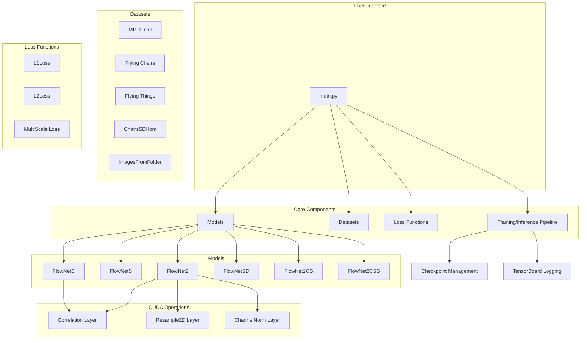
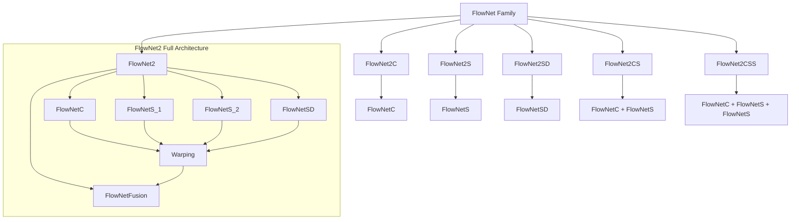
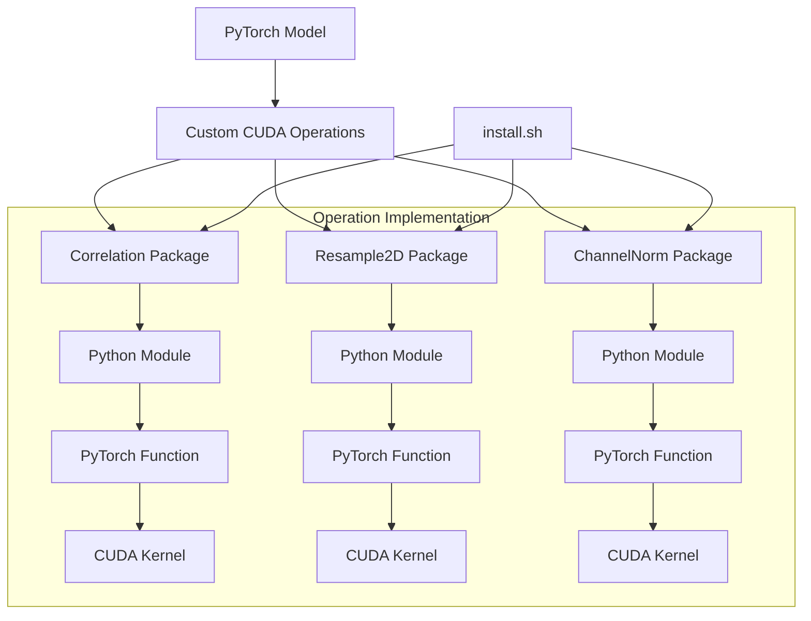
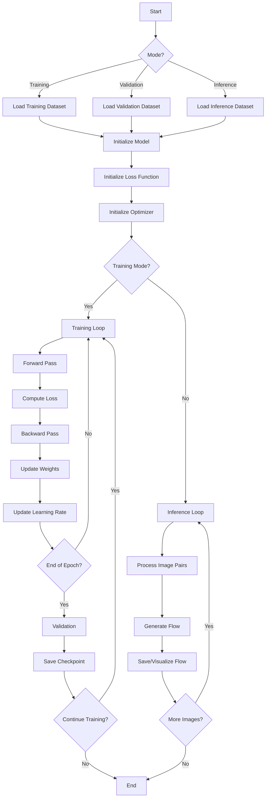
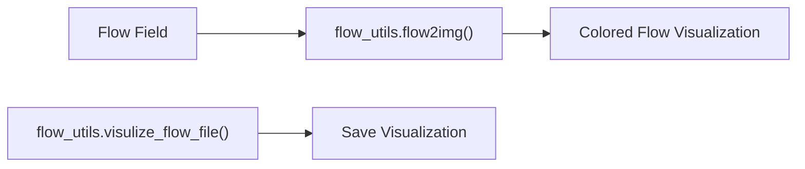
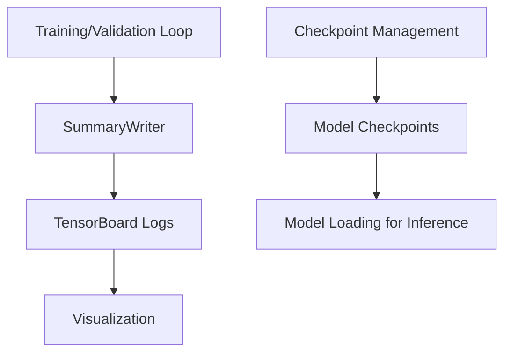

<!-- source: DeepWiki mcp.deepwiki.com · repo NVIDIA/flownet2-pytorch · page 1 FlowNet2-PyTorch Overview · fetched 2026-10-26 -->

# FlowNet2-PyTorch Overview

<details>
<summary>Relevant source files</summary>

The following files were used as context for generating this wiki page:

- [README.md](README.md)
- [main.py](main.py)
- [utils/flow_utils.py](utils/flow_utils.py)

</details>


## Purpose and Scope

This document provides a comprehensive overview of FlowNet2-PyTorch, a PyTorch implementation of the FlowNet 2.0 architecture for optical flow estimation. It covers the system architecture, available network variants, custom CUDA operations, training and inference pipelines, and supported datasets. For installation instructions, see [Installation](#2), and for detailed model architecture descriptions, see [Models](#3).

Sources: [README.md:1-5]()

## System Architecture

FlowNet2-PyTorch implements a deep learning framework for optical flow estimation based on the research paper "FlowNet 2.0: Evolution of Optical Flow Estimation with Deep Networks". The system is designed to support multiple network architectures, training on standard optical flow datasets, and inference with high-performance CUDA-accelerated operations.

### High-Level System Architecture



The system is centered around `main.py`, which serves as the entry point and orchestrates the interaction between models, datasets, and loss functions. The system supports various model architectures (FlowNet2, FlowNetS, FlowNetC, etc.), multiple datasets, and different loss functions. Custom CUDA operations provide critical functionality for certain network architectures.

Sources: [main.py:16-16](), [README.md:13-28]()

## Network Architecture Hierarchy

FlowNet2-PyTorch implements multiple variants of the FlowNet architecture, each with different characteristics and performance profiles.



The full FlowNet2 architecture combines several sub-networks: FlowNetC, two FlowNetS networks, FlowNetSD, and a FlowNetFusion module that blends their outputs. The simpler variants (FlowNet2C, FlowNet2S, FlowNet2SD) use individual sub-networks, while FlowNet2CS and FlowNet2CSS combine multiple sub-networks in a sequential manner.

Sources: [README.md:14-22]()

## Custom CUDA Layers

FlowNet2 relies on custom CUDA-accelerated layers for optimal performance. These layers are implemented as PyTorch extensions with CUDA kernels.



The custom CUDA operations include:

1. **Correlation Layer**: Computes patch-wise similarities between feature maps
2. **Resample2D Layer**: Performs spatial resampling of feature maps
3. **ChannelNorm Layer**: Normalizes feature maps across the channel dimension

These layers are essential for the operation of FlowNet2 and FlowNetC architectures and are installed via the `install.sh` script.

Sources: [README.md:24-28]()

## Training and Inference Pipeline

FlowNet2-PyTorch provides a complete pipeline for both training and inference. The main workflow is implemented in `main.py`.



### Training Process

The training pipeline consists of:
1. Loading the specified training dataset
2. Initializing the model, loss function, and optimizer
3. Running the training loop for a specified number of epochs
4. Periodically validating the model on a validation dataset
5. Saving checkpoints based on validation performance

### Inference Process

The inference pipeline includes:
1. Loading the specified inference dataset
2. Loading a trained model from a checkpoint
3. Applying the model to image pairs to generate optical flow predictions
4. Optionally saving and visualizing the predicted flow fields

Sources: [main.py:245-405]()

## Data Handling

### Supported Datasets

FlowNet2-PyTorch supports several standard optical flow datasets:

| Dataset | Description | Usage |
|---------|-------------|-------|
| MPI Sintel | Synthetic scenes with ground truth flow | Training/Validation |
| Flying Chairs | Synthetic chairs with flow | Training |
| Flying Things | Synthetic objects with flow | Training |
| ChairsSDHom | Extension of Flying Chairs | Training |
| ImagesFromFolder | Custom images | Inference |

### Flow Visualization

The system includes utilities to visualize optical flow fields using a color coding scheme:



The visualization converts the 2D vector field of optical flow into a color-coded image where hue represents direction and saturation represents magnitude.

Sources: [README.md:30-32](), [utils/flow_utils.py:62-204]()

## Loss Functions

The system supports multiple loss functions for training:

| Loss Function | Description |
|---------------|-------------|
| L1 Loss | Mean absolute error |
| L2 Loss | Mean squared error |
| MultiScale Loss | Loss computed at multiple resolution scales |

MultiScale loss allows for computing the loss at different resolution levels, which helps in handling large displacements in optical flow.

Sources: [README.md:34-36](), [main.py:66-66]()

## Command-Line Interface

FlowNet2-PyTorch provides a comprehensive command-line interface through `main.py`. Key functionalities include:

### Training

```
python main.py --batch_size 8 --model FlowNet2 --loss=L1Loss --optimizer=Adam --optimizer_lr=1e-4 \
--training_dataset MpiSintelFinal --training_dataset_root /path/to/mpi-sintel/final/dataset \
--validation_dataset MpiSintelClean --validation_dataset_root /path/to/mpi-sintel/clean/dataset
```

### Inference

```
python main.py --inference --model FlowNet2 --save_flow --inference_dataset MpiSintelClean \
--inference_dataset_root /path/to/mpi-sintel/clean/dataset \
--resume /path/to/checkpoints
```

The interface supports numerous parameters for configuring model architecture, training hyperparameters, dataset options, and inference settings.

Sources: [main.py:23-82](), [README.md:67-84]()

## Integration with External Tools

The system integrates with TensorBoard for logging and visualization during training:



TensorBoard logging includes metrics such as loss values, learning rates, and computation time, providing valuable insights into the training process.

Sources: [main.py:228-229](), [main.py:320-327]()

## Advanced Features

### Multi-GPU Support

FlowNet2-PyTorch supports training on multiple GPUs using PyTorch's DataParallel functionality. The system automatically detects available GPUs and distributes workload accordingly.

### FP16 Support

The system supports inference using half-precision (FP16) for improved performance on compatible hardware, though custom CUDA layers currently only support full precision.

Sources: [README.md:5-7](), [main.py:187-195]()

## Pre-trained Models

The repository provides access to pre-trained models converted from the original Caffe implementation. These models can be used for immediate inference or as starting points for fine-tuning.

Available pre-trained models include:
- FlowNet2
- FlowNet2-C
- FlowNet2-CS
- FlowNet2-CSS
- FlowNet2-CSS-ft-sd
- FlowNet2-S
- FlowNet2-SD

Sources: [README.md:56-65]()

---

