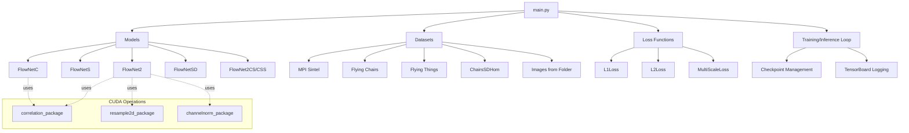
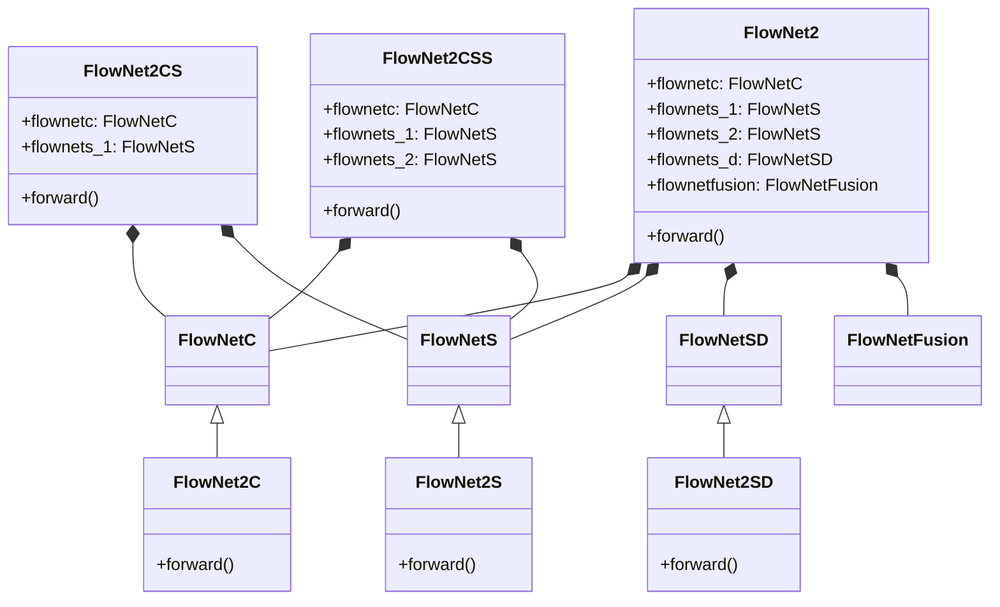
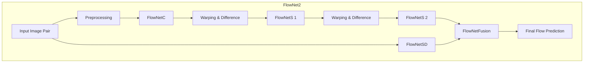
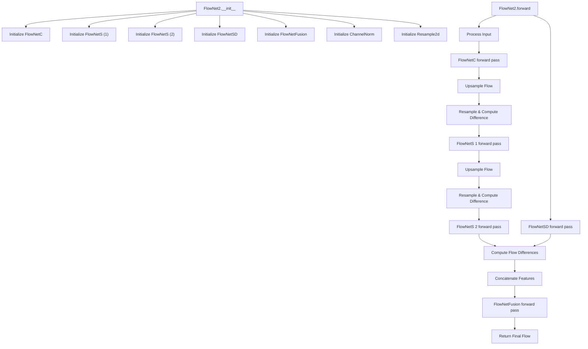
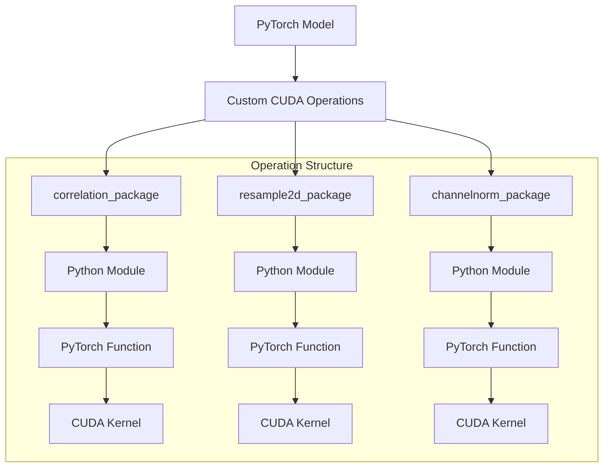
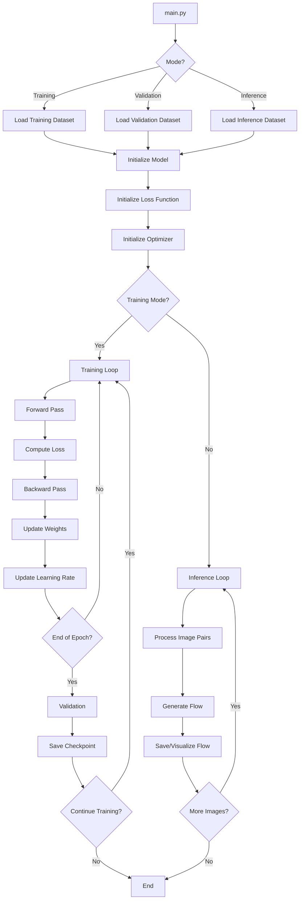
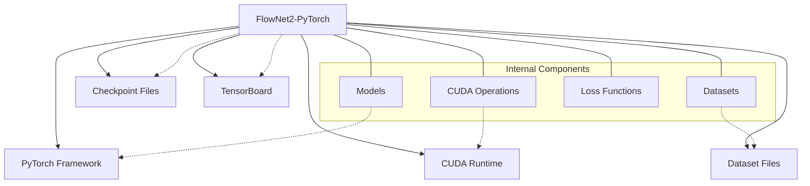
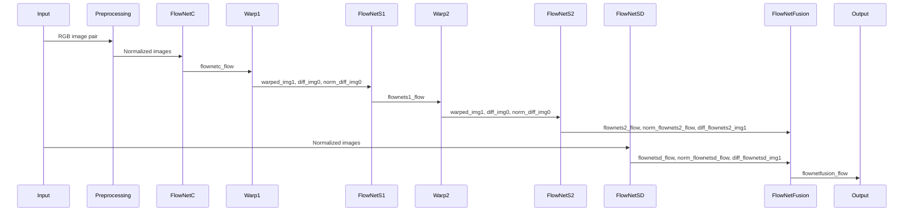

<!-- source: DeepWiki mcp.deepwiki.com · repo NVIDIA/flownet2-pytorch · page 1.1 System Architecture · fetched 2026-10-26 -->

# System Architecture

Relevant source files

The following files were used as context for generating this wiki page:

- [README.md](README.md)
- [models.py](models.py)

This document provides a comprehensive overview of the FlowNet2-PyTorch system architecture, detailing the relationships between key components and the data flow throughout the system. This page focuses on the structural design of the system rather than implementation details of specific components, which are covered in their respective pages.

## 1. Overall System Architecture

The FlowNet2-PyTorch system is designed to train and evaluate various FlowNet models for optical flow estimation. The system architecture follows a modular design with clear separation of concerns between models, datasets, training, and inference components.

**Key Components:**

1. **main.py**: Entry point that orchestrates the entire system
2. **Models**: Implementation of the FlowNet variants for optical flow estimation
3. **Datasets**: Data loaders for standard optical flow datasets
4. **Loss Functions**: Various loss functions for training
5. **Training/Inference Loop**: Controls the training and evaluation process
6. **CUDA Operations**: Custom GPU-accelerated operations essential for efficient computation

Sources: [README.md:1-37](), [models.py:1-28]()

## 2. Model Hierarchy and Relationships

The FlowNet2-PyTorch system implements various network architectures in a hierarchical manner, with FlowNet2 being the most complex model that combines multiple sub-networks.

**Model Variants:**

1. **FlowNet2**: The complete architecture combining FlowNetC, two FlowNetS networks, FlowNetSD, and FlowNetFusion
2. **FlowNet2C**: Uses only the FlowNetC component
3. **FlowNet2S**: Uses only the FlowNetS component
4. **FlowNet2SD**: Uses only the FlowNetSD component
5. **FlowNet2CS**: Combines FlowNetC and FlowNetS components
6. **FlowNet2CSS**: Combines FlowNetC and two FlowNetS components

Sources: [models.py:30-186](), [models.py:187-505](), [README.md:13-22]()

## 3. FlowNet2 Architecture in Detail

The FlowNet2 architecture is the most complex model in the system, combining multiple specialized sub-networks to achieve state-of-the-art optical flow estimation. Here's a detailed look at its architecture and data flow:

**Data Flow in FlowNet2:**

1. **Input Processing**: The input image pair is normalized and preprocessed
2. **FlowNetC Processing**: Performs initial flow estimation using correlation operation
3. **First Warping**: First image is warped to second image using FlowNetC's flow estimation
4. **FlowNetS 1 Processing**: Refines flow estimation based on warped images and initial flow
5. **Second Warping**: Second warping operation using FlowNetS 1's refined flow
6. **FlowNetS 2 Processing**: Further refinement of flow
7. **FlowNetSD Processing**: Independent flow estimation with high detail sensitivity
8. **Fusion**: FlowNetFusion combines the outputs of FlowNetS 2 and FlowNetSD
9. **Output**: Final flow prediction

Sources: [models.py:30-186]()

## 4. Implementation Architecture

The following diagram illustrates the implementation structure of the FlowNet2 model and how each component is initialized and connected:

**Key Implementation Components:**

1. **Initialization**: Each sub-network (FlowNetC, FlowNetS, FlowNetSD, FlowNetFusion) is instantiated
2. **Forward Pass**: Input processing, sequential flow through sub-networks with intermediate processing
3. **Intermediate Operations**: Upsampling, warping (via Resample2d), channel normalization
4. **Flow Fusion**: Combining flow estimations from different sub-networks

Sources: [models.py:32-102](), [models.py:120-185]()

## 5. CUDA Operations Architecture

The custom CUDA operations are critical components of the FlowNet2 architecture, providing GPU-accelerated implementations of computationally intensive operations.

**Custom CUDA Operations:**

1. **Correlation Layer**: Computes patch-wise similarities between feature maps - essential for FlowNetC
2. **Resample2D Layer**: Performs warping operations using estimated flow
3. **ChannelNorm Layer**: Normalizes feature maps across the channel dimension

Each CUDA operation follows a three-tier architecture:
- Python module interface for seamless integration with PyTorch
- PyTorch Function with forward and backward methods (for autograd)
- CUDA kernel implementation for GPU acceleration

Sources: [README.md:24-28](), [models.py:9-16](), [models.py:39-51]()

## 6. Training and Inference Pipeline

The system provides a comprehensive pipeline for both training and inference of optical flow models.

**Training and Inference Pipeline Features:**

1. **Mode Selection**: Supports training, validation, and inference modes
2. **Dataset Loading**: Loads appropriate dataset based on mode
3. **Model Initialization**: Instantiates the selected FlowNet variant
4. **Training Loop**: Forward pass, loss computation, backward pass, weight updates
5. **Validation**: Evaluates model performance on validation dataset
6. **Checkpoint Management**: Saves and loads model checkpoints
7. **Inference**: Generates flow predictions for image pairs

Sources: [README.md:67-84]()

## 7. Model Configuration Options

The system supports various configuration options for different network architectures. The following table summarizes the available model variants and their key components:

| Model         | Components                                     | Description                                   |
|---------------|-----------------------------------------------|-----------------------------------------------|
| FlowNet2      | FlowNetC + 2×FlowNetS + FlowNetSD + FlowNetFusion | Complete architecture with all components    |
| FlowNet2C     | FlowNetC                                      | Uses only correlation-based flow estimation   |
| FlowNet2S     | FlowNetS                                      | Uses only the simple flow estimation network  |
| FlowNet2SD    | FlowNetSD                                     | Uses the small displacement-focused network   |
| FlowNet2CS    | FlowNetC + FlowNetS                          | Combines correlation and simple networks      |
| FlowNet2CSS   | FlowNetC + 2×FlowNetS                        | Combines correlation and two simple networks  |

Each model variant can be further customized with options for:
- Batch normalization
- Half-precision (fp16) computation
- Scaling factor for flow (div_flow parameter)

Sources: [models.py:30-506](), [README.md:13-22]()

## 8. Interface with External Components

The FlowNet2-PyTorch system interfaces with several external components for complete functionality:

**External Interfaces:**

1. **PyTorch Framework**: Core deep learning framework used for tensor operations and autograd
2. **CUDA Runtime**: Required for execution of custom CUDA operations
3. **Dataset Files**: External dataset files in appropriate format
4. **Checkpoint Files**: Saved model weights and optimizer states
5. **TensorBoard**: Optional visualization of training metrics

Sources: [README.md:38-56]()

## 9. Data Flow in Model Forward Pass

Let's examine the detailed data flow inside the FlowNet2 model during a forward pass:

This sequence diagram illustrates how data flows through the FlowNet2 model:
1. Input images are preprocessed (normalized)
2. FlowNetC produces initial flow estimation
3. First warping operation creates difference images
4. FlowNetS1 refines the flow estimation
5. Second warping operation with updated flow
6. FlowNetS2 further refines the flow
7. In parallel, FlowNetSD processes the input independently
8. FlowNetFusion combines the outputs from FlowNetS2 and FlowNetSD
9. Final flow prediction is produced

Sources: [models.py:120-185]()

## Summary

The FlowNet2-PyTorch system architecture is designed with modularity and extensibility in mind. It consists of multiple interconnected components arranged in a hierarchical structure:

1. A set of neural network models (FlowNetC, FlowNetS, FlowNetSD, FlowNetFusion) that can be combined in different ways
2. Custom CUDA operations (correlation, resample2d, channelnorm) for computationally intensive tasks
3. A comprehensive training and inference pipeline
4. Support for various datasets and loss functions

This architecture allows for flexibility in model configuration while maintaining high performance through GPU acceleration of critical operations. For more information on specific components, please refer to their dedicated wiki pages.

---

