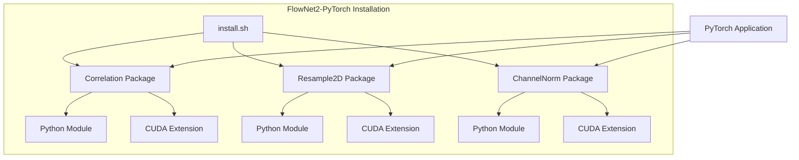
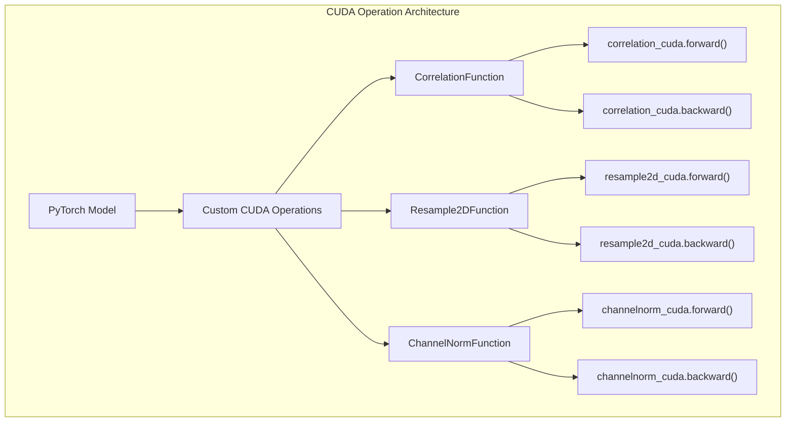
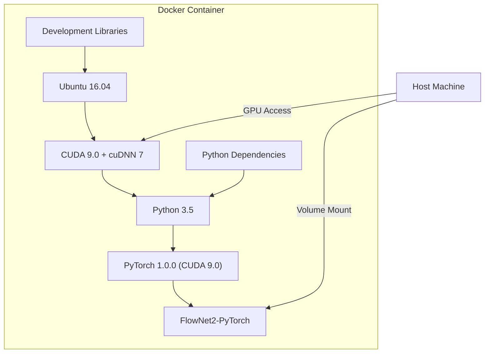

<!-- source: DeepWiki mcp.deepwiki.com · repo NVIDIA/flownet2-pytorch · page 2 Installation · fetched 2026-10-26 -->

# Installation

<details>
<summary>Relevant source files</summary>

The following files were used as context for generating this wiki page:

- [Dockerfile](Dockerfile)
- [install.sh](install.sh)
- [launch_docker.sh](launch_docker.sh)
- [networks/correlation_package/correlation.py](networks/correlation_package/correlation.py)

</details>


This document provides step-by-step instructions for installing and setting up FlowNet2-PyTorch. The repository requires specific CUDA extensions that must be compiled for the neural network models to function correctly. For information about pre-trained models, see [Pre-trained Models](#2.1).

## System Requirements

Before installation, ensure your system meets the following requirements:

| Requirement | Version/Specification |
|-------------|------------------------|
| CUDA        | 9.0                    |
| cuDNN       | 7                      |
| Python      | 3.5+                   |
| PyTorch     | 1.0.0                  |
| GPU         | NVIDIA GPU with CUDA support |

## Installation Methods

There are two methods to install FlowNet2-PyTorch:

1. **Native installation** - Install directly on your system
2. **Docker-based installation** - Use a pre-configured Docker environment

## Native Installation

### Step 1: Clone the Repository

```bash
git clone https://github.com/NVIDIA/flownet2-pytorch.git
cd flownet2-pytorch
```

### Step 2: Set Up Python Environment

Install PyTorch with CUDA support. The repository was developed with PyTorch 1.0.0:

```bash
pip3 install https://download.pytorch.org/whl/cu90/torch-1.0.0-cp35-cp35m-linux_x86_64.whl
```

### Step 3: Install Dependencies

```bash
pip3 install numpy scipy matplotlib scikit-image tensorboardX
```

### Step 4: Install Custom CUDA Extensions

The core functionality of FlowNet2 relies on three custom CUDA-accelerated operations that must be compiled:

```bash
./install.sh
```

This script will compile and install:
- Correlation package
- Resample2D package
- ChannelNorm package

Sources: [install.sh:1-15]()

## Installation Architecture

The following diagram illustrates the components that are installed by the `install.sh` script:



Sources: [install.sh:1-15](), [networks/correlation_package/correlation.py:1-62]()

## Custom CUDA Operations

The installation process compiles three essential CUDA operations:

1. **Correlation Package**: Implements spatial correlation between feature maps for matching image features
2. **Resample2D Package**: Provides differentiable resampling/warping operation for flow-based warping
3. **ChannelNorm Package**: Implements channel-wise normalization for feature maps

These operations are implemented as custom PyTorch extensions with optimized CUDA kernels for efficient computation on NVIDIA GPUs.



Sources: [networks/correlation_package/correlation.py:1-62]()

## Docker-based Installation

If you prefer to use Docker, FlowNet2-PyTorch provides a Docker setup that includes all required dependencies.

### Prerequisites

- Docker
- NVIDIA Docker (for GPU support)

### Steps

1. Build and run the Docker container:

```bash
./launch_docker.sh
```

This script:
1. Builds a Docker image with all dependencies
2. Launches a container with the current directory mounted
3. Provides an interactive shell inside the container

Sources: [launch_docker.sh:1-5](), [Dockerfile:1-28]()

## Docker Environment

The Docker environment includes:



The Docker environment includes the following key components:

| Component | Version/Details |
|-----------|----------------|
| Base Image | nvidia/cuda:9.0-cudnn7-devel-ubuntu16.04 |
| Python | 3.5 |
| PyTorch | 1.0.0 (with CUDA 9.0) |
| Libraries | NumPy, SciPy, matplotlib, scikit-image, tensorboardX |
| Development Tools | cmake, g++, CUDA toolkit |

Sources: [Dockerfile:1-28](), [launch_docker.sh:1-5]()

## Verifying Installation

After installation, verify that the custom CUDA extensions are working correctly:

```python
import torch
from networks.correlation_package.correlation import Correlation
from networks.resample2d_package.resample2d import Resample2d
from networks.channelnorm_package.channelnorm import ChannelNorm

# Create dummy tensors
input1 = torch.randn(1, 3, 64, 64).cuda()
input2 = torch.randn(1, 3, 64, 64).cuda()

# Test correlation
correlation = Correlation(pad_size=3, kernel_size=3, max_displacement=20, stride1=1, stride2=2, corr_multiply=1)
out_correlation = correlation(input1, input2)
print("Correlation layer test passed!")

# Test other layers similarly
```

If no errors occur and the message is printed, the installation is successful.

## Troubleshooting

If you encounter issues during installation of the CUDA extensions:

1. Ensure CUDA paths are correctly set in your environment
2. Check that your CUDA and PyTorch versions are compatible
3. Verify you have necessary build tools (gcc, g++)
4. For compilation errors, check if your GPU architecture is supported

For more detailed information on the models and their architectures, see [Models](#3).

---

