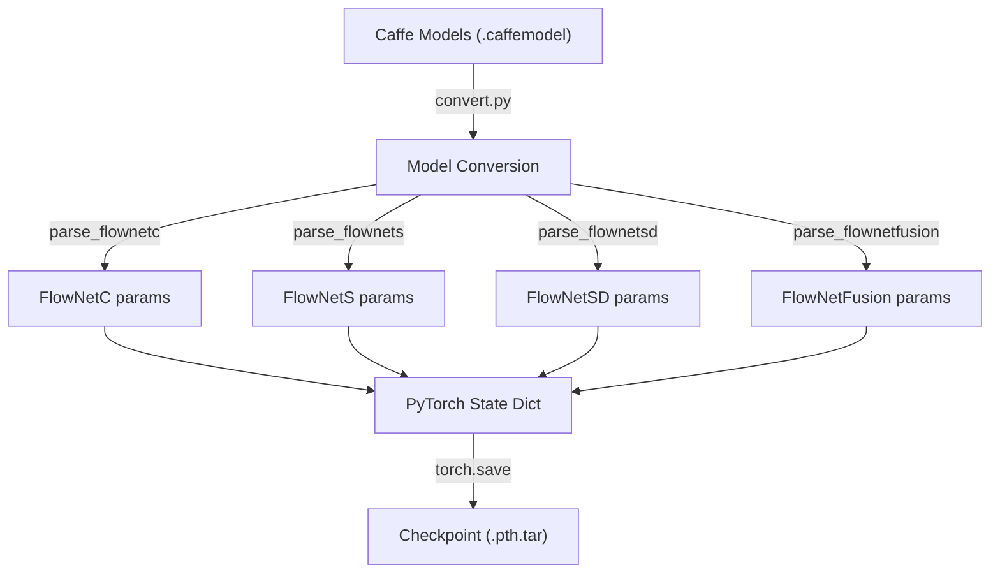
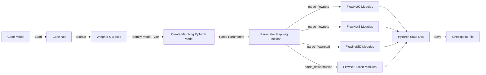
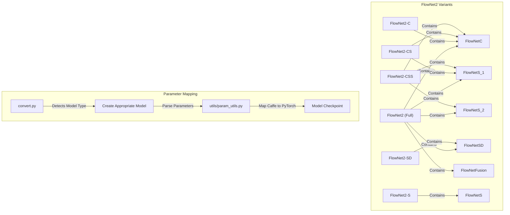

<!-- source: DeepWiki mcp.deepwiki.com · repo NVIDIA/flownet2-pytorch · page 2.1 Pre-trained Models · fetched 2026-10-26 -->

# Pre-trained Models

<details>
<summary>Relevant source files</summary>

The following files were used as context for generating this wiki page:

- [convert.py](convert.py)
- [download_caffe_models.sh](download_caffe_models.sh)
- [run-caffe2pytorch.sh](run-caffe2pytorch.sh)
- [utils/param_utils.py](utils/param_utils.py)

</details>


This document explains how to download, convert, and use pre-trained FlowNet2 models with the PyTorch implementation. FlowNet2-PyTorch supports converting the original Caffe models provided by the FlowNet2 authors to PyTorch format, allowing for immediate use without training from scratch.

## Contents

- [Available Pre-trained Models](#available-pre-trained-models)
- [Downloading Caffe Models](#downloading-caffe-models)
- [Converting Caffe Models to PyTorch](#converting-caffe-models-to-pytorch)
- [Using Pre-trained Models](#using-pre-trained-models)

## Available Pre-trained Models

FlowNet2-PyTorch supports several pre-trained model variants with different accuracy and speed tradeoffs:

| Model Name | Description | Performance | Speed |
|------------|-------------|-------------|-------|
| FlowNet2 | Full model with all components | Best | Slowest |
| FlowNet2-CSS | Three networks (C+S+S) without fusion | Very good | Slow |
| FlowNet2-CSS-ft-sd | CSS fine-tuned with small displacement data | Good | Slow |
| FlowNet2-CS | Two networks (C+S) | Good | Medium |
| FlowNet2-C | Only correlation network | Basic | Fast |
| FlowNet2-S | Only simple network | Basic | Fast |
| FlowNet2-SD | Small displacement model | Good for small motions | Fast |

Sources: [convert.py:57-136]()

## Downloading Caffe Models

The repository provides a script to download the original Caffe models from the FlowNet2 authors.


To download the models:

1. Run the download script which clones the FlowNet2-Docker repository
   ```bash
   ./download_caffe_models.sh
   ```

2. This creates a Docker image with all necessary Caffe models

Sources: [download_caffe_models.sh:1-14]()

## Converting Caffe Models to PyTorch

After downloading the Caffe models, you need to convert them to PyTorch format using the provided conversion tools.



The conversion process:

1. Run the conversion script that uses Docker for environment isolation:
   ```bash
   ./run-caffe2pytorch.sh /path/to/flownet2-pytorch
   ```

2. This script performs these operations:
   - Builds a PyTorch Docker image with CUDA support
   - Installs custom layers
   - Runs the conversion script for each model variant
   - Saves checkpoint files in PyTorch format

The conversion script supports all model variants and creates corresponding checkpoint files:
- FlowNet2_checkpoint.pth.tar
- FlowNet2-C_checkpoint.pth.tar
- FlowNet2-CS_checkpoint.pth.tar
- FlowNet2-CSS_checkpoint.pth.tar
- FlowNet2-CSS-ft-sd_checkpoint.pth.tar
- FlowNet2-S_checkpoint.pth.tar
- FlowNet2-SD_checkpoint.pth.tar

Sources: [run-caffe2pytorch.sh:1-17](), [convert.py:1-137]()

## Model Conversion Process Details

The conversion process involves mapping parameters from Caffe models to PyTorch models using specialized parsing functions:



The conversion handles important details like:
- Flipping RGB channels for the first convolutional layer
- Organizing parameters for each sub-network
- Handling model-specific layer names and prefixes

Sources: [convert.py:48-137](), [utils/param_utils.py:1-254]()

## Using Pre-trained Models

Once converted, you can load the pre-trained models for inference or fine-tuning:

1. Load a pre-trained model:
   ```python
   import torch
   from models import FlowNet2  # Or any other model variant
   
   # Initialize the model
   args = {}  # Add any required args
   model = FlowNet2(args)
   
   # Load the pre-trained weights
   checkpoint = torch.load('FlowNet2_checkpoint.pth.tar')
   model.load_state_dict(checkpoint['state_dict'])
   
   # Set to evaluation mode
   model.eval()
   ```

2. Use the model for inference (refer to [Training and Inference](#4) for detailed usage).

Sources: [convert.py:67-69](), [convert.py:75-78](), [convert.py:86-89]()

## Model Architecture Variants

The conversion script supports different FlowNet2 architecture variants, each with specific parameter mapping:



Each model variant has specific parameter mapping functions that handle the differences in layer naming and structure between Caffe and PyTorch implementations.

Sources: [convert.py:57-136](), [utils/param_utils.py:5-254]()

## Verifying Converted Models

After conversion, you can verify if the models were correctly converted by:

1. Loading the checkpoint and inspecting the state dictionary keys
2. Running a simple inference test with sample images
3. Comparing the output with the expected results from the original Caffe implementation

For troubleshooting conversion issues, refer to the [Custom CUDA Operations](#6) section as these operations are critical for the correct functioning of the FlowNet2 models.

---

