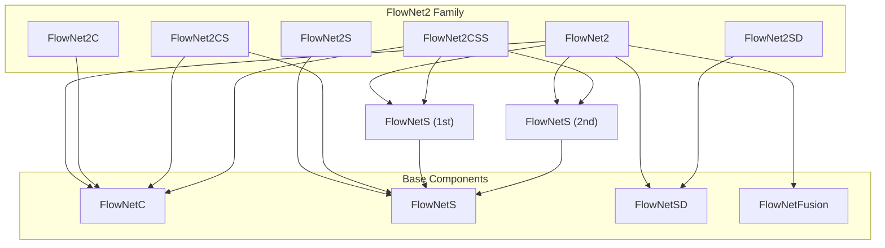
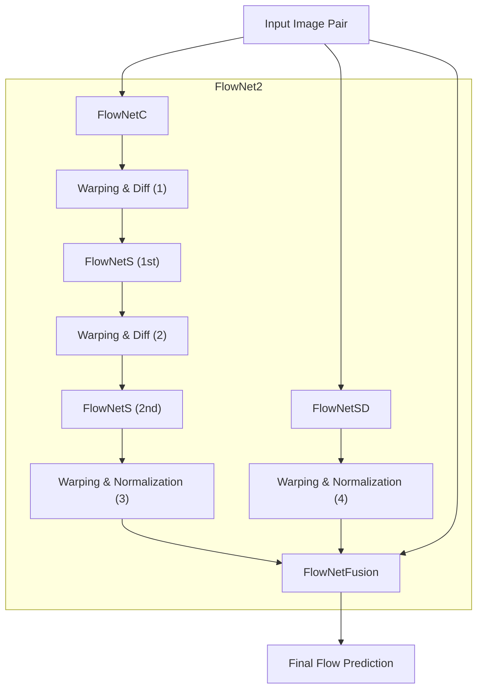
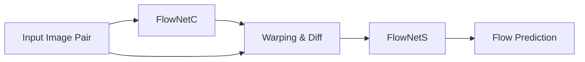
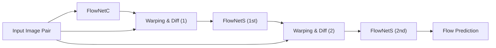

<!-- source: DeepWiki mcp.deepwiki.com · repo NVIDIA/flownet2-pytorch · page 3 Models · fetched 2026-10-26 -->

# Models

<details>
<summary>Relevant source files</summary>

The following files were used as context for generating this wiki page:

- [models.py](models.py)

</details>


This page provides a comprehensive overview of the FlowNet2 network architecture and its variants implemented in the FlowNet2-PyTorch repository. The models described here are designed for optical flow estimation from pairs of images. For more detailed information about specific components like FlowNetS, FlowNetC, FlowNetSD, or FlowNetFusion, see their respective pages ([FlowNetS](#3.1), [FlowNetC](#3.2), [FlowNetSD](#3.3), [FlowNetFusion](#3.4)).

## Model Hierarchy

FlowNet2-PyTorch implements a family of neural networks for optical flow estimation, with varying architectures, complexity, and accuracy.

### Model Hierarchy Diagram



Sources: [models.py:30-186](), [models.py:187-299](), [models.py:300-351](), [models.py:353-416](), [models.py:418-505]()

## FlowNet2 Architecture

FlowNet2 is the complete model that combines multiple network components to achieve high-quality optical flow estimation. It processes a pair of RGB images and outputs a dense optical flow field.

### FlowNet2 Components and Data Flow



Sources: [models.py:30-186]()

The full FlowNet2 architecture processes inputs through the following steps:

1. Input normalization: Normalize and split the input image pair
2. FlowNetC: Process normalized inputs through the correlation-based network
3. First warping: Warp the second image to the first using the initial flow estimate
4. FlowNetS (1st): Refine the flow using the warped image and original inputs
5. Second warping: Warp again with the refined flow
6. FlowNetS (2nd): Further refine the flow
7. FlowNetSD: Process the original inputs with a small-displacement specialized network
8. Flow normalization: Normalize both flow fields
9. FlowNetFusion: Combine all the information to produce the final flow prediction

The key insight behind FlowNet2 is that different network components specialize in different aspects of optical flow estimation, and their combination provides superior results.

Sources: [models.py:30-186](), [models.py:120-185]()

## Model Variants

FlowNet2-PyTorch implements several variants of the FlowNet2 architecture, each with different trade-offs between accuracy, speed, and model size.

### Model Variants Comparison

| Model | Components | Parameters | Input | Output | Use Case |
|-------|------------|------------|-------|--------|----------|
| FlowNet2 | FlowNetC + 2×FlowNetS + FlowNetSD + FlowNetFusion | ~162.5M | Image pair | Flow field | Best accuracy, slower inference |
| FlowNet2C | FlowNetC only | ~39.2M | Image pair | Flow field | Fast, moderate accuracy |
| FlowNet2S | FlowNetS only | ~38.7M | Image pair | Flow field | Fast, moderate accuracy |
| FlowNet2SD | FlowNetSD only | ~38.7M* | Image pair | Flow field | Small displacements |
| FlowNet2CS | FlowNetC + FlowNetS | ~77.9M* | Image pair | Flow field | Good balance of speed/accuracy |
| FlowNet2CSS | FlowNetC + 2×FlowNetS | ~116.6M* | Image pair | Flow field | High accuracy, moderate speed |

*Note: Approximate parameter counts based on network architecture

Sources: [models.py:28](), [models.py:30-186](), [models.py:187-299](), [models.py:300-351](), [models.py:353-416](), [models.py:418-505]()

### FlowNet2C

FlowNet2C uses only the correlation-based FlowNetC component of the full FlowNet2 architecture. It's suitable for applications where computational efficiency is important but correlation-based matching is desired.

The model inherits from `FlowNetC.FlowNetC` and adds preprocessing to normalize the input image pair before passing it through the network.

Sources: [models.py:187-253]()

### FlowNet2S

FlowNet2S uses only the FlowNetS component, which is a simpler network without the correlation layer. It's the fastest of the FlowNet2 variants but may have lower accuracy for complex motion patterns.

The model inherits from `FlowNetS.FlowNetS` and adds preprocessing similar to FlowNet2C.

Sources: [models.py:255-299]()

### FlowNet2SD

FlowNet2SD uses only the FlowNetSD component, which is specialized for small displacement optical flow. It's particularly useful for scenarios where the motion between frames is limited.

The model inherits from `FlowNetSD.FlowNetSD` and includes similar preprocessing to the other variants.

Sources: [models.py:301-351]()

### FlowNet2CS

FlowNet2CS combines FlowNetC and FlowNetS in a cascaded manner. FlowNetC produces an initial flow estimate, which is used to warp the second image. The warped image, original images, flow, and difference magnitude are then processed by FlowNetS to refine the flow.



Sources: [models.py:353-416]()

### FlowNet2CSS

FlowNet2CSS extends FlowNet2CS by adding a second FlowNetS stage. The output from the first FlowNetS is used to warp the second image again, and the result is processed by the second FlowNetS to further refine the flow.



Sources: [models.py:418-505]()

## Common Operations

### Image Warping and Normalization

All FlowNet2 variants use image warping and channel normalization operations:

1. **Image Warping**: The `Resample2d` operation warps an image using a flow field. This allows the network to compensate for motion between frames.
2. **Channel Normalization**: The `ChannelNorm` operation normalizes feature maps, which helps stabilize training and improve generalization.

These operations are crucial for the cascaded architecture of FlowNet2, where the output of one network is used to warp images before feeding them to the next network.

Sources: [models.py:39-51](), [models.py:52-62](), [models.py:73-87]()

### Mixed Precision Support

FlowNet2-PyTorch supports mixed precision training and inference with FP16 operations. The models include special handling for custom CUDA operations when running in FP16 mode:

```python
if args.fp16:
    self.resample1 = nn.Sequential(
                    tofp32(), 
                    Resample2d(),
                    tofp16()) 
else:
    self.resample1 = Resample2d()
```

This allows for faster computation on compatible hardware while maintaining numerical stability.

Sources: [models.py:45-51](), [models.py:56-62](), [models.py:73-87]()

## Initialization and Training

All FlowNet2 models use Xavier uniform initialization for convolutional and transposed convolutional weights, which helps with training deep networks by maintaining appropriate activation magnitudes through the network.

During training, the models return flow predictions at multiple scales to enable multi-scale loss computation. During inference, only the final, upsampled flow prediction is returned.

Sources: [models.py:92-102](), [models.py:250-253](), [models.py:296-299](), [models.py:348-351]()

## Usage Example

The primary usage of these models is through the main training and inference pipeline. Models are instantiated with configuration parameters and then used for forward passes with image pairs:

```python
# Example usage (simplified)
model = FlowNet2(args)  # or any variant
flow_prediction = model(image_pair)
```

For specific usage patterns, refer to the [Training and Inference](#4) documentation.

---

