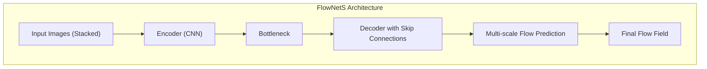
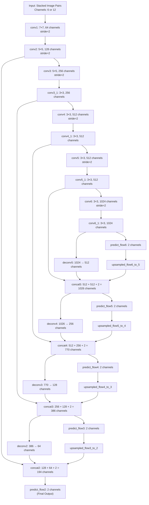
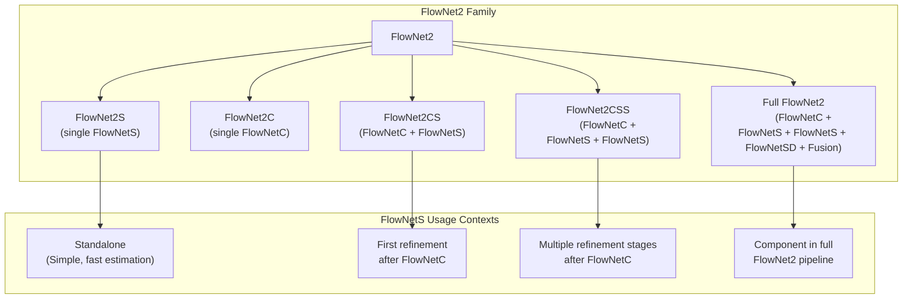

<!-- source: DeepWiki mcp.deepwiki.com · repo NVIDIA/flownet2-pytorch · page 3.1 FlowNetS · fetched 2026-10-26 -->

# FlowNetS

<details>
<summary>Relevant source files</summary>

The following files were used as context for generating this wiki page:

- [networks/FlowNetS.py](networks/FlowNetS.py)

</details>


## Purpose and Overview

This documentation covers the FlowNetS architecture, a fundamental building block in the FlowNet2 family of optical flow estimation networks. FlowNetS is the simplest variant in the FlowNet family, using a straightforward encoder-decoder architecture with skip connections to estimate optical flow between two input images. This page focuses on the architecture, implementation, and role of FlowNetS within the broader FlowNet2 ecosystem.

For information about other network variants, see [FlowNetC](#3.2), [FlowNetSD](#3.3), or [FlowNetFusion](#3.4).

## Architecture

FlowNetS follows an encoder-decoder architecture with skip connections. It directly processes stacked RGB image pairs to estimate pixel-level motion between frames.

### High-Level Architecture



Sources: [networks/FlowNetS.py:15-94]()

### Detailed Network Structure



Sources: [networks/FlowNetS.py:19-45](), [networks/FlowNetS.py:60-90]()

## Implementation Details

The FlowNetS implementation in the FlowNet2-PyTorch repository consists of several key components:

### Class Definition and Parameters

FlowNetS is implemented as a PyTorch module with approximately 38.7 million parameters.

The constructor initializes the network layers with optional batch normalization:

```python
def __init__(self, args, input_channels = 12, batchNorm=True):
```

By default, the network accepts 12-channel inputs (e.g., two RGB images with additional features), but this can be customized through the `input_channels` parameter.

Sources: [networks/FlowNetS.py:15-58]()

### Network Components

The network consists of the following main components:

1. **Encoder Path**: A series of convolutional layers that progressively reduce spatial dimensions while increasing the feature channels
2. **Bottleneck**: The deepest layer (`conv6_1`) with 1024 channels
3. **Decoder Path**: A series of transposed convolutions (deconvolutions) that upsample feature maps
4. **Skip Connections**: Direct connections from encoder to decoder at corresponding resolutions
5. **Flow Prediction**: Multiple flow prediction branches at different scales
6. **Flow Upsampling**: Transposed convolutions to upsample flow predictions for concatenation with higher-resolution features

Sources: [networks/FlowNetS.py:19-45]()

### Forward Pass

The forward pass processes the input through the encoder and decoder paths, with flow predictions at multiple scales:

1. Input passes through encoder layers (conv1 to conv6_1)
2. Initial flow prediction at the lowest resolution (flow6)
3. Upsampling of flow and features via deconvolution
4. Concatenation of encoder features, upsampled features, and upsampled flow
5. Flow prediction at the current scale
6. Steps 3-5 repeat until reaching the highest resolution (flow2)

During training, the network returns flow predictions at all scales (flow2, flow3, flow4, flow5, flow6) to apply supervision at multiple resolutions. During inference, only the highest resolution flow prediction (flow2) is returned.

Sources: [networks/FlowNetS.py:60-94]()

### Weight Initialization

The network uses Xavier uniform initialization for both convolutional and transposed convolutional layers:

```python
for m in self.modules():
    if isinstance(m, nn.Conv2d) or isinstance(m, nn.ConvTranspose2d):
        if m.bias is not None:
            init.uniform_(m.bias)
        init.xavier_uniform_(m.weight)
```

This initialization method helps achieve better convergence during training.

Sources: [networks/FlowNetS.py:47-57]()

## Technical Specifications

The table below summarizes the key layers and their configurations in FlowNetS:

| Layer Name | Kernel Size | Input Channels | Output Channels | Stride | Notes |
|------------|-------------|----------------|-----------------|--------|-------|
| conv1      | 7×7         | 12 (default)   | 64              | 2      | First encoding layer |
| conv2      | 5×5         | 64             | 128             | 2      | |
| conv3      | 5×5         | 128            | 256             | 2      | |
| conv3_1    | 3×3         | 256            | 256             | 1      | |
| conv4      | 3×3         | 256            | 512             | 2      | |
| conv4_1    | 3×3         | 512            | 512             | 1      | |
| conv5      | 3×3         | 512            | 512             | 2      | |
| conv5_1    | 3×3         | 512            | 512             | 1      | |
| conv6      | 3×3         | 512            | 1024            | 2      | |
| conv6_1    | 3×3         | 1024           | 1024            | 1      | Bottleneck layer |
| predict_flow6 | 3×3      | 1024           | 2               | 1      | Flow prediction at 1/64 resolution |
| deconv5    | 4×4         | 1024           | 512             | 2      | Transposed convolution |
| predict_flow5 | 3×3      | 1026           | 2               | 1      | Flow prediction at 1/32 resolution |
| deconv4    | 4×4         | 1026           | 256             | 2      | Transposed convolution |
| predict_flow4 | 3×3      | 770            | 2               | 1      | Flow prediction at 1/16 resolution |
| deconv3    | 4×4         | 770            | 128             | 2      | Transposed convolution |
| predict_flow3 | 3×3      | 386            | 2               | 1      | Flow prediction at 1/8 resolution |
| deconv2    | 4×4         | 386            | 64              | 2      | Transposed convolution |
| predict_flow2 | 3×3      | 194            | 2               | 1      | Final flow prediction at 1/4 resolution |

Sources: [networks/FlowNetS.py:19-45]()

## Role in FlowNet2 Architecture

FlowNetS serves as a building block in the broader FlowNet2 ecosystem:



Sources: [networks/FlowNetS.py:15-94]()

## Technical Considerations

1. **Input Format**: FlowNetS typically accepts stacked RGB image pairs (6 channels) or augmented inputs (12 channels).

2. **Resolution**: The network reduces spatial resolution by a factor of 64 through the encoder path and then upsamples to 1/4 of the original resolution.

3. **Skip Connections**: The architecture heavily relies on skip connections to preserve fine details that might be lost during downsampling.

4. **Multi-scale Supervision**: During training, loss is applied at all flow prediction scales to encourage hierarchical flow learning.

5. **Parameter Count**: With approximately 38.7 million parameters, FlowNetS is relatively lightweight compared to the full FlowNet2 model.

Sources: [networks/FlowNetS.py:13](), [networks/FlowNetS.py:91-94]()

## Summary

FlowNetS is a fundamental component in the FlowNet2 architecture, providing optical flow estimation through a straightforward convolutional encoder-decoder structure with skip connections. Its simple design makes it relatively fast and efficient, while still achieving reasonable accuracy for many optical flow applications. FlowNetS can be used both as a standalone model and as a building block in more complex architectures like FlowNet2CS, FlowNet2CSS, and the full FlowNet2 model.

---

