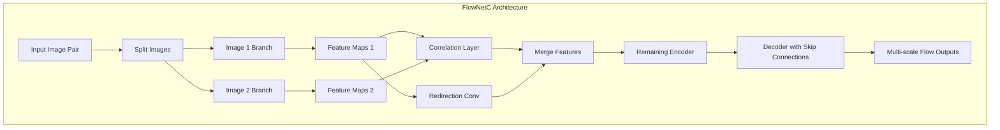
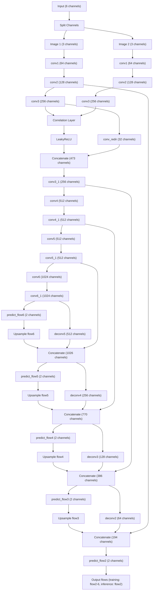
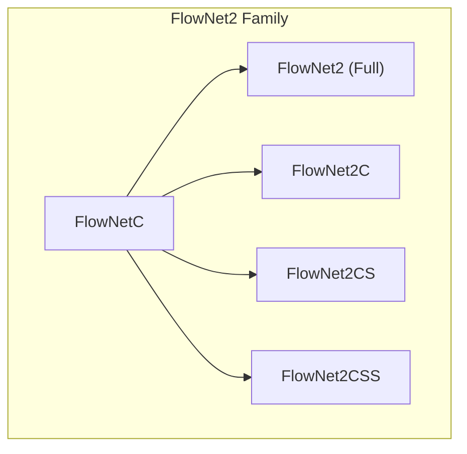

<!-- source: DeepWiki mcp.deepwiki.com · repo NVIDIA/flownet2-pytorch · page 3.2 FlowNetC · fetched 2026-10-26 -->

# FlowNetC

<details>
<summary>Relevant source files</summary>

The following files were used as context for generating this wiki page:

- [networks/FlowNetC.py](networks/FlowNetC.py)

</details>


## Purpose and Overview

This document provides a detailed explanation of the FlowNetC architecture, a key component in the FlowNet2 family of networks designed for optical flow estimation. FlowNetC is notable for its use of a correlation layer to explicitly match features between input frames, enabling more accurate flow prediction compared to the simpler FlowNetS architecture (see [FlowNetS](#3.1)).

FlowNetC serves as a building block in several larger architectures in the FlowNet2 family, including the full FlowNet2, FlowNet2C, FlowNet2CS, and FlowNet2CSS models. It processes pairs of input images and outputs optical flow fields at multiple resolutions.

## Architecture Overview

FlowNetC employs a Siamese network design with two separate but identical branches that process each input image independently before merging their features through a correlation operation. This approach allows the network to explicitly compare features from both images to estimate motion.



Sources: [networks/FlowNetC.py:13-128]()

## Detailed Network Structure

FlowNetC consists of an encoder-decoder structure with skip connections and a correlation layer. The network contains approximately 39 million parameters.

### Network Architecture Diagram



Sources: [networks/FlowNetC.py:13-128]()

## Key Components

### 1. Siamese Encoder Branches

The FlowNetC architecture begins with identical convolutional branches that process each input image independently:

```
Encoder Branch (per input image):
conv1: 3 → 64 channels (7×7 kernel, stride 2)
conv2: 64 → 128 channels (5×5 kernel, stride 2)
conv3: 128 → 256 channels (5×5 kernel, stride 2)
```

Each branch produces a set of feature maps that represent increasingly abstract representations of the input image.

Sources: [networks/FlowNetC.py:20-23](), [networks/FlowNetC.py:75-83]()

### 2. Correlation Layer

The correlation layer is the distinguishing feature of FlowNetC, enabling the network to explicitly compare features between the two images:

| Parameter | Value | Description |
|-----------|-------|-------------|
| pad_size | 20 | Padding for feature maps |
| kernel_size | 1 | Size of comparison kernel |
| max_displacement | 20 | Maximum displacement for correlation |
| stride1 | 1 | Stride for first feature map |
| stride2 | 2 | Stride for second feature map |
| corr_multiply | 1 | Multiplication factor |

The correlation layer supports both FP32 and FP16 precision, with automatic conversion for mixed-precision training when specified.

Sources: [networks/FlowNetC.py:25-31](), [networks/FlowNetC.py:86-87]()

### 3. Feature Merging

After correlation, features are merged:
1. A redirection convolution (`conv_redir`) reduces the dimensionality of the first branch's features from 256 to 32 channels
2. These reduced features are concatenated with the correlation output
3. The merged features proceed through additional convolutional layers

The merged path has the following structure:
```
conv3_1: 473 → 256 channels
conv4: 256 → 512 channels (stride 2)
conv4_1: 512 → 512 channels
conv5: 512 → 512 channels (stride 2)
conv5_1: 512 → 512 channels
conv6: 512 → 1024 channels (stride 2)
conv6_1: 1024 → 1024 channels
```

Sources: [networks/FlowNetC.py:33-40](), [networks/FlowNetC.py:90-100]()

### 4. Decoder with Skip Connections

The decoder architecture uses upconvolution (transposed convolution) layers combined with features from the encoder through skip connections:

```
deconv5: 1024 → 512 channels
deconv4: 1026 → 256 channels
deconv3: 770 → 128 channels
deconv2: 386 → 64 channels
```

Note that the input channel counts for deconvolutions (1026, 770, 386) include the concatenated features from skip connections and upsampled flow.

Sources: [networks/FlowNetC.py:42-45](), [networks/FlowNetC.py:103-121]()

### 5. Multi-scale Flow Prediction

FlowNetC predicts optical flow at five different resolutions, allowing for coarse-to-fine refinement:

| Layer | Input Features | Output |
|-------|---------------|--------|
| predict_flow6 | 1024 channels | 2-channel flow at 1/64 resolution |
| predict_flow5 | 1026 channels | 2-channel flow at 1/32 resolution |
| predict_flow4 | 770 channels | 2-channel flow at 1/16 resolution |
| predict_flow3 | 386 channels | 2-channel flow at 1/8 resolution |
| predict_flow2 | 194 channels | 2-channel flow at 1/4 resolution |

During training, all flow predictions (flow2-flow6) are returned for multi-scale supervision. During inference, only the highest resolution flow (flow2) is returned.

Sources: [networks/FlowNetC.py:47-51](), [networks/FlowNetC.py:102-124](), [networks/FlowNetC.py:125-128]()

## Implementation Details

### Weight Initialization

FlowNetC uses Xavier/Glorot uniform initialization for both convolutional and transposed convolutional layers, ensuring proper gradient flow through the network:

```python
for m in self.modules():
    if isinstance(m, nn.Conv2d) or isinstance(m, nn.ConvTranspose2d):
        if m.bias is not None:
            init.uniform_(m.bias)
        init.xavier_uniform_(m.weight)
```

Sources: [networks/FlowNetC.py:58-68]()

### Activation Functions

LeakyReLU with a negative slope of 0.1 is used as the activation function throughout the network, including after the correlation layer:

```python
self.corr_activation = nn.LeakyReLU(0.1,inplace=True)
```

Sources: [networks/FlowNetC.py:33]()

### Training vs. Inference Mode

FlowNetC behaves differently depending on whether it's in training or inference mode:
- **Training mode**: Returns all five flow predictions (flow2-flow6) for multi-scale supervision
- **Inference mode**: Returns only the highest resolution flow prediction (flow2)

```python
if self.training:
    return flow2,flow3,flow4,flow5,flow6
else:
    return flow2,
```

Sources: [networks/FlowNetC.py:125-128]()

## FlowNetC in the FlowNet2 Family

FlowNetC is used in several configurations within the FlowNet2 family:



- **FlowNet2C**: Uses only FlowNetC
- **FlowNet2CS**: Combines FlowNetC followed by FlowNetS
- **FlowNet2CSS**: Combines FlowNetC followed by two FlowNetS networks
- **FlowNet2 (Full)**: Integrates FlowNetC, multiple FlowNetS networks, FlowNetSD, and a fusion network

Sources: System Architecture Overview

## Parameter Count

FlowNetC has approximately 39,175,298 parameters, making it a moderately sized network in the FlowNet2 family.

Sources: [networks/FlowNetC.py:11]()

---

