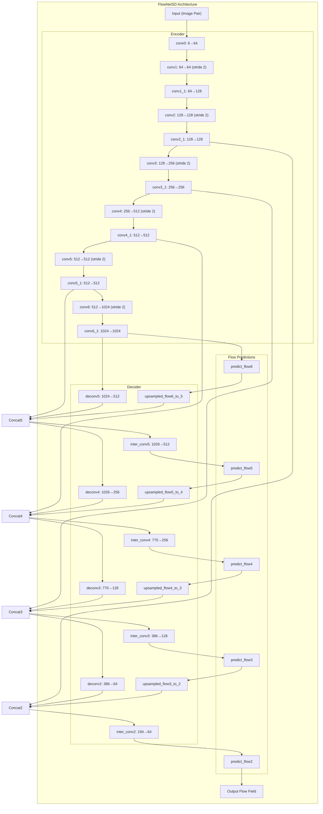
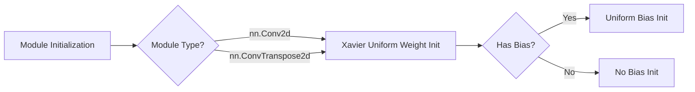
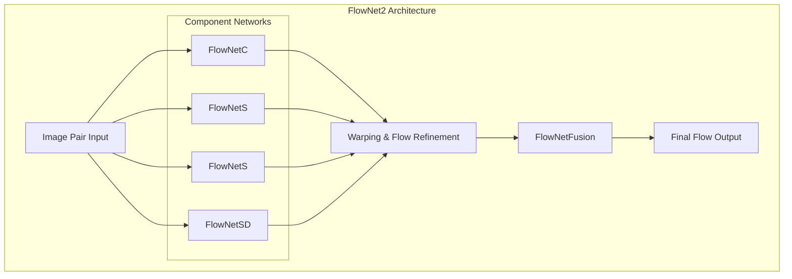

<!-- source: DeepWiki mcp.deepwiki.com · repo NVIDIA/flownet2-pytorch · page 3.3 FlowNetSD · fetched 2026-10-26 -->

# FlowNetSD

Relevant source files

The following files were used as context for generating this wiki page:

- [networks/FlowNetSD.py](networks/FlowNetSD.py)

## Purpose and Overview

FlowNetSD is a specialized convolutional neural network architecture designed for optical flow estimation. It represents one of the key component networks in the FlowNet2 family, serving as an improved variant that delivers more accurate flow predictions, particularly for small displacements. This document details the architecture, implementation, and operation of FlowNetSD as implemented in the FlowNet2-PyTorch repository.

For information about other FlowNet variants, see [FlowNetS](#3.1), [FlowNetC](#3.2), or the fusion component [FlowNetFusion](#3.4).

Sources: [networks/FlowNetSD.py:11-13]()

## Architecture Overview

FlowNetSD follows an encoder-decoder architecture with skip connections. Unlike the standard FlowNetS, it employs a modified design optimized for small displacements in optical flow estimation. The network contains approximately 45.4 million trainable parameters.

The architecture consists of:
- An encoder with 13 convolutional layers that progressively downsample the input
- A decoder that upsamples features and merges information from different scales
- Skip connections that preserve spatial details
- Multiple flow prediction branches at different resolutions

Sources: [networks/FlowNetSD.py:16-28](), [networks/FlowNetSD.py:30-49]()

## Key Components

### Encoder

The encoder consists of a series of convolutional blocks, each typically containing a strided convolution followed by a regular convolution:

| Layer | Input Channels | Output Channels | Stride | Purpose |
|-------|----------------|-----------------|--------|---------|
| conv0 | 6 | 64 | 1 | Initial feature extraction from RGB image pair |
| conv1 | 64 | 64 | 2 | First downsampling |
| conv1_1 | 64 | 128 | 1 | Feature expansion |
| conv2 | 128 | 128 | 2 | Second downsampling |
| conv2_1 | 128 | 128 | 1 | Feature processing |
| conv3 | 128 | 256 | 2 | Third downsampling |
| conv3_1 | 256 | 256 | 1 | Feature processing |
| conv4 | 256 | 512 | 2 | Fourth downsampling |
| conv4_1 | 512 | 512 | 1 | Feature processing |
| conv5 | 512 | 512 | 2 | Fifth downsampling |
| conv5_1 | 512 | 512 | 1 | Feature processing |
| conv6 | 512 | 1024 | 2 | Sixth downsampling |
| conv6_1 | 1024 | 1024 | 1 | Final feature processing |

The encoder gradually reduces spatial dimensions while increasing the feature channel count, capturing hierarchical information needed for optical flow estimation.

Sources: [networks/FlowNetSD.py:16-28]()

### Decoder and Flow Prediction

The decoder reconstructs the flow field through a series of deconvolution and intermediate convolution operations combined with skip connections:

1. **Deconvolution layers**: Upsample features from coarser to finer resolutions
   - deconv5: 1024 → 512 channels
   - deconv4: 1026 → 256 channels
   - deconv3: 770 → 128 channels
   - deconv2: 386 → 64 channels

2. **Intermediate convolution layers**: Process concatenated features
   - inter_conv5: 1026 → 512 channels
   - inter_conv4: 770 → 256 channels
   - inter_conv3: 386 → 128 channels
   - inter_conv2: 194 → 64 channels

3. **Flow prediction layers**: Generate flow fields at each resolution level
   - predict_flow6 through predict_flow2

4. **Flow upsampling layers**: Upsample flow predictions for concatenation
   - upsampled_flow6_to_5 through upsampled_flow3_to_2

Sources: [networks/FlowNetSD.py:30-49]()

## Implementation Details

### Initialization

FlowNetSD uses Xavier uniform initialization for both convolutional and transposed convolutional layers. This initialization technique helps achieve better convergence by maintaining the variance of activations across the network.

Sources: [networks/FlowNetSD.py:51-61]()

### Forward Pass

The forward pass processes an input tensor `x` representing a concatenated pair of RGB images (6 channels total) and generates optical flow predictions at multiple scales. The process follows these key steps:

1. **Encoder processing**: The input passes through all encoder layers, generating feature maps at different resolutions.
2. **Coarsest flow prediction**: A flow prediction is made at the deepest layer (flow6).
3. **Progressive refinement**: The flow is progressively upsampled and refined through the decoder, combining information from skip connections.
4. **Multi-scale outputs**: During training, the network returns flow predictions at 5 different scales (flow2 through flow6).
5. **Inference output**: During inference, only the finest resolution flow prediction (flow2) is returned.

The forward pass exhibits a consistent pattern at each decoder level:
- Upsample the flow from the previous layer
- Deconvolve features from the previous layer
- Concatenate with encoder features (skip connection) and upsampled flow
- Process through an intermediate convolution layer
- Predict new flow at this resolution

Sources: [networks/FlowNetSD.py:66-106]()

## Integration with FlowNet2

FlowNetSD serves as one of the key components in the full FlowNet2 architecture. In the complete FlowNet2 network:

FlowNetSD's unique properties contribute to the overall performance of FlowNet2:

1. **Small displacement specialization**: FlowNetSD is optimized for small displacements, complementing FlowNetC and FlowNetS which handle different motion ranges.

2. **Architectural modifications**: Unlike the standard FlowNetS, FlowNetSD uses a different design that improves the ability to capture fine motion details.

3. **Fusion integration**: The output of FlowNetSD is processed along with other component networks and fed into the FlowNetFusion module for final flow refinement.

Sources: [networks/FlowNetSD.py:11-106]()

## Performance Characteristics

FlowNetSD has approximately 45.4 million parameters, making it one of the larger components in the FlowNet2 architecture. Its specialized nature for small displacements delivers the following benefits:

- Better performance on scenes with subtle motion
- Improved detail preservation in flow fields
- Complementary capabilities to other FlowNet variants

During training, the network outputs multi-scale flow predictions to facilitate deep supervision, while during inference, it produces a single high-resolution flow field.

Sources: [networks/FlowNetSD.py:9](), [networks/FlowNetSD.py:103-106]()

---

