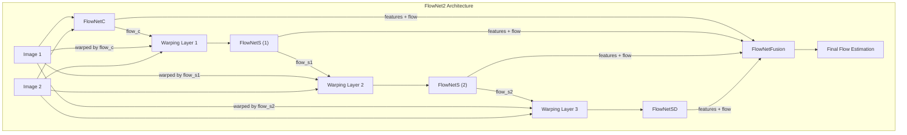

<!-- source: DeepWiki mcp.deepwiki.com · repo NVIDIA/flownet2-pytorch · page 3.4 FlowNetFusion · fetched 2026-10-26 -->

# FlowNetFusion

<details>
<summary>Relevant source files</summary>

The following files were used as context for generating this wiki page:

- [networks/FlowNetFusion.py](networks/FlowNetFusion.py)
- [utils/tools.py](utils/tools.py)

</details>


FlowNetFusion is a specialized neural network module that serves as the final refinement component in the FlowNet2 architecture. Its primary purpose is to take the outputs from preceding networks (FlowNetC, FlowNetS, and FlowNetSD) and fuse them together to produce more accurate optical flow estimations.

For information about the complete FlowNet2 architecture, see [Models](#3). For details on the other network components (FlowNetS, FlowNetC, FlowNetSD), see their respective pages: [FlowNetS](#3.1), [FlowNetC](#3.2), and [FlowNetSD](#3.3).

## 1. Architecture Overview

FlowNetFusion is a convolutional neural network designed to refine and combine multiple flow estimations. It consists of a series of convolutional layers for feature extraction, deconvolutional layers for upsampling, and specialized flow prediction layers.

```mermaid
flowchart TD
    subgraph "FlowNetFusion"
        Input["Input (Warped Flows + Features)"]
        
        Conv0["conv0: 11→64 channels"]
        Conv1["conv1: 64→64 channels, stride=2"]
        Conv1_1["conv1_1: 64→128 channels"]
        Conv2["conv2: 128→128 channels, stride=2"]
        Conv2_1["conv2_1: 128→128 channels"]
        
        PredFlow2["predict_flow2"]
        Upsample2to1["upsampled_flow2_to_1"]
        Deconv1["deconv1: 128→32 channels"]
        
        InterConv1["inter_conv1: 162→32 channels"]
        PredFlow1["predict_flow1"]
        Upsample1to0["upsampled_flow1_to_0"]
        Deconv0["deconv0: 162→16 channels"]
        
        InterConv0["inter_conv0: 82→16 channels"]
        PredFlow0["predict_flow0"]
        
        Output["Output Flow"]
        
        Input --> Conv0
        Conv0 --> Conv1
        Conv1 --> Conv1_1
        Conv1_1 --> Conv2
        Conv2 --> Conv2_1
        
        Conv2_1 --> PredFlow2
        Conv2_1 --> Deconv1
        PredFlow2 --> Upsample2to1
        
        Conv1_1 --> |Concat| InterConv1
        Deconv1 --> |Concat| InterConv1
        Upsample2to1 --> |Concat| InterConv1
        
        InterConv1 --> PredFlow1
        InterConv1 --> |Concat| Deconv0
        PredFlow1 --> Upsample1to0
        
        Conv0 --> |Concat| InterConv0
        Deconv0 --> |Concat| InterConv0
        Upsample1to0 --> |Concat| InterConv0
        
        InterConv0 --> PredFlow0
        PredFlow0 --> Output
    end
```



Sources: [networks/FlowNetFusion.py:11-67]()

## 2. Implementation Details

FlowNetFusion is implemented as a PyTorch `nn.Module` with approximately 581,226 parameters. The network takes as input a combined tensor that includes warped flow fields and feature maps from previous networks.

### 2.1 Network Layers

The FlowNetFusion architecture consists of the following key components:

| Layer Type | Name | Input Channels | Output Channels | Stride | Purpose |
|------------|------|----------------|-----------------|--------|---------|
| Convolution | conv0 | 11 | 64 | 1 | Initial feature extraction |
| Convolution | conv1 | 64 | 64 | 2 | Downsampling |
| Convolution | conv1_1 | 64 | 128 | 1 | Feature processing |
| Convolution | conv2 | 128 | 128 | 2 | Further downsampling |
| Convolution | conv2_1 | 128 | 128 | 1 | Feature processing |
| Deconvolution | deconv1 | 128 | 32 | - | Upsampling features |
| Deconvolution | deconv0 | 162 | 16 | - | Upsampling features |
| Interleaved Conv | inter_conv1 | 162 | 32 | - | Processing concatenated features |
| Interleaved Conv | inter_conv0 | 82 | 16 | - | Processing concatenated features |
| Flow Prediction | predict_flow2 | 128 | 2 | - | Flow prediction at 1/4 resolution |
| Flow Prediction | predict_flow1 | 32 | 2 | - | Flow prediction at 1/2 resolution |
| Flow Prediction | predict_flow0 | 16 | 2 | - | Flow prediction at full resolution |
| Flow Upsampling | upsampled_flow2_to_1 | 2 | 2 | - | Upsampling flow from 1/4 to 1/2 resolution |
| Flow Upsampling | upsampled_flow1_to_0 | 2 | 2 | - | Upsampling flow from 1/2 to full resolution |

Sources: [networks/FlowNetFusion.py:15-33]()

### 2.2 Weight Initialization

The weights in FlowNetFusion are initialized using Xavier uniform initialization, which helps achieve better convergence during training:

```python
for m in self.modules():
    if isinstance(m, nn.Conv2d):
        if m.bias is not None:
            init.uniform_(m.bias)
        init.xavier_uniform_(m.weight)

    if isinstance(m, nn.ConvTranspose2d):
        if m.bias is not None:
            init.uniform_(m.bias)
        init.xavier_uniform_(m.weight)
```

Sources: [networks/FlowNetFusion.py:35-45]()

## 3. Forward Pass

The forward pass of FlowNetFusion processes the input through multiple stages, generating flow predictions at different resolutions and gradually refining them:

```mermaid
flowchart TD
    subgraph "Forward Pass Flow"
        Input["Input x (11 channels)"]
        Conv0Out["out_conv0 (64 channels)"]
        Conv1Out["out_conv1 (128 channels)"]
        Conv2Out["out_conv2 (128 channels)"]
        
        Flow2["flow2 (1/4 resolution)"]
        Flow2Up["flow2_up (upsampled to 1/2 resolution)"]
        Deconv1Out["out_deconv1 (32 channels)"]
        
        Concat1["concat1 (128+32+2=162 channels)"]
        InterConv1Out["out_interconv1 (32 channels)"]
        Flow1["flow1 (1/2 resolution)"]
        Flow1Up["flow1_up (upsampled to full resolution)"]
        Deconv0Out["out_deconv0 (16 channels)"]
        
        Concat0["concat0 (64+16+2=82 channels)"]
        InterConv0Out["out_interconv0 (16 channels)"]
        Flow0["flow0 (full resolution)"]
        
        Input --> |"conv0"| Conv0Out
        Conv0Out --> |"conv1, conv1_1"| Conv1Out
        Conv1Out --> |"conv2, conv2_1"| Conv2Out
        
        Conv2Out --> |"predict_flow2"| Flow2
        Flow2 --> |"upsampled_flow2_to_1"| Flow2Up
        Conv2Out --> |"deconv1"| Deconv1Out
        
        Conv1Out --> |"concat"| Concat1
        Deconv1Out --> |"concat"| Concat1
        Flow2Up --> |"concat"| Concat1
        
        Concat1 --> |"inter_conv1"| InterConv1Out
        InterConv1Out --> |"predict_flow1"| Flow1
        Flow1 --> |"upsampled_flow1_to_0"| Flow1Up
        Concat1 --> |"deconv0"| Deconv0Out
        
        Conv0Out --> |"concat"| Concat0
        Deconv0Out --> |"concat"| Concat0
        Flow1Up --> |"concat"| Concat0
        
        Concat0 --> |"inter_conv0"| InterConv0Out
        InterConv0Out --> |"predict_flow0"| Flow0
    end
```



The forward pass can be broken down into the following steps:

1. **Feature Extraction**: The input is processed through convolutional layers to extract features at different resolutions.
2. **Initial Flow Prediction**: Flow is predicted at the lowest resolution (1/4).
3. **Flow Upsampling**: The predicted flow is upsampled to higher resolutions.
4. **Feature Concatenation**: Features from different resolutions are concatenated with the upsampled flow.
5. **Iterative Refinement**: The concatenated features are processed to predict refined flow at each resolution.
6. **Final Prediction**: The network outputs the final flow prediction at full resolution.

Sources: [networks/FlowNetFusion.py:47-66]()

## 4. Integration with FlowNet2

FlowNetFusion serves as the final component in the FlowNet2 architecture, where it fuses the outputs from the preceding networks to produce the final refined optical flow:



The input to FlowNetFusion (11 channels) typically consists of:
- Flow estimations from previous networks (FlowNetC, FlowNetS, FlowNetSD)
- Feature maps associated with these flows
- Potentially warped image features

FlowNetFusion performs the following roles in the FlowNet2 architecture:

1. **Flow Fusion**: Combines multiple flow estimations from different specialized networks
2. **Refinement**: Iteratively refines the flow predictions at multiple resolutions
3. **Context Integration**: Incorporates context from feature maps of different networks
4. **Multi-scale Processing**: Processes and predicts flow at different scales (1/4, 1/2, and full resolution)

Sources: [networks/FlowNetFusion.py:11-67]()

## 5. Performance Considerations

FlowNetFusion contributes to the overall effectiveness of FlowNet2 by combining the strengths of different network architectures:

- FlowNetC provides good initial estimation with its correlation layer
- FlowNetS variants contribute different perspectives on the flow field
- FlowNetSD adds robustness to small displacements
- FlowNetFusion integrates these outputs, resolving inconsistencies and producing more accurate flow

The total parameter count of FlowNetFusion is relatively small (approximately 581,226 parameters), making it computationally efficient while still providing significant refinement capabilities.

Sources: [networks/FlowNetFusion.py:9]()

---

