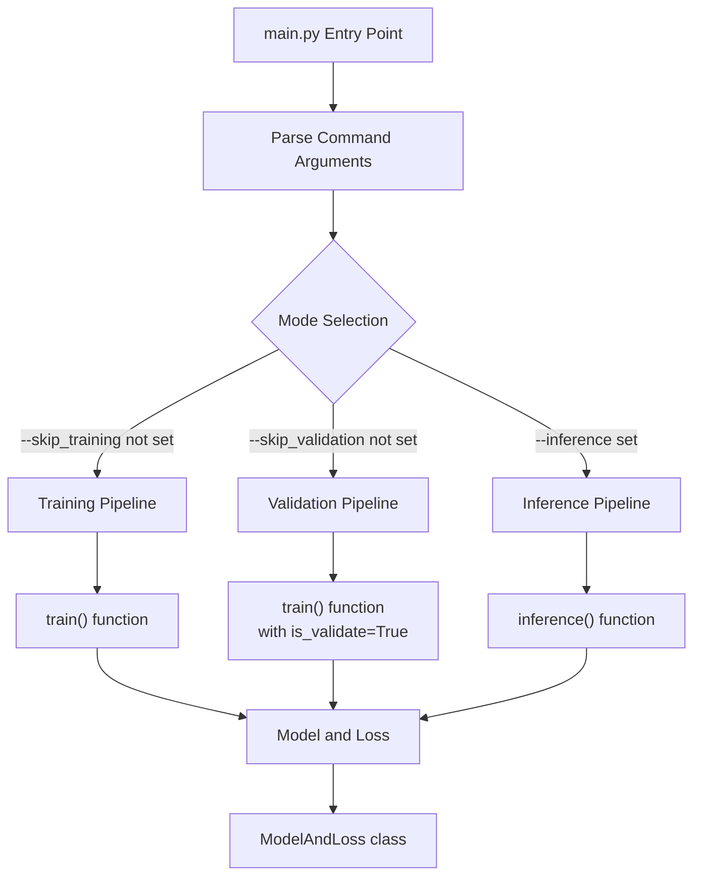
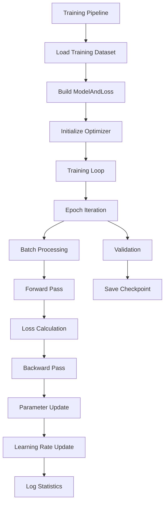
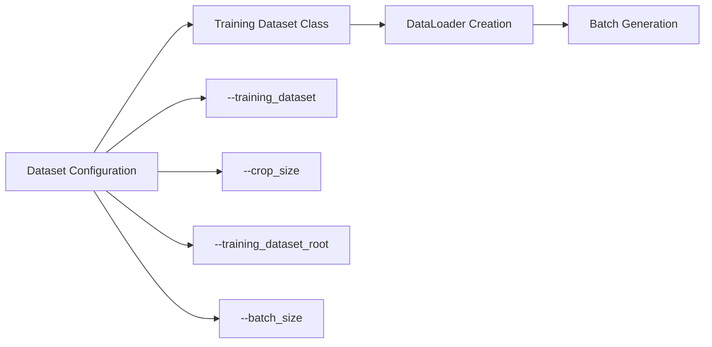
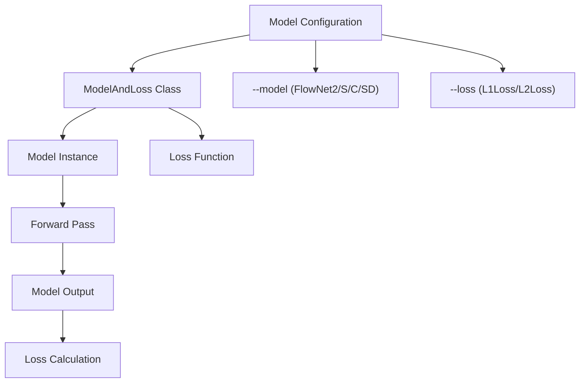
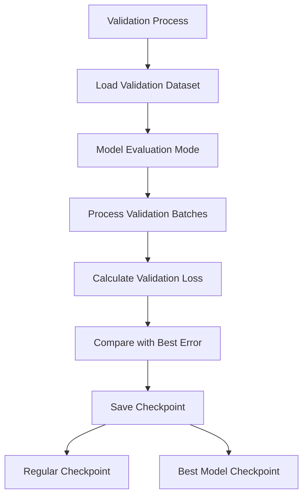
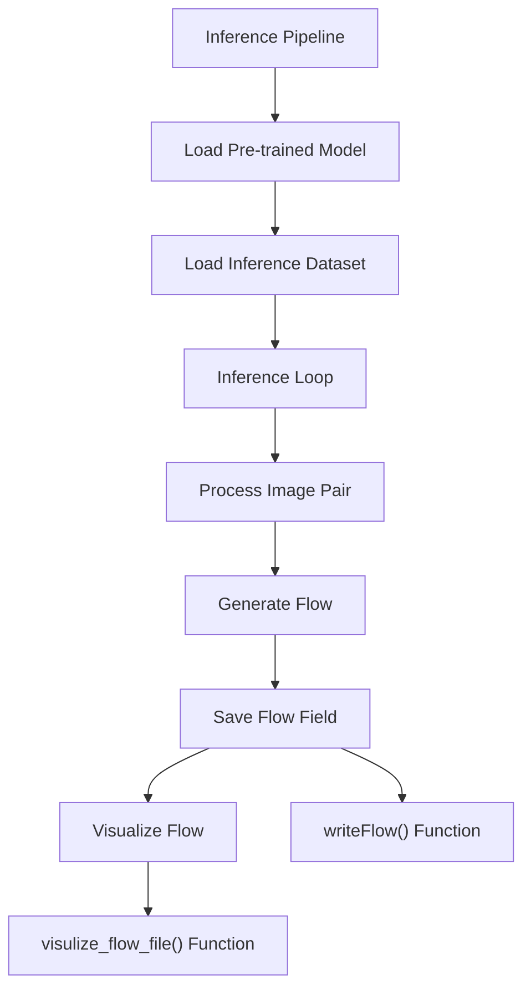

<!-- source: DeepWiki mcp.deepwiki.com · repo NVIDIA/flownet2-pytorch · page 4 Training and Inference · fetched 2026-10-26 -->

# Training and Inference

<details>
<summary>Relevant source files</summary>

The following files were used as context for generating this wiki page:

- [main.py](main.py)
- [utils/flow_utils.py](utils/flow_utils.py)

</details>


This document provides a comprehensive guide on the training and inference processes in the FlowNet2-PyTorch repository. It covers how to train FlowNet2 models for optical flow estimation and how to use trained models to generate optical flow predictions from image pairs.

## Overview

The FlowNet2-PyTorch repository implements a flexible framework for training, validating, and performing inference with various FlowNet models. The entire process is orchestrated by the `main.py` script, which handles all three operational modes:



Sources: [main.py:22-120](), [main.py:246-341](), [main.py:343-405]()

## Training Pipeline

The training pipeline involves dataset loading, model initialization, loss function configuration, and iterative optimization of model parameters.



Sources: [main.py:130-146](), [main.py:162-181](), [main.py:232-239](), [main.py:246-341](), [main.py:414-457]()

### Dataset Configuration

Training begins with loading the specified dataset:



The system supports multiple datasets implemented in the `datasets` module:
- MPI Sintel (Clean and Final versions)
- Flying Chairs
- Flying Things
- ChairsSDHom

Sources: [main.py:70-82](), [main.py:140-145]()

### Model and Loss Configuration

Models and loss functions are dynamically loaded based on command-line arguments:



The `ModelAndLoss` class encapsulates both the model and loss function in a single module, simplifying the training process.

Sources: [main.py:163-179](), [main.py:102-104]()

### Optimization Process

The training loop iterates through batches of data, computing forward and backward passes:

1. Zero gradients
2. Forward pass through the model
3. Compute loss values
4. Backward pass for gradient calculation
5. Update parameters
6. Update learning rate according to schedule

Key parameters for controlling optimization:
- `--optimizer`: Optimizer class (default: Adam)
- `--gradient_clip`: Value for gradient clipping
- `--schedule_lr_frequency`: Frequency for learning rate updates
- `--schedule_lr_fraction`: Fraction for learning rate scheduling

Sources: [main.py:268-297](), [main.py:302]()

### Validation and Checkpointing

Validation is performed at regular intervals during training:



Checkpoints contain:
- Model architecture
- Epoch number
- Model state dictionary
- Best error value

Sources: [main.py:419-436](), [main.py:444-452]()

## Inference Pipeline

The inference pipeline focuses on generating optical flow predictions from image pairs using a trained model.



Sources: [main.py:343-405](), [main.py:208-215](), [flow_utils.py:28-57](), [flow_utils.py:62-69]()

### Model Loading

For inference, a pre-trained model is loaded from a checkpoint file:

```python
checkpoint = torch.load(args.resume)
model_and_loss.module.model.load_state_dict(checkpoint['state_dict'])
```

Key parameter: `--resume` points to the checkpoint file to load the model from.

Sources: [main.py:208-215]()

### Flow Generation

The inference process:

1. Loads image pairs from the inference dataset
2. Passes them through the model
3. Generates optical flow predictions
4. Optionally saves flow fields to disk
5. Optionally creates visualizations of the flow

Key parameters:
- `--inference_dataset`: Dataset for inference
- `--inference_batch_size`: Batch size for inference
- `--inference_size`: Spatial size for inference (divisible by 64)
- `--save_flow`: Flag to save predicted flows
- `--inference_visualize`: Flag to visualize flows

Sources: [main.py:365-374](), [main.py:386-395]()

### Flow Visualization and Storage

Flow fields can be saved in standard `.flo` format and visualized using color-coded representations:


The visualization uses a standard color-coding scheme for optical flow where:
- Hue represents flow direction
- Saturation/value represent flow magnitude

Sources: [flow_utils.py:28-57](), [flow_utils.py:62-69](), [flow_utils.py:72-109]()

## Command-Line Interface

The repository provides an extensive set of command-line arguments for configuring training and inference:

### General Parameters

| Parameter | Description | Default |
|-----------|-------------|---------|
| `--model` | Model architecture | FlowNet2 |
| `--loss` | Loss function | L1Loss |
| `--optimizer` | Optimizer | Adam |
| `--batch_size` | Training batch size | 8 |
| `--resume` | Path to checkpoint for resuming | '' |
| `--save` | Directory for saving results | ./work |
| `--cuda` | Use CUDA | True if available |
| `--fp16` | Use mixed precision | False |

### Training Parameters

| Parameter | Description | Default |
|-----------|-------------|---------|
| `--start_epoch` | Starting epoch | 1 |
| `--total_epochs` | Total number of epochs | 10000 |
| `--train_n_batches` | Batches per epoch | -1 (all) |
| `--crop_size` | Crop size for training | [256, 256] |
| `--gradient_clip` | Gradient clipping value | None |
| `--schedule_lr_frequency` | LR scheduling frequency | 0 |
| `--schedule_lr_fraction` | LR scheduling fraction | 10 |

### Validation and Inference Parameters

| Parameter | Description | Default |
|-----------|-------------|---------|
| `--validation_frequency` | Epochs between validations | 5 |
| `--validation_n_batches` | Number of validation batches | -1 (all) |
| `--inference` | Run in inference mode | False |
| `--inference_visualize` | Visualize flow during inference | False |
| `--inference_size` | Spatial size for inference | [-1, -1] |
| `--save_flow` | Save predicted flows | False |

Sources: [main.py:23-82]()

## Practical Usage

### Training Example

To train a FlowNet2 model on the MPI Sintel dataset:

```bash
python main.py \
  --model FlowNet2 \
  --loss L1Loss \
  --optimizer Adam \
  --optimizer_lr 0.0001 \
  --training_dataset MpiSintelFinal \
  --training_dataset_root ./data/MPI-Sintel/flow/training \
  --validation_dataset MpiSintelClean \
  --validation_dataset_root ./data/MPI-Sintel/flow/training \
  --batch_size 8 \
  --total_epochs 50 \
  --validation_frequency 5 \
  --save ./checkpoints/flownet2_sintel
```

### Inference Example

To perform inference with a pre-trained model:

```bash
python main.py \
  --model FlowNet2 \
  --inference \
  --inference_dataset MpiSintelClean \
  --inference_dataset_root ./data/MPI-Sintel/flow/training \
  --resume ./checkpoints/flownet2_sintel/FlowNet2_checkpoint.pth.tar \
  --save_flow \
  --inference_visualize
```

## Best Practices and Troubleshooting

### Training Best Practices

- **Batch Size**: Adjust based on GPU memory. Larger batch sizes generally lead to more stable training.
- **Learning Rate**: Start with a smaller learning rate (e.g., 1e-4) and use scheduling.
- **Gradient Clipping**: Enable gradient clipping to prevent exploding gradients.
- **Mixed Precision**: Use `--fp16` on compatible GPUs for faster training.
- **Regular Validation**: Set appropriate `--validation_frequency` to monitor training progress.

### Inference Considerations

- **Model Selection**: Choose the appropriate FlowNet variant based on your accuracy/speed requirements.
- **Inference Size**: Set `--inference_size` to dimensions divisible by 64 for optimal performance.
- **Visualization**: Enable `--inference_visualize` to inspect the quality of generated flows.
- **Checkpoint Selection**: Use checkpoints with the lowest validation error for best results.

### Common Issues

- **Out of Memory**: Reduce batch size or use a smaller model variant.
- **Slow Training**: Enable mixed precision with `--fp16` or use fewer training batches.
- **Poor Flow Quality**: Try different model architectures or ensure proper dataset preprocessing.
- **Validation Error**: Ensure that validation dataset root path is correctly specified.

Sources: [main.py:108-122](), [main.py:414-457]()

For more detailed information about available loss functions and their usage, please refer to the [Loss Functions](#4.2) page.

---

