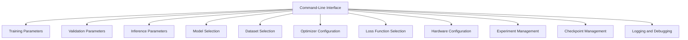
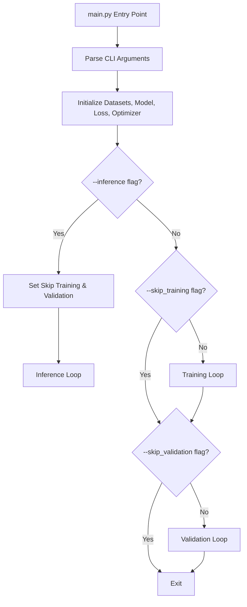

<!-- source: DeepWiki mcp.deepwiki.com · repo NVIDIA/flownet2-pytorch · page 4.1 Command-line Interface · fetched 2026-10-26 -->

# Command-line Interface

<details>
<summary>Relevant source files</summary>

The following files were used as context for generating this wiki page:

- [main.py](main.py)
- [networks/FlowNetFusion.py](networks/FlowNetFusion.py)
- [utils/flow_utils.py](utils/flow_utils.py)
- [utils/tools.py](utils/tools.py)

</details>


This document provides a comprehensive reference for the command-line interface (CLI) of FlowNet2-PyTorch. The system's entry point is the main.py script, which accepts numerous arguments to configure the training, validation, and inference processes for FlowNet2 and its variants.

For information about the specific model architectures, see [Models](#3).

## 1. Overview

The CLI is designed to provide fine-grained control over every aspect of the FlowNet2 workflow, from model selection to training parameters, hardware utilization, and inference configuration.



Sources: [main.py:22-83]()

## 2. Execution Flow

The command-line arguments determine the system's execution flow. The following diagram illustrates how different flags affect the program's behavior:



Sources: [main.py:22-121](), [main.py:407-458]()

## 3. Argument Categories

### 3.1 Basic Training Parameters

These parameters control the training process:

| Parameter | Type | Default | Description |
|-----------|------|---------|-------------|
| `--start_epoch` | int | 1 | Starting epoch number |
| `--total_epochs` | int | 10000 | Total number of epochs to run |
| `--batch_size` | int | 8 | Batch size for training |
| `--train_n_batches` | int | -1 | Number of mini-batches per epoch (-1 for all) |
| `--crop_size` | int list | [256, 256] | Spatial dimensions to crop training samples |
| `--gradient_clip` | float | None | Value for gradient clipping |
| `--schedule_lr_frequency` | int | 0 | Frequency for learning rate adjustments (0 for no schedule) |
| `--schedule_lr_fraction` | float | 10 | Factor to reduce learning rate by |
| `--rgb_max` | float | 255.0 | Maximum RGB value |

Sources: [main.py:25-33](), [main.py:131-136]()

### 3.2 Hardware Configuration

Parameters that control hardware utilization:

| Parameter | Type | Default | Description |
|-----------|------|---------|-------------|
| `--number_workers` | int | 8 | Number of data loading worker threads |
| `--number_gpus` | int | -1 | Number of GPUs to use (-1 for all available) |
| `--no_cuda` | flag | False | Disable CUDA usage |
| `--fp16` | flag | False | Run model in pseudo-fp16 mode |
| `--fp16_scale` | float | 1024.0 | Scaling factor for FP16 loss |

Sources: [main.py:35-37](), [main.py:61-62]()

### 3.3 Experiment Management

Parameters for managing experiments:

| Parameter | Type | Default | Description |
|-----------|------|---------|-------------|
| `--seed` | int | 1 | Random seed for reproducibility |
| `--name` | string | "run" | Name appended to save directory |
| `--save` | string | "./work" | Directory for saving checkpoints and logs |

Sources: [main.py:39-42]()

### 3.4 Validation Parameters

Parameters for the validation process:

| Parameter | Type | Default | Description |
|-----------|------|---------|-------------|
| `--validation_frequency` | int | 5 | Validate every n epochs |
| `--validation_n_batches` | int | -1 | Number of batches for validation (-1 for all) |
| `--render_validation` | flag | False | Run inference and save flows during validation |
| `--skip_validation` | flag | False | Skip validation entirely |

Sources: [main.py:43-46](), [main.py:59]()

### 3.5 Inference Parameters

Parameters for running inference:

| Parameter | Type | Default | Description |
|-----------|------|---------|-------------|
| `--inference` | flag | False | Run in inference mode |
| `--inference_visualize` | flag | False | Visualize optical flow during inference |
| `--inference_size` | int list | [-1, -1] | Spatial size for inference (divisible by 64) |
| `--inference_batch_size` | int | 1 | Batch size for inference |
| `--inference_n_batches` | int | -1 | Number of batches for inference (-1 for all) |
| `--save_flow` | flag | False | Save predicted flows to files |

Sources: [main.py:47-53]()

### 3.6 Checkpoint Management

Parameters for handling model checkpoints:

| Parameter | Type | Default | Description |
|-----------|------|---------|-------------|
| `--resume` | string | "" | Path to checkpoint to resume from |

Sources: [main.py:55](), [main.py:208-222]()

### 3.7 Logging

Parameters for logging and visualization:

| Parameter | Type | Default | Description |
|-----------|------|---------|-------------|
| `--log_frequency` | int | 1 | Log every n batches |

Sources: [main.py:56]()

## 4. Dynamic Argument Generation

The system dynamically generates arguments for model, loss function, optimizer, and datasets:

```mermaid
flowchart TD
    A["Dynamic Argument Generation"]
    
    A --> B["Model Arguments"]
    B --> B1["--model Model_Name"]
    B --> B2["--model_parameter_1 value1"]
    B --> B3["--model_parameter_2 value2"]
    B --> B4["..."]
    
    A --> C["Loss Arguments"]
    C --> C1["--loss Loss_Name"]
    C --> C2["--loss_parameter_1 value1"]
    C --> C3["--loss_parameter_2 value2"]
    C --> C4["..."]
    
    A --> D["Optimizer Arguments"]
    D --> D1["--optimizer Optimizer_Name"]
    D --> D2["--optimizer_lr value"]
    D --> D3["--optimizer_beta1 value"]
    D --> D4["..."]
    
    A --> E["Dataset Arguments"]
    E --> E1["--training_dataset Dataset_Name"]
    E --> E2["--validation_dataset Dataset_Name"]
    E --> E3["--inference_dataset Dataset_Name"]
    E --> E4["--dataset_parameter_name value"]
```



Sources: [main.py:64-82](), [utils/tools.py:55-86]()

The dynamic argument generation system works as follows:

1. For models, you can select any model class from the `models` module using the `--model` flag (default: FlowNet2).
2. For loss functions, you can select any loss class from the `losses` module using the `--loss` flag (default: L1Loss).
3. For optimizers, you can select any optimizer from PyTorch's `torch.optim` module using the `--optimizer` flag (default: Adam).
4. For datasets, you can select training, validation, and inference datasets from the `datasets` module using `--training_dataset`, `--validation_dataset`, and `--inference_dataset` flags.

For each selected class, related parameters can be specified using the naming convention `--[class_type]_[parameter_name]`.

## 5. Example Commands

### 5.1 Training

```bash
python main.py --model FlowNet2 --loss L1Loss --optimizer Adam \
               --training_dataset MpiSintelFinal --validation_dataset MpiSintelClean \
               --save ./checkpoints/flownet2 --name run1 \
               --batch_size 8 --total_epochs 100 --validation_frequency 5
```

### 5.2 Fine-tuning

```bash
python main.py --model FlowNet2 --loss L1Loss --optimizer Adam \
               --training_dataset MpiSintelFinal --validation_dataset MpiSintelClean \
               --save ./checkpoints/flownet2 --name finetune1 \
               --batch_size 8 --total_epochs 20 --validation_frequency 5 \
               --resume ./checkpoints/flownet2/checkpoint.pth.tar
```

### 5.3 Inference

```bash
python main.py --inference --model FlowNet2 \
               --inference_dataset ImagesFromFolder \
               --inference_dataset_root ./input_images \
               --resume ./checkpoints/flownet2/model_best.pth.tar \
               --save ./results --save_flow --inference_visualize
```

## 6. Implementation Details

The command-line argument parsing is implemented in the main function of `main.py`. The `argparse` module is used to define and process the arguments.

Key implementation components:

1. Argument parsing and validation (lines 22-121)
2. Dynamic loading of models, losses, and datasets based on arguments (lines 130-159, 162-182)
3. Execution path determination based on flags (lines 407-458)
4. Training, validation, and inference loops controlled by arguments (lines 246-405)

Sources: [main.py:22-458]()

The system also uses helper functions from `utils/tools.py` for dynamic argument generation (`add_arguments_for_module`) and parameter extraction (`kwargs_from_args`).

Sources: [utils/tools.py:55-86]()

## 7. Advanced Usage Patterns

### 7.1 Scheduling Learning Rate

Learning rate scheduling can be configured using the `--schedule_lr_frequency` and `--schedule_lr_fraction` parameters. The learning rate is divided by the fraction value every `frequency` iterations.

Sources: [main.py:31-32](), [utils/tools.py:131-136]()

### 7.2 Mixed Precision Training

The system supports mixed precision training (FP16) using the `--fp16` flag, with scaling controlled by the `--fp16_scale` parameter.

Sources: [main.py:61-62](), [main.py:187-195](), [main.py:280-291]()

### 7.3 Flow Visualization

When using `--inference_visualize`, the system will save visualization of the generated optical flow. The visualization uses a standard color-coding for optical flow fields.

Sources: [main.py:48-49](), [main.py:353-356](), [utils/flow_utils.py:62-69]()

## 8. Troubleshooting

- If you encounter CUDA out-of-memory errors, reduce the batch size or use a smaller model variant.
- For faster training, increase `--number_workers` to match your CPU core count.
- If resuming training fails, ensure the model architecture matches the checkpoint.
- For reproducible results, set the same `--seed` value across runs.

---

