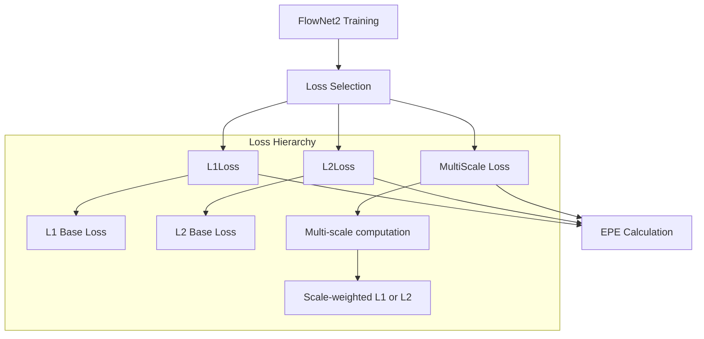
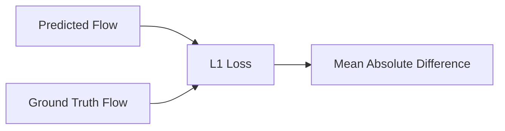
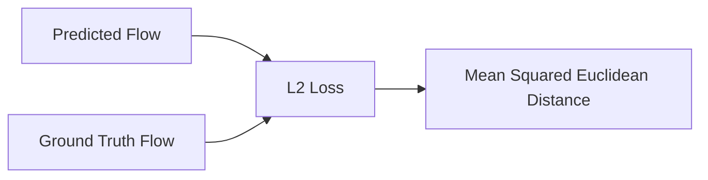
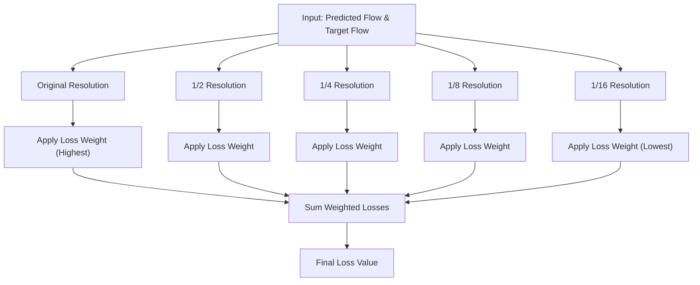
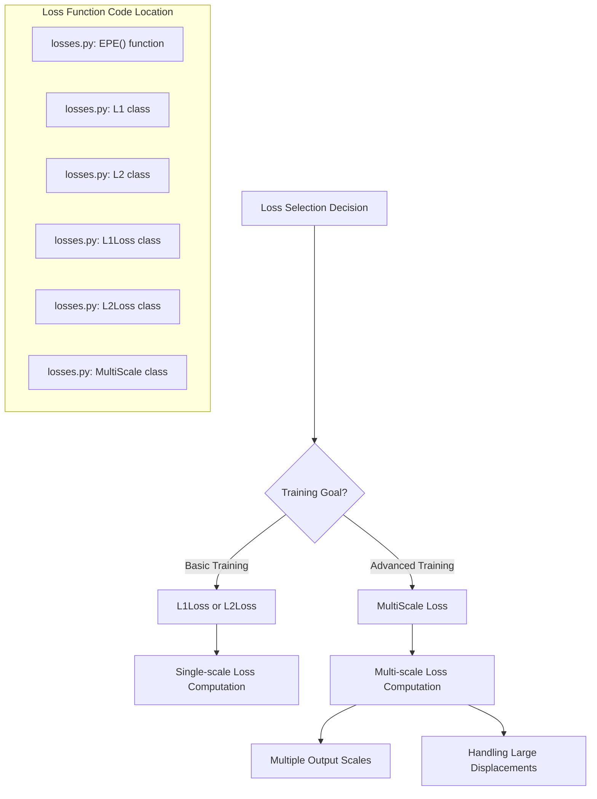

<!-- source: DeepWiki mcp.deepwiki.com · repo NVIDIA/flownet2-pytorch · page 4.2 Loss Functions · fetched 2026-10-26 -->

# Loss Functions

<details>
<summary>Relevant source files</summary>

The following files were used as context for generating this wiki page:

- [losses.py](losses.py)

</details>


This page documents the loss functions used in FlowNet2-PyTorch for training optical flow models. Loss functions are a critical component for measuring the difference between predicted optical flow and ground truth during training. For information about the training process itself, see [Training and Inference](#4).

## Overview

FlowNet2-PyTorch implements several loss functions specialized for optical flow estimation:
- End Point Error (EPE)
- L1 Loss
- L2 Loss
- MultiScale Loss

The loss functions are defined in the losses.py file and can be selected via command-line arguments during training.



Sources: [losses.py:1-87]()

## End Point Error (EPE)

End Point Error is the standard evaluation metric for optical flow. It computes the Euclidean distance between the predicted flow vectors and the ground truth flow vectors.

### Implementation

```python
def EPE(input_flow, target_flow):
    return torch.norm(target_flow-input_flow, p=2, dim=1).mean()
```

The EPE function calculates the L2 norm (Euclidean distance) between predicted and target flow vectors along the channel dimension and then takes the mean across all pixels. This provides a single scalar value representing the average displacement error.

Sources: [losses.py:11-12]()

## Basic Loss Classes

### L1 Loss

The L1 loss computes the mean absolute difference between predicted and target flow.



**Implementation**: The L1 class implements the mean absolute error between outputs and targets.

Sources: [losses.py:14-19]()

### L2 Loss

The L2 loss computes the mean squared Euclidean distance between predicted and target flow.



**Implementation**: The L2 class implements the Euclidean distance (L2 norm) between outputs and targets.

Sources: [losses.py:21-26]()

## Loss Wrappers

### L1Loss

L1Loss is a wrapper class that combines L1 loss with EPE calculation, returning both values. This allows for training using L1 loss while still monitoring EPE, which is the standard evaluation metric.

**Implementation Details**:
- Initialized with arguments from the main program
- Uses L1 loss internally
- Returns both L1 loss value and EPE value

Sources: [losses.py:28-38]()

### L2Loss

Similar to L1Loss, L2Loss is a wrapper that combines L2 loss with EPE calculation.

**Implementation Details**:
- Initialized with arguments from the main program
- Uses L2 loss internally
- Returns both L2 loss value and EPE value

Sources: [losses.py:40-50]()

## MultiScale Loss

The MultiScale loss is an advanced loss function that evaluates the flow prediction at multiple resolution scales. This approach is particularly effective for optical flow estimation, as it helps handle large displacements and fine details simultaneously.



### Key Features

1. **Multiple Resolution Scales**: The loss is computed at several downsampled resolutions using `nn.AvgPool2d`.
2. **Scale Weighting**: Each scale has a weight that typically decreases for coarser scales.
3. **Support for Both L1 and L2 Norms**: The loss can use either L1 or L2 norm as the base loss function.
4. **Support for Flow Prediction Tuples**: Handles multi-scale predictions from network architectures that output flow at multiple scales.

### Parameters

| Parameter | Description | Default Value |
|-----------|-------------|---------------|
| startScale | Starting scale factor for downsampling | 4 |
| numScales | Number of resolution scales to compute loss on | 5 |
| l_weight | Weight for the highest resolution | 0.32 |
| norm | Type of norm to use ('L1' or 'L2') | 'L1' |

### Implementation Details

The MultiScale loss uses average pooling operations to downsample the target flow to match the predicted flow at each scale. The loss values at each scale are weighted according to a geometric series (l_weight / 2^scale).

When the network outputs a tuple of predictions (common in FlowNet architectures), the loss at each scale is computed against the appropriately downsampled target.

Sources: [losses.py:52-86]()

## Loss Function Selection

When training FlowNet2 models, the appropriate loss function can be selected based on the specific requirements:

1. **L1Loss**: Generally provides good results for optical flow and is less sensitive to outliers compared to L2Loss.
2. **L2Loss**: Can be useful when large errors should be penalized more heavily.
3. **MultiScale**: Recommended for most scenarios as it balances learning across different flow magnitudes and scales.

The MultiScale loss is particularly important for FlowNet2 training, as it matches the multi-scale prediction approach used in the network architecture. The original FlowNet2 paper uses a multi-scale loss with L1 norm.



Sources: [losses.py:1-87]()

---

