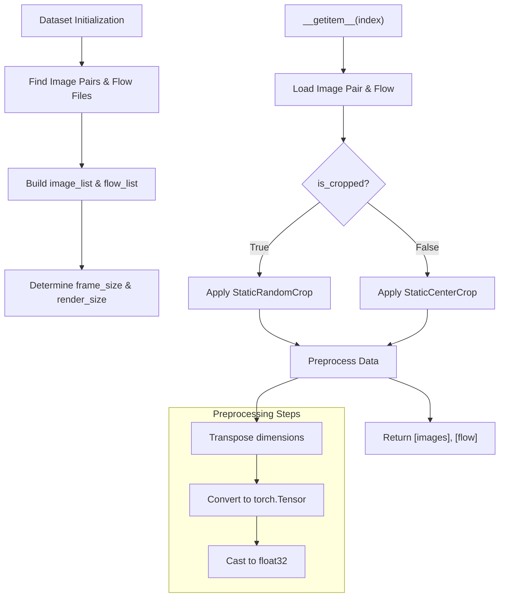
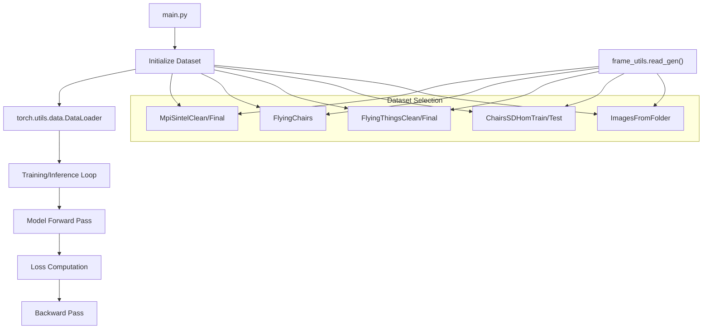

<!-- source: DeepWiki mcp.deepwiki.com · repo NVIDIA/flownet2-pytorch · page 5 Datasets · fetched 2026-10-26 -->

# Datasets

<details>
<summary>Relevant source files</summary>

The following files were used as context for generating this wiki page:

- [datasets.py](datasets.py)

</details>


This document provides a comprehensive overview of the dataset implementations in the FlowNet2-PyTorch codebase. The datasets module is responsible for loading, preprocessing, and providing access to various standard optical flow datasets used for training and evaluating FlowNet2 models. For information about data preprocessing details, see [Data Preprocessing](#5.1).

## Dataset Architecture Overview

The FlowNet2-PyTorch implementation supports several standard optical flow datasets. All dataset classes inherit from PyTorch's `torch.utils.data.Dataset` class and implement the required methods for data loading and preprocessing.

```mermaid
classDiagram
    class "torch.utils.data.Dataset" {
        __getitem__(index)
        __len__()
    }
    
    class "StaticRandomCrop" {
        +th, tw: crop_size
        +h1, w1: random_position
        +__call__(img)
    }
    
    class "StaticCenterCrop" {
        +th, tw: crop_size
        +h, w: image_size
        +__call__(img)
    }
    
    class "MpiSintel" {
        +args
        +is_cropped
        +crop_size
        +render_size
        +replicates
        +image_list
        +flow_list
        +__getitem__(index)
        +__len__()
    }
    
    class "FlyingChairs" {
        +args
        +is_cropped
        +crop_size
        +render_size
        +replicates
        +image_list
        +flow_list
        +__getitem__(index)
        +__len__()
    }
    
    class "FlyingThings" {
        +args
        +is_cropped
        +crop_size
        +render_size
        +replicates
        +image_list
        +flow_list
        +__getitem__(index)
        +__len__()
    }
    
    class "ChairsSDHom" {
        +args
        +is_cropped
        +crop_size
        +render_size
        +replicates
        +image_list
        +flow_list
        +__getitem__(index)
        +__len__()
    }
    
    class "ImagesFromFolder" {
        +args
        +is_cropped
        +crop_size
        +render_size
        +replicates
        +image_list
        +__getitem__(index)
        +__len__()
    }
    
    class "MpiSintelClean"
    class "MpiSintelFinal"
    class "FlyingThingsClean"
    class "FlyingThingsFinal"
    class "ChairsSDHomTrain"
    class "ChairsSDHomTest"
    
    "torch.utils.data.Dataset" <|-- "MpiSintel"
    "torch.utils.data.Dataset" <|-- "FlyingChairs"
    "torch.utils.data.Dataset" <|-- "FlyingThings"
    "torch.utils.data.Dataset" <|-- "ChairsSDHom"
    "torch.utils.data.Dataset" <|-- "ImagesFromFolder"
    
    "MpiSintel" <|-- "MpiSintelClean"
    "MpiSintel" <|-- "MpiSintelFinal"
    "FlyingThings" <|-- "FlyingThingsClean"
    "FlyingThings" <|-- "FlyingThingsFinal"
    "ChairsSDHom" <|-- "ChairsSDHomTrain"
    "ChairsSDHom" <|-- "ChairsSDHomTest"
```

Sources: [datasets.py:30-366]()

## Dataset Loading Workflow

The following diagram illustrates the typical workflow for loading and processing data from a dataset in FlowNet2-PyTorch:



Sources: [datasets.py:76-101](), [datasets.py:146-170](), [datasets.py:213-237](), [datasets.py:282-307](), [datasets.py:345-362]()

## Supported Datasets

The FlowNet2-PyTorch codebase supports the following optical flow datasets:

### MPI Sintel

MPI Sintel is a popular benchmark dataset for optical flow evaluation. It provides two variants:

- **MpiSintelClean**: Computer-generated images without motion blur or atmospheric effects
- **MpiSintelFinal**: Contains realistic effects like motion blur and atmospheric distortion

The dataset contains image pairs and corresponding ground truth flow files organized hierarchically by scene.

```python
class MpiSintel(data.Dataset):
    def __init__(self, args, is_cropped=False, root='', dstype='clean', replicates=1):
        # Initialize and load dataset
        # ...
```

Sources: [datasets.py:30-104](), [datasets.py:106-112]()

### Flying Chairs

Flying Chairs is a synthetic dataset consisting of randomly moving chairs rendered on top of background images. It's primarily used for training optical flow networks.

```python
class FlyingChairs(data.Dataset):
    def __init__(self, args, is_cropped, root='/path/to/FlyingChairs_release/data', replicates=1):
        # Initialize and load dataset
        # ...
```

Sources: [datasets.py:114-173]()

### Flying Things

Flying Things 3D is a large-scale synthetic dataset with 3D models rendered on random trajectories. It provides two variants:

- **FlyingThingsClean**: Clean rendered images
- **FlyingThingsFinal**: Contains motion blur and other effects

```python
class FlyingThings(data.Dataset):
    def __init__(self, args, is_cropped, root='/path/to/flyingthings3d', dstype='frames_cleanpass', replicates=1):
        # Initialize and load dataset
        # ...
```

Sources: [datasets.py:175-248]()

### ChairsSDHom

ChairsSDHom (Chairs with Stereo, Deformation, and Homography) is an extension of the Flying Chairs dataset with more complex motions and transformations. It provides training and testing splits.

```python
class ChairsSDHom(data.Dataset):
    def __init__(self, args, is_cropped, root='/path/to/chairssdhom/data', dstype='train', replicates=1):
        # Initialize and load dataset
        # ...
```

Sources: [datasets.py:250-318]()

### ImagesFromFolder

ImagesFromFolder is a utility dataset that allows inference on arbitrary image sequences stored in a folder. This dataset doesn't provide ground truth flow, making it suitable for inference-only scenarios.

```python
class ImagesFromFolder(data.Dataset):
    def __init__(self, args, is_cropped, root='/path/to/frames/only/folder', iext='png', replicates=1):
        # Initialize and load dataset
        # ...
```

Sources: [datasets.py:320-365]()

## Dataset Components and Functionality

### Data Format and Structure

Each dataset loads and processes data in a similar way:

| Dataset Component | Description |
|------------------|-------------|
| `image_list` | List of image pairs (frames at t and t+1) |
| `flow_list` | List of corresponding optical flow files |
| `frame_size` | Original dimensions of the images |
| `render_size` | Target dimensions (adjusted to be divisible by 64) |
| `crop_size` | Dimensions for random crop during training |
| `replicates` | Multiplier for dataset size (data augmentation) |

Sources: [datasets.py:30-104](), [datasets.py:114-173](), [datasets.py:175-248](), [datasets.py:250-318](), [datasets.py:320-365]()

### Cropping Operations

Two cropping methods are implemented to handle image and flow cropping:

1. **StaticRandomCrop**: Randomly crops images to a specified size at a consistent position within an image pair and corresponding flow
2. **StaticCenterCrop**: Crops images to a specified size at the center

These operations ensure that image pairs and flow data remain consistent during preprocessing.

```python
class StaticRandomCrop(object):
    def __init__(self, image_size, crop_size):
        # Initialize with random crop position
        # ...
    
    def __call__(self, img):
        # Apply crop at the same position
        # ...
```

```python
class StaticCenterCrop(object):
    def __init__(self, image_size, crop_size):
        # Initialize with center crop parameters
        # ...
    
    def __call__(self, img):
        # Apply center crop
        # ...
```

Sources: [datasets.py:13-28]()

### Data Loading and Preprocessing Workflow

All datasets implement a common pattern for loading and preprocessing data:

1. Initialize with dataset path and configuration parameters
2. Locate and index all image pairs and flow files during initialization
3. In `__getitem__`:
   - Load image pair and flow data
   - Apply cropping (random for training, center for validation/testing)
   - Preprocess data (transpose dimensions, convert to PyTorch tensors)
   - Return processed image pair and flow

Sources: [datasets.py:76-101](), [datasets.py:146-170](), [datasets.py:213-237](), [datasets.py:282-307](), [datasets.py:345-362]()

## Dataset Integration with Training Pipeline

The following diagram illustrates how datasets integrate with the training pipeline in FlowNet2-PyTorch:



Sources: [datasets.py:76-101](), [datasets.py:146-170](), [datasets.py:213-237](), [datasets.py:282-307](), [datasets.py:345-362]()

## Dataset Usage

### Common Parameters

All dataset classes accept the following common parameters:

| Parameter | Description |
|-----------|-------------|
| `args` | Configuration arguments (including crop_size and inference_size) |
| `is_cropped` | Boolean flag for random cropping (True for training) |
| `root` | Root directory of the dataset |
| `replicates` | Multiplier for dataset size (data augmentation) |

Sources: [datasets.py:30-104](), [datasets.py:114-173](), [datasets.py:175-248](), [datasets.py:250-318](), [datasets.py:320-365]()

### Example Dataset Initialization

Here's an example of initializing the MPI Sintel Clean dataset:

```python
# Initialize dataset for training
train_dataset = MpiSintelClean(args, 
                              is_cropped=True,  # Use random cropping for training
                              root='/path/to/MPI-Sintel', 
                              replicates=1)

# Initialize dataset for validation
val_dataset = MpiSintelClean(args, 
                            is_cropped=False,  # Use center cropping for validation
                            root='/path/to/MPI-Sintel', 
                            replicates=1)
```

Sources: [datasets.py:106-112](), [datasets.py:384-390]()

## Dataset Directory Structure

Each dataset expects a specific directory structure. Here are examples for the main datasets:

### MPI Sintel

```
MPI-Sintel/
├── flow/
│   └── training/
│       ├── scene_1/
│       │   ├── frame_0001.flo
│       │   ├── frame_0002.flo
│       │   └── ...
│       ├── scene_2/
│       └── ...
├── clean/
│   └── training/
│       ├── scene_1/
│       │   ├── frame_0001.png
│       │   ├── frame_0002.png
│       │   └── ...
│       ├── scene_2/
│       └── ...
└── final/
    └── training/
        ├── scene_1/
        ├── scene_2/
        └── ...
```

### Flying Chairs

```
FlyingChairs_release/data/
├── 00001_img1.ppm
├── 00001_img2.ppm
├── 00001_flow.flo
├── 00002_img1.ppm
├── 00002_img2.ppm
├── 00002_flow.flo
└── ...
```

Sources: [datasets.py:38-62](), [datasets.py:122-132]()

---

