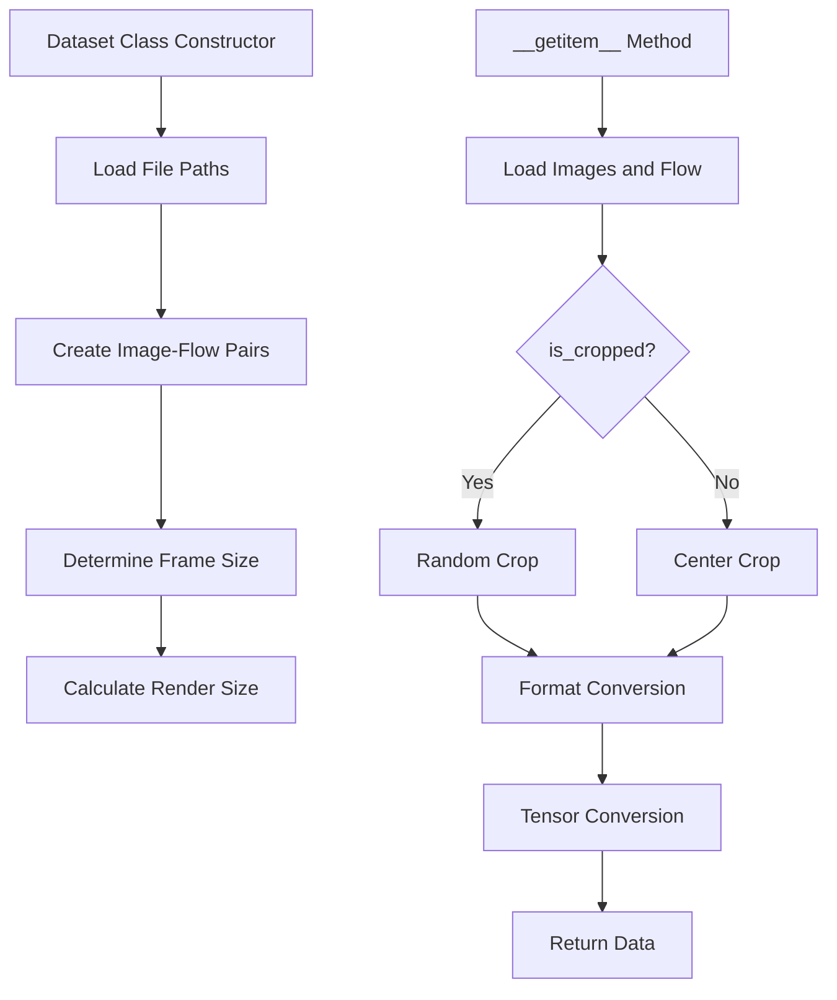
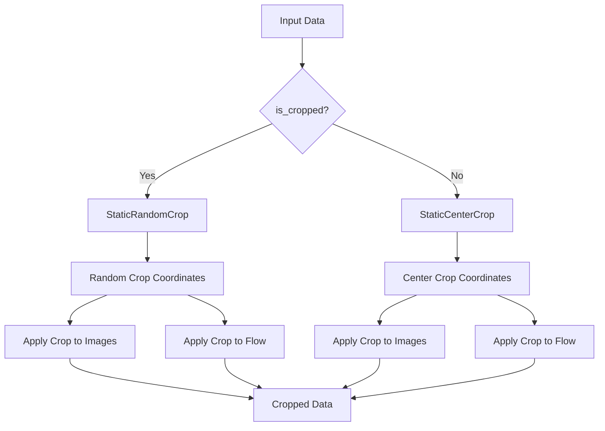
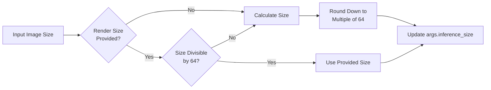

<!-- source: DeepWiki mcp.deepwiki.com · repo NVIDIA/flownet2-pytorch · page 5.1 Data Preprocessing · fetched 2026-10-26 -->

# Data Preprocessing

<details>
<summary>Relevant source files</summary>

The following files were used as context for generating this wiki page:

- [datasets.py](datasets.py)

</details>


This page documents the data preprocessing pipeline in the FlowNet2-PyTorch implementation. It covers how optical flow datasets are loaded, processed, and augmented to prepare them for training and inference. For information about the specific datasets supported, see [Datasets](#5).

## 1. Data Loading Pipeline Overview

The FlowNet2-PyTorch repository implements a comprehensive data preprocessing pipeline that handles various optical flow datasets. The pipeline ensures images and their corresponding flow are properly loaded, cropped, and formatted for the neural network.



**Diagram: Data Loading Pipeline Flow**

Sources: [datasets.py:29-365]()

## 2. Dataset Classes

FlowNet2-PyTorch provides implementations for several standard optical flow datasets, all inheriting common preprocessing functionality.

```mermaid
classDiagram
    class "PyTorch Dataset" {
        __getitem__()
        __len__()
    }
    
    class "MpiSintel" {
        +args
        +is_cropped
        +crop_size
        +render_size
        +replicates
        +image_list
        +flow_list
        +__getitem__()
        +__len__()
    }
    
    class "FlyingChairs" {
        +args
        +is_cropped
        +crop_size
        +render_size
        +replicates
        +image_list
        +flow_list
        +__getitem__()
        +__len__()
    }
    
    class "FlyingThings" {
        +args
        +is_cropped
        +crop_size
        +render_size
        +replicates
        +image_list
        +flow_list
        +__getitem__()
        +__len__()
    }
    
    class "ChairsSDHom" {
        +args
        +is_cropped
        +crop_size
        +render_size
        +replicates
        +image_list
        +flow_list
        +__getitem__()
        +__len__()
    }
    
    class "ImagesFromFolder" {
        +args
        +is_cropped
        +crop_size
        +render_size
        +replicates
        +image_list
        +__getitem__()
        +__len__()
    }
    
    "PyTorch Dataset" <|-- "MpiSintel"
    "PyTorch Dataset" <|-- "FlyingChairs"
    "PyTorch Dataset" <|-- "FlyingThings" 
    "PyTorch Dataset" <|-- "ChairsSDHom"
    "PyTorch Dataset" <|-- "ImagesFromFolder"
    
    "MpiSintel" <|-- "MpiSintelClean"
    "MpiSintel" <|-- "MpiSintelFinal"
    "FlyingThings" <|-- "FlyingThingsClean"
    "FlyingThings" <|-- "FlyingThingsFinal"
    "ChairsSDHom" <|-- "ChairsSDHomTrain"
    "ChairsSDHom" <|-- "ChairsSDHomTest"
```

**Diagram: Dataset Class Hierarchy**

Sources: [datasets.py:30-365]()

Each dataset class follows a similar pattern:
1. Initialize with arguments, cropping settings, and paths
2. Locate and pair image and flow files
3. Implement `__getitem__` to load and preprocess data
4. Implement `__len__` to return dataset size

## 3. Key Preprocessing Operations

### 3.1 Image and Flow Loading

Images and flow fields are loaded using utility functions from `frame_utils.py`. The raw data is read from disk and converted to numpy arrays with the appropriate format.

Example from MpiSintel dataset:
```python
img1 = frame_utils.read_gen(self.image_list[index][0])
img2 = frame_utils.read_gen(self.image_list[index][1])
flow = frame_utils.read_gen(self.flow_list[index])
```

Sources: [datasets.py:80-83]()

### 3.2 Cropping Operations

FlowNet2-PyTorch implements two cropping strategies:

| Cropper Class | Purpose | When Used |
|---------------|---------|-----------|
| `StaticRandomCrop` | Randomly crops images and flow fields to a specified size | During training (`is_cropped=True`) |
| `StaticCenterCrop` | Crops from the center of the images and flow fields | During validation/inference (`is_cropped=False`) |

The cropping operation applies the same crop coordinates to both images and the flow field, ensuring spatial consistency.

Sources: [datasets.py:13-28](), [datasets.py:88-93]()



**Diagram: Cropping Process**

Sources: [datasets.py:13-28](), [datasets.py:88-93]()

### 3.3 Data Format Transformation

After cropping, both images and flow fields undergo format transformations to meet the expected input format of the neural network:

1. Images are stacked and transposed from (H, W, C) to (C, N, H, W) format, where N is the number of images (typically 2 for optical flow)
2. Flow fields are transposed from (H, W, C) to (C, H, W) format

```python
images = np.array(images).transpose(3,0,1,2)
flow = flow.transpose(2,0,1)
```

Sources: [datasets.py:95-96]()

### 3.4 Tensor Conversion

Finally, numpy arrays are converted to PyTorch tensors with `float32` data type:

```python
images = torch.from_numpy(images.astype(np.float32))
flow = torch.from_numpy(flow.astype(np.float32))
```

Sources: [datasets.py:98-99]()

## 4. Render Size Calculation

The system automatically calculates appropriate render sizes that are divisible by 64, which is a requirement for the network architecture:



**Diagram: Render Size Calculation**

Sources: [datasets.py:68-72](), [datasets.py:140-144](), [datasets.py:207-211](), [datasets.py:276-280](), [datasets.py:339-343]()

## 5. Dataset-Specific Preprocessing

While the general preprocessing pipeline is similar across datasets, there are some dataset-specific operations:

### 5.1 MPI Sintel

- Supports both "clean" and "final" rendering passes
- Filters out test sequences during dataset loading
- Constructs image pairs based on sequential frame numbers

Sources: [datasets.py:30-104]()

### 5.2 Flying Chairs

- Pairs images based on the file naming convention in the dataset
- Every two consecutive `.ppm` files form an image pair

Sources: [datasets.py:114-173]()

### 5.3 Flying Things

- Organizes data from a complex directory structure
- Handles both "left" and "right" views
- Supports both "cleanpass" and "finalpass" rendering passes

Sources: [datasets.py:175-248]()

### 5.4 ChairsSDHom

- Loads image pairs from separate `t0` and `t1` directories
- Inverts the flow field order with `flow = flow[::-1,:,:]`

Sources: [datasets.py:250-318]()

### 5.5 Images from Folder

- Generic dataset for inference on arbitrary image sequences
- Creates pairs from consecutive images in a directory
- Returns zero tensors for flow since ground truth is not available

Sources: [datasets.py:320-365]()

## 6. Configuration Parameters

Several key parameters control the data preprocessing pipeline:

| Parameter | Purpose | Where Set |
|-----------|---------|-----------|
| `crop_size` | Size to crop images during training | Command-line arguments |
| `inference_size` | Size to crop images during inference | Command-line arguments, updated by dataset class |
| `is_cropped` | Whether to use random cropping (training) or center cropping (inference) | Dataset initialization |
| `replicates` | Number of times to replicate the dataset (for small datasets) | Dataset initialization |

Sources: [datasets.py:31-36](), [datasets.py:115-120](), [datasets.py:176-181](), [datasets.py:251-256](), [datasets.py:321-326]()

## 7. Data Augmentation

FlowNet2-PyTorch implements minimal data augmentation through random cropping during training. The `StaticRandomCrop` class selects a random position for cropping, which effectively provides translation augmentation.

Sources: [datasets.py:13-21](), [datasets.py:88-90]()

---

