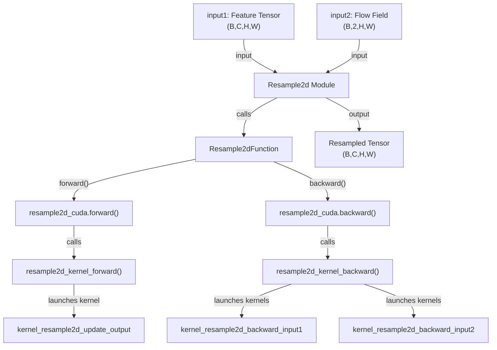
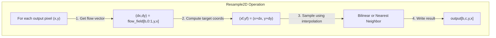
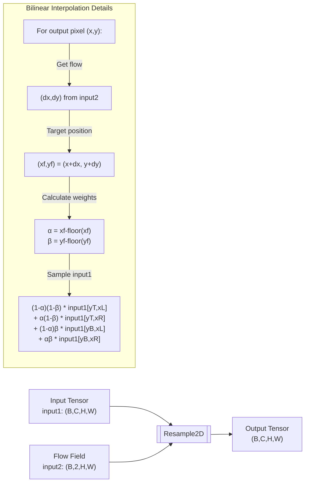

<!-- source: DeepWiki mcp.deepwiki.com · repo NVIDIA/flownet2-pytorch · page 6.2 Resample2D Layer · fetched 2026-10-26 -->

# Resample2D Layer

<details>
<summary>Relevant source files</summary>

The following files were used as context for generating this wiki page:

- [networks/resample2d_package/resample2d.py](networks/resample2d_package/resample2d.py)
- [networks/resample2d_package/resample2d_cuda.cc](networks/resample2d_package/resample2d_cuda.cc)
- [networks/resample2d_package/resample2d_kernel.cu](networks/resample2d_package/resample2d_kernel.cu)
- [networks/resample2d_package/resample2d_kernel.cuh](networks/resample2d_package/resample2d_kernel.cuh)

</details>


## Purpose and Function

The Resample2D Layer is a CUDA-accelerated custom operation in the FlowNet2-PyTorch implementation that performs spatial resampling of feature maps based on flow fields. This layer is essential for:

- Warping feature maps according to estimated optical flow
- Enabling feature alignment between frames
- Supporting differentiable sampling operations needed for end-to-end training
- Providing efficient GPU-accelerated implementation for high-performance processing

For information about other custom CUDA operations in FlowNet2, see [Correlation Layer](#6.1) and [ChannelNorm Layer](#6.3).

Sources: [networks/resample2d_package/resample2d.py]()

## Architecture Overview

The Resample2D Layer follows a layered architecture pattern typical for PyTorch CUDA extensions:



The architecture consists of:
1. Python interface classes (`Resample2d` and `Resample2dFunction`)
2. CUDA function bindings (`resample2d_cuda.forward/backward`)
3. CUDA kernel wrapper functions (`resample2d_kernel_forward/backward`)
4. CUDA kernel implementations for forward and backward passes

Sources: [networks/resample2d_package/resample2d.py](), [networks/resample2d_package/resample2d_cuda.cc](), [networks/resample2d_package/resample2d_kernel.cu]()

## Implementation Details

### Python Interface

The Python interface consists of two main classes:

1. `Resample2dFunction`: Extends PyTorch's `Function` class to implement the autograd functionality
   - `forward`: Prepares data and calls CUDA implementation
   - `backward`: Computes gradients for both input tensor and flow field

2. `Resample2d`: A PyTorch `Module` wrapper that makes the function easier to use
   - Takes `kernel_size` and `bilinear` parameters during initialization
   - Handles tensor preparation and function calling

```python
# Usage pattern:
resampler = Resample2d(kernel_size=1, bilinear=True)
output = resampler(feature_tensor, flow_field)
```

Sources: [networks/resample2d_package/resample2d.py:5-49]()

### Resampling Operation

The resampling operation warps a feature tensor based on a flow field:



For bilinear interpolation mode:
1. Computes target coordinates `(xf,yf)` by adding flow vectors to pixel coordinates
2. Identifies four neighboring pixels around the target coordinates
3. Calculates interpolation weights based on fractional coordinates
4. Performs weighted sampling from the four neighbors

For nearest-neighbor mode:
1. Computes target coordinates as above
2. Rounds to the nearest pixel coordinates
3. Samples the value from that pixel

Sources: [networks/resample2d_package/resample2d_kernel.cu:16-72]()

### CUDA Implementation

The CUDA implementation contains three main kernels:

1. **Forward Kernel** (`kernel_resample2d_update_output`):
   - Takes input tensor and flow field
   - Computes target sampling locations for each output pixel
   - Performs bilinear interpolation or nearest-neighbor sampling
   - Writes results to output tensor

2. **Backward Kernels**:
   - `kernel_resample2d_backward_input1`: Computes gradients with respect to the input tensor
   - `kernel_resample2d_backward_input2`: Computes gradients with respect to the flow field

The kernels use CUDA thread parallelism to process multiple pixels simultaneously, with each thread handling one output pixel.

Sources: [networks/resample2d_package/resample2d_kernel.cu:16-198]()

## Technical Details

### Forward Pass Implementation

The forward pass implementation of the Resample2D layer:



The forward kernel performs these key operations:
1. Calculates the target position by adding flow vectors to pixel coordinates
2. Computes interpolation parameters (α, β) from fractional coordinates
3. Samples from four neighboring pixels with appropriate weights (bilinear mode)
   or rounds to nearest pixel (nearest-neighbor mode)
4. Applies kernel_size to consider larger neighborhoods when specified

Sources: [networks/resample2d_package/resample2d_kernel.cu:16-72]()

### Backward Pass Implementation

The backward pass consists of two parts:

1. **Gradient with respect to input tensor**:
   - Distributes gradients to input locations based on sampling weights
   - Uses atomic operations to handle cases where multiple output gradients affect the same input location

2. **Gradient with respect to flow field**:
   - Calculates how changes in flow vectors affect the output
   - Computes partial derivatives based on bilinear interpolation weights

The backward pass enables end-to-end training by providing gradients that can flow through the resampling operation.

Sources: [networks/resample2d_package/resample2d_kernel.cu:76-198]()

## Parameters and Configuration

The Resample2D layer accepts two configuration parameters:

| Parameter | Type | Default | Description |
|-----------|------|---------|-------------|
| kernel_size | int | 1 | Defines the neighborhood size for sampling around target coordinates |
| bilinear | bool | True | When True, uses bilinear interpolation; when False, uses nearest-neighbor sampling |

Sources: [networks/resample2d_package/resample2d.py:42-45]()

## Usage in FlowNet2

In the FlowNet2 architecture, the Resample2D Layer is primarily used for:

1. Warping feature maps from one frame based on the estimated flow to align with another frame
2. Aligning features before correlation or fusion operations
3. Computing warping-based losses during training

Usage example:

```python
from networks.resample2d_package.resample2d import Resample2d

# Initialize the resampler
resampler = Resample2d(kernel_size=1, bilinear=True)

# features: tensor of shape [batch_size, channels, height, width]
# flow: tensor of shape [batch_size, 2, height, width]
warped_features = resampler(features, flow)
```

Sources: [networks/resample2d_package/resample2d.py:40-49]()

## Performance Considerations

For optimal performance when using the Resample2D Layer:

1. Input tensors should be contiguous for efficient memory access (the implementation calls `contiguous()` if needed)
2. Keep kernel_size small for most applications (kernel_size=1 is standard)
3. Bilinear mode provides smoother results suitable for gradient-based learning
4. Ensure tensors are on the same device (GPU) to avoid unnecessary transfers

Sources: [networks/resample2d_package/resample2d.py:48-49](), [networks/resample2d_package/resample2d_kernel.cu:5-6]()

---

