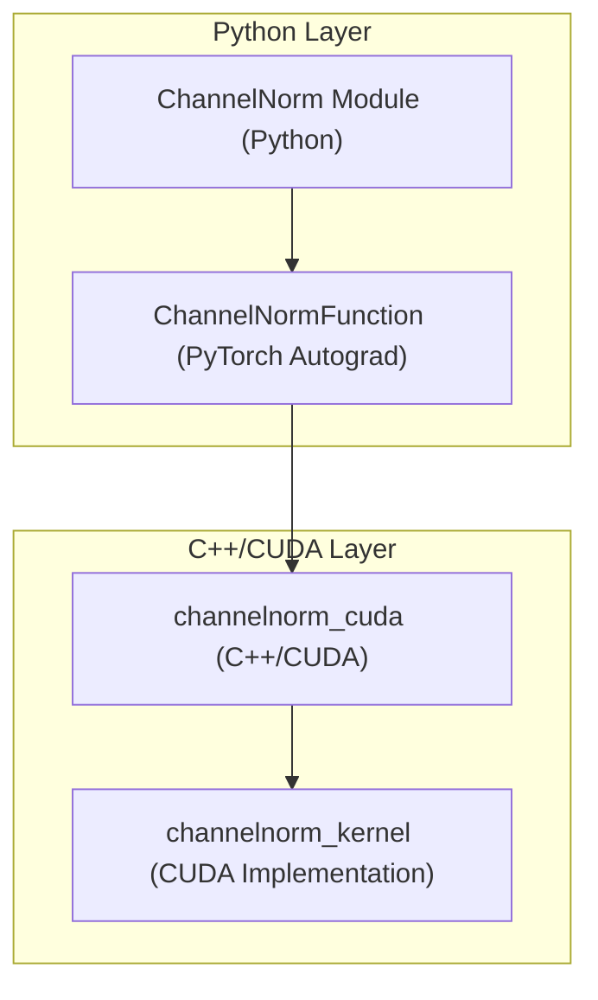
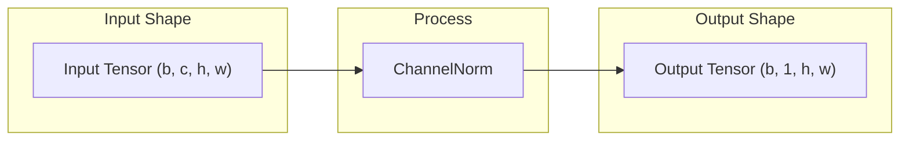
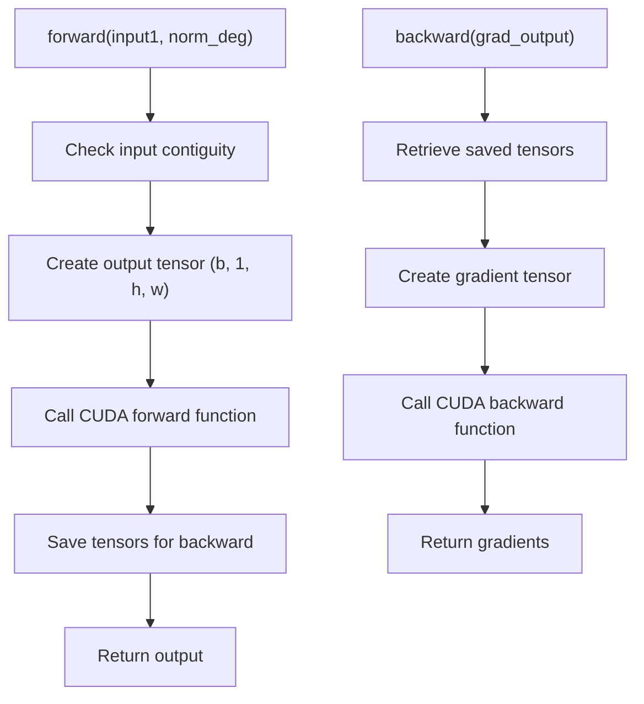

<!-- source: DeepWiki mcp.deepwiki.com · repo NVIDIA/flownet2-pytorch · page 6.3 ChannelNorm Layer · fetched 2026-10-26 -->

# ChannelNorm Layer

<details>
<summary>Relevant source files</summary>

The following files were used as context for generating this wiki page:

- [networks/channelnorm_package/channelnorm.py](networks/channelnorm_package/channelnorm.py)
- [networks/channelnorm_package/channelnorm_cuda.cc](networks/channelnorm_package/channelnorm_cuda.cc)
- [networks/channelnorm_package/channelnorm_kernel.cuh](networks/channelnorm_package/channelnorm_kernel.cuh)

</details>


## Purpose and Overview

The ChannelNorm Layer is a custom CUDA-accelerated operation in the FlowNet2-PyTorch implementation that computes the norm across the channel dimension of a tensor. This specialized layer normalizes feature maps by calculating the L2 (or other specified) norm across channels at each spatial location, producing a single-channel output where each pixel value represents the magnitude of the feature response at that position. The ChannelNorm layer is a critical component in the FlowNet2 architecture, helping to normalize feature representations for more effective optical flow estimation.

For information about other custom CUDA operations used in FlowNet2, see [Correlation Layer](#6.1) and [Resample2D Layer](#6.2).

Sources: [networks/channelnorm_package/channelnorm.py:1-40]()

## Architecture and Implementation

The ChannelNorm Layer follows the standard PyTorch extension pattern, consisting of three main components:



This layered approach allows for high-performance CUDA execution while providing a clean, PyTorch-compatible interface for use in neural networks.

Sources: [networks/channelnorm_package/channelnorm.py:1-40](), [networks/channelnorm_package/channelnorm_cuda.cc:1-32](), [networks/channelnorm_package/channelnorm_kernel.cuh:1-17]()

## Data Flow and Tensor Transformations

The ChannelNorm layer transforms a multi-channel input tensor into a single-channel output tensor by computing norms across the channel dimension:



For each spatial position (h, w), the layer computes the norm of the vector formed by all channel values at that position, resulting in a single value in the output tensor.

Sources: [networks/channelnorm_package/channelnorm.py:7-17]()

## Python Interface

### ChannelNorm Module

The `ChannelNorm` class is a PyTorch `nn.Module` subclass that provides a user-friendly interface for the channel normalization operation.

```python
class ChannelNorm(Module):
    def __init__(self, norm_deg=2):
        # Initialize with normalization degree (default: L2 norm)
        
    def forward(self, input1):
        # Apply the ChannelNormFunction to the input
```

The module takes a single parameter `norm_deg` which specifies the degree of the norm to be computed (default is 2 for L2 norm).

Sources: [networks/channelnorm_package/channelnorm.py:31-39]()

### ChannelNormFunction

The `ChannelNormFunction` class implements the PyTorch autograd Function interface, which defines how to compute the operation and its gradients.



The `forward` method:
1. Verifies the input tensor is contiguous in memory
2. Creates an output tensor with shape [batch_size, 1, height, width]
3. Calls the CUDA implementation to compute the channel norm
4. Saves relevant tensors and parameters for the backward pass

The `backward` method:
1. Retrieves the saved input and output tensors
2. Creates a zero tensor for the input gradient
3. Calls the CUDA implementation to compute the gradient
4. Returns the gradient with respect to the input

Sources: [networks/channelnorm_package/channelnorm.py:5-28]()

## CUDA Implementation

The channel normalization operation is implemented in CUDA for high-performance execution on NVIDIA GPUs. The implementation consists of:

1. **C++ Interface**: A PyTorch extension that exposes the CUDA kernels to Python
2. **CUDA Kernels**: Highly optimized functions that perform the actual computation

### C++ Binding Interface

The C++ interface defines two main functions:

- `channelnorm_cuda_forward`: Computes the channel normalization in the forward pass
- `channelnorm_cuda_backward`: Computes the gradients in the backward pass

These functions act as bridges between PyTorch's Python interface and the CUDA kernels.

Sources: [networks/channelnorm_package/channelnorm_cuda.cc:1-32]()

### CUDA Kernel Interface

The CUDA kernel interface defines the function signatures for the forward and backward operations:

```cpp
void channelnorm_kernel_forward(
    at::Tensor& input1,
    at::Tensor& output, 
    int norm_deg);

void channelnorm_kernel_backward(
    at::Tensor& input1,
    at::Tensor& output,
    at::Tensor& gradOutput,
    at::Tensor& gradInput1,
    int norm_deg);
```

These kernels perform parallel computations on the GPU to efficiently normalize channels and compute gradients.

Sources: [networks/channelnorm_package/channelnorm_kernel.cuh:1-17]()

## Mathematical Operation

The ChannelNorm layer computes the norm of feature values across the channel dimension at each spatial location:

For a given input tensor X of shape [batch_size, channels, height, width] and a norm degree p, the output Y at position (b, 0, h, w) is:

$$Y_{b,0,h,w} = \left( \sum_{c=0}^{C-1} |X_{b,c,h,w}|^p \right)^{1/p}$$

Where:
- b is the batch index
- c is the channel index
- h, w are the spatial coordinates
- C is the total number of channels

For the default case where p=2 (L2 norm), this computes the Euclidean norm of the channel vector at each spatial location.

Sources: [networks/channelnorm_package/channelnorm.py:7-17]()

## Usage in FlowNet2

Within the FlowNet2 architecture, the ChannelNorm layer is used to normalize feature representations at various stages of the optical flow computation pipeline. It helps to:

1. Normalize feature maps for more stable comparisons
2. Compute feature magnitudes for flow estimation
3. Prepare feature maps for subsequent operations like correlation or warping

The normalization across channels provides a measure of feature activation strength at each spatial location, which is valuable for optical flow estimation.

## Example Usage

Here's how the ChannelNorm layer is typically used within a PyTorch model:

```python
import torch
from channelnorm_package.channelnorm import ChannelNorm

# Create channel normalization layer (using L2 norm)
channelnorm = ChannelNorm(norm_deg=2)

# Input feature map: [batch_size, channels, height, width]
feature_map = torch.randn(1, 64, 256, 256)

# Apply channel normalization
normalized = channelnorm(feature_map)

# Result shape: [1, 1, 256, 256]
print(normalized.shape)
```

This example creates a ChannelNorm layer that computes the L2 norm across 64 channels, resulting in a single-channel output tensor that represents the magnitude of the feature response at each spatial location.

## Performance Considerations

As a CUDA-accelerated operation, the ChannelNorm layer offers significant performance benefits compared to an equivalent implementation in Python or CPU-based code. The layer:

1. Processes each spatial location in parallel on the GPU
2. Efficiently computes norms across channels
3. Provides optimized gradient computation for backpropagation

For large feature maps or real-time applications like optical flow estimation, this GPU acceleration is crucial for maintaining acceptable performance.

## Implementation Limitations

1. The input tensor must be contiguous in memory (enforced in the forward method)
2. Currently, the implementation primarily supports L2 normalization, though other norms can be specified
3. The operation requires a CUDA-capable GPU with appropriate drivers

Sources: [networks/channelnorm_package/channelnorm.py:8-9]()

---

