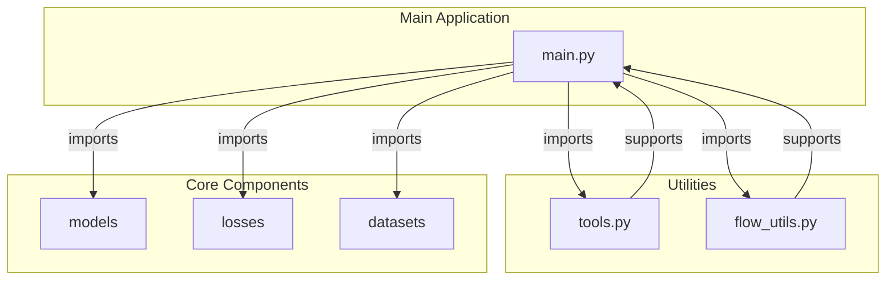
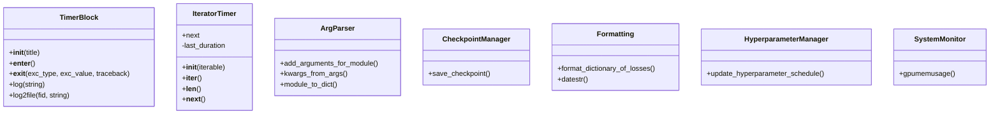
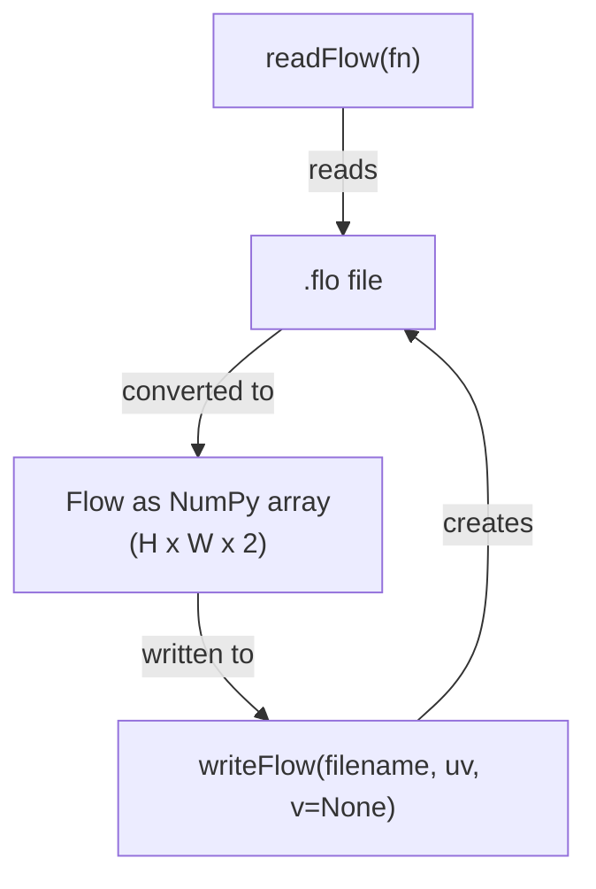
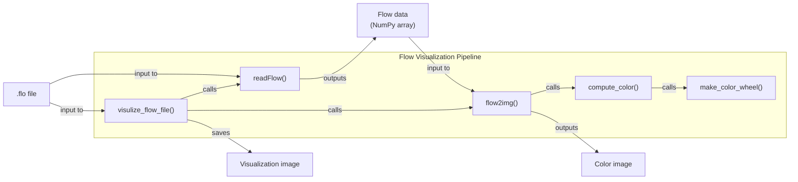
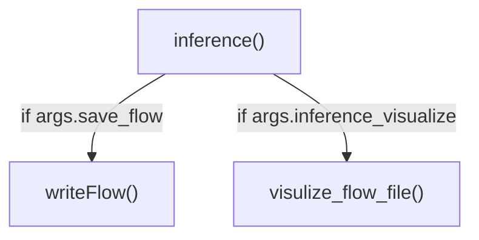
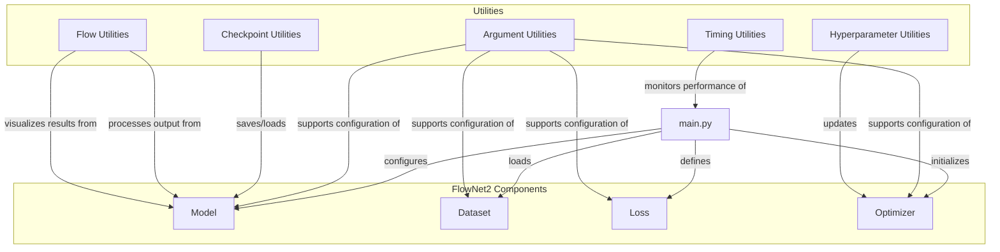

<!-- source: DeepWiki mcp.deepwiki.com · repo NVIDIA/flownet2-pytorch · page 7 Utilities · fetched 2026-10-26 -->

# Utilities

<details>
<summary>Relevant source files</summary>

The following files were used as context for generating this wiki page:

- [main.py](main.py)
- [networks/FlowNetFusion.py](networks/FlowNetFusion.py)
- [utils/flow_utils.py](utils/flow_utils.py)
- [utils/tools.py](utils/tools.py)

</details>


## Overview

The Utilities module in FlowNet2-PyTorch provides supporting functions and classes that handle common operations throughout the codebase. This page documents the two main utility modules: `tools.py` (general utilities) and `flow_utils.py` (optical flow-specific utilities).

These utilities serve as the "glue code" that connects the main components of the system including training, inference, model management, and flow visualization. They are not directly part of the model architecture but provide essential functionality for the overall system operation.

Sources: [utils/tools.py:1-145](), [utils/flow_utils.py:1-204](), [main.py:16-17]()

## System Architecture Context

The following diagram illustrates how the utility modules fit into the overall FlowNet2-PyTorch architecture:



Sources: [main.py:16-17]()

## General Utilities (tools.py)

The `tools.py` module contains utilities for argument parsing, timing, logging, and checkpoint management. These utilities support the training and inference pipeline.

### Key Components



Sources: [utils/tools.py:1-145]()

### Command-line Argument Management

The module provides utilities for dynamically configuring command-line arguments based on Python classes:

1. `module_to_dict(module, exclude=[])` - Converts a module's classes to a dictionary
2. `add_arguments_for_module(parser, module, argument_for_class, default, skip_params=[], parameter_defaults={})` - Adds arguments for a module's class to the parser
3. `kwargs_from_args(args, argument_for_class)` - Extracts keyword arguments from parsed arguments

These functions allow the main script to dynamically create command-line interfaces for models, losses, optimizers, and datasets.

Example usage in main.py:
```
tools.add_arguments_for_module(parser, models, argument_for_class='model', default='FlowNet2')
tools.add_arguments_for_module(parser, losses, argument_for_class='loss', default='L1Loss')
```

Sources: [utils/tools.py:18-86](), [main.py:64-82]()

### Timing and Logging

The module includes classes and functions for timing operations and logging results:

1. `TimerBlock` - A context manager for timing code blocks and logging
2. `IteratorTimer` - A wrapper for iterables that times each iteration
3. `datestr()` - Generates a timestamp in 'YYYYMMDD_HHMM' format

Example usage:
```python
with tools.TimerBlock("Parsing Arguments") as block:
    # Code to be timed
    block.log("Operation completed")
```

The `TimerBlock` is used extensively in `main.py` to provide timing information for operations like argument parsing, dataset initialization, and model building.

Sources: [utils/tools.py:13-53](), [utils/tools.py:98-115](), [main.py:88-100]()

### Formatting and Output

1. `format_dictionary_of_losses(labels, values)` - Formats loss values with appropriate precision

This function is used to print loss values during training and validation, automatically adjusting precision based on the magnitude of the values.

Sources: [utils/tools.py:88-95](), [main.py:313]()

### Hyperparameter Management

1. `update_hyperparameter_schedule(args, epoch, global_iteration, optimizer)` - Updates learning rates according to a schedule

This function is called during training to adjust learning rates based on the number of iterations.

Sources: [utils/tools.py:131-136](), [main.py:302]()

### Checkpoint Management

1. `save_checkpoint(state, is_best, path, prefix, filename='checkpoint.pth.tar')` - Saves model checkpoints

This function handles saving model checkpoints, including special handling for the best-performing model.

Sources: [utils/tools.py:138-144](), [main.py:429-450]()

## Flow Utilities (flow_utils.py)

The `flow_utils.py` module contains utilities for working with optical flow data, including reading, writing, and visualizing flow fields.

### Flow File Operations

The following diagram illustrates the relationship between flow file operations:



Sources: [utils/flow_utils.py:7-57]()

#### Reading Flow Files

`readFlow(fn)` reads a Middlebury format .flo file and returns the flow data as a NumPy array.

Structure of a .flo file:
- Magic number (202021.25)
- Width and height (int32)
- Flow data (2D vectors, float32)

Sources: [utils/flow_utils.py:7-26]()

#### Writing Flow Files

`writeFlow(filename, uv, v=None)` writes optical flow data to a .flo file.

- If `v` is None, `uv` is assumed to contain both u and v channels (H×W×2)
- Otherwise, `u` and `v` are provided as separate arrays

Sources: [utils/flow_utils.py:28-57]()

### Flow Visualization

The flow visualization pipeline converts numeric flow data into color images for visualization:



Sources: [utils/flow_utils.py:62-204]()

#### Visualization Functions

1. `visulize_flow_file(flow_filename, save_dir=None)` - Visualizes flow from a file and optionally saves the visualization
2. `flow2img(flow_data)` - Converts flow data to a color image
3. `compute_color(u, v)` - Computes colors for optical flow visualization
4. `make_color_wheel()` - Generates the color wheel used for flow visualization

The color coding in these functions uses the Middlebury color scheme for optical flow, which represents direction with hue and magnitude with saturation/value.

Sources: [utils/flow_utils.py:62-204]()

## Usage in Main Application

### General Utilities Usage

The following table shows the main uses of utility functions in the main application:

| Utility | Purpose | Used in |
|---------|---------|---------|
| `add_arguments_for_module()` | Configure command-line arguments | Model, loss, optimizer, and dataset setup |
| `TimerBlock` | Time operations and log results | Argument parsing, dataset loading, model building |
| `format_dictionary_of_losses()` | Format loss values for display | Training and validation loops |
| `update_hyperparameter_schedule()` | Update learning rates | Training loop |
| `save_checkpoint()` | Save model checkpoints | Training and validation loops |
| `IteratorTimer` | Time iterator operations | Training, validation, and inference loops |

Sources: [main.py:64-82](), [main.py:88-100](), [main.py:254-259](), [main.py:302](), [main.py:313](), [main.py:429-450]()

### Flow Utilities Usage

Flow utilities are primarily used in the inference function of the main application:



When `save_flow` is enabled, the application writes predicted flow fields to .flo files using `writeFlow()`.

When `inference_visualize` is enabled, the application visualizes the flow fields using `visulize_flow_file()`.

Sources: [main.py:343-405]()

## Integration with FlowNet2 Architecture

The utility modules provide essential functionality that glues together different components of the FlowNet2 architecture:



Sources: [main.py:16-17](), [main.py:64-82](), [main.py:343-394]()