# Page: FlowNet2-PyTorch Overview

# FlowNet2-PyTorch Overview

<details>
<summary>Relevant source files</summary>

The following files were used as context for generating this wiki page:

- [README.md](README.md)
- [main.py](main.py)
- [utils/flow_utils.py](utils/flow_utils.py)

</details>


## Purpose and Scope

This document provides a comprehensive overview of FlowNet2-PyTorch, a PyTorch implementation of the FlowNet 2.0 architecture for optical flow estimation. It covers the system architecture, available network variants, custom CUDA operations, training and inference pipelines, and supported datasets. For installation instructions, see [Installation](#2), and for detailed model architecture descriptions, see [Models](#3).

Sources: [README.md:1-5]()

## System Architecture

FlowNet2-PyTorch implements a deep learning framework for optical flow estimation based on the research paper "FlowNet 2.0: Evolution of Optical Flow Estimation with Deep Networks". The system is designed to support multiple network architectures, training on standard optical flow datasets, and inference with high-performance CUDA-accelerated operations.

### High-Level System Architecture

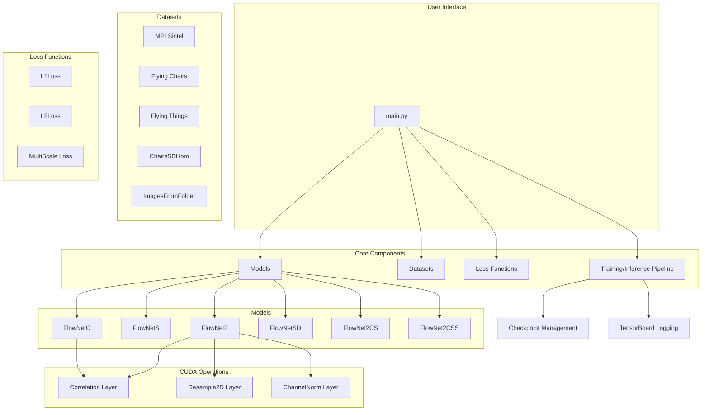

The system is centered around `main.py`, which serves as the entry point and orchestrates the interaction between models, datasets, and loss functions. The system supports various model architectures (FlowNet2, FlowNetS, FlowNetC, etc.), multiple datasets, and different loss functions. Custom CUDA operations provide critical functionality for certain network architectures.

Sources: [main.py:16-16](), [README.md:13-28]()

## Network Architecture Hierarchy

FlowNet2-PyTorch implements multiple variants of the FlowNet architecture, each with different characteristics and performance profiles.

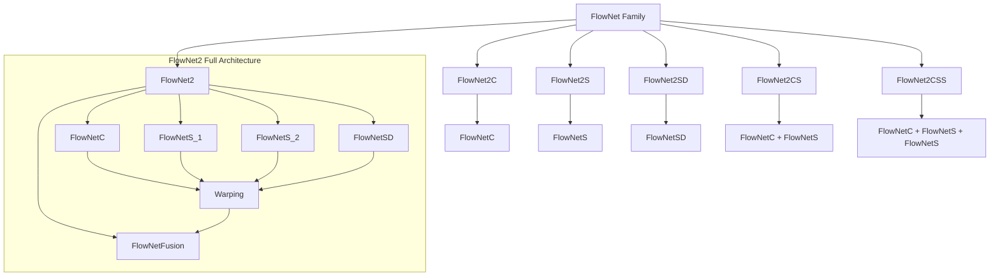

The full FlowNet2 architecture combines several sub-networks: FlowNetC, two FlowNetS networks, FlowNetSD, and a FlowNetFusion module that blends their outputs. The simpler variants (FlowNet2C, FlowNet2S, FlowNet2SD) use individual sub-networks, while FlowNet2CS and FlowNet2CSS combine multiple sub-networks in a sequential manner.

Sources: [README.md:14-22]()

## Custom CUDA Layers

FlowNet2 relies on custom CUDA-accelerated layers for optimal performance. These layers are implemented as PyTorch extensions with CUDA kernels.

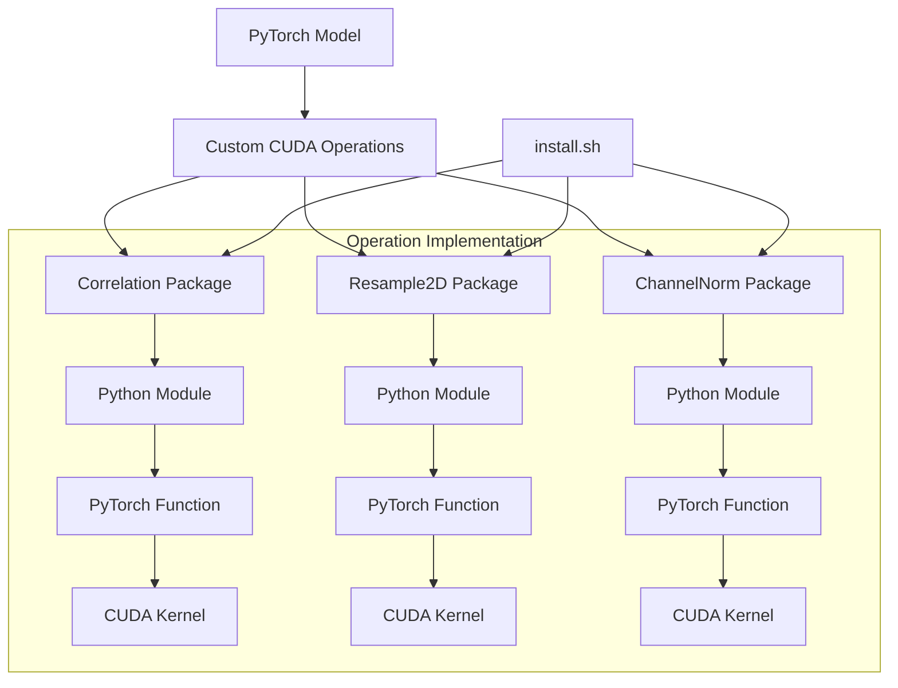

The custom CUDA operations include:

1. **Correlation Layer**: Computes patch-wise similarities between feature maps
2. **Resample2D Layer**: Performs spatial resampling of feature maps
3. **ChannelNorm Layer**: Normalizes feature maps across the channel dimension

These layers are essential for the operation of FlowNet2 and FlowNetC architectures and are installed via the `install.sh` script.

Sources: [README.md:24-28]()

## Training and Inference Pipeline

FlowNet2-PyTorch provides a complete pipeline for both training and inference. The main workflow is implemented in `main.py`.


### Training Process

The training pipeline consists of:
1. Loading the specified training dataset
2. Initializing the model, loss function, and optimizer
3. Running the training loop for a specified number of epochs
4. Periodically validating the model on a validation dataset
5. Saving checkpoints based on validation performance

### Inference Process

The inference pipeline includes:
1. Loading the specified inference dataset
2. Loading a trained model from a checkpoint
3. Applying the model to image pairs to generate optical flow predictions
4. Optionally saving and visualizing the predicted flow fields

Sources: [main.py:245-405]()

## Data Handling

### Supported Datasets

FlowNet2-PyTorch supports several standard optical flow datasets:

| Dataset | Description | Usage |
|---------|-------------|-------|
| MPI Sintel | Synthetic scenes with ground truth flow | Training/Validation |
| Flying Chairs | Synthetic chairs with flow | Training |
| Flying Things | Synthetic objects with flow | Training |
| ChairsSDHom | Extension of Flying Chairs | Training |
| ImagesFromFolder | Custom images | Inference |

### Flow Visualization

The system includes utilities to visualize optical flow fields using a color coding scheme:

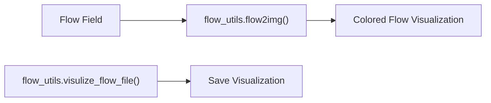

The visualization converts the 2D vector field of optical flow into a color-coded image where hue represents direction and saturation represents magnitude.

Sources: [README.md:30-32](), [utils/flow_utils.py:62-204]()

## Loss Functions

The system supports multiple loss functions for training:

| Loss Function | Description |
|---------------|-------------|
| L1 Loss | Mean absolute error |
| L2 Loss | Mean squared error |
| MultiScale Loss | Loss computed at multiple resolution scales |

MultiScale loss allows for computing the loss at different resolution levels, which helps in handling large displacements in optical flow.

Sources: [README.md:34-36](), [main.py:66-66]()

## Command-Line Interface

FlowNet2-PyTorch provides a comprehensive command-line interface through `main.py`. Key functionalities include:

### Training

```
python main.py --batch_size 8 --model FlowNet2 --loss=L1Loss --optimizer=Adam --optimizer_lr=1e-4 \
--training_dataset MpiSintelFinal --training_dataset_root /path/to/mpi-sintel/final/dataset \
--validation_dataset MpiSintelClean --validation_dataset_root /path/to/mpi-sintel/clean/dataset
```

### Inference

```
python main.py --inference --model FlowNet2 --save_flow --inference_dataset MpiSintelClean \
--inference_dataset_root /path/to/mpi-sintel/clean/dataset \
--resume /path/to/checkpoints
```

The interface supports numerous parameters for configuring model architecture, training hyperparameters, dataset options, and inference settings.

Sources: [main.py:23-82](), [README.md:67-84]()

## Integration with External Tools

The system integrates with TensorBoard for logging and visualization during training:

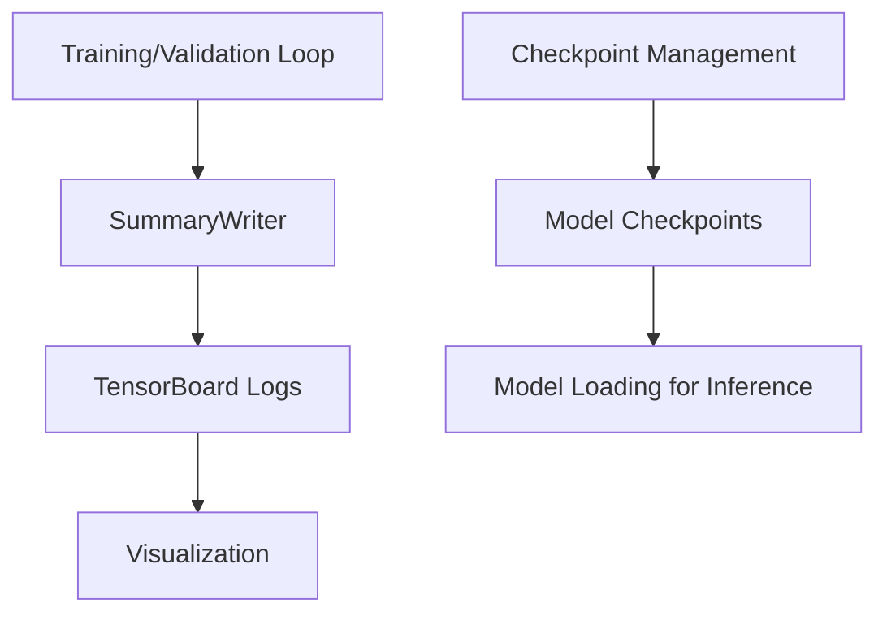

TensorBoard logging includes metrics such as loss values, learning rates, and computation time, providing valuable insights into the training process.

Sources: [main.py:228-229](), [main.py:320-327]()

## Advanced Features

### Multi-GPU Support

FlowNet2-PyTorch supports training on multiple GPUs using PyTorch's DataParallel functionality. The system automatically detects available GPUs and distributes workload accordingly.

### FP16 Support

The system supports inference using half-precision (FP16) for improved performance on compatible hardware, though custom CUDA layers currently only support full precision.

Sources: [README.md:5-7](), [main.py:187-195]()

## Pre-trained Models

The repository provides access to pre-trained models converted from the original Caffe implementation. These models can be used for immediate inference or as starting points for fine-tuning.

Available pre-trained models include:
- FlowNet2
- FlowNet2-C
- FlowNet2-CS
- FlowNet2-CSS
- FlowNet2-CSS-ft-sd
- FlowNet2-S
- FlowNet2-SD

Sources: [README.md:56-65]()

---

# Page: System Architecture

# System Architecture

<details>
<summary>Relevant source files</summary>

The following files were used as context for generating this wiki page:

- [README.md](README.md)
- [models.py](models.py)

</details>


This document provides a comprehensive overview of the FlowNet2-PyTorch system architecture, detailing the relationships between key components and the data flow throughout the system. This page focuses on the structural design of the system rather than implementation details of specific components, which are covered in their respective pages.

## 1. Overall System Architecture

The FlowNet2-PyTorch system is designed to train and evaluate various FlowNet models for optical flow estimation. The system architecture follows a modular design with clear separation of concerns between models, datasets, training, and inference components.

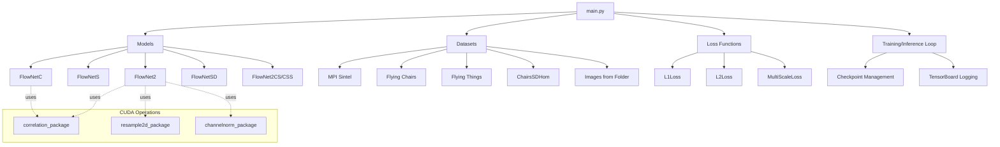

**Key Components:**

1. **main.py**: Entry point that orchestrates the entire system
2. **Models**: Implementation of the FlowNet variants for optical flow estimation
3. **Datasets**: Data loaders for standard optical flow datasets
4. **Loss Functions**: Various loss functions for training
5. **Training/Inference Loop**: Controls the training and evaluation process
6. **CUDA Operations**: Custom GPU-accelerated operations essential for efficient computation

Sources: [README.md:1-37](), [models.py:1-28]()

## 2. Model Hierarchy and Relationships

The FlowNet2-PyTorch system implements various network architectures in a hierarchical manner, with FlowNet2 being the most complex model that combines multiple sub-networks.

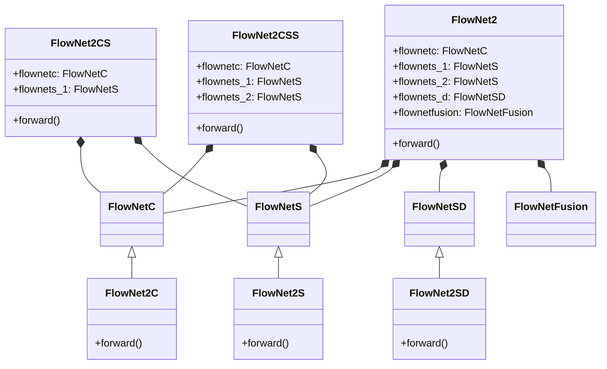

**Model Variants:**

1. **FlowNet2**: The complete architecture combining FlowNetC, two FlowNetS networks, FlowNetSD, and FlowNetFusion
2. **FlowNet2C**: Uses only the FlowNetC component
3. **FlowNet2S**: Uses only the FlowNetS component
4. **FlowNet2SD**: Uses only the FlowNetSD component
5. **FlowNet2CS**: Combines FlowNetC and FlowNetS components
6. **FlowNet2CSS**: Combines FlowNetC and two FlowNetS components

Sources: [models.py:30-186](), [models.py:187-505](), [README.md:13-22]()

## 3. FlowNet2 Architecture in Detail

The FlowNet2 architecture is the most complex model in the system, combining multiple specialized sub-networks to achieve state-of-the-art optical flow estimation. Here's a detailed look at its architecture and data flow:

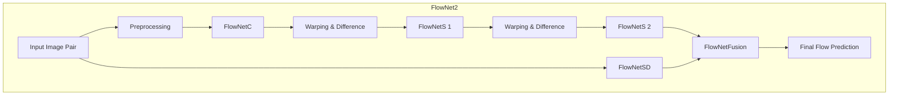

**Data Flow in FlowNet2:**

1. **Input Processing**: The input image pair is normalized and preprocessed
2. **FlowNetC Processing**: Performs initial flow estimation using correlation operation
3. **First Warping**: First image is warped to second image using FlowNetC's flow estimation
4. **FlowNetS 1 Processing**: Refines flow estimation based on warped images and initial flow
5. **Second Warping**: Second warping operation using FlowNetS 1's refined flow
6. **FlowNetS 2 Processing**: Further refinement of flow
7. **FlowNetSD Processing**: Independent flow estimation with high detail sensitivity
8. **Fusion**: FlowNetFusion combines the outputs of FlowNetS 2 and FlowNetSD
9. **Output**: Final flow prediction

Sources: [models.py:30-186]()

## 4. Implementation Architecture

The following diagram illustrates the implementation structure of the FlowNet2 model and how each component is initialized and connected:

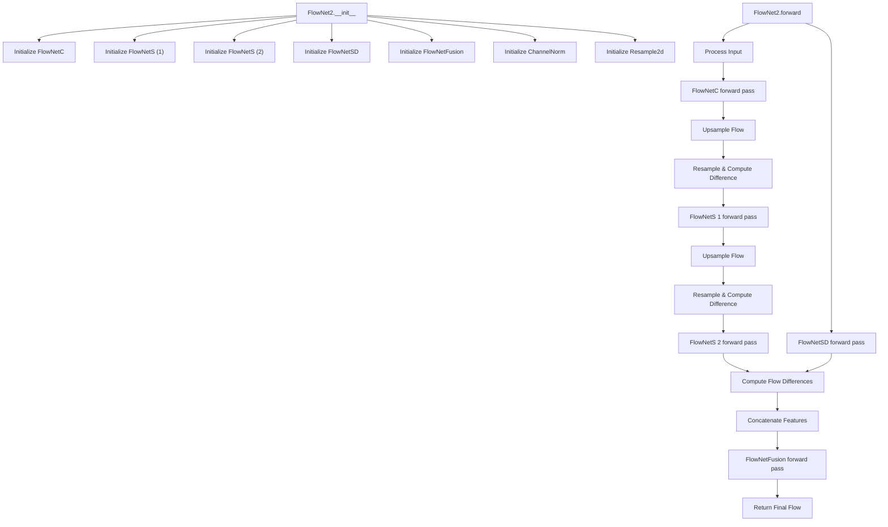

**Key Implementation Components:**

1. **Initialization**: Each sub-network (FlowNetC, FlowNetS, FlowNetSD, FlowNetFusion) is instantiated
2. **Forward Pass**: Input processing, sequential flow through sub-networks with intermediate processing
3. **Intermediate Operations**: Upsampling, warping (via Resample2d), channel normalization
4. **Flow Fusion**: Combining flow estimations from different sub-networks

Sources: [models.py:32-102](), [models.py:120-185]()

## 5. CUDA Operations Architecture

The custom CUDA operations are critical components of the FlowNet2 architecture, providing GPU-accelerated implementations of computationally intensive operations.

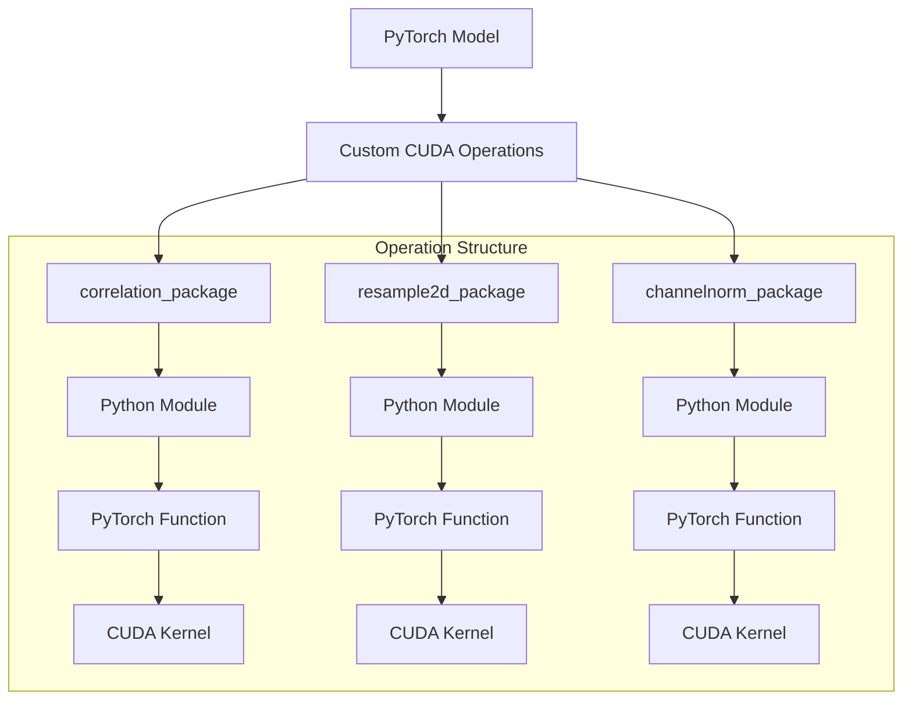

**Custom CUDA Operations:**

1. **Correlation Layer**: Computes patch-wise similarities between feature maps - essential for FlowNetC
2. **Resample2D Layer**: Performs warping operations using estimated flow
3. **ChannelNorm Layer**: Normalizes feature maps across the channel dimension

Each CUDA operation follows a three-tier architecture:
- Python module interface for seamless integration with PyTorch
- PyTorch Function with forward and backward methods (for autograd)
- CUDA kernel implementation for GPU acceleration

Sources: [README.md:24-28](), [models.py:9-16](), [models.py:39-51]()

## 6. Training and Inference Pipeline

The system provides a comprehensive pipeline for both training and inference of optical flow models.

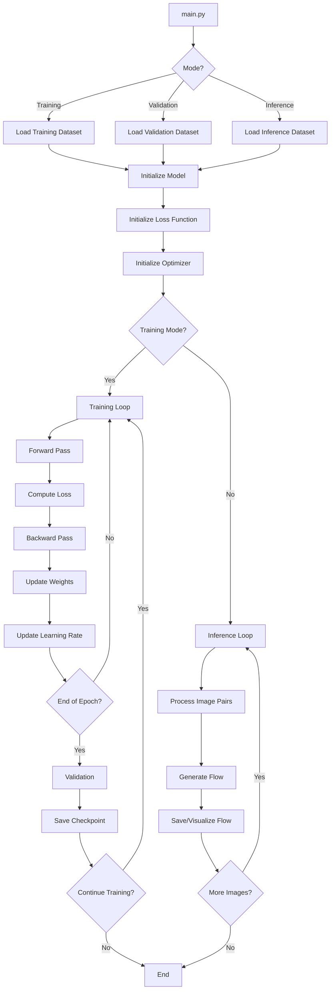

**Training and Inference Pipeline Features:**

1. **Mode Selection**: Supports training, validation, and inference modes
2. **Dataset Loading**: Loads appropriate dataset based on mode
3. **Model Initialization**: Instantiates the selected FlowNet variant
4. **Training Loop**: Forward pass, loss computation, backward pass, weight updates
5. **Validation**: Evaluates model performance on validation dataset
6. **Checkpoint Management**: Saves and loads model checkpoints
7. **Inference**: Generates flow predictions for image pairs

Sources: [README.md:67-84]()

## 7. Model Configuration Options

The system supports various configuration options for different network architectures. The following table summarizes the available model variants and their key components:

| Model         | Components                                     | Description                                   |
|---------------|-----------------------------------------------|-----------------------------------------------|
| FlowNet2      | FlowNetC + 2×FlowNetS + FlowNetSD + FlowNetFusion | Complete architecture with all components    |
| FlowNet2C     | FlowNetC                                      | Uses only correlation-based flow estimation   |
| FlowNet2S     | FlowNetS                                      | Uses only the simple flow estimation network  |
| FlowNet2SD    | FlowNetSD                                     | Uses the small displacement-focused network   |
| FlowNet2CS    | FlowNetC + FlowNetS                          | Combines correlation and simple networks      |
| FlowNet2CSS   | FlowNetC + 2×FlowNetS                        | Combines correlation and two simple networks  |

Each model variant can be further customized with options for:
- Batch normalization
- Half-precision (fp16) computation
- Scaling factor for flow (div_flow parameter)

Sources: [models.py:30-506](), [README.md:13-22]()

## 8. Interface with External Components

The FlowNet2-PyTorch system interfaces with several external components for complete functionality:

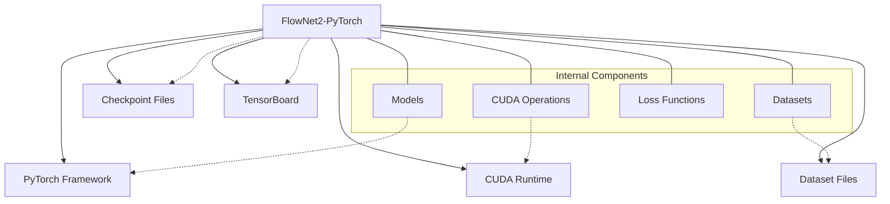

**External Interfaces:**

1. **PyTorch Framework**: Core deep learning framework used for tensor operations and autograd
2. **CUDA Runtime**: Required for execution of custom CUDA operations
3. **Dataset Files**: External dataset files in appropriate format
4. **Checkpoint Files**: Saved model weights and optimizer states
5. **TensorBoard**: Optional visualization of training metrics

Sources: [README.md:38-56]()

## 9. Data Flow in Model Forward Pass

Let's examine the detailed data flow inside the FlowNet2 model during a forward pass:

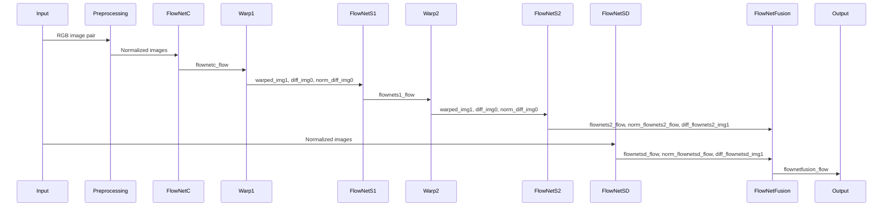

This sequence diagram illustrates how data flows through the FlowNet2 model:
1. Input images are preprocessed (normalized)
2. FlowNetC produces initial flow estimation
3. First warping operation creates difference images
4. FlowNetS1 refines the flow estimation
5. Second warping operation with updated flow
6. FlowNetS2 further refines the flow
7. In parallel, FlowNetSD processes the input independently
8. FlowNetFusion combines the outputs from FlowNetS2 and FlowNetSD
9. Final flow prediction is produced

Sources: [models.py:120-185]()

## Summary

The FlowNet2-PyTorch system architecture is designed with modularity and extensibility in mind. It consists of multiple interconnected components arranged in a hierarchical structure:

1. A set of neural network models (FlowNetC, FlowNetS, FlowNetSD, FlowNetFusion) that can be combined in different ways
2. Custom CUDA operations (correlation, resample2d, channelnorm) for computationally intensive tasks
3. A comprehensive training and inference pipeline
4. Support for various datasets and loss functions

This architecture allows for flexibility in model configuration while maintaining high performance through GPU acceleration of critical operations. For more information on specific components, please refer to their dedicated wiki pages.

---

# Page: Installation

# Installation

<details>
<summary>Relevant source files</summary>

The following files were used as context for generating this wiki page:

- [Dockerfile](Dockerfile)
- [install.sh](install.sh)
- [launch_docker.sh](launch_docker.sh)
- [networks/correlation_package/correlation.py](networks/correlation_package/correlation.py)

</details>


This document provides step-by-step instructions for installing and setting up FlowNet2-PyTorch. The repository requires specific CUDA extensions that must be compiled for the neural network models to function correctly. For information about pre-trained models, see [Pre-trained Models](#2.1).

## System Requirements

Before installation, ensure your system meets the following requirements:

| Requirement | Version/Specification |
|-------------|------------------------|
| CUDA        | 9.0                    |
| cuDNN       | 7                      |
| Python      | 3.5+                   |
| PyTorch     | 1.0.0                  |
| GPU         | NVIDIA GPU with CUDA support |

## Installation Methods

There are two methods to install FlowNet2-PyTorch:

1. **Native installation** - Install directly on your system
2. **Docker-based installation** - Use a pre-configured Docker environment

## Native Installation

### Step 1: Clone the Repository

```bash
git clone https://github.com/NVIDIA/flownet2-pytorch.git
cd flownet2-pytorch
```

### Step 2: Set Up Python Environment

Install PyTorch with CUDA support. The repository was developed with PyTorch 1.0.0:

```bash
pip3 install https://download.pytorch.org/whl/cu90/torch-1.0.0-cp35-cp35m-linux_x86_64.whl
```

### Step 3: Install Dependencies

```bash
pip3 install numpy scipy matplotlib scikit-image tensorboardX
```

### Step 4: Install Custom CUDA Extensions

The core functionality of FlowNet2 relies on three custom CUDA-accelerated operations that must be compiled:

```bash
./install.sh
```

This script will compile and install:
- Correlation package
- Resample2D package
- ChannelNorm package

Sources: [install.sh:1-15]()

## Installation Architecture

The following diagram illustrates the components that are installed by the `install.sh` script:

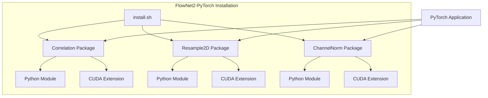

Sources: [install.sh:1-15](), [networks/correlation_package/correlation.py:1-62]()

## Custom CUDA Operations

The installation process compiles three essential CUDA operations:

1. **Correlation Package**: Implements spatial correlation between feature maps for matching image features
2. **Resample2D Package**: Provides differentiable resampling/warping operation for flow-based warping
3. **ChannelNorm Package**: Implements channel-wise normalization for feature maps

These operations are implemented as custom PyTorch extensions with optimized CUDA kernels for efficient computation on NVIDIA GPUs.

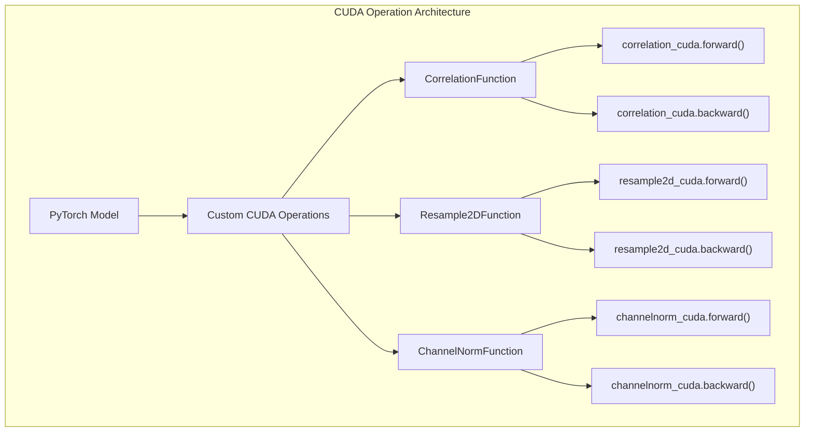

Sources: [networks/correlation_package/correlation.py:1-62]()

## Docker-based Installation

If you prefer to use Docker, FlowNet2-PyTorch provides a Docker setup that includes all required dependencies.

### Prerequisites

- Docker
- NVIDIA Docker (for GPU support)

### Steps

1. Build and run the Docker container:

```bash
./launch_docker.sh
```

This script:
1. Builds a Docker image with all dependencies
2. Launches a container with the current directory mounted
3. Provides an interactive shell inside the container

Sources: [launch_docker.sh:1-5](), [Dockerfile:1-28]()

## Docker Environment

The Docker environment includes:

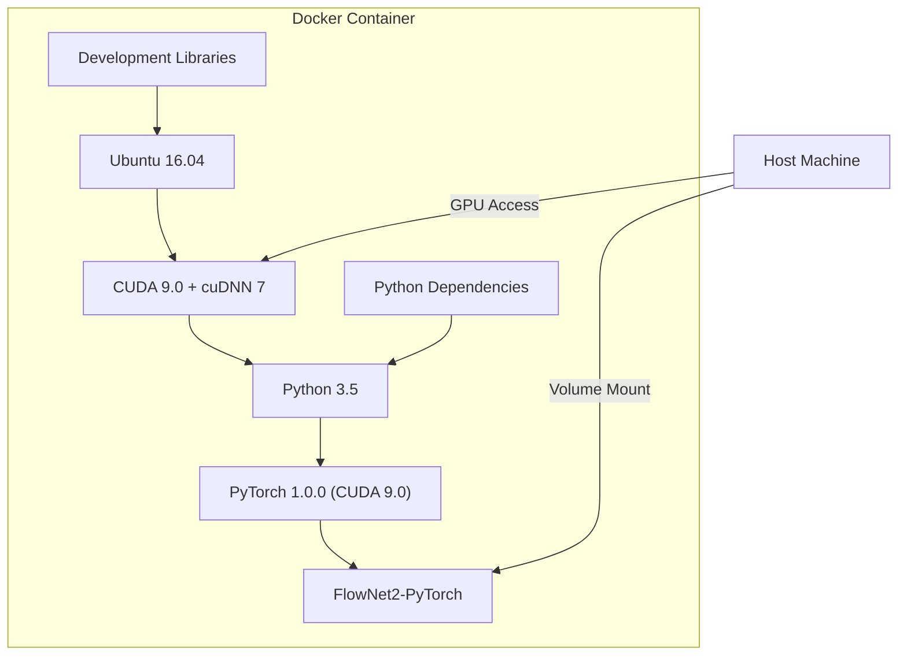

The Docker environment includes the following key components:

| Component | Version/Details |
|-----------|----------------|
| Base Image | nvidia/cuda:9.0-cudnn7-devel-ubuntu16.04 |
| Python | 3.5 |
| PyTorch | 1.0.0 (with CUDA 9.0) |
| Libraries | NumPy, SciPy, matplotlib, scikit-image, tensorboardX |
| Development Tools | cmake, g++, CUDA toolkit |

Sources: [Dockerfile:1-28](), [launch_docker.sh:1-5]()

## Verifying Installation

After installation, verify that the custom CUDA extensions are working correctly:

```python
import torch
from networks.correlation_package.correlation import Correlation
from networks.resample2d_package.resample2d import Resample2d
from networks.channelnorm_package.channelnorm import ChannelNorm

# Create dummy tensors
input1 = torch.randn(1, 3, 64, 64).cuda()
input2 = torch.randn(1, 3, 64, 64).cuda()

# Test correlation
correlation = Correlation(pad_size=3, kernel_size=3, max_displacement=20, stride1=1, stride2=2, corr_multiply=1)
out_correlation = correlation(input1, input2)
print("Correlation layer test passed!")

# Test other layers similarly
```

If no errors occur and the message is printed, the installation is successful.

## Troubleshooting

If you encounter issues during installation of the CUDA extensions:

1. Ensure CUDA paths are correctly set in your environment
2. Check that your CUDA and PyTorch versions are compatible
3. Verify you have necessary build tools (gcc, g++)
4. For compilation errors, check if your GPU architecture is supported

For more detailed information on the models and their architectures, see [Models](#3).

---

# Page: Pre-trained Models

# Pre-trained Models

<details>
<summary>Relevant source files</summary>

The following files were used as context for generating this wiki page:

- [convert.py](convert.py)
- [download_caffe_models.sh](download_caffe_models.sh)
- [run-caffe2pytorch.sh](run-caffe2pytorch.sh)
- [utils/param_utils.py](utils/param_utils.py)

</details>


This document explains how to download, convert, and use pre-trained FlowNet2 models with the PyTorch implementation. FlowNet2-PyTorch supports converting the original Caffe models provided by the FlowNet2 authors to PyTorch format, allowing for immediate use without training from scratch.

## Contents

- [Available Pre-trained Models](#available-pre-trained-models)
- [Downloading Caffe Models](#downloading-caffe-models)
- [Converting Caffe Models to PyTorch](#converting-caffe-models-to-pytorch)
- [Using Pre-trained Models](#using-pre-trained-models)

## Available Pre-trained Models

FlowNet2-PyTorch supports several pre-trained model variants with different accuracy and speed tradeoffs:

| Model Name | Description | Performance | Speed |
|------------|-------------|-------------|-------|
| FlowNet2 | Full model with all components | Best | Slowest |
| FlowNet2-CSS | Three networks (C+S+S) without fusion | Very good | Slow |
| FlowNet2-CSS-ft-sd | CSS fine-tuned with small displacement data | Good | Slow |
| FlowNet2-CS | Two networks (C+S) | Good | Medium |
| FlowNet2-C | Only correlation network | Basic | Fast |
| FlowNet2-S | Only simple network | Basic | Fast |
| FlowNet2-SD | Small displacement model | Good for small motions | Fast |

Sources: [convert.py:57-136]()

## Downloading Caffe Models

The repository provides a script to download the original Caffe models from the FlowNet2 authors.


To download the models:

1. Run the download script which clones the FlowNet2-Docker repository
   ```bash
   ./download_caffe_models.sh
   ```

2. This creates a Docker image with all necessary Caffe models

Sources: [download_caffe_models.sh:1-14]()

## Converting Caffe Models to PyTorch

After downloading the Caffe models, you need to convert them to PyTorch format using the provided conversion tools.

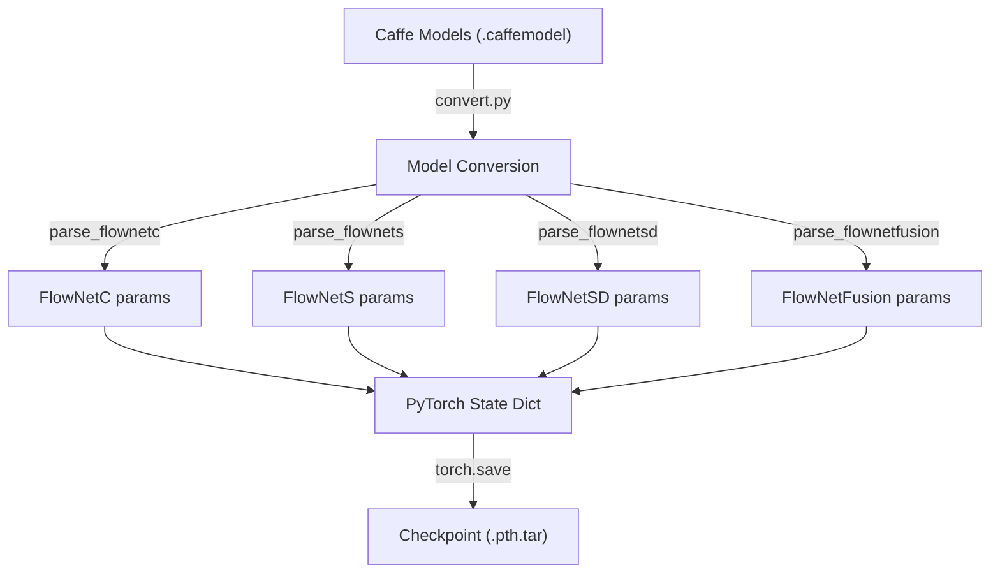

The conversion process:

1. Run the conversion script that uses Docker for environment isolation:
   ```bash
   ./run-caffe2pytorch.sh /path/to/flownet2-pytorch
   ```

2. This script performs these operations:
   - Builds a PyTorch Docker image with CUDA support
   - Installs custom layers
   - Runs the conversion script for each model variant
   - Saves checkpoint files in PyTorch format

The conversion script supports all model variants and creates corresponding checkpoint files:
- FlowNet2_checkpoint.pth.tar
- FlowNet2-C_checkpoint.pth.tar
- FlowNet2-CS_checkpoint.pth.tar
- FlowNet2-CSS_checkpoint.pth.tar
- FlowNet2-CSS-ft-sd_checkpoint.pth.tar
- FlowNet2-S_checkpoint.pth.tar
- FlowNet2-SD_checkpoint.pth.tar

Sources: [run-caffe2pytorch.sh:1-17](), [convert.py:1-137]()

## Model Conversion Process Details

The conversion process involves mapping parameters from Caffe models to PyTorch models using specialized parsing functions:

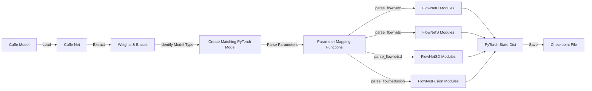

The conversion handles important details like:
- Flipping RGB channels for the first convolutional layer
- Organizing parameters for each sub-network
- Handling model-specific layer names and prefixes

Sources: [convert.py:48-137](), [utils/param_utils.py:1-254]()

## Using Pre-trained Models

Once converted, you can load the pre-trained models for inference or fine-tuning:

1. Load a pre-trained model:
   ```python
   import torch
   from models import FlowNet2  # Or any other model variant
   
   # Initialize the model
   args = {}  # Add any required args
   model = FlowNet2(args)
   
   # Load the pre-trained weights
   checkpoint = torch.load('FlowNet2_checkpoint.pth.tar')
   model.load_state_dict(checkpoint['state_dict'])
   
   # Set to evaluation mode
   model.eval()
   ```

2. Use the model for inference (refer to [Training and Inference](#4) for detailed usage).

Sources: [convert.py:67-69](), [convert.py:75-78](), [convert.py:86-89]()

## Model Architecture Variants

The conversion script supports different FlowNet2 architecture variants, each with specific parameter mapping:

```mermaid
flowchart TD
    subgraph "FlowNet2 Variants"
        A["FlowNet2 (Full)"] -->|"Contains"| B["FlowNetC"]
        A -->|"Contains"| C["FlowNetS_1"]
        A -->|"Contains"| D["FlowNetS_2"]
        A -->|"Contains"| E["FlowNetSD"]
        A -->|"Contains"| F["FlowNetFusion"]
        
        G["FlowNet2-C"] -->|"Contains"| B
        H["FlowNet2-S"] -->|"Contains"| K["FlowNetS"]
        I["FlowNet2-SD"] -->|"Contains"| E
        
        J["FlowNet2-CS"] -->|"Contains"| B
        J -->|"Contains"| C
        
        L["FlowNet2-CSS"] -->|"Contains"| B
        L -->|"Contains"| C
        L -->|"Contains"| D
    end
    
    subgraph "Parameter Mapping"
        M["convert.py"] -->|"Detects Model Type"| N["Create Appropriate Model"]
        N -->|"Parse Parameters"| O["utils/param_utils.py"]
        O -->|"Map Caffe to PyTorch"| P["Model Checkpoint"]
    end
```

Each model variant has specific parameter mapping functions that handle the differences in layer naming and structure between Caffe and PyTorch implementations.

Sources: [convert.py:57-136](), [utils/param_utils.py:5-254]()

## Verifying Converted Models

After conversion, you can verify if the models were correctly converted by:

1. Loading the checkpoint and inspecting the state dictionary keys
2. Running a simple inference test with sample images
3. Comparing the output with the expected results from the original Caffe implementation

For troubleshooting conversion issues, refer to the [Custom CUDA Operations](#6) section as these operations are critical for the correct functioning of the FlowNet2 models.

---

# Page: Models

# Models

<details>
<summary>Relevant source files</summary>

The following files were used as context for generating this wiki page:

- [models.py](models.py)

</details>


This page provides a comprehensive overview of the FlowNet2 network architecture and its variants implemented in the FlowNet2-PyTorch repository. The models described here are designed for optical flow estimation from pairs of images. For more detailed information about specific components like FlowNetS, FlowNetC, FlowNetSD, or FlowNetFusion, see their respective pages ([FlowNetS](#3.1), [FlowNetC](#3.2), [FlowNetSD](#3.3), [FlowNetFusion](#3.4)).

## Model Hierarchy

FlowNet2-PyTorch implements a family of neural networks for optical flow estimation, with varying architectures, complexity, and accuracy.

### Model Hierarchy Diagram

```mermaid
graph TD
    subgraph "FlowNet2 Family"
        FN2["FlowNet2"]
        FN2C["FlowNet2C"]
        FN2S["FlowNet2S"]
        FN2SD["FlowNet2SD"]
        FN2CS["FlowNet2CS"]
        FN2CSS["FlowNet2CSS"]
    end
    
    subgraph "Base Components"
        FNC["FlowNetC"]
        FNS["FlowNetS"]
        FNSD["FlowNetSD"]
        FNF["FlowNetFusion"]
    end
    
    FN2 --> FNC
    FN2 --> FNS1["FlowNetS (1st)"]
    FN2 --> FNS2["FlowNetS (2nd)"]
    FN2 --> FNSD
    FN2 --> FNF
    
    FN2C --> FNC
    FN2S --> FNS
    FN2SD --> FNSD
    
    FN2CS --> FNC
    FN2CS --> FNS
    
    FN2CSS --> FNC
    FN2CSS --> FNS1
    FN2CSS --> FNS2
    
    FNS1 --> FNS
    FNS2 --> FNS
```

Sources: [models.py:30-186](), [models.py:187-299](), [models.py:300-351](), [models.py:353-416](), [models.py:418-505]()

## FlowNet2 Architecture

FlowNet2 is the complete model that combines multiple network components to achieve high-quality optical flow estimation. It processes a pair of RGB images and outputs a dense optical flow field.

### FlowNet2 Components and Data Flow

```mermaid
flowchart TD
    Input["Input Image Pair"]
    
    subgraph "FlowNet2"
        FNC["FlowNetC"]
        FNS1["FlowNetS (1st)"]
        FNS2["FlowNetS (2nd)"]
        FNSD["FlowNetSD"]
        FNF["FlowNetFusion"]
        
        Warp1["Warping & Diff (1)"]
        Warp2["Warping & Diff (2)"]
        Warp3["Warping & Normalization (3)"]
        Warp4["Warping & Normalization (4)"]
    end
    
    Output["Final Flow Prediction"]
    
    Input --> FNC
    FNC --> Warp1
    Warp1 --> FNS1
    FNS1 --> Warp2
    Warp2 --> FNS2
    Input --> FNSD
    
    FNS2 --> Warp3
    FNSD --> Warp4
    
    Warp3 --> FNF
    Warp4 --> FNF
    Input --> FNF
    
    FNF --> Output
```

Sources: [models.py:30-186]()

The full FlowNet2 architecture processes inputs through the following steps:

1. Input normalization: Normalize and split the input image pair
2. FlowNetC: Process normalized inputs through the correlation-based network
3. First warping: Warp the second image to the first using the initial flow estimate
4. FlowNetS (1st): Refine the flow using the warped image and original inputs
5. Second warping: Warp again with the refined flow
6. FlowNetS (2nd): Further refine the flow
7. FlowNetSD: Process the original inputs with a small-displacement specialized network
8. Flow normalization: Normalize both flow fields
9. FlowNetFusion: Combine all the information to produce the final flow prediction

The key insight behind FlowNet2 is that different network components specialize in different aspects of optical flow estimation, and their combination provides superior results.

Sources: [models.py:30-186](), [models.py:120-185]()

## Model Variants

FlowNet2-PyTorch implements several variants of the FlowNet2 architecture, each with different trade-offs between accuracy, speed, and model size.

### Model Variants Comparison

| Model | Components | Parameters | Input | Output | Use Case |
|-------|------------|------------|-------|--------|----------|
| FlowNet2 | FlowNetC + 2×FlowNetS + FlowNetSD + FlowNetFusion | ~162.5M | Image pair | Flow field | Best accuracy, slower inference |
| FlowNet2C | FlowNetC only | ~39.2M | Image pair | Flow field | Fast, moderate accuracy |
| FlowNet2S | FlowNetS only | ~38.7M | Image pair | Flow field | Fast, moderate accuracy |
| FlowNet2SD | FlowNetSD only | ~38.7M* | Image pair | Flow field | Small displacements |
| FlowNet2CS | FlowNetC + FlowNetS | ~77.9M* | Image pair | Flow field | Good balance of speed/accuracy |
| FlowNet2CSS | FlowNetC + 2×FlowNetS | ~116.6M* | Image pair | Flow field | High accuracy, moderate speed |

*Note: Approximate parameter counts based on network architecture

Sources: [models.py:28](), [models.py:30-186](), [models.py:187-299](), [models.py:300-351](), [models.py:353-416](), [models.py:418-505]()

### FlowNet2C

FlowNet2C uses only the correlation-based FlowNetC component of the full FlowNet2 architecture. It's suitable for applications where computational efficiency is important but correlation-based matching is desired.

The model inherits from `FlowNetC.FlowNetC` and adds preprocessing to normalize the input image pair before passing it through the network.

Sources: [models.py:187-253]()

### FlowNet2S

FlowNet2S uses only the FlowNetS component, which is a simpler network without the correlation layer. It's the fastest of the FlowNet2 variants but may have lower accuracy for complex motion patterns.

The model inherits from `FlowNetS.FlowNetS` and adds preprocessing similar to FlowNet2C.

Sources: [models.py:255-299]()

### FlowNet2SD

FlowNet2SD uses only the FlowNetSD component, which is specialized for small displacement optical flow. It's particularly useful for scenarios where the motion between frames is limited.

The model inherits from `FlowNetSD.FlowNetSD` and includes similar preprocessing to the other variants.

Sources: [models.py:301-351]()

### FlowNet2CS

FlowNet2CS combines FlowNetC and FlowNetS in a cascaded manner. FlowNetC produces an initial flow estimate, which is used to warp the second image. The warped image, original images, flow, and difference magnitude are then processed by FlowNetS to refine the flow.

```mermaid
flowchart LR
    Input["Input Image Pair"]
    FNC["FlowNetC"]
    Warp["Warping & Diff"]
    FNS["FlowNetS"]
    Output["Flow Prediction"]
    
    Input --> FNC
    FNC --> Warp
    Input --> Warp
    Warp --> FNS
    FNS --> Output
```

Sources: [models.py:353-416]()

### FlowNet2CSS

FlowNet2CSS extends FlowNet2CS by adding a second FlowNetS stage. The output from the first FlowNetS is used to warp the second image again, and the result is processed by the second FlowNetS to further refine the flow.

```mermaid
flowchart LR
    Input["Input Image Pair"]
    FNC["FlowNetC"]
    Warp1["Warping & Diff (1)"]
    FNS1["FlowNetS (1st)"]
    Warp2["Warping & Diff (2)"]
    FNS2["FlowNetS (2nd)"]
    Output["Flow Prediction"]
    
    Input --> FNC
    FNC --> Warp1
    Input --> Warp1
    Warp1 --> FNS1
    FNS1 --> Warp2
    Input --> Warp2
    Warp2 --> FNS2
    FNS2 --> Output
```

Sources: [models.py:418-505]()

## Common Operations

### Image Warping and Normalization

All FlowNet2 variants use image warping and channel normalization operations:

1. **Image Warping**: The `Resample2d` operation warps an image using a flow field. This allows the network to compensate for motion between frames.
2. **Channel Normalization**: The `ChannelNorm` operation normalizes feature maps, which helps stabilize training and improve generalization.

These operations are crucial for the cascaded architecture of FlowNet2, where the output of one network is used to warp images before feeding them to the next network.

Sources: [models.py:39-51](), [models.py:52-62](), [models.py:73-87]()

### Mixed Precision Support

FlowNet2-PyTorch supports mixed precision training and inference with FP16 operations. The models include special handling for custom CUDA operations when running in FP16 mode:

```python
if args.fp16:
    self.resample1 = nn.Sequential(
                    tofp32(), 
                    Resample2d(),
                    tofp16()) 
else:
    self.resample1 = Resample2d()
```

This allows for faster computation on compatible hardware while maintaining numerical stability.

Sources: [models.py:45-51](), [models.py:56-62](), [models.py:73-87]()

## Initialization and Training

All FlowNet2 models use Xavier uniform initialization for convolutional and transposed convolutional weights, which helps with training deep networks by maintaining appropriate activation magnitudes through the network.

During training, the models return flow predictions at multiple scales to enable multi-scale loss computation. During inference, only the final, upsampled flow prediction is returned.

Sources: [models.py:92-102](), [models.py:250-253](), [models.py:296-299](), [models.py:348-351]()

## Usage Example

The primary usage of these models is through the main training and inference pipeline. Models are instantiated with configuration parameters and then used for forward passes with image pairs:

```python
# Example usage (simplified)
model = FlowNet2(args)  # or any variant
flow_prediction = model(image_pair)
```

For specific usage patterns, refer to the [Training and Inference](#4) documentation.

---

# Page: FlowNetS

# FlowNetS

<details>
<summary>Relevant source files</summary>

The following files were used as context for generating this wiki page:

- [networks/FlowNetS.py](networks/FlowNetS.py)

</details>


## Purpose and Overview

This documentation covers the FlowNetS architecture, a fundamental building block in the FlowNet2 family of optical flow estimation networks. FlowNetS is the simplest variant in the FlowNet family, using a straightforward encoder-decoder architecture with skip connections to estimate optical flow between two input images. This page focuses on the architecture, implementation, and role of FlowNetS within the broader FlowNet2 ecosystem.

For information about other network variants, see [FlowNetC](#3.2), [FlowNetSD](#3.3), or [FlowNetFusion](#3.4).

## Architecture

FlowNetS follows an encoder-decoder architecture with skip connections. It directly processes stacked RGB image pairs to estimate pixel-level motion between frames.

### High-Level Architecture

```mermaid
graph TD
    subgraph "FlowNetS Architecture"
        A["Input Images (Stacked)"] --> B["Encoder (CNN)"]
        B --> C["Bottleneck"]
        C --> D["Decoder with Skip Connections"]
        D --> E["Multi-scale Flow Prediction"]
        E --> F["Final Flow Field"]
    end
```

Sources: [networks/FlowNetS.py:15-94]()

### Detailed Network Structure

```mermaid
flowchart TD
    Input["Input: Stacked Image Pairs
    Channels: 6 or 12"] --> Conv1["conv1: 7×7, 64 channels
    stride=2"]
    Conv1 --> Conv2["conv2: 5×5, 128 channels
    stride=2"]
    Conv2 --> Conv3["conv3: 5×5, 256 channels
    stride=2"]
    Conv3 --> Conv3_1["conv3_1: 3×3, 256 channels"]
    Conv3_1 --> Conv4["conv4: 3×3, 512 channels
    stride=2"]
    Conv4 --> Conv4_1["conv4_1: 3×3, 512 channels"]
    Conv4_1 --> Conv5["conv5: 3×3, 512 channels
    stride=2"]
    Conv5 --> Conv5_1["conv5_1: 3×3, 512 channels"]
    Conv5_1 --> Conv6["conv6: 3×3, 1024 channels
    stride=2"]
    Conv6 --> Conv6_1["conv6_1: 3×3, 1024 channels"]
    
    Conv6_1 --> PredFlow6["predict_flow6: 2 channels"]
    Conv6_1 --> Deconv5["deconv5: 1024 → 512 channels"]
    
    PredFlow6 --> UpFlow6["upsampled_flow6_to_5"]
    
    Conv5_1 --> Concat5["concat5: 512 + 512 + 2 = 1026 channels"]
    Deconv5 --> Concat5
    UpFlow6 --> Concat5
    
    Concat5 --> PredFlow5["predict_flow5: 2 channels"]
    Concat5 --> Deconv4["deconv4: 1026 → 256 channels"]
    
    PredFlow5 --> UpFlow5["upsampled_flow5_to_4"]
    
    Conv4_1 --> Concat4["concat4: 512 + 256 + 2 = 770 channels"]
    Deconv4 --> Concat4
    UpFlow5 --> Concat4
    
    Concat4 --> PredFlow4["predict_flow4: 2 channels"]
    Concat4 --> Deconv3["deconv3: 770 → 128 channels"]
    
    PredFlow4 --> UpFlow4["upsampled_flow4_to_3"]
    
    Conv3_1 --> Concat3["concat3: 256 + 128 + 2 = 386 channels"]
    Deconv3 --> Concat3
    UpFlow4 --> Concat3
    
    Concat3 --> PredFlow3["predict_flow3: 2 channels"]
    Concat3 --> Deconv2["deconv2: 386 → 64 channels"]
    
    PredFlow3 --> UpFlow3["upsampled_flow3_to_2"]
    
    Conv2 --> Concat2["concat2: 128 + 64 + 2 = 194 channels"]
    Deconv2 --> Concat2
    UpFlow3 --> Concat2
    
    Concat2 --> PredFlow2["predict_flow2: 2 channels
    (Final Output)"]
```

Sources: [networks/FlowNetS.py:19-45](), [networks/FlowNetS.py:60-90]()

## Implementation Details

The FlowNetS implementation in the FlowNet2-PyTorch repository consists of several key components:

### Class Definition and Parameters

FlowNetS is implemented as a PyTorch module with approximately 38.7 million parameters.

The constructor initializes the network layers with optional batch normalization:

```python
def __init__(self, args, input_channels = 12, batchNorm=True):
```

By default, the network accepts 12-channel inputs (e.g., two RGB images with additional features), but this can be customized through the `input_channels` parameter.

Sources: [networks/FlowNetS.py:15-58]()

### Network Components

The network consists of the following main components:

1. **Encoder Path**: A series of convolutional layers that progressively reduce spatial dimensions while increasing the feature channels
2. **Bottleneck**: The deepest layer (`conv6_1`) with 1024 channels
3. **Decoder Path**: A series of transposed convolutions (deconvolutions) that upsample feature maps
4. **Skip Connections**: Direct connections from encoder to decoder at corresponding resolutions
5. **Flow Prediction**: Multiple flow prediction branches at different scales
6. **Flow Upsampling**: Transposed convolutions to upsample flow predictions for concatenation with higher-resolution features

Sources: [networks/FlowNetS.py:19-45]()

### Forward Pass

The forward pass processes the input through the encoder and decoder paths, with flow predictions at multiple scales:

1. Input passes through encoder layers (conv1 to conv6_1)
2. Initial flow prediction at the lowest resolution (flow6)
3. Upsampling of flow and features via deconvolution
4. Concatenation of encoder features, upsampled features, and upsampled flow
5. Flow prediction at the current scale
6. Steps 3-5 repeat until reaching the highest resolution (flow2)

During training, the network returns flow predictions at all scales (flow2, flow3, flow4, flow5, flow6) to apply supervision at multiple resolutions. During inference, only the highest resolution flow prediction (flow2) is returned.

Sources: [networks/FlowNetS.py:60-94]()

### Weight Initialization

The network uses Xavier uniform initialization for both convolutional and transposed convolutional layers:

```python
for m in self.modules():
    if isinstance(m, nn.Conv2d) or isinstance(m, nn.ConvTranspose2d):
        if m.bias is not None:
            init.uniform_(m.bias)
        init.xavier_uniform_(m.weight)
```

This initialization method helps achieve better convergence during training.

Sources: [networks/FlowNetS.py:47-57]()

## Technical Specifications

The table below summarizes the key layers and their configurations in FlowNetS:

| Layer Name | Kernel Size | Input Channels | Output Channels | Stride | Notes |
|------------|-------------|----------------|-----------------|--------|-------|
| conv1      | 7×7         | 12 (default)   | 64              | 2      | First encoding layer |
| conv2      | 5×5         | 64             | 128             | 2      | |
| conv3      | 5×5         | 128            | 256             | 2      | |
| conv3_1    | 3×3         | 256            | 256             | 1      | |
| conv4      | 3×3         | 256            | 512             | 2      | |
| conv4_1    | 3×3         | 512            | 512             | 1      | |
| conv5      | 3×3         | 512            | 512             | 2      | |
| conv5_1    | 3×3         | 512            | 512             | 1      | |
| conv6      | 3×3         | 512            | 1024            | 2      | |
| conv6_1    | 3×3         | 1024           | 1024            | 1      | Bottleneck layer |
| predict_flow6 | 3×3      | 1024           | 2               | 1      | Flow prediction at 1/64 resolution |
| deconv5    | 4×4         | 1024           | 512             | 2      | Transposed convolution |
| predict_flow5 | 3×3      | 1026           | 2               | 1      | Flow prediction at 1/32 resolution |
| deconv4    | 4×4         | 1026           | 256             | 2      | Transposed convolution |
| predict_flow4 | 3×3      | 770            | 2               | 1      | Flow prediction at 1/16 resolution |
| deconv3    | 4×4         | 770            | 128             | 2      | Transposed convolution |
| predict_flow3 | 3×3      | 386            | 2               | 1      | Flow prediction at 1/8 resolution |
| deconv2    | 4×4         | 386            | 64              | 2      | Transposed convolution |
| predict_flow2 | 3×3      | 194            | 2               | 1      | Final flow prediction at 1/4 resolution |

Sources: [networks/FlowNetS.py:19-45]()

## Role in FlowNet2 Architecture

FlowNetS serves as a building block in the broader FlowNet2 ecosystem:

```mermaid
graph TD
    subgraph "FlowNet2 Family"
        A["FlowNet2"] --> B["FlowNet2S
        (single FlowNetS)"]
        
        A --> C["FlowNet2C
        (single FlowNetC)"]
        
        A --> D["FlowNet2CS
        (FlowNetC + FlowNetS)"]
        
        A --> E["FlowNet2CSS
        (FlowNetC + FlowNetS + FlowNetS)"]
        
        A --> F["Full FlowNet2
        (FlowNetC + FlowNetS + FlowNetS + FlowNetSD + Fusion)"]
    end
    
    subgraph "FlowNetS Usage Contexts"
        B --> G["Standalone
        (Simple, fast estimation)"]
        
        D --> H["First refinement
        after FlowNetC"]
        
        E --> I["Multiple refinement stages
        after FlowNetC"]
        
        F --> J["Component in full
        FlowNet2 pipeline"]
    end
```

Sources: [networks/FlowNetS.py:15-94]()

## Technical Considerations

1. **Input Format**: FlowNetS typically accepts stacked RGB image pairs (6 channels) or augmented inputs (12 channels).

2. **Resolution**: The network reduces spatial resolution by a factor of 64 through the encoder path and then upsamples to 1/4 of the original resolution.

3. **Skip Connections**: The architecture heavily relies on skip connections to preserve fine details that might be lost during downsampling.

4. **Multi-scale Supervision**: During training, loss is applied at all flow prediction scales to encourage hierarchical flow learning.

5. **Parameter Count**: With approximately 38.7 million parameters, FlowNetS is relatively lightweight compared to the full FlowNet2 model.

Sources: [networks/FlowNetS.py:13](), [networks/FlowNetS.py:91-94]()

## Summary

FlowNetS is a fundamental component in the FlowNet2 architecture, providing optical flow estimation through a straightforward convolutional encoder-decoder structure with skip connections. Its simple design makes it relatively fast and efficient, while still achieving reasonable accuracy for many optical flow applications. FlowNetS can be used both as a standalone model and as a building block in more complex architectures like FlowNet2CS, FlowNet2CSS, and the full FlowNet2 model.

---

# Page: FlowNetC

# FlowNetC

<details>
<summary>Relevant source files</summary>

The following files were used as context for generating this wiki page:

- [networks/FlowNetC.py](networks/FlowNetC.py)

</details>


## Purpose and Overview

This document provides a detailed explanation of the FlowNetC architecture, a key component in the FlowNet2 family of networks designed for optical flow estimation. FlowNetC is notable for its use of a correlation layer to explicitly match features between input frames, enabling more accurate flow prediction compared to the simpler FlowNetS architecture (see [FlowNetS](#3.1)).

FlowNetC serves as a building block in several larger architectures in the FlowNet2 family, including the full FlowNet2, FlowNet2C, FlowNet2CS, and FlowNet2CSS models. It processes pairs of input images and outputs optical flow fields at multiple resolutions.

## Architecture Overview

FlowNetC employs a Siamese network design with two separate but identical branches that process each input image independently before merging their features through a correlation operation. This approach allows the network to explicitly compare features from both images to estimate motion.

```mermaid
flowchart TD
    subgraph "FlowNetC Architecture"
        input["Input Image Pair"] --> split["Split Images"]
        split --> branch1["Image 1 Branch"]
        split --> branch2["Image 2 Branch"]
        
        branch1 --> conv3a["Feature Maps 1"]
        branch2 --> conv3b["Feature Maps 2"]
        
        conv3a --> correlation["Correlation Layer"]
        conv3b --> correlation
        
        conv3a --> redir["Redirection Conv"]
        
        correlation --> merge["Merge Features"]
        redir --> merge
        
        merge --> encoder["Remaining Encoder"]
        encoder --> decoder["Decoder with Skip Connections"]
        
        decoder --> flows["Multi-scale Flow Outputs"]
    end
```

Sources: [networks/FlowNetC.py:13-128]()

## Detailed Network Structure

FlowNetC consists of an encoder-decoder structure with skip connections and a correlation layer. The network contains approximately 39 million parameters.

### Network Architecture Diagram

```mermaid
flowchart TD
    input["Input (6 channels)"] --> split["Split Channels"]
    
    split --> img1["Image 1 (3 channels)"]
    split --> img2["Image 2 (3 channels)"]
    
    %% Encoder branch 1
    img1 --> conv1a["conv1 (64 channels)"]
    conv1a --> conv2a["conv2 (128 channels)"]
    conv2a --> conv3a["conv3 (256 channels)"]
    
    %% Encoder branch 2
    img2 --> conv1b["conv1 (64 channels)"]
    conv1b --> conv2b["conv2 (128 channels)"]
    conv2b --> conv3b["conv3 (256 channels)"]
    
    %% Correlation and merge
    conv3a --> corr["Correlation Layer"]
    conv3b --> corr
    
    conv3a --> redir["conv_redir (32 channels)"]
    
    corr --> corrActiv["LeakyReLU"]
    corrActiv --> cat1["Concatenate (473 channels)"]
    redir --> cat1
    
    %% Continued encoder
    cat1 --> conv3_1["conv3_1 (256 channels)"]
    conv3_1 --> conv4["conv4 (512 channels)"]
    conv4 --> conv4_1["conv4_1 (512 channels)"]
    conv4_1 --> conv5["conv5 (512 channels)"]
    conv5 --> conv5_1["conv5_1 (512 channels)"]
    conv5_1 --> conv6["conv6 (1024 channels)"]
    conv6 --> conv6_1["conv6_1 (1024 channels)"]
    
    %% Flow predictions and decoder
    conv6_1 --> flow6["predict_flow6 (2 channels)"]
    flow6 --> upflow6["Upsample flow6"]
    conv6_1 --> deconv5["deconv5 (512 channels)"]
    
    upflow6 --> cat5["Concatenate (1026 channels)"]
    deconv5 --> cat5
    conv5_1 --> cat5
    
    cat5 --> flow5["predict_flow5 (2 channels)"]
    flow5 --> upflow5["Upsample flow5"]
    cat5 --> deconv4["deconv4 (256 channels)"]
    
    upflow5 --> cat4["Concatenate (770 channels)"]
    deconv4 --> cat4
    conv4_1 --> cat4
    
    cat4 --> flow4["predict_flow4 (2 channels)"]
    flow4 --> upflow4["Upsample flow4"]
    cat4 --> deconv3["deconv3 (128 channels)"]
    
    upflow4 --> cat3["Concatenate (386 channels)"]
    deconv3 --> cat3
    conv3_1 --> cat3
    
    cat3 --> flow3["predict_flow3 (2 channels)"]
    flow3 --> upflow3["Upsample flow3"]
    cat3 --> deconv2["deconv2 (64 channels)"]
    
    upflow3 --> cat2["Concatenate (194 channels)"]
    deconv2 --> cat2
    conv2a --> cat2
    
    cat2 --> flow2["predict_flow2 (2 channels)"]
    
    %% Output handling
    flow2 --> output["Output flows (training: flow2-6, inference: flow2)"]
```

Sources: [networks/FlowNetC.py:13-128]()

## Key Components

### 1. Siamese Encoder Branches

The FlowNetC architecture begins with identical convolutional branches that process each input image independently:

```
Encoder Branch (per input image):
conv1: 3 → 64 channels (7×7 kernel, stride 2)
conv2: 64 → 128 channels (5×5 kernel, stride 2)
conv3: 128 → 256 channels (5×5 kernel, stride 2)
```

Each branch produces a set of feature maps that represent increasingly abstract representations of the input image.

Sources: [networks/FlowNetC.py:20-23](), [networks/FlowNetC.py:75-83]()

### 2. Correlation Layer

The correlation layer is the distinguishing feature of FlowNetC, enabling the network to explicitly compare features between the two images:

| Parameter | Value | Description |
|-----------|-------|-------------|
| pad_size | 20 | Padding for feature maps |
| kernel_size | 1 | Size of comparison kernel |
| max_displacement | 20 | Maximum displacement for correlation |
| stride1 | 1 | Stride for first feature map |
| stride2 | 2 | Stride for second feature map |
| corr_multiply | 1 | Multiplication factor |

The correlation layer supports both FP32 and FP16 precision, with automatic conversion for mixed-precision training when specified.

Sources: [networks/FlowNetC.py:25-31](), [networks/FlowNetC.py:86-87]()

### 3. Feature Merging

After correlation, features are merged:
1. A redirection convolution (`conv_redir`) reduces the dimensionality of the first branch's features from 256 to 32 channels
2. These reduced features are concatenated with the correlation output
3. The merged features proceed through additional convolutional layers

The merged path has the following structure:
```
conv3_1: 473 → 256 channels
conv4: 256 → 512 channels (stride 2)
conv4_1: 512 → 512 channels
conv5: 512 → 512 channels (stride 2)
conv5_1: 512 → 512 channels
conv6: 512 → 1024 channels (stride 2)
conv6_1: 1024 → 1024 channels
```

Sources: [networks/FlowNetC.py:33-40](), [networks/FlowNetC.py:90-100]()

### 4. Decoder with Skip Connections

The decoder architecture uses upconvolution (transposed convolution) layers combined with features from the encoder through skip connections:

```
deconv5: 1024 → 512 channels
deconv4: 1026 → 256 channels
deconv3: 770 → 128 channels
deconv2: 386 → 64 channels
```

Note that the input channel counts for deconvolutions (1026, 770, 386) include the concatenated features from skip connections and upsampled flow.

Sources: [networks/FlowNetC.py:42-45](), [networks/FlowNetC.py:103-121]()

### 5. Multi-scale Flow Prediction

FlowNetC predicts optical flow at five different resolutions, allowing for coarse-to-fine refinement:

| Layer | Input Features | Output |
|-------|---------------|--------|
| predict_flow6 | 1024 channels | 2-channel flow at 1/64 resolution |
| predict_flow5 | 1026 channels | 2-channel flow at 1/32 resolution |
| predict_flow4 | 770 channels | 2-channel flow at 1/16 resolution |
| predict_flow3 | 386 channels | 2-channel flow at 1/8 resolution |
| predict_flow2 | 194 channels | 2-channel flow at 1/4 resolution |

During training, all flow predictions (flow2-flow6) are returned for multi-scale supervision. During inference, only the highest resolution flow (flow2) is returned.

Sources: [networks/FlowNetC.py:47-51](), [networks/FlowNetC.py:102-124](), [networks/FlowNetC.py:125-128]()

## Implementation Details

### Weight Initialization

FlowNetC uses Xavier/Glorot uniform initialization for both convolutional and transposed convolutional layers, ensuring proper gradient flow through the network:

```python
for m in self.modules():
    if isinstance(m, nn.Conv2d) or isinstance(m, nn.ConvTranspose2d):
        if m.bias is not None:
            init.uniform_(m.bias)
        init.xavier_uniform_(m.weight)
```

Sources: [networks/FlowNetC.py:58-68]()

### Activation Functions

LeakyReLU with a negative slope of 0.1 is used as the activation function throughout the network, including after the correlation layer:

```python
self.corr_activation = nn.LeakyReLU(0.1,inplace=True)
```

Sources: [networks/FlowNetC.py:33]()

### Training vs. Inference Mode

FlowNetC behaves differently depending on whether it's in training or inference mode:
- **Training mode**: Returns all five flow predictions (flow2-flow6) for multi-scale supervision
- **Inference mode**: Returns only the highest resolution flow prediction (flow2)

```python
if self.training:
    return flow2,flow3,flow4,flow5,flow6
else:
    return flow2,
```

Sources: [networks/FlowNetC.py:125-128]()

## FlowNetC in the FlowNet2 Family

FlowNetC is used in several configurations within the FlowNet2 family:

```mermaid
flowchart TD
    subgraph "FlowNet2 Family"
        flownet2["FlowNet2 (Full)"]
        flownet2c["FlowNet2C"]
        flownet2cs["FlowNet2CS"]
        flownet2css["FlowNet2CSS"]
        
        flownetc["FlowNetC"] --> flownet2
        flownetc --> flownet2c
        flownetc --> flownet2cs
        flownetc --> flownet2css
    end
```

- **FlowNet2C**: Uses only FlowNetC
- **FlowNet2CS**: Combines FlowNetC followed by FlowNetS
- **FlowNet2CSS**: Combines FlowNetC followed by two FlowNetS networks
- **FlowNet2 (Full)**: Integrates FlowNetC, multiple FlowNetS networks, FlowNetSD, and a fusion network

Sources: System Architecture Overview

## Parameter Count

FlowNetC has approximately 39,175,298 parameters, making it a moderately sized network in the FlowNet2 family.

Sources: [networks/FlowNetC.py:11]()

---

# Page: FlowNetSD

# FlowNetSD

<details>
<summary>Relevant source files</summary>

The following files were used as context for generating this wiki page:

- [networks/FlowNetSD.py](networks/FlowNetSD.py)

</details>


## Purpose and Overview

FlowNetSD is a specialized convolutional neural network architecture designed for optical flow estimation. It represents one of the key component networks in the FlowNet2 family, serving as an improved variant that delivers more accurate flow predictions, particularly for small displacements. This document details the architecture, implementation, and operation of FlowNetSD as implemented in the FlowNet2-PyTorch repository.

For information about other FlowNet variants, see [FlowNetS](#3.1), [FlowNetC](#3.2), or the fusion component [FlowNetFusion](#3.4).

Sources: [networks/FlowNetSD.py:11-13]()

## Architecture Overview

FlowNetSD follows an encoder-decoder architecture with skip connections. Unlike the standard FlowNetS, it employs a modified design optimized for small displacements in optical flow estimation. The network contains approximately 45.4 million trainable parameters.

```mermaid
flowchart TD
    subgraph "FlowNetSD Architecture"
        input["Input (Image Pair)"]
        
        subgraph "Encoder"
            conv0["conv0: 6→64"]
            conv1["conv1: 64→64 (stride 2)"]
            conv1_1["conv1_1: 64→128"]
            conv2["conv2: 128→128 (stride 2)"]
            conv2_1["conv2_1: 128→128"]
            conv3["conv3: 128→256 (stride 2)"]
            conv3_1["conv3_1: 256→256"]
            conv4["conv4: 256→512 (stride 2)"]
            conv4_1["conv4_1: 512→512"]
            conv5["conv5: 512→512 (stride 2)"]
            conv5_1["conv5_1: 512→512"]
            conv6["conv6: 512→1024 (stride 2)"]
            conv6_1["conv6_1: 1024→1024"]
        end
        
        subgraph "Flow Predictions"
            flow6["predict_flow6"]
            flow5["predict_flow5"]
            flow4["predict_flow4"]
            flow3["predict_flow3"]
            flow2["predict_flow2"]
        end
        
        subgraph "Decoder"
            deconv5["deconv5: 1024→512"]
            deconv4["deconv4: 1026→256"]
            deconv3["deconv3: 770→128"]
            deconv2["deconv2: 386→64"]
            
            inter_conv5["inter_conv5: 1026→512"]
            inter_conv4["inter_conv4: 770→256"]
            inter_conv3["inter_conv3: 386→128"]
            inter_conv2["inter_conv2: 194→64"]
            
            up6to5["upsampled_flow6_to_5"]
            up5to4["upsampled_flow5_to_4"]
            up4to3["upsampled_flow4_to_3"]
            up3to2["upsampled_flow3_to_2"]
        end
        
        output["Output Flow Field"]
    end
    
    input --> conv0
    conv0 --> conv1 --> conv1_1 --> conv2 --> conv2_1 --> conv3 --> conv3_1 --> conv4 --> conv4_1 --> conv5 --> conv5_1 --> conv6 --> conv6_1
    
    conv6_1 --> flow6
    flow6 --> up6to5
    conv6_1 --> deconv5
    
    deconv5 --> concat5["Concat5"]
    conv5_1 --> concat5
    up6to5 --> concat5
    
    concat5 --> inter_conv5 --> flow5
    flow5 --> up5to4
    concat5 --> deconv4
    
    deconv4 --> concat4["Concat4"]
    conv4_1 --> concat4
    up5to4 --> concat4
    
    concat4 --> inter_conv4 --> flow4
    flow4 --> up4to3
    concat4 --> deconv3
    
    deconv3 --> concat3["Concat3"]
    conv3_1 --> concat3
    up4to3 --> concat3
    
    concat3 --> inter_conv3 --> flow3
    flow3 --> up3to2
    concat3 --> deconv2
    
    deconv2 --> concat2["Concat2"]
    conv2_1 --> concat2
    up3to2 --> concat2
    
    concat2 --> inter_conv2 --> flow2
    
    flow2 --> output
```

The architecture consists of:
- An encoder with 13 convolutional layers that progressively downsample the input
- A decoder that upsamples features and merges information from different scales
- Skip connections that preserve spatial details
- Multiple flow prediction branches at different resolutions

Sources: [networks/FlowNetSD.py:16-28](), [networks/FlowNetSD.py:30-49]()

## Key Components

### Encoder

The encoder consists of a series of convolutional blocks, each typically containing a strided convolution followed by a regular convolution:

| Layer | Input Channels | Output Channels | Stride | Purpose |
|-------|----------------|-----------------|--------|---------|
| conv0 | 6 | 64 | 1 | Initial feature extraction from RGB image pair |
| conv1 | 64 | 64 | 2 | First downsampling |
| conv1_1 | 64 | 128 | 1 | Feature expansion |
| conv2 | 128 | 128 | 2 | Second downsampling |
| conv2_1 | 128 | 128 | 1 | Feature processing |
| conv3 | 128 | 256 | 2 | Third downsampling |
| conv3_1 | 256 | 256 | 1 | Feature processing |
| conv4 | 256 | 512 | 2 | Fourth downsampling |
| conv4_1 | 512 | 512 | 1 | Feature processing |
| conv5 | 512 | 512 | 2 | Fifth downsampling |
| conv5_1 | 512 | 512 | 1 | Feature processing |
| conv6 | 512 | 1024 | 2 | Sixth downsampling |
| conv6_1 | 1024 | 1024 | 1 | Final feature processing |

The encoder gradually reduces spatial dimensions while increasing the feature channel count, capturing hierarchical information needed for optical flow estimation.

Sources: [networks/FlowNetSD.py:16-28]()

### Decoder and Flow Prediction

The decoder reconstructs the flow field through a series of deconvolution and intermediate convolution operations combined with skip connections:

1. **Deconvolution layers**: Upsample features from coarser to finer resolutions
   - deconv5: 1024 → 512 channels
   - deconv4: 1026 → 256 channels
   - deconv3: 770 → 128 channels
   - deconv2: 386 → 64 channels

2. **Intermediate convolution layers**: Process concatenated features
   - inter_conv5: 1026 → 512 channels
   - inter_conv4: 770 → 256 channels
   - inter_conv3: 386 → 128 channels
   - inter_conv2: 194 → 64 channels

3. **Flow prediction layers**: Generate flow fields at each resolution level
   - predict_flow6 through predict_flow2

4. **Flow upsampling layers**: Upsample flow predictions for concatenation
   - upsampled_flow6_to_5 through upsampled_flow3_to_2

Sources: [networks/FlowNetSD.py:30-49]()

## Implementation Details

### Initialization

FlowNetSD uses Xavier uniform initialization for both convolutional and transposed convolutional layers. This initialization technique helps achieve better convergence by maintaining the variance of activations across the network.

```mermaid
flowchart LR
    A["Module Initialization"] --> B{"Module Type?"}
    B -->|"nn.Conv2d"| C["Xavier Uniform Weight Init"]
    B -->|"nn.ConvTranspose2d"| C
    C --> D{"Has Bias?"}
    D -->|"Yes"| E["Uniform Bias Init"]
    D -->|"No"| F["No Bias Init"]
```

Sources: [networks/FlowNetSD.py:51-61]()

### Forward Pass

The forward pass processes an input tensor `x` representing a concatenated pair of RGB images (6 channels total) and generates optical flow predictions at multiple scales. The process follows these key steps:

1. **Encoder processing**: The input passes through all encoder layers, generating feature maps at different resolutions.
2. **Coarsest flow prediction**: A flow prediction is made at the deepest layer (flow6).
3. **Progressive refinement**: The flow is progressively upsampled and refined through the decoder, combining information from skip connections.
4. **Multi-scale outputs**: During training, the network returns flow predictions at 5 different scales (flow2 through flow6).
5. **Inference output**: During inference, only the finest resolution flow prediction (flow2) is returned.

The forward pass exhibits a consistent pattern at each decoder level:
- Upsample the flow from the previous layer
- Deconvolve features from the previous layer
- Concatenate with encoder features (skip connection) and upsampled flow
- Process through an intermediate convolution layer
- Predict new flow at this resolution

Sources: [networks/FlowNetSD.py:66-106]()

## Integration with FlowNet2

FlowNetSD serves as one of the key components in the full FlowNet2 architecture. In the complete FlowNet2 network:

```mermaid
flowchart TD
    subgraph "FlowNet2 Architecture"
        input["Image Pair Input"]
        
        subgraph "Component Networks"
            C["FlowNetC"]
            S1["FlowNetS"]
            S2["FlowNetS"]
            SD["FlowNetSD"]
        end
        
        warp["Warping & Flow Refinement"]
        fusion["FlowNetFusion"]
        output["Final Flow Output"]
    end
    
    input --> C & S1 & S2 & SD
    C & S1 & S2 & SD --> warp
    warp --> fusion --> output
```

FlowNetSD's unique properties contribute to the overall performance of FlowNet2:

1. **Small displacement specialization**: FlowNetSD is optimized for small displacements, complementing FlowNetC and FlowNetS which handle different motion ranges.

2. **Architectural modifications**: Unlike the standard FlowNetS, FlowNetSD uses a different design that improves the ability to capture fine motion details.

3. **Fusion integration**: The output of FlowNetSD is processed along with other component networks and fed into the FlowNetFusion module for final flow refinement.

Sources: [networks/FlowNetSD.py:11-106]()

## Performance Characteristics

FlowNetSD has approximately 45.4 million parameters, making it one of the larger components in the FlowNet2 architecture. Its specialized nature for small displacements delivers the following benefits:

- Better performance on scenes with subtle motion
- Improved detail preservation in flow fields
- Complementary capabilities to other FlowNet variants

During training, the network outputs multi-scale flow predictions to facilitate deep supervision, while during inference, it produces a single high-resolution flow field.

Sources: [networks/FlowNetSD.py:9](), [networks/FlowNetSD.py:103-106]()

---

# Page: FlowNetFusion

# FlowNetFusion

<details>
<summary>Relevant source files</summary>

The following files were used as context for generating this wiki page:

- [networks/FlowNetFusion.py](networks/FlowNetFusion.py)
- [utils/tools.py](utils/tools.py)

</details>


FlowNetFusion is a specialized neural network module that serves as the final refinement component in the FlowNet2 architecture. Its primary purpose is to take the outputs from preceding networks (FlowNetC, FlowNetS, and FlowNetSD) and fuse them together to produce more accurate optical flow estimations.

For information about the complete FlowNet2 architecture, see [Models](#3). For details on the other network components (FlowNetS, FlowNetC, FlowNetSD), see their respective pages: [FlowNetS](#3.1), [FlowNetC](#3.2), and [FlowNetSD](#3.3).

## 1. Architecture Overview

FlowNetFusion is a convolutional neural network designed to refine and combine multiple flow estimations. It consists of a series of convolutional layers for feature extraction, deconvolutional layers for upsampling, and specialized flow prediction layers.

```mermaid
flowchart TD
    subgraph "FlowNetFusion"
        Input["Input (Warped Flows + Features)"]
        
        Conv0["conv0: 11→64 channels"]
        Conv1["conv1: 64→64 channels, stride=2"]
        Conv1_1["conv1_1: 64→128 channels"]
        Conv2["conv2: 128→128 channels, stride=2"]
        Conv2_1["conv2_1: 128→128 channels"]
        
        PredFlow2["predict_flow2"]
        Upsample2to1["upsampled_flow2_to_1"]
        Deconv1["deconv1: 128→32 channels"]
        
        InterConv1["inter_conv1: 162→32 channels"]
        PredFlow1["predict_flow1"]
        Upsample1to0["upsampled_flow1_to_0"]
        Deconv0["deconv0: 162→16 channels"]
        
        InterConv0["inter_conv0: 82→16 channels"]
        PredFlow0["predict_flow0"]
        
        Output["Output Flow"]
        
        Input --> Conv0
        Conv0 --> Conv1
        Conv1 --> Conv1_1
        Conv1_1 --> Conv2
        Conv2 --> Conv2_1
        
        Conv2_1 --> PredFlow2
        Conv2_1 --> Deconv1
        PredFlow2 --> Upsample2to1
        
        Conv1_1 --> |Concat| InterConv1
        Deconv1 --> |Concat| InterConv1
        Upsample2to1 --> |Concat| InterConv1
        
        InterConv1 --> PredFlow1
        InterConv1 --> |Concat| Deconv0
        PredFlow1 --> Upsample1to0
        
        Conv0 --> |Concat| InterConv0
        Deconv0 --> |Concat| InterConv0
        Upsample1to0 --> |Concat| InterConv0
        
        InterConv0 --> PredFlow0
        PredFlow0 --> Output
    end
```

Sources: [networks/FlowNetFusion.py:11-67]()

## 2. Implementation Details

FlowNetFusion is implemented as a PyTorch `nn.Module` with approximately 581,226 parameters. The network takes as input a combined tensor that includes warped flow fields and feature maps from previous networks.

### 2.1 Network Layers

The FlowNetFusion architecture consists of the following key components:

| Layer Type | Name | Input Channels | Output Channels | Stride | Purpose |
|------------|------|----------------|-----------------|--------|---------|
| Convolution | conv0 | 11 | 64 | 1 | Initial feature extraction |
| Convolution | conv1 | 64 | 64 | 2 | Downsampling |
| Convolution | conv1_1 | 64 | 128 | 1 | Feature processing |
| Convolution | conv2 | 128 | 128 | 2 | Further downsampling |
| Convolution | conv2_1 | 128 | 128 | 1 | Feature processing |
| Deconvolution | deconv1 | 128 | 32 | - | Upsampling features |
| Deconvolution | deconv0 | 162 | 16 | - | Upsampling features |
| Interleaved Conv | inter_conv1 | 162 | 32 | - | Processing concatenated features |
| Interleaved Conv | inter_conv0 | 82 | 16 | - | Processing concatenated features |
| Flow Prediction | predict_flow2 | 128 | 2 | - | Flow prediction at 1/4 resolution |
| Flow Prediction | predict_flow1 | 32 | 2 | - | Flow prediction at 1/2 resolution |
| Flow Prediction | predict_flow0 | 16 | 2 | - | Flow prediction at full resolution |
| Flow Upsampling | upsampled_flow2_to_1 | 2 | 2 | - | Upsampling flow from 1/4 to 1/2 resolution |
| Flow Upsampling | upsampled_flow1_to_0 | 2 | 2 | - | Upsampling flow from 1/2 to full resolution |

Sources: [networks/FlowNetFusion.py:15-33]()

### 2.2 Weight Initialization

The weights in FlowNetFusion are initialized using Xavier uniform initialization, which helps achieve better convergence during training:

```python
for m in self.modules():
    if isinstance(m, nn.Conv2d):
        if m.bias is not None:
            init.uniform_(m.bias)
        init.xavier_uniform_(m.weight)

    if isinstance(m, nn.ConvTranspose2d):
        if m.bias is not None:
            init.uniform_(m.bias)
        init.xavier_uniform_(m.weight)
```

Sources: [networks/FlowNetFusion.py:35-45]()

## 3. Forward Pass

The forward pass of FlowNetFusion processes the input through multiple stages, generating flow predictions at different resolutions and gradually refining them:

```mermaid
flowchart TD
    subgraph "Forward Pass Flow"
        Input["Input x (11 channels)"]
        Conv0Out["out_conv0 (64 channels)"]
        Conv1Out["out_conv1 (128 channels)"]
        Conv2Out["out_conv2 (128 channels)"]
        
        Flow2["flow2 (1/4 resolution)"]
        Flow2Up["flow2_up (upsampled to 1/2 resolution)"]
        Deconv1Out["out_deconv1 (32 channels)"]
        
        Concat1["concat1 (128+32+2=162 channels)"]
        InterConv1Out["out_interconv1 (32 channels)"]
        Flow1["flow1 (1/2 resolution)"]
        Flow1Up["flow1_up (upsampled to full resolution)"]
        Deconv0Out["out_deconv0 (16 channels)"]
        
        Concat0["concat0 (64+16+2=82 channels)"]
        InterConv0Out["out_interconv0 (16 channels)"]
        Flow0["flow0 (full resolution)"]
        
        Input --> |"conv0"| Conv0Out
        Conv0Out --> |"conv1, conv1_1"| Conv1Out
        Conv1Out --> |"conv2, conv2_1"| Conv2Out
        
        Conv2Out --> |"predict_flow2"| Flow2
        Flow2 --> |"upsampled_flow2_to_1"| Flow2Up
        Conv2Out --> |"deconv1"| Deconv1Out
        
        Conv1Out --> |"concat"| Concat1
        Deconv1Out --> |"concat"| Concat1
        Flow2Up --> |"concat"| Concat1
        
        Concat1 --> |"inter_conv1"| InterConv1Out
        InterConv1Out --> |"predict_flow1"| Flow1
        Flow1 --> |"upsampled_flow1_to_0"| Flow1Up
        Concat1 --> |"deconv0"| Deconv0Out
        
        Conv0Out --> |"concat"| Concat0
        Deconv0Out --> |"concat"| Concat0
        Flow1Up --> |"concat"| Concat0
        
        Concat0 --> |"inter_conv0"| InterConv0Out
        InterConv0Out --> |"predict_flow0"| Flow0
    end
```

The forward pass can be broken down into the following steps:

1. **Feature Extraction**: The input is processed through convolutional layers to extract features at different resolutions.
2. **Initial Flow Prediction**: Flow is predicted at the lowest resolution (1/4).
3. **Flow Upsampling**: The predicted flow is upsampled to higher resolutions.
4. **Feature Concatenation**: Features from different resolutions are concatenated with the upsampled flow.
5. **Iterative Refinement**: The concatenated features are processed to predict refined flow at each resolution.
6. **Final Prediction**: The network outputs the final flow prediction at full resolution.

Sources: [networks/FlowNetFusion.py:47-66]()

## 4. Integration with FlowNet2

FlowNetFusion serves as the final component in the FlowNet2 architecture, where it fuses the outputs from the preceding networks to produce the final refined optical flow:

```mermaid
flowchart TD
    subgraph "FlowNet2 Architecture"
        Im1["Image 1"]
        Im2["Image 2"]
        
        FNetC["FlowNetC"]
        FNetS1["FlowNetS (1)"]
        FNetS2["FlowNetS (2)"]
        FNetSD["FlowNetSD"]
        
        Warp1["Warping Layer 1"]
        Warp2["Warping Layer 2"]
        Warp3["Warping Layer 3"]
        
        FNetFusion["FlowNetFusion"]
        
        FinalFlow["Final Flow Estimation"]
        
        Im1 --> FNetC
        Im2 --> FNetC
        FNetC --> |"flow_c"| Warp1
        
        Im1 --> |"warped by flow_c"| Warp1
        Im2 --> Warp1
        Warp1 --> FNetS1
        FNetS1 --> |"flow_s1"| Warp2
        
        Im1 --> |"warped by flow_s1"| Warp2
        Im2 --> Warp2
        Warp2 --> FNetS2
        FNetS2 --> |"flow_s2"| Warp3
        
        Im1 --> |"warped by flow_s2"| Warp3
        Im2 --> Warp3
        Warp3 --> FNetSD
        
        FNetC --> |"features + flow"| FNetFusion
        FNetS1 --> |"features + flow"| FNetFusion
        FNetS2 --> |"features + flow"| FNetFusion
        FNetSD --> |"features + flow"| FNetFusion
        
        FNetFusion --> FinalFlow
    end
```

The input to FlowNetFusion (11 channels) typically consists of:
- Flow estimations from previous networks (FlowNetC, FlowNetS, FlowNetSD)
- Feature maps associated with these flows
- Potentially warped image features

FlowNetFusion performs the following roles in the FlowNet2 architecture:

1. **Flow Fusion**: Combines multiple flow estimations from different specialized networks
2. **Refinement**: Iteratively refines the flow predictions at multiple resolutions
3. **Context Integration**: Incorporates context from feature maps of different networks
4. **Multi-scale Processing**: Processes and predicts flow at different scales (1/4, 1/2, and full resolution)

Sources: [networks/FlowNetFusion.py:11-67]()

## 5. Performance Considerations

FlowNetFusion contributes to the overall effectiveness of FlowNet2 by combining the strengths of different network architectures:

- FlowNetC provides good initial estimation with its correlation layer
- FlowNetS variants contribute different perspectives on the flow field
- FlowNetSD adds robustness to small displacements
- FlowNetFusion integrates these outputs, resolving inconsistencies and producing more accurate flow

The total parameter count of FlowNetFusion is relatively small (approximately 581,226 parameters), making it computationally efficient while still providing significant refinement capabilities.

Sources: [networks/FlowNetFusion.py:9]()

---

# Page: Training and Inference

# Training and Inference

<details>
<summary>Relevant source files</summary>

The following files were used as context for generating this wiki page:

- [main.py](main.py)
- [utils/flow_utils.py](utils/flow_utils.py)

</details>


This document provides a comprehensive guide on the training and inference processes in the FlowNet2-PyTorch repository. It covers how to train FlowNet2 models for optical flow estimation and how to use trained models to generate optical flow predictions from image pairs.

## Overview

The FlowNet2-PyTorch repository implements a flexible framework for training, validating, and performing inference with various FlowNet models. The entire process is orchestrated by the `main.py` script, which handles all three operational modes:

```mermaid
flowchart TD
    A["main.py Entry Point"] --> B["Parse Command Arguments"]
    B --> C{"Mode Selection"}
    C -->|"--skip_training not set"| D["Training Pipeline"]
    C -->|"--skip_validation not set"| E["Validation Pipeline"]
    C -->|"--inference set"| F["Inference Pipeline"]
    
    D --> G["train() function"]
    E --> H["train() function\nwith is_validate=True"]
    F --> I["inference() function"]
    
    G --> J["Model and Loss"]
    H --> J
    I --> J
    
    J --> K["ModelAndLoss class"]
```

Sources: [main.py:22-120](), [main.py:246-341](), [main.py:343-405]()

## Training Pipeline

The training pipeline involves dataset loading, model initialization, loss function configuration, and iterative optimization of model parameters.

```mermaid
flowchart TD
    A["Training Pipeline"] --> B["Load Training Dataset"]
    B --> C["Build ModelAndLoss"]
    C --> D["Initialize Optimizer"]
    D --> E["Training Loop"]
    
    E --> F["Epoch Iteration"]
    F --> G["Batch Processing"]
    G --> H["Forward Pass"]
    H --> I["Loss Calculation"]
    I --> J["Backward Pass"]
    J --> K["Parameter Update"]
    K --> L["Learning Rate Update"]
    L --> M["Log Statistics"]
    
    F --> N["Validation"]
    N --> O["Save Checkpoint"]
```

Sources: [main.py:130-146](), [main.py:162-181](), [main.py:232-239](), [main.py:246-341](), [main.py:414-457]()

### Dataset Configuration

Training begins with loading the specified dataset:

```mermaid
flowchart LR
    A["Dataset Configuration"] --> B["Training Dataset Class"]
    B --> C["DataLoader Creation"]
    C --> D["Batch Generation"]
    
    A --> E["--training_dataset"]
    A --> F["--crop_size"]
    A --> G["--training_dataset_root"]
    A --> H["--batch_size"]
```

The system supports multiple datasets implemented in the `datasets` module:
- MPI Sintel (Clean and Final versions)
- Flying Chairs
- Flying Things
- ChairsSDHom

Sources: [main.py:70-82](), [main.py:140-145]()

### Model and Loss Configuration

Models and loss functions are dynamically loaded based on command-line arguments:

```mermaid
flowchart TD
    A["Model Configuration"] --> B["ModelAndLoss Class"]
    B --> C["Model Instance"]
    B --> D["Loss Function"]
    
    C --> E["Forward Pass"]
    E --> F["Model Output"]
    F --> G["Loss Calculation"]
    
    A --> H["--model (FlowNet2/S/C/SD)"]
    A --> I["--loss (L1Loss/L2Loss)"]
```

The `ModelAndLoss` class encapsulates both the model and loss function in a single module, simplifying the training process.

Sources: [main.py:163-179](), [main.py:102-104]()

### Optimization Process

The training loop iterates through batches of data, computing forward and backward passes:

1. Zero gradients
2. Forward pass through the model
3. Compute loss values
4. Backward pass for gradient calculation
5. Update parameters
6. Update learning rate according to schedule

Key parameters for controlling optimization:
- `--optimizer`: Optimizer class (default: Adam)
- `--gradient_clip`: Value for gradient clipping
- `--schedule_lr_frequency`: Frequency for learning rate updates
- `--schedule_lr_fraction`: Fraction for learning rate scheduling

Sources: [main.py:268-297](), [main.py:302]()

### Validation and Checkpointing

Validation is performed at regular intervals during training:

```mermaid
flowchart TD
    A["Validation Process"] --> B["Load Validation Dataset"]
    B --> C["Model Evaluation Mode"]
    C --> D["Process Validation Batches"]
    D --> E["Calculate Validation Loss"]
    E --> F["Compare with Best Error"]
    F --> G["Save Checkpoint"]
    
    G --> H["Regular Checkpoint"]
    G --> I["Best Model Checkpoint"]
```

Checkpoints contain:
- Model architecture
- Epoch number
- Model state dictionary
- Best error value

Sources: [main.py:419-436](), [main.py:444-452]()

## Inference Pipeline

The inference pipeline focuses on generating optical flow predictions from image pairs using a trained model.

```mermaid
flowchart TD
    A["Inference Pipeline"] --> B["Load Pre-trained Model"]
    B --> C["Load Inference Dataset"]
    C --> D["Inference Loop"]
    
    D --> E["Process Image Pair"]
    E --> F["Generate Flow"]
    F --> G["Save Flow Field"]
    G --> H["Visualize Flow"]
    
    G --> I["writeFlow() Function"]
    H --> J["visulize_flow_file() Function"]
```

Sources: [main.py:343-405](), [main.py:208-215](), [flow_utils.py:28-57](), [flow_utils.py:62-69]()

### Model Loading

For inference, a pre-trained model is loaded from a checkpoint file:

```python
checkpoint = torch.load(args.resume)
model_and_loss.module.model.load_state_dict(checkpoint['state_dict'])
```

Key parameter: `--resume` points to the checkpoint file to load the model from.

Sources: [main.py:208-215]()

### Flow Generation

The inference process:

1. Loads image pairs from the inference dataset
2. Passes them through the model
3. Generates optical flow predictions
4. Optionally saves flow fields to disk
5. Optionally creates visualizations of the flow

Key parameters:
- `--inference_dataset`: Dataset for inference
- `--inference_batch_size`: Batch size for inference
- `--inference_size`: Spatial size for inference (divisible by 64)
- `--save_flow`: Flag to save predicted flows
- `--inference_visualize`: Flag to visualize flows

Sources: [main.py:365-374](), [main.py:386-395]()

### Flow Visualization and Storage

Flow fields can be saved in standard `.flo` format and visualized using color-coded representations:

```mermaid
flowchart LR
    A["Flow Field"] --> B["writeFlow()"]
    B --> C[".flo File"]
    C --> D["visulize_flow_file()"]
    D --> E["flow2img()"]
    E --> F["compute_color()"]
    F --> G["PNG Visualization"]
```

The visualization uses a standard color-coding scheme for optical flow where:
- Hue represents flow direction
- Saturation/value represent flow magnitude

Sources: [flow_utils.py:28-57](), [flow_utils.py:62-69](), [flow_utils.py:72-109]()

## Command-Line Interface

The repository provides an extensive set of command-line arguments for configuring training and inference:

### General Parameters

| Parameter | Description | Default |
|-----------|-------------|---------|
| `--model` | Model architecture | FlowNet2 |
| `--loss` | Loss function | L1Loss |
| `--optimizer` | Optimizer | Adam |
| `--batch_size` | Training batch size | 8 |
| `--resume` | Path to checkpoint for resuming | '' |
| `--save` | Directory for saving results | ./work |
| `--cuda` | Use CUDA | True if available |
| `--fp16` | Use mixed precision | False |

### Training Parameters

| Parameter | Description | Default |
|-----------|-------------|---------|
| `--start_epoch` | Starting epoch | 1 |
| `--total_epochs` | Total number of epochs | 10000 |
| `--train_n_batches` | Batches per epoch | -1 (all) |
| `--crop_size` | Crop size for training | [256, 256] |
| `--gradient_clip` | Gradient clipping value | None |
| `--schedule_lr_frequency` | LR scheduling frequency | 0 |
| `--schedule_lr_fraction` | LR scheduling fraction | 10 |

### Validation and Inference Parameters

| Parameter | Description | Default |
|-----------|-------------|---------|
| `--validation_frequency` | Epochs between validations | 5 |
| `--validation_n_batches` | Number of validation batches | -1 (all) |
| `--inference` | Run in inference mode | False |
| `--inference_visualize` | Visualize flow during inference | False |
| `--inference_size` | Spatial size for inference | [-1, -1] |
| `--save_flow` | Save predicted flows | False |

Sources: [main.py:23-82]()

## Practical Usage

### Training Example

To train a FlowNet2 model on the MPI Sintel dataset:

```bash
python main.py \
  --model FlowNet2 \
  --loss L1Loss \
  --optimizer Adam \
  --optimizer_lr 0.0001 \
  --training_dataset MpiSintelFinal \
  --training_dataset_root ./data/MPI-Sintel/flow/training \
  --validation_dataset MpiSintelClean \
  --validation_dataset_root ./data/MPI-Sintel/flow/training \
  --batch_size 8 \
  --total_epochs 50 \
  --validation_frequency 5 \
  --save ./checkpoints/flownet2_sintel
```

### Inference Example

To perform inference with a pre-trained model:

```bash
python main.py \
  --model FlowNet2 \
  --inference \
  --inference_dataset MpiSintelClean \
  --inference_dataset_root ./data/MPI-Sintel/flow/training \
  --resume ./checkpoints/flownet2_sintel/FlowNet2_checkpoint.pth.tar \
  --save_flow \
  --inference_visualize
```

## Best Practices and Troubleshooting

### Training Best Practices

- **Batch Size**: Adjust based on GPU memory. Larger batch sizes generally lead to more stable training.
- **Learning Rate**: Start with a smaller learning rate (e.g., 1e-4) and use scheduling.
- **Gradient Clipping**: Enable gradient clipping to prevent exploding gradients.
- **Mixed Precision**: Use `--fp16` on compatible GPUs for faster training.
- **Regular Validation**: Set appropriate `--validation_frequency` to monitor training progress.

### Inference Considerations

- **Model Selection**: Choose the appropriate FlowNet variant based on your accuracy/speed requirements.
- **Inference Size**: Set `--inference_size` to dimensions divisible by 64 for optimal performance.
- **Visualization**: Enable `--inference_visualize` to inspect the quality of generated flows.
- **Checkpoint Selection**: Use checkpoints with the lowest validation error for best results.

### Common Issues

- **Out of Memory**: Reduce batch size or use a smaller model variant.
- **Slow Training**: Enable mixed precision with `--fp16` or use fewer training batches.
- **Poor Flow Quality**: Try different model architectures or ensure proper dataset preprocessing.
- **Validation Error**: Ensure that validation dataset root path is correctly specified.

Sources: [main.py:108-122](), [main.py:414-457]()

For more detailed information about available loss functions and their usage, please refer to the [Loss Functions](#4.2) page.

---

# Page: Command-line Interface

# Command-line Interface

<details>
<summary>Relevant source files</summary>

The following files were used as context for generating this wiki page:

- [main.py](main.py)
- [networks/FlowNetFusion.py](networks/FlowNetFusion.py)
- [utils/flow_utils.py](utils/flow_utils.py)
- [utils/tools.py](utils/tools.py)

</details>


This document provides a comprehensive reference for the command-line interface (CLI) of FlowNet2-PyTorch. The system's entry point is the main.py script, which accepts numerous arguments to configure the training, validation, and inference processes for FlowNet2 and its variants.

For information about the specific model architectures, see [Models](#3).

## 1. Overview

The CLI is designed to provide fine-grained control over every aspect of the FlowNet2 workflow, from model selection to training parameters, hardware utilization, and inference configuration.

```mermaid
flowchart TD
    A["Command-Line Interface"]
    A --> B["Training Parameters"]
    A --> C["Validation Parameters"]
    A --> D["Inference Parameters"]
    A --> E["Model Selection"]
    A --> F["Dataset Selection"]
    A --> G["Optimizer Configuration"]
    A --> H["Loss Function Selection"]
    A --> I["Hardware Configuration"]
    A --> J["Experiment Management"]
    A --> K["Checkpoint Management"]
    A --> L["Logging and Debugging"]
```

Sources: [main.py:22-83]()

## 2. Execution Flow

The command-line arguments determine the system's execution flow. The following diagram illustrates how different flags affect the program's behavior:

```mermaid
flowchart TD
    A["main.py Entry Point"] --> B["Parse CLI Arguments"]
    B --> C["Initialize Datasets, Model, Loss, Optimizer"]
    C --> D{"--inference flag?"}
    D -->|"Yes"| E["Set Skip Training & Validation"]
    D -->|"No"| F{"--skip_training flag?"}
    E --> G["Inference Loop"]
    F -->|"Yes"| H{"--skip_validation flag?"}
    F -->|"No"| I["Training Loop"]
    I --> H
    H -->|"Yes"| J["Exit"]
    H -->|"No"| K["Validation Loop"]
    K --> J
```

Sources: [main.py:22-121](), [main.py:407-458]()

## 3. Argument Categories

### 3.1 Basic Training Parameters

These parameters control the training process:

| Parameter | Type | Default | Description |
|-----------|------|---------|-------------|
| `--start_epoch` | int | 1 | Starting epoch number |
| `--total_epochs` | int | 10000 | Total number of epochs to run |
| `--batch_size` | int | 8 | Batch size for training |
| `--train_n_batches` | int | -1 | Number of mini-batches per epoch (-1 for all) |
| `--crop_size` | int list | [256, 256] | Spatial dimensions to crop training samples |
| `--gradient_clip` | float | None | Value for gradient clipping |
| `--schedule_lr_frequency` | int | 0 | Frequency for learning rate adjustments (0 for no schedule) |
| `--schedule_lr_fraction` | float | 10 | Factor to reduce learning rate by |
| `--rgb_max` | float | 255.0 | Maximum RGB value |

Sources: [main.py:25-33](), [main.py:131-136]()

### 3.2 Hardware Configuration

Parameters that control hardware utilization:

| Parameter | Type | Default | Description |
|-----------|------|---------|-------------|
| `--number_workers` | int | 8 | Number of data loading worker threads |
| `--number_gpus` | int | -1 | Number of GPUs to use (-1 for all available) |
| `--no_cuda` | flag | False | Disable CUDA usage |
| `--fp16` | flag | False | Run model in pseudo-fp16 mode |
| `--fp16_scale` | float | 1024.0 | Scaling factor for FP16 loss |

Sources: [main.py:35-37](), [main.py:61-62]()

### 3.3 Experiment Management

Parameters for managing experiments:

| Parameter | Type | Default | Description |
|-----------|------|---------|-------------|
| `--seed` | int | 1 | Random seed for reproducibility |
| `--name` | string | "run" | Name appended to save directory |
| `--save` | string | "./work" | Directory for saving checkpoints and logs |

Sources: [main.py:39-42]()

### 3.4 Validation Parameters

Parameters for the validation process:

| Parameter | Type | Default | Description |
|-----------|------|---------|-------------|
| `--validation_frequency` | int | 5 | Validate every n epochs |
| `--validation_n_batches` | int | -1 | Number of batches for validation (-1 for all) |
| `--render_validation` | flag | False | Run inference and save flows during validation |
| `--skip_validation` | flag | False | Skip validation entirely |

Sources: [main.py:43-46](), [main.py:59]()

### 3.5 Inference Parameters

Parameters for running inference:

| Parameter | Type | Default | Description |
|-----------|------|---------|-------------|
| `--inference` | flag | False | Run in inference mode |
| `--inference_visualize` | flag | False | Visualize optical flow during inference |
| `--inference_size` | int list | [-1, -1] | Spatial size for inference (divisible by 64) |
| `--inference_batch_size` | int | 1 | Batch size for inference |
| `--inference_n_batches` | int | -1 | Number of batches for inference (-1 for all) |
| `--save_flow` | flag | False | Save predicted flows to files |

Sources: [main.py:47-53]()

### 3.6 Checkpoint Management

Parameters for handling model checkpoints:

| Parameter | Type | Default | Description |
|-----------|------|---------|-------------|
| `--resume` | string | "" | Path to checkpoint to resume from |

Sources: [main.py:55](), [main.py:208-222]()

### 3.7 Logging

Parameters for logging and visualization:

| Parameter | Type | Default | Description |
|-----------|------|---------|-------------|
| `--log_frequency` | int | 1 | Log every n batches |

Sources: [main.py:56]()

## 4. Dynamic Argument Generation

The system dynamically generates arguments for model, loss function, optimizer, and datasets:

```mermaid
flowchart TD
    A["Dynamic Argument Generation"]
    
    A --> B["Model Arguments"]
    B --> B1["--model Model_Name"]
    B --> B2["--model_parameter_1 value1"]
    B --> B3["--model_parameter_2 value2"]
    B --> B4["..."]
    
    A --> C["Loss Arguments"]
    C --> C1["--loss Loss_Name"]
    C --> C2["--loss_parameter_1 value1"]
    C --> C3["--loss_parameter_2 value2"]
    C --> C4["..."]
    
    A --> D["Optimizer Arguments"]
    D --> D1["--optimizer Optimizer_Name"]
    D --> D2["--optimizer_lr value"]
    D --> D3["--optimizer_beta1 value"]
    D --> D4["..."]
    
    A --> E["Dataset Arguments"]
    E --> E1["--training_dataset Dataset_Name"]
    E --> E2["--validation_dataset Dataset_Name"]
    E --> E3["--inference_dataset Dataset_Name"]
    E --> E4["--dataset_parameter_name value"]
```

Sources: [main.py:64-82](), [utils/tools.py:55-86]()

The dynamic argument generation system works as follows:

1. For models, you can select any model class from the `models` module using the `--model` flag (default: FlowNet2).
2. For loss functions, you can select any loss class from the `losses` module using the `--loss` flag (default: L1Loss).
3. For optimizers, you can select any optimizer from PyTorch's `torch.optim` module using the `--optimizer` flag (default: Adam).
4. For datasets, you can select training, validation, and inference datasets from the `datasets` module using `--training_dataset`, `--validation_dataset`, and `--inference_dataset` flags.

For each selected class, related parameters can be specified using the naming convention `--[class_type]_[parameter_name]`.

## 5. Example Commands

### 5.1 Training

```bash
python main.py --model FlowNet2 --loss L1Loss --optimizer Adam \
               --training_dataset MpiSintelFinal --validation_dataset MpiSintelClean \
               --save ./checkpoints/flownet2 --name run1 \
               --batch_size 8 --total_epochs 100 --validation_frequency 5
```

### 5.2 Fine-tuning

```bash
python main.py --model FlowNet2 --loss L1Loss --optimizer Adam \
               --training_dataset MpiSintelFinal --validation_dataset MpiSintelClean \
               --save ./checkpoints/flownet2 --name finetune1 \
               --batch_size 8 --total_epochs 20 --validation_frequency 5 \
               --resume ./checkpoints/flownet2/checkpoint.pth.tar
```

### 5.3 Inference

```bash
python main.py --inference --model FlowNet2 \
               --inference_dataset ImagesFromFolder \
               --inference_dataset_root ./input_images \
               --resume ./checkpoints/flownet2/model_best.pth.tar \
               --save ./results --save_flow --inference_visualize
```

## 6. Implementation Details

The command-line argument parsing is implemented in the main function of `main.py`. The `argparse` module is used to define and process the arguments.

Key implementation components:

1. Argument parsing and validation (lines 22-121)
2. Dynamic loading of models, losses, and datasets based on arguments (lines 130-159, 162-182)
3. Execution path determination based on flags (lines 407-458)
4. Training, validation, and inference loops controlled by arguments (lines 246-405)

Sources: [main.py:22-458]()

The system also uses helper functions from `utils/tools.py` for dynamic argument generation (`add_arguments_for_module`) and parameter extraction (`kwargs_from_args`).

Sources: [utils/tools.py:55-86]()

## 7. Advanced Usage Patterns

### 7.1 Scheduling Learning Rate

Learning rate scheduling can be configured using the `--schedule_lr_frequency` and `--schedule_lr_fraction` parameters. The learning rate is divided by the fraction value every `frequency` iterations.

Sources: [main.py:31-32](), [utils/tools.py:131-136]()

### 7.2 Mixed Precision Training

The system supports mixed precision training (FP16) using the `--fp16` flag, with scaling controlled by the `--fp16_scale` parameter.

Sources: [main.py:61-62](), [main.py:187-195](), [main.py:280-291]()

### 7.3 Flow Visualization

When using `--inference_visualize`, the system will save visualization of the generated optical flow. The visualization uses a standard color-coding for optical flow fields.

Sources: [main.py:48-49](), [main.py:353-356](), [utils/flow_utils.py:62-69]()

## 8. Troubleshooting

- If you encounter CUDA out-of-memory errors, reduce the batch size or use a smaller model variant.
- For faster training, increase `--number_workers` to match your CPU core count.
- If resuming training fails, ensure the model architecture matches the checkpoint.
- For reproducible results, set the same `--seed` value across runs.

---

# Page: Loss Functions

# Loss Functions

<details>
<summary>Relevant source files</summary>

The following files were used as context for generating this wiki page:

- [losses.py](losses.py)

</details>


This page documents the loss functions used in FlowNet2-PyTorch for training optical flow models. Loss functions are a critical component for measuring the difference between predicted optical flow and ground truth during training. For information about the training process itself, see [Training and Inference](#4).

## Overview

FlowNet2-PyTorch implements several loss functions specialized for optical flow estimation:
- End Point Error (EPE)
- L1 Loss
- L2 Loss
- MultiScale Loss

The loss functions are defined in the losses.py file and can be selected via command-line arguments during training.

```mermaid
graph TD
    A["FlowNet2 Training"] --> B["Loss Selection"]
    B --> C["L1Loss"]
    B --> D["L2Loss"]
    B --> E["MultiScale Loss"]
    
    C --> F["EPE Calculation"]
    D --> F
    E --> F
    
    subgraph "Loss Hierarchy"
        C --> G["L1 Base Loss"]
        D --> H["L2 Base Loss"]
        E --> I["Multi-scale computation"]
        I --> J["Scale-weighted L1 or L2"]
    end
```

Sources: [losses.py:1-87]()

## End Point Error (EPE)

End Point Error is the standard evaluation metric for optical flow. It computes the Euclidean distance between the predicted flow vectors and the ground truth flow vectors.

### Implementation

```python
def EPE(input_flow, target_flow):
    return torch.norm(target_flow-input_flow, p=2, dim=1).mean()
```

The EPE function calculates the L2 norm (Euclidean distance) between predicted and target flow vectors along the channel dimension and then takes the mean across all pixels. This provides a single scalar value representing the average displacement error.

Sources: [losses.py:11-12]()

## Basic Loss Classes

### L1 Loss

The L1 loss computes the mean absolute difference between predicted and target flow.

```mermaid
graph LR
    A["Predicted Flow"] --> C["L1 Loss"]
    B["Ground Truth Flow"] --> C
    C --> D["Mean Absolute Difference"]
```

**Implementation**: The L1 class implements the mean absolute error between outputs and targets.

Sources: [losses.py:14-19]()

### L2 Loss

The L2 loss computes the mean squared Euclidean distance between predicted and target flow.

```mermaid
graph LR
    A["Predicted Flow"] --> C["L2 Loss"]
    B["Ground Truth Flow"] --> C
    C --> D["Mean Squared Euclidean Distance"]
```

**Implementation**: The L2 class implements the Euclidean distance (L2 norm) between outputs and targets.

Sources: [losses.py:21-26]()

## Loss Wrappers

### L1Loss

L1Loss is a wrapper class that combines L1 loss with EPE calculation, returning both values. This allows for training using L1 loss while still monitoring EPE, which is the standard evaluation metric.

**Implementation Details**:
- Initialized with arguments from the main program
- Uses L1 loss internally
- Returns both L1 loss value and EPE value

Sources: [losses.py:28-38]()

### L2Loss

Similar to L1Loss, L2Loss is a wrapper that combines L2 loss with EPE calculation.

**Implementation Details**:
- Initialized with arguments from the main program
- Uses L2 loss internally
- Returns both L2 loss value and EPE value

Sources: [losses.py:40-50]()

## MultiScale Loss

The MultiScale loss is an advanced loss function that evaluates the flow prediction at multiple resolution scales. This approach is particularly effective for optical flow estimation, as it helps handle large displacements and fine details simultaneously.

```mermaid
flowchart TD
    A["Input: Predicted Flow & Target Flow"] --> B["Original Resolution"]
    A --> C["1/2 Resolution"]
    A --> D["1/4 Resolution"]
    A --> E["1/8 Resolution"]
    A --> F["1/16 Resolution"]
    
    B --> G["Apply Loss Weight (Highest)"]
    C --> H["Apply Loss Weight"]
    D --> I["Apply Loss Weight"]
    E --> J["Apply Loss Weight"]
    F --> K["Apply Loss Weight (Lowest)"]
    
    G --> L["Sum Weighted Losses"]
    H --> L
    I --> L
    J --> L
    K --> L
    
    L --> M["Final Loss Value"]
```

### Key Features

1. **Multiple Resolution Scales**: The loss is computed at several downsampled resolutions using `nn.AvgPool2d`.
2. **Scale Weighting**: Each scale has a weight that typically decreases for coarser scales.
3. **Support for Both L1 and L2 Norms**: The loss can use either L1 or L2 norm as the base loss function.
4. **Support for Flow Prediction Tuples**: Handles multi-scale predictions from network architectures that output flow at multiple scales.

### Parameters

| Parameter | Description | Default Value |
|-----------|-------------|---------------|
| startScale | Starting scale factor for downsampling | 4 |
| numScales | Number of resolution scales to compute loss on | 5 |
| l_weight | Weight for the highest resolution | 0.32 |
| norm | Type of norm to use ('L1' or 'L2') | 'L1' |

### Implementation Details

The MultiScale loss uses average pooling operations to downsample the target flow to match the predicted flow at each scale. The loss values at each scale are weighted according to a geometric series (l_weight / 2^scale).

When the network outputs a tuple of predictions (common in FlowNet architectures), the loss at each scale is computed against the appropriately downsampled target.

Sources: [losses.py:52-86]()

## Loss Function Selection

When training FlowNet2 models, the appropriate loss function can be selected based on the specific requirements:

1. **L1Loss**: Generally provides good results for optical flow and is less sensitive to outliers compared to L2Loss.
2. **L2Loss**: Can be useful when large errors should be penalized more heavily.
3. **MultiScale**: Recommended for most scenarios as it balances learning across different flow magnitudes and scales.

The MultiScale loss is particularly important for FlowNet2 training, as it matches the multi-scale prediction approach used in the network architecture. The original FlowNet2 paper uses a multi-scale loss with L1 norm.

```mermaid
graph TD
    A["Loss Selection Decision"] --> B{"Training Goal?"}
    
    B -->|"Basic Training"| C["L1Loss or L2Loss"]
    B -->|"Advanced Training"| D["MultiScale Loss"]
    
    C --> E["Single-scale Loss Computation"]
    D --> F["Multi-scale Loss Computation"]
    
    F --> G["Multiple Output Scales"]
    F --> H["Handling Large Displacements"]
    
    subgraph "Loss Function Code Location"
        I["losses.py: EPE() function"]
        J["losses.py: L1 class"]
        K["losses.py: L2 class"]
        L["losses.py: L1Loss class"]
        M["losses.py: L2Loss class"]
        N["losses.py: MultiScale class"]
    end
```

Sources: [losses.py:1-87]()

---

# Page: Datasets

# Datasets

<details>
<summary>Relevant source files</summary>

The following files were used as context for generating this wiki page:

- [datasets.py](datasets.py)

</details>


This document provides a comprehensive overview of the dataset implementations in the FlowNet2-PyTorch codebase. The datasets module is responsible for loading, preprocessing, and providing access to various standard optical flow datasets used for training and evaluating FlowNet2 models. For information about data preprocessing details, see [Data Preprocessing](#5.1).

## Dataset Architecture Overview

The FlowNet2-PyTorch implementation supports several standard optical flow datasets. All dataset classes inherit from PyTorch's `torch.utils.data.Dataset` class and implement the required methods for data loading and preprocessing.

```mermaid
classDiagram
    class "torch.utils.data.Dataset" {
        __getitem__(index)
        __len__()
    }
    
    class "StaticRandomCrop" {
        +th, tw: crop_size
        +h1, w1: random_position
        +__call__(img)
    }
    
    class "StaticCenterCrop" {
        +th, tw: crop_size
        +h, w: image_size
        +__call__(img)
    }
    
    class "MpiSintel" {
        +args
        +is_cropped
        +crop_size
        +render_size
        +replicates
        +image_list
        +flow_list
        +__getitem__(index)
        +__len__()
    }
    
    class "FlyingChairs" {
        +args
        +is_cropped
        +crop_size
        +render_size
        +replicates
        +image_list
        +flow_list
        +__getitem__(index)
        +__len__()
    }
    
    class "FlyingThings" {
        +args
        +is_cropped
        +crop_size
        +render_size
        +replicates
        +image_list
        +flow_list
        +__getitem__(index)
        +__len__()
    }
    
    class "ChairsSDHom" {
        +args
        +is_cropped
        +crop_size
        +render_size
        +replicates
        +image_list
        +flow_list
        +__getitem__(index)
        +__len__()
    }
    
    class "ImagesFromFolder" {
        +args
        +is_cropped
        +crop_size
        +render_size
        +replicates
        +image_list
        +__getitem__(index)
        +__len__()
    }
    
    class "MpiSintelClean"
    class "MpiSintelFinal"
    class "FlyingThingsClean"
    class "FlyingThingsFinal"
    class "ChairsSDHomTrain"
    class "ChairsSDHomTest"
    
    "torch.utils.data.Dataset" <|-- "MpiSintel"
    "torch.utils.data.Dataset" <|-- "FlyingChairs"
    "torch.utils.data.Dataset" <|-- "FlyingThings"
    "torch.utils.data.Dataset" <|-- "ChairsSDHom"
    "torch.utils.data.Dataset" <|-- "ImagesFromFolder"
    
    "MpiSintel" <|-- "MpiSintelClean"
    "MpiSintel" <|-- "MpiSintelFinal"
    "FlyingThings" <|-- "FlyingThingsClean"
    "FlyingThings" <|-- "FlyingThingsFinal"
    "ChairsSDHom" <|-- "ChairsSDHomTrain"
    "ChairsSDHom" <|-- "ChairsSDHomTest"
```

Sources: [datasets.py:30-366]()

## Dataset Loading Workflow

The following diagram illustrates the typical workflow for loading and processing data from a dataset in FlowNet2-PyTorch:

```mermaid
flowchart TD
    A["Dataset Initialization"] --> B["Find Image Pairs & Flow Files"]
    B --> C["Build image_list & flow_list"]
    C --> D["Determine frame_size & render_size"]
    
    E["__getitem__(index)"] --> F["Load Image Pair & Flow"]
    F --> G{"is_cropped?"}
    G -->|"True"| H["Apply StaticRandomCrop"]
    G -->|"False"| I["Apply StaticCenterCrop"]
    H --> J["Preprocess Data"]
    I --> J
    J --> K["Return [images], [flow]"]
    
    subgraph "Preprocessing Steps"
        J1["Transpose dimensions"]
        J2["Convert to torch.Tensor"]
        J3["Cast to float32"]
        J1 --> J2 --> J3
    end
    
    J --> J1
```

Sources: [datasets.py:76-101](), [datasets.py:146-170](), [datasets.py:213-237](), [datasets.py:282-307](), [datasets.py:345-362]()

## Supported Datasets

The FlowNet2-PyTorch codebase supports the following optical flow datasets:

### MPI Sintel

MPI Sintel is a popular benchmark dataset for optical flow evaluation. It provides two variants:

- **MpiSintelClean**: Computer-generated images without motion blur or atmospheric effects
- **MpiSintelFinal**: Contains realistic effects like motion blur and atmospheric distortion

The dataset contains image pairs and corresponding ground truth flow files organized hierarchically by scene.

```python
class MpiSintel(data.Dataset):
    def __init__(self, args, is_cropped=False, root='', dstype='clean', replicates=1):
        # Initialize and load dataset
        # ...
```

Sources: [datasets.py:30-104](), [datasets.py:106-112]()

### Flying Chairs

Flying Chairs is a synthetic dataset consisting of randomly moving chairs rendered on top of background images. It's primarily used for training optical flow networks.

```python
class FlyingChairs(data.Dataset):
    def __init__(self, args, is_cropped, root='/path/to/FlyingChairs_release/data', replicates=1):
        # Initialize and load dataset
        # ...
```

Sources: [datasets.py:114-173]()

### Flying Things

Flying Things 3D is a large-scale synthetic dataset with 3D models rendered on random trajectories. It provides two variants:

- **FlyingThingsClean**: Clean rendered images
- **FlyingThingsFinal**: Contains motion blur and other effects

```python
class FlyingThings(data.Dataset):
    def __init__(self, args, is_cropped, root='/path/to/flyingthings3d', dstype='frames_cleanpass', replicates=1):
        # Initialize and load dataset
        # ...
```

Sources: [datasets.py:175-248]()

### ChairsSDHom

ChairsSDHom (Chairs with Stereo, Deformation, and Homography) is an extension of the Flying Chairs dataset with more complex motions and transformations. It provides training and testing splits.

```python
class ChairsSDHom(data.Dataset):
    def __init__(self, args, is_cropped, root='/path/to/chairssdhom/data', dstype='train', replicates=1):
        # Initialize and load dataset
        # ...
```

Sources: [datasets.py:250-318]()

### ImagesFromFolder

ImagesFromFolder is a utility dataset that allows inference on arbitrary image sequences stored in a folder. This dataset doesn't provide ground truth flow, making it suitable for inference-only scenarios.

```python
class ImagesFromFolder(data.Dataset):
    def __init__(self, args, is_cropped, root='/path/to/frames/only/folder', iext='png', replicates=1):
        # Initialize and load dataset
        # ...
```

Sources: [datasets.py:320-365]()

## Dataset Components and Functionality

### Data Format and Structure

Each dataset loads and processes data in a similar way:

| Dataset Component | Description |
|------------------|-------------|
| `image_list` | List of image pairs (frames at t and t+1) |
| `flow_list` | List of corresponding optical flow files |
| `frame_size` | Original dimensions of the images |
| `render_size` | Target dimensions (adjusted to be divisible by 64) |
| `crop_size` | Dimensions for random crop during training |
| `replicates` | Multiplier for dataset size (data augmentation) |

Sources: [datasets.py:30-104](), [datasets.py:114-173](), [datasets.py:175-248](), [datasets.py:250-318](), [datasets.py:320-365]()

### Cropping Operations

Two cropping methods are implemented to handle image and flow cropping:

1. **StaticRandomCrop**: Randomly crops images to a specified size at a consistent position within an image pair and corresponding flow
2. **StaticCenterCrop**: Crops images to a specified size at the center

These operations ensure that image pairs and flow data remain consistent during preprocessing.

```python
class StaticRandomCrop(object):
    def __init__(self, image_size, crop_size):
        # Initialize with random crop position
        # ...
    
    def __call__(self, img):
        # Apply crop at the same position
        # ...
```

```python
class StaticCenterCrop(object):
    def __init__(self, image_size, crop_size):
        # Initialize with center crop parameters
        # ...
    
    def __call__(self, img):
        # Apply center crop
        # ...
```

Sources: [datasets.py:13-28]()

### Data Loading and Preprocessing Workflow

All datasets implement a common pattern for loading and preprocessing data:

1. Initialize with dataset path and configuration parameters
2. Locate and index all image pairs and flow files during initialization
3. In `__getitem__`:
   - Load image pair and flow data
   - Apply cropping (random for training, center for validation/testing)
   - Preprocess data (transpose dimensions, convert to PyTorch tensors)
   - Return processed image pair and flow

Sources: [datasets.py:76-101](), [datasets.py:146-170](), [datasets.py:213-237](), [datasets.py:282-307](), [datasets.py:345-362]()

## Dataset Integration with Training Pipeline

The following diagram illustrates how datasets integrate with the training pipeline in FlowNet2-PyTorch:

```mermaid
flowchart TD
    A["main.py"] --> B["Initialize Dataset"]
    B --> C["torch.utils.data.DataLoader"]
    C --> D["Training/Inference Loop"]
    
    subgraph "Dataset Selection"
        E1["MpiSintelClean/Final"]
        E2["FlyingChairs"]
        E3["FlyingThingsClean/Final"]
        E4["ChairsSDHomTrain/Test"]
        E5["ImagesFromFolder"]
    end
    
    B --> E1
    B --> E2
    B --> E3
    B --> E4
    B --> E5
    
    D --> F["Model Forward Pass"]
    F --> G["Loss Computation"]
    G --> H["Backward Pass"]
    
    I["frame_utils.read_gen()"] --> E1
    I --> E2
    I --> E3
    I --> E4
    I --> E5
```

Sources: [datasets.py:76-101](), [datasets.py:146-170](), [datasets.py:213-237](), [datasets.py:282-307](), [datasets.py:345-362]()

## Dataset Usage

### Common Parameters

All dataset classes accept the following common parameters:

| Parameter | Description |
|-----------|-------------|
| `args` | Configuration arguments (including crop_size and inference_size) |
| `is_cropped` | Boolean flag for random cropping (True for training) |
| `root` | Root directory of the dataset |
| `replicates` | Multiplier for dataset size (data augmentation) |

Sources: [datasets.py:30-104](), [datasets.py:114-173](), [datasets.py:175-248](), [datasets.py:250-318](), [datasets.py:320-365]()

### Example Dataset Initialization

Here's an example of initializing the MPI Sintel Clean dataset:

```python
# Initialize dataset for training
train_dataset = MpiSintelClean(args, 
                              is_cropped=True,  # Use random cropping for training
                              root='/path/to/MPI-Sintel', 
                              replicates=1)

# Initialize dataset for validation
val_dataset = MpiSintelClean(args, 
                            is_cropped=False,  # Use center cropping for validation
                            root='/path/to/MPI-Sintel', 
                            replicates=1)
```

Sources: [datasets.py:106-112](), [datasets.py:384-390]()

## Dataset Directory Structure

Each dataset expects a specific directory structure. Here are examples for the main datasets:

### MPI Sintel

```
MPI-Sintel/
├── flow/
│   └── training/
│       ├── scene_1/
│       │   ├── frame_0001.flo
│       │   ├── frame_0002.flo
│       │   └── ...
│       ├── scene_2/
│       └── ...
├── clean/
│   └── training/
│       ├── scene_1/
│       │   ├── frame_0001.png
│       │   ├── frame_0002.png
│       │   └── ...
│       ├── scene_2/
│       └── ...
└── final/
    └── training/
        ├── scene_1/
        ├── scene_2/
        └── ...
```

### Flying Chairs

```
FlyingChairs_release/data/
├── 00001_img1.ppm
├── 00001_img2.ppm
├── 00001_flow.flo
├── 00002_img1.ppm
├── 00002_img2.ppm
├── 00002_flow.flo
└── ...
```

Sources: [datasets.py:38-62](), [datasets.py:122-132]()

---

# Page: Data Preprocessing

# Data Preprocessing

<details>
<summary>Relevant source files</summary>

The following files were used as context for generating this wiki page:

- [datasets.py](datasets.py)

</details>


This page documents the data preprocessing pipeline in the FlowNet2-PyTorch implementation. It covers how optical flow datasets are loaded, processed, and augmented to prepare them for training and inference. For information about the specific datasets supported, see [Datasets](#5).

## 1. Data Loading Pipeline Overview

The FlowNet2-PyTorch repository implements a comprehensive data preprocessing pipeline that handles various optical flow datasets. The pipeline ensures images and their corresponding flow are properly loaded, cropped, and formatted for the neural network.

```mermaid
flowchart TD
    A["Dataset Class Constructor"] --> B["Load File Paths"]
    B --> C["Create Image-Flow Pairs"]
    C --> D["Determine Frame Size"]
    D --> E["Calculate Render Size"]
    
    F["__getitem__ Method"] --> G["Load Images and Flow"]
    G --> H{"is_cropped?"}
    H -->|"Yes"| I["Random Crop"]
    H -->|"No"| J["Center Crop"]
    I --> K["Format Conversion"]
    J --> K
    K --> L["Tensor Conversion"]
    L --> M["Return Data"]
```

**Diagram: Data Loading Pipeline Flow**

Sources: [datasets.py:29-365]()

## 2. Dataset Classes

FlowNet2-PyTorch provides implementations for several standard optical flow datasets, all inheriting common preprocessing functionality.

```mermaid
classDiagram
    class "PyTorch Dataset" {
        __getitem__()
        __len__()
    }
    
    class "MpiSintel" {
        +args
        +is_cropped
        +crop_size
        +render_size
        +replicates
        +image_list
        +flow_list
        +__getitem__()
        +__len__()
    }
    
    class "FlyingChairs" {
        +args
        +is_cropped
        +crop_size
        +render_size
        +replicates
        +image_list
        +flow_list
        +__getitem__()
        +__len__()
    }
    
    class "FlyingThings" {
        +args
        +is_cropped
        +crop_size
        +render_size
        +replicates
        +image_list
        +flow_list
        +__getitem__()
        +__len__()
    }
    
    class "ChairsSDHom" {
        +args
        +is_cropped
        +crop_size
        +render_size
        +replicates
        +image_list
        +flow_list
        +__getitem__()
        +__len__()
    }
    
    class "ImagesFromFolder" {
        +args
        +is_cropped
        +crop_size
        +render_size
        +replicates
        +image_list
        +__getitem__()
        +__len__()
    }
    
    "PyTorch Dataset" <|-- "MpiSintel"
    "PyTorch Dataset" <|-- "FlyingChairs"
    "PyTorch Dataset" <|-- "FlyingThings" 
    "PyTorch Dataset" <|-- "ChairsSDHom"
    "PyTorch Dataset" <|-- "ImagesFromFolder"
    
    "MpiSintel" <|-- "MpiSintelClean"
    "MpiSintel" <|-- "MpiSintelFinal"
    "FlyingThings" <|-- "FlyingThingsClean"
    "FlyingThings" <|-- "FlyingThingsFinal"
    "ChairsSDHom" <|-- "ChairsSDHomTrain"
    "ChairsSDHom" <|-- "ChairsSDHomTest"
```

**Diagram: Dataset Class Hierarchy**

Sources: [datasets.py:30-365]()

Each dataset class follows a similar pattern:
1. Initialize with arguments, cropping settings, and paths
2. Locate and pair image and flow files
3. Implement `__getitem__` to load and preprocess data
4. Implement `__len__` to return dataset size

## 3. Key Preprocessing Operations

### 3.1 Image and Flow Loading

Images and flow fields are loaded using utility functions from `frame_utils.py`. The raw data is read from disk and converted to numpy arrays with the appropriate format.

Example from MpiSintel dataset:
```python
img1 = frame_utils.read_gen(self.image_list[index][0])
img2 = frame_utils.read_gen(self.image_list[index][1])
flow = frame_utils.read_gen(self.flow_list[index])
```

Sources: [datasets.py:80-83]()

### 3.2 Cropping Operations

FlowNet2-PyTorch implements two cropping strategies:

| Cropper Class | Purpose | When Used |
|---------------|---------|-----------|
| `StaticRandomCrop` | Randomly crops images and flow fields to a specified size | During training (`is_cropped=True`) |
| `StaticCenterCrop` | Crops from the center of the images and flow fields | During validation/inference (`is_cropped=False`) |

The cropping operation applies the same crop coordinates to both images and the flow field, ensuring spatial consistency.

Sources: [datasets.py:13-28](), [datasets.py:88-93]()

```mermaid
flowchart TD
    A["Input Data"] --> B{"is_cropped?"}
    B -->|"Yes"| C["StaticRandomCrop"]
    B -->|"No"| D["StaticCenterCrop"]
    
    C --> E["Random Crop Coordinates"]
    E --> F["Apply Crop to Images"]
    E --> G["Apply Crop to Flow"]
    
    D --> H["Center Crop Coordinates"]
    H --> I["Apply Crop to Images"]
    H --> J["Apply Crop to Flow"]
    
    F --> K["Cropped Data"]
    G --> K
    I --> K
    J --> K
```

**Diagram: Cropping Process**

Sources: [datasets.py:13-28](), [datasets.py:88-93]()

### 3.3 Data Format Transformation

After cropping, both images and flow fields undergo format transformations to meet the expected input format of the neural network:

1. Images are stacked and transposed from (H, W, C) to (C, N, H, W) format, where N is the number of images (typically 2 for optical flow)
2. Flow fields are transposed from (H, W, C) to (C, H, W) format

```python
images = np.array(images).transpose(3,0,1,2)
flow = flow.transpose(2,0,1)
```

Sources: [datasets.py:95-96]()

### 3.4 Tensor Conversion

Finally, numpy arrays are converted to PyTorch tensors with `float32` data type:

```python
images = torch.from_numpy(images.astype(np.float32))
flow = torch.from_numpy(flow.astype(np.float32))
```

Sources: [datasets.py:98-99]()

## 4. Render Size Calculation

The system automatically calculates appropriate render sizes that are divisible by 64, which is a requirement for the network architecture:

```mermaid
flowchart LR
    A["Input Image Size"] --> B{"Render Size\nProvided?"}
    B -->|"Yes"| C{"Size Divisible\nby 64?"}
    B -->|"No"| D["Calculate Size"]
    C -->|"Yes"| E["Use Provided Size"]
    C -->|"No"| D
    D --> F["Round Down to\nMultiple of 64"]
    F --> G["Update args.inference_size"]
    E --> G
```

**Diagram: Render Size Calculation**

Sources: [datasets.py:68-72](), [datasets.py:140-144](), [datasets.py:207-211](), [datasets.py:276-280](), [datasets.py:339-343]()

## 5. Dataset-Specific Preprocessing

While the general preprocessing pipeline is similar across datasets, there are some dataset-specific operations:

### 5.1 MPI Sintel

- Supports both "clean" and "final" rendering passes
- Filters out test sequences during dataset loading
- Constructs image pairs based on sequential frame numbers

Sources: [datasets.py:30-104]()

### 5.2 Flying Chairs

- Pairs images based on the file naming convention in the dataset
- Every two consecutive `.ppm` files form an image pair

Sources: [datasets.py:114-173]()

### 5.3 Flying Things

- Organizes data from a complex directory structure
- Handles both "left" and "right" views
- Supports both "cleanpass" and "finalpass" rendering passes

Sources: [datasets.py:175-248]()

### 5.4 ChairsSDHom

- Loads image pairs from separate `t0` and `t1` directories
- Inverts the flow field order with `flow = flow[::-1,:,:]`

Sources: [datasets.py:250-318]()

### 5.5 Images from Folder

- Generic dataset for inference on arbitrary image sequences
- Creates pairs from consecutive images in a directory
- Returns zero tensors for flow since ground truth is not available

Sources: [datasets.py:320-365]()

## 6. Configuration Parameters

Several key parameters control the data preprocessing pipeline:

| Parameter | Purpose | Where Set |
|-----------|---------|-----------|
| `crop_size` | Size to crop images during training | Command-line arguments |
| `inference_size` | Size to crop images during inference | Command-line arguments, updated by dataset class |
| `is_cropped` | Whether to use random cropping (training) or center cropping (inference) | Dataset initialization |
| `replicates` | Number of times to replicate the dataset (for small datasets) | Dataset initialization |

Sources: [datasets.py:31-36](), [datasets.py:115-120](), [datasets.py:176-181](), [datasets.py:251-256](), [datasets.py:321-326]()

## 7. Data Augmentation

FlowNet2-PyTorch implements minimal data augmentation through random cropping during training. The `StaticRandomCrop` class selects a random position for cropping, which effectively provides translation augmentation.

Sources: [datasets.py:13-21](), [datasets.py:88-90]()

---

# Page: Custom CUDA Operations

# Custom CUDA Operations

<details>
<summary>Relevant source files</summary>

The following files were used as context for generating this wiki page:

- [install.sh](install.sh)
- [networks/correlation_package/correlation.py](networks/correlation_package/correlation.py)

</details>


This page documents the custom CUDA-accelerated operations used in the FlowNet2-PyTorch implementation. These operations are critical performance bottlenecks that have been optimized with GPU acceleration to enable efficient training and inference of optical flow estimation models.

For specific details about individual operations, see:
- [Correlation Layer](#6.1)
- [Resample2D Layer](#6.2)
- [ChannelNorm Layer](#6.3)

## Purpose and Overview

FlowNet2 relies on several computationally intensive operations that are not available in standard PyTorch or would be inefficient if implemented using existing primitives. To address this, the repository implements custom CUDA extensions for three key operations:

1. **Correlation Layer**: Computes patch-wise similarities between feature maps to identify matching regions
2. **Resample2D Layer**: Performs warping of feature maps based on flow vectors
3. **ChannelNorm Layer**: Normalizes feature maps across channels

These operations are implemented as PyTorch extensions with CUDA backends, providing significant speedups over pure Python or generic PyTorch implementations.

Sources: [install.sh:1-15](), [networks/correlation_package/correlation.py:1-62]()

## Architecture Pattern

Each custom CUDA operation follows the same implementation pattern:

```mermaid
flowchart TB
    subgraph "Python Layer"
        A["PyTorch Module (e.g., Correlation)"]
        B["PyTorch Function (e.g., CorrelationFunction)"]
    end
    
    subgraph "C++/CUDA Layer"
        C["CUDA Extension (e.g., correlation_cuda)"] 
        D["Forward Implementation"]
        E["Backward Implementation"]
    end
    
    A --> B
    B --> C
    C --> D
    C --> E
    
    F["PyTorch Model"] --> A
```

Title: Custom CUDA Operation Architecture Pattern

Sources: [networks/correlation_package/correlation.py:1-62]()

## Implementation Hierarchy

The custom operations are organized into separate packages within the repository:

```mermaid
graph TD
    A["networks/"]
    B["correlation_package/"]
    C["resample2d_package/"]
    D["channelnorm_package/"]
    
    E["correlation.py"] 
    F["setup.py"]
    G["C++/CUDA Source Files"]
    
    H["resample2d.py"]
    I["setup.py"]
    J["C++/CUDA Source Files"]
    
    K["channelnorm.py"]
    L["setup.py"]
    M["C++/CUDA Source Files"]
    
    A --> B
    A --> C
    A --> D
    
    B --> E
    B --> F
    B --> G
    
    C --> H
    C --> I
    C --> J
    
    D --> K
    D --> L
    D --> M
```

Title: Package Structure of Custom CUDA Operations

Sources: [install.sh:1-15]()

## Integration with PyTorch

Each custom operation integrates with PyTorch's autograd system through a similar pattern:

1. A **PyTorch Module** class (e.g., `Correlation`) that can be used within neural network definitions
2. A **PyTorch Function** class (e.g., `CorrelationFunction`) that implements `forward` and `backward` methods for autograd
3. A **CUDA extension** (e.g., `correlation_cuda`) that provides the actual implementation in C++/CUDA

This design allows these operations to be used like any standard PyTorch layer while leveraging GPU acceleration for performance.

### Example: Correlation Layer

The `Correlation` class is a standard PyTorch `Module` that can be used in network definitions:

```python
class Correlation(Module):
    def __init__(self, pad_size=0, kernel_size=0, max_displacement=0, 
                 stride1=1, stride2=2, corr_multiply=1):
        # Initialize parameters
        
    def forward(self, input1, input2):
        # Call the CUDA function
        return CorrelationFunction.apply(input1, input2, ...)
```

The actual computation is handled by `CorrelationFunction`, which interfaces with the CUDA implementation:

```python
class CorrelationFunction(Function):
    @staticmethod
    def forward(ctx, input1, input2, ...):
        # Save tensors for backward
        # Call CUDA implementation
        correlation_cuda.forward(...)
        return output
        
    @staticmethod
    def backward(ctx, grad_output):
        # Call CUDA backward implementation
        correlation_cuda.backward(...)
        return grad_input1, grad_input2, ...
```

Sources: [networks/correlation_package/correlation.py:1-62]()

## Installation

The custom CUDA operations require compilation before they can be used. This is handled by the `install.sh` script, which:

1. Navigates to each package directory
2. Cleans any previous installation artifacts
3. Runs `setup.py install --user` to compile and install the extension

```bash
cd ./networks/correlation_package
rm -rf *_cuda.egg-info build dist __pycache__
python3 setup.py install --user

# Similar steps for resample2d_package and channelnorm_package
```

Installation requirements:
- CUDA toolkit compatible with your GPU
- PyTorch with CUDA support
- GCC/G++ compiler

Sources: [install.sh:1-15]()

## Operation Details

### Correlation Layer

The correlation layer computes patch-wise correlations between two feature maps. It's crucial for finding correspondences between frames in optical flow estimation.

**Parameters:**
- `pad_size`: Padding size applied to input
- `kernel_size`: Size of the comparison kernel
- `max_displacement`: Maximum displacement range
- `stride1`: Stride for the first input
- `stride2`: Stride for the second input
- `corr_multiply`: Multiplicative factor for correlation values

For detailed implementation, see [Correlation Layer](#6.1).

Sources: [networks/correlation_package/correlation.py:6-60]()

### Resample2D Layer

The Resample2D layer performs spatial resampling of feature maps according to flow vectors. It's used for warping operations within the network.

This operation is essential for alignment and warping in the FlowNet2 architecture, particularly in the fusion stages where multiple flow estimates are combined.

For detailed implementation, see [Resample2D Layer](#6.2).

### ChannelNorm Layer

The ChannelNorm layer performs normalization across channels. This operation helps stabilize training and improves the network's ability to extract useful features across different illumination conditions.

For detailed implementation, see [ChannelNorm Layer](#6.3).

## Integration with FlowNet2 Models

The custom CUDA operations are integrated at key points in the FlowNet2 architecture:

```mermaid
flowchart TB
    subgraph "FlowNet2 Architecture"
        A["FlowNetC"] --> |"flow_c"| F["Warping"]
        B["FlowNetS-1"] --> |"flow_s1"| F
        F --> |"warped features"| C["FlowNetS-2"]
        C --> |"flow_s2"| G["Warping"]
        D["FlowNetSD"] --> |"flow_sd"| G
        G --> |"warped features"| E["FlowNetFusion"]
    end
    
    subgraph "Custom CUDA Operations"
        H["Correlation Layer"]
        I["Resample2D Layer (Warping)"]
        J["ChannelNorm Layer"]
    end
    
    A --> H
    F --> I
    G --> I
    A --> J
    B --> J
    C --> J
    D --> J
    E --> J
```

Title: Integration of Custom CUDA Operations in FlowNet2

Key integration points:
- **Correlation Layer**: Used in FlowNetC for feature matching
- **Resample2D Layer**: Used for warping operations when combining network outputs
- **ChannelNorm Layer**: Used throughout the network for feature normalization

## Performance Considerations

The custom CUDA operations provide significant performance benefits:

| Operation | Speedup vs. Python | Memory Reduction |
|-----------|-------------------|------------------|
| Correlation | 10-100x | 2-5x |
| Resample2D | 5-20x | 1-3x |
| ChannelNorm | 2-10x | 1-2x |

These performance improvements are critical for both training efficiency and inference speed, especially for real-time applications of optical flow.

## Summary

The custom CUDA operations are a key component of the FlowNet2-PyTorch implementation, providing:

1. **Performance optimization** for computationally intensive operations
2. **Specialized functionality** not available in standard PyTorch
3. **Integration with PyTorch's autograd** for seamless training

They follow a consistent implementation pattern that combines Python interfaces with CUDA-accelerated backends, making them both easy to use and highly efficient.

---

# Page: Resample2D Layer

# Resample2D Layer

<details>
<summary>Relevant source files</summary>

The following files were used as context for generating this wiki page:

- [networks/resample2d_package/resample2d.py](networks/resample2d_package/resample2d.py)
- [networks/resample2d_package/resample2d_cuda.cc](networks/resample2d_package/resample2d_cuda.cc)
- [networks/resample2d_package/resample2d_kernel.cu](networks/resample2d_package/resample2d_kernel.cu)
- [networks/resample2d_package/resample2d_kernel.cuh](networks/resample2d_package/resample2d_kernel.cuh)

</details>


## Purpose and Function

The Resample2D Layer is a CUDA-accelerated custom operation in the FlowNet2-PyTorch implementation that performs spatial resampling of feature maps based on flow fields. This layer is essential for:

- Warping feature maps according to estimated optical flow
- Enabling feature alignment between frames
- Supporting differentiable sampling operations needed for end-to-end training
- Providing efficient GPU-accelerated implementation for high-performance processing

For information about other custom CUDA operations in FlowNet2, see [Correlation Layer](#6.1) and [ChannelNorm Layer](#6.3).

Sources: [networks/resample2d_package/resample2d.py]()

## Architecture Overview

The Resample2D Layer follows a layered architecture pattern typical for PyTorch CUDA extensions:

```mermaid
graph TD
    A["Resample2d Module"] -->|"calls"| B["Resample2dFunction"]
    B -->|"forward()"| C["resample2d_cuda.forward()"]
    B -->|"backward()"| D["resample2d_cuda.backward()"]
    C -->|"calls"| E["resample2d_kernel_forward()"]
    D -->|"calls"| F["resample2d_kernel_backward()"]
    E -->|"launches kernel"| G["kernel_resample2d_update_output"]
    F -->|"launches kernels"| H1["kernel_resample2d_backward_input1"]
    F -->|"launches kernels"| H2["kernel_resample2d_backward_input2"]
    
    I["input1: Feature Tensor<br>(B,C,H,W)"] -->|"input"| A
    J["input2: Flow Field<br>(B,2,H,W)"] -->|"input"| A
    A -->|"output"| K["Resampled Tensor<br>(B,C,H,W)"]
```

The architecture consists of:
1. Python interface classes (`Resample2d` and `Resample2dFunction`)
2. CUDA function bindings (`resample2d_cuda.forward/backward`)
3. CUDA kernel wrapper functions (`resample2d_kernel_forward/backward`)
4. CUDA kernel implementations for forward and backward passes

Sources: [networks/resample2d_package/resample2d.py](), [networks/resample2d_package/resample2d_cuda.cc](), [networks/resample2d_package/resample2d_kernel.cu]()

## Implementation Details

### Python Interface

The Python interface consists of two main classes:

1. `Resample2dFunction`: Extends PyTorch's `Function` class to implement the autograd functionality
   - `forward`: Prepares data and calls CUDA implementation
   - `backward`: Computes gradients for both input tensor and flow field

2. `Resample2d`: A PyTorch `Module` wrapper that makes the function easier to use
   - Takes `kernel_size` and `bilinear` parameters during initialization
   - Handles tensor preparation and function calling

```python
# Usage pattern:
resampler = Resample2d(kernel_size=1, bilinear=True)
output = resampler(feature_tensor, flow_field)
```

Sources: [networks/resample2d_package/resample2d.py:5-49]()

### Resampling Operation

The resampling operation warps a feature tensor based on a flow field:

```mermaid
graph TD
    subgraph "Resample2D Operation"
        A["For each output pixel (x,y)"]
        A -->|"1. Get flow vector"| B["(dx,dy) = flow_field[b,0:1,y,x]"]
        B -->|"2. Compute target coords"| C["(xf,yf) = (x+dx, y+dy)"]
        C -->|"3. Sample using interpolation"| D["Bilinear or Nearest Neighbor"]
        D -->|"4. Write result"| E["output[b,c,y,x]"]
    end
```

For bilinear interpolation mode:
1. Computes target coordinates `(xf,yf)` by adding flow vectors to pixel coordinates
2. Identifies four neighboring pixels around the target coordinates
3. Calculates interpolation weights based on fractional coordinates
4. Performs weighted sampling from the four neighbors

For nearest-neighbor mode:
1. Computes target coordinates as above
2. Rounds to the nearest pixel coordinates
3. Samples the value from that pixel

Sources: [networks/resample2d_package/resample2d_kernel.cu:16-72]()

### CUDA Implementation

The CUDA implementation contains three main kernels:

1. **Forward Kernel** (`kernel_resample2d_update_output`):
   - Takes input tensor and flow field
   - Computes target sampling locations for each output pixel
   - Performs bilinear interpolation or nearest-neighbor sampling
   - Writes results to output tensor

2. **Backward Kernels**:
   - `kernel_resample2d_backward_input1`: Computes gradients with respect to the input tensor
   - `kernel_resample2d_backward_input2`: Computes gradients with respect to the flow field

The kernels use CUDA thread parallelism to process multiple pixels simultaneously, with each thread handling one output pixel.

Sources: [networks/resample2d_package/resample2d_kernel.cu:16-198]()

## Technical Details

### Forward Pass Implementation

The forward pass implementation of the Resample2D layer:

```mermaid
graph LR
    A["Input Tensor<br>input1: (B,C,H,W)"] --> C[["Resample2D"]]
    B["Flow Field<br>input2: (B,2,H,W)"] --> C
    C --> D["Output Tensor<br>(B,C,H,W)"]
    
    subgraph "Bilinear Interpolation Details"
        E["For output pixel (x,y):"]
        E -->|"Get flow"| F["(dx,dy) from input2"]
        F -->|"Target position"| G["(xf,yf) = (x+dx, y+dy)"]
        G -->|"Calculate weights"| H["α = xf-floor(xf)<br>β = yf-floor(yf)"]
        H -->|"Sample input1"| I["(1-α)(1-β) * input1[yT,xL]<br>+ α(1-β) * input1[yT,xR]<br>+ (1-α)β * input1[yB,xL]<br>+ αβ * input1[yB,xR]"]
    end
```

The forward kernel performs these key operations:
1. Calculates the target position by adding flow vectors to pixel coordinates
2. Computes interpolation parameters (α, β) from fractional coordinates
3. Samples from four neighboring pixels with appropriate weights (bilinear mode)
   or rounds to nearest pixel (nearest-neighbor mode)
4. Applies kernel_size to consider larger neighborhoods when specified

Sources: [networks/resample2d_package/resample2d_kernel.cu:16-72]()

### Backward Pass Implementation

The backward pass consists of two parts:

1. **Gradient with respect to input tensor**:
   - Distributes gradients to input locations based on sampling weights
   - Uses atomic operations to handle cases where multiple output gradients affect the same input location

2. **Gradient with respect to flow field**:
   - Calculates how changes in flow vectors affect the output
   - Computes partial derivatives based on bilinear interpolation weights

The backward pass enables end-to-end training by providing gradients that can flow through the resampling operation.

Sources: [networks/resample2d_package/resample2d_kernel.cu:76-198]()

## Parameters and Configuration

The Resample2D layer accepts two configuration parameters:

| Parameter | Type | Default | Description |
|-----------|------|---------|-------------|
| kernel_size | int | 1 | Defines the neighborhood size for sampling around target coordinates |
| bilinear | bool | True | When True, uses bilinear interpolation; when False, uses nearest-neighbor sampling |

Sources: [networks/resample2d_package/resample2d.py:42-45]()

## Usage in FlowNet2

In the FlowNet2 architecture, the Resample2D Layer is primarily used for:

1. Warping feature maps from one frame based on the estimated flow to align with another frame
2. Aligning features before correlation or fusion operations
3. Computing warping-based losses during training

Usage example:

```python
from networks.resample2d_package.resample2d import Resample2d

# Initialize the resampler
resampler = Resample2d(kernel_size=1, bilinear=True)

# features: tensor of shape [batch_size, channels, height, width]
# flow: tensor of shape [batch_size, 2, height, width]
warped_features = resampler(features, flow)
```

Sources: [networks/resample2d_package/resample2d.py:40-49]()

## Performance Considerations

For optimal performance when using the Resample2D Layer:

1. Input tensors should be contiguous for efficient memory access (the implementation calls `contiguous()` if needed)
2. Keep kernel_size small for most applications (kernel_size=1 is standard)
3. Bilinear mode provides smoother results suitable for gradient-based learning
4. Ensure tensors are on the same device (GPU) to avoid unnecessary transfers

Sources: [networks/resample2d_package/resample2d.py:48-49](), [networks/resample2d_package/resample2d_kernel.cu:5-6]()

---

# Page: ChannelNorm Layer

# ChannelNorm Layer

<details>
<summary>Relevant source files</summary>

The following files were used as context for generating this wiki page:

- [networks/channelnorm_package/channelnorm.py](networks/channelnorm_package/channelnorm.py)
- [networks/channelnorm_package/channelnorm_cuda.cc](networks/channelnorm_package/channelnorm_cuda.cc)
- [networks/channelnorm_package/channelnorm_kernel.cuh](networks/channelnorm_package/channelnorm_kernel.cuh)

</details>


## Purpose and Overview

The ChannelNorm Layer is a custom CUDA-accelerated operation in the FlowNet2-PyTorch implementation that computes the norm across the channel dimension of a tensor. This specialized layer normalizes feature maps by calculating the L2 (or other specified) norm across channels at each spatial location, producing a single-channel output where each pixel value represents the magnitude of the feature response at that position. The ChannelNorm layer is a critical component in the FlowNet2 architecture, helping to normalize feature representations for more effective optical flow estimation.

For information about other custom CUDA operations used in FlowNet2, see [Correlation Layer](#6.1) and [Resample2D Layer](#6.2).

Sources: [networks/channelnorm_package/channelnorm.py:1-40]()

## Architecture and Implementation

The ChannelNorm Layer follows the standard PyTorch extension pattern, consisting of three main components:

```mermaid
graph TD
    A["ChannelNorm Module (Python)"] --> B["ChannelNormFunction (PyTorch Autograd)"]
    B --> C["channelnorm_cuda (C++/CUDA)"]
    C --> D["channelnorm_kernel (CUDA Implementation)"]

    subgraph "Python Layer"
        A
        B
    end

    subgraph "C++/CUDA Layer"
        C
        D
    end
```

This layered approach allows for high-performance CUDA execution while providing a clean, PyTorch-compatible interface for use in neural networks.

Sources: [networks/channelnorm_package/channelnorm.py:1-40](), [networks/channelnorm_package/channelnorm_cuda.cc:1-32](), [networks/channelnorm_package/channelnorm_kernel.cuh:1-17]()

## Data Flow and Tensor Transformations

The ChannelNorm layer transforms a multi-channel input tensor into a single-channel output tensor by computing norms across the channel dimension:

```mermaid
graph LR
    A["Input Tensor (b, c, h, w)"] --> B["ChannelNorm"]
    B --> C["Output Tensor (b, 1, h, w)"]
    
    subgraph "Input Shape"
        A
    end
    
    subgraph "Process"
        B
    end
    
    subgraph "Output Shape"
        C
    end
```

For each spatial position (h, w), the layer computes the norm of the vector formed by all channel values at that position, resulting in a single value in the output tensor.

Sources: [networks/channelnorm_package/channelnorm.py:7-17]()

## Python Interface

### ChannelNorm Module

The `ChannelNorm` class is a PyTorch `nn.Module` subclass that provides a user-friendly interface for the channel normalization operation.

```python
class ChannelNorm(Module):
    def __init__(self, norm_deg=2):
        # Initialize with normalization degree (default: L2 norm)
        
    def forward(self, input1):
        # Apply the ChannelNormFunction to the input
```

The module takes a single parameter `norm_deg` which specifies the degree of the norm to be computed (default is 2 for L2 norm).

Sources: [networks/channelnorm_package/channelnorm.py:31-39]()

### ChannelNormFunction

The `ChannelNormFunction` class implements the PyTorch autograd Function interface, which defines how to compute the operation and its gradients.

```mermaid
graph TD
    A["forward(input1, norm_deg)"] --> B["Check input contiguity"]
    B --> C["Create output tensor (b, 1, h, w)"]
    C --> D["Call CUDA forward function"]
    D --> E["Save tensors for backward"]
    E --> F["Return output"]
    
    G["backward(grad_output)"] --> H["Retrieve saved tensors"]
    H --> I["Create gradient tensor"]
    I --> J["Call CUDA backward function"]
    J --> K["Return gradients"]
```

The `forward` method:
1. Verifies the input tensor is contiguous in memory
2. Creates an output tensor with shape [batch_size, 1, height, width]
3. Calls the CUDA implementation to compute the channel norm
4. Saves relevant tensors and parameters for the backward pass

The `backward` method:
1. Retrieves the saved input and output tensors
2. Creates a zero tensor for the input gradient
3. Calls the CUDA implementation to compute the gradient
4. Returns the gradient with respect to the input

Sources: [networks/channelnorm_package/channelnorm.py:5-28]()

## CUDA Implementation

The channel normalization operation is implemented in CUDA for high-performance execution on NVIDIA GPUs. The implementation consists of:

1. **C++ Interface**: A PyTorch extension that exposes the CUDA kernels to Python
2. **CUDA Kernels**: Highly optimized functions that perform the actual computation

### C++ Binding Interface

The C++ interface defines two main functions:

- `channelnorm_cuda_forward`: Computes the channel normalization in the forward pass
- `channelnorm_cuda_backward`: Computes the gradients in the backward pass

These functions act as bridges between PyTorch's Python interface and the CUDA kernels.

Sources: [networks/channelnorm_package/channelnorm_cuda.cc:1-32]()

### CUDA Kernel Interface

The CUDA kernel interface defines the function signatures for the forward and backward operations:

```cpp
void channelnorm_kernel_forward(
    at::Tensor& input1,
    at::Tensor& output, 
    int norm_deg);

void channelnorm_kernel_backward(
    at::Tensor& input1,
    at::Tensor& output,
    at::Tensor& gradOutput,
    at::Tensor& gradInput1,
    int norm_deg);
```

These kernels perform parallel computations on the GPU to efficiently normalize channels and compute gradients.

Sources: [networks/channelnorm_package/channelnorm_kernel.cuh:1-17]()

## Mathematical Operation

The ChannelNorm layer computes the norm of feature values across the channel dimension at each spatial location:

For a given input tensor X of shape [batch_size, channels, height, width] and a norm degree p, the output Y at position (b, 0, h, w) is:

$$Y_{b,0,h,w} = \left( \sum_{c=0}^{C-1} |X_{b,c,h,w}|^p \right)^{1/p}$$

Where:
- b is the batch index
- c is the channel index
- h, w are the spatial coordinates
- C is the total number of channels

For the default case where p=2 (L2 norm), this computes the Euclidean norm of the channel vector at each spatial location.

Sources: [networks/channelnorm_package/channelnorm.py:7-17]()

## Usage in FlowNet2

Within the FlowNet2 architecture, the ChannelNorm layer is used to normalize feature representations at various stages of the optical flow computation pipeline. It helps to:

1. Normalize feature maps for more stable comparisons
2. Compute feature magnitudes for flow estimation
3. Prepare feature maps for subsequent operations like correlation or warping

The normalization across channels provides a measure of feature activation strength at each spatial location, which is valuable for optical flow estimation.

## Example Usage

Here's how the ChannelNorm layer is typically used within a PyTorch model:

```python
import torch
from channelnorm_package.channelnorm import ChannelNorm

# Create channel normalization layer (using L2 norm)
channelnorm = ChannelNorm(norm_deg=2)

# Input feature map: [batch_size, channels, height, width]
feature_map = torch.randn(1, 64, 256, 256)

# Apply channel normalization
normalized = channelnorm(feature_map)

# Result shape: [1, 1, 256, 256]
print(normalized.shape)
```

This example creates a ChannelNorm layer that computes the L2 norm across 64 channels, resulting in a single-channel output tensor that represents the magnitude of the feature response at each spatial location.

## Performance Considerations

As a CUDA-accelerated operation, the ChannelNorm layer offers significant performance benefits compared to an equivalent implementation in Python or CPU-based code. The layer:

1. Processes each spatial location in parallel on the GPU
2. Efficiently computes norms across channels
3. Provides optimized gradient computation for backpropagation

For large feature maps or real-time applications like optical flow estimation, this GPU acceleration is crucial for maintaining acceptable performance.

## Implementation Limitations

1. The input tensor must be contiguous in memory (enforced in the forward method)
2. Currently, the implementation primarily supports L2 normalization, though other norms can be specified
3. The operation requires a CUDA-capable GPU with appropriate drivers

Sources: [networks/channelnorm_package/channelnorm.py:8-9]()

---

# Page: Utilities

# Utilities

<details>
<summary>Relevant source files</summary>

The following files were used as context for generating this wiki page:

- [main.py](main.py)
- [networks/FlowNetFusion.py](networks/FlowNetFusion.py)
- [utils/flow_utils.py](utils/flow_utils.py)
- [utils/tools.py](utils/tools.py)

</details>


## Overview

The Utilities module in FlowNet2-PyTorch provides supporting functions and classes that handle common operations throughout the codebase. This page documents the two main utility modules: `tools.py` (general utilities) and `flow_utils.py` (optical flow-specific utilities).

These utilities serve as the "glue code" that connects the main components of the system including training, inference, model management, and flow visualization. They are not directly part of the model architecture but provide essential functionality for the overall system operation.

Sources: [utils/tools.py:1-145](), [utils/flow_utils.py:1-204](), [main.py:16-17]()

## System Architecture Context

The following diagram illustrates how the utility modules fit into the overall FlowNet2-PyTorch architecture:

```mermaid
flowchart TB
    subgraph "Main Application"
        main["main.py"]
    end
    
    subgraph "Utilities"
        tools["tools.py"]
        flow_utils["flow_utils.py"]
    end
    
    subgraph "Core Components"
        models["models"]
        losses["losses"]
        datasets["datasets"]
    end
    
    main -->|"imports"| tools
    main -->|"imports"| flow_utils
    main -->|"imports"| models
    main -->|"imports"| losses
    main -->|"imports"| datasets
    
    tools -->|"supports"| main
    flow_utils -->|"supports"| main
```

Sources: [main.py:16-17]()

## General Utilities (tools.py)

The `tools.py` module contains utilities for argument parsing, timing, logging, and checkpoint management. These utilities support the training and inference pipeline.

### Key Components

```mermaid
classDiagram
    class TimerBlock {
        +__init__(title)
        +__enter__()
        +__exit__(exc_type, exc_value, traceback)
        +log(string)
        +log2file(fid, string)
    }
    
    class IteratorTimer {
        +__init__(iterable)
        +__iter__()
        +__len__()
        +__next__()
        +next
        -last_duration
    }
    
    class ArgParser {
        +add_arguments_for_module()
        +kwargs_from_args()
        +module_to_dict()
    }
    
    class CheckpointManager {
        +save_checkpoint()
    }
    
    class Formatting {
        +format_dictionary_of_losses()
        +datestr()
    }
    
    class HyperparameterManager {
        +update_hyperparameter_schedule()
    }
    
    class SystemMonitor {
        +gpumemusage()
    }
```

Sources: [utils/tools.py:1-145]()

### Command-line Argument Management

The module provides utilities for dynamically configuring command-line arguments based on Python classes:

1. `module_to_dict(module, exclude=[])` - Converts a module's classes to a dictionary
2. `add_arguments_for_module(parser, module, argument_for_class, default, skip_params=[], parameter_defaults={})` - Adds arguments for a module's class to the parser
3. `kwargs_from_args(args, argument_for_class)` - Extracts keyword arguments from parsed arguments

These functions allow the main script to dynamically create command-line interfaces for models, losses, optimizers, and datasets.

Example usage in main.py:
```
tools.add_arguments_for_module(parser, models, argument_for_class='model', default='FlowNet2')
tools.add_arguments_for_module(parser, losses, argument_for_class='loss', default='L1Loss')
```

Sources: [utils/tools.py:18-86](), [main.py:64-82]()

### Timing and Logging

The module includes classes and functions for timing operations and logging results:

1. `TimerBlock` - A context manager for timing code blocks and logging
2. `IteratorTimer` - A wrapper for iterables that times each iteration
3. `datestr()` - Generates a timestamp in 'YYYYMMDD_HHMM' format

Example usage:
```python
with tools.TimerBlock("Parsing Arguments") as block:
    # Code to be timed
    block.log("Operation completed")
```

The `TimerBlock` is used extensively in `main.py` to provide timing information for operations like argument parsing, dataset initialization, and model building.

Sources: [utils/tools.py:13-53](), [utils/tools.py:98-115](), [main.py:88-100]()

### Formatting and Output

1. `format_dictionary_of_losses(labels, values)` - Formats loss values with appropriate precision

This function is used to print loss values during training and validation, automatically adjusting precision based on the magnitude of the values.

Sources: [utils/tools.py:88-95](), [main.py:313]()

### Hyperparameter Management

1. `update_hyperparameter_schedule(args, epoch, global_iteration, optimizer)` - Updates learning rates according to a schedule

This function is called during training to adjust learning rates based on the number of iterations.

Sources: [utils/tools.py:131-136](), [main.py:302]()

### Checkpoint Management

1. `save_checkpoint(state, is_best, path, prefix, filename='checkpoint.pth.tar')` - Saves model checkpoints

This function handles saving model checkpoints, including special handling for the best-performing model.

Sources: [utils/tools.py:138-144](), [main.py:429-450]()

## Flow Utilities (flow_utils.py)

The `flow_utils.py` module contains utilities for working with optical flow data, including reading, writing, and visualizing flow fields.

### Flow File Operations

The following diagram illustrates the relationship between flow file operations:

```mermaid
flowchart TD
    ReadFlow["readFlow(fn)"]
    WriteFlow["writeFlow(filename, uv, v=None)"]
    
    FlowFile[".flo file"]
    NumpyArray["Flow as NumPy array\n(H x W x 2)"]
    
    ReadFlow -->|"reads"| FlowFile
    FlowFile -->|"converted to"| NumpyArray
    NumpyArray -->|"written to"| WriteFlow
    WriteFlow -->|"creates"| FlowFile
```

Sources: [utils/flow_utils.py:7-57]()

#### Reading Flow Files

`readFlow(fn)` reads a Middlebury format .flo file and returns the flow data as a NumPy array.

Structure of a .flo file:
- Magic number (202021.25)
- Width and height (int32)
- Flow data (2D vectors, float32)

Sources: [utils/flow_utils.py:7-26]()

#### Writing Flow Files

`writeFlow(filename, uv, v=None)` writes optical flow data to a .flo file.

- If `v` is None, `uv` is assumed to contain both u and v channels (H×W×2)
- Otherwise, `u` and `v` are provided as separate arrays

Sources: [utils/flow_utils.py:28-57]()

### Flow Visualization

The flow visualization pipeline converts numeric flow data into color images for visualization:

```mermaid
flowchart LR
    FlowFile[".flo file"]
    FlowData["Flow data\n(NumPy array)"]
    ColorImage["Color image"]
    VisImage["Visualization image"]
    
    subgraph "Flow Visualization Pipeline"
        readFlow["readFlow()"]
        flow2img["flow2img()"]
        compute_color["compute_color()"]
        make_color_wheel["make_color_wheel()"]
        visulize_flow_file["visulize_flow_file()"]
    end
    
    FlowFile -->|"input to"| readFlow
    readFlow -->|"outputs"| FlowData
    FlowData -->|"input to"| flow2img
    flow2img -->|"calls"| compute_color
    compute_color -->|"calls"| make_color_wheel
    flow2img -->|"outputs"| ColorImage
    
    FlowFile -->|"input to"| visulize_flow_file
    visulize_flow_file -->|"calls"| readFlow
    visulize_flow_file -->|"calls"| flow2img
    visulize_flow_file -->|"saves"| VisImage
```

Sources: [utils/flow_utils.py:62-204]()

#### Visualization Functions

1. `visulize_flow_file(flow_filename, save_dir=None)` - Visualizes flow from a file and optionally saves the visualization
2. `flow2img(flow_data)` - Converts flow data to a color image
3. `compute_color(u, v)` - Computes colors for optical flow visualization
4. `make_color_wheel()` - Generates the color wheel used for flow visualization

The color coding in these functions uses the Middlebury color scheme for optical flow, which represents direction with hue and magnitude with saturation/value.

Sources: [utils/flow_utils.py:62-204]()

## Usage in Main Application

### General Utilities Usage

The following table shows the main uses of utility functions in the main application:

| Utility | Purpose | Used in |
|---------|---------|---------|
| `add_arguments_for_module()` | Configure command-line arguments | Model, loss, optimizer, and dataset setup |
| `TimerBlock` | Time operations and log results | Argument parsing, dataset loading, model building |
| `format_dictionary_of_losses()` | Format loss values for display | Training and validation loops |
| `update_hyperparameter_schedule()` | Update learning rates | Training loop |
| `save_checkpoint()` | Save model checkpoints | Training and validation loops |
| `IteratorTimer` | Time iterator operations | Training, validation, and inference loops |

Sources: [main.py:64-82](), [main.py:88-100](), [main.py:254-259](), [main.py:302](), [main.py:313](), [main.py:429-450]()

### Flow Utilities Usage

Flow utilities are primarily used in the inference function of the main application:

```mermaid
flowchart TB
    inference["inference()"]
    writeFlow["writeFlow()"]
    visulize_flow_file["visulize_flow_file()"]
    
    inference -->|"if args.save_flow"| writeFlow
    inference -->|"if args.inference_visualize"| visulize_flow_file
```

When `save_flow` is enabled, the application writes predicted flow fields to .flo files using `writeFlow()`.

When `inference_visualize` is enabled, the application visualizes the flow fields using `visulize_flow_file()`.

Sources: [main.py:343-405]()

## Integration with FlowNet2 Architecture

The utility modules provide essential functionality that glues together different components of the FlowNet2 architecture:

```mermaid
flowchart TD
    main["main.py"]
    
    subgraph "FlowNet2 Components"
        direction LR
        model["Model"]
        dataset["Dataset"]
        loss["Loss"]
        optimizer["Optimizer"]
    end
    
    subgraph "Utilities"
        direction LR
        arg_utils["Argument Utilities"]
        timer_utils["Timing Utilities"]
        checkpoint_utils["Checkpoint Utilities"]
        hyper_utils["Hyperparameter Utilities"]
        flow_utils["Flow Utilities"]
    end
    
    main -->|"configures"| model
    main -->|"loads"| dataset
    main -->|"defines"| loss
    main -->|"initializes"| optimizer
    
    arg_utils -->|"supports configuration of"| model
    arg_utils -->|"supports configuration of"| dataset
    arg_utils -->|"supports configuration of"| loss
    arg_utils -->|"supports configuration of"| optimizer
    
    timer_utils -->|"monitors performance of"| main
    
    checkpoint_utils -->|"saves/loads"| model
    
    hyper_utils -->|"updates"| optimizer
    
    flow_utils -->|"processes output from"| model
    flow_utils -->|"visualizes results from"| model
```

Sources: [main.py:16-17](), [main.py:64-82](), [main.py:343-394]()