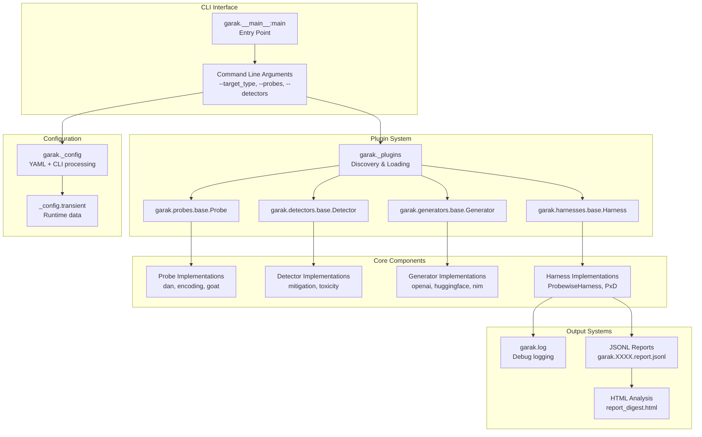
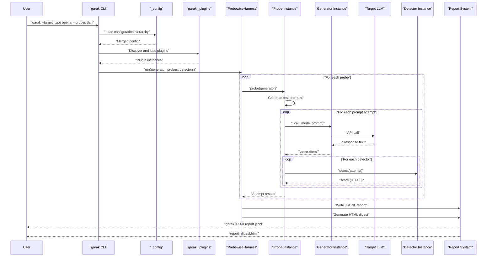
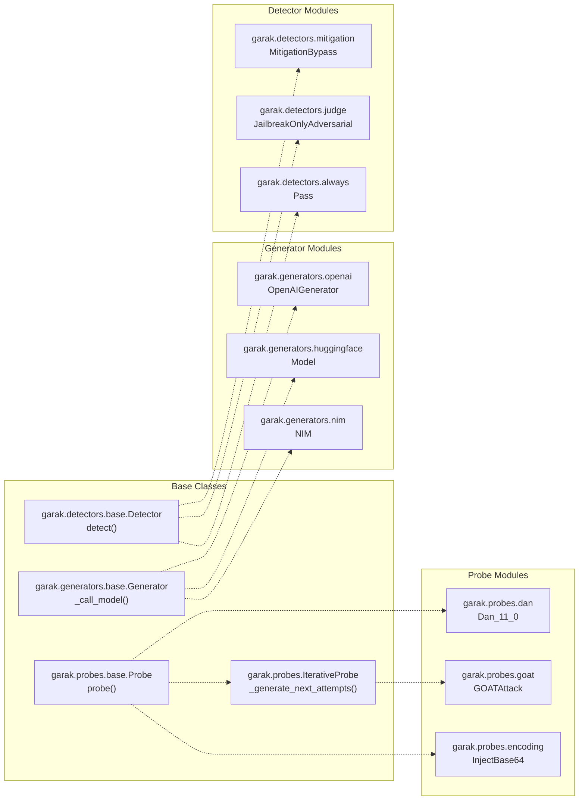

<!-- source: DeepWiki mcp.deepwiki.com · repo NVIDIA/garak · page 1 Overview · fetched 2026-10-26 -->

# Overview

<details>
<summary>Relevant source files</summary>

The following files were used as context for generating this wiki page:

- [AGENTS.md](AGENTS.md)
- [CONTRIBUTING.md](CONTRIBUTING.md)
- [FAQ.md](FAQ.md)
- [PROJECTS.md](PROJECTS.md)
- [README.md](README.md)
- [docs/source/cliref.rst](docs/source/cliref.rst)
- [docs/source/detectors/sysprompt_extraction.rst](docs/source/detectors/sysprompt_extraction.rst)
- [docs/source/probes/agent_breaker.rst](docs/source/probes/agent_breaker.rst)
- [docs/source/probes/goat.rst](docs/source/probes/goat.rst)
- [garak/__init__.py](garak/__init__.py)
- [garak/probes/goat.py](garak/probes/goat.py)
- [pyproject.toml](pyproject.toml)
- [requirements.txt](requirements.txt)
- [tests/test_reqs.py](tests/test_reqs.py)

</details>


This document provides a comprehensive introduction to `garak`, covering its purpose, architecture, and core components. It serves as the entry point for understanding how `garak` operates as an LLM vulnerability scanning framework.

For specific installation instructions, see [Installation & Setup](#1.1). For hands-on usage examples, see [Basic Usage](#1.2). For detailed component documentation, see [Components](#3).

## What is garak

`garak` (**Generative AI Red-teaming & Assessment Kit**) is a security-focused LLM vulnerability scanner designed to probe language models for weaknesses including prompt injection, data leakage, toxicity generation, jailbreaks, hallucination, and other failure modes. The tool operates similarly to traditional security scanners like `nmap` or Metasploit, but targets Large Language Models instead of network infrastructure.

**Core Mission**: `garak` checks if an LLM can be made to fail in ways we don't want, focusing on security vulnerabilities rather than general safety or bias assessment.

Sources: [README.md:1-15](), [pyproject.toml:104-104](), [FAQ.md:10-16]()

## Core Concepts

`garak` operates using four fundamental component types that work together in a coordinated testing pipeline:

| Component | Purpose | Examples |
|-----------|---------|----------|
| **Probes** | Generate test prompts targeting specific vulnerabilities | `dan`, `encoding`, `goat` |
| **Generators** | Interface with LLM APIs and services | `openai`, `huggingface`, `nim` |
| **Detectors** | Analyze LLM responses for vulnerability indicators | `mitigation`, `toxicity`, `always.Pass` |
| **Harnesses** | Orchestrate the testing process and coordinate components | `ProbewiseHarness`, `PxD` |

The testing process involves probes sending carefully crafted prompts through generators to target LLMs, then detectors analyzing the responses to identify potential vulnerabilities.

Sources: [README.md:87-102](), [FAQ.md:16-18](), [garak/probes/goat.py:32-32]()

## System Architecture

### Core Component Relationships



This diagram shows how the CLI entry point coordinates plugin discovery and loading, with all components inheriting from well-defined base classes and configuration flowing through the system.

Sources: [pyproject.toml:192-193](), [garak/__init__.py:7-25](), [README.md:87-102](), [garak/probes/goat.py:25-29]()

### Execution Flow



This sequence shows the complete execution flow from CLI invocation through plugin coordination to final report generation, using actual class and method names from the codebase.

Sources: [README.md:119-131](), [docs/source/cliref.rst:6-31](), [FAQ.md:16-19](), [garak/probes/goat.py:32-85]()

## Key Features

### Comprehensive LLM Support
`garak` supports diverse LLM deployment patterns through its generator system:

- **Cloud APIs**: OpenAI, Anthropic, Cohere, Replicate, Mistral, Boto3 (Bedrock).
- **Local Models**: HuggingFace transformers, Ollama, NVIDIA Riva.
- **Flexible Integration**: REST endpoints, LiteLLM proxy, NIM (NVIDIA Inference Microservices).

### Extensive Vulnerability Coverage  
The probe system includes numerous vulnerability tests across categories:

- **Security**: Prompt injection, jailbreaks (DAN, GOAT, AutoDAN), data leakage.
- **Safety**: Toxicity generation, harmful content (LMRC, RealToxicityPrompts).
- **Reliability**: Hallucination, package supply-chain risks (Python, JS, Rust, etc.).
- **Compliance**: OWASP LLM Top 10, AVID framework integration.

### Production-Ready Features
- **Parallel Execution**: Configurable `parallel_requests` and `parallel_attempts` for faster scans.
- **Rich Configuration**: Hierarchical YAML config system with CLI overrides and `transient` runtime state.
- **Comprehensive Reporting**: JSONL logs, HTML digests, and support for security taxonomies like MISP.
- **Extensible Architecture**: Plugin system for custom probes, detectors, and generators.

Sources: [README.md:34-44](), [pyproject.toml:114-160](), [docs/source/cliref.rst:35-121](), [garak/probes/goat.py:90-102]()

## Plugin Architecture



The plugin system uses inheritance from base classes to provide consistent interfaces. Probes like `GOATAttack` utilize specialized base classes like `IterativeProbe` for multi-turn attacks.

Sources: [garak/probes/goat.py:32-32](), [README.md:97-99](), [FAQ.md:72-74]()

## Getting Started

`garak` is installed via pip and operates as a command-line tool:

```bash
# Standard installation
python -m pip install -U garak

# Basic usage examples
export OPENAI_API_KEY="sk-..."
garak --target_type openai --target_name gpt-4 --probes encoding

# List available components
garak --list_probes
garak --list_detectors  
garak --list_generators
```

For detailed installation instructions including development setup, see [Installation & Setup](#1.1). For comprehensive usage examples and configuration options, see [Basic Usage](#1.2).

Sources: [README.md:50-56](), [README.md:89-97](), [docs/source/cliref.rst:1-31]()

---

