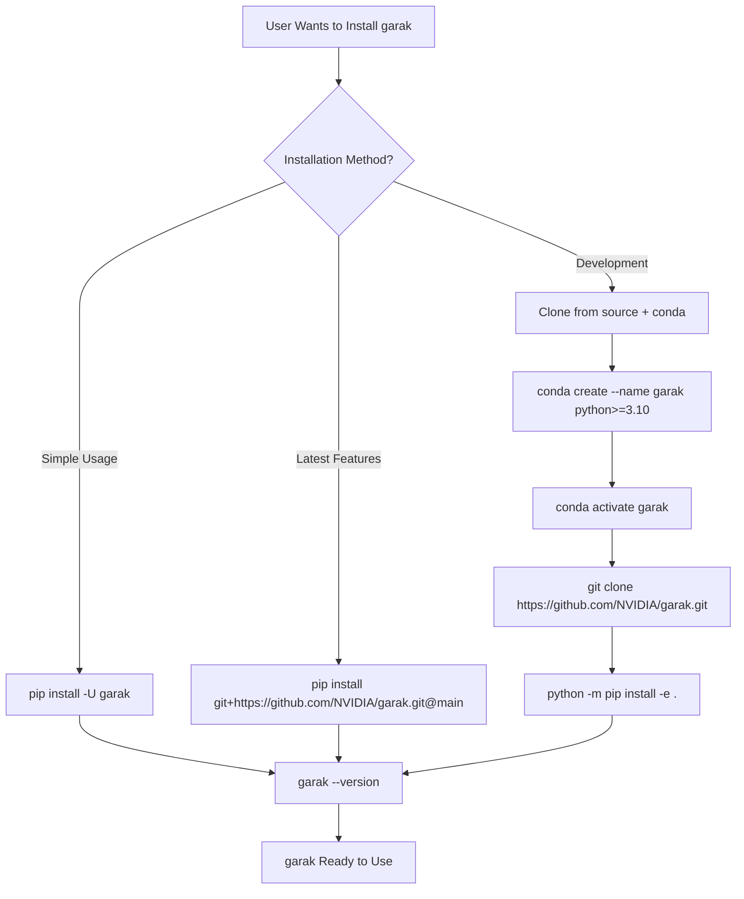
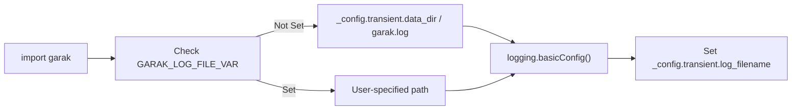

<!-- source: DeepWiki mcp.deepwiki.com · repo NVIDIA/garak · page 1.1 Installation & Setup · fetched 2026-10-26 -->

# Installation & Setup

<details>
<summary>Relevant source files</summary>

The following files were used as context for generating this wiki page:

- [.github/workflows/docs.yml](.github/workflows/docs.yml)
- [.readthedocs.yaml](.readthedocs.yaml)
- [docs/README.md](docs/README.md)
- [docs/source/Makefile](docs/source/Makefile)
- [docs/source/_config.rst](docs/source/_config.rst)
- [docs/source/_plugins.rst](docs/source/_plugins.rst)
- [docs/source/basic.rst](docs/source/basic.rst)
- [docs/source/cli.rst](docs/source/cli.rst)
- [docs/source/cliref.rst](docs/source/cliref.rst)
- [docs/source/command.rst](docs/source/command.rst)
- [docs/source/exception.rst](docs/source/exception.rst)
- [docs/source/index_analyze.rst](docs/source/index_analyze.rst)
- [docs/source/install.rst](docs/source/install.rst)
- [docs/source/interactive.rst](docs/source/interactive.rst)
- [docs/source/payloads.rst](docs/source/payloads.rst)
- [docs/source/report.rst](docs/source/report.rst)
- [docs/source/usage.rst](docs/source/usage.rst)
- [garak/__init__.py](garak/__init__.py)
- [garak/configs/fast.json](garak/configs/fast.json)
- [pyproject.toml](pyproject.toml)
- [requirements.txt](requirements.txt)
- [tests/test_reqs.py](tests/test_reqs.py)

</details>


This document guides you through installing garak and performing initial configuration steps. It covers system requirements, installation methods, dependency management, and basic setup verification. For information about running garak commands and basic usage patterns, see [Basic Usage](#1.2). For detailed configuration options and advanced setup, see [Configuration System](#2.3).

## System Requirements

garak supports Python 3.10 and newer, developed primarily for Linux and macOS environments, with Windows support available.

**Python Version Requirements:**
- Minimum: Python 3.10
- Specified in `pyproject.toml` [pyproject.toml:113-113]()

**Operating System Support:**
- Linux and macOS (primary development platforms) [pyproject.toml:111-111]()
- Windows (supported via conditional dependencies like `python-magic-bin`) [pyproject.toml:143-143]()

**Hardware Considerations:**
garak can run in multiple modes depending on your target models:
- **API-only mode**: Minimal local resources (for OpenAI, Anthropic, etc.)
- **Local model mode**: Requires significant RAM and potentially GPU memory for `transformers` or `torch` [pyproject.toml:116-132]()

**Sources:** [pyproject.toml:106-113](), [pyproject.toml:143-144]()

## Installation Methods

### Standard PyPI Installation

The simplest installation method for most users:

```bash
python -m pip install -U garak
```

This installs the latest stable release from PyPI with all core dependencies.

### Development Version Installation

To get the latest features and fixes from the main branch:

```bash
python -m pip install -U git+https://github.com/NVIDIA/garak.git@main
```

### Source Installation with Conda

Recommended for development or when you need more control over the environment:

```bash
conda create --name garak "python>=3.10"
conda activate garak
git clone https://github.com/NVIDIA/garak.git
cd garak
python -m pip install -e .
```

### Installation Flow Diagram



**Sources:** [pyproject.toml:5-160](), [docs/README.md:5-10]()

## Core Dependencies Architecture

garak has a complex dependency tree designed to support multiple LLM providers, analysis frameworks, and specialized functionality.

### Primary Dependency Categories

```mermaid
graph TB
    subgraph "Core ML Framework"
        transformers["transformers>=5.0"]
        torch["torch>=2.6.0"]
        accelerate["accelerate>=0.23.0"]
        datasets["datasets>=3.0.0"]
    end
    
    subgraph "LLM Provider APIs"
        openai["openai>=2.0"]
        cohere["cohere>=5.16.0"]
        anthropic["anthropic>=0.40.0"]
        litellm["litellm>=1.84.0"]
        mistralai["mistralai==1.5.2"]
    end
    
    subgraph "Text Processing"
        nltk["nltk>=3.9.1"]
        sentencepiece["sentencepiece>=0.1.99"]
        tiktoken["tiktoken>=0.7.0"]
        zalgolib["zalgolib>=0.2.2"]
    end
    
    subgraph "Analysis & Reporting"
        avidtools["avidtools==0.1.2"]
        langchain["langchain>=1.2.1"]
        numpy["numpy>=2.0.0"]
        markdown["markdown>=3.4.3"]
    end
    
    subgraph "Entry Point"
        garak_main["garak.__main__:main"]
    end
    
    garak_main --> transformers
    garak_main --> openai
    garak_main --> nltk
    garak_main --> avidtools
```



### Optional Dependencies

garak includes several optional dependency groups for specialized functionality, defined in `pyproject.toml` [pyproject.toml:162-187]():

| Group | Purpose | Key Packages |
|-------|---------|-------------|
| `tests` | Testing framework | `pytest`, `requests-mock`, `respx` |
| `lint` | Code formatting | `black`, `pylint` |
| `calibration` | Statistical analysis | `scipy` |
| `audio` | Audio processing | `soundfile`, `librosa` |
| `dra` | Toxicity detection | `detoxify` |

Install optional dependencies using:
```bash
python -m pip install "garak[tests,calibration,audio]"
```

**Sources:** [pyproject.toml:114-187](), [requirements.txt:1-65]()

## Entry Point Configuration

garak is configured as a command-line application through the `pyproject.toml` entry point configuration [pyproject.toml:192-193]():

```toml
[project.scripts]
garak = "garak.__main__:main"
```

### Logging & Path Initialization

garak automatically configures logging and data paths during package initialization in `garak/__init__.py` [garak/__init__.py:11-25](). It uses `xdg-base-dirs` to manage data directories [pyproject.toml:146-146]().



**Sources:** [garak/__init__.py:11-25](), [pyproject.toml:146-146](), [pyproject.toml:192-193]()

## Environment Variables

Several environment variables control garak's behavior and are required for various generators:

### Required for Specific Generators

| Variable | Purpose | Required For |
|----------|---------|-------------|
| `OPENAI_API_KEY` | OpenAI API authentication | OpenAI models |
| `ANTHROPIC_API_KEY` | Anthropic API access | Anthropic models |
| `COHERE_API_KEY` | Cohere API authentication | Cohere models |
| `REPLICATE_API_TOKEN` | Replicate API access | Replicate models |
| `MISTRAL_API_KEY` | Mistral API access | Mistral models |

### Optional Configuration

| Variable | Purpose | Default |
|----------|---------|---------|
| `GARAK_LOG_FILE` | Custom log file location | `data_dir/garak.log` |

**Sources:** [garak/__init__.py:11-17](), [docs/source/usage.rst:29-31](), [docs/source/usage.rst:39-40]()

## Initial Setup Verification

After installation, verify garak is working correctly:

### Version Check
```bash
garak --version
```
Expected output: `garak LLM vulnerability scanner v[version]` [docs/source/cliref.rst:6-6]()

### List Available Components
```bash
garak --list_probes      # Show available vulnerability probes [docs/source/cliref.rst:28-28]()
garak --list_detectors   # Show available detection methods [docs/source/cliref.rst:29-29]()
garak --list_generators  # Show available LLM interfaces [docs/source/cliref.rst:29-29]()
```

### Configuration Status
```bash
garak --list_config      # Display current configuration [docs/source/cliref.rst:30-30]()
```

### Test Run
To verify the installation without consuming API credits, use a small Hugging Face model:
```bash
garak --target_type huggingface --target_name gpt2 --probes dan.Dan_11_0
```

**Sources:** [docs/source/cliref.rst:6-31](), [docs/source/usage.rst:43-48]()

## Configuration Hierarchy

Config values are loaded in the following priority (lowest-first) as defined in `docs/source/_config.rst` [docs/source/_config.rst:14-20]():

1. **Plugin defaults**: Hardcoded in the plugin classes.
2. **Core config**: `garak/resources/garak.core.yaml`.
3. **Site config**: `$HOME/.config/garak/garak.site.yaml` or `.json`.
4. **Runtime config**: Manually specified via `--config` CLI parameter.
5. **Command-line options**: Flags passed directly to the `garak` command.

**Sources:** [docs/source/_config.rst:7-21](), [docs/source/cliref.rst:13-13]()

---

