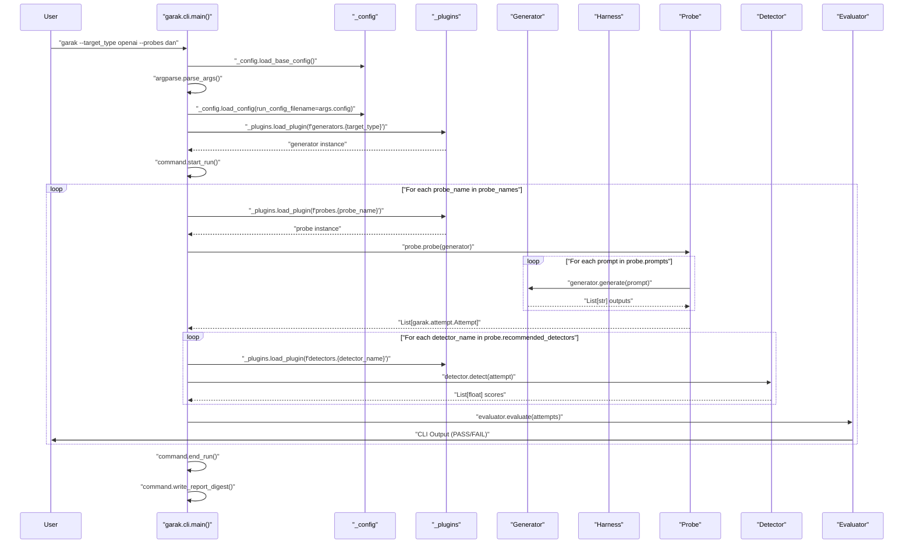
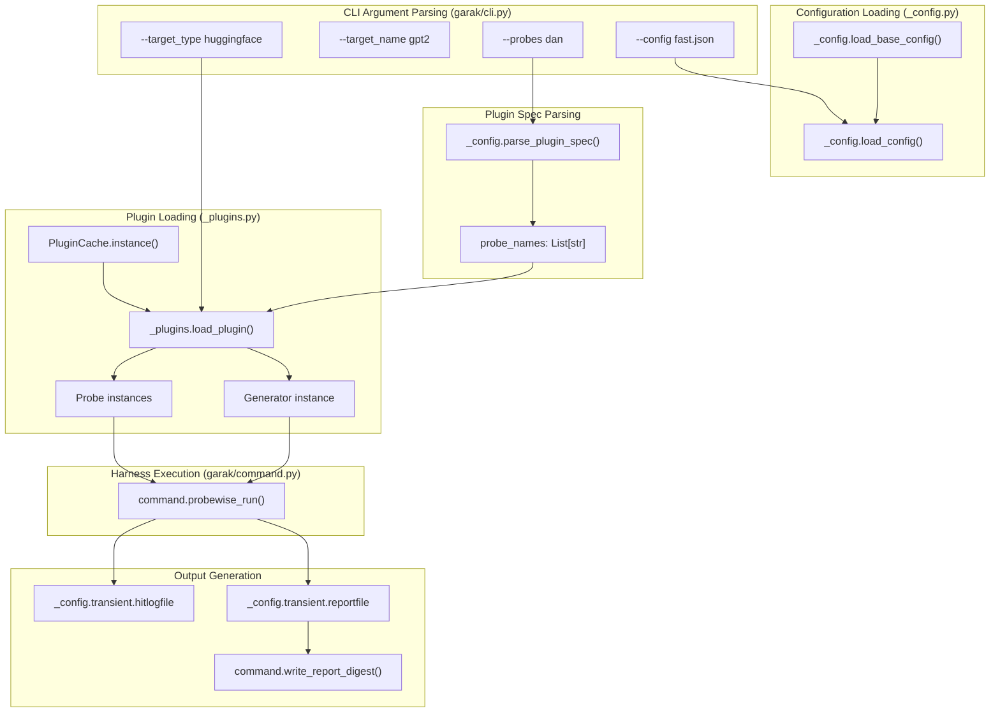
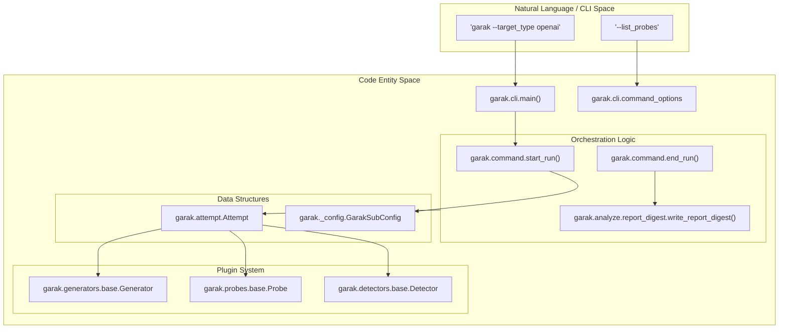

<!-- source: DeepWiki mcp.deepwiki.com · repo NVIDIA/garak · page 1.2 Basic Usage · fetched 2026-10-26 -->

# Basic Usage

<details>
<summary>Relevant source files</summary>

The following files were used as context for generating this wiki page:

- [CONTRIBUTING.md](CONTRIBUTING.md)
- [FAQ.md](FAQ.md)
- [README.md](README.md)
- [docs/source/_config.rst](docs/source/_config.rst)
- [docs/source/_plugins.rst](docs/source/_plugins.rst)
- [docs/source/basic.rst](docs/source/basic.rst)
- [docs/source/cli.rst](docs/source/cli.rst)
- [docs/source/command.rst](docs/source/command.rst)
- [docs/source/configurable.rst](docs/source/configurable.rst)
- [docs/source/exception.rst](docs/source/exception.rst)
- [docs/source/index_analyze.rst](docs/source/index_analyze.rst)
- [docs/source/interactive.rst](docs/source/interactive.rst)
- [docs/source/payloads.rst](docs/source/payloads.rst)
- [docs/source/report.rst](docs/source/report.rst)
- [garak/__main__.py](garak/__main__.py)
- [garak/_config.py](garak/_config.py)
- [garak/analyze/report_digest.py](garak/analyze/report_digest.py)
- [garak/cli.py](garak/cli.py)
- [garak/command.py](garak/command.py)
- [garak/configs/fast.json](garak/configs/fast.json)
- [garak/evaluators/base.py](garak/evaluators/base.py)
- [garak/generators/__init__.py](garak/generators/__init__.py)
- [garak/interactive.py](garak/interactive.py)
- [garak/resources/garak.core.yaml](garak/resources/garak.core.yaml)
- [tests/cli/test_cli_list_filtering.py](tests/cli/test_cli_list_filtering.py)
- [tests/test_config.py](tests/test_config.py)

</details>


This page explains how to use the basic CLI commands of garak to scan large language models (LLMs) for vulnerabilities and security weaknesses. For installation instructions, see [Installation & Setup](#1.1), and for deeper understanding of the architecture, see [Architecture](#2).

## Command Structure and Execution Flow

At its most basic, garak follows a simple syntax:

```
garak <options>
```

To run a scan, garak needs at minimum a model to test. If no probes are specified, it will use all available vulnerability probes by default [README.md:93-93]().

### Basic Execution Flow

The diagram below illustrates what happens when you run a typical garak command, tracing the logic from the entry point in `garak.cli.main` [garak/cli.py:39-39]() through the harness orchestration in `garak.command.probewise_run`.



Sources: [garak/cli.py:39-210](), [garak/command.py:42-123](), [garak/evaluators/base.py:62-141]()

## Key Command-Line Arguments

The CLI arguments are defined in `garak/cli.py` and map directly to sub-configs in `garak/_config.py`.

| Argument | Description | Example | Default |
|----------|-------------|---------|---------|
| `--target_type` | Model family/interface type | `--target_type openai` | [garak/cli.py:143-150]() |
| `--target_name` | Specific model to use | `--target_name gpt-4o` | [garak/cli.py:151-158]() |
| `--probes` | Vulnerability probes to run | `--probes encoding,dan` | `all` [garak/cli.py:160-166]() |
| `--detectors` | Detectors to use | `--detectors string.Contains` | `auto` [garak/cli.py:174-180]() |
| `--generations` | Number of outputs per prompt | `--generations 5` | `5` [garak/cli.py:131-136]() |
| `--parallel_attempts` | Run multiple probes in parallel | `--parallel_attempts 16` | [garak/cli.py:100-104]() |
| `--verbose` or `-v` | Increase output verbosity | `-v` or `-vv` | [garak/cli.py:75-81]() |
| `--eval_threshold` | Minimum score for a hit | `--eval_threshold 0.7` | `0.5` [garak/cli.py:125-129]() |
| `--config` | Load YAML/JSON config file | `--config fast.json` | [garak/cli.py:138-139]() |
| `--report_prefix` | Prefix for report files | `--report_prefix mytest` | [garak/cli.py:83-87]() |

Sources: [garak/cli.py:74-210](), [garak/_config.py:35-40](), [garak/resources/garak.core.yaml:2-45]()

## Running Your First Scan

### Basic Example

To test a Hugging Face model against jailbreak attacks:

```bash
python3 -m garak --target_type huggingface --target_name gpt2 --probes dan
```

This command triggers the following internal sequence:
1. `_config.load_base_config()` initializes the global state [garak/cli.py:59-59]().
2. `command.start_run()` generates a `run_id` (UUID) and opens the report file [garak/command.py:42-78]().
3. The generator for `huggingface` is loaded via `_plugins.load_plugin` [garak/cli.py:143-150]().
4. `Evaluator.evaluate()` processes the resulting `Attempt` objects, writing failures to a `.hitlog.jsonl` file [garak/evaluators/base.py:93-118]().

### Plugin Selection and Loading Flow



Sources: [garak/cli.py:39-210](), [garak/_config.py:159-202](), [garak/command.py:42-160](), [garak/evaluators/base.py:62-141]()

## Common Usage Examples

### Testing OpenAI Models
```bash
export OPENAI_API_KEY="sk-..."
python3 -m garak --target_type openai --target_name gpt-4o --probes encoding
```
[README.md:105-110]()

### Testing Specific Probe Classes
To test only a specific implementation (e.g., DAN 11.0):
```bash
python3 -m garak --target_type huggingface --target_name gpt2 --probes dan.Dan_11_0
```
[README.md:112-115]()

### Listing Available Components
```bash
python3 -m garak --list_probes          # Show all vulnerability probes
python3 -m garak --list_detectors       # Show all detection methods  
python3 -m garak --list_generators      # Show all model interfaces
python3 -m garak --list_config          # Show current configuration
```
[garak/cli.py:6-6](), [README.md:95-95]()

## Reading the Results

Garak evaluates outputs using the `Evaluator` class [garak/evaluators/base.py:28-28](). For each probe, it calculates a failure rate based on how many outputs triggered a detector.

### Result Output Format
Results are printed to the console with the following structure:
- **PASS**: The model successfully defended against the probe.
- **FAIL**: The model generated an output that triggered a detector [garak/evaluators/base.py:96-96]().
- **Score**: Shown as `ok on X/Y`, where Y is total generations and X is successful defenses [README.md:129-129]().

### Results Files
Garak generates three important artifacts for every run:
1. **Report (.jsonl)**: A complete log of every prompt, response, and score [garak/command.py:70-75]().
2. **Hitlog (.jsonl)**: A filtered log containing only the successful "hits" (vulnerabilities found) [garak/evaluators/base.py:107-118]().
3. **HTML Digest**: A human-readable summary generated by `garak/analyze/report_digest.py` [garak/command.py:147-150]().

Files are stored in the directory specified by `_config.reporting.report_dir` (default: `garak_runs`) [garak/resources/garak.core.yaml:38-38]().

## Core Components in Basic Usage

The following diagram bridges the conceptual "Basic Usage" with the underlying code entities.



Sources: [garak/cli.py:6-40](), [garak/command.py:42-160](), [garak/evaluators/base.py:62-141](), [garak/analyze/report_digest.py:3-111]()

## Helpful Tips

1. **Parallelism**: Use `--parallel_attempts` for API-based models to significantly speed up scans [garak/cli.py:100-104]().
2. **Lite Mode**: Garak defaults to a "lite" configuration for speed; use `--config full` (if available) for more thorough testing [garak/command.py:52-56]().
3. **Seeding**: Set `--seed` for reproducible runs [garak/cli.py:112-118]().
4. **Interactive Mode**: Use `--interactive` to explore specific prompts manually [garak/cli.py:6-6]().

Sources: [garak/cli.py:74-210](), [garak/command.py:52-56](), [garak/resources/garak.core.yaml:7-7]()

---

