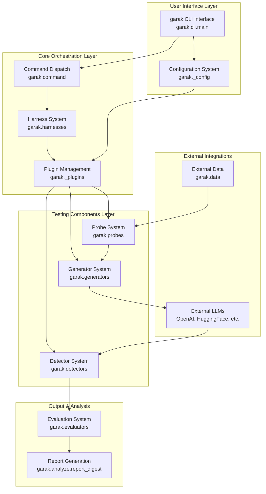
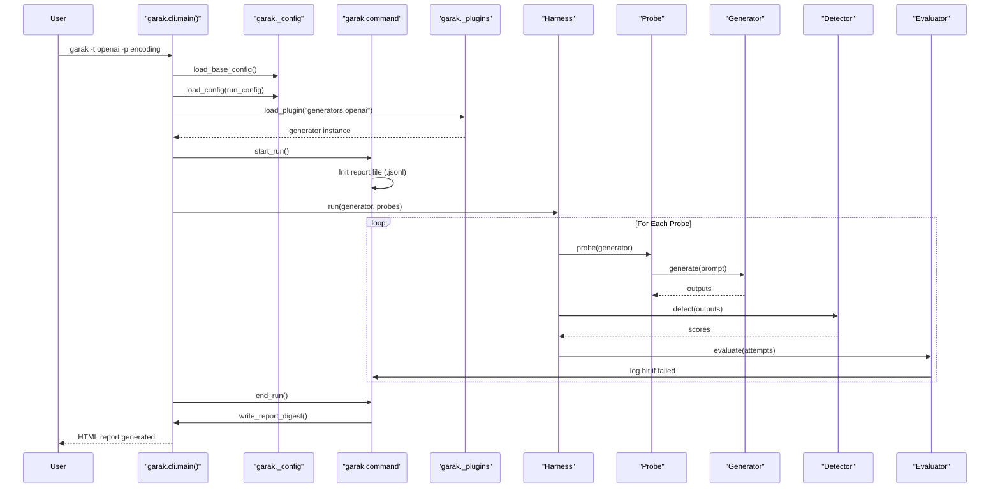
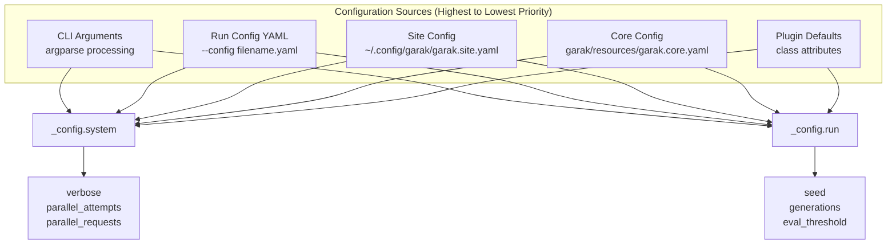
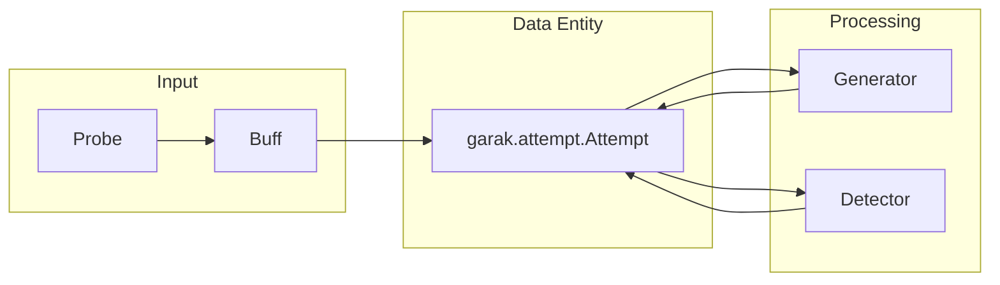

<!-- source: DeepWiki mcp.deepwiki.com · repo NVIDIA/garak · page 2 Architecture · fetched 2026-10-26 -->

# Architecture

<details>
<summary>Relevant source files</summary>

The following files were used as context for generating this wiki page:

- [CONTRIBUTING.md](CONTRIBUTING.md)
- [FAQ.md](FAQ.md)
- [README.md](README.md)
- [docs/source/configurable.rst](docs/source/configurable.rst)
- [garak/_config.py](garak/_config.py)
- [garak/_plugins.py](garak/_plugins.py)
- [garak/analyze/report_digest.py](garak/analyze/report_digest.py)
- [garak/cli.py](garak/cli.py)
- [garak/command.py](garak/command.py)
- [garak/evaluators/base.py](garak/evaluators/base.py)
- [garak/generators/base.py](garak/generators/base.py)
- [garak/generators/cohere.py](garak/generators/cohere.py)
- [garak/generators/ggml.py](garak/generators/ggml.py)
- [garak/generators/huggingface.py](garak/generators/huggingface.py)
- [garak/generators/openai.py](garak/generators/openai.py)
- [garak/generators/replicate.py](garak/generators/replicate.py)
- [garak/resources/garak.core.yaml](garak/resources/garak.core.yaml)
- [garak/resources/plugin_cache.json](garak/resources/plugin_cache.json)
- [tests/cli/test_cli_list_filtering.py](tests/cli/test_cli_list_filtering.py)
- [tests/test_config.py](tests/test_config.py)

</details>


This page provides an overview of the garak LLM vulnerability scanner architecture, explaining how the system works from a high level, its key components, and how they interact. For more detailed information about specific components, see the related pages on [Core Components](#2.1), [Plugin System](#2.2), [Configuration System](#2.3), and [Execution Flow](#2.4).

## High-Level System Overview

Garak is a sophisticated LLM vulnerability scanning framework built on a layered, plugin-based architecture. The system orchestrates vulnerability testing through a well-defined pipeline that separates user interface, core orchestration, testing components, and reporting.

### Overall System Architecture



Sources: [garak/cli.py:39-110](), [garak/_config.py:1-41](), [garak/_plugins.py:4-22](), [garak/command.py:42-121](), [garak/analyze/report_digest.py:3-41]()

## Component Architecture

At a high level, garak consists of these main architectural components:

1.  **CLI Interface**: Entry point for users via `garak.cli.main()` [garak/cli.py:39-40]().
2.  **Configuration System**: Manages hierarchical settings with precedence (Core < Site < Run < CLI) [garak/_config.py:6-31]().
3.  **Plugin System**: Manages discovery, caching, and loading via `PluginCache` [garak/_plugins.py:39-42]().
4.  **Core Components**:
    *   **Probes**: Generate prompts to test LLM vulnerabilities [garak/resources/plugin_cache.json:2-30]().
    *   **Generators**: Interface with LLMs (e.g., `HuggingFace.Pipeline`, `OpenAI.OpenAICompatible`) [garak/generators/huggingface.py:46-59](), [garak/generators/openai.py:134-155]().
    *   **Detectors**: Analyze responses for vulnerabilities [garak/_plugins.py:20-21]().
    *   **Harnesses**: Orchestrate interactions (e.g., `ProbewiseHarness`, `PxD`) [garak/_config.py:113]().
    *   **Buffs**: Modify prompts (e.g., translation, paraphrasing) [garak/_config.py:112]().
    *   **Evaluators**: Assess detector results (e.g., `garak.evaluators.base.Evaluator`) [garak/evaluators/base.py:28-32]().
5.  **Reporting System**: Generates JSONL logs and HTML summaries [garak/analyze/report_digest.py:3-13]().

### Core Class Architecture

```mermaid
classDiagram
    class "cli" {
        +main(arguments)
        +parse_cli_plugin_config(plugin_type, args)
    }
    
    class "_config" {
        +load_base_config()
        +load_config()
        +system: GarakSubConfig
        +run: GarakSubConfig
        +plugins: GarakSubConfig
        +reporting: GarakSubConfig
        +transient: TransientConfig
    }
    
    class "PluginCache" {
        +instance()
        +_load_plugin_cache()
        +_build_plugin_cache()
    }
    
    class "Generator" {
        +generate(prompt)
        +_call_model(prompt, generations)
        +DEFAULT_PARAMS: dict
    }
    
    class "Evaluator" {
        +evaluate(attempts)
        +test(test_value) bool
    }
    
    class "Attempt" {
        +prompt: Message
        +outputs: List[Message]
        +detector_results: dict
        +as_dict()
    }
    
    cli --> _config
    cli --> PluginCache
    Generator --|> Configurable
    Evaluator --> Attempt
```

Sources: [garak/cli.py:39-72](), [garak/_config.py:47-88](), [garak/_plugins.py:39-60](), [garak/generators/base.py:21-50](), [garak/evaluators/base.py:28-62]()

## Execution Flow

The typical execution flow in garak starts with a CLI command and progresses through configuration loading, plugin initialization, and test execution. For details, see [Execution Flow](#2.4).

### Main Execution Sequence



Sources: [garak/cli.py:39-65](), [garak/command.py:42-121](), [garak/command.py:124-160](), [garak/generators/base.py:138-175](), [garak/evaluators/base.py:62-142]()

## Configuration Management

Garak's configuration system has a well-defined precedence hierarchy managed through the `_config` module. For details, see [Configuration System](#2.3).

### Configuration Precedence and Structure



Sources: [garak/_config.py:6-31](), [garak/_config.py:30-41](), [garak/cli.py:74-139]()

## Plugin System

The plugin system is central to garak's extensibility. It utilizes a `PluginCache` to store metadata about available probes, detectors, and generators, significantly speeding up discovery. For details, see [Plugin System](#2.2).

### Plugin Architecture and Discovery System

```mermaid
graph TD
    subgraph "Plugin Discovery & Management"
        PluginCache["Plugin Cache<br/>plugin_cache.json"]
        Director["_plugins.enumerate_plugins"]
        Provider["_plugins.load_plugin"]
    end
    
    subgraph "Plugin Categories"
        ProbePlugins["Probes<br/>(e.g. probes.dan)"]
        DetectorPlugins["Detectors<br/>(e.g. detectors.mitigation)"]
        GeneratorPlugins["Generators<br/>(e.g. generators.openai)"]
    end
    
    subgraph "Base Classes"
        ProbeBase["garak.probes.base.Probe"]
        DetectorBase["garak.detectors.base.Detector"]
        GeneratorBase["garak.generators.base.Generator"]
    end
    
    Director --> PluginCache
    Provider --> ProbePlugins
    ProbePlugins --|> ProbeBase
    DetectorPlugins --|> DetectorBase
    GeneratorPlugins --|> GeneratorBase
```

Sources: [garak/_plugins.py:39-60](), [garak/_plugins.py:20-22](), [garak/resources/plugin_cache.json:1-30]()

## Core Data Flow

The core of garak's architecture revolves around the `Attempt` object and the flow of data between components. For details, see [Core Components](#2.1).

### Attempt-Centric Data Flow



Sources: [garak/generators/base.py:138-152](), [garak/evaluators/base.py:62-100](), [garak/analyze/report_digest.py:57-87]()

## Architectural Considerations

1.  **Plugin-Based Extensibility**: All major functional units (Probes, Detectors, Generators, Buffs, Harnesses) are plugins [garak/_plugins.py:20-21]().
2.  **Configuration Hierarchy**: Precedence allows site-wide defaults to be overridden by specific run configs or CLI flags [garak/_config.py:6-31]().
3.  **Discovery via Caching**: `plugin_cache.json` avoids expensive filesystem scans on every startup [garak/_plugins.py:39-51]().
4.  **Reporting and Analysis**: The system generates detailed JSONL reports that are later summarized into HTML [garak/analyze/report_digest.py:3-13](), [garak/command.py:147-150]().

Sources: [garak/_config.py:6-31](), [garak/_plugins.py:39-51](), [garak/analyze/report_digest.py:3-13]()

---

