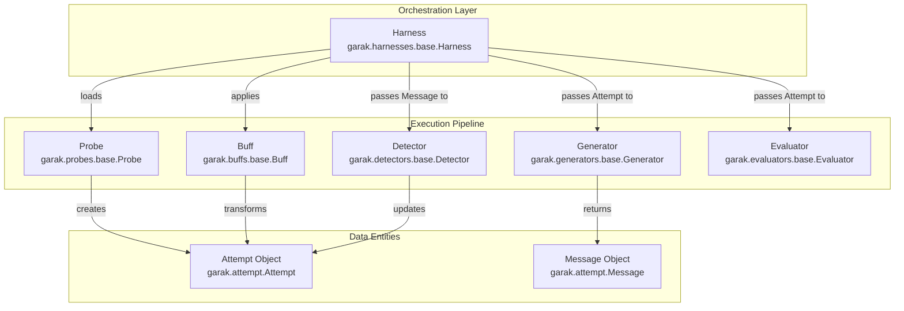
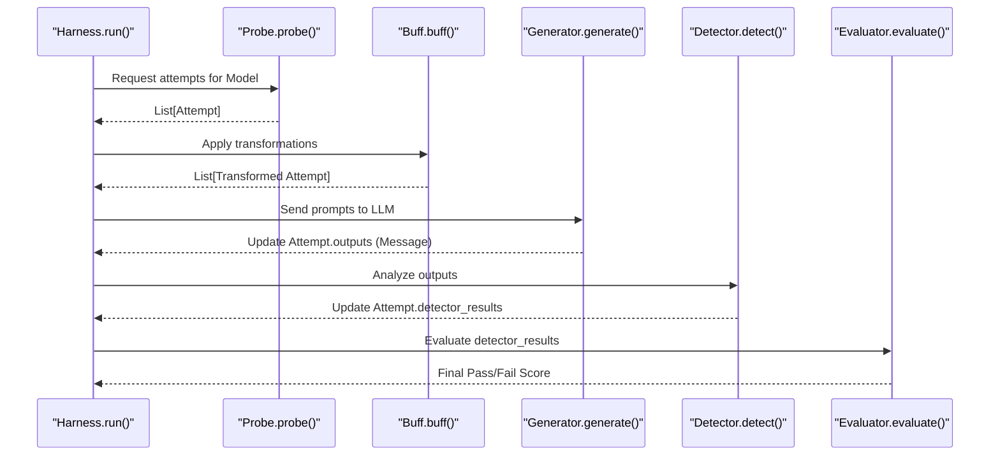

<!-- source: DeepWiki mcp.deepwiki.com · repo NVIDIA/garak · page 2.1 Core Components · fetched 2026-10-26 -->

# Core Components

Relevant source files

The following files were used as context for generating this wiki page:

- [CONTRIBUTING.md](CONTRIBUTING.md)
- [FAQ.md](FAQ.md)
- [README.md](README.md)
- [garak/buffs/base.py](garak/buffs/base.py)
- [garak/buffs/low_resource_languages.py](garak/buffs/low_resource_languages.py)
- [garak/configurable.py](garak/configurable.py)
- [garak/harnesses/base.py](garak/harnesses/base.py)
- [garak/harnesses/probewise.py](garak/harnesses/probewise.py)
- [garak/harnesses/pxd.py](garak/harnesses/pxd.py)
- [tests/evaluators/__init__.py](tests/evaluators/__init__.py)
- [tests/evaluators/test_base.py](tests/evaluators/test_base.py)
- [tests/evaluators/test_evaluators.py](tests/evaluators/test_evaluators.py)
- [tests/test_configurable.py](tests/test_configurable.py)

This document provides a technical overview of garak's core components that comprise the vulnerability scanning pipeline: **Probes**, **Detectors**, **Generators**, **Harnesses**, **Buffs**, and **Evaluators**. These components work together to systematically test LLMs for security and safety vulnerabilities.

## System Component Architecture

The core components form a processing pipeline orchestrated by a `Harness`. The system utilizes a hierarchical configuration system via the `Configurable` base class [garak/configurable.py:24-162]().

### Code Entity Relationship Diagram
This diagram maps system roles to their primary implementation classes and shows the data flow using core structures like `Attempt` and `Message`.

**Sources:** [garak/harnesses/base.py:81-148](), [garak/buffs/base.py:18-43](), [garak/attempt.py:1-100]()

## Probes: Vulnerability Test Generation

**Probes** generate specific vulnerability tests. They create `Attempt` objects containing prompts designed to elicit undesirable behaviors [FAQ.md:16-19](). Probes specify their requirements through metadata like `primary_detector` and `modality` [garak/harnesses/base.py:177-189]().

### Key Probe Mechanisms
*   **Prompt Generation**: Probes define the attack surface (e.g., prompt injection, data leakage).
*   **Modality Matching**: Probes check if their input modality (e.g., text, audio) matches the generator's capabilities [garak/harnesses/base.py:177-187]().
*   **Recommended Detectors**: Probes often suggest specific detectors best suited to identify their specific failure modes [garak/harnesses/probewise.py:30-55]().

**Sources:** [garak/harnesses/base.py:172-192](), [garak/harnesses/probewise.py:86-96](), [FAQ.md:28-30]()

## Buffs: Prompt Augmentation

**Buffs** are transformation layers that sit between Probes and Generators. They take a list of `Attempt` objects and return modified versions, such as translating prompts into low-resource languages or applying encodings [garak/buffs/base.py:18-25]().

### Buff Lifecycle
1.  **Transform**: The `transform()` method creates derivative `Attempt` objects from a source [garak/buffs/base.py:69-73]().
2.  **Tracking**: Buffs store the origin attempt ID in the `notes` attribute to maintain lineage [garak/buffs/base.py:45-67]().
3.  **Untransform**: If `post_buff_hook` is enabled, buffs can process the LLM output (e.g., translating a response back to English) before detection [garak/buffs/low_resource_languages.py:54-69]().

**Sources:** [garak/buffs/base.py:18-97](), [garak/buffs/low_resource_languages.py:23-69]()

## Generators: LLM Interface Layer

**Generators** provide a unified interface to diverse LLM backends. They are responsible for the `_call_model` implementation and managing model-specific parameters [README.md:93-100]().

*   **API Generators**: Connect to services like OpenAI, NVCF (NIM), or Anthropic [README.md:34-44](), [FAQ.md:72-75]().
*   **Local Generators**: Interface with local frameworks like Hugging Face `transformers` or `llama.cpp` [README.md:137-142]().
*   **Modality**: Generators declare supported input/output modalities which are validated by the harness [garak/harnesses/base.py:177-187]().

**Sources:** [README.md:34-44](), [garak/harnesses/base.py:138-140](), [FAQ.md:72-75]()

## Detectors: Response Analysis

**Detectors** analyze the `outputs` (list of `Message` objects) within an `Attempt` to identify "hits" [FAQ.md:16-19]().

### Detection Logic
*   **Scoring**: Detectors produce a score, typically between 0.0 and 1.0, indicating the presence of a vulnerability [garak/harnesses/base.py:194-205]().
*   **Implementation**: They may use keyword matching, regex, or machine learning classifiers [FAQ.md:25-27]().
*   **Assignment**: Results are stored in the `Attempt.detector_results` dictionary, keyed by the detector name [garak/harnesses/base.py:204-205]().

**Sources:** [garak/harnesses/base.py:194-205](), [FAQ.md:25-27]()

## Evaluators: Scoring and Reporting

**Evaluators** judge the results collected by detectors. They aggregate scores across multiple generations to determine if a probe passed or failed [FAQ.md:18-19]().

### Evaluation Types
*   **ThresholdEvaluator**: Passes if the failure rate is below a certain percentage [tests/evaluators/test_evaluators.py:214-219]().
*   **ZeroToleranceEvaluator**: Fails if a single hit is detected [tests/evaluators/test_evaluators.py:22-23]().

**Sources:** [tests/evaluators/test_evaluators.py:1-23](), [FAQ.md:18-19]()

## Harnesses: Orchestration

The **Harness** is the engine that coordinates all other components. It manages the lifecycle of a scan, from initializing runtime services to emitting reports [garak/harnesses/base.py:81-148]().

### Core Harness Implementations
| Harness | Logic |
| :--- | :--- |
| `ProbewiseHarness` | Executes probes one-by-one, loading only the detectors recommended by each probe [garak/harnesses/probewise.py:18-55](). |
| `PxD` | Runs a "Probes x Detectors" matrix, applying all specified detectors to every probe response [garak/harnesses/pxd.py:6-12](). |

### Execution Data Flow
This diagram illustrates how the `Harness.run()` method moves data between entities.

**Sources:** [garak/harnesses/base.py:135-205](), [garak/harnesses/probewise.py:30-110](), [garak/buffs/base.py:79-97]()

---

