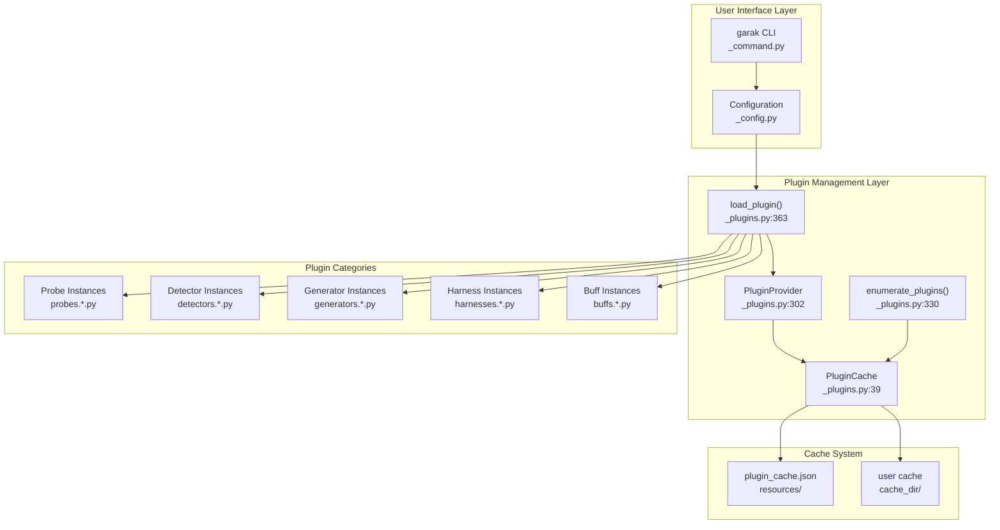
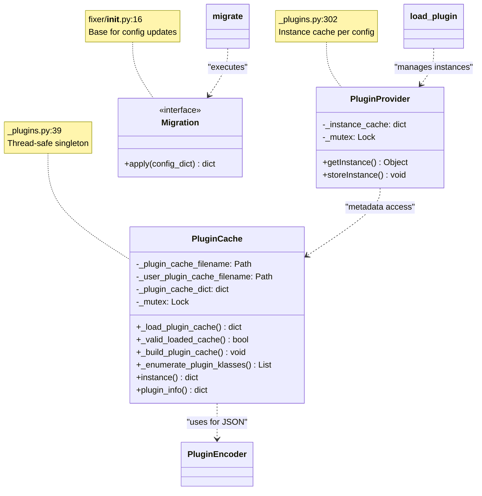
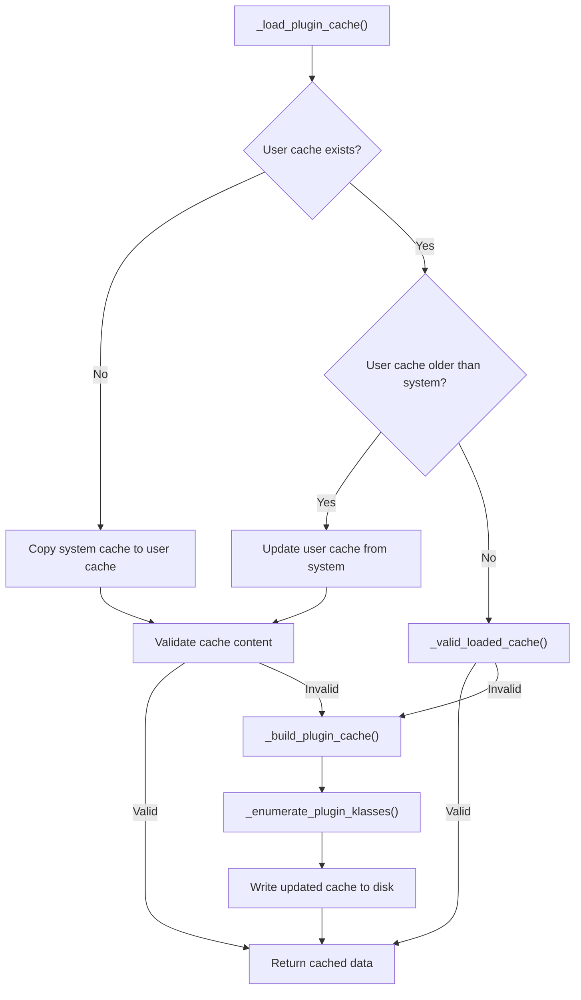
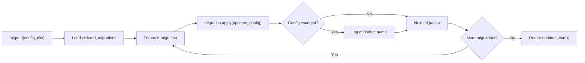

<!-- source: DeepWiki mcp.deepwiki.com · repo NVIDIA/garak · page 2.2 Plugin System · fetched 2026-10-26 -->

# Plugin System

Relevant source files

The following files were used as context for generating this wiki page:

- [garak/_plugins.py](garak/_plugins.py)
- [garak/generators/base.py](garak/generators/base.py)
- [garak/generators/cohere.py](garak/generators/cohere.py)
- [garak/generators/ggml.py](garak/generators/ggml.py)
- [garak/generators/huggingface.py](garak/generators/huggingface.py)
- [garak/generators/openai.py](garak/generators/openai.py)
- [garak/generators/replicate.py](garak/generators/replicate.py)
- [garak/probes/_tier.py](garak/probes/_tier.py)
- [garak/resources/fixer/20240628_gcg_rename.py](garak/resources/fixer/20240628_gcg_rename.py)
- [garak/resources/fixer/20240801_continuation_rename.py](garak/resources/fixer/20240801_continuation_rename.py)
- [garak/resources/fixer/20240822_knownbadsignatures_rename.py](garak/resources/fixer/20240822_knownbadsignatures_rename.py)
- [garak/resources/fixer/20241011_replay_rename.py](garak/resources/fixer/20241011_replay_rename.py)
- [garak/resources/fixer/__init__.py](garak/resources/fixer/__init__.py)
- [garak/resources/fixer/_plugin.py](garak/resources/fixer/_plugin.py)
- [garak/resources/plugin_cache.json](garak/resources/plugin_cache.json)
- [tests/plugins/test_plugin_cache.py](tests/plugins/test_plugin_cache.py)
- [tests/resources/test_fixer.py](tests/resources/test_fixer.py)
- [tests/test_hitlog.py](tests/test_hitlog.py)

The garak plugin system provides the infrastructure for dynamically discovering, loading, and managing the core components that perform vulnerability scanning on Large Language Models (LLMs). It serves as the central orchestration layer between the CLI interface and the actual vulnerability testing components, implementing a modular architecture with efficient caching and singleton instance management.

The plugin system is accessed through the `PluginCache` and `PluginProvider` classes in [garak/_plugins.py](), which handle plugin discovery, metadata caching, and instance management for all plugin types: `probes`, `detectors`, `generators`, `harnesses`, and `buffs`.

## Role in Overall Architecture

The plugin system operates as the core orchestration layer in garak's architecture, positioned between the CLI interface and the actual vulnerability testing components:

Title: Plugin System Data Flow

Sources: [garak/_plugins.py:39-445](), [garak/resources/plugin_cache.json:1-30]()

## Plugin Architecture Overview

The plugin system consists of three main components:

1.  **PluginCache**: Manages metadata discovery and caching for performance [garak/_plugins.py:39-217]().
2.  **PluginProvider**: Implements singleton pattern for plugin instances [garak/_plugins.py:302-323]().
3.  **Fixer/Migration System**: Handles configuration and plugin name updates for backward compatibility [garak/resources/fixer/__init__.py:1-60]().

Title: Plugin System Class Relationships

Sources: [garak/_plugins.py:39-323](), [garak/resources/fixer/__init__.py:16-21]()

## Plugin Cache System

The `PluginCache` class implements a high-performance caching mechanism that stores plugin metadata to avoid repeated filesystem scanning and module importing operations.

### Cache Validation and Rebuild Process

The cache system implements automatic validation through `_valid_loaded_cache()` [garak/_plugins.py:123-164]() and rebuilding via `_build_plugin_cache()` [garak/_plugins.py:165-217]().

Title: Cache Synchronization Flow

Sources: [garak/_plugins.py:84-121](), [garak/_plugins.py:123-164]()

### Cache Contents
The cache stores comprehensive metadata for each plugin. For example, a probe entry includes:
*   `description`: Docstring-derived summary [garak/_plugins.py:255]().
*   `DEFAULT_PARAMS`: Default configuration values [garak/resources/plugin_cache.json:5]().
*   `primary_detector`: The default detector for this probe [garak/resources/plugin_cache.json:20]().
*   `tags`: Security taxonomy tags (e.g., OWASP, AVID) [garak/resources/plugin_cache.json:21-27]().
*   `tier`: Importance level (1-3, or 9 for unlisted) [garak/probes/_tier.py:9-58]().

## Plugin Discovery and Loading

### Discovery (`enumerate_plugins`)
The `enumerate_plugins` function [garak/_plugins.py:330-361]() provides a high-level interface to browse available plugins by category (`probes`, `detectors`, etc.). It relies on `_enumerate_plugin_klasses` [garak/_plugins.py:169-198]() to perform the actual module scanning.

### Loading (`load_plugin`)
The `load_plugin` function [garak/_plugins.py:363-444]() is the primary entry point for instantiating plugins. It supports:
*   **Two-part paths**: `category.module` (e.g., `probes.dan`), which uses the module's `DEFAULT_CLASS` [garak/_plugins.py:375-385]().
*   **Three-part paths**: `category.module.class` (e.g., `probes.dan.DanInTheWild`) for explicit loading [garak/_plugins.py:387-397]().

It integrates with `PluginProvider.getInstance()` [garak/_plugins.py:307-316]() to ensure that plugins are singletons relative to a specific `config_root`.

## Fixer and Migration System

Garak includes a "fixer" system to manage breaking changes in plugin naming or configuration structures.

*   **Migration Base Class**: Defines the `apply()` interface [garak/resources/fixer/__init__.py:16-20]().
*   **Automatic Execution**: The `migrate()` function [garak/resources/fixer/__init__.py:45-59]() automatically runs all discovered migrations in the `garak/resources/fixer/` directory.
*   **Common Fixes**:
    *   Renaming GCG probes to `suffix` [tests/resources/test_fixer.py:31-70]().
    *   Renaming `knownbadsignatures` to `av_spam_scanning` [tests/resources/test_fixer.py:103-120]().
    *   Updating XSS probes to `web_injection` [tests/resources/test_fixer.py:149-167]().

Title: Configuration Migration Process

Sources: [garak/resources/fixer/__init__.py:24-59](), [tests/resources/test_fixer.py:22-168]()

## Summary of Key Functions

| Function | File | Role |
| :--- | :--- | :--- |
| `load_plugin` | `garak/_plugins.py` | Main entry point for instantiating a plugin. |
| `enumerate_plugins` | `garak/_plugins.py` | Lists available plugins in a category. |
| `plugin_info` | `garak/_plugins.py` | Returns metadata for a plugin class or name. |
| `migrate` | `garak/resources/fixer/__init__.py` | Updates configuration for backward compatibility. |
| `PluginCache.instance` | `garak/_plugins.py` | Accesses the singleton plugin metadata cache. |

Sources: [garak/_plugins.py:39-444](), [garak/resources/fixer/__init__.py:45-59]()

---

