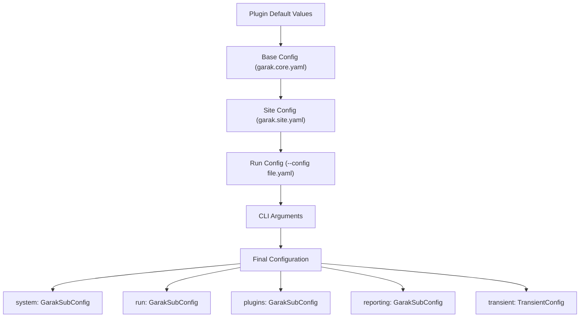
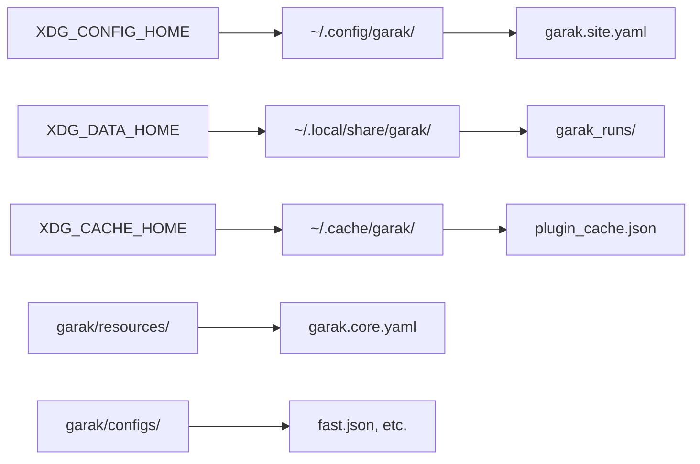
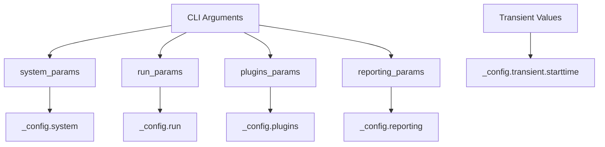
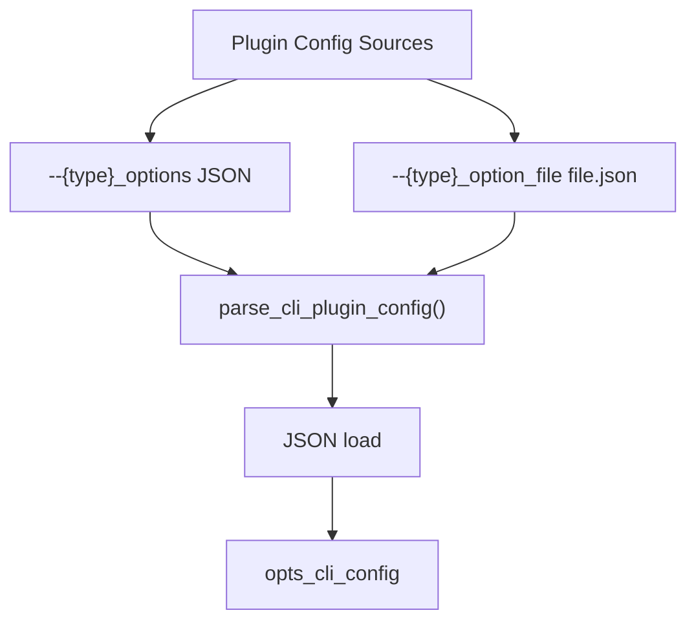
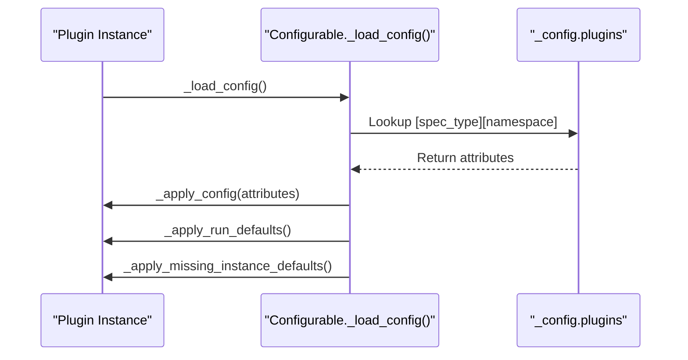

<!-- source: DeepWiki mcp.deepwiki.com · repo NVIDIA/garak · page 2.3 Configuration System · fetched 2026-10-26 -->

# Configuration System

<details>
<summary>Relevant source files</summary>

The following files were used as context for generating this wiki page:

- [docs/source/_config.rst](docs/source/_config.rst)
- [docs/source/_plugins.rst](docs/source/_plugins.rst)
- [docs/source/basic.rst](docs/source/basic.rst)
- [docs/source/cli.rst](docs/source/cli.rst)
- [docs/source/command.rst](docs/source/command.rst)
- [docs/source/configurable.rst](docs/source/configurable.rst)
- [docs/source/exception.rst](docs/source/exception.rst)
- [docs/source/index_analyze.rst](docs/source/index_analyze.rst)
- [docs/source/interactive.rst](docs/source/interactive.rst)
- [docs/source/payloads.rst](docs/source/payloads.rst)
- [docs/source/report.rst](docs/source/report.rst)
- [garak/_config.py](garak/_config.py)
- [garak/analyze/report_digest.py](garak/analyze/report_digest.py)
- [garak/cli.py](garak/cli.py)
- [garak/command.py](garak/command.py)
- [garak/configs/fast.json](garak/configs/fast.json)
- [garak/configurable.py](garak/configurable.py)
- [garak/evaluators/base.py](garak/evaluators/base.py)
- [garak/resources/fixer/20250224_lightweight_probe_defaults.py](garak/resources/fixer/20250224_lightweight_probe_defaults.py)
- [garak/resources/garak.core.yaml](garak/resources/garak.core.yaml)
- [tests/cli/test_cli_list_filtering.py](tests/cli/test_cli_list_filtering.py)
- [tests/test_config.py](tests/test_config.py)
- [tests/test_configurable.py](tests/test_configurable.py)

</details>


The garak configuration system manages settings and parameters across multiple hierarchical layers, from default values through site-wide configuration to individual run parameters. It handles CLI argument parsing, YAML configuration files, and plugin-specific settings with a well-defined precedence order that ensures predictable behavior.

For information about plugin discovery and loading, see [Plugin System](#2.2). For details about execution orchestration, see [Execution Flow](#2.4).

## Configuration Hierarchy and Precedence

The configuration system follows a strict precedence order where higher-priority sources override lower-priority ones:



Sources: [garak/_config.py:6-6]()

The `_config` module maintains five primary configuration categories:

| Category | Purpose | Key Parameters |
|----------|---------|----------------|
| `system` | Runtime behavior settings | `verbose`, `parallel_requests`, `parallel_attempts`, `skip_unknown` |
| `run` | Execution parameters | `seed`, `generations`, `eval_threshold`, `deprefix`, `probe_tags` |
| `plugins` | Plugin specifications and options | `target_type`, `target_name`, `probe_spec`, `detector_spec` |
| `reporting` | Output and analysis settings | `taxonomy`, `report_prefix`, `confidence_interval_method` |
| `transient` | Runtime-only values | `run_id`, `report_filename`, `starttime`, `package_dir` |

Sources: [garak/_config.py:35-40](), [garak/_config.py:60-87]()

## Configuration File Structure and Storage

### File System Layout

The configuration system uses XDG Base Directory specification for cross-platform compatibility. Upon initialization, the system ensures these directories exist with specific permissions (`0o740`).



Sources: [garak/_config.py:21-25](), [garak/_config.py:69-79](), [garak/resources/garak.core.yaml:38-38]()

### YAML Configuration Structure

Configuration files follow a standardized YAML structure with nested sections. The core configuration defines the baseline for all garak runs.

```yaml
---
system:
  verbose: 0
  parallel_attempts: false
  max_workers: 500

run:
  seed: null
  generations: 5
  eval_threshold: 0.5

plugins:
  target_type: null
  probe_spec: all
  extended_detectors: true

reporting:
  report_dir: garak_runs
  confidence_interval_method: bootstrap
```

Sources: [garak/resources/garak.core.yaml:1-45]()

## CLI Argument Processing

### Argument Categories and Mapping

The CLI system maps command-line arguments to configuration categories using predefined parameter lists. The `main` function in `garak/cli.py` initializes the `argparse.ArgumentParser` and populates it with defaults from the current `_config` state.



Sources: [garak/_config.py:35-40](), [garak/cli.py:47-48](), [garak/cli.py:67-220]()

### Plugin-Specific Configuration

Plugin configurations can be provided through multiple mechanisms, including JSON strings or files specifically for probes, detectors, generators, or buffs.



Sources: [garak/cli.py:9-36](), [garak/cli.py:195-210]()

## The Configurable Base Class

The `Configurable` class is the base for most garak plugins (probes, detectors, generators). It provides automated configuration loading and dependency management.

### Dependency Loading
The `_load_deps` method dynamically imports modules listed in `extra_dependency_names`. This allows garak to remain lightweight while supporting plugins that require heavy libraries (e.g., `torch`, `transformers`).

Sources: [garak/configurable.py:24-52]()

### Instance Configuration Flow
When a plugin is instantiated, `_load_config` is called to apply settings from the global `_config` object to the instance.



Sources: [garak/configurable.py:72-117]()

## Configuration Loading and Merging

### Initialization Flow
The configuration system loads through a multi-stage process, starting with the base config and then layering site and run-specific files.

Sources: [garak/_config.py:243-294]()

### Configuration Merging
The `_combine_into()` function merges nested dictionaries recursively, ensuring that specific plugin settings don't wipe out general settings.

Sources: [garak/_config.py:148-156]()

## Migration and Fixer Utilities

garak includes a "fixer" system to handle configuration migrations between versions, such as renaming plugins or updating parameter paths.

### Migration Classes
Fixers are implemented as `Migration` classes with an `apply` method. For example, the `20250224_lightweight_probe_defaults.py` fixer renames several probes to make lightweight versions the default.

| Fixer Class | Purpose | Path Affected |
|-------------|---------|---------------|
| `RenameFigstep` | Update FigStep naming | `plugins.probes.visual_jailbreak` |
| `RenamePrimes` | Update snowball naming | `plugins.probes.snowball` |
| `RenameLatentJailbreak` | Update latent naming | `plugins.probes.latentinjection` |

Sources: [garak/resources/fixer/20250224_lightweight_probe_defaults.py:8-188]()

## Security and Validation

### API Key Detection
The configuration system monitors for potential secrets in YAML/JSON files. If an `api_key` is detected, the system checks file permissions (on Unix) or issues a warning (on Windows).

Sources: [garak/_config.py:179-201]()

### Deprecation Handling
The system tracks deprecated configuration paths (e.g., `plugins.model_type`) and issues notices via `garak.command.deprecation_notice`.

Sources: [garak/_config.py:28-31](), [garak/_config.py:203-213](), [garak/command.py:24-30]()

---

