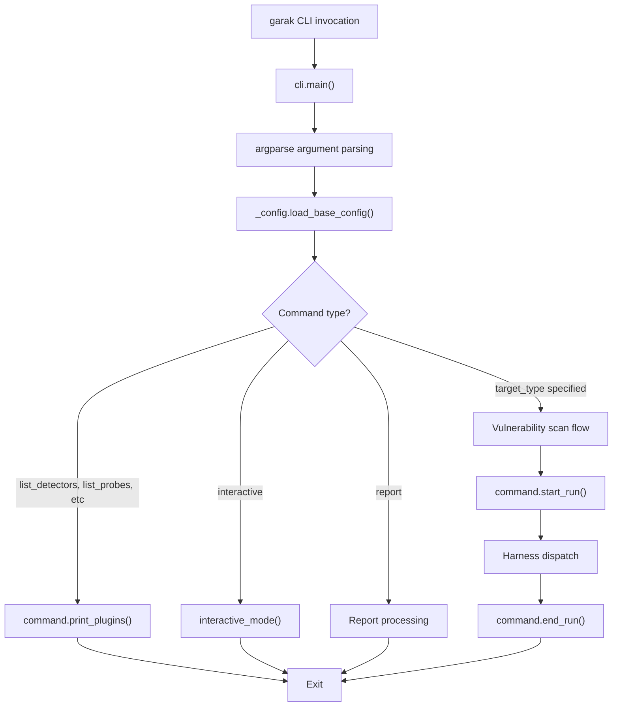
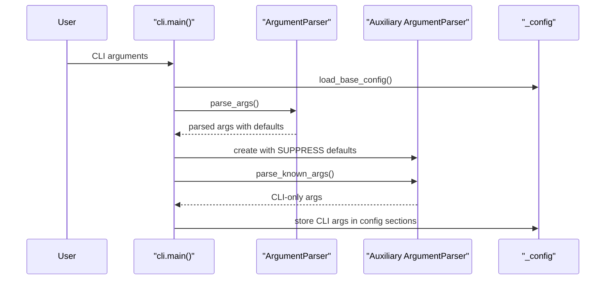
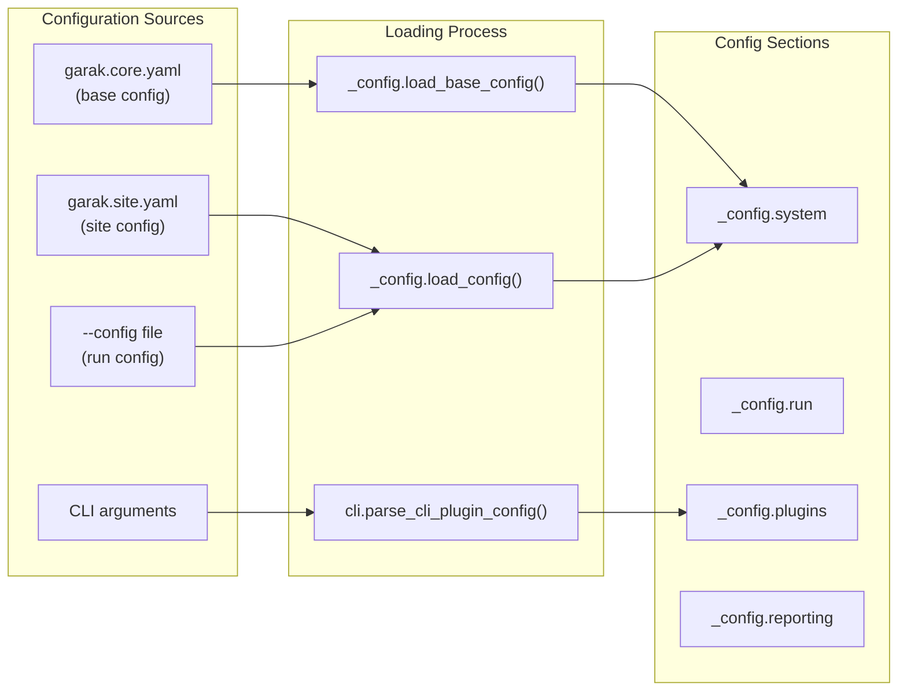
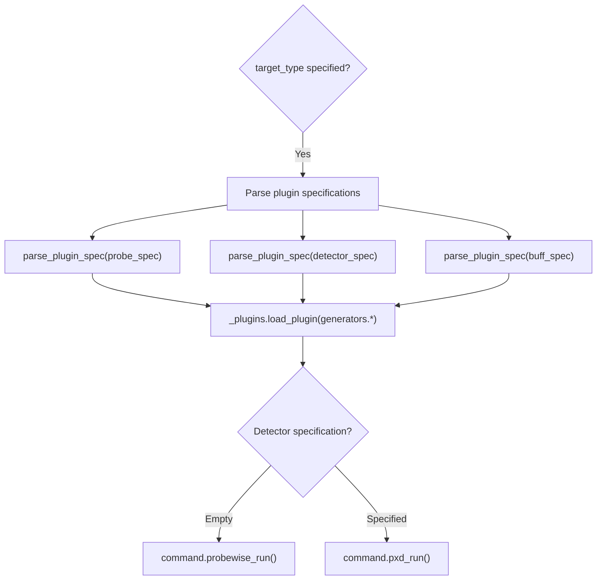
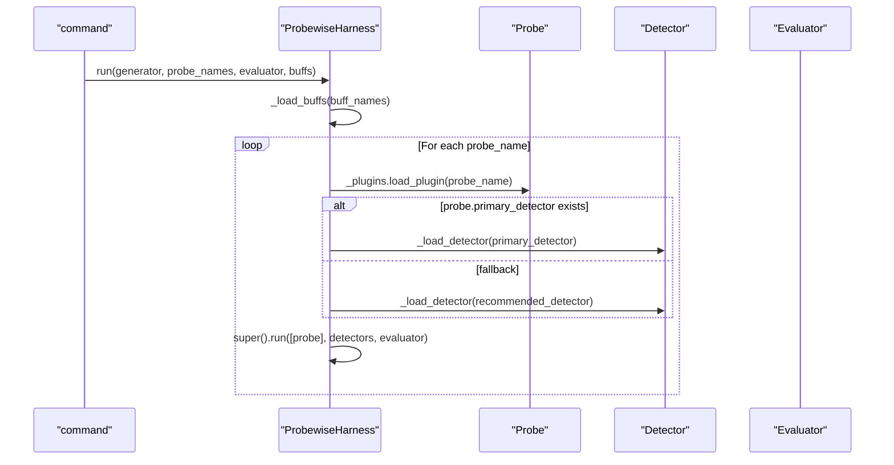
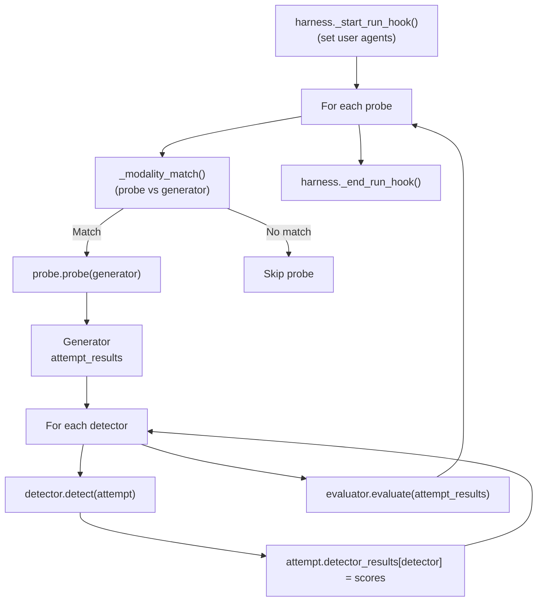
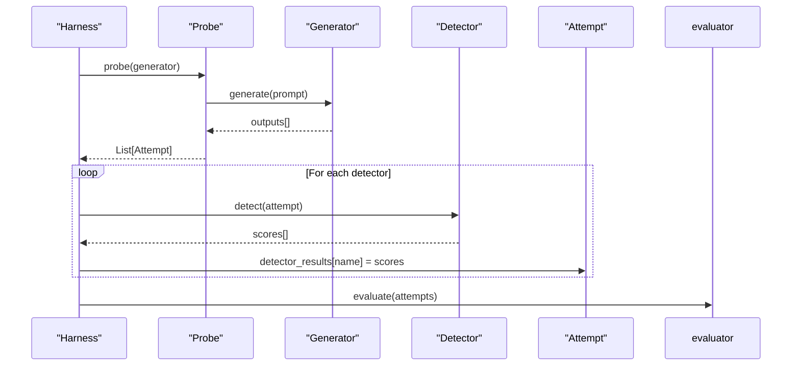
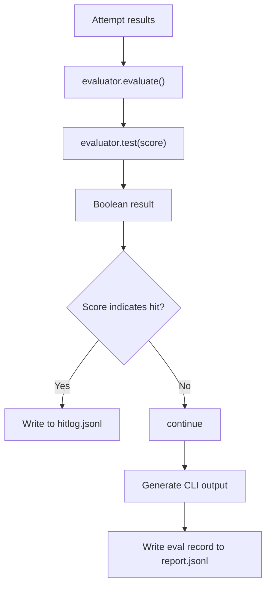
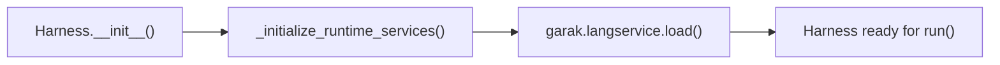
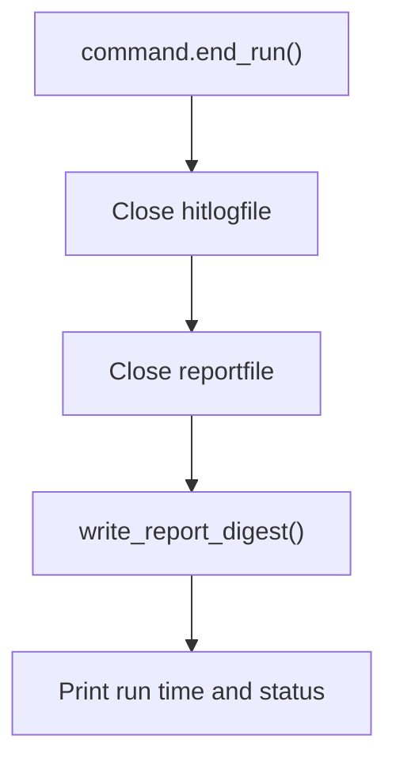

<!-- source: DeepWiki mcp.deepwiki.com · repo NVIDIA/garak · page 2.4 Execution Flow · fetched 2026-10-26 -->

# Execution Flow

Relevant source files

The following files were used as context for generating this wiki page:

- [docs/source/configurable.rst](docs/source/configurable.rst)
- [garak/_config.py](garak/_config.py)
- [garak/analyze/report_digest.py](garak/analyze/report_digest.py)
- [garak/attempt.py](garak/attempt.py)
- [garak/buffs/base.py](garak/buffs/base.py)
- [garak/buffs/low_resource_languages.py](garak/buffs/low_resource_languages.py)
- [garak/cli.py](garak/cli.py)
- [garak/command.py](garak/command.py)
- [garak/evaluators/base.py](garak/evaluators/base.py)
- [garak/harnesses/base.py](garak/harnesses/base.py)
- [garak/harnesses/probewise.py](garak/harnesses/probewise.py)
- [garak/harnesses/pxd.py](garak/harnesses/pxd.py)
- [garak/probes/base.py](garak/probes/base.py)
- [garak/probes/fitd.py](garak/probes/fitd.py)
- [garak/resources/garak.core.yaml](garak/resources/garak.core.yaml)
- [tests/_assets/analyze/test_with_ci.report.jsonl](tests/_assets/analyze/test_with_ci.report.jsonl)
- [tests/analyze/test_aggregate.py](tests/analyze/test_aggregate.py)
- [tests/analyze/test_report_digest_plugin_cache.py](tests/analyze/test_report_digest_plugin_cache.py)
- [tests/cli/test_cli_list_filtering.py](tests/cli/test_cli_list_filtering.py)
- [tests/probes/test_probes_fitd.py](tests/probes/test_probes_fitd.py)
- [tests/test_attempt.py](tests/test_attempt.py)
- [tests/test_config.py](tests/test_config.py)
- [tests/test_internal_structures.py](tests/test_internal_structures.py)

This document describes how a garak scan executes from start to finish, covering the orchestration of CLI processing, configuration loading, plugin management, and the core testing pipeline.

## CLI Entry Point and Command Dispatch

The execution flow begins when garak is invoked from the command line. The `main()` function in `garak.cli` serves as the primary entry point, handling argument parsing and dispatching to appropriate command functions.

**CLI Argument Processing Flow**

The CLI processing distinguishes between CLI-provided arguments and default values to populate the hierarchical configuration system.

Sources: [garak/cli.py:39-65](), [garak/cli.py:59-60](), [garak/cli.py:414-434]()

## Configuration Loading and Validation

Before executing any scan logic, garak loads configuration from multiple sources in precedence order. The `_config` module manages this hierarchy.

Sources: [garak/_config.py:6-31](), [garak/_config.py:249-294](), [garak/cli.py:9-36](), [garak/cli.py:59-60]()

## Plugin Specification Parsing and Loading

When a target is specified, garak parses plugin specifications and loads the required components via the `_plugins` module.

The `_plugins.load_plugin` function handles the instantiation of classes based on string paths.

Sources: [garak/cli.py:553-575](), [garak/command.py:220-238](), [garak/probes/base.py:68-106]()

## Harness Selection and Execution

Based on the detector configuration, garak selects either the `ProbewiseHarness` or `PxD` (Probes x Detectors) harness to orchestrate the testing.

**ProbewiseHarness Execution Flow**
The `ProbewiseHarness` runs probes and uses their internal `primary_detector` or `recommended_detector` suggestions.

Sources: [garak/harnesses/probewise.py:30-107](), [garak/harnesses/base.py:135-182](), [garak/command.py:220-238]()

## Core Testing Pipeline

The base `Harness` class implements the core testing pipeline that executes probes against generators and analyzes results with detectors.

**Detailed Attempt Processing Flow**
The `Attempt` object (defined in `garak.attempt`) is the primary data structure passed through the pipeline.

Sources: [garak/harnesses/base.py:135-199](), [garak/attempt.py:173-220](), [garak/probes/base.py:165-200]()

## Evaluation and Reporting

The `Evaluator` (defined in `garak.evaluators.base`) processes detector results, determines passes/fails, and manages hit logging.

**Output Files Summary**

| File Type | Implementation | Purpose |
|-----------|----------------|---------|
| `*.report.jsonl` | `command.start_run` | Complete scan record including setup and evals. |
| `*.hitlog.jsonl` | `evaluators.base.Evaluator` | Records of specific adversarial hits. |
| `*.html` | `analyze.report_digest` | Human-readable summary generated at run end. |

Sources: [garak/evaluators/base.py:62-141](), [garak/command.py:70-122](), [garak/command.py:142-160](), [garak/analyze/report_digest.py:48-87]()

## Service Initialization

Before probe execution, the harness initializes runtime services like `garak.langservice` to support multilingual features.

Sources: [garak/harnesses/base.py:27-48](), [garak/harnesses/base.py:92-98]()

## Run Completion

At the end of a scan, `command.end_run()` is called to finalize the report, close file handles, and generate the HTML digest summary.

Sources: [garak/command.py:124-160](), [garak/analyze/report_digest.py:90-111]()

---

