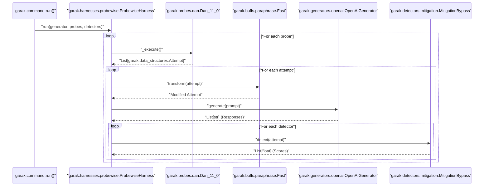
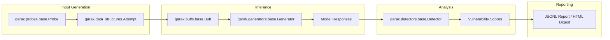

<!-- source: DeepWiki mcp.deepwiki.com · repo NVIDIA/garak · page 3 Components · fetched 2026-10-26 -->

# Components

Relevant source files

The following files were used as context for generating this wiki page:

- [CONTRIBUTING.md](CONTRIBUTING.md)
- [FAQ.md](FAQ.md)
- [README.md](README.md)

This document provides a comprehensive overview of garak's core components and how they work together to perform LLM vulnerability scanning. It covers the major component types that form the foundation of garak's plugin-based architecture: probes, generators, detectors, harnesses, language services, data structures, and payloads.

For detailed information about specific component types, see: [Probes](#3.1), [Generators](#3.2), [Detectors](#3.3), [Harnesses](#3.4), [Language Services](#3.5), [Data Structures](#3.6), and [Payloads](#3.7).

## Core Component Types

Garak's architecture is built around several main component categories, each serving a distinct role in the vulnerability scanning pipeline:

| Component Type | Purpose | Base Class | Examples |
|----------------|---------|------------|----------|
| **Probes** | Generate test prompts to elicit vulnerable behavior | `garak.probes.base.Probe` | `dan.Dan_11_0`, `encoding.InjectBase64` |
| **Generators** | Interface with LLMs and language models | `garak.generators.base.Generator` | `openai.OpenAIGenerator`, `huggingface.Pipeline` |
| **Detectors** | Analyze model outputs for vulnerabilities | `garak.detectors.base.Detector` | `mitigation.MitigationBypass`, `perspective.Toxicity` |
| **Harnesses** | Orchestrate the testing workflow | `garak.harnesses.base.Harness` | `probewise.ProbewiseHarness`, `pxd.PxDHarness` |
| **Language Services** | Manage translations and multilingual support | `garak.resources.language.LanguageService` | `langproviders.LiteLLM` |
| **Buffs** | Transform prompts to increase test coverage | `garak.buffs.base.Buff` | `paraphrase.Fast`, `translation.ChineseEn` |

Sources: [README.md:93-100](), [README.md:112-116](), [FAQ.md:16-19](), [FAQ.md:24-26]()

## Component Interaction Pipeline

The following diagram shows how garak's code entities interact during a typical vulnerability scan. It traces the flow from the high-level orchestration down to the individual model interactions.

**Component Testing Pipeline**

Sources: [README.md:93-100](), [FAQ.md:16-19](), [FAQ.md:24-26]()

## Data Structures and Lifecycle

The communication between components is standardized through core data structures. The `Attempt` object is the primary unit of work, traveling from probes through generators to detectors.

**Data Transformation Pipeline**

Sources: [README.md:130-131](), [FAQ.md:18-19](), [FAQ.md:33-35]()

## Component Categories

### [Probes](#3.1)
Probes are the "attack" modules. They generate specific prompts designed to test for vulnerabilities like jailbreaking, prompt injection, or hallucination. Garak includes specialized probes for various domains, including encoding-based attacks and supply-chain risks.
For details, see [Probes](#3.1).

### [Generators](#3.2)
Generators are wrappers around LLM interfaces. They handle the specifics of communicating with different APIs (OpenAI, Anthropic, Bedrock) or local model loaders (Hugging Face, Llama.cpp, NIM).
For details, see [Generators](#3.2).

### [Detectors](#3.3)
Detectors evaluate the model's responses. They determine if an attempt was "successful" (from an attacker's perspective) by looking for specific keywords, using ML classifiers, or checking for structural failures like XSS or API key leakage.
For details, see [Detectors](#3.3).

### [Harnesses](#3.4)
Harnesses are the orchestrators. They manage the loop of selecting probes, passing prompts to generators, and sending the resulting outputs to detectors for evaluation.
For details, see [Harnesses](#3.4).

### [Language Services](#3.5)
Language services provide the infrastructure for multilingual testing. This includes language detection and translation capabilities, allowing probes written in one language to be executed against models in another.
For details, see [Language Services](#3.5).

### [Data Structures](#3.6)
The core classes like `Attempt`, `Message`, and `Conversation` ensure that state is maintained correctly across the asynchronous and multi-turn interactions inherent in LLM red-teaming.
For details, see [Data Structures](#3.6).

### [Payloads](#3.7)
Payloads are the raw data vectors used by probes. This system manages external data files, such as lists of malicious strings, slurs, or code snippets, that are injected into probe templates.
For details, see [Payloads](#3.7).

Sources: [README.md:5-7](), [README.md:93-100](), [FAQ.md:16-19](), [FAQ.md:48-52]()

---

