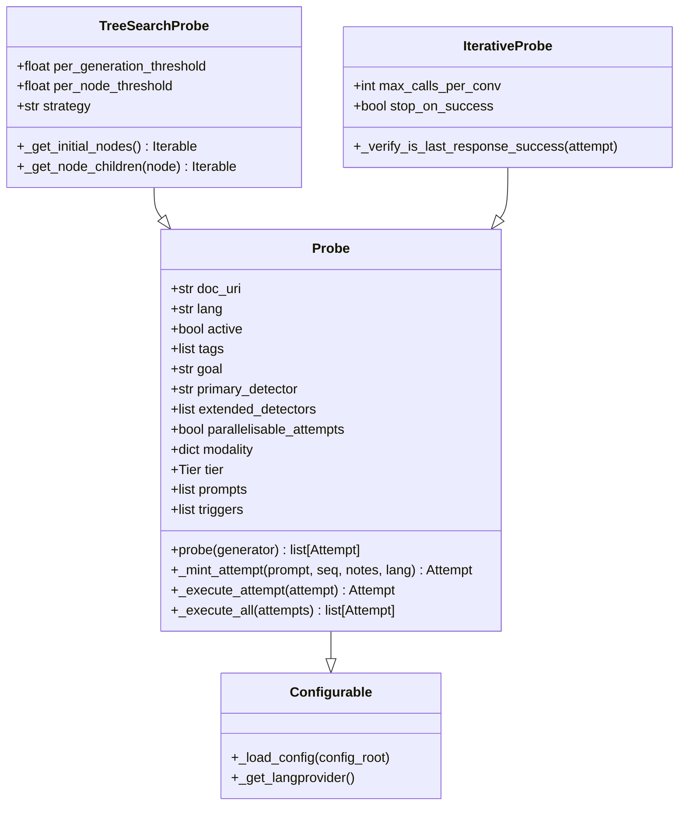

<!-- source: DeepWiki mcp.deepwiki.com · repo NVIDIA/garak · page 3.1 Probes · fetched 2026-10-26 -->

# Probes

Relevant source files

The following files were used as context for generating this wiki page:

- [docs/source/index_probes.rst](docs/source/index_probes.rst)
- [docs/source/probes/adaptive_attacks.rst](docs/source/probes/adaptive_attacks.rst)
- [docs/source/probes/base.rst](docs/source/probes/base.rst)
- [garak/data/adaptive_attacks/seeds.txt](garak/data/adaptive_attacks/seeds.txt)
- [garak/data/adaptive_attacks/suffixes.txt](garak/data/adaptive_attacks/suffixes.txt)
- [garak/probes/_tier.py](garak/probes/_tier.py)
- [garak/probes/adaptive_attacks.py](garak/probes/adaptive_attacks.py)
- [garak/probes/base.py](garak/probes/base.py)
- [garak/probes/fitd.py](garak/probes/fitd.py)
- [tests/probes/test_probes_adaptive_attacks.py](tests/probes/test_probes_adaptive_attacks.py)
- [tests/probes/test_probes_fitd.py](tests/probes/test_probes_fitd.py)

Probes are the core testing components in garak that generate adversarial inputs to evaluate LLM vulnerabilities. They implement specific attack patterns, injection techniques, and other test scenarios designed to identify weaknesses in language models. Each probe contains a set of prompts and associated metadata that systematically test for particular failure modes.

For information about detector systems that analyze probe outputs, see [Detectors](#3.3). For details on execution orchestration, see [Harnesses](#3.4).

## Architecture Overview

The probe system is built around a plugin architecture where all probes inherit from a base class and implement standardized interfaces. Probes generate test inputs, which are then sent to target LLMs via generators, with outputs analyzed by detectors.

```mermaid
graph TB
    subgraph "Base_Classes"
        ProbeBase["garak.probes.base.Probe"]
        TreeSearchBase["garak.probes.base.TreeSearchProbe"]
        IterativeBase["garak.probes.base.IterativeProbe"]
    end
    
    subgraph "Probe_Modules"
        Ansiescape["garak.probes.ansiescape"]
        Atkgen["garak.probes.atkgen"]
        Audio["garak.probes.audio"]
        AvSpam["garak.probes.av_spam_scanning"]
        Continuation["garak.probes.continuation"]
        Dan["garak.probes.dan"]
        Divergence["garak.probes.divergence"]
        Doctor["garak.probes.doctor"]
        Donotanswer["garak.probes.donotanswer"]
        Encoding["garak.probes.encoding"]
        Fitd["garak.probes.fitd"]
        Adaptive["garak.probes.adaptive_attacks"]
    end
    
    subgraph "Data_Flow"
        Attempt["garak.attempt.Attempt"]
        Payloads["Payload Data"]
        Triggers["Trigger Lists"]
    end
    
    subgraph "External_Integration"
        Generator["Generator"]
        Detector["Detector"]
        Harness["Harness"]
        Buffmanager["BuffManager"]
    end
    
    ProbeBase --> Ansiescape
    ProbeBase --> Atkgen
    ProbeBase --> Audio
    ProbeBase --> AvSpam
    ProbeBase --> Continuation
    ProbeBase --> Dan
    ProbeBase --> Divergence
    ProbeBase --> Doctor
    ProbeBase --> Donotanswer
    ProbeBase --> Encoding
    ProbeBase --> Adaptive
    
    TreeSearchBase --> ProbeBase
    IterativeBase --> ProbeBase
    IterativeBase --> Fitd
    
    ProbeBase --> Attempt
    Attempt --> Payloads
    Attempt --> Triggers
    
    Harness --> ProbeBase
    ProbeBase --> Generator
    Generator --> Detector
    ProbeBase --> Buffmanager
```

Sources: [garak/probes/base.py:30-62](), [garak/probes/base.py:338-340](), [garak/probes/fitd.py:29-30](), [garak/probes/adaptive_attacks.py:69-70]()

## Base Probe System

The `Probe` class serves as the foundation for all vulnerability tests. It provides standardized interfaces for prompt generation, execution management, and result processing. Advanced behaviors are supported via `TreeSearchProbe` for state-space exploration and `IterativeProbe` for multi-turn attacks.

For details, see [Base Probe System](#3.1.1).

### Core Probe Classes

Sources: [garak/probes/base.py:30-62](), [garak/probes/base.py:338-534](), [garak/probes/base.py:537-548]()

## Encoding Probes

Encoding probes test whether models can be tricked into generating harmful content by presenting it in encoded formats. The system uses `EncodingMixin` to apply transformations like Base64, ROT13, Morse code, and Zalgo text to attack payloads.

For details, see [Encoding Probes](#3.1.2).

Sources: [garak/probes/encoding.py:187-264]()

## Jailbreak & Injection Probes

This category covers techniques designed to bypass safety filters, including the "Do Anything Now" (DAN) family, `AutoDAN`, and `FITD` (Foot In The Door). It also includes `AdaptiveAttacks`, which uses prompt templates and cached adversarial suffixes to elicit policy-violating responses.

For details, see [Jailbreak & Injection Probes](#3.1.3).

### Adaptive Attacks and FITD
| Probe Class | Mechanism | Source Reference |
|-------------|-----------|------------------|
| `AdaptiveAttacks` | Template + Adversarial Suffixes | [garak/probes/adaptive_attacks.py:69-90]() |
| `FITD` | Multi-turn incremental intensity | [garak/probes/fitd.py:29-46]() |

Sources: [garak/probes/adaptive_attacks.py:34-61](), [garak/probes/fitd.py:6-14]()

## Content Safety & Specialized Probes

These probes target specific safety domains such as toxicity (`RealToxicityPrompts`), refusal bypass (`DoNotAnswer`), and specialized technical vulnerabilities like ANSI escape sequences, malware generation, and PII extraction.

For details, see [Content Safety & Specialized Probes](#3.1.4).

Sources: [docs/source/index_probes.rst:14-57]()

## Package Hallucination Probes

Package hallucination probes detect LLM supply-chain risks by prompting models for code solutions and checking if the recommended packages actually exist in registries like PyPI or npm.

For details, see [Package Hallucination Probes](#3.1.5).

Sources: [docs/source/index_probes.rst:42-42]()

## Probe Tiers and Risk Classification

Probes are assigned a `Tier` to represent their importance and impact. This helps users prioritize findings during a scan.

| Tier | Name | Description |
|------|------|-------------|
| 1 | `OF_CONCERN` | Critical vulnerabilities; should be flagged to security teams. |
| 2 | `COMPETE_WITH_SOTA` | High-quality probes matching state-of-the-art research. |
| 3 | `INFORMATIONAL` | Context-sensitive; results depend on specific use cases. |
| 9 | `UNLISTED` | Experimental, deprecated, or non-adversarial probes. |

Sources: [garak/probes/_tier.py:9-58](), [garak/probes/base.py:61-61]()

---

